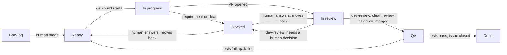

# Move a ticket from Ready to Done

How a GitHub issue moves through the [project board](https://github.com/users/haicanhdieu/projects/4/views/1): which column means what, which label mirrors it, who moves it, and how to start the agent for each step. The steps are **build → review and merge → QA test → done**. Build has the `dev-build` skill and review/merge has `dev-review`. QA is done by people until its skill lands.

**Applies to:** anyone who files, triages, builds, reviews or tests a ticket, and every agent skill that changes a ticket's status. Code rules stay in [git-workflow.md](../conventions/git-workflow.md).

## 1. The flow



## 2. Columns and labels

The board's **Status** field is the source of truth. A `status:*` label mirrors it so you can filter issues without the board (`gh issue list --label status:ready`). Never set one without the other: use [`board.sh`](../../.agent/skills/dev-build/scripts/board.sh), which sets both.

| Status      | Label                | Meaning                                                      | Moved here by             |
| ----------- | -------------------- | ------------------------------------------------------------ | ------------------------- |
| Backlog     | _(none)_             | Filed, not triaged.                                          | whoever files it          |
| Ready       | `status:ready`       | Clear enough to build (see §3).                              | human triage, or QA       |
| In progress | `status:in-progress` | Being built on its own branch.                               | `dev-build`               |
| Blocked     | `status:blocked`     | Waiting on a human answer; the question is the last comment. | `dev-build`, `dev-review` |
| In review   | `status:in-review`   | PR open against `main`.                                      | `dev-build`               |
| QA          | `status:qa`          | PR merged to `main`; waiting for QA.                         | `dev-review`              |
| Done        | _(none)_             | QA passed; issue closed.                                     | QA                        |

Other labels:

| Label              | On    | Meaning                                                                                                                           |
| ------------------ | ----- | --------------------------------------------------------------------------------------------------------------------------------- |
| `bug`              | issue | Something is broken. `dev-build` takes the bug-fix path.                                                                          |
| `enhancement`      | issue | New behavior. `dev-build` takes the feature path.                                                                                 |
| `qa:failed`        | issue | QA found a problem after merge. `dev-build` takes the bug-fix path. Remove it when fixed.                                         |
| `agent-authored`   | PR    | Written by an agent (`dev-build`, or fixes from `dev-review`).                                                                    |
| `review:sensitive` | PR    | Touches a [sensitive path](../conventions/git-workflow.md#sensitive-paths). `dev-review` runs its security review at high effort. |

PRs say `Refs #<n>`, **not** `Closes #<n>`: merging must not close the issue, or it would skip QA. QA closes it.

## 3. Triage: make a ticket Ready

1. Add a type label: `bug` or `enhancement`.
2. Check it is buildable:
   - **Bug:** what you did, what you expected, what happened (error text, screenshot, run id). One sentence each is enough.
   - **Feature:** a task list the agent can follow without guessing: `- [ ]` steps or numbered steps that name the behavior and where it goes, plus how to tell it is done. Or a link to a plan in `docs/superpowers/plans/` that is on `main`. A new screen, flow or module also needs a spec ([git-workflow.md §4](../conventions/git-workflow.md#4-when-a-spec-plan-or-adr-is-required)).
3. Move it:

   ```sh
   bash .agent/skills/dev-build/scripts/board.sh status <n> Ready
   ```

   You should see `#<n> -> Ready (status:ready)`.

## 4. Build: run `dev-build`

In Claude Code, from the repo root:

```text
/dev-build 42                      # a GitHub issue
/dev-build "the runs list shows UTC times; it should use the browser timezone"   # a description
```

A description is first filed as a new issue, so the board tracks it. The skill then:

1. Reads the issue, comments and labels, and decides bug or feature.
2. Stops with a comment (status **Blocked**) if the requirement is unclear.
3. Creates `fix/<n>-<slug>` or `feat/<n>-<slug>` from the latest `origin/main` in its own worktree, and moves the card to **In progress**.
4. Fixes (systematic debugging, then a failing test first) or implements the task list (test-driven).
5. Verifies, pushes, opens a PR to `main`, labels it, and moves the card to **In review**.

If the card is already In progress, In review, QA or Done, `dev-build` stops and tells you; it never takes over someone else's branch.

## 5. Answer a Blocked ticket

1. Read the agent's last comment on the issue. It lists what is missing.
2. Reply in a comment, or edit the issue body (add the task list or repro).
3. Move it back and rerun the skill that blocked:
   - blocked by `dev-build` (comment on the issue): `board.sh status <n> Ready`, then `/dev-build <n>`;
   - blocked by `dev-review` (comment on the PR): `board.sh status <n> "In review"`, then `/dev-review <pr>`.

## 6. Review and merge: run `dev-review`

In Claude Code, from the repo root:

```text
/dev-review 57        # a PR number or URL
/dev-review #42       # an issue: reviews its open PR
```

The skill:

1. Rebases the PR on the latest `main` in its own worktree and resolves conflicts (or blocks if the two sides need a product decision).
2. Reviews the diff with four agents in parallel: **code quality** (against [docs/conventions/](../conventions/README.md)), **architecture**, **performance** and **security**. Each finding gets a severity:

   | Severity | Means                                                                                       | Before merge      |
   | -------- | ------------------------------------------------------------------------------------------- | ----------------- |
   | critical | Security or tenancy hole, wrong architecture, data loss, damaging performance, broken build | fixed             |
   | high     | Wrong behavior, missing test, a MUST broken, a perf problem at modest scale                 | fixed             |
   | medium   | A SHOULD broken, missing edge case or UI state, maintenance cost                            | fixed             |
   | low      | Nice to have                                                                                | listed, not fixed |

   Full rubric: [severity.md](../../.agent/skills/dev-review/severity.md). Findings are posted as one comment on the PR per round.

3. Sends agents to fix every critical, high and medium finding, then re-reviews all four dimensions. At most 3 rounds.
4. Waits for CI and fixes failures this PR caused (at most 3 tries). A failure the PR didn't cause (it fails on `main` too, infra, a flaky test) blocks instead of being re-run.
5. Squash-merges: with `--auto` if `main` has required status checks, otherwise after it has watched every check go green itself.
6. Moves the issue to **QA** (reopening it if the merge closed it) and comments.

It stops at **Blocked** when it needs a human: a conflict that needs a product decision, findings still open after round 3, or CI broken by something outside the PR. PRs that change agent rules or CI (`AGENTS.md`, `.claude/`, `.agent/skills/`, `.github/workflows/`) get reviewed and fixed, then wait at **In review** for a human to merge ([git-workflow.md §7](../conventions/git-workflow.md#7-rules-for-ai-agent-authored-changes) rule 7).

To review by hand instead, use [code-review-checklist.md](../conventions/code-review-checklist.md), merge per [git-workflow.md §5](../conventions/git-workflow.md#5-merge-policy), and run `board.sh status <n> QA`.

## 7. QA test _(manual until the qa-test skill lands)_

1. Test the change on QA (or locally with `devbox run e2e-local`).
2. **Pass:** close the issue with a comment saying what you tested, then `board.sh status <n> Done`.
3. **Fail:** comment what failed (steps, expected, actual), add `qa:failed`, and move it to **Ready**. `dev-build` will take it as a bug fix on a new branch.

## Troubleshooting

| Symptom                                                            | Fix                                                                                                                                                                                            |
| ------------------------------------------------------------------ | ---------------------------------------------------------------------------------------------------------------------------------------------------------------------------------------------- |
| `board.sh` or `gh pr create` fails with 403 / not found            | The active `gh` account can't write to the repo or project. Pass a token for one that can, per command: `GH_TOKEN=$(gh auth token --user <login>) bash …`. Don't `gh auth switch`.             |
| `board has no Status option '…'`                                   | Spelling is exact and case-sensitive: `Backlog`, `Ready`, `In progress`, `Blocked`, `In review`, `QA`, `Done`.                                                                                 |
| Card and label disagree                                            | Someone changed one by hand. Rerun `board.sh status <n> "<Status>"` with the right column; it fixes both.                                                                                      |
| Issue closed when the PR merged, skipping QA                       | The PR body used `Closes`/`Fixes #<n>`. Reopen the issue and move it to **QA**. Use `Refs #<n>` next time.                                                                                     |
| `dev-build` says "already in progress" but nobody is on it         | A run died. Check for an open PR or a pushed branch for the issue; if none, move the card to **Ready** and run again.                                                                          |
| `dev-review` merged before CI finished                             | `main` has no required status checks, and auto-merge was used anyway. Make `gate / ci-passed` required in branch protection ([git-workflow.md §6](../conventions/git-workflow.md#6-ci-gates)). |
| `dev-review` can't create its worktree: branch already checked out | `dev-build`'s worktree still holds it. The skill reuses it if it is clean; otherwise `git worktree remove <path>` after checking nothing is unpushed.                                          |
| Wrong project board                                                | `board.sh` defaults to project 4 of the repo owner. Set `BOARD_OWNER` / `BOARD_NUMBER` to point elsewhere.                                                                                     |
