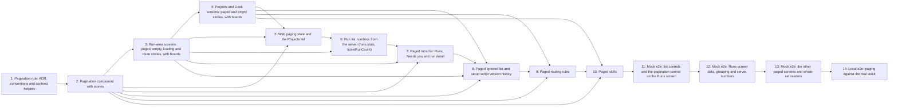

<!-- dev-plan: kind=plan id=shared-pagination rev=1 hash=dab04177728c spec=docs/superpowers/specs/2026-11-19-shared-pagination-design.md spec-hash=78d0477e708c -->
# Shared pagination for every data list Implementation Plan

> **For agentic workers:** REQUIRED SUB-SKILL: Use superpowers:subagent-driven-development (recommended) or superpowers:executing-plans to implement this plan task-by-task. Steps use checkbox (`- [ ]`) syntax for tracking.

**Goal:** One offset-pagination rule for the API and the web app, applied to Runs, Needs you, Ignored, Projects, Rules, Skills and setup script version history, with a shared `Pagination` control (numbered pages, jump to page, a remembered page size of 20/50/100) and the Run list's counts served by the server instead of a 1000-run background load.

**Architecture:** The rule lands first as an ADR plus convention edits, together with framework-free helpers in `packages/contracts/src/schemas/page.ts` (`PageQuery`, `pageOf`, `pageWindow`, `toPage`, `slicePage`, `pageRange`). Storybook comes next (the spec makes it a blocker): the `Pagination` component, then every screen's paged, empty, loading and error stories with the 20 new boards registered. After that, each list moves as one slice (contract, API, web route, MSW, tests), because the response shape changes and the web app is the only client. The Run list first gets `runs.stats` and `ticketRunCount`, then moves `runs.list` to offset pages. Mock and local e2e come last.

**Tech Stack:** TypeScript (strict), Zod 4, Drizzle + Postgres, NestJS/Fastify, React 19, TanStack Router + Query, MSW, Storybook, Vitest, Playwright.

**Spec:** `docs/superpowers/specs/2026-11-19-shared-pagination-design.md` (rev 2). Read it alongside this plan. Its "E2E requirements" section holds the BR/TC tables that the e2e tasks cite.

**Shape (the human's instruction):** the tasks form one sequential chain. Each task depends on the one before it, and each is a reviewable slice of roughly 300–500 lines.

## Global Constraints

- AGENTS.md rules 1–11 apply to every task: contracts first; layering `apps → core → db → contracts` and `web → contracts` only; provider-agnostic names; `withOrg` on every query; no secrets in logs; untrusted text never interpolated; authz on every endpoint; no edits to applied migrations; a bug fix starts with a failing test; no network in tests; design tokens, stories and loading/empty/error states; strict TS with Zod at boundaries.
- No new dependency, and no migration. Zod, Drizzle, TanStack Router and Query, the existing `ds` components and `localStorage` cover everything.
- Query: `page` is an integer ≥ 1, default 1, at most 2147483647. `pageSize` is an integer 1–100, default 20.
- Response envelope: `{ items: T[], page: number, pageSize: number, total: number }`. `total` counts every row that matches the route's filters. The client derives the page count as `ceil(total / pageSize)`.
- A `page` past the last page returns 200 with `items: []` and the real `total`, never a 4xx. The client then moves to the last page.
- Every paged query has a fixed `ORDER BY` that ends in a unique column. `total` comes from a `count(*)` with the same `WHERE`, run in the same `withOrg` transaction (not a window function).
- Orders: runs `queued_at desc, id asc`; ignored `received_at desc, id asc`; projects `created_at asc, id asc`; rules `created_at asc, id asc`; skills `name asc` (paged in memory with `slicePage`); setup versions `version desc`.
- Readers that need the whole set read page 1 with `pageSize=100` in one request: the project switcher menu, the Needs you page's project list, the Rules page's skill picker, the Skills page's rule references, the setup flow's "already exists" checks, and run detail's runs of the same ticket.
- Web: the page lives in the URL as `?page=N` (page 1 leaves it out; a missing or invalid value means 1). The page size comes from `usePageSize()`, stored under `agentdesk.pageSize`; only 20, 50 and 100 are allowed, and anything else means 20. Changing the page size, the filter, the ticket filter or the grouped toggle returns to page 1.
- `Pagination` copy: "Showing <first>–<last> of <total>" (en dash, thousands grouped); buttons "Previous", "Next", "Page N" (`aria-current="page"` on the current one, "…" `aria-hidden`); "Go to page" (`inputmode="numeric"`) with a "Go" button; "Rows per page" with 20, 50, 100. The control is hidden when `total` ≤ 20.
- Compact widths, from the control's own container (container queries): under 1070px hide labels and the Previous/Next words; under 790px drop "Showing" and use the narrow page set `1 … 25 … 50`; under 590px hide the range and use smaller controls; under 360px show only the current page; wrap only at 240px or below. The sizes come from `design/prototype/project/Pagination.dc.html`, mapped to existing tokens.
- Each screen keeps its current layout, columns and copy. Only the control under the list and the server-fed numbers are new.
- **Storybook first (a blocker from the spec, not an ordering preference):** Tasks 2–4 add the `Pagination` component, every screen story and the 20 boards before any task that wires the UI in `apps/web/src/{app,features}` (Tasks 5–10). Each of those tasks lists the Storybook tasks it needs under "Depends on".
- Task 1 changes agent rules (ADR and convention docs), so its PR waits for a human.
- Not sensitive (the spec says so): no migration, no change to `withOrg`/RLS, auth, webhooks, secrets, the terminal or the run Job. Existing list queries keep their org/project scope and authz.
- Before every commit, run `devbox run fix` until it prints `fix: clean.`. Use Conventional Commits with the package as scope.

## Review Focus

1. **The last row on the last page is deleted** (for example, the only routing rule on page 2). A person expects to land on page 1 with its rows, not on an empty page showing "No routing rules yet" while rules exist. Tests: Task 5 (`useClampToLastPage`) and Task 9 (delete on the last page).
2. **A hand-typed page beyond the API's maximum** (`?page=99999999999`). A person expects page 1, not a 400 route error. Test: Task 5 (`PageSearch`).
3. **A live status change moves a run out of the shown filter** (on the Queued chip, a queued run starts). A person expects the page to refill and the range total to drop by one, not a short page with a stale total. Test: Task 7 (`applyRunStatus`).
4. **The page size changes on a deep page while storage is blocked** (page 40 at 20 rows, then pick 100 in a private window). A person expects page 1 at 100 rows on every list for this visit, and 20 again on the next visit. Test: Task 5 (`usePageSize`).
5. **A rule toggled on page 2 while page 1 is cached.** A person expects only that rule to flip in every cached copy (its page and the whole-set read), with no other row reverted. Test: Task 9 (`useToggleRule`).

## Needs approval

None.

## Agent calls made while planning

- Agent call: the ADR keeps the spec's number 0026. If 0026 is taken when Task 1 lands (the agent-model-routing plan also plans a 0026), use the next free number and update the convention links to match, so two ADRs never share a number.
- Agent call: `PAGE_SIZE_OPTIONS = [20, 50, 100]` lives in `apps/web/src/components/Pagination.tsx`, not contracts, because the API accepts 1–100 and only the web chooser is limited to three sizes.
- Agent call: the web loads a page the same way on every screen. The route loader awaits the page on first entry (`cause !== 'stay'`), so first load and failure use the existing route skeleton and route error. Between pages the loader only prefetches, and the screen keeps the shown page through `usePagedQuery` (`useDeferredValue` over the query params). The spec leaves this mechanism to the builder; one shared hook keeps all seven lists consistent.
- Agent call: `Pagination` renders the wide and the narrow page sets as two lists and shows one through the container query, because the page buttons cannot be computed from a CSS width. The hidden list is `display: none`, so screen readers never hear two "Page 25" buttons.
- Agent call: the wide page set follows the spec's rule literally (first, last, and current ± 1). A gap of a single page still shows "…" (page 4 of 50 is `1 … 3 4 5 … 50`), because the spec does not make an exception.
- Agent call: "Go to page" accepts only an optional leading `-` and digits, so `-3` can be typed (TC-8.5) while letters cannot (TC-8.7). The box clears after a jump.
- Agent call: the two route boards (`RouteLoading`, `RouteError`) need presentational parts. `RoutePending`'s skeleton and `LoaderErrorBanner`'s banner move into `components/RouteStates.tsx` (`RouteSkeleton`, `RouteLoadError`), and `app/boundaries.tsx` renders them. Screens and stories cannot import the router (frontend.md §1).
- Agent call: the `Pagination` board maps to the `Components/Pagination` story `Board`. `src/test/coverage.test.ts` looks for board stories in `screens/*.stories.tsx` plus `components/Pagination.stories.tsx`; its screens-layout check keeps its screens-only glob. The board shows a component, not a screen.
- Agent call: three new boards reuse stories that already show their exact content: `RunsProblemsEmpty` and `DeskSetupVersionsError` (same export names) and `NeedsYouEmpty` (export `NeedsYouNone`). Each moves from `stateStories` to `boardStories`.
- Agent call: canvas.json places the 20 new boards in a new "Pagination" section (`notes['t-paging']`) below the Desk row. Each board is 1440 wide and as tall as its base screen's board (Runs 1000, RunsProblems 960, NeedsYou 740, Projects and Desk 900). The `Pagination` board's height is its document height at 1440 wide, measured once with Playwright.
- Agent call: `DeskSkills` gets an `active?: Skill` prop, so the editor keeps the selected skill when the list moves to a page that does not hold it (TC-30.2). The route opens `?skill=` when that name is on the page or in the whole-set read.
- Agent call: Desk Rules opens `?rule=<id>` from the current page, or else from the whole-set rules read (page 1, size 100), so a link to a rule on another page still opens its editor (TC-29.4). Whether the list should jump to that rule's page is spec Q1 and stays open.
- Agent call: a run that leaves its list's filter through a live status change is patched in place, and that cached page is invalidated rather than shortened, because offset pages shift and the total changes.
- Agent call: run status changes (live events and the cancel/finish/resume mutations) invalidate `runsQueries.stats`, so chip counts and the banner stay current. `ProjectDto.counts` patching is unchanged.
- Agent call: list items share one type for both shapes. The web helpers that take a run from either a list or the detail (`withPendingNote`, `toRunSummary`, `cachedRun`, the detail mappers) take `RunCore = Omit<RunListItem, 'ticketRunCount'>`, because `RunDto` does not gain `ticketRunCount`.
- Agent call: query keys put the page last. Runs: `[...runsKey, 'list', filter, ticket ?? null, page, pageSize]`. Projects: `['org', org, 'projects', 'list', page, pageSize]`. Desk: `[...deskKey, 'skills' | 'rules', page, pageSize]`. Setup: `[...setupKey, 'versions', page, pageSize]`. Every invalidation uses the prefix without the page, which covers every cached page.
- Agent call: the Desk setup version history reads with `useQuery` and `placeholderData: keepPreviousData` rather than `usePagedQuery`, because that history already has its own inline loading, error and empty states (not route-level ones).
- Agent call: the "Today" line keeps its current copy: "Today: 9 runs, 1 failed", or "Today: 0 runs" with no failed part when none failed. The spec keeps current copy, so TC-24.3 and TC-24.4 assert "Today: 0 runs" and "Today: 1 run".
- Agent call: mock e2e pick list sizes, held responses and failures through a session-storage key, `agentdesk.mock.lists`, which `startMockWorker` reads, like the existing `agentdesk.mock.auth` key. MSW answers inside the service worker, where Playwright routing cannot reach.
- Agent call: the local e2e helpers (`ok`, `signInAndCreateProject`, `commentOnNewTicket`) come from `apps/web/e2e/local/helpers.ts`. If that file does not exist yet (the agent-model-routing plan creates it), Task 14 moves the helpers there out of `run.spec.ts`.
- Agent call: TC-20.3, TC-37.1 and TC-37.3 (more than 20 projects in a local org) are proven in `apps/api/test/projects.int.test.ts`, the lowest layer that can prove them. The fake provider exposes one repo (`dev/demo`), and a connection holds one project per repo, so a local org cannot hold 26 projects without new scope.
- Agent call: TC-34.x are written against the setup flow's real checks. Step 4 skips a template already in the repo, and step 5 skips a rule command that already exists. Both are tested with the existing item placed beyond the first 20, and the expected result is that the step finishes with no error and no duplicate. The flow has no "already exists" message to assert.
- Agent call: there is no ticket filter text box in the app; the ticket filter is the `?ticket=` search param. TC-15.3 becomes a route test: every href that changes `ticket` or the filter carries no `page`. See OPEN.
- Agent call: TC-20.5 runs against the fake repo, which is shared by every org on the machine. It adds 22 skills with a random prefix and asserts their relative A-to-Z order and that each appears exactly once, not an exact total.

---

<!-- dev-plan:graph:begin -->
## Task graph

Generated by `dev-plan.mjs graph --write` from each task's **Depends on:** line. Do not edit it by hand.
Tasks in the same wave touch no common file and can be built in parallel; a task starts when everything it depends on is merged.

| Wave | Task | Depends on |
| ---- | ---- | ---------- |
| 1 | Task 1: Pagination rule: ADR, conventions and contract helpers | none |
| 2 | Task 2: Pagination component with stories | Task 1 |
| 3 | Task 3: Run-area screens: paged, empty, loading and route stories, with boards | Task 2 |
| 4 | Task 4: Projects and Desk screens: paged and empty stories, with boards | Task 3 |
| 5 | Task 5: Web paging state and the Projects list | Task 2, Task 3, Task 4 |
| 6 | Task 6: Run list numbers from the server (runs.stats, ticketRunCount) | Task 3, Task 5 |
| 7 | Task 7: Paged runs.list: Runs, Needs you and run detail | Task 2, Task 3, Task 6 |
| 8 | Task 8: Paged Ignored list and setup script version history | Task 2, Task 3, Task 4, Task 7 |
| 9 | Task 9: Paged routing rules | Task 2, Task 4, Task 8 |
| 10 | Task 10: Paged skills | Task 2, Task 4, Task 9 |
| 11 | Task 11: Mock e2e: list controls and the pagination control on the Runs screen | Task 10 |
| 12 | Task 12: Mock e2e: Runs screen data, grouping and server numbers | Task 11 |
| 13 | Task 13: Mock e2e: the other paged screens and whole-set readers | Task 12 |
| 14 | Task 14: Local e2e: paging against the real stack | Task 13 |


<!-- dev-plan:graph:end -->

### Task 1: Pagination rule: ADR, conventions and contract helpers

**Depends on:** none

**Files:**

- Create: `docs/adr/0026-offset-pagination-for-data-lists.md`
- Modify: `docs/adr/README.md`
- Modify: `docs/conventions/backend.md`
- Modify: `docs/conventions/database.md`
- Modify: `docs/conventions/frontend.md`
- Create: `packages/contracts/src/schemas/page.ts`
- Create: `packages/contracts/src/schemas/page.test.ts`
- Modify: `packages/contracts/src/index.ts`

**Interfaces:**

- Consumes: nothing.
- Produces (exported from `@agentdesk/contracts`):

```ts
export const PAGE_MAX = 2147483647;
export const PAGE_SIZE_DEFAULT = 20;
export const PAGE_SIZE_MAX = 100;
/** Coerced from the query string. Route queries extend it (`PageQuery.extend({ filter, ticket })`). */
export const PageQuery: z.ZodObject<{ page: z.ZodDefault<...>; pageSize: z.ZodDefault<...> }>;
export type PageQuery = z.infer<typeof PageQuery>; // { page: number; pageSize: number }
export interface Page<T> { items: T[]; page: number; pageSize: number; total: number }
/** Envelope schema: items array of `item`, page int ≥ 1, pageSize int ≥ 1, total int ≥ 0. */
export function pageOf<T extends z.ZodType>(item: T): z.ZodObject<{ items: z.ZodArray<T>; page: z.ZodNumber; pageSize: z.ZodNumber; total: z.ZodNumber }>;
export function pageWindow(q: PageQuery): { limit: number; offset: number }; // limit = pageSize, offset = (page - 1) * pageSize
export function toPage<T>(items: T[], total: number, q: PageQuery): Page<T>;
/** Pages an in-memory list (already in its fixed order). */
export function slicePage<T>(all: readonly T[], q: PageQuery): Page<T>;
/** first/last row numbers (1-based) and page count; first = last = 0 when total is 0 or page > pageCount. */
export function pageRange(page: number, pageSize: number, total: number): { first: number; last: number; pageCount: number };
```

- [x] **Step 1: Write the failing contract tests** in `page.test.ts`

- `PageQuery.parse({})` → `{ page: 1, pageSize: 20 }`; `PageQuery.parse({ page: '3', pageSize: '50' })` → `{ page: 3, pageSize: 50 }`.
- `PageQuery.safeParse` fails for `page: '0'`, `'-1'`, `'1.5'`, `'abc'`, `'2147483648'`, and for `pageSize: '0'`, `'101'`. It passes for `page: '2147483647'` and `pageSize: '1'` and `'100'`.
- `pageOf(z.object({ id: z.string() }))` parses `{ items: [{ id: 'a' }], page: 1, pageSize: 20, total: 1 }` and rejects `total: -1`, `page: 0`, and a missing `total`.
- `pageWindow({ page: 1, pageSize: 20 })` → `{ limit: 20, offset: 0 }`; `pageWindow({ page: 25, pageSize: 20 })` → `{ limit: 20, offset: 480 }`; `pageWindow({ page: 2147483647, pageSize: 100 })` → offset `214748364600` (a safe integer).
- `toPage(['a'], 21, { page: 2, pageSize: 20 })` → `{ items: ['a'], page: 2, pageSize: 20, total: 21 }`.
- `slicePage` over the letters `a`–`v` (22 items): page 2 size 20 → items `['u', 'v']` and total 22; page 3 → `[]` and total 22; size 100 → all 22.
- `pageRange(25, 20, 1000)` → `{ first: 481, last: 500, pageCount: 50 }`; `(4, 20, 63)` → `{ 61, 63, 4 }`; `(1, 20, 0)` → `{ 0, 0, 0 }`; `(5, 20, 63)` → `{ 0, 0, 4 }`; `(51, 20, 1004)` → `{ 1001, 1004, 51 }`.

- [x] **Step 2: Run them and see them fail**

Run: `pnpm --filter @agentdesk/contracts test -- page`
Expected: FAIL (module `./page` not found).

- [x] **Step 3: Implement `page.ts` and export it from `index.ts`**

`PageQuery` uses `z.coerce.number().int().min(1).max(PAGE_MAX).default(1)` and `z.coerce.number().int().min(1).max(PAGE_SIZE_MAX).default(PAGE_SIZE_DEFAULT)`, matching the other integer params in `routes.ts`. The module has no framework imports.

- [x] **Step 4: Run the contract tests**

Run: `pnpm --filter @agentdesk/contracts test && pnpm --filter @agentdesk/contracts typecheck`
Expected: PASS.

- [x] **Step 5: Write the ADR and convention edits**

- `docs/adr/0026-offset-pagination-for-data-lists.md`, status **Proposed**, date 2026-11-19, source issue #146. Sections: Context (keyset rule today; no total, no jump to page; the 1000-run walk), Decision (offset pages with a total for every data list; the API rule and envelope from Global Constraints; `count(*)` in the same `withOrg` transaction; whole-set readers use page 1 at size 100), Alternatives (keyset with Previous/Next only; load more / infinite scroll, each with its trade-off from the spec's Approaches), Consequences (page drift under concurrent inserts is accepted; deep offsets cost more; no new index because runs and ignored events already have matching ones). Add its row to `docs/adr/README.md`.
- `backend.md` §11: replace the keyset line with: "List endpoints for data lists **MUST** take `page` (integer ≥ 1, default 1, max 2147483647) and `pageSize` (integer 1–100, default 20) through `PageQuery`, and return `pageOf(Item)`: `{ items, page, pageSize, total }`. A page past the end is 200 with `items: []` and the real `total`. _Why: numbered pages and jump to page need a total (ADR 0026)._"
- `database.md` §8: replace the keyset `MUST` with: "**MUST** paginate data lists with `LIMIT`/`OFFSET` from `pageWindow` and a fixed `ORDER BY` that ends in a unique column (`id` or the natural unique key); `total` comes from a `count(*)` with the same `WHERE` in the same `withOrg` transaction, not a window function. Page drift under concurrent inserts is accepted (ADR 0026)." Change the composite-index `SHOULD` to "…in the same column order as the list's `ORDER BY` (e.g. `runs (project_id, queued_at desc, id)`)." Change the checklist item to "No queries in loops; data lists use offset pages (`PageQuery`, `pageOf`) with a fixed order ending in a unique column and a capped `pageSize`."
- `frontend.md` §3: add "A data list **MUST** render the shared `Pagination` component under the list, keep its page in the URL as `?page=N` (page 1 leaves it out), and take its page size from the shared browser preference `usePageSize()` (`agentdesk.pageSize`; 20, 50 or 100)."

- [x] **Step 6: Commit**

```bash
devbox run fix
git add docs/adr docs/conventions packages/contracts/src/schemas/page.ts packages/contracts/src/schemas/page.test.ts packages/contracts/src/index.ts
git commit -m "feat(contracts): offset pagination rule, ADR 0026 and page helpers"
```

The PR changes agent rules (convention docs), so it waits for a human.

---

### Task 2: `Pagination` component with stories

**Depends on:** Task 1

**Files:**

- Create: `apps/web/src/components/Pagination.tsx`
- Create: `apps/web/src/components/Pagination.module.css`
- Create: `apps/web/src/components/Pagination.stories.tsx`
- Create: `apps/web/src/components/Pagination.test.tsx`
- Modify: `apps/web/src/components/index.ts`

**Interfaces:**

- Consumes: nothing from contracts (components cannot import contracts).
- Produces (exported from `@/components`):

```ts
export const PAGE_SIZE_OPTIONS = [20, 50, 100] as const;
export type PageSizeOption = (typeof PAGE_SIZE_OPTIONS)[number];
export interface PaginationProps {
  page: number;
  pageSize: PageSizeOption;
  total: number;
  /** The next page is loading: nav aria-busy, every control disabled. */
  busy?: boolean;
  onPageChange(page: number): void;
  onPageSizeChange(size: PageSizeOption): void;
}
/** Not rendered when total <= PAGE_SIZE_OPTIONS[0]. */
export function Pagination(props: PaginationProps): JSX.Element | null;
/** 'wide': first, last, current ± 1; 'narrow': first, current, last. 'gap' between non-adjacent numbers. */
export function pageItems(page: number, pageCount: number, set: 'wide' | 'narrow'): (number | 'gap')[];
/** 12480 → "12,480" (en-US grouping). */
export function formatCount(n: number): string;
```

- [x] **Step 1: Write the failing tests** in `Pagination.test.tsx`

- `pageItems(1, 50, 'wide')` → `[1, 2, 'gap', 50]`; `(50, 50, 'wide')` → `[1, 'gap', 49, 50]`; `(25, 50, 'wide')` → `[1, 'gap', 24, 25, 26, 'gap', 50]`; `(3, 5, 'wide')` → `[1, 2, 3, 4, 5]`; `(1, 3, 'wide')` → `[1, 2, 3]`; `(4, 50, 'wide')` → `[1, 'gap', 3, 4, 5, 'gap', 50]`; `(1, 1, 'wide')` → `[1]`.
- `pageItems(25, 50, 'narrow')` → `[1, 'gap', 25, 'gap', 50]`; `(1, 50, 'narrow')` → `[1, 'gap', 50]`; `(2, 50, 'narrow')` → `[1, 2, 'gap', 50]`.
- `formatCount(1000)` → `'1,000'`; `formatCount(12480)` → `'12,480'`.
- `it('renders nothing at 20 rows or fewer')`: `total` 0, 15 and 20 render no `navigation`. With `total` 21 there is a `navigation` named "Pagination".
- `it('shows the range and page buttons')`: page 25, size 20, total 1000 → the text "Showing 481–500 of 1,000"; buttons "Page 1", "Page 24", "Page 25", "Page 26", "Page 50"; only "Page 25" has `aria-current="page"`; every "…" has `aria-hidden="true"`.
- `it('disables Previous on page 1 and Next on the last page')`, plus `it('Previous and Next call onPageChange with page ∓ 1')`.
- `it('clicking a page button calls onPageChange with its number')`.
- `it('Go is disabled while the box is empty and clamps the jump')`: typing `80` with 50 pages and clicking Go → `onPageChange(50)`; `0` → `1`; `-3` → `1`; `99999999999999999999` → `50`; pressing Enter in the box with `10` → `onPageChange(10)`; typing `abc` leaves the box empty and Go disabled; the box clears after a jump.
- `it('Rows per page offers exactly 20, 50 and 100')`, plus selecting 50 → `onPageSizeChange(50)`.
- `it('busy marks the nav and disables every control')`: `nav` has `aria-busy="true"`, and every page button, Previous, Next, the "Go to page" box, Go and "Rows per page" are disabled.

- [x] **Step 2: Run them and see them fail**

Run: `pnpm --filter @agentdesk/web test -- Pagination`
Expected: FAIL (module not found).

- [x] **Step 3: Implement `Pagination.tsx` and `Pagination.module.css`**

Build it from `ds` `Button`, `TextInput` and `Select` only, styled with design tokens. Structure: `<nav aria-label="Pagination" aria-busy>` containing a range `<p>` (with "Showing " in its own span), an `<ol>` for the wide set and an `<ol>` for the narrow set, a current-only element for under 360px, a `<form>` for "Go to page" (its `onSubmit` is the Go action, so Enter works), and the labelled "Rows per page" `Select`. The labels and the Previous/Next words sit in spans that become visually hidden (sr-only pattern) under 1070px. Container queries go on the nav (`container-type: inline-size`) at `max-width` 1069px, 789px, 589px and 359px, with wrapping only at 240px or below. Copy the sizes from the board.

- [x] **Step 4: Write `Pagination.stories.tsx`** (title `Components/Pagination`)

Stories: `MiddlePage` (25 of 50), `FirstPage`, `LastPage`, `FewPages` (3 pages), `ManyPages` (312 of 624, total 12,480), `JumpOutOfRange` (the box holds `80`), `Loading` (`busy`) and `Hidden` (total 20). Add `Compact1069`, `Compact789`, `Compact589` and `Compact359`, each the middle page in a container of that width. Add `Board`, which stacks the states at the board's widths in the board's order (this is the export the `Pagination` board maps to in Task 3). Use `parameters: { layout: 'padded' }`, and use no-op callbacks except in `JumpOutOfRange`.

- [ ] **Step 5: Run the tests, typecheck and the stories smoke test (axe)**

Run: `pnpm --filter @agentdesk/web test -- Pagination stories.smoke && pnpm --filter @agentdesk/web typecheck`
Expected: PASS.

- [x] **Step 6: Commit**

```bash
devbox run fix
git add apps/web/src/components/Pagination.tsx apps/web/src/components/Pagination.module.css apps/web/src/components/Pagination.stories.tsx apps/web/src/components/Pagination.test.tsx apps/web/src/components/index.ts
git commit -m "feat(web): shared Pagination component with stories"
```

---

### Task 3: Run-area screens: paged, empty, loading and route stories, with boards

**Depends on:** Task 2

**Files:**

- Create: `apps/web/src/components/RouteStates.tsx`
- Modify: `apps/web/src/components/index.ts`
- Modify: `apps/web/src/app/boundaries.tsx`
- Modify: `apps/web/src/screens/Runs.tsx`
- Modify: `apps/web/src/screens/RunsProblems.tsx`
- Modify: `apps/web/src/screens/NeedsYou.tsx`
- Modify: `apps/web/src/screens/runs.stories.tsx`
- Modify: `apps/web/src/screens/runs.test.tsx`
- Create: `apps/web/src/mocks/paged.ts`
- Modify: `apps/web/src/mocks/index.ts`
- Modify: `apps/web/src/screens/storyIds.ts`
- Modify: `apps/web/scripts/parity.mjs`
- Modify: `design/prototype/project/canvas.json`
- Modify: `apps/web/src/test/coverage.test.ts`

**Interfaces:**

- Consumes: `Pagination`, `PaginationProps` (Task 2).
- Produces:

```ts
// screens (props added; everything else unchanged)
RunsProps.pagination?: PaginationProps;          // rendered directly under the table; table aria-busy={pagination?.busy || undefined}
RunsProblemsProps.pagination?: PaginationProps;  // under the ignored rows; list aria-busy as above
NeedsYouProps.pagination?: PaginationProps;      // under the run cards; list aria-busy as above
// components/RouteStates.tsx
export function RouteSkeleton(): JSX.Element;    // role="status" aria-busy="true" aria-label="Loading" + the two Skeletons RoutePending draws today
export function RouteLoadError(props: { title: string; detail?: string; requestId?: string; onRetry(): void }): JSX.Element; // the Banner LoaderErrorBanner draws today
// mocks/paged.ts (exported from @/mocks)
export function pagedRuns(total: number, opts?: { ticketSize?: number }): RunSummary[];   // newest first, numbers total..1, deterministic
export function pagedIgnored(total: number): IgnoredCommand[];
export function pagedNeedsYou(total: number): { run: RunSummary; href: string; idleAt: string; endsAt: string }[];
export function pagedProjects(total: number): Project[];
export function pagedRules(total: number): Rule[];
export function pagedSkills(total: number): Skill[];
export function pagedVersions(total: number): ScriptVersion[];
```

(`pagedProjects`, `pagedRules`, `pagedSkills` and `pagedVersions` are used by Task 4's stories. They live here so that `mocks/paged.ts` is written once.)

- [ ] **Step 1: Write the failing screen tests** in `runs.test.tsx`

- `it('Runs draws the pagination control under the table and marks the table busy')`: render `Runs` with `pagination={{ page: 4, pageSize: 20, total: 63, busy: true, … }}` → a `navigation` named "Pagination" comes after the table in document order, and the table has `aria-busy="true"`.
- `it('Runs with no runs shows the empty state and no control')`: `groups=[]` and `pagination` total 0 → "No runs match this filter" and no `navigation` named "Pagination".
- `it('RunsProblems draws the control under the ignored rows')` and `it('NeedsYou draws the control under the cards')`.
- `it('RouteSkeleton is a busy status')` and `it('RouteLoadError shows title, request ID and Retry')`.

- [ ] **Step 2: Run them and see them fail**

Run: `pnpm --filter @agentdesk/web test -- runs.test`
Expected: FAIL (`pagination` not rendered; `RouteStates` missing).

- [ ] **Step 3: Implement the screen props and `RouteStates.tsx`**

Make `RoutePending` and `LoaderErrorBanner` in `app/boundaries.tsx` render `RouteSkeleton` and `RouteLoadError`. Their behaviour stays the same: Retry still calls `router.invalidate()` after the query reset.

- [ ] **Step 4: Write the fixtures and stories**

`mocks/paged.ts` builds rows from the existing fixtures' shapes, copying the boards' visible values (ticket titles, rule commands, authors). In `runs.stories.tsx`, add:

- `RunsPaged`: grouped, page 4 of 4, 63 runs; the continued ticket header shows its full "N of max runs"; chips Needs you 1, Active 2, Queued 1, Ended 59, All 63, Ignored 3; "Today: 9 runs, 1 failed"; the needs-you banner; control "Showing 61–63 of 63".
- `RunsFlatPaged`: flat, page 51 of 51, 1,004 runs.
- `RunsPageLoading`: grouped page 4, `busy`.
- `RunsEmpty`: the filter's empty state, no control.
- `RunsProblemsPaged`: page 2 of 2, 27 ignored.
- `NeedsYouPaged`: page 2 of 2, 21 runs.
- `RouteLoading` and `RouteError`: the Runs artboard frame with `RouteSkeleton`, and with `RouteLoadError` ("Internal server error", a request ID, Retry).

Each story uses the existing `artboard(height)` and `viewport(1440, height)`, with heights from the base board (Runs 1000, RunsProblems 960, NeedsYou 740).

- [ ] **Step 5: Register the 11 boards**

The boards are `Pagination`, `RunsPaged`, `RunsFlatPaged`, `RunsPageLoading`, `RunsEmpty`, `RunsProblemsPaged`, `RunsProblemsEmpty`, `NeedsYouPaged`, `NeedsYouEmpty`, `RouteLoading` and `RouteError`.

- In `canvas.json`, add `notes['t-paging']` = `{ x: 0, y: 8920, text: 'Pagination', kind: 'title1', maxW: 12080 }`. Add each board under `boards` (x = column × 1520 in the order above, y = 9160, w 1440, h per the Agent call above, a `title` taken from the board's `<title>`, `expand: 'fill'`) and append it to `order`.
- In `storyIds.ts`, add the boards to `boardStories` in canvas order: `Pagination: { title: 'Components/Pagination', exportName: 'Board' }`, `NeedsYouEmpty: { title: runs, exportName: 'NeedsYouNone' }`, `RunsProblemsEmpty: { title: runs, exportName: 'RunsProblemsEmpty' }`, and the rest with an export name equal to the board name. Remove `RunsProblemsEmpty` and `NeedsYouNone` from `stateStories`. Update the doc comment's board count.
- In `parity.mjs`, add the same 11 name → `[title, export]` pairs to `stories`.
- In `coverage.test.ts`, raise the board count by 11 (34 → 45 on today's main; add 11 to whatever it is when this lands). Look up board stories in `../screens/*.stories.tsx` and `../components/Pagination.stories.tsx` through a second glob; leave the screens-layout test's module count and glob unchanged.

- [ ] **Step 6: Run the tests and typecheck**

Run: `pnpm --filter @agentdesk/web test -- runs.test coverage stories.smoke boundaries shell && pnpm --filter @agentdesk/web typecheck`
Expected: PASS.

- [ ] **Step 7: Check parity by eye**

Run: `pnpm --filter @agentdesk/web build-storybook && node apps/web/scripts/parity.mjs`
Expected: "45 pairs written" (or the new total). Compare `parity-out/<board>.story.png` with `.proto.png` for the 11 new boards and fix differences that are not caused by the app's newer column names (the spec says the app's columns win). Do not commit `parity-out/` or `storybook-static/`.

- [ ] **Step 8: Commit**

```bash
devbox run fix
git add apps/web/src/components/RouteStates.tsx apps/web/src/components/index.ts apps/web/src/app/boundaries.tsx apps/web/src/screens/Runs.tsx apps/web/src/screens/RunsProblems.tsx apps/web/src/screens/NeedsYou.tsx apps/web/src/screens/runs.stories.tsx apps/web/src/screens/runs.test.tsx apps/web/src/mocks/paged.ts apps/web/src/mocks/index.ts apps/web/src/screens/storyIds.ts apps/web/scripts/parity.mjs design/prototype/project/canvas.json apps/web/src/test/coverage.test.ts
git commit -m "feat(web): paged, empty and route stories for the run screens"
```

---

### Task 4: Projects and Desk screens: paged and empty stories, with boards

**Depends on:** Task 3

**Files:**

- Modify: `apps/web/src/screens/Projects.tsx`
- Modify: `apps/web/src/screens/DeskRules.tsx`
- Modify: `apps/web/src/screens/DeskSkills.tsx`
- Modify: `apps/web/src/screens/DeskSetup.tsx`
- Modify: `apps/web/src/screens/entry.stories.tsx`
- Modify: `apps/web/src/screens/desk.stories.tsx`
- Modify: `apps/web/src/screens/entry.test.tsx`
- Modify: `apps/web/src/screens/desk.test.tsx`
- Modify: `apps/web/src/screens/deskSetup.test.tsx`
- Modify: `apps/web/src/screens/storyIds.ts`
- Modify: `apps/web/scripts/parity.mjs`
- Modify: `design/prototype/project/canvas.json`
- Modify: `apps/web/src/test/coverage.test.ts`

**Interfaces:**

- Consumes: `Pagination`, `PaginationProps` (Task 2); `pagedProjects`, `pagedRules`, `pagedSkills`, `pagedVersions` (Task 3).
- Produces:

```ts
ProjectsProps.pagination?: PaginationProps;     // under the table; table aria-busy
DeskRulesProps.pagination?: PaginationProps;    // between the rule list and GuardsCard ("Guards on every rule")
DeskSkillsProps.pagination?: PaginationProps;   // under the skill list in the left column
DeskSkillsProps.active?: Skill;                 // the editor's skill; defaults to skills.find(activeName) ?? skills[0]
DeskSetupProps.versionsTotal?: number;          // header "N versions"; defaults to versions.length
DeskSetupProps.versionsPagination?: PaginationProps; // under VersionHistory; not drawn while versionsLoading or versionsError
```

- [ ] **Step 1: Write the failing screen tests**

- `entry.test.tsx`: `it('Projects draws the control under the table')`.
- `desk.test.tsx`: `it('DeskRules puts the control between the list and Guards on every rule')` (document order: the last rule row, then the "Pagination" nav, then the "Guards on every rule" heading). `it('DeskRules with no rules shows No routing rules yet and no control')`. `it('DeskSkills puts the control under the list and keeps the active skill in the editor when it is not in the list')` (`active` is a skill absent from `skills`, and the editor shows its name). `it('DeskSkills with no skills shows No skills yet and no control')`.
- `deskSetup.test.tsx`: `it('the header counts versionsTotal, not the rows shown')` (`versions` has 3 rows and `versionsTotal` is 23 → "23 versions"). `it('no control while versions load, fail or are empty')` covers the "Loading versions" status with `aria-busy`, the error text "Could not load the version history. Reload to try again.", and "0 versions" with "No versions yet. The first save creates version 1.".

- [ ] **Step 2: Run them and see them fail**

Run: `pnpm --filter @agentdesk/web test -- entry.test desk.test deskSetup.test`
Expected: FAIL.

- [ ] **Step 3: Implement the screen props**

- [ ] **Step 4: Write the stories**

- `entry.stories.tsx`: `ProjectsPaged` (page 2 of 2, 26 projects, "Showing 21–26 of 26").
- `desk.stories.tsx`: `DeskRulesPaged` (page 2 of 2, 24 rules), `DeskRulesEmpty`, `DeskSkillsPaged` (page 2 of 2, 22 skills, editor unchanged), `DeskSkillsEmpty`, `DeskSetupPaged` (page 2 of 2, header "23 versions"), `DeskSetupVersionsLoading` and `DeskSetupVersionsEmpty` (a saved script with "0 versions").
- `DeskSetupVersionsError` already exists.
- Heights are 900, as for the existing Projects and Desk stories.

- [ ] **Step 5: Register the 9 boards**

The boards are `ProjectsPaged`, `DeskRulesPaged`, `DeskRulesEmpty`, `DeskSkillsPaged`, `DeskSkillsEmpty`, `DeskSetupPaged`, `DeskSetupVersionsLoading`, `DeskSetupVersionsError` and `DeskSetupVersionsEmpty`, registered the same way as in Task 3:

- `canvas.json`: a second row at y = 10400 under `t-paging`.
- `storyIds.ts`: `ProjectsPaged` titled `Screens/Entry`; the rest titled `Screens/Desk` with export = board name. Move `DeskSetupVersionsError` from `stateStories` to `boardStories`.
- `parity.mjs`: the same 9 pairs.
- `coverage.test.ts`: count + 9.

- [ ] **Step 6: Run the tests, typecheck and parity**

Run: `pnpm --filter @agentdesk/web test -- entry.test desk.test deskSetup.test coverage stories.smoke && pnpm --filter @agentdesk/web typecheck && pnpm --filter @agentdesk/web build-storybook && node apps/web/scripts/parity.mjs`
Expected: PASS, and "54 pairs written" (or the new total). Check the 9 new pairs by eye.

- [ ] **Step 7: Commit**

```bash
devbox run fix
git add apps/web/src/screens apps/web/scripts/parity.mjs design/prototype/project/canvas.json apps/web/src/test/coverage.test.ts
git commit -m "feat(web): paged and empty stories for Projects and the Desk lists"
```

---

### Task 5: Web paging state and the Projects list

**Depends on:** Task 2, Task 3, Task 4

**Files:**

- Create: `apps/web/src/app/pagination.ts`
- Create: `apps/web/src/app/pagination.test.tsx`
- Modify: `packages/contracts/src/routes.ts`
- Modify: `packages/contracts/src/routes.test.ts`
- Modify: `apps/api/src/projects/projects.controller.ts`
- Modify: `apps/api/src/projects/projects.service.ts`
- Modify: `apps/api/test/projects.int.test.ts`
- Modify: `apps/web/src/features/projects/queries.ts`
- Modify: `apps/web/src/features/projects/menu.ts`
- Modify: `apps/web/src/features/projects/projects.route.test.tsx`
- Modify: `apps/web/src/features/projects/switcher.route.test.tsx`
- Modify: `apps/web/src/app/routes/o.$org.projects.index.tsx`
- Modify: `apps/web/src/app/routes/o.$org.p.$project.needs-you.tsx`
- Modify: `apps/web/src/features/desk/agent.form.ts`
- Modify: `apps/web/src/features/desk/mutations.ts`
- Modify: `apps/web/src/features/setup/mutations.ts`
- Modify: `apps/web/src/mocks/msw/handlers.ts`
- Modify: `apps/web/src/mocks/msw/contract.test.ts`
- Modify: `apps/web/CONTRACT-GAPS.md`

**Interfaces:**

- Consumes: `PageQuery`, `pageOf`, `pageWindow`, `toPage`, `PAGE_MAX`, `PAGE_SIZE_MAX`, `Page` (Task 1); `PAGE_SIZE_OPTIONS`, `PageSizeOption`, `PaginationProps` (Task 2); `ProjectsProps.pagination` (Task 4).
- Produces:

```ts
// contracts: routes.projects.list = { method: 'GET', path: '/api/projects', query: PageQuery, response: pageOf(ProjectDto) }
// apps/web/src/app/pagination.ts
export const PAGE_SIZE_STORAGE_KEY = 'agentdesk.pageSize';
/** Page 1 at the contract maximum: the readers that need the whole set. */
export const WHOLE_SET: PageQuery = { page: 1, pageSize: PAGE_SIZE_MAX };
/** Route search piece: `page` as text; anything but an integer 1..PAGE_MAX becomes undefined (page 1). */
export const PageSearch: z.ZodObject<{ page: z.ZodOptional<z.ZodString> /* .catch(undefined) */ }>;
export function pageOfSearch(search: { page?: string }): number;            // undefined → 1
export function pageToSearch(page: number): string | undefined;            // 1 → undefined, else String(page)
/** Saved size, else the size chosen earlier this visit (storage blocked), else 20. */
export function readPageSize(): PageSizeOption;
export function usePageSize(): [PageSizeOption, (size: PageSizeOption) => void];
/** Loader helper: awaits the page on entry (route skeleton / route error); between pages only prefetches. */
export function loadPage(queryClient: QueryClient, options: FetchQueryOptions, cause: 'enter' | 'stay' | 'preload'): Promise<void>;
/** Shows the page for `params`; while the next params load, keeps the shown page and returns busy: true. Suspends only when nothing is cached. */
export function usePagedQuery<P extends Record<string, unknown>, T>(params: P, build: (p: P) => UseSuspenseQueryOptions<Page<T>>): { data: Page<T>; busy: boolean };
/** When page > ceil(total / pageSize) and total > 0, calls go(lastPage) once (the route replaces the URL). */
export function useClampToLastPage(page: number, pageSize: number, total: number, go: (page: number) => void): void;
/** PaginationProps for a route: page changes and size changes (size → page 1) go through `go`. */
export function usePaginationProps(args: { page: number; total: number; busy: boolean; go(page: number): void }): PaginationProps;
// features/projects/queries.ts
export const projectsListKey: (org: string) => readonly ['org', string, 'projects', 'list'];
projectsQueries.list(org: string, q: PageQuery)   // key [...projectsListKey(org), q.page, q.pageSize]
projectsQueries.all(org: string)                  // list(org, WHOLE_SET)
```

- [ ] **Step 1: Write the failing helper tests** in `pagination.test.tsx`

- `PageSearch.parse({ page: '3' })` → `{ page: '3' }`. `PageSearch.parse` maps each of `{ page: '0' }`, `{ page: '-2' }`, `{ page: '1.5' }`, `{ page: 'abc' }` and `{ page: '99999999999' }` to `{ page: undefined }`. `pageOfSearch({})` → 1; `pageToSearch(1)` → `undefined`; `pageToSearch(4)` → `'4'`.
- `readPageSize()` → 20 when nothing is saved, and also when the saved value is `'33'`, `'abc'` or `'0'`; → 100 when `'100'` is saved.
- `usePageSize`: a set saves the value under `agentdesk.pageSize`. When `localStorage.setItem` and `getItem` throw, a set of 50 makes `readPageSize()` return 50 for this module instance (the same visit), and a fresh module import (`vi.resetModules`, a new visit) returns 20.
- `useClampToLastPage(5, 20, 63, go)` calls `go(4)` once. `(4, 20, 63, go)`, `(3, 20, 0, go)` and `(1, 20, 0, go)` never call `go`.
- `usePaginationProps`: `onPageSizeChange(50)` saves 50 and calls `go(1)`. `onPageChange(3)` calls `go(3)`.
- `usePagedQuery`: rendered with a QueryClient whose fetcher is held open, changing params from page 1 to page 2 keeps page 1's `data` with `busy: true`; releasing the fetch gives page 2's data with `busy: false`.

- [ ] **Step 2: Write the failing API tests** in `projects.int.test.ts`, `describe('projects.list paging')`

- Create 26 projects in org A, using the existing fixture helpers to insert rows (the HTTP create needs a reachable repo). Without a query, `items.length` is 20, `total` is 26, `page` is 1 and `pageSize` is 20.
- `?page=2` returns 6 items, oldest created first, and the union of pages 1 and 2 has every id exactly once.
- With equal `created_at` on all rows, the order is by `id` ascending and stable across two requests.
- `?page=3` → 200, `items: []`, `total: 26`.
- `?page=0`, `?pageSize=0`, `?pageSize=101`, `?page=abc` and `?page=2147483648` → 400.
- Org B has 30 projects, and org A still sees `total: 26` with none of B's ids. An org with 0 projects gets `total: 0, items: []`. This also covers TC-20.3, TC-37.1 and TC-37.3 (Agent call).
- Each response parses with the route's schema (`helpers/contract.ts`).

- [ ] **Step 3: Write the failing web route tests**

- `projects.route.test.tsx`:
  - 26 projects → 20 rows and "Showing 1–20 of 26". Clicking "Page 2" → 6 rows and `?page=2` in the location.
  - Visiting `?page=9` replaces the location with `?page=2`.
  - 20 projects → no "Pagination" nav.
  - Changing "Rows per page" to 50 → 26 rows and no `page` in the location.
  - While page 2's response is held, page 1's rows stay with the table `aria-busy="true"`.
- `switcher.route.test.tsx`: with 26 projects, opening the project menu lists all 26 (a single request with `pageSize=100`). With 101 projects it lists 100.

- [ ] **Step 4: Run them and see them fail**

Run: `pnpm --filter @agentdesk/web test -- pagination projects.route switcher.route && pnpm --filter @agentdesk/api test -- projects`
Expected: FAIL.

- [ ] **Step 5: Implement**

- Contracts: `projects.list` gets `query: PageQuery` and `response: pageOf(ProjectDto)`.
- API: the controller takes `@Query(new ZodPipe(routes.projects.list.query))`. `ProjectsService.list(org, q)` runs, in one `withOrg`, a `count(*)` over `projects` and then the page `orderBy(asc(projects.createdAt), asc(projects.id)).limit(limit).offset(offset)`. `countsFor` runs over the page's ids only. The result goes through `toPage`.
- Web:
  - Implement `app/pagination.ts`. `usePagedQuery` is `useSuspenseQuery` over `useDeferredValue` of the params (memoised on their primitive values), and `busy` is true when the deferred key's hash differs from the current one.
  - Projects route: `validateSearch: PageSearch`; `loaderDeps: ({ search }) => ({ page: pageOfSearch(search) })`; the loader calls `loadPage(queryClient, projectsQueries.list(org, { page, pageSize: readPageSize() }), cause)`. The component uses `usePageSize`, `usePagedQuery`, `useClampToLastPage` and `usePaginationProps`, and its navigation is `navigate({ search: (prev) => ({ ...prev, page: pageToSearch(p) }), replace? })` (replace only for the clamp). Connection queries run only for the shown page's projects. It passes `pagination` to `Projects`.
  - `menu.ts` and the Needs you route's project list use `projectsQueries.all(org)` (`.items`).
  - Every `projectsQueries.list(org).queryKey, exact: true` invalidation in `agent.form.ts`, `desk/mutations.ts` and `setup/mutations.ts` becomes `{ queryKey: projectsListKey(org) }` (keeping `refetchType` where it is set).
- MSW: the `projects.list` handler sorts by `createdAt`, then `id`, and returns `slicePage(rows, query)`. Update `contract.test.ts` for the envelope.
- `CONTRACT-GAPS.md`: add a row "Readers that need the whole set" stating that the project switcher menu and the Needs you project list read page 1 at `pageSize=100` (capped at 100; spec "Readers that need the whole set"). Tasks 7, 9 and 10 add their readers to this row.

- [ ] **Step 6: Run the tests, typecheck, and the existing mock e2e for these screens**

Run: `pnpm --filter @agentdesk/contracts test && pnpm --filter @agentdesk/api test -- projects && pnpm --filter @agentdesk/web test -- pagination projects switcher contract && pnpm typecheck && pnpm --filter @agentdesk/web exec vite build --mode mock && pnpm --filter @agentdesk/web exec playwright test e2e/mock/top-bar-sticky.spec.ts e2e/mock/external-links.spec.ts`
Expected: PASS.

- [ ] **Step 7: Commit**

```bash
devbox run fix
git add packages/contracts/src/routes.ts packages/contracts/src/routes.test.ts apps/api/src/projects apps/api/test/projects.int.test.ts apps/web/src/app/pagination.ts apps/web/src/app/pagination.test.tsx 'apps/web/src/app/routes/o.$org.projects.index.tsx' 'apps/web/src/app/routes/o.$org.p.$project.needs-you.tsx' apps/web/src/features/projects apps/web/src/features/desk/agent.form.ts apps/web/src/features/desk/mutations.ts apps/web/src/features/setup/mutations.ts apps/web/src/mocks/msw apps/web/CONTRACT-GAPS.md
git commit -m "feat(web): shared page state and a paged Projects list"
```

---

### Task 6: Run list numbers from the server (`runs.stats`, `ticketRunCount`)

**Depends on:** Task 3, Task 5

**Files:**

- Modify: `packages/contracts/src/schemas/runs.ts`
- Modify: `packages/contracts/src/schemas/runs.test.ts`
- Modify: `packages/contracts/src/routes.ts`
- Modify: `packages/contracts/src/routes.test.ts`
- Modify: `apps/api/src/runs/runs.controller.ts`
- Modify: `apps/api/src/runs/runs.service.ts`
- Modify: `apps/api/test/runs.int.test.ts`
- Modify: `apps/web/src/features/runs/queries.ts`
- Modify: `apps/web/src/features/runs/map.ts`
- Modify: `apps/web/src/features/runs/map.test.ts`
- Modify: `apps/web/src/features/runs/pending.ts`
- Modify: `apps/web/src/features/runs/detail.map.ts`
- Modify: `apps/web/src/features/runs/applyEvents.ts`
- Modify: `apps/web/src/features/runs/applyEvents.test.ts`
- Modify: `apps/web/src/features/runs/mutations.ts`
- Modify: `apps/web/src/app/routes/o.$org.p.$project.runs.index.tsx`
- Modify: `apps/web/src/features/runs/runs.route.test.tsx`
- Modify: `apps/web/src/mocks/msw/handlers.ts`
- Modify: `apps/web/src/mocks/msw/contract.test.ts`
- Modify: `apps/web/CONTRACT-GAPS.md`

**Interfaces:**

- Consumes: Task 5's helpers; `RunsProps` (Task 3).
- Produces:

```ts
// contracts/schemas/runs.ts
export const RunListItem = RunDto.omit({ prompt: true, finalPrompt: true }).extend({
  /** Runs this ticket has had in the project, all statuses. */
  ticketRunCount: z.number().int().min(1),
});
export const RunStatsQuery = z.object({ since: Timestamp });
export const RunStatsDto = z.object({
  counts: z.object({ needs_you: int, active: int, queued: int, ended: int, all: int, ignored: int }), // int = z.number().int().min(0)
  today: z.object({ total: int, failed: int }),
  idleRun: RunListItem.nullable(),
  nextQueuedNumber: z.number().int().nullable(),
});
export type RunStatsDto = z.infer<typeof RunStatsDto>;
// routes.runs.stats = { method: 'GET', path: '/api/projects/:projectId/runs/stats', params: projectParams, query: RunStatsQuery, response: RunStatsDto }
// web
export type RunCore = Omit<RunListItem, 'ticketRunCount'>;     // features/runs/queries.ts
runsQueries.stats(org: string, projectId: string, since: string) // key [...runsKey, 'stats', since], refetchOnWindowFocus: true
export function startOfLocalDay(now: Date): string;              // map.ts: local midnight as an ISO timestamp
export function todaySummary(today: RunStatsDto['today']): string; // "Today: 9 runs, 1 failed" / "Today: 1 run"
export function ticketRunCounts(items: RunListItem[]): Map<string, number>; // ticketKey → ticketRunCount
```

- [ ] **Step 1: Write the failing API tests** in `runs.int.test.ts`, `describe('runs.stats')`

- Seed a project with these runs: 1 queued (oldest queued number recorded), 1 starting, 1 running, 1 idle, 1 paused, 1 done, 3 succeeded, 2 failed, 1 expired, and 3 `ignored_*` inbound events.
  - Expected counts: `needs_you` 2, `active` 4 (starting, running, idle, done), `queued` 1, `ended` 6, `all` 12, `ignored` 3.
  - The same counts come back as `total` from `runs.list` with each filter (the meanings match).
- `today`: two runs with `queued_at` exactly at `since` and one second after (one of them failed), and one a second before. Expected: `{ total: 2, failed: 1 }`. A `since` with a `+02:00` offset is honoured.
- `idleRun` is the newest idle run by `queued_at`, as a list item with `ticketRunCount`, and `null` when none is idle. `nextQueuedNumber` is the number of the oldest queued run, and `null` when none is queued.
- A missing `since` → 400; `since=yesterday` → 400.
- Another org's project → 404, and its runs never change org A's counts.
- `GET …/runs/stats` is not taken by `runs.byNumber`.
- `ticketRunCount` on `runs.list` items: ticket T has 3 runs (1 ended, 2 queued). With `filter=queued`, each T item carries `ticketRunCount: 3`.

- [ ] **Step 2: Write the failing web tests**

- `map.test.ts`: `todaySummary({ total: 9, failed: 1 })` → `'Today: 9 runs, 1 failed'`; `({ total: 1, failed: 0 })` → `'Today: 1 run'`; `({ total: 0, failed: 0 })` → `'Today: 0 runs'`. `startOfLocalDay(new Date(2026, 10, 19, 15, 4))` equals `new Date(2026, 10, 19).toISOString()`. `groupByTicket` with `ticketRunCounts` gives a group's `runsUsed` the server count even when fewer runs are on the list.
- `runs.route.test.tsx`: the chips read the stats fixture (Needs you 1, Active 2, Queued 1, Ended 59, All 63, Ignored 3) while the run list holds 9 runs. The "Today" line comes from stats. The banner names `idleRun` and its slot note says "Run 63 is waiting" from `nextQueuedNumber`. The Runs route makes no request for `filter=all` unless the All chip is shown, and no `projects.ignored` request unless the Ignored chip is shown.
- `applyEvents.test.ts`: a status change invalidates the cached `stats` query.

- [ ] **Step 3: Run them and see them fail**

Run: `pnpm --filter @agentdesk/api test -- runs && pnpm --filter @agentdesk/web test -- map.test runs.route applyEvents`
Expected: FAIL.

- [ ] **Step 4: Implement**

- Contracts as in Produces. Raise the route count in `routes.test.ts` by 1 and assert `flat['runs.stats']`. In `runs.test.ts`, check that `RunStatsDto` parses a full example and that `RunListItem` requires `ticketRunCount`.
- API (`runs.service.ts`):
  - Extract `statusIn(filter: RunListFilter): SQL | undefined`, shared by `listPage` and `stats`.
  - `stats(org, projectId, since)` runs, in one `withOrg`, one grouped `count(*) filter (where …)` query over `runs` for the five counts and the two `today` numbers, one count over `inboundEvents` (`starts_with(outcome, 'ignored_')`), one `limit 1` query for `idleRun` (`status = 'idle'`, `queued_at desc, id asc`), and one for `nextQueuedNumber` (`status = 'queued'`, `queued_at asc, id desc`).
  - `ticketRunCountsFor(tx, projectId, refs): Promise<Map<string, number>>` is one grouped query (`ticket_ref in (…)`, `group by ticket_ref`). `listItems` and `toListItem` take its count. `RunDto` stays unchanged.
  - The controller declares `stats` before `byNumber`.
- Web:
  - `RunCore` replaces `RunListItem` in the bounds of `withPendingNote`, `toRunSummary`, `cachedRun` and the `detail.map.ts` helpers.
  - Runs route: the loader reads `runsQueries.stats(org, project, startOfLocalDay(new Date()))`, the filtered list, and `runsQueries.ignored` only when `filter === 'ignored'`. The component takes counts, `today`, `idleRun` and `nextQueuedNumber` from stats, and builds groups with `groupByTicket(summaries, dto.maxRunsPerTicket, ticketRunCounts(listed.items))`.
  - Remove the unfiltered `'all'` load, `chipCounts` and `runsPerTicket` (with their tests).
  - `applyRunStatus` and the cancel/finish/resume mutations invalidate `[...runsKey(org, projectId), 'stats']`.
- MSW: a `runs.stats` handler computes the same numbers from the mock store, and the `runs.list` handler adds `ticketRunCount`. Add the stats fixture parse to `contract.test.ts`.
- `CONTRACT-GAPS.md`: remove the `runs.list` "aggregate counts" row as resolved.

- [ ] **Step 5: Run the tests, typecheck, and the existing run e2e**

Run: `pnpm --filter @agentdesk/contracts test && pnpm --filter @agentdesk/api test -- runs && pnpm --filter @agentdesk/web test -- runs map applyEvents realtime detail contract && pnpm typecheck && pnpm --filter @agentdesk/web exec vite build --mode mock && pnpm --filter @agentdesk/web exec playwright test e2e/mock/runs-board.spec.ts e2e/mock/run.spec.ts`
Expected: PASS.

- [ ] **Step 6: Commit**

```bash
devbox run fix
git add packages/contracts/src apps/api/src/runs apps/api/test/runs.int.test.ts apps/web/src/features/runs 'apps/web/src/app/routes/o.$org.p.$project.runs.index.tsx' apps/web/src/mocks/msw apps/web/CONTRACT-GAPS.md
git commit -m "feat(api): runs.stats and ticketRunCount feed the Run list's numbers"
```

---

### Task 7: Paged `runs.list`: Runs, Needs you and run detail

**Depends on:** Task 2, Task 3, Task 6

**Files:**

- Modify: `packages/contracts/src/schemas/runs.ts`
- Modify: `packages/contracts/src/schemas/runs.test.ts`
- Modify: `packages/contracts/src/routes.test.ts`
- Modify: `packages/contracts/src/client/api.test.ts`
- Modify: `apps/api/src/runs/runs.service.ts`
- Modify: `apps/api/test/runs.int.test.ts`
- Modify: `apps/web/src/features/runs/queries.ts`
- Modify: `apps/web/src/features/runs/applyEvents.ts`
- Modify: `apps/web/src/features/runs/applyEvents.test.ts`
- Modify: `apps/web/src/features/runs/mutations.ts`
- Modify: `apps/web/src/features/runs/realtime.test.tsx`
- Modify: `apps/web/src/app/routes/o.$org.p.$project.runs.index.tsx`
- Modify: `apps/web/src/app/routes/o.$org.p.$project.needs-you.tsx`
- Modify: `apps/web/src/app/routes/o.$org.p.$project.runs.$run.tsx`
- Modify: `apps/web/src/features/runs/runs.route.test.tsx`
- Modify: `apps/web/src/features/runs/detail.route.test.tsx`
- Modify: `apps/web/src/mocks/msw/handlers.ts`
- Modify: `apps/web/src/mocks/msw/contract.test.ts`
- Modify: `apps/web/CONTRACT-GAPS.md`

**Interfaces:**

- Consumes: Task 5's helpers; `RunsProps.pagination`, `NeedsYouProps.pagination` (Task 3); `RunListItem`, `runsQueries.stats` (Task 6).
- Produces:

```ts
// contracts
export const RunListQuery = PageQuery.extend({ filter: RunListFilter.optional(), ticket: z.string().optional() }); // cursor and limit removed
export const RunListResponse = pageOf(RunListItem);
// web
export type RunList = Page<CachedRun>;  // `truncated`, RUN_LIST_PAGE_SIZE and RUN_LIST_MAX_PAGES removed
export interface RunListParams { filter: RunListFilter; ticket?: string; page: number; pageSize: number }
runsQueries.list(org: string, projectId: string, p: RunListParams) // key [...runsKey, 'list', p.filter, p.ticket ?? null, p.page, p.pageSize]
```

- [ ] **Step 1: Write the failing API tests** in `runs.int.test.ts`

Replace the three keyset/cursor tests with:

- `it('pages runs: defaults, total, past the end')`: 45 runs → 20 items, `total: 45`; `?page=3` → 5 items; `?page=4` → 200, `items: []`, `total: 45`.
- `it('pages are disjoint and complete with identical queued_at, ordered by id')`: 7 runs at one `queued_at`, `pageSize=2` → 4 pages with every id once, ids ascending.
- `it('rejects page and pageSize out of bounds')`: `page=0`, `pageSize=101`, `pageSize=0`, `page=2147483648` → 400; the old `?limit=1000` → 400.
- `it('total counts the filter and the ticket')`: `filter=ended&ticket=T` totals only T's ended runs.
- `it("another org's runs are never counted")`.

The other `listRuns(...)` calls move to `page`/`pageSize`.

- [ ] **Step 2: Write the failing web tests**

- `runs.route.test.tsx`:
  - 63 runs → 20 rows and "Showing 1–20 of 63". "Page 4" → 3 rows and `?page=4`.
  - `?page=99` replaces the location with `?page=4`. `?page=abc` shows page 1.
  - From `?page=3`, each chip href and the grouped toggle land on page 1, and no filter or ticket href carries `page` (TC-15.3 at this layer).
  - Grouped mode: a ticket whose runs sit at positions 19–21 shows its header on page 1 and again at the top of page 2 with the same "N of max runs".
  - "Rows per page" 50 → 50 rows on page 1.
  - While page 2 is held, page 1's rows stay with the table and nav `aria-busy="true"` and every control disabled.
  - Needs you: 21 needs-you runs → 20 cards; "Page 2" → 1 card, "Showing 21–21 of 21"; the tab badge stays at the project's count.
- `detail.route.test.tsx`: a ticket with 21 runs (and one with 50) lists all of them in the same-ticket section with one `pageSize=100` request.
- `applyEvents.test.ts`:
  - A status change on a row of a cached page patches the row.
  - A row that leaves its page's filter stays patched, and that page's query is invalidated (Review Focus 3).
  - `listScope` reads filter and ticket from the new key shape.

- [ ] **Step 3: Run them and see them fail**

Run: `pnpm --filter @agentdesk/api test -- runs && pnpm --filter @agentdesk/web test -- runs.route detail.route applyEvents realtime`
Expected: FAIL.

- [ ] **Step 4: Implement**

- Contracts as in Produces. `client/api.test.ts` uses `{ filter: 'needs_you', page: 1, pageSize: 20 }` and the envelope.
- API: `listPage` runs `count(*)` with the filter and ticket conditions, then the page `orderBy(desc(runs.queuedAt), asc(runs.id)).limit(limit).offset(offset)`, then `toPage`. Delete `isRealTimestamp`, `Cursor`, `encodeCursor`, `decodeCursor`, `QUEUED_AT_TEXT`, the cursor branch of `list`, and `isPgCode` if nothing else uses it.
- Web:
  - Runs route: `RunsSearch` gains `...PageSearch.shape`, and `loaderDeps` adds `page`. The loader uses `loadPage` for the list (pageSize from `readPageSize()`). The component uses `usePagedQuery`, `useClampToLastPage` and `usePaginationProps`. `filterHref` and `setGrouped` drop `page`. It passes `pagination` to `Runs`.
  - Needs you route: same pattern with `filter: 'needs_you'`.
  - Run detail: `runsQueries.list(org, project, { filter: 'all', ticket: dto.ticket.ref, ...WHOLE_SET })`.
  - `applyEvents.ts`: update `listScope` for the new key and implement the leave-the-filter Agent call.
  - `mutations.ts`: type its `setQueriesData` with `RunList`.
- MSW: the `runs.list` handler filters, sorts by number descending, and returns `slicePage`.
- `CONTRACT-GAPS.md`: add run detail's same-ticket runs to the whole-set row.

- [ ] **Step 5: Run the tests, typecheck, and the existing run e2e (mock, and local with the stack up)**

Run: `pnpm --filter @agentdesk/contracts test && pnpm --filter @agentdesk/api test -- runs && pnpm --filter @agentdesk/web test && pnpm typecheck && pnpm --filter @agentdesk/web exec vite build --mode mock && pnpm --filter @agentdesk/web exec playwright test e2e/mock/runs-board.spec.ts e2e/mock/run.spec.ts e2e/mock/trigger.spec.ts e2e/mock/agent-limits.spec.ts && pnpm --filter @agentdesk/web exec playwright test e2e/local/run.spec.ts`
Expected: PASS. If the stack cannot start, say so in the PR and list `run.spec.ts` as written but not run.

- [ ] **Step 6: Commit**

```bash
devbox run fix
git add packages/contracts/src apps/api/src/runs apps/api/test/runs.int.test.ts apps/web/src/features/runs 'apps/web/src/app/routes/o.$org.p.$project.runs.index.tsx' 'apps/web/src/app/routes/o.$org.p.$project.needs-you.tsx' 'apps/web/src/app/routes/o.$org.p.$project.runs.$run.tsx' apps/web/src/mocks/msw apps/web/CONTRACT-GAPS.md
git commit -m "feat(api): offset pages for runs.list; paged Runs and Needs you"
```

---

### Task 8: Paged Ignored list and setup script version history

**Depends on:** Task 2, Task 3, Task 4, Task 7

**Files:**

- Modify: `packages/contracts/src/routes.ts`
- Modify: `apps/api/src/runs/runs.controller.ts`
- Modify: `apps/api/src/runs/runs.service.ts`
- Modify: `apps/api/test/runs.int.test.ts`
- Modify: `apps/api/src/setup/setup-script.controller.ts`
- Modify: `apps/api/src/setup/setup-script.service.ts`
- Modify: `apps/api/test/setup-script.int.test.ts`
- Modify: `apps/web/src/features/runs/queries.ts`
- Modify: `apps/web/src/app/routes/o.$org.p.$project.runs.index.tsx`
- Modify: `apps/web/src/features/runs/runs.route.test.tsx`
- Modify: `apps/web/src/features/setup-script/queries.ts`
- Modify: `apps/web/src/features/setup-script/mutations.ts`
- Modify: `apps/web/src/app/routes/o.$org.p.$project.desk.setup.tsx`
- Modify: `apps/web/src/features/setup-script/setup.route.test.tsx`
- Modify: `apps/web/src/mocks/msw/handlers.ts`
- Modify: `apps/web/src/mocks/msw/contract.test.ts`

**Interfaces:**

- Consumes: Task 5's helpers; `RunsProblemsProps.pagination` (Task 3); `DeskSetupProps.versionsTotal`, `versionsPagination` (Task 4).
- Produces:

```ts
// routes.projects.ignored: query PageQuery, response pageOf(IgnoredEventDto)   (IGNORED_LIMIT removed)
// routes.setupScript.versions: query PageQuery, response pageOf(SetupScriptVersionDto)
runsQueries.ignored(org: string, projectId: string, q: PageQuery)        // key [...projectKey, 'ignored', q.page, q.pageSize]
export const versionsKey: (org: string, projectId: string) => readonly [...setupKey, 'versions'];
setupQueries.versions(org: string, projectId: string, q: PageQuery)       // key [...versionsKey, q.page, q.pageSize]
```

- [ ] **Step 1: Write the failing API tests**

- `runs.int.test.ts` `describe('ignored list')`: 130 ignored events → 20 items, `total: 130`; `?page=7` → 10 items (no 100 cap); newest received first with `id` ascending on ties; `?page=8` → empty with `total: 130`; bounds → 400; another org's events are not counted. The old "max 100" test goes.
- `setup-script.int.test.ts`: 23 versions → page 1 holds versions 23..4, page 2 holds 3..1, `total: 23`; past the end → empty; bounds → 400; another org's project → 404.

- [ ] **Step 2: Write the failing web tests**

- `runs.route.test.tsx`: Ignored chip with 27 ignored → 20 rows; "Page 2" → 7 rows and "Showing 21–27 of 27"; the chip count is still from stats (27). From page 3 of All, clicking Ignored lands on page 1 of the ignored list. 20 ignored → no control.
- `setup.route.test.tsx`: 23 versions → the header reads "23 versions" and 20 rows; "Page 2" → 3 rows; `?page=5` → `?page=2`; while loading, failing or with 0 versions there is no "Pagination" nav.

- [ ] **Step 3: Run them and see them fail**

Run: `pnpm --filter @agentdesk/api test -- runs setup-script && pnpm --filter @agentdesk/web test -- runs.route setup-script/setup.route`
Expected: FAIL.

- [ ] **Step 4: Implement**

- Contracts as in Produces.
- API: both services run `count(*)` and the page in one `withOrg` and use `toPage`; both controllers take `@Query(new ZodPipe(<route>.query))`. Remove `IGNORED_LIMIT`.
- Web:
  - Runs route on the Ignored chip: `loadPage` plus `usePagedQuery` for `runsQueries.ignored(org, project, { page, pageSize })`, with `pagination` passed to `RunsProblems`.
  - Desk setup route: `validateSearch: PageSearch`. Versions use `useQuery({ ...setupQueries.versions(org, projectId, { page, pageSize }), placeholderData: keepPreviousData })`, with `busy` = `isPlaceholderData`, `versionsTotal` = `data.total`, `versionsPagination` from `usePaginationProps`, and `useClampToLastPage`.
  - `setup-script/mutations.ts` invalidates `versionsKey(org, projectId)`.
- MSW: both handlers return `slicePage` over their fixed order. Update `contract.test.ts`.

- [ ] **Step 5: Run the tests, typecheck, and the existing desk setup e2e**

Run: `pnpm --filter @agentdesk/api test -- runs setup-script && pnpm --filter @agentdesk/web test -- runs setup-script contract && pnpm typecheck && pnpm --filter @agentdesk/web exec vite build --mode mock && pnpm --filter @agentdesk/web exec playwright test e2e/mock/desk-setup.spec.ts e2e/mock/desk-setup-layout.spec.ts e2e/mock/runs-board.spec.ts`
Expected: PASS.

- [ ] **Step 6: Commit**

```bash
devbox run fix
git add packages/contracts/src/routes.ts apps/api/src/runs apps/api/src/setup apps/api/test/runs.int.test.ts apps/api/test/setup-script.int.test.ts apps/web/src/features/runs/queries.ts 'apps/web/src/app/routes/o.$org.p.$project.runs.index.tsx' apps/web/src/features/runs/runs.route.test.tsx apps/web/src/features/setup-script 'apps/web/src/app/routes/o.$org.p.$project.desk.setup.tsx' apps/web/src/mocks/msw
git commit -m "feat(api): paged ignored commands and setup script history"
```

---

### Task 9: Paged routing rules

**Depends on:** Task 2, Task 4, Task 8

**Files:**

- Modify: `packages/contracts/src/routes.ts`
- Modify: `apps/api/src/rules/rules.controller.ts`
- Modify: `apps/api/src/rules/rules.service.ts`
- Modify: `apps/api/test/rules.int.test.ts`
- Modify: `apps/web/src/features/desk/queries.ts`
- Modify: `apps/web/src/features/desk/mutations.ts`
- Modify: `apps/web/src/app/routes/o.$org.p.$project.desk.rules.tsx`
- Modify: `apps/web/src/app/routes/o.$org.p.$project.desk.skills.tsx`
- Modify: `apps/web/src/features/desk/rules.route.test.tsx`
- Modify: `apps/web/src/features/desk/skills.route.test.tsx`
- Modify: `apps/web/src/features/setup/queries.ts`
- Modify: `apps/web/src/features/setup/mutations.ts`
- Modify: `apps/web/src/features/setup/setup.route.test.tsx`
- Modify: `apps/web/src/mocks/msw/handlers.ts`
- Modify: `apps/web/src/mocks/msw/contract.test.ts`
- Modify: `apps/web/CONTRACT-GAPS.md`

**Interfaces:**

- Consumes: Task 5's helpers; `DeskRulesProps.pagination` (Task 4).
- Produces:

```ts
// routes.rules.list: query PageQuery, response pageOf(RuleDto)
export const rulesKey: (org: string, projectId: string) => readonly [...deskKey, 'rules'];
deskQueries.rules(org: string, projectId: string, q: PageQuery)   // key [...rulesKey, q.page, q.pageSize]
deskQueries.allRules(org: string, projectId: string)              // rules(org, projectId, WHOLE_SET)
setupQueries.rules = deskQueries.allRules
```

- [ ] **Step 1: Write the failing API tests** in `rules.int.test.ts`

24 rules → 20 items, `total: 24`, oldest created first with `id` ascending on ties; `?page=2` → 4 items; past the end → empty with the real total; bounds → 400; another org's rules are not counted.

- [ ] **Step 2: Write the failing web tests**

- `rules.route.test.tsx`:
  - 24 rules → 20 rows and "Showing 1–20 of 24", with the control placed before "Guards on every rule". "Page 2" → 4 rows.
  - On page 2, deleting its only remaining rule (23 rules left, page 2 now empty) lands on page 1 (Review Focus 1).
  - Toggling a rule on page 2 flips it in that page's cache and in the whole-set cache; a late failure reverts only that rule (Review Focus 5).
  - `?rule=<id of rule 22>` without `page` opens rule 22's editor (whole-set fallback).
- `skills.route.test.tsx`: with 25 rules, the rule references of the skill being deleted list rules beyond the first 20 (one `pageSize=100` request).
- `setup.route.test.tsx`: step 5 with 21 existing rules where `code-build` was created 21st → "Save rules and finish" creates no duplicate, finishes, and sends no `POST` for `code-build`.

- [ ] **Step 3: Run them and see them fail**

Run: `pnpm --filter @agentdesk/api test -- rules && pnpm --filter @agentdesk/web test -- rules.route skills.route setup/setup.route`
Expected: FAIL.

- [ ] **Step 4: Implement**

- Contracts as in Produces.
- API: `RulesService.list(org, projectId, q)` runs `count(*)` and the page `orderBy(asc(rules.createdAt), asc(rules.id))`; the controller adds the query pipe. Any `stats` the rule DTO carries keep coming from their grouped query over the page's ids.
- Web:
  - Desk Rules route: `RulesSearch` gains `...PageSearch.shape`. The loader uses `loadPage` for the page, plus the skills read it already makes. `editing` is the page's rule or, failing that, `allRules` (loaded only when `?rule=<uuid>` is not on the page). Pass `pagination`. Opening or closing a rule keeps `page` in the search.
  - Desk Skills route: rule references use `allRules`.
  - `useToggleRule`: `setQueriesData({ queryKey: rulesKey(org, projectId) }, page => page && { ...page, items: page.items.map(...) })`, and read the current value from any cached page (`getQueriesData`).
  - `useSaveRule` and `useDeleteRule` invalidate `rulesKey`.
  - `useSaveRulesStep` reads `api.rules.list({ params, query: WHOLE_SET }).items`.
  - `ReadyStep` reads `setupQueries.rules` (now the whole set).
- MSW: the `rules.list` handler sorts by `createdAt`, then `id`, and returns `slicePage`.
- `CONTRACT-GAPS.md`: add the Skills page's rule references and the setup rules check to the whole-set row.

- [ ] **Step 5: Run the tests, typecheck, and the existing rules e2e**

Run: `pnpm --filter @agentdesk/api test -- rules && pnpm --filter @agentdesk/web test -- desk setup contract && pnpm typecheck && pnpm --filter @agentdesk/web exec vite build --mode mock && pnpm --filter @agentdesk/web exec playwright test e2e/mock/rules.spec.ts e2e/mock/rules-layout.spec.ts e2e/mock/setup.spec.ts`
Expected: PASS.

- [ ] **Step 6: Commit**

```bash
devbox run fix
git add packages/contracts/src/routes.ts apps/api/src/rules apps/api/test/rules.int.test.ts apps/web/src/features/desk apps/web/src/features/setup 'apps/web/src/app/routes/o.$org.p.$project.desk.rules.tsx' 'apps/web/src/app/routes/o.$org.p.$project.desk.skills.tsx' apps/web/src/mocks/msw apps/web/CONTRACT-GAPS.md
git commit -m "feat(api): paged routing rules"
```

---

### Task 10: Paged skills

**Depends on:** Task 2, Task 4, Task 9

**Files:**

- Modify: `packages/contracts/src/routes.ts`
- Modify: `apps/api/src/skills/skills.controller.ts`
- Modify: `apps/api/src/skills/skills.service.ts`
- Modify: `apps/api/test/skills.int.test.ts`
- Modify: `apps/web/src/features/desk/queries.ts`
- Modify: `apps/web/src/features/desk/mutations.ts`
- Modify: `apps/web/src/app/routes/o.$org.p.$project.desk.skills.tsx`
- Modify: `apps/web/src/app/routes/o.$org.p.$project.desk.rules.tsx`
- Modify: `apps/web/src/features/desk/skills.route.test.tsx`
- Modify: `apps/web/src/features/desk/rules.route.test.tsx`
- Modify: `apps/web/src/features/setup/queries.ts`
- Modify: `apps/web/src/features/setup/mutations.ts`
- Modify: `apps/web/src/app/routes/o.$org.projects.new.$step.tsx`
- Modify: `apps/web/src/features/setup/setup.route.test.tsx`
- Modify: `apps/web/src/mocks/msw/handlers.ts`
- Modify: `apps/web/src/mocks/msw/contract.test.ts`
- Modify: `apps/web/CONTRACT-GAPS.md`

**Interfaces:**

- Consumes: Task 5's helpers; `DeskSkillsProps.pagination`, `DeskSkillsProps.active` (Task 4); `rulesKey`, `allRules` (Task 9).
- Produces:

```ts
// routes.skills.list: query PageQuery, response pageOf(SkillSummaryDto)   (paged in memory: slicePage after sort by name)
export const skillsKey: (org: string, projectId: string) => readonly [...deskKey, 'skills'];
deskQueries.skills(org: string, projectId: string, q: PageQuery)  // key [...skillsKey, q.page, q.pageSize]
deskQueries.allSkills(org: string, projectId: string)             // skills(org, projectId, WHOLE_SET)
setupQueries.skills = deskQueries.allSkills
```

- [ ] **Step 1: Write the failing API tests** in `skills.int.test.ts`

With the fake code host holding 22 skills in shuffled order: page 1 holds the first 20 names A to Z, page 2 the last 2, `total: 22`; past the end → empty with `total: 22`; bounds → 400; another org's project → 404.

- [ ] **Step 2: Write the failing web tests**

- `skills.route.test.tsx`: 22 skills → 20 in the list with the control under it. "Page 2" → 2 skills, and the editor still shows the skill that was open (`active`). `?skill=<22nd name>` without `page` opens that skill in the editor. `?page=4` → `?page=2`.
- `rules.route.test.tsx`: the skill picker offers 25 of 25 skills (one `pageSize=100` request) and 100 of 101.
- `setup.route.test.tsx`: step 4 with 21 skills sorting before `code-review`, and `code-review` already in the repo → committing the templates sends no `PUT` for `code-review` and the step finishes.

- [ ] **Step 3: Run them and see them fail**

Run: `pnpm --filter @agentdesk/api test -- skills && pnpm --filter @agentdesk/web test -- skills.route rules.route setup/setup.route`
Expected: FAIL.

- [ ] **Step 4: Implement**

- Contracts as in Produces.
- API: `SkillsService.list(org, projectId, q)` returns `slicePage([...await host.listSkills(project)].sort((a, b) => (a.name < b.name ? -1 : a.name > b.name ? 1 : 0)), q)`. Skill names are lowercase slugs, so code-unit order is A to Z.
- Web:
  - Desk Skills route: `SkillsSearch` gains `...PageSearch.shape`. The loader uses `loadPage` for the page. `activeName` is `search.skill` when that name is on the page or in `allSkills`, else the page's first skill. The route passes `active` (the detail-backed skill) and `pagination`.
  - Desk Rules route: the skill picker uses `allSkills`.
  - `useCommitSkill` and `useDeleteSkill` invalidate `skillsKey`.
  - `useSaveSkillsStep` reads `api.skills.list({ params, query: WHOLE_SET }).items`.
  - The `$step` route's `RulesStep` and `ReadyStep` read `setupQueries.skills` (the whole set), and so does its loader.
- MSW: the `skills.list` handler sorts by name and returns `slicePage`.
- `CONTRACT-GAPS.md`: add the Rules page's skill picker and the setup skills check to the whole-set row.

- [ ] **Step 5: Run the tests, typecheck, and the existing desk and setup e2e**

Run: `pnpm --filter @agentdesk/api test -- skills && pnpm --filter @agentdesk/web test && pnpm typecheck && pnpm --filter @agentdesk/web exec vite build --mode mock && pnpm --filter @agentdesk/web exec playwright test e2e/mock/rules.spec.ts e2e/mock/setup.spec.ts e2e/mock/desk-setup.spec.ts`
Expected: PASS.

- [ ] **Step 6: Commit**

```bash
devbox run fix
git add packages/contracts/src/routes.ts apps/api/src/skills apps/api/test/skills.int.test.ts apps/web/src/features/desk apps/web/src/features/setup 'apps/web/src/app/routes/o.$org.p.$project.desk.skills.tsx' 'apps/web/src/app/routes/o.$org.p.$project.desk.rules.tsx' 'apps/web/src/app/routes/o.$org.projects.new.$step.tsx' apps/web/src/mocks/msw apps/web/CONTRACT-GAPS.md
git commit -m "feat(api): paged skills"
```

---

### Task 11: Mock e2e: list controls and the pagination control on the Runs screen

**Depends on:** Task 10

**Files:**

- Create: `apps/web/src/mocks/msw/e2eLists.ts`
- Create: `apps/web/src/mocks/msw/e2eLists.test.ts`
- Modify: `apps/web/src/mocks/msw/browser.ts`
- Modify: `apps/web/src/mocks/msw/db.ts`
- Modify: `apps/web/e2e/mock/mock.ts`
- Create: `apps/web/e2e/mock/pagination-control.spec.ts`

**Interfaces:**

- Consumes: every paged MSW handler (Tasks 5–10).
- Produces:

```ts
// mocks/msw/e2eLists.ts (mock mode only)
export const MOCK_LISTS_KEY = 'agentdesk.mock.lists';
export const MockLists = z.object({
  runs: z.object({
    total: z.number().int().min(0),
    statuses: z.partialRecord(RunStatus, z.number().int().min(0)).optional(), // newest runs take these, the rest succeeded
    today: z.number().int().min(0).optional(),      // newest N queued today, the rest on earlier days
    ticketSize: z.number().int().min(1).optional(), // runs per ticket in consecutive chunks from the newest (default 1)
  }).optional(),
  needsYou: z.number().int().min(0).optional(),     // idle runs added on top of `runs`
  ignored: z.number().int().min(0).optional(),
  projects: z.number().int().min(0).optional(),
  rules: z.number().int().min(0).optional(),
  skills: z.number().int().min(0).optional(),
  versions: z.number().int().min(0).optional(),
  hold: z.array(z.object({ route: z.string(), page: z.number().int().optional(), pageSize: z.number().int().optional(), ms: z.number().int() })).optional(),
  fail: z.array(z.object({ route: z.string(), times: z.number().int().optional() })).optional(), // 500 problem "Internal server error" with a request ID; times omitted = always
});
export type MockLists = z.infer<typeof MockLists>;
/** Replaces the invoicer-api lists (and alice's projects) with generated rows; deterministic. */
export function applyMockLists(lists: MockLists): void;
/** Handlers placed before the route handlers: hold = await ms, then fall through; fail = problem response. */
export function mockListHandlers(lists: MockLists): RequestHandler[];
// e2e/mock/mock.ts
export async function seedLists(page: Page, lists: MockLists): Promise<void>; // addInitScript writing MOCK_LISTS_KEY before the first load
```

- [ ] **Step 1: Write the failing unit tests** in `e2eLists.test.ts`

- `applyMockLists({ runs: { total: 63, statuses: { starting: 1, running: 1, paused: 1, queued: 1 } } })`: the store holds 63 invoicer-api runs, and `runs.stats` answers Needs you 1, Active 2, Queued 1, Ended 59, All 63.
- `ticketSize: 3` puts positions 19–21 on one ticket.
- `projects: 101` → 101 alice projects.
- A `hold` for `runs.list` page 2 delays only page 2.
- `fail` with `times: 3` fails three requests, then lets the handler answer.
- An invalid JSON value under the key is ignored (the seed stays).

- [ ] **Step 2: Implement** `e2eLists.ts`. `browser.ts` reads and parses the key in `startMockWorker` (inside a try, like `loadAuth`), calls `applyMockLists`, and prepends `mockListHandlers` with `worker.use`. `db.ts` gains the store writes `applyMockLists` needs. `mock.ts` gains `seedLists`.

- [ ] **Step 3: Write `pagination-control.spec.ts`**

Each test seeds its own lists and starts at `/o/alice/p/<INVOICER_API>/runs`. Rules and cases:

- **BR-2:** TC-2.1–2.5.
- **BR-3:** TC-3.3–3.5.
- **BR-4:** TC-4.1–4.6.
- **BR-5:** TC-5.1, TC-5.2.
- **BR-6:** TC-6.1–6.5.
- **BR-7:** TC-7.1–7.4.
- **BR-8:** TC-8.1–8.7.
- **BR-9:** TC-9.1–9.5.
- **BR-10:** TC-10.1–10.3.
- **BR-12:** TC-12.1–12.4.
- **BR-13:** TC-13.1.
- **BR-14:** TC-14.1–14.4. For TC-14.5 and TC-14.6, an init script makes `Storage.prototype.getItem` and `setItem` throw for `agentdesk.pageSize`; a new context is a new visit.
- **BR-16:** TC-16.1–16.5, using `hold` for page 2 and for `pageSize=50`.
- **BR-39 to BR-43:** TC-39.1–39.3, TC-40.1–40.2, TC-41.1–41.2, TC-42.1–42.2 and TC-43.1–43.4. Set the control's container width by resizing the viewport so the main column has the stated width, or by setting the nav's parent `style.width` with `locator.evaluate`. "One row" means every child's `boundingBox().y` shares one row band.

- [ ] **Step 4: Run the new unit test and the new spec only**

Run: `pnpm --filter @agentdesk/web test -- e2eLists && pnpm --filter @agentdesk/web exec vite build --mode mock && pnpm --filter @agentdesk/web exec playwright test e2e/mock/pagination-control.spec.ts`
Expected: PASS.

- [ ] **Step 5: Commit**

```bash
devbox run fix
git add apps/web/src/mocks/msw/e2eLists.ts apps/web/src/mocks/msw/e2eLists.test.ts apps/web/src/mocks/msw/browser.ts apps/web/src/mocks/msw/db.ts apps/web/e2e/mock/mock.ts apps/web/e2e/mock/pagination-control.spec.ts
git commit -m "test(web): mock e2e for the pagination control"
```

---

### Task 12: Mock e2e: Runs screen data, grouping and server numbers

**Depends on:** Task 11

**Files:**

- Create: `apps/web/e2e/mock/runs-paging.spec.ts`

**Interfaces:**

- Consumes: `seedLists`, `MockLists` (Task 11).
- Produces: nothing.

- [ ] **Step 1: Write `runs-paging.spec.ts`.** Rules and cases:

- **BR-1:** TC-1.1–1.3.
- **BR-11:** TC-11.1, TC-11.7.
- **BR-15:** TC-15.1, TC-15.2, TC-15.4, TC-15.5. TC-15.3 is covered in Task 7's route test (no ticket text box; see OPEN).
- **BR-17:** TC-17.1, TC-17.3, using `hold` on `runs.list` for the first load.
- **BR-18:** TC-18.1, TC-18.2 (`fail` with `times: 3`, which covers Query's two retries, then Retry succeeds) and TC-18.4 (`fail` always).
- **BR-19:** TC-19.1–19.4.
- **BR-21:** TC-21.1–21.4 (`ticketSize: 3`).
- **BR-22:** TC-22.1 (63 runs with `ticketSize: 7`, so one ticket has 4 runs on page 3 and 3 on page 4, and N = 7 on both pages), TC-22.2 and TC-22.3 (a ticket of 50).
- **BR-23:** TC-23.1–23.4 (statuses `{ starting: 1, running: 1, paused: 1, queued: 1 }` plus `ignored: 3`).
- **BR-24:** TC-24.1–24.3. TC-24.3 asserts "Today: 0 runs" (Agent call).
- **BR-25:** TC-25.1–25.5.
- **BR-36:** TC-36.3, delivering a status change on page 2 through the mock project event stream's existing scripted-run mechanism (`runScript`) for a run on that page.

- [ ] **Step 2: Run the new spec only**

Run: `pnpm --filter @agentdesk/web exec vite build --mode mock && pnpm --filter @agentdesk/web exec playwright test e2e/mock/runs-paging.spec.ts`
Expected: PASS.

- [ ] **Step 3: Commit**

```bash
devbox run fix
git add apps/web/e2e/mock/runs-paging.spec.ts
git commit -m "test(web): mock e2e for paged runs and server-fed numbers"
```

---

### Task 13: Mock e2e: the other paged screens and whole-set readers

**Depends on:** Task 12

**Files:**

- Create: `apps/web/e2e/mock/lists-paging.spec.ts`

**Interfaces:**

- Consumes: `seedLists`, `MockLists` (Task 11).
- Produces: nothing.

- [ ] **Step 1: Write `lists-paging.spec.ts`**, grouped by screen, covering these rules and cases:

- **Projects:** BR-3 TC-3.1, TC-3.2; BR-5 TC-5.3; BR-9 TC-9.6; BR-28 TC-28.1, TC-28.2; BR-18 TC-18.3.
- **Across lists:** BR-1 TC-1.4; BR-13 TC-13.2, TC-13.3; BR-17 TC-17.2.
- **Ignored:** BR-11 TC-11.2; BR-26 TC-26.1–26.4.
- **Needs you:** BR-11 TC-11.3; BR-27 TC-27.1–27.3.
- **Desk Rules:** BR-11 TC-11.4; BR-29 TC-29.1–29.4 (TC-29.4 asserts only what Q1 allows: the editor shows rule 22 and the list has a working control).
- **Desk Skills:** BR-11 TC-11.5; BR-30 TC-30.1–30.4.
- **Setup history:** BR-11 TC-11.6; BR-31 TC-31.1–31.5.
- **Whole-set readers:** BR-32 TC-32.1–32.4; BR-33 TC-33.1–33.4; BR-34 TC-34.4 (step 4 and step 5 skip an existing item beyond the first 20 and finish); BR-35 TC-35.1–35.3.

- [ ] **Step 2: Run the new spec only**

Run: `pnpm --filter @agentdesk/web exec vite build --mode mock && pnpm --filter @agentdesk/web exec playwright test e2e/mock/lists-paging.spec.ts`
Expected: PASS.

- [ ] **Step 3: Commit**

```bash
devbox run fix
git add apps/web/e2e/mock/lists-paging.spec.ts
git commit -m "test(web): mock e2e for paged Projects, Desk lists and whole-set readers"
```

---

### Task 14: Local e2e: paging against the real stack

**Depends on:** Task 13

**Files:**

- Create: `apps/web/e2e/local/pagination.spec.ts`
- Create: `apps/web/e2e/local/helpers.ts` (only when it does not exist yet; see the Agent call)
- Modify: `apps/web/e2e/local/run.spec.ts` (only if this task moves the helpers)

**Interfaces:**

- Consumes: the paged API routes and screens (Tasks 5–10); `ok`, `signInAndCreateProject`, `commentOnNewTicket` from `./helpers`.
- Produces: nothing.

- [ ] **Step 1: Write `pagination.spec.ts`**

Each test signs in as a fresh dev-login user. Projects keep `maxConcurrentRuns: 1` (`PATCH /api/projects/:id`) so most runs stay queued. Runs come from `commentOnNewTicket` on separate tickets. Rules and cases:

- **BR-20:**
  - TC-20.1: 45 runs, then read pages 1–3.
  - TC-20.2: 27 comments whose command no rule matches → ignored, then read Ignored pages 1–2.
  - TC-20.4: 24 rules via `POST /api/projects/:id/rules`.
  - TC-20.5: 22 skills via `PUT /api/projects/:id/skills/<prefix>-<a..v>`; assert relative order and exactly-once (Agent call).
  - TC-20.6: 23 setup versions via `PUT …/setup-script` with `baseVersion`.
  - TC-20.3 is proven in Task 5's API test (Agent call).
- **BR-24:** TC-24.4 (one fresh run → "Today: 1 run").
- **BR-34:** TC-34.1–34.3, run as a custom setup flow:
  - After step 1, add 21 skills with names sorting before `code-review` and make sure `code-review` exists. Step 4 then finishes with no error and `code-review` is not written twice.
  - Create 21 rules and then `code-build`. Step 5 then finishes with no error and no duplicate.
  - A new template name is still added.
- **BR-36:** TC-36.1 (25 runs; a new comment, then wait for "of 26" with the new run first) and TC-36.2 (with concurrency 1, the first queued run starts and its row status changes without a reload).
- **BR-37:** TC-37.2 (a second dev-login user, org B, creates 40 runs; org A with 25 sees "of 25" and All 25). TC-37.1 and TC-37.3 are proven in Task 5's API test (Agent call).
- **BR-38:** TC-38.1–38.3.

- [ ] **Step 2: Run the new spec only, with the stack up**

Run: `devbox run dev-bg` (wait until api and web are Ready in `devbox services ls`), then `pnpm --filter @agentdesk/web exec playwright test e2e/local/pagination.spec.ts`
Expected: PASS. If the stack cannot start (no Docker engine, runner pod), say so in the PR and list this spec as written but not run. Never tick it as passed.

- [ ] **Step 3: Commit**

```bash
devbox run fix
git add apps/web/e2e/local
git commit -m "test(web): local e2e for paged lists against the real stack"
```
