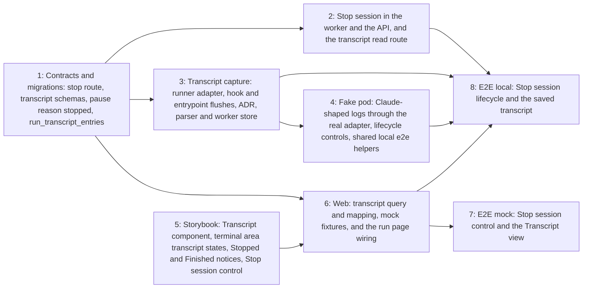

<!-- dev-plan: kind=plan id=stopped-session-resume rev=2 hash=437f725945f2 spec=docs/superpowers/specs/2026-11-19-stopped-session-resume-design.md spec-hash=c752f07a905b -->
# Saved transcript for stopped runs and a resumable Stop session Implementation Plan

> **For agentic workers:** REQUIRED SUB-SKILL: Use superpowers:subagent-driven-development (recommended) or superpowers:executing-plans to implement this plan task-by-task. Steps use checkbox (`- [ ]`) syntax for tracking.

**Goal:** A run page with no live pod shows a read-only Transcript saved in Postgres (agent-neutral wire line, Claude adapter first), and a person can Stop a live session so it parks as `paused` / `stopped`, resumable for the agent's paused keep time, while Finish stays final.

**Architecture:** Contracts, the core update name and two migrations land first with every consumer compiling. The worker gets a `stopSession` update that ends the session through the idle timer's park path with reason `stopped`; the API adds `POST /runs/:id/stop` and `GET /runs/:id/transcript`. In the runner, a Claude `transcript.mjs` turns Claude Code's JSONL log into `agentdesk: transcript <base64>` lines, called from the hook and from entrypoint flushes; the core parser reads those lines and the worker's log follower redacts and stores them. The fake pod runs the real adapter, so the local stack exercises the whole path. The web adds a `Transcript` component and Stop session control in Storybook first, then wires them to an infinite query and a stop mutation.

**Tech Stack:** TypeScript (strict), Zod 4, Drizzle + Postgres, NestJS/Fastify, Temporal (`patched`, updates), bash + Node `fs` in the runner image, React 19 + TanStack Query/Router, MSW, Storybook, Vitest, Playwright.

**Spec:** `docs/superpowers/specs/2026-11-19-stopped-session-resume-design.md` (rev 2). Read it with this plan. Its "E2E requirements" section holds the BR/TC tables the e2e tasks cite. The approved boards `design/prototype/project/{RunRunningStop,RunIdleEnding,RunStopped,RunSucceededFinished,RunTranscriptStates}.dc.html` decide layout and copy; where the spec and a board differ, the board wins.

## Global Constraints

- AGENTS.md rules 1–11 bind every task. Layering is `apps → core → db → contracts`, and `web → contracts` only. No provider names outside `images/runner/agents/claude/`. Every query goes through `withOrg`. Transcript text is untrusted and is redacted before storage. Authz on both new routes is the same as on `runs.log` / `runs.finish`.
- No new dependency. Node's built-in `fs`/`child_process`, Zod, Drizzle, Temporal, NestJS, TanStack Query, MSW and the existing `ds` cover everything. No markdown renderer.
- Wire line, exactly: `agentdesk: transcript <base64 of one JSON object>`, printed to `/proc/1/fd/1` (`AGENTDESK_STATUS_OUT` overrides it, as for the hook). The parser accepts a base64 body of at most 12,000 chars.
- `TranscriptWireEntry`: `id` is 1 to 128 chars of `[A-Za-z0-9._:-]`; `at` is an optional ISO timestamp; `kind` is `user` | `agent` | `tool` | `notice`; `text` is at most 8,000 UTF-8 bytes; `tool` is 1 to 64 chars, only for `kind: tool`; `truncated` is an optional boolean.
- Per-run cap: 20,000 entries. At the cap the worker stores one `notice` "Transcript limit reached; later messages were not saved" and drops later entries.
- Stop session rejections, verbatim: "The agent has not started yet", "The session is already ending", "Only a live session can be stopped", "This run started before Stop session was available; Finish or Cancel it". Patch id: `stop-session`.
- The stopped run is `status = paused`, `pauseReason = stopped`, park kind `needs_input`, with no ticket comment. `pauseReasonText('stopped')` returns "stopped by you".
- Adapter flush: the entrypoint runs `timeout 5 node …/transcript.mjs flush`, ignoring errors, right after `agentdesk: session started` and at the start of `end_session` before the scrollback. Both calls are skipped when the agent dir has no `transcript.mjs`.
- Copy, verbatim: "Stop session"; "Stop the session?"; "The agent is in the middle of a step. Stopping now cuts that step short. Everything up to now is kept, and you can resume for {paused keep time}."; "Keep running"; "The session is already ending" (disabled tooltip); "Stopped" (icon title); "Stopped: can be resumed for {time left}."; "Stopped by you {relative time}."; "Finished. The session was deleted and cannot be resumed."; "Transcript"; "Ending…"; "Paused, read-only"; "Ended, read-only"; "Paused" / "Ended" when nothing is saved; "Transcript of the agent conversation" (`role="log"` label); "You"; "Prompt"; "… (cut)"; "Show earlier messages"; "Loading the transcript"; "Couldn't load the transcript"; "Request ID {id}"; "Retry"; "No conversation was saved for this run."; "Conversation compacted".
- Migrations: `0017_run_pause_reason_stopped.sql` and `0018_run_transcript_entries.sql`. Never edit 0013, 0014 or any applied migration.
- Workflow changes sit behind `patched('stop-session')`. Every existing replay fixture must still replay.
- **Storybook first (blocker from the spec's "UI and Storybook" section, not an ordering preference):** no task that implements or wires this UI in `apps/web/src/{app,features}` starts before the Storybook task (Task 5) is merged and reviewed. Task 6, the only task that wires this UI, lists Task 5 under **Depends on**.
- **Build order:** one task at a time, in number order (Task 1 to Task 8). Each task is one branch and one PR, with one commit per part, and starts after the previous task is merged. **Depends on:** lines list only the tasks whose interfaces or files a task really uses, so a few tasks (3, 5) depend on less than the task before them; the build still follows the number order.
- Sensitive tasks (label `review:sensitive`, high-effort security review): Task 1 (Part B: migration, RLS), Task 2 (run workflow / Job lifecycle; authz and the RLS read path), Task 3 (runner image and entrypoint; secret redaction of agent output).
- Before every commit: `devbox run fix` until it prints `fix: clean.`. Use Conventional Commits with the package as scope. PR size: see the Agent call on grouping.

## Review Focus

1. **Text that grows when JSON-encoded** (a message of 8,000 bytes made mostly of `"`, `\` or newlines): a person expects the entry stored, cut and marked `truncated`, never dropped because its line went over 12,000 base64 chars. Test in Task 3 Part A (`the encoded line of a quote-heavy 8,000-byte message stays within 12,000 base64 chars`).
2. **A multi-byte character at the 8,000-byte cut** (an emoji or CJK character straddling byte 8,000): a person expects valid text ending before that character, with `truncated: true`. The contract counts UTF-8 bytes, not string length. Tests in Task 1 Part A (`text limit counts UTF-8 bytes`) and Task 3 Part A (`cuts on a code point boundary`).
3. **Stop pressed twice, or Stop and Finish from two tabs in the same instant**, before the main loop has applied the first: a person expects the second request to get "The session is already ending" and the run to park once. Test in Task 2 Part A (`a second stopSession before the main loop runs is rejected as already ending`).
4. **A resumed pod re-sending entries already stored**, with log line numbers that restart at 1 on every pod: a person expects each entry once. Dedupe is by `(run_id, source_id)`, never by log line. Test in Task 3 Part C (`a second pod re-sending the same ids stores nothing new`).
5. **A run already near the cap when a new pod starts** (19,999 rows stored by earlier pods): a person expects one more entry, then the single limit notice, and the notice never twice. Test in Task 3 Part C (`counts rows stored by earlier pods and stores the notice once`).

## Needs approval

None. No new package, library, service, image, CI action, binary or workspace package.

## Agent calls made while planning

- Agent call: Task 1 Part A also makes the smallest consumer edits that keep every package compiling and the MSW "a handler for every route key" test green: `pausedKeepSeconds` in the API's run mapping and the web fixtures, stub MSW handlers for `runs.stop` / `runs.transcript`, and the `'stopped'` case of `pauseReasonText`. Reason: a required DTO field and two new route keys would otherwise break `api` and `web`.
- Agent call: `UPDATE.stopSession = 'stopSession'` goes into `packages/core/src/temporal-names.ts` in Task 1 Part A, before the worker (Task 2 Part A) and the API (Task 2 Part B) use it. Reason: both need the literal, and the worker's equality test pins it.
- Agent call: the transcript wire entry, `TranscriptKind`, the DTO, the query and the response schemas all live in `packages/contracts/src/schemas/transcript.ts`. Reason: one file for the agent-neutral transcript contract.
- Agent call: the API's cheap pre-check answers 409 with the workflow's own wording: "The session is already ending" when `sessionEndingAt` is set, "Only a live session can be stopped" otherwise. Reason: BR-11 and BR-12 expect that toast whichever layer refuses.
- Agent call: the `stopSession` validator checks in this order: unpatched, then already ending (`ending`, `finishRequested` or `stopRequested`), then not a live phase, then agent not started. Reason: during an end the person must read "already ending", and a second Stop before the main loop runs must be refused.
- Agent call: `seq` is assigned with the existing `appendSeqEvent` helper under the run-row lock (spec "Left to the builder"). Reason: it is how `run_events` already keeps per-run order.
- Agent call: a wire `at` is used when it parses and lies between now − 31 days and now + 5 minutes; otherwise the worker's clock time. Reason: the paused keep time is at most 30 days, so a resume flush can bring entries that old.
- Agent call: an insert that fails is tried up to 3 times in place. Then the follower logs `{ kind: 'transcript', failed: <count> }` and carries on. Reason: a lost transcript line must never fail or stall the run.
- Agent call: the fake pod writes Claude-shaped JSONL on its fake volume and runs the real `images/runner/agents/claude/transcript.mjs` at the hook and flush points. Reason: the local cases about thinking, tool output, the 200-char summary, the 8,000-byte cut and the hard kill test the adapter's mapping, which only the real adapter can show.
- Agent call: fake-pod controls are `--fake-*` prompt flags plus control files in the pod's state dir, like the existing `stop`/`kill` files (Task 4). Reason: the e2e cases need them and the fake pod already works this way.
- Agent call: the local e2e helpers move out of `apps/web/e2e/local/run.spec.ts` into `apps/web/e2e/local/helpers.ts` in Task 4 Part B. If that file already exists on main (the agent-model-routing plan makes the same move), Task 4 Part B reuses it and only adds its new helpers. Reason: both local e2e specs (Task 8) need the same helpers, and a spec file should hold only its own tests.
- Agent call: if `0017`/`0018` are taken on main when Task 1 Part B is built (the agent-model-routing plan also adds a `0017`), use the next free numbers and keep the names. Reason: migration numbers must be unique and applied ones never change.
- Agent call: Stop session has no "Stopping…" top-bar note. Its buttons wait on the mutation's pending state, and the page then shows "Session ending…". Reason: a pending note lasts until the run is final, and a stopped run never is.
- Agent call: the Transcript page size is 200, the route's default (spec "Left to the builder").
- Agent call: while the session is ending, the area always shows the Transcript, including its empty state. The saved-terminal-text fallback applies only once the run is paused or ended. Reason: the end flush lands with the park, and the page refetches then.
- Agent call: mocked runs for this feature are seeded into the browser mock only, as `lifecycleRuns.ts` does. Behaviours (slow, failing, fail-once transcript; slow finish and cancel) are keyed by run number. The mock e2e specs install a fixed clock at `SESSION_MOCK_NOW`. Reason: MSW answers inside the service worker, which Playwright routing cannot reach, and relative times need a fixed now.
- Agent call: the new ADR is `docs/adr/0026-agent-neutral-transcript-protocol.md`, the next free number.
- Agent call: if no real Claude Code 2.1.323 session can be recorded for the adapter fixtures, write them by hand from that version's JSONL format and say so in the PR. Reason: tests run without network or credentials.
- Agent call: local cases that need short timers (idle timer, ending deadline) run only on a stack started with the env overrides, like the existing pause tests (`E2E_IDLE_END_SECONDS`, and a new `E2E_ENDING_DEADLINE_SECONDS`). Reason: the default timers are 30 and 1.5 minutes.
- Agent call: TC-14.1 to TC-14.3 and TC-19.2 are not written as e2e specs. The lowest layers that prove them are the Task 2 Part A in-process workflow test (`runtime.unpatched.add('stop-session')`) and the Task 1 Part A / Task 6 Part A unit tests of `pauseReasonText`. Reason: see OPEN in the hand-off. The local stack cannot start a run on the old workflow code, and no screen prints the pause reason of a stopped run.
- Agent call: `TerminalBar` gets a `tools` prop (default `true`) to hide Find and Copy all, and `ds` gets a `chevron-up` icon. Reason: the Transcript bar and the "Show earlier messages" button need them, and neither exists.
- Agent call: the existing `RunRunning`, `RunIdle` and `RunReconnect` boards predate the Stop session button and the removal of the "Transcript, coming in MVP" tab. Their parity screenshots will differ by those. Task 5 (Parts B and C) notes this in the PR and leaves the boards alone. Reason: redrawing them is outside the spec.
- Agent call: on the human's instruction ("to much tasks, need redesign task for sequence implement instead parallely"), the work is grouped into 8 tasks built one after another, each a slice the reviewer can judge as a whole: 1 shared contracts and migrations; 2 Stop session on the backend plus the transcript read route; 3 transcript capture from runner to Postgres; 4 the fake pod the local e2e needs; 5 all Storybook work; 6 all web wiring and mock fixtures; 7 the mock e2e; 8 the local e2e. Each former small task is kept as a Part with its own steps and commit. Reason: these are the lines along which a reviewer could accept one task and reject its neighbour. Storybook stays its own task because the spec's Storybook-first blocker needs it reviewed before the wiring starts.
- Agent call: several tasks will be well over the repo's usual ~800-line PR size (Tasks 2, 3, 5 and 6 most of all). The PR body says the size follows the human's request for fewer, sequential tasks. Reason: the human asked not to split the work this finely, and AGENTS.md's PR size is a guideline ("around"), not a check.

---

<!-- dev-plan:graph:begin -->
## Task graph

Generated by `dev-plan.mjs graph --write` from each task's **Depends on:** line. Do not edit it by hand.
Tasks in the same wave touch no common file and can be built in parallel; a task starts when everything it depends on is merged.

| Wave | Task | Depends on |
| ---- | ---- | ---------- |
| 1 | Task 1: Contracts and migrations: stop route, transcript schemas, pause reason stopped, run_transcript_entries | none |
| 1 | Task 5: Storybook: Transcript component, terminal area transcript states, Stopped and Finished notices, Stop session control | none |
| 2 | Task 2: Stop session in the worker and the API, and the transcript read route | Task 1 |
| 2 | Task 3: Transcript capture: runner adapter, hook and entrypoint flushes, ADR, parser and worker store | Task 1 |
| 2 | Task 6: Web: transcript query and mapping, mock fixtures, and the run page wiring | Task 1, Task 5 |
| 3 | Task 4: Fake pod: Claude-shaped logs through the real adapter, lifecycle controls, shared local e2e helpers | Task 3 |
| 3 | Task 7: E2E mock: Stop session control and the Transcript view | Task 6 |
| 4 | Task 8: E2E local: Stop session lifecycle and the saved transcript | Task 2, Task 3, Task 4, Task 6 |


<!-- dev-plan:graph:end -->

### Task 1: Contracts and migrations: stop route, transcript schemas, pause reason `stopped`, `run_transcript_entries`

**Depends on:** none

**Files:**

- Create: `packages/contracts/src/schemas/transcript.ts`
- Create: `packages/contracts/src/schemas/transcript.test.ts`
- Modify: `packages/contracts/src/enums.ts`
- Modify: `packages/contracts/src/schemas/runs.ts`
- Modify: `packages/contracts/src/schemas/runs.test.ts`
- Modify: `packages/contracts/src/routes.ts`
- Modify: `packages/contracts/src/routes.test.ts`
- Modify: `packages/contracts/src/index.ts`
- Modify: `packages/core/src/temporal-names.ts`
- Modify: `apps/api/src/runs/runs.service.ts`
- Modify: `apps/api/test/runs.int.test.ts`
- Modify: `apps/web/src/mocks/dto/runs.ts`
- Modify: `apps/web/src/mocks/msw/db.ts`
- Modify: `apps/web/src/mocks/msw/handlers.ts`
- Modify: `apps/web/src/mocks/msw/contract.test.ts`
- Modify: `apps/web/src/features/runs/detail.map.ts`
- Modify: `apps/web/src/features/runs/detail.map.test.ts`
- Modify: `packages/db/src/schema/app.ts`
- Create: `packages/db/migrations/0017_run_pause_reason_stopped.sql` (generated, then checked)
- Create: `packages/db/migrations/0018_run_transcript_entries.sql` (generated, plus a hand-written block)
- Create: `packages/db/migrations/meta/0017_snapshot.json` (generated)
- Create: `packages/db/migrations/meta/0018_snapshot.json` (generated)
- Modify: `packages/db/migrations/meta/_journal.json` (generated)
- Modify: `packages/db/test/migrate.int.test.ts`
- Modify: `packages/db/test/rls.int.test.ts`

Parts: A (Contracts, update name and every consumer compiling); B (Migrations — pause reason `stopped` and `run_transcript_entries` with RLS). Build the parts in order in one branch, one commit per part, one PR for the task.

#### Part A: Contracts, update name and every consumer compiling

**Interfaces:**

- Consumes: nothing new.
- Produces (exported from `@agentdesk/contracts`):

```ts
// enums.ts
export const PauseReason = z.enum(['idle_timeout', 'pod_lost', 'agent_crashed', 'stopped']);
/** Statuses whose live session a person may stop (with no session end under way). */
export const STOPPABLE_RUN_STATUSES = ['running', 'idle', 'done'] as const satisfies readonly RunStatus[];

// schemas/transcript.ts
export const TRANSCRIPT_TEXT_MAX_BYTES = 8000;
export const TRANSCRIPT_WIRE_MAX_BASE64 = 12000;
export const TRANSCRIPT_ENTRY_CAP = 20000;
export const TRANSCRIPT_LIMIT_NOTICE = 'Transcript limit reached; later messages were not saved';
export const TranscriptKind = z.enum(['user', 'agent', 'tool', 'notice']);
export type TranscriptKind = z.infer<typeof TranscriptKind>;
export const TranscriptWireEntry: z.ZodType<{
  id: string; at?: string; kind: TranscriptKind; text: string; tool?: string; truncated?: boolean;
}>; // id /^[A-Za-z0-9._:-]{1,128}$/, at z.iso.datetime({ offset: true }), text ≤ 8000 UTF-8 bytes, tool 1..64 and only with kind 'tool'
export type TranscriptWireEntry = z.infer<typeof TranscriptWireEntry>;
export const RunTranscriptEntryDto = z.object({
  seq: z.number().int(), at: Timestamp, kind: TranscriptKind, tool: z.string().nullable(), text: z.string(), truncated: z.boolean(),
});
export const RunTranscriptQuery = z.object({
  before: z.coerce.number().int().min(1).max(2147483647).optional(),
  limit: z.coerce.number().int().min(1).max(500).default(200),
});
export const RunTranscriptResponse = z.object({ items: z.array(RunTranscriptEntryDto), nextBefore: z.number().int().nullable() });
// (types of the same names)

// schemas/runs.ts: RunDto gains, after idleEndSeconds:
/** The agent's paused keep time: how long a paused or stopped run can be resumed. */
pausedKeepSeconds: z.number().int(),

// routes.ts, in `runs`:
stop: { method: 'POST', path: '/api/runs/:runId/stop', params: runParams, response: empty },
transcript: { method: 'GET', path: '/api/runs/:runId/transcript', params: runParams, query: RunTranscriptQuery, response: RunTranscriptResponse },
```

- Produces (core): `UPDATE.stopSession = 'stopSession'`, with doc comment "RunWorkflow: stop a live session (park as paused/stopped); resolves `{ accepted: true }` or fails `NotStoppable`."
- Produces (web mocks): `MockDb` gains `runTranscripts: Record<string, RunTranscriptEntryDto[]>` (by run id, oldest first, empty in the seed). The `'runs.transcript'` handler pages it exactly as the route does. The `'runs.stop'` handler answers 202 for a run in `STOPPABLE_RUN_STATUSES` with `sessionEndingAt === null`, and otherwise the 409 problem with the pre-check wording (Agent call above).

- [x] **Step 1: Write the failing contract tests**

In `transcript.test.ts`:
- `TranscriptWireEntry` accepts `{ id: 'a1b2:0', kind: 'agent', text: 'hi' }`, and `{ id: 'x', kind: 'tool', tool: 'Bash', text: 'dotnet test', at: '2026-11-19T14:13:00.000Z', truncated: true }`.
- It rejects: `id: ''`; `'a'.repeat(129)`; `'a b'`; `'a/b'`; `kind: 'thinking'`; `tool: ''`; `tool: 'a'.repeat(65)`; `tool` on a `user` entry; `at: 'yesterday'`.
- `text limit counts UTF-8 bytes`: `'a'.repeat(8000)` passes, `'a'.repeat(8001)` fails, `'é'.repeat(4000)` passes, `'é'.repeat(4000) + 'a'` fails.
- `RunTranscriptQuery`: `{}` → `{ limit: 200 }`, `{ limit: '500', before: '7' }` parses, and `limit: 0`, `limit: 501`, `before: 0`, `before: 2147483648` fail.
- `RunTranscriptResponse` parses `{ items: [], nextBefore: null }`.

In `runs.test.ts`: the run literal gets `pausedKeepSeconds: 604800`. Add `PauseReason.parse('stopped')`, and check that `STOPPABLE_RUN_STATUSES` equals `['running', 'idle', 'done']`.

In `routes.test.ts`: the route count goes to `46`. Add `flat['runs.stop']` toMatchObject `{ method: 'POST', path: '/api/runs/:runId/stop' }` and `flat['runs.transcript']` toMatchObject `{ method: 'GET', path: '/api/runs/:runId/transcript' }`.

- [x] **Step 2: Run them and see them fail**

Run: `pnpm --filter @agentdesk/contracts test`
Expected: FAIL. `TranscriptWireEntry` and `STOPPABLE_RUN_STATUSES` are not exported, and the route count is 44.

- [x] **Step 3: Implement the contracts and the update name**

Add the enums, the new schema file (exported from `index.ts`), `pausedKeepSeconds`, the two routes and `UPDATE.stopSession`. Count text bytes with `new TextEncoder().encode(s).length` in a `refine`. Use one `superRefine` for "tool only with kind tool".

- [x] **Step 4: Run the contract tests**

Run: `pnpm --filter @agentdesk/contracts test`
Expected: PASS.

- [x] **Step 5: Write the failing consumer tests**

- `apps/api/test/runs.int.test.ts`: next to the `idleEndSeconds` test, add `it('a run carries its agent paused keep time, or the default for a deleted agent')`. Set `agents.pausedKeepSeconds = 7200`, then `runs.get` matches `{ pausedKeepSeconds: 7200 }`, and the orphan run matches `{ pausedKeepSeconds: 604800 }`.
- `apps/web/src/mocks/msw/contract.test.ts`, `it('runs.transcript pages newest-first windows oldest first and runs.stop answers 202 on a live run')`:
  - Seed 5 entries (seq 1..5) on an idle fixture run.
  - `limit: 2` gives seq `[4, 5]` with `nextBefore: 4`.
  - `before: 4, limit: 2` gives `[2, 3]` with `nextBefore: 2`.
  - `before: 2` gives `[1]` with `nextBefore: null`.
  - `runs.stop` on the idle run resolves, and on a paused run it rejects with status 409.
- `apps/web/src/features/runs/detail.map.test.ts`: `pauseReasonText('stopped')` is `'stopped by you'`.

- [x] **Step 6: Run them and see them fail**

Run: `pnpm --filter @agentdesk/api test -- runs && pnpm --filter @agentdesk/web test -- contract detail.map`
Expected: FAIL. `pausedKeepSeconds` is missing, there is no handler for the new routes, and `pauseReasonText` has no `'stopped'` case. Typecheck also fails on that switch.

- [x] **Step 7: Keep every consumer compiling**

- `runs.service.ts`: `AgentInfo` and `agentsFor` gain `pausedKeepSeconds`. `toListItem` sets `pausedKeepSeconds: agent?.pausedKeepSeconds ?? AGENT_PAUSED_KEEP_SECONDS_DEFAULT`.
- Web: `pausedKeepSeconds: 604800` in both literals of `mocks/dto/runs.ts` and in the run the handlers build (`handlers.ts` near line 277). The `{ ...run, idleEndSeconds }` merge (near line 133) also copies the agent's `pausedKeepSeconds`. Add `runTranscripts` to `db.ts` (seed `{}`, reset with the store), the two handlers in `routeHandlers`, and `'runs.stop': 202` in the status map.
- `detail.map.ts`: add `case 'stopped': return 'stopped by you';` to `pauseReasonText`.

- [x] **Step 8: Typecheck and test the touched packages**

Run: `pnpm typecheck && pnpm --filter @agentdesk/contracts test && pnpm --filter @agentdesk/api test -- runs && pnpm --filter @agentdesk/web test -- contract detail.map map`
Expected: typecheck clean everywhere, tests PASS.

- [x] **Step 9: Commit**

```bash
devbox run fix
git add packages/contracts packages/core/src/temporal-names.ts apps/api/src/runs/runs.service.ts apps/api/test/runs.int.test.ts apps/web/src/mocks/dto/runs.ts apps/web/src/mocks/msw apps/web/src/features/runs/detail.map.ts apps/web/src/features/runs/detail.map.test.ts
git commit -m "feat(contracts): stop session route, transcript wire and DTO schemas, pause reason stopped"
```

#### Part B: Migrations — pause reason `stopped` and `run_transcript_entries` with RLS

**Interfaces:**

- Consumes: nothing.
- Produces (`@agentdesk/db`):

```ts
// runs: check runs_pause_reason_check becomes  pause_reason in ('idle_timeout','pod_lost','agent_crashed','stopped')
export const runTranscriptEntries = pgTable('run_transcript_entries', {
  orgId: uuid('org_id').notNull(),
  runId: uuid('run_id').notNull().references(() => runs.id, { onDelete: 'cascade' }),
  seq: integer('seq').notNull(),
  sourceId: text('source_id').notNull(),
  at: ts('at').notNull(),
  kind: text('kind').notNull(),            // check run_transcript_entries_kind_check in ('user','agent','tool','notice')
  tool: text('tool'),
  text: text('text').notNull(),
  truncated: boolean('truncated').notNull().default(false),
}, /* pkey run_transcript_entries_pkey (run_id, seq); unique run_transcript_entries_source_key (run_id, source_id);
      index run_transcript_entries_org_idx (org_id); orgPolicy() */);
```

- [x] **Step 1: Write the failing db tests**

In `migrate.int.test.ts`, add `it('0017 adds stopped to the pause reason check and writes no rows')`:
- the SQL has no `UPDATE`/`INSERT`/`DELETE`;
- after migrating, a run accepts `pause_reason = 'stopped'` and still rejects `'nope'`.

Add `it('0018 creates run_transcript_entries with forced RLS and the run_events grants')`:
- `relforcerowsecurity` is true;
- `agentdesk_app` has SELECT, INSERT, UPDATE, DELETE;
- a second row with the same `(run_id, source_id)` violates `run_transcript_entries_source_key`;
- `kind = 'thinking'` violates the kind check;
- deleting the run deletes its rows.

In `rls.int.test.ts`, add `it('run_transcript_entries rows of another org are invisible and cannot be inserted')`, in the style of the `run_events` case.

- [x] **Step 2: Run them and see them fail**

Run: `pnpm --filter @agentdesk/db test`
Expected: FAIL. The table and the `stopped` value do not exist.

- [x] **Step 3: Edit the schema and generate both migrations**

Change the check literal in `runs` (and its comment). Run `pnpm --filter @agentdesk/db db:generate --name run_pause_reason_stopped`. Add the table, then run `pnpm --filter @agentdesk/db db:generate --name run_transcript_entries`. Append the hand-written block to `0018`, in the style of `0007_setup_tests.sql`:

```sql
-- Hand-written: FORCE RLS binds the owner too; the app role gets the same grants as run_events.
ALTER TABLE "run_transcript_entries" FORCE ROW LEVEL SECURITY;--> statement-breakpoint
GRANT SELECT, INSERT, UPDATE, DELETE ON "run_transcript_entries" TO agentdesk_app;
```

Check that `0017` only drops and re-adds `runs_pause_reason_check`, like `0014`.

- [x] **Step 4: Run the db tests**

Run: `pnpm --filter @agentdesk/db test`
Expected: PASS.

- [x] **Step 5: Commit**

```bash
devbox run fix
git add packages/db
git commit -m "feat(db): pause reason stopped and run_transcript_entries with forced RLS"
```

---

### Task 2: Stop session in the worker and the API, and the transcript read route

**Depends on:** Task 1

**Files:**

- Modify: `apps/worker/src/workflows/signals.ts`
- Modify: `apps/worker/src/workflows/agent-phase.ts`
- Modify: `apps/worker/src/workflows/park.ts`
- Modify: `apps/worker/src/workflows/run.workflow.ts`
- Modify: `apps/worker/test/agent-phase.test.ts`
- Modify: `apps/worker/test/park.test.ts`
- Modify: `apps/worker/test/gate.workflow.test.ts`
- Modify: `apps/worker/test/run.workflow.in-process.test.ts`
- Modify: `apps/worker/test/run.workflow.test.ts`
- Create: `apps/worker/test/fixtures/run-stop-session-history.json` (written by `UPDATE_REPLAY_FIXTURES=1`)
- Modify: `apps/api/src/runs/runs.controller.ts`
- Modify: `apps/api/src/runs/runs.service.ts`
- Modify: `apps/api/test/runs.int.test.ts`

Parts: A (Worker — Stop session update and park with reason `stopped`); B (API — `POST /runs/:id/stop` and `GET /runs/:id/transcript`). Build the parts in order in one branch, one commit per part, one PR for the task.

#### Part A: Worker — Stop session update and park with reason `stopped`

**Interfaces:**

- Consumes: `PauseReason` incl. `'stopped'` (Task 1 Part A); `UPDATE.stopSession` (Task 1 Part A).
- Produces:

```ts
// signals.ts
export interface StopSessionResult { accepted: true }
export const stopSession = defineUpdate<StopSessionResult>('stopSession');

// agent-phase.ts
export interface StopSessionInput {
  phase: RunPhase; ending: boolean; finishRequested: boolean; stopRequested: boolean;
  /** The agent's session in the current pod reported `session_started`. */
  sessionStarted: boolean;
  /** patched('stop-session') */
  patched: boolean;
}
/** Why a `stopSession` update is refused, or undefined when accepted (order: patch, ending, live phase, started). */
export function stopSessionRejection(input: StopSessionInput): string | undefined;

// park.ts — EndOutcomeInput gains:
/** Why the ending session parks (a person's Stop: 'stopped'); absent means the idle timer. */
parkReason?: PauseReason;
// endOutcome: while ending with a parkKind and no finish: { kind: 'park', parkKind, reason: input.parkReason ?? 'idle_timeout' }
```

- Produces (behaviour the API relies on): `stopSession` fails with `ApplicationFailure` type `NotStoppable` and the messages in Global Constraints. If the run is finalized before the session could end, the message is "The run finished before it could be stopped".

- [x] **Step 1: Write the failing pure tests**

`agent-phase.test.ts`, `describe('stopSessionRejection')`, with base `{ phase: 'running', ending: false, finishRequested: false, stopRequested: false, sessionStarted: true, patched: true }`:
- returns `undefined` for phases `running`, `idle`, `agent_done`;
- `patched: false` gives "This run started before Stop session was available; Finish or Cancel it";
- each of `{ ending: true, phase: 'ending' }`, `{ finishRequested: true }`, `{ stopRequested: true }` gives "The session is already ending";
- each of `loading`, `waiting_slot`, `starting`, `parked`, `resuming`, `finalizing` gives "Only a live session can be stopped";
- `sessionStarted: false` gives "The agent has not started yet".

`park.test.ts`:
- `endOutcome({ ending: true, finishRequested: false, phase: 'ending', parkKind: 'needs_input', parkReason: 'stopped', podLost: false, exitCode: 0 })` equals `{ kind: 'park', parkKind: 'needs_input', reason: 'stopped' }`;
- the same with `podLost: true` is still reason `stopped`;
- without `parkReason` the reason is `idle_timeout`;
- with `finishRequested: true` the result is `{ kind: 'succeeded' }`.

`gate.workflow.test.ts`: `expect(UPDATE.stopSession).toBe(signals.stopSession.name)`.

- [x] **Step 2: Run them and see them fail**

Run: `pnpm --filter @agentdesk/worker test -- agent-phase park gate.workflow`
Expected: FAIL. `stopSessionRejection` and `stopSession` are not defined, and `parkReason` is ignored.

- [x] **Step 3: Implement the pure parts**

Add `stopSession` to `signals.ts`, `stopSessionRejection` to `agent-phase.ts`, and `parkReason` to `endOutcome`.

- [x] **Step 4: Run them**

Run: `pnpm --filter @agentdesk/worker test -- agent-phase park gate.workflow`
Expected: PASS.

- [x] **Step 5: Write the failing workflow tests**

In `run.workflow.in-process.test.ts`, `describe('stop session')`, in the style of the existing park tests:
- `stop from running, idle and done parks paused with reason stopped and posts no paused comment`, as an `it.each` over the three phases:
  - the update resolves `{ accepted: true }`;
  - `endSession` is called;
  - after the pod's end, `parkRun` gets `{ kind: 'needs_input', reason: 'stopped' }`;
  - `postComment` is never called with `'paused'`.
- `a stopped run resumes as Needs you and Finish then ends it succeeded with the volume deleted`.
- `a second stopSession before the main loop runs is rejected as already ending` (Review Focus 3).
- `Finish while a stop is ending is rejected as already ending, and the run parks as stopped`, and `Stop while a Finish is ending is rejected and the run succeeds`.
- `the idle timer ending first makes stopSession fail as already ending and parks with idle_timeout`.
- `Cancel while a stop is ending ends the run cancelled`.
- `a pod lost while a stop is ending parks with reason stopped`.
- `the ending deadline while a stop is ending deletes the Job and parks with reason stopped`.
- `a Resume queued while a stop is ending runs right after the park`.
- `stop before the pod reported session_started is rejected with "The agent has not started yet", and accepted after it`.
- `a resumed pod must report session_started again before it can be stopped`. Check that the flag resets on park.
- `a run that started before stop-session rejects stopSession and keeps today's sessionStarted rule`, using `runtime.unpatched.add('stop-session')`.

In `run.workflow.test.ts`, add a Temporal test-env scenario that is stopped, resumed and finished, and register the fixture name `run-stop-session` in the replay test's list.

- [x] **Step 6: Run them and see them fail**

Run: `pnpm --filter @agentdesk/worker test -- run.workflow`
Expected: FAIL. There is no `stopSession` handler.

- [x] **Step 7: Implement the workflow**

In `run.workflow.ts`:
- Add the state `stopRequested`, `parkReason: PauseReason | undefined`, `stopSessionPatch`, `podSessionStarted`. Read `stopSessionPatch = patched('stop-session')` right after `followerReconnect`.
- `sessionStarted` handler: when `stopSessionPatch`, set `podSessionStarted = true` in any phase. Keep the existing `resuming` branch as is.
- `podSessionStarted = false` in `park()` and at the start of `resumeAttempt`.
- `setHandler(stopSession, …)` with validator `stopSessionRejection({ …, sessionStarted: podSessionStarted, patched: stopSessionPatch })`. The handler sets `stopRequested`, awaits `finishRunSettled(ending, phase)`, throws `NotStoppable` when `!ending`, and returns `{ accepted: true }`.
- Main loop, next to the finish branch: `if (stopRequested && !ending)` sets `parkKind = 'needs_input'`, `parkReason = 'stopped'`, `ending = true`, `endingStartedMs`, `phase = 'ending'`, then `endSession`. Add `(stopRequested && !ending)` to `wake`.
- Pass `parkReason` into `endOutcome`. The fallback branch calls `park(c, parkKind, parkReason ?? 'idle_timeout')`.
- `park()` skips `postComment(c, 'paused')` when `reason === 'stopped'`, and clears `stopRequested` and `parkReason` once parked.

Then run `UPDATE_REPLAY_FIXTURES=1 pnpm --filter @agentdesk/worker test -- run.workflow` once to write `run-stop-session-history.json`.

- [x] **Step 8: Run all worker tests**

Run: `pnpm --filter @agentdesk/worker typecheck && pnpm --filter @agentdesk/worker test`
Expected: PASS. Every existing replay fixture still replays.

- [x] **Step 9: Commit**

```bash
devbox run fix
git add apps/worker/src/workflows apps/worker/test
git commit -m "feat(worker): stopSession update parks a live session as paused with reason stopped"
```

#### Part B: API — `POST /runs/:id/stop` and `GET /runs/:id/transcript`

**Interfaces:**

- Consumes: `routes.runs.stop`, `routes.runs.transcript`, `RunTranscriptQuery`, `RunTranscriptResponse`, `TranscriptKind`, `STOPPABLE_RUN_STATUSES` (Task 1 Part A); `UPDATE.stopSession` (Task 1 Part A); `runTranscriptEntries` (Task 1 Part B).
- Produces:

```ts
// RunsService
stop(org: OrgContext, runId: string): Promise<void>;      // 202; 404 other org; 409 problems as below
transcript(org: OrgContext, runId: string, q: RunTranscriptQuery): Promise<RunTranscriptResponse>;
// RunsController: @Post(routePath(routes.runs.stop)) @HttpCode(202); @Get(routePath(routes.runs.transcript)) with ZodPipe on params and query
```

- [x] **Step 1: Write the failing integration tests**

In `runs.int.test.ts`, `describe('stop session')`:
- `stop on a running, idle or done run is 202 via the stopSession update`. The fake temporal records `[UPDATE.stopSession]`.
- `stop on a paused, queued or final run is a 409 "Only a live session can be stopped" and sends nothing`.
- `stop while sessionEndingAt is set is a 409 "The session is already ending" and sends nothing`.
- `stop answered NotStoppable is a 409 with its message`, with "The agent has not started yet".
- `stop with the workflow gone, or completed mid-update, is a 409 Run is no longer active`.
- `stop failing for any other reason is not hidden as a 409`.
- `stop on another org's run is 404 and without a session is 401`.

`describe('transcript')`, inserting rows through `withOrg`:
- `returns the newest page oldest first with nextBefore, then the older page`. Use 5 rows, `limit=2`, then `before=4`.
- `nextBefore is null on the oldest page and for a run with no entries`.
- `rejects limit 0, limit 501 and before 0 with a 400`.
- `another org's run is 404 and without a session is 401`.
- `rows of another org on the same run id are never returned`.

Each response goes through `expectContract('runs.transcript', …)`.

- [x] **Step 2: Run them and see them fail**

Run: `pnpm --filter @agentdesk/api test -- runs`
Expected: FAIL with 404 for the unknown routes.

- [x] **Step 3: Implement**

`stop` follows `finish`. The pre-check is the status in `STOPPABLE_RUN_STATUSES` with `sessionEndingAt` null (409 wording per the Agent call). Then `executeUpdate(UPDATE.stopSession)`, mapping `NotStoppable`, `WorkflowNotFoundError` and `AcceptedUpdateCompletedWorkflow` exactly as `finish` maps theirs.

`transcript` follows `log`: `withOrg`, `loadRun`, then select `where run_id = $1 [and seq < before] order by seq desc limit limit + 1`. When there are `limit + 1` rows, drop the extra and set `nextBefore` to the smallest returned `seq`. Reverse the rows. Parse `kind` with `TranscriptKind`.

- [x] **Step 4: Run them**

Run: `pnpm --filter @agentdesk/api typecheck && pnpm --filter @agentdesk/api test -- runs`
Expected: PASS.

- [x] **Step 5: Commit**

```bash
devbox run fix
git add apps/api/src/runs apps/api/test/runs.int.test.ts
git commit -m "feat(api): stop a live session and read a run's transcript"
```

---

### Task 3: Transcript capture: runner adapter, hook and entrypoint flushes, ADR, parser and worker store

**Depends on:** Task 1

**Files:**

- Create: `images/runner/agents/claude/transcript.mjs`
- Create: `images/runner/test/claude-transcript.test.ts`
- Create: `images/runner/test/fixtures/claude-transcript/session.jsonl` (prompt, replies, tool_use for Bash/Edit/Write/Read/other, tool_result, thinking, meta, summary, compact boundary, API error entry, one unknown shape)
- Create: `images/runner/test/fixtures/claude-transcript/continue.jsonl` (a second session file, as `--continue` writes)
- Modify: `images/runner/agents/claude/hook.mjs`
- Modify: `images/runner/entrypoint.sh`
- Modify: `images/runner/Dockerfile`
- Modify: `images/runner/test/claude-hook.test.ts`
- Modify: `images/runner/test/entrypoint.test.ts`
- Modify: `images/runner/test/dockerfile.test.ts`
- Create: `docs/adr/0026-agent-neutral-transcript-protocol.md`
- Modify: `docs/adr/README.md`
- Modify: `docs/adr/0011-interactive-claude-code-in-tmux.md` (status line "Amended by 0026")
- Modify: `packages/core/src/kube/log-parser.ts`
- Modify: `packages/core/test/kube/log-parser.test.ts`
- Create: `apps/worker/src/activities/transcript-store.ts`
- Create: `apps/worker/test/transcript-store.int.test.ts`
- Modify: `apps/worker/src/activities/run.activities.impl.ts`
- Modify: `apps/worker/test/run.activities.int.test.ts`

Parts: A (Runner — Claude transcript adapter); B (Runner — hook and entrypoint call the adapter, image ships it, ADR); C (Core parser kind `transcript` and the follower stores entries). Build the parts in order in one branch, one commit per part, one PR for the task.

#### Part A: Runner — Claude transcript adapter

**Interfaces:**

- Consumes: nothing. This is plain Node ESM with no imports outside `node:*`.
- Produces (`images/runner/agents/claude/transcript.mjs`):

```js
/** Claude log entry (one parsed JSONL line) → wire entries; unknown shapes → []. Pure. */
export function mapEntry(entry) // → Array<{ id, at?, kind, text, tool?, truncated? }>
/** Cuts text to ≤ 8000 UTF-8 bytes on a code point boundary and so that the encoded line's base64 body is ≤ 12000 chars. */
export function fitText(text, encode) // → { text, truncated }
/** One protocol line: `agentdesk: transcript <base64(JSON)>`. */
export function wireLine(entry) // → string
/** Sends entries appended since the saved offset of each path; holds the lock; returns the number of lines written. */
export function sendNew({ paths, stateDir, out }) // → number
/** Hook entry point: records input.transcript_path (a string under $HOME) and sends; never throws. */
export function transcriptStep(input, env = process.env) // → void
// CLI: `node transcript.mjs flush` → sends every recorded path plus the newest *.jsonl in
//   $HOME/.claude/projects/<cwd with every non [A-Za-z0-9] char replaced by '-'>/, then exits 0 within 5 s.
// Env: HOME; AGENTDESK_STATE_DIR (default $HOME/.agentdesk); AGENTDESK_STATUS_OUT (default /proc/1/fd/1).
// State: $AGENTDESK_STATE_DIR/transcript.json { files: { [path]: { offset: number } } }; lock: $AGENTDESK_STATE_DIR/transcript.lock (exclusive create, stale timeout — builder's choice).
```

- Mapping (spec §3.2):
  - `user` with string content or text blocks, not meta → `user`.
  - `user` holding only `tool_result` → skipped.
  - `assistant` `text` block → `agent`.
  - `assistant` `tool_use` block → `tool` with `tool` = the name. The text is: for Bash, `input.command`; for Edit, Write and Read, `input.file_path`; for others, the first 200 chars of `JSON.stringify(input)`.
  - An `assistant` API error entry → `notice` with its text.
  - A compact boundary → `notice` "Conversation compacted".
  - `thinking`, `system`, `summary`, meta and unknown shapes → skipped.
  - Ids are the entry's `uuid`, plus `:n` for the n-th block.

- [x] **Step 1: Write the failing adapter tests**

In `claude-transcript.test.ts`, run in-process against the fixtures with a temp `HOME`, state dir and out file:
- `maps the fixture session to the expected wire entries`: a literal array of expected `{ id, kind, text, tool? }`, including `tool: 'Bash', text: 'dotnet test'` and the API error notice "API Error: 401 invalid credential".
- `skips thinking, tool results, meta, summary and unknown shapes`: no output contains the fixture's thinking text or its `tool_result` text.
- `an other tool's summary is the first 200 chars of its input JSON`: inputs whose JSON is exactly 200 and 201 chars.
- `cuts at 8000 bytes with truncated`: 8,000 bytes stays whole with no `truncated`, and 8,001 bytes is cut to ≤ 8,000 with `truncated: true`.
- `cuts on a code point boundary` (Review Focus 2): `'a'.repeat(7999) + '😀'` is cut to `'a'.repeat(7999)`.
- `the encoded line of a quote-heavy 8,000-byte message stays within 12,000 base64 chars` (Review Focus 1), for `'"'.repeat(8000)` and `'\n'.repeat(8000)`.
- `keeps offsets across two runs (resume)`: a second `sendNew` after appending two lines sends only those two.
- `the lock stops a concurrent send from sending an entry twice`: hold the lock file, and `sendNew` sends nothing. A lock older than the stale timeout is taken over.
- `flush sends recorded paths plus the newest session file and exits 0 within 5 s`: spawn `node transcript.mjs flush` with `cwd` = a temp repo dir and assert the elapsed time is < 5,000 ms.
- `transcriptStep ignores a transcript_path outside HOME and never throws on bad input`.

- [x] **Step 2: Run them and see them fail**

Run: `pnpm --filter @agentdesk/runner test -- claude-transcript`
Expected: FAIL. The module does not exist.

- [x] **Step 3: Implement `transcript.mjs`**

Read each file from its saved offset up to the last complete line, `JSON.parse` each line in a try, `mapEntry`, and append `wireLine` output to `out`. Then save the new offset (write a temp file and rename, like `hook.mjs`). No shell, no network. Writes go only under `AGENTDESK_STATE_DIR`.

- [x] **Step 4: Run them**

Run: `pnpm --filter @agentdesk/runner typecheck && pnpm --filter @agentdesk/runner test -- claude-transcript`
Expected: PASS.

- [x] **Step 5: Commit**

```bash
devbox run fix
git add images/runner/agents/claude/transcript.mjs images/runner/test/claude-transcript.test.ts images/runner/test/fixtures/claude-transcript
git commit -m "feat(runner): Claude transcript adapter maps the session log to transcript lines"
```

#### Part B: Runner — hook and entrypoint call the adapter, image ships it, ADR

**Interfaces:**

- Consumes: `transcriptStep(input)` and the `flush` CLI (Task 3 Part A).
- Produces: the image ships `/usr/local/lib/agentdesk/agents/claude/transcript.mjs`. The entrypoint has a `transcript_flush` function that runs `timeout 5 node "$LIB_DIR/agents/$AGENT_DIR/transcript.mjs" flush </dev/null >/dev/null 2>&1 || true` from the repo dir, and only when that file exists.

- [x] **Step 1: Write the failing tests**

- `claude-hook.test.ts`:
  - `every handled event also sends new transcript entries`: feed `user-prompt-submit.json` with a `transcript_path` to a fixture JSONL under the temp HOME, and the out file holds the status line and then `agentdesk: transcript …` lines.
  - `a throwing transcript step leaves the status line and exit code unchanged`: point `transcript_path` at a directory.
- `entrypoint.test.ts`:
  - `flush runs right after session started and at the start of end_session, before the scrollback`: stub `node` on `PATH` to record its argv, and assert the order in the log: `agentdesk: session started`, then the flush call, …, the flush call, then `agentdesk: final scrollback begin`.
  - `flush is skipped when the agent dir has no transcript.mjs`.
  - `a flush that hangs is cut off by timeout 5 and the session still ends`.
- `dockerfile.test.ts`: the Dockerfile has `COPY agents/claude/transcript.mjs /usr/local/lib/agentdesk/agents/claude/transcript.mjs`, and the existing chmod/chown line lists it.

- [x] **Step 2: Run them and see them fail**

Run: `pnpm --filter @agentdesk/runner test -- claude-hook entrypoint dockerfile`
Expected: FAIL.

- [x] **Step 3: Implement**

- `hook.mjs`: `import { transcriptStep } from './transcript.mjs'`. After the state write at the end, call `try { transcriptStep(input) } catch {}`.
- `entrypoint.sh`: add `transcript_flush`. Call it right after `echo 'agentdesk: session started'` and as the first line of `end_session`.
- `Dockerfile`: add the COPY and the file to the existing chmod/chown list.

- [x] **Step 4: Write the ADR**

`0026-agent-neutral-transcript-protocol.md` follows `0000-template.md`. Its content is spec §2 (wire line, `TranscriptWireEntry`), §2.2 (adapter contract, flush), the choice of hooks plus flush over a tail process, Postgres storage with redaction and the 20,000 cap, the read-only view, and alternatives B and C. It amends ADR 0011 ("history is final scrollback only") and extends ADR 0020's adapter model. Add the README row and the amendment line in 0011.

- [x] **Step 5: Run the runner tests**

Run: `pnpm --filter @agentdesk/runner typecheck && pnpm --filter @agentdesk/runner test`
Expected: PASS.

- [x] **Step 6: Commit**

```bash
devbox run fix
git add images/runner docs/adr
git commit -m "feat(runner): hook and entrypoint flushes send transcript lines; ADR 0026"
```

#### Part C: Core parser kind `transcript` and the follower stores entries

**Interfaces:**

- Consumes: `TranscriptWireEntry`, `TRANSCRIPT_ENTRY_CAP`, `TRANSCRIPT_LIMIT_NOTICE`, `TRANSCRIPT_WIRE_MAX_BASE64` (Task 1 Part A); `runTranscriptEntries` (Task 1 Part B).
- Produces:

```ts
// packages/core/src/kube/log-parser.ts
// LogLineKind gains 'transcript'; ParsedLogLine gains  transcript?: TranscriptWireEntry
// /^agentdesk: transcript ([A-Za-z0-9+/]+={0,2})$/ on the trimmed line, body ≤ 12000 chars and length % 4 === 0,
// then base64 → utf8 → JSON.parse → TranscriptWireEntry.safeParse; any failure → { kind: 'text', text: line }.

// apps/worker/src/activities/transcript-store.ts
export const TRANSCRIPT_LIMIT_SOURCE_ID = 'agentdesk:limit';
export interface TranscriptRow { sourceId: string; at: Date; kind: TranscriptKind; tool: string | null; text: string; truncated: boolean }
/** Wire entry → row: text redacted with `secrets`; `at` when plausible (now − 31 days … now + 5 min), else `now`. Pure. */
export function toTranscriptRow(entry: TranscriptWireEntry, secrets: string[], now: Date): TranscriptRow;
/** Inserts with the next per-run seq (appendSeqEvent, run-row lock) ON CONFLICT (run_id, source_id) DO NOTHING; true when inserted. Inside withOrg. */
export function insertTranscriptEntry(tx: Tx, orgId: string, runId: string, row: TranscriptRow): Promise<boolean>;
export function countTranscriptEntries(tx: Tx, runId: string): Promise<number>;
/** Per follower attempt: counts once on first use, enforces the cap (one limit notice), retries an insert 3 times, then logs kind and count only. */
export function createTranscriptSink(deps: { db: Db; orgId: string; runId: string; now(): Date; warn(msg: string, fields: Record<string, unknown>): void }):
  { store(entry: TranscriptWireEntry, secrets: string[]): Promise<void> };
```

- [x] **Step 1: Write the failing parser tests**

In `log-parser.test.ts`, `describe('transcript lines')`:
- a valid line built from `Buffer.from(JSON.stringify({ id: 'u1:0', kind: 'agent', text: 'hi' })).toString('base64')` parses to `{ kind: 'transcript', transcript: { id: 'u1:0', kind: 'agent', text: 'hi' } }`;
- a body of 12,001 chars, `!!!`, a body whose length is not a multiple of 4, base64 of `not json`, and base64 of `{ "id": "a b", "kind": "agent", "text": "x" }` each give `{ kind: 'text' }` with the original line;
- leading and trailing spaces are accepted, like the other markers.

- [x] **Step 2: Run them and see them fail**

Run: `pnpm --filter @agentdesk/core test -- log-parser`
Expected: FAIL.

- [x] **Step 3: Implement the parser branch, then run**

Run: `pnpm --filter @agentdesk/core test -- log-parser`
Expected: PASS.

- [x] **Step 4: Write the failing store and follower tests**

`transcript-store.int.test.ts` (real Postgres, as the other `.int` tests):
- `toTranscriptRow redacts secrets in text, including inside a tool step summary`: a `tool` entry with `text: 'curl -H "Bearer s3cr3t"'` and secrets `['s3cr3t']` gives text `'curl -H "Bearer ***"'`.
- `toTranscriptRow keeps a plausible at and replaces a future or ancient one with now`.
- `insert assigns seq 1, 2, 3 in order and ignores a repeated source id`.
- `rows are written under the run's org and invisible to another org`.
- `counts rows stored by earlier pods and stores the notice once` (Review Focus 5): seed 19,999 rows. Storing two entries gives one entry plus one notice with `TRANSCRIPT_LIMIT_NOTICE` (`source_id = 'agentdesk:limit'`, 20,001 rows). A third entry adds nothing.
- `an insert that keeps failing is logged by kind and count, never its text, and the sink carries on`.

`run.activities.int.test.ts` (fake gateway, the existing follower harness):
- `transcript lines are redacted and stored, and not written to run_events`;
- `a follower retry re-reading the log stores each entry once`;
- `a second pod re-sending the same ids stores nothing new` (Review Focus 4);
- `a malformed transcript line is an ordinary text line`.

- [x] **Step 5: Run them and see them fail**

Run: `pnpm --filter @agentdesk/worker test -- transcript-store run.activities.int`
Expected: FAIL.

- [x] **Step 6: Implement**

Write `transcript-store.ts`. In `followPodLogs`, create one sink per attempt. In `onParsed`, `parsed.kind === 'transcript' && parsed.transcript` calls `await sink.store(parsed.transcript, secrets)`, then returns `undefined`, so the durable line advances as usual. Transcript text never goes into logs, errors, `run_events` or workflow history.

- [x] **Step 7: Run all touched tests**

Run: `pnpm --filter @agentdesk/core test && pnpm --filter @agentdesk/worker typecheck && pnpm --filter @agentdesk/worker test`
Expected: PASS.

- [x] **Step 8: Commit**

```bash
devbox run fix
git add packages/core/src/kube/log-parser.ts packages/core/test/kube/log-parser.test.ts apps/worker/src/activities apps/worker/test/transcript-store.int.test.ts apps/worker/test/run.activities.int.test.ts
git commit -m "feat(core,worker): parse transcript lines and store them redacted, capped and deduplicated"
```

---

### Task 4: Fake pod: Claude-shaped logs through the real adapter, lifecycle controls, shared local e2e helpers

**Depends on:** Task 3

**Files:**

- Create: `packages/core/src/kube/fake-claude-log.mjs`
- Modify: `packages/core/src/kube/fake-pod.mjs`
- Modify: `packages/core/test/kube/fake-pod.test.ts`
- Create: `apps/web/e2e/local/helpers.ts` (or extend it when it already exists; see the Agent call)
- Modify: `apps/web/e2e/local/run.spec.ts` (imports the moved helpers; no test changes)

Parts: A (Fake pod writes Claude-shaped logs and runs the transcript adapter); B (Fake pod lifecycle controls and shared local e2e helpers). Build the parts in order in one branch, one commit per part, one PR for the task.

#### Part A: Fake pod writes Claude-shaped logs and runs the transcript adapter

**Interfaces:**

- Consumes: `images/runner/agents/claude/transcript.mjs` CLI `flush` (Task 3 Part A).
- Produces (fake pod behaviour that Task 4 Part B and the local e2e build on; document each in the header comment):
  - With `FAKE_VOLUME_DIR` set, the pod keeps a Claude-format session file under `$FAKE_VOLUME_DIR/home/.claude/projects/<slug of $FAKE_VOLUME_DIR/workspace>/<session>.jsonl`. It appends the prompt as a `user` entry at a fresh start, each typed line as a `user` entry, and an `assistant` text "Fake agent reply <n>" at each turn end. Entry ids come from `crypto.randomUUID()`.
  - It runs `process.execPath <adapter> flush` (`spawnSync`, `cwd` = `$FAKE_VOLUME_DIR/workspace`, env `HOME=$FAKE_VOLUME_DIR/home`, `AGENTDESK_STATE_DIR=$HOME/.agentdesk`, `AGENTDESK_STATUS_OUT=<state dir>/log`, timeout 5,000 ms) at the real hook and flush points: after `session started`, when a typed line starts a turn, at each turn end, and at the start of `finish()` before the scrollback.
  - `<adapter>` is `FAKE_TRANSCRIPT_ADAPTER`, defaulting to `new URL('../../../../images/runner/agents/claude/transcript.mjs', import.meta.url)`. When the file is missing or the variable is empty, the pod writes no session file and sends nothing (like an old image).
  - Prompt flags:
    - `--fake-no-transcript`: nothing is sent.
    - `--fake-thinking`: the first reply has a `thinking` block "THINKING-MARKER" before its text.
    - `--fake-tools`: the first turn adds `tool_use` blocks Bash `dotnet test`, Edit/Write/Read with file paths, and two `Grep` steps whose input JSON is exactly 200 and 201 chars, plus a `tool_result` user entry "OUTPUT-MARKER".
    - `--fake-long-replies`: the first turn adds agent replies of exactly 8,000 and 8,001 UTF-8 bytes.
    - `--fake-api-error`: the first turn writes an API error assistant entry "API Error: 401 invalid credential", then ends like `--fake-fail`.
    - `--fake-transcript-bulk=<n>`: the first session file holds exactly `<n>` entries (the prompt, then agent replies "bulk reply <i>"), sent by one flush at the first turn end; later turns are normal.
    - `--fake-unflushed`: after the first turn's flush, one more agent reply "UNFLUSHED-MARKER" is appended to the file without a flush.
    - `--fake-bad-transcript-lines`: after `session started`, three malformed `agentdesk: transcript` lines go to both `log` and `pane`: a 12,001-char body, `!!!`, and valid base64 of `{"id":"a b","kind":"agent","text":"x"}`.

- [ ] **Step 1: Write the failing tests**

In `fake-pod.test.ts`, run with `FAKE_TRANSCRIPT_ADAPTER` pointing at the real adapter and a temp volume:
- `a fresh run sends the prompt and the first reply as transcript lines`: decode the `agentdesk: transcript` log lines and get `[user: PROMPT, agent: 'Fake agent reply 1']`.
- `a resumed pod continues the same session file and sends only new entries`.
- `stop runs the end flush before the scrollback`.
- `no adapter file, or --fake-no-transcript, sends nothing`.
- One test per flag, asserting the decoded lines. For example, `--fake-thinking` has no line containing `THINKING-MARKER`, `--fake-tools` has no `OUTPUT-MARKER`, and `--fake-unflushed` has `UNFLUSHED-MARKER` in the session file but not in the log.

- [ ] **Step 2: Run them and see them fail**

Run: `pnpm --filter @agentdesk/core test -- fake-pod`
Expected: FAIL.

- [ ] **Step 3: Implement**

`fake-claude-log.mjs` exports pure builders `userEntry(text)`, `replyEntry(text, { thinking?, tools?, apiError? })` and `toolResultEntry(text)`, returning objects in the Task 3 Part A fixture shapes, plus `appendEntry(file, entry)`. `fake-pod.mjs` wires them in and calls the adapter. PROMPT stays untrusted: it is only written to files and searched with `includes`, never executed.

- [ ] **Step 4: Run them**

Run: `pnpm --filter @agentdesk/core test -- fake-pod fake-gateway`
Expected: PASS.

- [ ] **Step 5: Commit**

```bash
devbox run fix
git add packages/core/src/kube/fake-claude-log.mjs packages/core/src/kube/fake-pod.mjs packages/core/test/kube/fake-pod.test.ts
git commit -m "feat(core): fake pod writes Claude-shaped logs and sends them through the transcript adapter"
```

#### Part B: Fake pod lifecycle controls and shared local e2e helpers

**Interfaces:**

- Consumes: the fake pod from Task 4 Part A.
- Produces (fake pod):
  - `--fake-hold-start`: after the setup markers, the pod waits for a `release-start` file in its state dir before logging `agentdesk: session started`.
  - `--fake-slow-end`: on `stop`, the pod waits for a `release-end` file before `finish(0, 'stop_request')`.
  - `--fake-hang-on-stop`: `stop` is ignored, and only `kill` or the Job's deletion ends the pod.
  - `--fake-exit-ok`: after the first turn the pod finishes with `agent_exit` code 0.
  - A `hardkill` file in the state dir makes the pod write `exit` 137 and exit 137 at once, with no flush, no scrollback and no end line.
- Produces (`apps/web/e2e/local/helpers.ts`):

```ts
export const API: string; export const REPO: string; export const FAKE_STATE_DIR: string;
export async function ok(res: APIResponse, status: number, what: string): Promise<unknown>;
export async function signInAndCreateProject(page: Page): Promise<{ handle: string; projectId: string }>;
export async function commentOnNewTicket(page: Page, handle: string, projectId: string, body: string, author?: string): Promise<string>;
/** Creates `name` in the run's fake pod state dir (`release-start`, `release-end`, `hardkill`). */
export async function touchPodFile(runId: string, name: string): Promise<void>;
/** Reads `GET /dev/fake/posted` (comments the app posted on the fake board). */
export async function postedComments(page: Page): Promise<{ ticketNumber: number; body: string }[]>;
/** Fetches every transcript entry of a run through `runs.transcript`, oldest first. */
export async function transcriptOf(page: Page, runId: string): Promise<RunTranscriptEntryDto[]>;
```

- [ ] **Step 1: Write the failing fake-pod tests**

One test per control: `hold-start logs session started only after release-start`, `slow-end ends only after release-end`, `hang-on-stop ignores stop and ends on kill`, `exit-ok ends with session ended reason=agent_exit code=0`, and `hardkill exits 137 with no end flush, no scrollback and no end line`.

- [ ] **Step 2: Run them and see them fail**

Run: `pnpm --filter @agentdesk/core test -- fake-pod`
Expected: FAIL.

- [ ] **Step 3: Implement the controls, then run**

Run: `pnpm --filter @agentdesk/core test -- fake-pod`
Expected: PASS.

- [ ] **Step 4: Move the helpers**

Move `API`, `REPO`, `FAKE_STATE_DIR`, `ok`, `signInAndCreateProject` and `commentOnNewTicket` from `run.spec.ts` into `helpers.ts` and import them back. Add the three new helpers. Check: `pnpm --filter @agentdesk/web typecheck`, then, with the stack up, `pnpm --filter @agentdesk/web exec playwright test e2e/local/run.spec.ts -g "a comment on the fake board becomes a live run"` still passes.

- [ ] **Step 5: Commit**

```bash
devbox run fix
git add packages/core/src/kube/fake-pod.mjs packages/core/test/kube/fake-pod.test.ts apps/web/e2e/local/helpers.ts apps/web/e2e/local/run.spec.ts
git commit -m "feat(core): fake pod hold, slow end, hang, exit-ok and hard-kill controls; shared local e2e helpers"
```

---

### Task 5: Storybook: Transcript component, terminal area transcript states, Stopped and Finished notices, Stop session control

**Depends on:** none

**Files:**

- Create: `apps/web/src/components/Transcript.tsx`
- Create: `apps/web/src/components/Transcript.module.css`
- Create: `apps/web/src/components/Transcript.stories.tsx`
- Create: `apps/web/src/components/Transcript.test.tsx`
- Modify: `apps/web/src/components/index.ts`
- Modify: `apps/web/src/components/TerminalBar.tsx`
- Modify: `apps/web/src/components/TerminalBar.stories.tsx`
- Modify: `apps/web/src/components/Terminal.test.tsx` (holds the `TerminalBar` tests)
- Modify: `apps/web/src/ds/icons.tsx`
- Modify: `apps/web/src/ds/Icon.test.tsx` (icon count 37 → 38)
- Create: `apps/web/src/mocks/transcript.ts`
- Modify: `apps/web/src/mocks/index.ts`
- Modify: `apps/web/src/screens/RunTerminalArea.tsx`
- Modify: `apps/web/src/screens/RunTerminalArea.stories.tsx`
- Modify: `apps/web/src/screens/RunDetail.tsx` (pass `transcript` through only)
- Modify: `apps/web/src/screens/runDetail.stories.tsx`
- Modify: `apps/web/src/screens/runDetail.test.tsx`
- Modify: `apps/web/src/screens/storyIds.ts`
- Modify: `apps/web/scripts/parity.mjs`
- Modify: `apps/web/src/test/coverage.test.ts`
- Modify: `design/prototype/project/canvas.json`
- Modify: `apps/web/src/mocks/types.ts`
- Modify: `apps/web/src/mocks/runDetail.tsx`

Parts: A (Storybook — Transcript component, Transcript bar and chevron-up icon); B (Storybook — terminal area transcript states, Stopped and Finished notices); C (Storybook — Stop session button and confirm in the top bar). Build the parts in order in one branch, one commit per part, one PR for the task.

#### Part A: Storybook — Transcript component, Transcript bar and chevron-up icon

**Interfaces:**

- Consumes: nothing new.
- Produces:

```ts
// components/Transcript.tsx
export interface TranscriptItem {
  key: string;
  kind: 'user' | 'agent' | 'tool' | 'notice';
  /** user: 'Prompt' or 'You'; agent: the agent's name; absent for tool and notice. */
  label?: string;
  /** Local "14:13". */
  time: string;
  /** Tool name; kind 'tool' only. */
  tool?: string;
  /** Plain text (already stripped of control and bidi characters by the caller). */
  text: string;
  truncated: boolean;
}
export interface TranscriptProps {
  state: 'loading' | 'error' | 'ready';
  items: TranscriptItem[];
  /** The failed request's id (error state). */
  requestId?: string;
  onRetry?(): void;
  /** Older entries exist: shows "Show earlier messages". */
  hasEarlier?: boolean;
  loadingEarlier?: boolean;
  onShowEarlier?(): void;
}
export function Transcript(props: TranscriptProps): JSX.Element;
// TerminalBarProps gains  tools?: boolean  (default true; false hides Find and Copy all)
// ds IconName gains 'chevron-up'
// mocks/transcript.ts: transcriptFixtures: { default: TranscriptItem[]; long: TranscriptItem[]; truncated: TranscriptItem[]; toolSteps: TranscriptItem[]; notices: TranscriptItem[] }
```

- Rendering rules (spec §7.3, boards `RunStopped`, `RunTranscriptStates`, `RunIdleEnding`):
  - `role="log"`, labelled "Transcript of the agent conversation".
  - Person messages sit in a raised bordered box, labelled with `label` and the time.
  - Agent replies are plain text with `label` and the time.
  - A tool step is one muted line: the `terminal` icon, the tool in bold, the text in mono.
  - Notices are centred muted lines between rules.
  - Text is rendered with `white-space: pre-wrap` as React text only.
  - A truncated entry ends with a muted "… (cut)".
  - With `hasEarlier`, a ghost "Show earlier messages" button with `chevron-up` sits at the top.
  - The log opens scrolled to the bottom. After `onShowEarlier` adds items above, the first visible item stays in place: restore `scrollTop` by the `scrollHeight` delta in a layout effect.
  - Loading: `Skeleton` lines in a `role="status"` element with `aria-busy="true"` and label "Loading the transcript".
  - Error: `Banner tone="err"` "Couldn't load the transcript", a faint "Request ID {id}" line when `requestId` is set, and a Retry button.
  - Empty (`ready` with no items): a centred icon and the heading "No conversation was saved for this run." with no body.
  - Design tokens only.

- [ ] **Step 1: Write the failing component tests**

In `Transcript.test.tsx`:
- `labels person messages You or Prompt and agent replies with the agent name and time`;
- `a tool step shows the tool name in bold and its summary in mono`;
- `notices render as centred rule lines in order`;
- `markup and markdown render literally and whitespace is kept`: `<b>bold</b> <script>…</script>` gives no `b` or `script` element and the literal text; `# Heading` gives no heading;
- `a truncated entry ends with … (cut)`;
- `Show earlier messages calls onShowEarlier and is absent without hasEarlier`;
- `loading is busy and labelled Loading the transcript`;
- `error shows the request id line only when set, and Retry calls onRetry`;
- `empty shows the heading with no body text`.

In `Terminal.test.tsx`, `describe('TerminalBar')`: `it('tools={false} hides Find and Copy all')`. In `Icon.test.tsx`: the icon count becomes `38`.

- [ ] **Step 2: Run them and see them fail**

Run: `pnpm --filter @agentdesk/web test -- Transcript Terminal Icon`
Expected: FAIL.

- [ ] **Step 3: Implement the component, the `tools` prop, the icon and the fixtures**

Write the stories, fed from `@/mocks` `transcriptFixtures`: `Default`, `Long` (with "Show earlier messages"), `Truncated`, `ToolSteps`, `Notices`, `Loading`, `Error` (Request ID `01JDK8Q3V2`, as on the board), `ErrorNoRequestId`, and `Empty`. Add a `TerminalBar` story `TranscriptBar` with `tools={false}`.

- [ ] **Step 4: Run tests and Storybook**

Run: `pnpm --filter @agentdesk/web test -- Transcript Terminal Icon && pnpm --filter @agentdesk/web typecheck`
Expected: PASS. Open the stories in `pnpm --filter @agentdesk/web storybook` and compare them with the boards.

- [ ] **Step 5: Commit**

```bash
devbox run fix
git add apps/web/src/components apps/web/src/ds/icons.tsx apps/web/src/mocks/transcript.ts apps/web/src/mocks/index.ts
git commit -m "feat(web): Transcript component and stories, Transcript bar without tools"
```

#### Part B: Storybook — terminal area transcript states, Stopped and Finished notices

**Interfaces:**

- Consumes: `Transcript`, `TranscriptProps`, `TerminalBar` `tools` (Task 5 Part A).
- Produces:

```ts
// mocks/types.ts — RunDetailData gains:
/** The agent's paused keep time as words ("7 days"): the Stop session confirm and the Stopped headline use it. */
pausedKeep?: string;
// RunDetailData['session'] gains:
/** A person's Stop parked the run (pauseReason 'stopped'): the paused notice's icon reads "Stopped". */
stopped?: true;
// RunDetailKey gains 'RunStopped' | 'RunSucceededFinished'

// RunTerminalAreaProps and RunDetailProps gain:
/** No live pod: show this Transcript in the terminal area (bar: one "Transcript" tab, no Find/Copy all). Absent: today's stored scrollback or placeholder. */
transcript?: TranscriptProps;
```

- Screen rules (spec §7.1, §7.2):
  - Live (`running`/`idle`/`done` and not `data.pausing`): only the "Terminal" tab, because the "Transcript, coming in MVP" view is removed.
  - With `transcript` set, for pausing, paused, ended (cancelled included) and expired: the bar is `views=[{ id: 'transcript', label: 'Transcript', icon: 'transcript' }]` with `tools={false}`, and the body is `<Transcript {...transcript} />`. Notices: `PausingNotice` when pausing, `PausedNotice` when paused (its icon title is "Stopped" when `data.session?.stopped`), `ExpiredNotice` when expired, and `EndNotice` when ended, including cancelled, so the cancelled placeholder is not shown.
  - Without `transcript`: exactly today's rendering.
  - Starting and resuming are unchanged.

- [ ] **Step 1: Write the failing screen tests**

In `runDetail.test.tsx`, `describe('RunDetail transcript and stopped')`:
- `a live run shows only the Terminal tab and no Transcript tab`;
- `a stopped run shows the Stopped notice headline and detail, Resume and Finish, and the Transcript under a bar without Find or Copy all`;
- `the paused notice's icon reads Stopped only for a stopped run`;
- `a session ending shows Session ending… above a loading Transcript`;
- `a cancelled run with a transcript shows the Transcript, not No scrollback was saved`;
- `a succeeded run after Finish shows Finished. The session was deleted and cannot be resumed. and no Re-open session`;
- `without a transcript prop a paused run keeps today's Saved scrollback tab`;
- `starting and resuming keep their placeholder even with a transcript prop`.

Update `coverage.test.ts`: the board count becomes 37.

- [ ] **Step 2: Run them and see them fail**

Run: `pnpm --filter @agentdesk/web test -- runDetail coverage`
Expected: FAIL.

- [ ] **Step 3: Implement the screen changes and the fixtures**

`mocks/runDetail.tsx` adds `RunStopped` (run 62 stopped 2 min ago, PR ticket, `transcriptFixtures.default` with a cut entry and "Show earlier messages", "Paused, read-only") and `RunSucceededFinished` (the "Succeeded in 9m 03s." title, the Finished body, "Ended, read-only"). Both are drawn from their boards.

- [ ] **Step 4: Register the boards and write the stories**

- Add `RunStopped`, `RunSucceededFinished` and `RunTranscriptStates` to `canvas.json` (`boards` with x, y, w, h, title from each board's `<title>`, and `order` after `RunCancelled`), to `boardStories` in `storyIds.ts` (title `Screens/Run detail`), and to `stories` in `parity.mjs`, all together.
- `runDetail.stories.tsx` gets `RunStopped`, `RunSucceededFinished` and `RunTranscriptStates`. The last renders the board's states side by side: paused by the idle timer, failed, timed out, cancelled, expired, the saved-scrollback fallback ("Saved scrollback", "Paused, read-only, 412 lines"), the empty state, and the error state.
- `RunTerminalArea.stories.tsx` gets state stories `TranscriptPausing`, `TranscriptPausedIdleTimeout`, `TranscriptStopped`, `TranscriptFailed`, `TranscriptCancelled`, `TranscriptExpired`, `TranscriptError`, `TranscriptEmpty` and `ScrollbackFallback`, each in `stateStories` with its board.
- Note the `RunRunning` and `RunIdle` parity difference (the removed tab) in the PR.

- [ ] **Step 5: Run tests and the parity check**

Run: `pnpm --filter @agentdesk/web test -- runDetail coverage RunTerminalArea && pnpm --filter @agentdesk/web typecheck`, then `pnpm --filter @agentdesk/web build-storybook && node apps/web/scripts/parity.mjs`
Expected: PASS. Compare `apps/web/parity-out/{RunStopped,RunSucceededFinished,RunTranscriptStates}.{story,proto}.png` by eye. `parity-out/` and `storybook-static/` are not committed.

- [ ] **Step 6: Commit**

```bash
devbox run fix
git add apps/web/src/screens apps/web/src/mocks/types.ts apps/web/src/mocks/runDetail.tsx apps/web/scripts/parity.mjs apps/web/src/test/coverage.test.ts design/prototype/project/canvas.json design/prototype/project/RunStopped.dc.html design/prototype/project/RunSucceededFinished.dc.html design/prototype/project/RunTranscriptStates.dc.html
git commit -m "feat(web): terminal area transcript states, Stopped and Finished notices in Storybook"
```

#### Part C: Storybook — Stop session button and confirm in the top bar

**Interfaces:**

- Consumes: `RunDetailData.pausedKeep`, the `transcript` prop (Task 5 Part B).
- Produces (`RunDetailProps` gains):

```ts
/** Opens the "Stop the session?" confirm (Stop session pressed while the agent works). */
onStopOpen?(): void;
stopConfirmOpen?: boolean;
onStopClose?(): void;
/** Stops the session: Stop session pressed on an idle or done run, or confirmed. */
onStop?(): void;
/** A stop request is in flight: the action buttons wait. */
stopping?: boolean;
```

- Screen rules (spec §7.4, boards `RunRunningStop`, `RunIdleEnding`):
  - The **Stop session** button (default style, `pause` icon) sits between Finish and Cancel run, shown only for `running`, `idle` and `done`.
  - It is disabled when `data.pausing`, with title "The session is already ending", or when `busy` (busy now includes `stopping`).
  - Its click calls `onStopOpen` when `running` and `onStop` otherwise.
  - The confirm is a `Popover` under the button: `role="dialog"`, label "Stop the session?", a `PopoverCard` with title "Stop the session?" and the body sentence with `data.pausedKeep`, then "Keep running" (ghost, calls `onStopClose`) and "Stop session" (primary, `pause` icon, calls `onStop`). Escape calls `onStopClose`.
  - The constant `STOPPABLE = ['running', 'idle', 'done']` mirrors the contracts' `STOPPABLE_RUN_STATUSES`, because screens do not import contracts.

- [ ] **Step 1: Write the failing screen tests**

In `runDetail.test.tsx`, `describe('RunDetail Stop session')`:
- `Stop session sits between Finish run and Cancel run on running, idle and done`;
- `is absent on paused, succeeded and failed runs`;
- `is disabled with the title The session is already ending while the session ends`;
- `is disabled while a cancel, finish, resume or stop is in flight`;
- `on a running run it calls onStopOpen; on idle and done it calls onStop`;
- `the confirm has the title, the body with the keep time, Keep running and Stop session; Escape and Keep running call onStopClose; Stop session calls onStop`.

`coverage.test.ts`: the board count becomes 39.

- [ ] **Step 2: Run them and see them fail**

Run: `pnpm --filter @agentdesk/web test -- runDetail coverage`
Expected: FAIL.

- [ ] **Step 3: Implement**

Add the button, the confirm and the props.

- [ ] **Step 4: Register the boards and write the stories**

- Add `RunRunningStop` and `RunIdleEnding` to `canvas.json`, `boardStories` and `parity.mjs` together.
- `runDetail.stories.tsx` gets `RunRunningStop` (run 61 running, confirm open, `pausedKeep: '7 days'`) and `RunIdleEnding` (run 62 idle with the session ending, Stop session disabled, Transcript loading). Fixtures go in `mocks/runDetail.tsx`.
- Add a state story `RunIdleActionPending` (Finish in flight, Stop session disabled) registered in `stateStories`.
- Note the `RunRunning`, `RunIdle` and `RunReconnect` parity difference (the new button) in the PR.

- [ ] **Step 5: Run tests and the parity check**

Run: `pnpm --filter @agentdesk/web test -- runDetail coverage && pnpm --filter @agentdesk/web typecheck`, then `pnpm --filter @agentdesk/web build-storybook && node apps/web/scripts/parity.mjs`
Expected: PASS. `RunRunningStop` and `RunIdleEnding` match their boards by eye.

- [ ] **Step 6: Commit**

```bash
devbox run fix
git add apps/web/src/screens apps/web/src/mocks/runDetail.tsx apps/web/scripts/parity.mjs apps/web/src/test/coverage.test.ts design/prototype/project/canvas.json design/prototype/project/RunRunningStop.dc.html design/prototype/project/RunIdleEnding.dc.html
git commit -m "feat(web): Stop session button and confirm in Storybook"
```

---

### Task 6: Web: transcript query and mapping, mock fixtures, and the run page wiring

**Depends on:** Task 1, Task 5

**Files:**

- Modify: `apps/web/src/features/runs/queries.ts`
- Create: `apps/web/src/features/runs/transcript.ts`
- Create: `apps/web/src/features/runs/transcript.test.tsx`
- Modify: `apps/web/src/features/runs/detail.map.ts`
- Modify: `apps/web/src/features/runs/detail.map.test.ts`
- Create: `apps/web/src/mocks/dto/sessionRuns.ts`
- Create: `apps/web/src/mocks/dto/sessionRuns.test.ts`
- Modify: `apps/web/src/mocks/msw/db.ts`
- Modify: `apps/web/src/mocks/msw/handlers.ts`
- Modify: `apps/web/src/mocks/msw/browser.ts`
- Modify: `apps/web/e2e/mock/mock.ts`
- Modify: `apps/web/src/app/routes/o.$org.p.$project.runs.$run.tsx`
- Modify: `apps/web/src/features/runs/mutations.ts`
- Modify: `apps/web/src/features/runs/detail.route.test.tsx`

Parts: A (Web data layer — transcript query and mapping, Stopped and Finished copy); B (Mock fixtures — stopped runs, transcripts and their behaviours); C (Wire Stop session and the Transcript into the run page). Build the parts in order in one branch, one commit per part, one PR for the task.

#### Part A: Web data layer — transcript query and mapping, Stopped and Finished copy

**Interfaces:**

- Consumes: `RunTranscriptResponse`, `RunTranscriptEntryDto`, `RunDto.pausedKeepSeconds`, `api.runs.transcript` (Task 1 Part A); `TranscriptItem` (Task 5 Part A); `RunDetailData.pausedKeep`, `session.stopped` (Task 5 Part B).
- Produces:

```ts
// queries.ts
export const TRANSCRIPT_PAGE_SIZE = 200;
// runsQueries.transcript(org, projectId, number): infiniteQueryOptions —
//   queryKey [...runsKey(org, projectId), number, 'transcript']; pages: RunTranscriptResponse (pages[0] = newest);
//   initialPageParam: undefined as number | undefined; getNextPageParam: (p) => p.nextBefore ?? undefined;
//   queryFn: ensureQueryData(detail) for the run id, then api.runs.transcript({ params: { runId }, query: { limit: TRANSCRIPT_PAGE_SIZE, before? } });
//   staleTime: Infinity, refetchOnWindowFocus: false (refetched by useTranscriptReload).

// transcript.ts
/** Pages → oldest-first items: user 'You' ('Prompt' for the lowest-seq user entry once no older page exists),
 *  agent = agentName, time = clockTime(at), text = plainText(text). */
export function transcriptItems(pages: RunTranscriptResponse[], agentName: string): TranscriptItem[];
/** The bar's connection: pausing 'Ending…'; paused 'Paused, read-only' ('Paused' when empty); ended/expired 'Ended, read-only' ('Ended' when empty). state 'none' while pausing, 'ended' otherwise. */
export function transcriptConnection(area: TerminalArea, empty: boolean): RunDetailData['connection'];
/** Refetches the transcript when the area goes from 'live' or 'pausing' to 'paused', 'ended' or 'expired', and once more after FINAL_LOG_RECHECK_MS. */
export function useTranscriptReload(org: string, projectId: string, number: number, area: TerminalArea): void;

// detail.map.ts
/** Text without C0/C1 controls (tab and newline kept) and bidi embeddings, overrides and isolates (the scrollback rule). */
export function plainText(text: string): string;
// toRunDetail sets pausedKeep (formatted like timeLeft: "7 days"); sessionOf for pauseReason 'stopped' gives
//   { state: 'paused', stopped: true, headline: `Stopped: can be resumed for ${left}.`, detail: `Stopped by you ${relativeTime(pausedAt, now)}.` };
// endNote for a succeeded run with sessionExpiresAt null and a `paused` status event before the last `succeeded` status event:
//   body 'Finished. The session was deleted and cannot be resumed.'
```

- [ ] **Step 1: Write the failing tests**

`detail.map.test.ts`:
- `a stopped run's session is Stopped: can be resumed for 6 days. and Stopped by you 2 min ago.`, with a clock fixed 2 min after `pausedAt` and `sessionExpiresAt` 6 days 23 h 58 min ahead;
- `a run paused by the idle timer keeps today's headline`;
- `pausedKeep is 7 days for 604800 seconds`;
- `a succeeded run with a paused status before it says Finished. The session was deleted and cannot be resumed.`;
- `a succeeded run that never paused keeps today's body`;
- `a succeeded run with a kept session keeps today's body`;
- `plainText strips U+202E and U+0007 and keeps newlines, tabs and runs of spaces`.

`transcript.test.tsx`:
- `items are oldest first across pages with You, Prompt and the agent name`;
- `Prompt only labels the lowest-seq user entry once no older page exists`;
- `times are local HH:MM`;
- `tool and notice items carry no label`;
- `transcriptConnection gives Ending…, Paused, read-only, Paused, Ended, read-only and Ended`;
- `runsQueries.transcript fetches the newest page, then the older page with before`, using MSW node `server.use` for `runs.transcript`;
- `useTranscriptReload invalidates when a pausing run becomes paused and not while it stays live`, using `renderHook` with a `QueryClient` spy.

- [ ] **Step 2: Run them and see them fail**

Run: `pnpm --filter @agentdesk/web test -- detail.map transcript`
Expected: FAIL.

- [ ] **Step 3: Implement**

Export `plainText` from `detail.map.ts`, reusing its `CONTROLS` rule. Write `transcript.ts`, add the query, and add the Stopped and Finished branches.

- [ ] **Step 4: Run them**

Run: `pnpm --filter @agentdesk/web test -- detail.map transcript && pnpm --filter @agentdesk/web typecheck`
Expected: PASS.

- [ ] **Step 5: Commit**

```bash
devbox run fix
git add apps/web/src/features/runs/queries.ts apps/web/src/features/runs/transcript.ts apps/web/src/features/runs/transcript.test.tsx apps/web/src/features/runs/detail.map.ts apps/web/src/features/runs/detail.map.test.ts
git commit -m "feat(web): transcript query and mapping, Stopped and Finished notice copy"
```

#### Part B: Mock fixtures — stopped runs, transcripts and their behaviours

**Interfaces:**

- Consumes: `RunDto`, `RunTranscriptEntryDto`, `MockDb.runTranscripts`, the stub handlers (Task 1 Part A).
- Produces (`sessionRuns.ts`, the same constants re-declared in `e2e/mock/mock.ts`, as that file already does for the lifecycle runs):

```ts
export const SESSION_MOCK_NOW = '2026-11-19T14:20:00.000Z';
export type TranscriptBehaviour = 'slow' | 'fail' | 'failNoRequestId' | 'failOnce';
export const sessionRunFixtures: RunDto[];
export const sessionEventFixtures: Record<string, RunEventDto[]>;
export const sessionTranscriptFixtures: Record<string, RunTranscriptEntryDto[]>;   // by run id
export const transcriptBehaviours: Record<number, TranscriptBehaviour>;          // by run number
export const slowActionRuns: ReadonlySet<number>;                                  // finish/cancel answer after 3000 ms
```

| Constant (number) | State | Transcript |
| --- | --- | --- |
| `STOP_RUNNING_RUN` (72) | running, slow cancel | — |
| `STOP_IDLE_RUN` (73) | idle, slow finish | — |
| `STOP_DONE_RUN` (74) | done | — |
| `STOP_RUNNING_ENDING_RUN` (75) | running, `sessionEndingAt` set | slow |
| `STOP_DONE_ENDING_RUN` (76) | done, `sessionEndingAt` set | slow |
| `STOPPED_RUN` (77) | paused/stopped 2 min before now, PR ticket | default (with a cut entry) |
| `STOPPED_ISSUE_RUN` (78) | paused/stopped, issue ticket | default |
| `STOPPED_DAY_RUN` (79) | stopped 1 day ago, keep 7 days | default |
| `STOPPED_NOW_RUN` (80) | stopped at now | default |
| `STOPPED_LATE_RUN` (81) | stopped 6 d 23 h ago | default |
| `FINISHED_AFTER_PAUSE_RUN` (82) | paused, resumed, succeeded by Finish (status events) | default |
| `EXPIRED_STOPPED_RUN` (83) | expired after a stop | default |
| `TRANSCRIPT_RICH_RUN` (84) | stopped | prompt; Claude reply at 14:13; person message at 14:16; Bash `dotnet test`; Edit/Write/Read paths; the three notices; HTML; markdown; three lines with 5 spaces; U+202E + U+0007 around "visible"; one cut entry |
| `TRANSCRIPT_LONG_RUN` (85) | stopped | 1,000 entries, the first is the prompt |
| `TRANSCRIPT_FAILED_RUN` (86) | failed | prompt, then notice "API Error: 401 invalid credential" |
| `TRANSCRIPT_TIMED_OUT_RUN` (87) | timed out | a few entries |
| `TRANSCRIPT_CANCELLED_RUN` (88) | cancelled by kim-hale at 13:10:41 | a few entries |
| `TRANSCRIPT_RESUMING_RUN` (89) | starting after a park | a few entries |
| `TRANSCRIPT_SLOW_RUN` (90) | stopped | default, slow |
| `TRANSCRIPT_ERROR_RUN` (91) | stopped | fail (request id `req-123`) |
| `TRANSCRIPT_ERROR_NO_ID_RUN` (92) | stopped | failNoRequestId |
| `TRANSCRIPT_FLAKY_RUN` (93) | stopped | failOnce (request id `req-123`) |
| `SCROLLBACK_PAUSED_RUN` (94) | paused, 412 lines of scrollback | none, slow |
| `SCROLLBACK_ENDED_RUN` (95) | succeeded, scrollback | none |
| `NOTHING_ENDED_RUN` (96) | succeeded, no scrollback | none |
| `NOTHING_PAUSED_RUN` (97) | paused, no scrollback | none |

- Handler behaviours:
  - `slow`: answer after 3,000 ms.
  - `fail`: a 500 problem with `requestId: 'req-123'` (body and `x-request-id`).
  - `failNoRequestId`: a 500 `application/problem+json` without any request id.
  - `failOnce`: the first request per page load fails like `fail`, and later requests succeed.
  - `slowActionRuns`: `runs.finish` / `runs.cancel` answer after 3,000 ms.

- [ ] **Step 1: Write the failing fixture test**

In `sessionRuns.test.ts`:
- every run parses with `RunDto` and every entry with `RunTranscriptEntryDto`;
- run numbers are unique and do not collide with `runFixtures` or `lifecycleRunFixtures`;
- seqs are strictly increasing per run;
- `TRANSCRIPT_LONG_RUN` has 1,000 entries;
- stopped runs have `pauseReason: 'stopped'` and `sessionExpiresAt = pausedAt + 7 days`.

- [ ] **Step 2: Run it and see it fail**

Run: `pnpm --filter @agentdesk/web test -- sessionRuns`
Expected: FAIL.

- [ ] **Step 3: Implement**

Add `mockDb.addTranscripts(byRunId)` to `db.ts`. Apply `transcriptBehaviours` in the `runs.transcript` handler and `slowActionRuns` in the finish and cancel handlers. Seed everything in `startMockWorker` next to the lifecycle runs. Add the constants and `SESSION_MOCK_NOW` to `e2e/mock/mock.ts`.

- [ ] **Step 4: Run tests and the existing mock specs that count runs**

Run: `pnpm --filter @agentdesk/web test -- sessionRuns contract`, then `pnpm --filter @agentdesk/web exec vite build --mode mock && pnpm --filter @agentdesk/web exec playwright test e2e/mock/runs-board.spec.ts e2e/mock/run.spec.ts`
Expected: PASS. If a count in those specs moved because of the new runs, the specs need a different project or the counts need fixing. Fix the fixtures (another ticket or project), not the specs' intent.

- [ ] **Step 5: Commit**

```bash
devbox run fix
git add apps/web/src/mocks/dto/sessionRuns.ts apps/web/src/mocks/dto/sessionRuns.test.ts apps/web/src/mocks/msw apps/web/e2e/mock/mock.ts
git commit -m "test(web): mock runs and transcripts for the stop session and transcript states"
```

#### Part C: Wire Stop session and the Transcript into the run page

**Interfaces:**

- Consumes:
  - `api.runs.stop` (Task 1 Part A);
  - `TranscriptProps` (Task 5 Part A);
  - the `transcript` prop (Task 5 Part B);
  - `onStopOpen`, `stopConfirmOpen`, `onStopClose`, `onStop`, `stopping` (Task 5 Part C);
  - `runsQueries.transcript`, `transcriptItems`, `transcriptConnection`, `useTranscriptReload` (Task 6 Part A);
  - the `sessionRuns` fixtures and `mockDb.addTranscripts` (Task 6 Part B).
- Produces:

```ts
// mutations.ts — like useResumeRun: no pending note; onSettled invalidates the run, the lists and the project counts.
export function useStopRun(org: string, projectId: string, opts?: { onError?(e: unknown): void }): UseMutationResult<null, unknown, RunRef>;
```

- Route rules:
  - The transcript query is enabled only when `area` is not `live`, `starting` or `resuming`. `useTranscriptReload(org, projectId, number, area)` runs every render.
  - Pass `transcript` when the area is `pausing`, or when the first page has entries, or while loading or failed (requestId from the `ApiError`, `onRetry` = `refetch`, `hasEarlier` = `hasNextPage`, `onShowEarlier` = `fetchNextPage`).
  - After an empty first page on a paused or ended run: with stored scrollback, pass no `transcript` and keep today's read-only scrollback terminal, tab and label. Without it, pass `{ state: 'ready', items: [] }`, with `transcriptConnection(area, true)`.
  - When `transcript` is passed, `data.connection` = `transcriptConnection(area, empty)`.
  - The pausing run no longer greys the last scrollback.
  - The live terminal mounts only for `live`.
  - Stop: `confirmingStop` state. `onStopOpen` opens it. `onStop` closes it and calls `stop.mutate(target)`. `stopping = stop.isPending`. A 409 toasts the server's message through `toastFromError`.

- [ ] **Step 1: Write the failing route tests**

In `detail.route.test.tsx`, seeding with `mockDb.addRuns(sessionRunFixtures, sessionEventFixtures)` and `mockDb.addTranscripts(sessionTranscriptFixtures)`:
- `a stopped run shows the Stopped notice and its Transcript, and never calls resume or opens a terminal socket`;
- `a paused run with no entries and stored scrollback falls back to Saved scrollback after the empty page`;
- `a run with neither shows No conversation was saved for this run. and the label Paused`;
- `the tab reads Transcript while loading and after a failed load; Retry refetches`;
- `Show earlier messages loads the older page`;
- `Stop session on an idle run posts at once and the page shows Session ending… after the refetch`;
- `Stop session on a running run opens the confirm; Keep running posts nothing; Stop session posts`;
- `a 409 from stop toasts The agent has not started yet`;
- `Stop session waits while a finish is in flight`;
- `a pausing run becoming paused refetches the transcript`.

- [ ] **Step 2: Run them and see them fail**

Run: `pnpm --filter @agentdesk/web test -- detail.route`
Expected: FAIL.

- [ ] **Step 3: Implement the mutation and the route wiring**

- [ ] **Step 4: Run them**

Run: `pnpm --filter @agentdesk/web test -- detail.route realtime && pnpm --filter @agentdesk/web typecheck`
Expected: PASS.

- [ ] **Step 5: Commit**

```bash
devbox run fix
git add apps/web/src/app/routes/o.\$org.p.\$project.runs.\$run.tsx apps/web/src/features/runs/mutations.ts apps/web/src/features/runs/detail.route.test.tsx
git commit -m "feat(web): wire Stop session and the read-only Transcript into the run page"
```

---

### Task 7: E2E mock: Stop session control and the Transcript view

**Depends on:** Task 6

**Files:**

- Create: `apps/web/e2e/mock/stop-session.spec.ts`
- Create: `apps/web/e2e/mock/transcript.spec.ts`

Parts: A (E2E mock — Stop session control and stopped notices); B (E2E mock — Transcript view). Build the parts in order in one branch, one commit per part, one PR for the task.

#### Part A: E2E mock — Stop session control and stopped notices

**Interfaces:**

- Consumes: the run constants and `SESSION_MOCK_NOW` in `e2e/mock/mock.ts` (Task 6 Part B); the wired page (Task 6 Part C).

Covers these rules and cases (spec "E2E requirements"):
- BR-1: TC-1.1 to TC-1.7, on runs 72, 73, 74, 64, 77, 60 and a failed fixture run.
- BR-2: TC-2.1 to TC-2.4, on runs 72, 67, 75, 76.
- BR-3: TC-3.1 to TC-3.3, on runs 73 and 72 with slow actions.
- BR-4: TC-4.1 and TC-4.2.
- BR-5: TC-5.1 to TC-5.3.
- BR-17: TC-17.1 to TC-17.3, on runs 77 and 78.
- BR-18: TC-18.1 to TC-18.4, on runs 79, 80, 81 and 77, with `page.clock.fastForward('03:00')` for TC-18.3.
- BR-19: TC-19.1, TC-19.3 and TC-19.4. TC-19.2 is not written (see the Agent call).
- BR-20: TC-20.1 to TC-20.4.
- BR-25: TC-25.1 and TC-25.2, on runs 60 and 82.
- BR-26: TC-26.1, on run 83. The real keep-time timer is proven by Task 2 Part A's expiry test.
- BR-27: TC-27.2.

Every test calls `page.clock.install({ time: new Date(SESSION_MOCK_NOW) })` before its first `goto`.

- [ ] **Step 1: Write the spec**

One `test()` per TC, titled `TC-<n.m> <short name>`, using the existing `runUrl` pattern from `e2e/mock/run.spec.ts`.

- [ ] **Step 2: Build and run only this spec**

Run: `pnpm --filter @agentdesk/web exec vite build --mode mock && pnpm --filter @agentdesk/web exec playwright test e2e/mock/stop-session.spec.ts`
Expected: PASS for every case.

- [ ] **Step 3: Commit**

```bash
devbox run fix
git add apps/web/e2e/mock/stop-session.spec.ts
git commit -m "test(web): mock e2e for the Stop session control and stopped notices"
```

#### Part B: E2E mock — Transcript view

**Interfaces:**

- Consumes: the run constants in `e2e/mock/mock.ts` (Task 6 Part B); the wired page (Task 6 Part C).

Covers:
- BR-28: TC-28.1 to TC-28.3, on runs 72, 62, 74.
- BR-29: TC-29.1 to TC-29.8, on runs 67, 77, 64, 82, 86, 87, 88, 83.
- BR-30: TC-30.1, on run 75.
- BR-31: TC-31.1 and TC-31.2, on runs 77 and 64.
- BR-32: TC-32.1 to TC-32.4, on runs 82, 86, 87, 83.
- BR-33: TC-33.1, on run 88.
- BR-34: TC-34.1 and TC-34.2, on runs 63 (before its script starts) and 89.
- BR-35: TC-35.1 and TC-35.2.
- BR-36: TC-36.1 to TC-36.3, on runs 90, 91, 94.
- BR-37: TC-37.3, on run 93.
- BR-38: TC-38.1; BR-39: TC-39.1; BR-40: TC-40.1 and TC-40.2; BR-41: TC-41.1. All on run 84.
- BR-43: TC-43.1 to TC-43.4, on run 84 (no `dialog` event and no `script` element for TC-43.1).
- BR-44: TC-44.3, on run 77.
- BR-45: TC-45.1 to TC-45.4, on runs 85 and 87. For TC-45.2, compare the first entry's bounding box before and after.
- BR-46: TC-46.1 and TC-46.2, on run 90.
- BR-47: TC-47.1 to TC-47.4, on runs 91, 92, 93 and 91.
- BR-48: TC-48.1 and TC-48.2, on runs 94 and 95.
- BR-49: TC-49.1 and TC-49.2, on runs 96 and 97.
- BR-56: TC-56.1, on run 86.

Times like "14:13" are asserted with the spec's fixed browser timezone (`test.use({ timezoneId: 'UTC' })`), with the fixtures written to match.

- [ ] **Step 1: Write the spec**

One `test()` per TC, titled `TC-<n.m> <short name>`.

- [ ] **Step 2: Build and run only this spec**

Run: `pnpm --filter @agentdesk/web exec vite build --mode mock && pnpm --filter @agentdesk/web exec playwright test e2e/mock/transcript.spec.ts`
Expected: PASS for every case.

- [ ] **Step 3: Commit**

```bash
devbox run fix
git add apps/web/e2e/mock/transcript.spec.ts
git commit -m "test(web): mock e2e for the read-only Transcript view"
```

---

### Task 8: E2E local: Stop session lifecycle and the saved transcript

**Depends on:** Task 2, Task 3, Task 4, Task 6

**Files:**

- Create: `apps/web/e2e/local/stop-session.spec.ts`
- Modify: `docs/runbooks/tests-and-e2e.md` (§4: the stack env for the stop-session deadline and idle cases)
- Create: `apps/web/e2e/local/transcript.spec.ts`

Parts: A (E2E local — Stop session lifecycle); B (E2E local — Transcript saved, cleaned and shown). Build the parts in order in one branch, one commit per part, one PR for the task.

#### Part A: E2E local — Stop session lifecycle

**Interfaces:**

- Consumes: the helpers and fake-pod controls (Task 4 Part B); the stack with Task 2, Task 3 and Task 6 merged.

Covers:
- BR-6: TC-6.1 and TC-6.2 (`--fake-done` for 6.2).
- BR-7: TC-7.1.
- BR-8: TC-8.1 (`--fake-tools`, stop during the next turn).
- BR-9: TC-9.1 and TC-9.2.
- BR-10: TC-10.1 and TC-10.2 (`--fake-hold-start`, then `touchPodFile(runId, 'release-start')`).
- BR-11: TC-11.1 to TC-11.3 (`--fake-slow-end`, two pages from one context).
- BR-12: TC-12.1, only with `E2E_IDLE_END_SECONDS`.
- BR-13: TC-13.1.
- BR-15: TC-15.1, and TC-15.2 (only with `E2E_IDLE_END_SECONDS`), through `postedComments`.
- BR-16: TC-16.1 (`--fake-hang-on-stop`, only with `E2E_ENDING_DEADLINE_SECONDS`) and TC-16.2 (`--fake-slow-end` + `hardkill`).
- BR-21: TC-21.1.
- BR-22: TC-22.1 and TC-22.2. Move the run volume's `session-started` marker aside before Resume, then put it back.
- BR-23: TC-23.1. Resume through `POST /api/runs/:id/resume` while the stop is ending.
- BR-24: TC-24.1 and TC-24.2.
- BR-27: TC-27.1, cancelling through `POST /api/runs/:id/cancel`.

BR-14 (TC-14.1 to TC-14.3) is not written. The local stack cannot start a run on the workflow code from before `stop-session`. The lowest layer that proves it is Task 2 Part A's `runtime.unpatched.add('stop-session')` test. Say so in the PR.

- [ ] **Step 1: Write the spec**

One `test()` per TC, titled `TC-<n.m> <short name>`. The idle and deadline cases sit in `test.describe` blocks that `test.skip` with a reason unless `E2E_IDLE_END_SECONDS` / `E2E_ENDING_DEADLINE_SECONDS` is set, as the existing pause tests do. Add the env line to `tests-and-e2e.md` §4: `RUN_ENDING_DEADLINE_SECONDS=10` with `E2E_ENDING_DEADLINE_SECONDS=10`.

- [ ] **Step 2: Run only this spec, on the default stack and on the short-timer stack**

Run: `devbox run dev-bg`, then `pnpm --filter @agentdesk/web exec playwright test e2e/local/stop-session.spec.ts`. Then, on a separate stack started with `RUN_IDLE_END_SECONDS=5 RUN_LEASE_TTL_SECONDS=4 TERMINAL_LEASE_INTERVAL_MS=1000 RUN_ENDING_DEADLINE_SECONDS=10 devbox run dev-bg`, run `E2E_IDLE_END_SECONDS=5 E2E_ENDING_DEADLINE_SECONDS=10 pnpm --filter @agentdesk/web exec playwright test e2e/local/stop-session.spec.ts -g "TC-12|TC-15.2|TC-16.1"`.
Expected: PASS. If the stack cannot start (no Docker engine, runner pod), say so in the PR and list these specs as written but not run.

- [ ] **Step 3: Commit**

```bash
devbox run fix
git add apps/web/e2e/local/stop-session.spec.ts docs/runbooks/tests-and-e2e.md
git commit -m "test(web): local e2e for the Stop session lifecycle"
```

#### Part B: E2E local — Transcript saved, cleaned and shown

**Interfaces:**

- Consumes: the helpers (Task 4 Part B); the fake-pod transcript flags (Task 4 Part A); the stack with Task 2, Task 3 and Task 6 merged.

Covers:
- BR-37: TC-37.1 and TC-37.2. No `kube/run-<id>` dir appears while the page is open.
- BR-40: TC-40.3 and TC-40.4 (`--fake-tools`).
- BR-42: TC-42.1 (`--fake-thinking`).
- BR-44: TC-44.1 and TC-44.2 (`--fake-long-replies`).
- BR-48: TC-48.3 (`--fake-no-transcript`).
- BR-50: TC-50.1 to TC-50.3 (`--fake-exit-ok` for 50.3).
- BR-51: TC-51.1.
- BR-52: TC-52.1 and TC-52.2 (`--fake-unflushed`, then `touchPodFile(runId, 'hardkill')`; resume; stop; `UNFLUSHED-MARKER` appears).
- BR-53: TC-53.1 to TC-53.3. Type the run's workspace token, read from `${FAKE_STATE_DIR}/secrets/<run job>.json`, and the agent credential entered at setup into the terminal, then assert neither value is anywhere in `transcriptOf` or the page.
- BR-54: TC-54.1 to TC-54.3 (`--fake-transcript-bulk=19999` / `=20000`, 10-minute test timeout; TC-54.2 types "OVER-LIMIT").
- BR-55: TC-55.1 to TC-55.3 (`--fake-bad-transcript-lines`).
- BR-56: TC-56.2 (`--fake-api-error`).

- [ ] **Step 1: Write the spec**

One `test()` per TC, titled `TC-<n.m> <short name>`. Use only helpers from `helpers.ts`. Helpers needed by this spec alone stay inside it.

- [ ] **Step 2: Run only this spec**

Run: `devbox run dev-bg`, then `pnpm --filter @agentdesk/web exec playwright test e2e/local/transcript.spec.ts`
Expected: PASS. If the stack cannot start, say so in the PR and list these specs as written but not run.

- [ ] **Step 3: Commit**

```bash
devbox run fix
git add apps/web/e2e/local/transcript.spec.ts
git commit -m "test(web): local e2e for the saved, redacted and capped transcript"
```

---

## Before saying done (every task)

Run `pnpm typecheck` and `pnpm test` for the packages the task touched (or `devbox run check`) and report the real results, failures included. Run only the task's own new or changed e2e specs. Fill in the PR template and go through `docs/conventions/code-review-checklist.md`. Label Tasks 1, 2 and 3 `review:sensitive`. Record any judgment call made while building in the PR.
