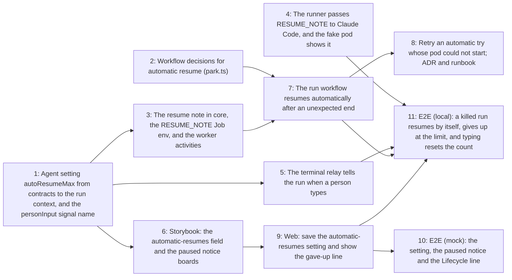

<!-- dev-plan: kind=plan id=pod-crash-auto-resume rev=1 hash=69b2d975c978 spec=docs/superpowers/specs/2026-11-20-pod-crash-auto-resume-design.md spec-hash=0ae4cec009a7 -->
# Automatic resume after an unexpected pod end Implementation Plan

> **For agentic workers:** REQUIRED SUB-SKILL: Use superpowers:subagent-driven-development (recommended) or superpowers:executing-plans to implement this plan task-by-task. Steps use checkbox (`- [ ]`) syntax for tracking.

**Goal:** A run whose pod dies after the agent started (U1 to U5) resumes by itself through the existing Resume path, up to a per-agent limit (`autoResumeMax`, default 5). Typing in the terminal or pressing Resume starts the count again. Each automatic try adds an event-log line, the paused notice says when the tries ran out, and every resume after an unexpected end gives the agent a short fixed note.

**Architecture:** The shared pieces land first: the agent column, its contract and API, the run context field, and the `personInput` signal name. Next come the parts that do not touch each other's files, built in parallel: the pure workflow decisions in `park.ts`; the core note builder with the Job env and the worker activities; the runner and fake pod passing the note to Claude Code; the terminal relay's typing signal; and the Storybook boards. The run workflow then wires these together behind `patched('auto-resume')`. A second workflow task adds the timed retry for a pod that could not start, with the ADR. The web wiring and both e2e suites come last.

**Tech Stack:** TypeScript (strict), Zod 4, Drizzle + Postgres, NestJS/Fastify (terminal WebSocket relay), Temporal TypeScript SDK 1.25 (`patched`, signals, updates, durable timers), `@kubernetes/client-node`, bash (runner entrypoint), React 19 + TanStack Query, MSW, Storybook, Vitest, Playwright.

**Spec:** `docs/superpowers/specs/2026-11-20-pod-crash-auto-resume-design.md`. Read it with this plan. The approved boards `design/prototype/project/{DeskAgentAutoResume,DeskAgentAutoResumeChanged,DeskAgentAutoResumeError,RunStoppedPodLost,RunStoppedPodLostGaveUp,RunStoppedPodLostGaveUpOnce,RunStoppedCrashedGaveUp,RunStoppedAutoResumeWaiting,RunStoppedAutoResumeFailedGaveUp,RunRunningAutoResume}.dc.html` decide layout and copy. Where the spec and a board differ, the board wins.

## Global Constraints

- AGENTS.md rules 1 to 11 bind every task. Layering is `apps → core → db → contracts`, and `web → contracts` only. Names stay generic (`autoResumeMax`, `auto_resume`, `personInput`). The agent column is read and written only through the existing scoped agent queries and `withOrg`.
- No new dependency: no package, library, service, image, CI action, binary or workspace package.
- Setting bounds: `AGENT_AUTO_RESUME_MAX_MIN = 0`, `AGENT_AUTO_RESUME_MAX_MAX = 10`, `AGENT_AUTO_RESUME_MAX_DEFAULT = 5`. Message, verbatim: "Automatic resumes must be between 0 and 10". 0 turns automatic resume off.
- Migration: `packages/db/migrations/0021_agent_auto_resume_max.sql` adds `agents.auto_resume_max integer not null default 5` with `check (auto_resume_max between 0 and 10)`, named `agents_auto_resume_max_check`. Existing agents get 5. Never edit 0000 to 0020.
- Unexpected ends are exactly the parks with `pauseReason` `pod_lost` or `agent_crashed` after the agent started. Kinds: `killed`, `lost`, `signal`, `session_gone`, `agent_exit`.
- Note, verbatim. Automatic resume: `Agent Desk: your last session was killed (<bracket>). Resumed, try <try>/<max>. Background processes and /tmp are gone.` A person's Resume: `Agent Desk: your last session was killed (<bracket>). Resumed. Background processes and /tmp are gone.`
- Brackets, verbatim: `killed` + `OOMKilled` → `OOMKilled, exit 137, limit <RUN_POD_MEMORY_LIMIT>`; `killed` + another usable reason → `<reason>, exit <code>`; `killed` with no usable reason → `exit <code>`; `lost` → `pod lost, no exit code`; `signal` → `SIGTERM from outside`; `session_gone` → `terminal session died`; `agent_exit` → `agent CLI exited with code <code>`. The code is the pod's real exit code from the cluster, never the end line's.
- The cluster's reason word is used only when it matches `^[A-Za-z]{1,40}$`. Otherwise it is left out. The note holds fixed text plus an integer exit code, that word and the configured memory limit. It never holds pod output, ticket text or repo text.
- Event payloads (type `lifecycle`): `{ kind: 'auto_resume', try, max, text: 'The last session was killed (<bracket>). Resuming automatically, try <try> of <max>.' }` and `{ kind: 'auto_resume_gave_up', tries, text: 'Gave up resuming automatically after <tries> tries.' }` (see the Agent call on "1 try").
- Pod env `RESUME_NOTE`, on resume Jobs only. The runner passes it as one quoted argv element: `claude --permission-mode bypassPermissions [--model …] --continue "<note>"`. Deploy order: the runner image goes live before the worker sends `RESUME_NOTE`. An older image ignores it.
- Workflow: patch id `auto-resume`, read once right after `stop-session`'s patch. Runs started before it keep today's behaviour. Signal `personInput`, no arguments. It resets the count and changes nothing else.
- Retry wait after a try whose pod could not start: 1, 2, 4, 8 minutes, then 10 minutes at most, on a durable workflow timer. "No saved session" and "agent or credential missing" are never retried.
- Terminal relay: `personInput` is sent at most once a minute per run, only for a run terminal with a passed authorization and a live exec session, and only for input that still has bytes after CSI, OSC, DCS, SS3 and bracketed-paste sequences are stripped.
- Copy, verbatim: "Automatic resumes after a crash"; "How many times in a row a run resumes by itself after its pod is killed or the agent crashes. Typing in the terminal or pressing Resume starts the count again. 0 turns it off."; "Tried to resume automatically N times." and "Tried to resume automatically 1 time.".
- **Storybook first (a blocker from the spec's "UI and Storybook" section, not an ordering preference):** no task that implements or wires this UI in `apps/web/src/{app,features}` starts before the Storybook task (Task 6) is merged and reviewed. Task 9, the task that wires this UI, lists Task 6 under **Depends on**.
- Sensitive tasks (label `review:sensitive`, high-effort security review): Task 1 (migration), Task 3 (resume Job env), Task 4 (runner resume command), Task 5 (terminal relay), Task 7 and Task 8 (run Job lifecycle in the workflow).
- Before every commit: `devbox run fix` until it prints `fix: clean.`. Conventional Commits with the package as scope. Each task is one branch and one PR.

## Review Focus

1. **A browser tab left open on a crashing run.** xterm.js answers terminal queries and reconnects to every new pod by itself. A person expects that to never reset the count, so the run still gives up at the limit. Tests in Task 5: `isPersonTyping` returns false for CPR, DA, an OSC colour reply, focus in/out, SGR and X10 mouse reports, and for arrow keys (CSI only). The gateway sends no `personInput` for them.
2. **A strange reason word from the cluster** (`OOM Killed`, `OOMKilled;rm`, 41 letters, `''`, `null`, `ÖOMKilled`). A person expects the note and the event line to leave the word out and keep the exit code. Test in Task 3 (`usablePodReason drops anything outside ^[A-Za-z]{1,40}$`, and the bracket falls back to `exit <code>`).
3. **A stale note on a later resume.** A run crashed, resumed fine, then the idle timer paused it and a person presses Resume. A person expects no "your last session was killed" note on that resume. Test in Task 7 (`after a resumed session came up, a later idle park sends no note on the next Resume`).
4. **A resumed pod that dies before its session starts** (for example OOM-killed during start-up). A person expects that to count as a try that could not start: retried after the wait, and given up at the limit, never a loop. Test in Task 8 (`a resumed pod that exits 137 before session started uses a try and is retried after 1 minute`).
5. **Finish, Cancel or a person's Resume during the wait between tries.** A person expects Finish to succeed, Cancel to cancel, and a person's Resume to run at once with the count at 0. No automatic try may start afterwards when the old timer would have fired. Tests in Task 8 (`Finish during the retry wait succeeds and no try starts after 1 minute`, `a person's Resume during the retry wait runs at once and resets the count`).

## Needs approval

None. No new package, library, service, image, CI action, binary or workspace package.

## Agent calls made while planning

- Agent call: the workflow treats a `RunContext` without `autoResumeMax` as 0 (off). Reason: `loadRun` always sets it, and every test harness and any context built without it keep today's behaviour.
- Agent call: `SIGNAL.personInput` goes into `packages/core/src/temporal-names.ts` in Task 1. Reason: the API relay (Task 5) and the workflow (Task 7) both need the literal, and putting it first lets them run in parallel.
- Agent call: Task 1 also sets the agent's limit to 0 in the existing local e2e specs and the `scripts/e2e-local.ts` crash scenario, all of which expect a crashed or killed run to stay paused. Reason: the default 5 would make them resume by themselves once Task 7 lands. Pinning them in the task that adds the setting keeps main green and keeps what they test.
- Agent call: the unexpected-end kinds and the `UnexpectedEnd` type are defined in `packages/core/src/kube/resume-note.ts` and mirrored in `apps/worker/src/workflows/park.ts`. A Task 7 test asserts the two kind lists are equal. Reason: workflow code cannot import core, the same reason `END_REASONS` is mirrored.
- Agent call: an end line `stop_request` that the workflow did not ask for (not `ending`) counts as kind `killed`, with the pod's exit code and reason. Reason: `endOutcome` parks it as `pod_lost`, the parity test needs a kind, and the exit code is the only fact the cluster vouches for.
- Agent call: `killed` facts are `exitCode` and `podReason`; `agent_exit` facts are `exitCode`; `lost`, `signal` and `session_gone` carry the kind only. Reason: those are the only facts their brackets print.
- Agent call: the bracket builder drops an exit code that is not an integer from 0 to 255. A `killed` end with neither a code nor a usable reason reads `exit unknown`. Reason: rule 6 asks for checked values only, and the note must still say something true.
- Agent call: the gave-up event text says "1 try" for one try and "<n> tries" otherwise. Reason: it matches the spec's own singular rule for the paused notice ("1 time").
- Agent call: `recordAutoResume` refuses input whose `max` is outside 1 to 10, whose `try` is outside 1 to `max`, or whose `tries` is outside 1 to 10 (non-retryable). Reason: the values come from workflow state, and a bad one means a bug, not something to store.
- Agent call: the relay sends `personInput` through a new `TerminalTarget.onPersonInput` hook that uses the run target's existing retrying send. The once-a-minute entry for a run is dropped when its last socket closes. Reason: targets already own their signals, and the map must not grow forever.
- Agent call: the workflow work is two tasks. Task 7 delivers automatic resume. A try that fails there posts the `paused` comment and waits for a person. Task 8 adds the timed retry for a pod that could not start, plus the ADR and runbook. Reason: together they are over 500 lines in the same files. The retry is its own decision (its own Agent call in the spec), so a reviewer can accept or reject it separately.
- Agent call: one Storybook task (Task 6) covers both screens. Reason: `canvas.json`, `storyIds.ts`, `scripts/parity.mjs`, `viewports.ts` and the 41-board count in `src/test/coverage.test.ts` are shared by every new board, so two Storybook tasks would edit the same files.
- Agent call: Task 6 also makes `limitsOf` in `features/desk/agent.form.ts` read `autoResumeMax`. The save path stays in Task 9. Reason: adding the field to the screen's `LimitField` breaks `limitsOf`'s type otherwise. Between the two merges the field shows its stored value, but a changed value is not sent.
- Agent call: the paused notice's line is a new optional session field `autoResumeGaveUp?: string` (the finished sentence), shown as a third line under `detail`. Reason: the screen stays a dumb renderer of text, like `headline` and `detail`.
- Agent call: the web shows the gave-up line only when the payload's `tries` is an integer from 1 to 10. Otherwise it shows nothing. Reason: the spec says a malformed payload shows nothing, and 10 is the setting's maximum.
- Agent call: the 10 new boards are added to `canvas.json` after the last board of their group (run boards after `RunIdleEnding`, desk boards after `DeskAgentAddressChanged`). They use the boards' own `<title>` and size (run boards 1440×900, desk boards 1440×1480), and `viewports.ts` gains the 1440×1480 artboard. Reason: the boards are drawn at those sizes and no layout was specified.
- Agent call: the mocked-e2e runs live in a new `apps/web/src/mocks/dto/autoResumeRuns.ts` (run numbers 99 to 104), seeded in `msw/browser.ts` like `lifecycleRuns.ts`. The "without the line" case reuses the existing `KILLED_RUN` (71). Reason: no edits to fixture files that other specs rely on.
- Agent call: the local e2e kills the pod with the fake pod's existing `hardkill` file. The fake gateway then reports exit 137 with reason `Error`, so the local note reads `(Error, exit 137)`. Reason: it is the existing way to kill a fake pod from outside, and the spec's assertions do not depend on the reason word.
- Agent call: the new ADR is `docs/adr/0028-unexpected-pod-ends-resume-automatically.md`, the next free number, written in Task 8.

---

<!-- dev-plan:graph:begin -->
## Task graph

Generated by `dev-plan.mjs graph --write` from each task's **Depends on:** line. Do not edit it by hand.
Tasks in the same wave touch no common file and can be built in parallel; a task starts when everything it depends on is merged.

| Wave | Task | Depends on |
| ---- | ---- | ---------- |
| 1 | Task 1: Agent setting autoResumeMax from contracts to the run context, and the personInput signal name | none |
| 1 | Task 2: Workflow decisions for automatic resume (park.ts) | none |
| 1 | Task 4: The runner passes RESUME_NOTE to Claude Code, and the fake pod shows it | none |
| 2 | Task 3: The resume note in core, the RESUME_NOTE Job env, and the worker activities | Task 1 |
| 2 | Task 5: The terminal relay tells the run when a person types | Task 1 |
| 2 | Task 6: Storybook: the automatic-resumes field and the paused notice boards | Task 1 |
| 3 | Task 7: The run workflow resumes automatically after an unexpected end | Task 2, Task 3 |
| 3 | Task 9: Web: save the automatic-resumes setting and show the gave-up line | Task 6 |
| 4 | Task 8: Retry an automatic try whose pod could not start; ADR and runbook | Task 7 |
| 4 | Task 10: E2E (mock): the setting, the paused notice and the Lifecycle line | Task 9 |
| 4 | Task 11: E2E (local): a killed run resumes by itself, gives up at the limit, and typing resets the count | Task 4, Task 5, Task 7, Task 9 |


<!-- dev-plan:graph:end -->

### Task 1: Agent setting `autoResumeMax` from contracts to the run context, and the `personInput` signal name

**Depends on:** none

**Files:**

- Modify: `packages/contracts/src/schemas/agents.ts`
- Modify: `packages/contracts/src/schemas/agents.test.ts`
- Modify: `packages/db/src/schema/app.ts`
- Create: `packages/db/migrations/0021_agent_auto_resume_max.sql` (generated, then checked)
- Create: `packages/db/migrations/meta/0021_snapshot.json` (generated)
- Modify: `packages/db/migrations/meta/_journal.json` (generated)
- Modify: `packages/db/test/migrate.int.test.ts`
- Modify: `apps/api/src/agents/agents.service.ts`
- Modify: `apps/api/test/agents.int.test.ts`
- Modify: `apps/worker/src/activities/run.activities.ts`
- Modify: `apps/worker/src/activities/run.activities.impl.ts`
- Modify: `apps/worker/test/run.activities.int.test.ts`
- Modify: `packages/core/src/temporal-names.ts`
- Modify: `apps/web/src/mocks/dto/agents.ts`
- Modify: `apps/web/src/mocks/msw/handlers.ts`
- Modify: `apps/web/src/features/desk/agent.form.test.ts`
- Modify: `apps/web/src/features/desk/agent.route.test.tsx`
- Modify: `apps/web/src/features/desk/map.test.ts`
- Modify: `apps/web/e2e/local/helpers.ts`
- Modify: `apps/web/e2e/local/run.spec.ts`
- Modify: `apps/web/e2e/local/run-model.spec.ts`
- Modify: `apps/web/e2e/local/transcript.spec.ts`
- Modify: `scripts/e2e-local.ts`

**Interfaces:**

- Consumes: nothing new.
- Produces (`@agentdesk/contracts`):

```ts
/** Automatic resumes after an unexpected pod end, in a row (spec 2026-11-20): 0 (off) to 10, default 5. */
export const AGENT_AUTO_RESUME_MAX_MIN = 0;
export const AGENT_AUTO_RESUME_MAX_MAX = 10;
export const AGENT_AUTO_RESUME_MAX_DEFAULT = 5;
// AgentDto, after idleEndSeconds:
autoResumeMax: z.number().int(),
// PutAgentRequest, after idleEndSeconds (absent keeps the stored value):
autoResumeMax: z.number().int().min(0, { message: 'Automatic resumes must be between 0 and 10' })
  .max(10, { message: 'Automatic resumes must be between 0 and 10' }).optional(),
```

- Produces (`@agentdesk/db`): `agents.autoResumeMax` (`integer('auto_resume_max').notNull().default(5)`) and `check('agents_auto_resume_max_check', sql\`${t.autoResumeMax} between 0 and 10\`)`.
- Produces (worker): `RunContext.autoResumeMax?: number`, with the doc "Automatic resumes in a row after an unexpected pod end; the agent's `autoResumeMax` (`AGENT_AUTO_RESUME_MAX_DEFAULT` when the agent row is gone). Read once when the run starts." `loadRun` always sets it.
- Produces (core): `SIGNAL.personInput = 'personInput'`, with the doc "RunWorkflow: a person typed into the run's terminal; resets the automatic-resume count. No args."
- Produces (local e2e): `export async function setAutoResumeMax(page: Page, projectId: string, value: number): Promise<void>` in `apps/web/e2e/local/helpers.ts`. It reads the agent, then `PUT /api/projects/:projectId/agent` with its `model`, `timeoutSeconds` and `autoResumeMax: value`, and expects 200.

- [x] **Step 1: Write the failing contract tests** in `agents.test.ts`

```ts
expect(PutAgentRequest.parse({ model: 'opus', timeoutSeconds: 3600 }).autoResumeMax).toBeUndefined();
for (const v of [0, 5, 10]) expect(PutAgentRequest.parse({ model: 'opus', timeoutSeconds: 3600, autoResumeMax: v }).autoResumeMax).toBe(v);
for (const v of [-1, 11, 2.5]) {
  const r = PutAgentRequest.safeParse({ model: 'opus', timeoutSeconds: 3600, autoResumeMax: v });
  expect(r.success).toBe(false);
}
// -1 and 11 carry exactly 'Automatic resumes must be between 0 and 10' at path ['autoResumeMax'].
expect([AGENT_AUTO_RESUME_MAX_MIN, AGENT_AUTO_RESUME_MAX_MAX, AGENT_AUTO_RESUME_MAX_DEFAULT]).toEqual([0, 10, 5]);
// AgentDto requires autoResumeMax (a fixture without it fails to parse).
```

- [x] **Step 2: Run** `pnpm --filter @agentdesk/contracts test agents`. Expected: FAIL (`autoResumeMax` not in the schema).
- [x] **Step 3: Add the constants and both fields** in `packages/contracts/src/schemas/agents.ts`, next to the idle-end ones.
- [x] **Step 4: Run** the same command. Expected: PASS.
- [x] **Step 5: Write the failing migration test** in `migrate.int.test.ts`: `agents.auto_resume_max defaults to 5 for new and existing agents and is limited to 0 to 10`. Copy the shape of the idle-end test: inserts with `auto_resume_max=-1` and `=11` reject with `code: '23514'` and `constraint: 'agents_auto_resume_max_check'`; `0` and `10` succeed; a row inserted without the column reads 5; and the SQL file `0021_agent_auto_resume_max.sql` adds exactly that column and that check.
- [x] **Step 6: Add the Drizzle column and check** in `packages/db/src/schema/app.ts` (beside `idleEndSeconds`). Then run `pnpm --filter @agentdesk/db db:generate -- --name agent_auto_resume_max`. Check that the SQL holds only the `ADD COLUMN "auto_resume_max" integer DEFAULT 5 NOT NULL` and `ADD CONSTRAINT "agents_auto_resume_max_check" CHECK (... between 0 and 10)` statements, like `0015_agent_idle_end.sql`.
- [x] **Step 7: Run** `pnpm --filter @agentdesk/db test:integration migrate`. Expected: PASS.
- [x] **Step 8: Write the failing API tests** in `apps/api/test/agents.int.test.ts`:
  - `GET` shows `autoResumeMax: 5`.
  - `PUT` with `autoResumeMax: 2` saves it, and a later `PUT` without it keeps 2 (`expectContract('agents.get', …)` shows 2).
  - `PUT` with `autoResumeMax` -1 or 11 is a 400 whose errors include pointer `/autoResumeMax`.
- [x] **Step 9: Map the field** in `agents.service.ts`: `toDto` sets `autoResumeMax: row.autoResumeMax`, and `put` sets `autoResumeMax: body.autoResumeMax` (undefined is skipped). Run `pnpm --filter @agentdesk/api test:integration agents`. Expected: PASS.
- [x] **Step 10: Write the failing `loadRun` tests** in `run.activities.int.test.ts`: the "returns the run context" expectation gains `autoResumeMax: 5`; `takes autoResumeMax from the agent row` (`update agents set auto_resume_max = 2` → 2); `uses AGENT_AUTO_RESUME_MAX_DEFAULT when the agent row is gone` → 5.
- [x] **Step 11: Add the field** to `RunContext`, and have `loadRun` select `agents.autoResumeMax` and set `autoResumeMax: row.autoResumeMax ?? AGENT_AUTO_RESUME_MAX_DEFAULT`. Run `pnpm --filter @agentdesk/worker test:integration run.activities.int`. Expected: PASS.
- [x] **Step 12: Add `SIGNAL.personInput`** to `packages/core/src/temporal-names.ts`.
- [x] **Step 13: Keep the web compiling.** Add `autoResumeMax: 5` to every `AgentDto` literal: `mocks/dto/agents.ts`, the agent row `handlers.ts` creates with a new project, `agent.form.test.ts`, `agent.route.test.tsx` and `desk/map.test.ts`. The `agents.put` handler sets `agent.autoResumeMax = body.autoResumeMax ?? agent.autoResumeMax`. Run `pnpm --filter @agentdesk/web typecheck && pnpm --filter @agentdesk/web test`. Expected: PASS.
- [x] **Step 14: Pin the existing crash specs to "off".** Add `setAutoResumeMax` to `helpers.ts`. Call `setAutoResumeMax(page, projectId, 0)` before the run is triggered in these places:
  - `run.spec.ts`: `a --fake-fail run pauses with "agent crashed (exit code 3)" and offers Resume`, and `an outage longer than the window parks the run with its work kept and it can be resumed`.
  - `run-model.spec.ts`: `startPausedRun`.
  - `transcript.spec.ts`: `killedMidTurn` (BR-52) and `TC-56.2`.

  In `scripts/e2e-local.ts` `failureScenario`, PUT the agent with `autoResumeMax: 0` after `setup` (same body shape as the helper).
- [x] **Step 15: Run the changed local specs** with the stack up (tests-and-e2e.md §3a), for example `pnpm --filter @agentdesk/web exec playwright test e2e/local/run.spec.ts -g "fake-fail run pauses"`, and the same for each title above. `scripts/e2e-local.ts` has no filter, so run it once with `pnpm test:e2e:local`. Expected: PASS, unchanged behaviour. If the stack cannot start, say so in the PR and list the specs.
- [x] **Step 16: Typecheck and test the touched packages** (`contracts`, `db`, `api`, `worker`, `core`, `web`), then commit: `feat(contracts): agent autoResumeMax setting with its column, API and run context`.

---

### Task 2: Workflow decisions for automatic resume (`park.ts`)

**Depends on:** none

**Files:**

- Modify: `apps/worker/src/workflows/park.ts`
- Modify: `apps/worker/test/park.test.ts`

**Interfaces:**

- Consumes: `EndOutcomeInput`, `endOutcome`, `ParkKind` (already in `park.ts`).
- Produces (all exported from `apps/worker/src/workflows/park.ts`, workflow-safe, type imports only):

```ts
/** Mirrors UNEXPECTED_END_KINDS in @agentdesk/core (workflow code cannot import core); a test asserts equality. */
export const UNEXPECTED_END_KINDS = ['killed', 'lost', 'signal', 'session_gone', 'agent_exit'] as const;
export type UnexpectedEndKind = (typeof UNEXPECTED_END_KINDS)[number];
export interface UnexpectedEnd { kind: UnexpectedEndKind; exitCode?: number; podReason?: string }
/** The U1–U5 kind and its facts, in `endOutcome`'s order; undefined for any end that is not unexpected. */
export function unexpectedEndOf(input: EndOutcomeInput & { podReason?: string }): UnexpectedEnd | undefined;
export type AutoResumeDecision = 'resume' | 'gave_up' | 'off';
/** off: max <= 0 or the park kind is done; gave_up: streak >= max; else resume. */
export function autoResumeDecision(streak: number, max: number, parkKind: ParkKind): AutoResumeDecision;
export const AUTO_RESUME_WAIT_MAX_SECONDS = 600;
/** Wait before the next try after `failedStarts` tries in a row whose pod could not start: 60, 120, 240, 480, then 600. */
export function autoResumeWaitSeconds(failedStarts: number): number;
/** `automatic`: the current resume was started by the workflow; a cancel before its session is up stops the run. */
export function cancelEffect(phase: RunPhase, kind: ParkKind | undefined, sessionUp: boolean, automatic?: boolean):
  'stop_run' | 'abort_resume' | 'ignore';
```

Mapping (Agent calls above): `podLost` → `{ kind: 'lost' }`. No end line and a non-zero code → `{ kind: 'killed', exitCode, podReason }`. End line `signal` → `{ kind: 'signal' }`. `session_gone` → `{ kind: 'session_gone' }`. `stop_request` while not ending → `killed`. `agent_exit` with a non-zero code → `{ kind: 'agent_exit', exitCode }`. `podReason` is copied only when given; absent facts are left out, never set to `undefined`.

- [x] **Step 1: Write the failing tests** in `park.test.ts`:

```ts
const base = { ending: false, finishRequested: false, phase: 'running' as const, podLost: false, exitCode: 137 };
expect(unexpectedEndOf({ ...base, podReason: 'OOMKilled' })).toEqual({ kind: 'killed', exitCode: 137, podReason: 'OOMKilled' });
expect(unexpectedEndOf({ ...base, podLost: true, exitCode: -1 })).toEqual({ kind: 'lost' });
expect(unexpectedEndOf({ ...base, endReason: 'signal', exitCode: 143 })).toEqual({ kind: 'signal' });
expect(unexpectedEndOf({ ...base, endReason: 'session_gone', exitCode: 0 })).toEqual({ kind: 'session_gone' });
expect(unexpectedEndOf({ ...base, endReason: 'agent_exit', exitCode: 1 })).toEqual({ kind: 'agent_exit', exitCode: 1 });
expect(unexpectedEndOf({ ...base, endReason: 'stop_request', exitCode: 0 })).toEqual({ kind: 'killed', exitCode: 0 });
// expected ends give undefined: ending (Finish, idle timer, Stop), exit 0 with no end line, agent_exit code 0
expect(unexpectedEndOf({ ...base, ending: true, parkKind: 'needs_input' })).toBeUndefined();
expect(unexpectedEndOf({ ...base, exitCode: 0 })).toBeUndefined();
expect(unexpectedEndOf({ ...base, endReason: 'agent_exit', exitCode: 0 })).toBeUndefined();
```

  - `parity with endOutcome`: over the cross product of `ending`, `finishRequested`, `parkKind` (undefined, needs_input, done), `endReason` (undefined plus each of `END_REASONS`), `podLost` and `exitCode` (-1, 0, 1, 137), `unexpectedEndOf(i) !== undefined` equals `endOutcome(i)` being a park with reason `pod_lost` or `agent_crashed`.
  - `autoResumeDecision`: `(0, 5, 'needs_input')` → `'resume'`; `(4, 5, 'needs_input')` → `'resume'`; `(5, 5, 'needs_input')` → `'gave_up'`; `(0, 0, 'needs_input')` → `'off'`; `(0, 5, 'done')` → `'off'`.
  - `autoResumeWaitSeconds`: `[1, 2, 3, 4, 5, 9].map(autoResumeWaitSeconds)` equals `[60, 120, 240, 480, 600, 600]`.
  - `cancelEffect`: `('resuming', 'needs_input', false, true)` → `'stop_run'`; `('resuming', 'needs_input', false, false)` → `'abort_resume'`; with `automatic` omitted the existing cases are unchanged.
- [x] **Step 2: Run** `pnpm --filter @agentdesk/worker test park`. Expected: FAIL (not exported).
- [x] **Step 3: Implement** the four exports and the `cancelEffect` parameter in `park.ts`. `unexpectedEndOf` follows `endOutcome`'s branches one for one, so the parity test pins it.
- [x] **Step 4: Run** the same command. Expected: PASS.
- [x] **Step 5: Typecheck and commit:** `feat(worker): decisions for resuming a run after an unexpected pod end`.

---

### Task 3: The resume note in core, the `RESUME_NOTE` Job env, and the worker activities

**Depends on:** Task 1

**Files:**

- Create: `packages/core/src/kube/resume-note.ts`
- Create: `packages/core/test/kube/resume-note.test.ts`
- Modify: `packages/core/src/kube/index.ts`
- Modify: `packages/core/src/kube/job-spec.ts`
- Modify: `packages/core/test/kube/job-spec.test.ts`
- Modify: `apps/worker/src/activities/run.activities.ts`
- Modify: `apps/worker/src/activities/run.activities.impl.ts`
- Modify: `apps/worker/src/activities/session.activity.ts`
- Modify: `apps/worker/test/session.activity.int.test.ts`
- Modify: `apps/worker/test/run.activities.int.test.ts`
- Modify: `apps/worker/test/helpers/run-workflow-harness.ts`

**Interfaces:**

- Consumes: `RunContext` (Task 1), `Config.RUN_POD_MEMORY_LIMIT` (exists), `appendRunEvent`.
- Produces (core, exported through `kube/index.ts`):

```ts
export const UNEXPECTED_END_KINDS = ['killed', 'lost', 'signal', 'session_gone', 'agent_exit'] as const;
export type UnexpectedEndKind = (typeof UNEXPECTED_END_KINDS)[number];
export interface UnexpectedEnd { kind: UnexpectedEndKind; exitCode?: number; podReason?: string }
/** `try`/`max` only on an automatic resume. */
export interface ResumeNoteInput { end: UnexpectedEnd; try?: number; max?: number }
export const POD_REASON_PATTERN = /^[A-Za-z]{1,40}$/;
/** The reason word when it matches POD_REASON_PATTERN, else undefined. */
export function usablePodReason(reason: string | null | undefined): string | undefined;
/** The bracket of the spec's §4 table; `memoryLimit` is RUN_POD_MEMORY_LIMIT. Re-checks podReason and exitCode. */
export function resumeBracket(end: UnexpectedEnd, memoryLimit: string): string;
export function resumeNoteText(note: ResumeNoteInput, memoryLimit: string): string;
export function autoResumeEventText(input: { end: UnexpectedEnd; try: number; max: number }, memoryLimit: string): string;
export function autoResumeGaveUpText(tries: number): string;
// RunJobInput gains:
/** Fixed note text from resumeNoteText; env RESUME_NOTE on a resume only. */
resumeNote?: string;
```

- Produces (worker activity interface, `run.activities.ts`):

```ts
import type { ResumeNoteInput, UnexpectedEnd } from '@agentdesk/core';
// FollowPodLogsResult gains:
/** The run pod's kill reason (`terminated.reason`, else the pod's `status.reason`) when it matches ^[A-Za-z]{1,40}$. */
podReason?: string;
// createRunSecretAndJob opts gain `note?: ResumeNoteInput` (used only with resume: true).
export type RecordAutoResumeInput =
  | { event: 'resume'; try: number; max: number; end: UnexpectedEnd; at: string }
  | { event: 'gave_up'; tries: number; at: string };
/** Appends one `lifecycle` event: `auto_resume` or `auto_resume_gave_up` (fixed text, §3). */
recordAutoResume(ctx: RunContext, input: RecordAutoResumeInput): Promise<void>;
```

- Produces (test harness): `run-workflow-harness.ts` `activities()` implements `recordAutoResume`. It pushes `'recordAutoResume'` to `s.calls` and the input to a new `Script.autoResumes: RecordAutoResumeInput[]`. `Script.createOpts` already records every `createRunSecretAndJob` option, so `note` is visible there.

- [x] **Step 1: Write the failing core tests** in `resume-note.test.ts`, with memory limit `'3Gi'`:

```ts
expect(resumeBracket({ kind: 'killed', exitCode: 137, podReason: 'OOMKilled' }, '3Gi')).toBe('OOMKilled, exit 137, limit 3Gi');
expect(resumeBracket({ kind: 'killed', exitCode: 1, podReason: 'Error' }, '3Gi')).toBe('Error, exit 1');
expect(resumeBracket({ kind: 'killed', exitCode: 1 }, '3Gi')).toBe('exit 1');
expect(resumeBracket({ kind: 'killed', exitCode: 137, podReason: 'OOM Killed' }, '3Gi')).toBe('exit 137');
expect(resumeBracket({ kind: 'killed' }, '3Gi')).toBe('exit unknown');
expect(resumeBracket({ kind: 'killed', exitCode: 300, podReason: 'Error' }, '3Gi')).toBe('Error');
expect(resumeBracket({ kind: 'lost' }, '3Gi')).toBe('pod lost, no exit code');
expect(resumeBracket({ kind: 'signal' }, '3Gi')).toBe('SIGTERM from outside');
expect(resumeBracket({ kind: 'session_gone' }, '3Gi')).toBe('terminal session died');
expect(resumeBracket({ kind: 'agent_exit', exitCode: 1 }, '3Gi')).toBe('agent CLI exited with code 1');
const oom = { kind: 'killed', exitCode: 137, podReason: 'OOMKilled' } as const;
expect(resumeNoteText({ end: oom, try: 1, max: 5 }, '3Gi')).toBe(
  'Agent Desk: your last session was killed (OOMKilled, exit 137, limit 3Gi). Resumed, try 1/5. Background processes and /tmp are gone.');
expect(resumeNoteText({ end: oom }, '3Gi')).toBe(
  'Agent Desk: your last session was killed (OOMKilled, exit 137, limit 3Gi). Resumed. Background processes and /tmp are gone.');
expect(autoResumeEventText({ end: oom, try: 1, max: 5 }, '3Gi')).toBe(
  'The last session was killed (OOMKilled, exit 137, limit 3Gi). Resuming automatically, try 1 of 5.');
expect(autoResumeGaveUpText(5)).toBe('Gave up resuming automatically after 5 tries.');
expect(autoResumeGaveUpText(1)).toBe('Gave up resuming automatically after 1 try.');
```

  - `usablePodReason drops anything outside ^[A-Za-z]{1,40}$` (Review Focus 2): `'OOMKilled'` and `'A'.repeat(40)` are kept. `'OOM Killed'`, `'OOMKilled;rm'`, `'A'.repeat(41)`, `''`, `null`, `undefined` and `'ÖOMKilled'` all give undefined.
  - In `job-spec.test.ts`: a resume with `resumeNote: 'x "y" $(z)'` has env `{ name: 'RESUME_NOTE', value: 'x "y" $(z)' }`. A resume without a note has no `RESUME_NOTE`. A fresh start given `resumeNote` has no `RESUME_NOTE`.
- [x] **Step 2: Run** `pnpm --filter @agentdesk/core test resume-note job-spec`. Expected: FAIL.
- [x] **Step 3: Implement** `resume-note.ts`, export it from `kube/index.ts`, and add `resumeNote` to `buildRunJob`. It is appended to the resume env list only when `input.resume && input.resumeNote`.
- [x] **Step 4: Run** the same command. Expected: PASS.
- [x] **Step 5: Write the failing activity tests.**
  - In `session.activity.int.test.ts`, `describe('recordAutoResume')`:
    - `{ event: 'resume', try: 1, max: 5, end: { kind: 'killed', exitCode: 137, podReason: 'OOMKilled' }, at }` appends one `lifecycle` event with payload exactly `{ kind: 'auto_resume', try: 1, max: 5, text: 'The last session was killed (OOMKilled, exit 137, limit 2Gi). Resuming automatically, try 1 of 5.' }` (test config memory limit) and `ts` = `at`.
    - `{ event: 'gave_up', tries: 5, at }` appends `{ kind: 'auto_resume_gave_up', tries: 5, text: 'Gave up resuming automatically after 5 tries.' }`.
    - `max: 11`, `try: 0`, `try: 6` with `max: 5`, `tries: 0` and `at: 'nope'` reject as non-retryable and append nothing.
    - A missing run, or a context of another org (RLS hides the run), rejects with `run not found` and appends nothing.
  - In `run.activities.int.test.ts` `resume mode`:
    - `createRunSecretAndJob(ctx, { resume: true, note: { end: { kind: 'agent_exit', exitCode: 1 } } })` starts the fake pod with env `RESUME_NOTE` = `'Agent Desk: your last session was killed (agent CLI exited with code 1). Resumed. Background processes and /tmp are gone.'`.
    - With `try: 2, max: 5` it reads `… Resumed, try 2/5. …`.
    - A resume without `note` has no `RESUME_NOTE`.
    - A fresh start with `note` has no `RESUME_NOTE`.
  - In `followPodLogs` (`session end marker and a vanished pod`): a pod whose process is killed from outside (the fake gateway reports exit 137, reason `Killed`) returns `podReason: 'Killed'`. A pod that exits 0 has no `podReason`.
- [x] **Step 6: Implement.**
  - `recordAutoResume` goes in `session.activity.ts` (`withOrg` + `appendRunEvent`, like `recordEndingDeadline`), with `SessionActivityDeps.config` widened to `RUN_POD_MEMORY_LIMIT`. It is listed in `SessionActivityImpls` and wrapped as `recordAutoResume: guarded('record auto resume', session.recordAutoResume)`.
  - `createRunSecretAndJob` passes `resumeNote: resume && opts.note ? resumeNoteText(opts.note, deps.config.RUN_POD_MEMORY_LIMIT) : undefined`.
  - `waitForExit` keeps the `reason` of its last `getRunPod` read beside the code (and beside `gone`). Both `done` results set `podReason` when `usablePodReason(reason)` is defined.
  - Add the `recordAutoResume` stub to `run-workflow-harness.ts`.
- [x] **Step 7: Run** `pnpm --filter @agentdesk/worker test:integration session.activity run.activities.int` and `pnpm --filter @agentdesk/worker typecheck`. Expected: PASS.
- [x] **Step 8: Commit** (one commit per package): `feat(core): resume note text and RESUME_NOTE on the resume Job`, then `feat(worker): recordAutoResume, the pod kill reason, and the note on the resume Job`.

---

### Task 4: The runner passes `RESUME_NOTE` to Claude Code, and the fake pod shows it

**Depends on:** none

**Files:**

- Modify: `images/runner/agents/claude/commands.sh`
- Modify: `images/runner/entrypoint.sh` (header comment only)
- Modify: `images/runner/test/entrypoint.test.ts`
- Modify: `packages/core/src/kube/fake-pod.mjs`
- Modify: `packages/core/test/kube/fake-pod.test.ts`

**Interfaces:**

- Consumes: env `RESUME_NOTE` (Task 3 sets it; this task only reads it, so nothing here waits for Task 3).
- Produces: `AGENT_RESUME_CMD='exec claude --permission-mode bypassPermissions ${AGENT_MODEL:+--model "$AGENT_MODEL"} --continue ${RESUME_NOTE:+"$RESUME_NOTE"}'`. On `RUN_MODE=resume` with a non-empty `RESUME_NOTE`, the fake pod writes the note plus `\r\n` to the pane right after it replays the saved pane, so it is the continued session's first message.

- [ ] **Step 1: Spike (spec §5, left to the builder).** On the pinned Claude Code (`CLAUDE_CODE_VERSION=2.1.323` in `images/runner/Dockerfile`), check by hand that an interactive `claude --continue "<text>"` continues the saved conversation and sends the text as the next message. Write what you ran and saw in the PR. If it does not behave so, stop and bring it back for review. If no credential can be used where you work, say so in the PR and leave the PR as draft until a human runs the spike.
- [x] **Step 2: Write the failing runner tests** in `entrypoint.test.ts`:
  - The `RESUME_CMD` constant becomes the new command string.
  - `resume with RESUME_NOTE passes it as one argv element after --continue`. Use `RESUME_NOTE: 'Agent Desk: killed (OOMKilled, exit 137). "q" $(touch /tmp/pwn) `back` ; rm -rf /'`, then `argvOf(...)` ends with `['--continue', <that exact string>]` and no `/tmp/pwn` file exists.
  - `resume without RESUME_NOTE ends with --continue` (the existing `--model` case keeps passing).
  - `a fresh start ignores RESUME_NOTE`: argv ends with the prompt only.
  - The header comment of `entrypoint.sh` names `RESUME_NOTE` (a text check, like the other env names).
- [x] **Step 3: Run** `pnpm --filter @agentdesk/runner test entrypoint`. Expected: FAIL.
- [x] **Step 4: Change** `AGENT_RESUME_CMD`. Add `RESUME_NOTE (optional, resume only: one message sent as the continued session's first prompt)` to the header comment.
- [x] **Step 5: Write the failing fake pod tests** in `fake-pod.test.ts`. A resume with `RESUME_NOTE: 'Agent Desk: note 1'` and a saved session has a pane that ends with `Agent Desk: note 1\r\n` after the replayed content. A resume without it has a pane equal to the saved pane. A resume with no saved session (exit 79) writes no note.
- [x] **Step 6: Implement** the fake pod line (the note is untrusted-looking env: only written to the pane file, never executed), and update the fake pod's header comment.
- [x] **Step 7: Run** `pnpm --filter @agentdesk/runner test && pnpm --filter @agentdesk/core test fake-pod`. Expected: PASS.
- [x] **Step 8: Commit:** `feat(runner): pass RESUME_NOTE to claude --continue`, then `test(core): fake pod shows the resume note`.

---

### Task 5: The terminal relay tells the run when a person types

**Depends on:** Task 1

**Files:**

- Create: `apps/api/src/terminal/typing.ts`
- Create: `apps/api/src/terminal/typing.test.ts`
- Modify: `apps/api/src/terminal/terminal-targets.ts`
- Modify: `apps/api/src/terminal/terminal.gateway.ts`
- Modify: `apps/api/test/terminal.int.test.ts`

**Interfaces:**

- Consumes: `SIGNAL.personInput` (Task 1).
- Produces:

```ts
// typing.ts
/** True when the input still has bytes after CSI (7-bit and 8-bit 0x9B), OSC and DCS (up to BEL or ST), SS3, and
 *  bracketed-paste markers are removed; an X10 mouse report (ESC [ M + 3 bytes) is removed whole. */
export function isPersonTyping(bytes: Uint8Array): boolean;
// terminal-targets.ts, TerminalTarget gains:
/** A person typed into this target's terminal (best effort; the run target signals personInput). */
onPersonInput?(id: string): Promise<void>;
// TerminalGateway gains the test seam:
personInputIntervalMs = 60_000;
```

- [x] **Step 1: Write the failing unit tests** in `typing.test.ts`. Use `const b = (s: string) => new TextEncoder().encode(s)`, and `Uint8Array.of(0x9b, 0x41)` for 8-bit CSI.
  - True for: `'a'`, `'\r'`, `'\x7f'` (Backspace), `'\x03'` (Ctrl-C), `'\x1b'` (Esc alone), `'\x1bx'` (Alt-x), `'\x1b[200~pasted text\x1b[201~'`, `'\x1b[Ahello'`.
  - False for (Review Focus 1): `'\x1b[12;40R'` (CPR), `'\x1b[?1;2c'` (DA), `'\x1b]11;rgb:1e1e/1e1e/1e1e\x1b\\'` and `'\x1b]10;rgb:ffff/ffff/ffff\x07'` (OSC colour replies), `'\x1bP1$r0m\x1b\\'` (DCS), `'\x1b[I'` and `'\x1b[O'` (focus), `'\x1b[<0;10;5M'` (SGR mouse), `'\x1b[M !!'` (X10 mouse), `'\x1bOA'` (SS3), `'\x1b[A\x1b[B'` (arrow keys), `Uint8Array.of(0x9b, 0x41)`, and an empty array.
- [x] **Step 2: Run** `pnpm --filter @agentdesk/api test:unit typing`. Expected: FAIL.
- [x] **Step 3: Implement** `isPersonTyping` as a byte scanner, one pass with no regex over decoded text. An unterminated OSC or DCS consumes the rest of the chunk.
- [x] **Step 4: Run** the same command. Expected: PASS.
- [x] **Step 5: Write the failing gateway tests** in `terminal.int.test.ts`, using `signalsFor(runId, SIGNAL.personInput)`:
  - An authorized run socket with a live session that sends `'ls\r'` → exactly one `personInput` with no args.
  - Two typed chunks within the interval → still one. After `gateway.personInputIntervalMs` elapses (set it to 50 ms in the test) another typed chunk → two.
  - `'\x1b[12;40R'` only → none.
  - A socket refused by authorization (4401/4403) that sends bytes → none.
  - A setup-test terminal that sends `'ls\r'` → none.
  - A failing signal (`t.temporal.signalHook` throws) leaves the relay working: later output still reaches the socket.
- [x] **Step 6: Implement.**
  - `runTarget` gets `onPersonInput: (id) => send(id, SIGNAL.personInput, [])`.
  - `onInput` writes to the session first. Then, only if `conn.session` is set, `conn.target.onPersonInput` exists and `isPersonTyping(buf)` holds, it checks `lastPersonInput: Map<string, number>` keyed by `terminalKey(conn.target, conn.runId)` against `personInputIntervalMs`. It records the time before sending and fires `onPersonInput(conn.runId).catch(() => undefined)` without awaiting.
  - Delete the map entry when the last socket of that key is unregistered.
- [x] **Step 7: Run** `pnpm --filter @agentdesk/api test:integration terminal && pnpm --filter @agentdesk/api typecheck`. Expected: PASS.
- [x] **Step 8: Commit:** `feat(api): signal personInput when a person types in a run terminal`.

---

### Task 6: Storybook: the automatic-resumes field and the paused notice boards

**Depends on:** Task 1

**Files:**

- Modify: `apps/web/src/screens/DeskAgent.tsx`
- Modify: `apps/web/src/screens/RunTerminalArea.tsx`
- Modify: `apps/web/src/screens/desk.stories.tsx`
- Modify: `apps/web/src/screens/runDetail.stories.tsx`
- Modify: `apps/web/src/screens/desk.test.tsx`
- Modify: `apps/web/src/screens/runDetail.test.tsx`
- Modify: `apps/web/src/screens/storyIds.ts`
- Modify: `apps/web/src/screens/viewports.ts`
- Modify: `apps/web/src/mocks/types.ts`
- Modify: `apps/web/src/mocks/agent.ts`
- Modify: `apps/web/src/mocks/runDetail.tsx`
- Modify: `apps/web/src/mocks/terminal.ts`
- Modify: `apps/web/src/mocks/mocks.test.ts`
- Modify: `apps/web/src/test/coverage.test.ts`
- Modify: `apps/web/scripts/parity.mjs`
- Modify: `design/prototype/project/canvas.json`
- Modify: `apps/web/src/features/desk/agent.form.ts` (`limitsOf` only)
- Modify: `apps/web/src/features/desk/agent.form.test.ts`

This task is the spec's **Storybook-first blocker**. Task 9 (the wiring) may not start until it is merged and reviewed.

**Interfaces:**

- Consumes: `AgentDto.autoResumeMax` (Task 1), for `limitsOf`.
- Produces (screens and mocks, used by Task 9):

```ts
// screens/DeskAgent.tsx
export type LimitField = 'timeoutMinutes' | 'pausedKeepMinutes' | 'doneKeepMinutes' | 'idleEndMinutes'
  | 'maxConcurrent' | 'maxRunsPerTicket' | 'autoResumeMax';
// mocks/types.ts
AgentSettings.autoResumeMax: number;
RunDetailData.session.autoResumeGaveUp?: string; // "Tried to resume automatically N times.", a third line under `detail`
// features/desk/agent.form.ts
limitsOf(agent, project).autoResumeMax === agent.autoResumeMax
```

Screen behaviour, as drawn:
- The Limits grid's last field, after "Runs per ticket", is "Automatic resumes after a crash" with the spec's help text. It is a numeric `TextInput` with the same `narrow` style as "Runs per ticket". Its value is `String(settings.autoResumeMax)`, its error is `limitsErrors.autoResumeMax`, and it is sent as `autoResumeMax: Number(…)` in `onSaveLimits`.
- `PausedNotice` (via `SessionLines`) renders `session.autoResumeGaveUp` as a third line after `detail`.

Stories (all fed from `@/mocks`, each matching its board):

| Board (canvas.json) | Story export | Title | Fixture |
| --- | --- | --- | --- |
| `DeskAgentAutoResume` | `DeskAgentAutoResume` | Screens/Desk | `agentSettings` (autoResumeMax 5) |
| `DeskAgentAutoResumeChanged` | `DeskAgentAutoResumeChanged` | Screens/Desk | autoResumeMax 2 |
| `DeskAgentAutoResumeError` | `DeskAgentAutoResumeError` | Screens/Desk | typed 12, `limitsErrors.autoResumeMax: 'Automatic resumes must be between 0 and 10'` |
| `RunStoppedPodLost` | `RunStoppedPodLost` | Screens/Run detail | paused pod_lost, read-only Transcript, no gave-up line |
| `RunStoppedPodLostGaveUp` | `RunStoppedPodLostGaveUp` | Screens/Run detail | + "Tried to resume automatically 5 times." |
| `RunStoppedPodLostGaveUpOnce` | `RunStoppedPodLostGaveUpOnce` | Screens/Run detail | + "Tried to resume automatically 1 time." |
| `RunStoppedCrashedGaveUp` | `RunStoppedCrashedGaveUp` | Screens/Run detail | "Paused: agent crashed (exit code 1)" + 5 times |
| `RunStoppedAutoResumeWaiting` | `RunStoppedAutoResumeWaiting` | Screens/Run detail | `resumeFailure: 'Resume failed: the pod could not start'`, no line |
| `RunStoppedAutoResumeFailedGaveUp` | `RunStoppedAutoResumeFailedGaveUp` | Screens/Run detail | that bar + 5 times |
| `RunRunningAutoResume` | `RunRunningAutoResume` | Screens/Run detail | running; Lifecycle "Pod running", "Claude Code started", the `auto_resume` text, "Pod running", "Session resumed"; terminal's first message is the note "Agent Desk: your last session was killed (OOMKilled, exit 137, limit 3Gi). Resumed, try 1/5. Background processes and /tmp are gone." |

Registration (all four together): `canvas.json` boards and `order` (see the Agent call on placement), `storyIds.ts` `boardStories` in canvas order, the `parity.mjs` story lists (`'StoppedPodLost'`, … in the Run list, `'AgentAutoResume'`, … in the Desk list), and `viewports.ts` artboard `[1440, 1480]`. In `coverage.test.ts`, "41 boards" and `toHaveLength(41)` become 51.

- [x] **Step 1: Write the failing screen tests.**
  - In `desk.test.tsx`: the Limits section has a textbox named "Automatic resumes after a crash" with value `'5'`, its help text is the spec's verbatim, and it is the last field of the grid. With `limitsErrors.autoResumeMax` set, the input has `aria-invalid="true"` and the message shows under the help text. Typing 2 and pressing Save limits calls `onSaveLimits` with `autoResumeMax: 2`.
  - In `runDetail.test.tsx`: a paused notice with `autoResumeGaveUp` shows that text after the detail line, beside Resume and Finish. Without it, the notice is unchanged.
  - In `agent.form.test.ts`: `limitsOf({ ...agent, autoResumeMax: 2 }, project).autoResumeMax` is 2.
- [x] **Step 2: Run** `pnpm --filter @agentdesk/web test desk.test runDetail.test agent.form`. Expected: FAIL.
- [x] **Step 3: Implement** the screen field, the notice line, the `mocks/types.ts` fields, `agentSettings.autoResumeMax = 5`, and `limitsOf`.
- [x] **Step 4: Add the fixtures and the 10 stories, and register the boards.** Fixtures go in `mocks/runDetail.tsx` (new `runDetails` keys with the same names as the boards; extend `mocks.test.ts`'s status map with them) and `mocks/terminal.ts` (the resumed terminal lines).
- [ ] **Step 5: Run** `pnpm --filter @agentdesk/web test && pnpm --filter @agentdesk/web typecheck`. Expected: PASS, including `coverage.test.ts` with 51 boards.
- [ ] **Step 6: Visual check:** `pnpm --filter @agentdesk/web build-storybook && pnpm --filter @agentdesk/web parity`. Compare the 10 new `parity-out/<board>.{story,proto}.png` pairs and fix any differences in layout or copy. Do not commit `storybook-static/` or `parity-out/`.
- [x] **Step 7: Commit:** `feat(web): Storybook boards for automatic resume after a crash`.

---

### Task 7: The run workflow resumes automatically after an unexpected end

**Depends on:** Task 2, Task 3

**Files:**

- Modify: `apps/worker/src/workflows/run.workflow.ts`
- Modify: `apps/worker/src/workflows/signals.ts`
- Modify: `apps/worker/test/gate.workflow.test.ts`
- Modify: `apps/worker/test/run.workflow.in-process.test.ts`
- Create: `apps/worker/test/run.workflow.auto-resume.test.ts`
- Modify: `apps/worker/test/helpers/run-workflow-harness.ts`
- Create: `apps/worker/test/fixtures/run-auto-resume-history.json` (recorded)

**Interfaces:**

- Consumes:
  - `unexpectedEndOf`, `autoResumeDecision`, `cancelEffect(…, automatic)` and `UNEXPECTED_END_KINDS` (Task 2).
  - `RecordAutoResumeInput`, `recordAutoResume`, `createRunSecretAndJob` opt `note`, `FollowPodLogsResult.podReason` and core `UNEXPECTED_END_KINDS` (Task 3).
  - `RunContext.autoResumeMax` and `SIGNAL.personInput` (Task 1).
- Produces:
  - `signals.ts`: `export const personInput = defineSignal<[]>('personInput');`.
  - Workflow behaviour (internal names are the builder's): with `patched('auto-resume')` read once right after `stopSessionPatch`, the workflow keeps `autoResumeStreak`, `lastEnd: UnexpectedEnd | undefined` and `resumeIsAutomatic`.

Behaviour, where `run()` gets a `park` decision with reason `pod_lost` or `agent_crashed` and the patch is on:

1. `lastEnd = unexpectedEndOf({ ...the endOutcome input, podReason })`, then `autoResumeDecision(autoResumeStreak, c.autoResumeMax ?? 0, decision.parkKind)`.
2. `resume`: `park()` runs as today but **skips the `paused` comment**. After it is parked with a kept session: `autoResumeStreak += 1`; `act.recordAutoResume(c, { event: 'resume', try: autoResumeStreak, max, end: lastEnd, at })`; then it accepts a resume itself (`resumeAccepted = true`, a fresh `resumeScope`, `resumeAbortReason = undefined`, `resumeIsAutomatic = true`). The parked loop runs `resumeAttempt` at once.
3. `gave_up`: `park()` as today (comment posted), then `recordAutoResume(c, { event: 'gave_up', tries: autoResumeStreak, at })`.
4. `off`: `park()` exactly as today.

More rules:
- `resumeAttempt` passes `note: { end: lastEnd, ...(resumeIsAutomatic ? { try: autoResumeStreak, max } : {}) }` to `createRunSecretAndJob` whenever `lastEnd` is set. On success it clears `lastEnd` and `resumeIsAutomatic`.
- If an automatic attempt fails in this task, it clears `resumeIsAutomatic` and posts the `paused` comment (it was skipped at the park). The run then waits for a person. Task 8 replaces this for "could not start".
- The `resumeRun` handler sets `autoResumeStreak = 0` and `resumeIsAutomatic = false`. The `personInput` handler sets `autoResumeStreak = 0` and nothing else (no epoch bump). Both apply only with the patch.
- `stop('cancelled')` passes `resumeIsAutomatic` to `cancelEffect`, so Cancel during an automatic try (no session up) cancels the run.

- [ ] **Step 1: Write the failing equality tests** in `gate.workflow.test.ts`: `expect(SIGNAL.personInput).toBe(signals.personInput.name)`, and `UNEXPECTED_END_KINDS` from `park.ts` equals core's `UNEXPECTED_END_KINDS`.
- [ ] **Step 2: Write the failing in-process tests** in `run.workflow.in-process.test.ts`. Add a `recordAutoResume` stub to `start()` that records its inputs, and let `start()` take `autoResumeMax`.
  - `a pod_lost park with autoResumeMax 5 resumes at once, without the paused comment`. Run to running, then exit `{ exitCode: 137, agentStarted: true, podReason: 'OOMKilled' }`. Expect:
    - `h.parks` to show reason `pod_lost`;
    - the auto-resume inputs to equal `[{ event: 'resume', try: 1, max: 5, end: { kind: 'killed', exitCode: 137, podReason: 'OOMKilled' }, at: expect.any(String) }]`;
    - `h.comments` to have no `paused`;
    - `h.createOpts.at(-1)` to match `{ resume: true, note: { end: { kind: 'killed', exitCode: 137, podReason: 'OOMKilled' }, try: 1, max: 5 } }`;
    - the statuses to go `paused`, `queued`, `starting`, then `idle` after `sessionStarted`.
  - `agent_crashed (agent_exit 1) also resumes, with kind agent_exit`.
  - `the try number goes up while nobody interacts`: three unexpected ends in a row give tries 1, 2, 3.
  - `at the limit the run stays paused with the gave_up event and the paused comment`: with max 2, the third end gives inputs `[resume 1, resume 2, { event: 'gave_up', tries: 2 }]`, exactly one `paused` comment, and phase `parked`.
  - `personInput resets the count`: max 1, end → try 1; then `sendSignal(personInput)`; end → try 1 again (not gave_up).
  - `a person's Resume resets the count`: max 1, end → try 1 → end → gave_up. A person's `resumeRun` succeeds, then the next end → `resume`, try 1.
  - `a person's Resume after an unexpected end sends the note without try`: max 0. End → parked with no auto-resume calls and the paused comment. `resumeRun` → `createOpts.at(-1).note` equals `{ end: { kind: 'killed', exitCode: 137 } }`, with no `try` or `max`.
  - `after a resumed session came up, a later idle park sends no note on the next Resume` (Review Focus 3).
  - `autoResumeMax 0 behaves as today` and `an absent autoResumeMax behaves as today`: no `recordAutoResume`, and the paused comment is posted.
  - `a done park is not resumed`: phase `agent_done`, the pod is lost, so it parks as done with no auto-resume.
  - `an idle-timer park, a Stop and a Finish never resume automatically`.
  - `Cancel during an automatic try cancels the run`: hold the resume slot (`holdResumeSlot`) and send `cancel`. The outcome is `cancelled`, and `restoreParked` is not called.
  - `Cancel during a person's Resume still only takes it back`: the existing test keeps passing.
  - `a failed automatic try posts the paused comment once and waits`: the resume create throws `NoAgentCredential`, so `restoreParked` runs, one `paused` comment is posted, and the run stays parked.
  - `a run started before the patch keeps today's behaviour`: `runtime.unpatched.add('auto-resume')`, max 5, an end parks with the comment and no auto-resume.
- [ ] **Step 3: Write the failing Temporal-env tests** in `run.workflow.auto-resume.test.ts`, with the harness (`startHarness`/`stopHarness`):
  - `a pod_lost park resumes by itself and comes back to idle`: capture it as `captured['run-auto-resume']`.
  - `at the limit (max 1) a second loss leaves the run paused with gave_up and the paused comment`.
  - `personInput between losses lets the run resume again`.
  - `replay: histories from this run and the checked-in fixtures replay without nondeterminism`: same shape as the resuming test. It replays `run-auto-resume` and every existing fixture (`run-pod-lost`, `run-park-resume`, `run-stop-session`, …), which proves runs started before the patch replay unchanged.
- [ ] **Step 4: Run** `pnpm --filter @agentdesk/worker test run.workflow.in-process gate.workflow` and `pnpm --filter @agentdesk/worker test run.workflow.auto-resume`. Expected: FAIL.
- [ ] **Step 5: Implement** the signal, the patch, the state, the `run()` decision, the `park()` changes (comment skip, auto start, gave-up event), the note in `resumeAttempt`, the resets and the cancel rule in `run.workflow.ts`. Record the fixture with `UPDATE_REPLAY_FIXTURES=1 pnpm --filter @agentdesk/worker test run.workflow.auto-resume`.
- [ ] **Step 6: Run** both commands again, plus every existing `run.workflow.*` test file. Expected: PASS.
- [ ] **Step 7: Typecheck and commit:** `feat(worker): resume a run automatically after an unexpected pod end`.

---

### Task 8: Retry an automatic try whose pod could not start; ADR and runbook

**Depends on:** Task 7

**Files:**

- Modify: `apps/worker/src/workflows/run.workflow.ts`
- Modify: `apps/worker/test/run.workflow.in-process.test.ts`
- Modify: `apps/worker/test/run.workflow.auto-resume.test.ts`
- Modify: `apps/worker/test/helpers/run-workflow-harness.ts`
- Create: `docs/adr/0028-unexpected-pod-ends-resume-automatically.md`
- Modify: `docs/adr/README.md`
- Modify: `docs/runbooks/runner-pod.md`

**Interfaces:**

- Consumes: `autoResumeWaitSeconds` and `autoResumeDecision` (Task 2), and the Task 7 workflow state.
- Produces (behaviour). `resumeAttempt` reports why it failed as one of `could_not_start` ("the pod could not start", which includes `RunJobStillPresent` after retries, Pending past 2 minutes, a pod that ended before `session started`, and the hard timer before the session), `no_session` (exit 79), `no_credential`, or `aborted` (a person's cancel). After a failed **automatic** attempt:
  - `could_not_start` with `autoResumeDecision(autoResumeStreak, max, kind) === 'resume'`: the run stays parked (paused, with today's "Resume failed: the pod could not start" event) and a durable timer waits `autoResumeWaitSeconds(failedStartsInARow)` seconds inside the parked loop, together with the existing finish, drop, resume and expiry wake-ups. When the timer fires and nothing else happened, the next automatic try starts with step 2's start (streak + 1, `auto_resume` event, accept), without a new park.
  - `could_not_start` with no tries left: `recordAutoResume(gave_up, tries: autoResumeStreak)`, then the `paused` comment.
  - `no_session` or `no_credential`: the `paused` comment, no retry.
  - The count of starts that failed in a row is reset when a session comes up or a person's Resume is accepted.

- [ ] **Step 1: Write the failing in-process tests**, using `fireTimer` and `pendingTimers`:
  - `a try whose pod could not start uses a try and is retried after 1 minute`: max 3, the resume create throws a non-retryable start failure. Expect one `restoreParked` with reason `the pod could not start`, no `paused` comment, and `pendingTimers()` contains `60_000`. `fireTimer(60_000)` → inputs `[resume 1, resume 2]`.
  - `the waits grow 1, 2, 4, 8, 10 minutes`: max 10, every start fails. The timers seen in order are `60_000`, `120_000`, `240_000`, `480_000`, `600_000`, `600_000`.
  - `at the limit after failed starts it gives up with gave_up and one paused comment`: max 2 → `[resume 1, resume 2, gave_up 2]`, then one `paused` comment and no timer.
  - `a resumed pod that exits 137 before session started uses a try and is retried after 1 minute` (Review Focus 4).
  - `no saved session is not retried and posts the paused comment` (`resumeFailed: true`).
  - `a missing agent or credential is not retried and posts the paused comment`.
  - `Finish during the retry wait succeeds and no try starts after 1 minute` (Review Focus 5).
  - `a person's Resume during the retry wait runs at once and resets the count` (Review Focus 5). If that resume then fails, no automatic retry follows.
  - `Cancel during the retry wait cancels the run`.
  - `the kept session's expiry during the wait expires the run as today`.
- [ ] **Step 2: Add one Temporal-env test** in `run.workflow.auto-resume.test.ts`: `an automatic try that could not start is retried after the wait and comes up`. Add a harness knob, `Script.resumeCreateFailFirst?: number`: the first N resumed `createRunSecretAndJob` calls throw a non-retryable start failure. With N = 1 and max 3, the second automatic try comes up (`auto_resume` tries 1 and 2, back to `idle`). Skip the 1-minute wait with the harness's `skipUntil`. No activity is in flight while the run is parked, so time skipping applies.
- [ ] **Step 3: Run** `pnpm --filter @agentdesk/worker test run.workflow.in-process run.workflow.auto-resume`. Expected: FAIL.
- [ ] **Step 4: Implement** the failure kind in `resumeAttempt`, the retry wait in the parked loop and the gave-up path. Remove Task 7's "any failed automatic try posts the comment" branch where `could_not_start` now retries.
- [ ] **Step 5: Run** the same command and every `run.workflow.*` file. Expected: PASS, including the replay tests.
- [ ] **Step 6: Write the ADR and runbook.**
  - `0028-unexpected-pod-ends-resume-automatically.md`, "Unexpected pod ends resume automatically, up to a per-agent limit": Status Accepted, Date 2026-11-20, Source the spec. It amends 0023. It records U1 to U5, approach A and the two rejected ones, the count and its reset (typing or Resume), the note and its fixed wording, the retry wait for a pod that could not start, and that Cancel during an automatic try cancels the run.
  - Add a `README.md` row.
  - In `runner-pod.md`, change "the run shows as paused" to: it resumes by itself up to the agent's "Automatic resumes after a crash" (default 5), then shows as paused.
- [ ] **Step 7: Typecheck and commit:** `feat(worker): retry an automatic resume whose pod could not start`, then `docs(adr): 0028 unexpected pod ends resume automatically`.

---

### Task 9: Web: save the automatic-resumes setting and show the gave-up line

**Depends on:** Task 6

**Files:**

- Modify: `apps/web/src/features/desk/agent.form.ts`
- Modify: `apps/web/src/features/desk/agent.form.test.ts`
- Modify: `apps/web/src/features/desk/agent.route.test.tsx`
- Modify: `apps/web/src/features/runs/detail.map.ts`
- Modify: `apps/web/src/features/runs/detail.map.test.ts`

**Interfaces:**

- Consumes:
  - `LimitField` with `autoResumeMax`, `AgentSettings.autoResumeMax`, `session.autoResumeGaveUp` and `limitsOf` (Task 6).
  - `PutAgentRequest.autoResumeMax` and the 400 pointer `/autoResumeMax` (Task 1).
  - The `auto_resume_gave_up` payload `{ kind, tries, text }` (Task 3).
- Produces:
  - `LimitsRequests.autoResumeMax?: number`, `LIMIT_POINTERS['/autoResumeMax'] = 'autoResumeMax'`.
  - `hasLimitChanges` counts it, and `saveAgent` sends it only when changed and updates `base.current.autoResumeMax` from the saved agent.
  - In `detail.map.ts`: `AutoResumeGaveUpPayload = z.object({ kind: z.literal('auto_resume_gave_up'), tries: z.number().int().min(1).max(10) })`.
  - `sessionOf` sets `autoResumeGaveUp` for a paused `pod_lost` or `agent_crashed` run when scanning back from the newest event finds that payload before any `status` event other than `paused`.
  - `resumeFailure` ignores `auto_resume_gave_up` events, as it ignores comments, when it picks the newest event.

- [ ] **Step 1: Write the failing tests.**
  - In `agent.form.test.ts`: `limitsRequests(base, { ...base, autoResumeMax: 2 })` equals `{ autoResumeMax: 2 }`; an unchanged value sends nothing; `hasLimitChanges({ autoResumeMax: 0 })` is true.
  - In `agent.route.test.tsx`: `saving 2 automatic resumes sends autoResumeMax 2 and shows it after a reload` (PUT body `{ model: 'opus', timeoutSeconds: 1800, autoResumeMax: 2 }`); `12 automatic resumes shows "Automatic resumes must be between 0 and 10" on the field and saves nothing`.
  - In `detail.map.test.ts`, for a paused `pod_lost` run:
    - Events `status paused`, `lifecycle pod_exit 137`, `lifecycle auto_resume_gave_up tries 5`, `comment` → `session.autoResumeGaveUp === 'Tried to resume automatically 5 times.'`, and the headline is still `Paused: the pod was killed, most likely out of memory (exit code 137)`.
    - `tries 1` → `'Tried to resume automatically 1 time.'`.
    - `agent_crashed` with tries 5 → the line plus `Paused: agent crashed (exit code 1)`.
    - No event → no line. `tries: 0`, `tries: 11`, `tries: '5'` or no `tries` → no line.
    - A `status running` after the event → no line. An `idle_timeout` pause with the event → no line.
    - `status paused`, `resume_failed 'the pod could not start'`, `auto_resume_gave_up 5`, `comment` → `resumeFailure: 'Resume failed: the pod could not start'` and the line.
    - `… resume_failed` with no gave-up → the bar and no line (the waiting state).
- [ ] **Step 2: Run** `pnpm --filter @agentdesk/web test agent.form agent.route detail.map`. Expected: FAIL.
- [ ] **Step 3: Implement** the form changes in `agent.form.ts` and the payload, `sessionOf` and `resumeFailure` changes in `detail.map.ts`.
- [ ] **Step 4: Run** the same command, then `pnpm --filter @agentdesk/web typecheck && pnpm --filter @agentdesk/web test`. Expected: PASS.
- [ ] **Step 5: Commit:** `feat(web): save automatic resumes and show when automatic resume gave up`.

---

### Task 10: E2E (mock): the setting, the paused notice and the Lifecycle line

**Depends on:** Task 9

**Files:**

- Create: `apps/web/src/mocks/dto/autoResumeRuns.ts`
- Create: `apps/web/src/mocks/dto/autoResumeRuns.test.ts`
- Modify: `apps/web/src/mocks/msw/browser.ts`
- Create: `apps/web/e2e/mock/auto-resume.spec.ts`

**Interfaces:**

- Consumes: the wired screens (Task 9) and the MSW `agents.put` handler (Task 1).
- Produces: the browser-mock runs of invoicer-api, built like `lifecycleRuns.ts`, with exported numbers:
  - `GAVE_UP_RUN = 99`: pod_lost, gave_up 5.
  - `GAVE_UP_ONCE_RUN = 100`: pod_lost, gave_up 1.
  - `CRASHED_GAVE_UP_RUN = 101`: agent_crashed exit 1, gave_up 5.
  - `AUTO_WAITING_RUN = 102`: auto_resume, queued, starting, paused, then resume_failed "the pod could not start".
  - `AUTO_FAILED_GAVE_UP_RUN = 103`: as 102, plus gave_up 5 and the paused comment.
  - `AUTO_RESUMED_RUNNING_RUN = 104`: running, with the Lifecycle events of the `RunRunningAutoResume` board.

  `browser.ts` seeds them with `mockDb.addRuns(autoResumeRunFixtures, autoResumeEventFixtures)`.

- [ ] **Step 1: Write the fixture test** `autoResumeRuns.test.ts`: every run and event parses through `RunDto` / `RunEventDto`, and `toRunDetail` reads each as the state it stands for (for example run 99's `session.autoResumeGaveUp` is `'Tried to resume automatically 5 times.'`). Run `pnpm --filter @agentdesk/web test autoResumeRuns`. Expected: FAIL, then PASS after Step 2.
- [ ] **Step 2: Add the fixtures and the seeding.**
- [ ] **Step 3: Write the mock specs** in `auto-resume.spec.ts`, one `test` per case:
  - `Automatic resumes after a crash shows 5 by default with its help text`.
  - `a saved change to 2 is shown again after leaving the page`. Fill 2, press Save limits, see "Limits saved", leave by the "Routing rules" link and come back, and the value is `'2'`.
  - `12 is refused with "Automatic resumes must be between 0 and 10", the field marked invalid, and nothing saved`.
  - `a killed run with automatic resume off or not tried shows no gave-up line`. Open `KILLED_RUN` (71): "Tried to resume automatically" has count 0, and Resume and Finish are visible.
  - `a run that gave up after 5 tries shows "Tried to resume automatically 5 times."` (run 99), under the headline and the "Paused … Can be resumed for …" line.
  - `a run that gave up after 1 try shows "Tried to resume automatically 1 time."` (run 100).
  - `a crashed run that gave up shows "Paused: agent crashed (exit code 1)" and the 5-times line` (run 101).
  - `while waiting between tries the page shows "Resume failed: the pod could not start" and no gave-up line` (run 102).
  - `when the last try could not start the page shows the Resume failed bar and the gave-up line` (run 103).
  - `a running run's Lifecycle list shows the automatic resume line`. Run 104's side panel Lifecycle shows "The last session was killed (OOMKilled, exit 137, limit 3Gi). Resuming automatically, try 1 of 5." between "Claude Code started" and "Pod running".
- [ ] **Step 4: Run** `pnpm --filter @agentdesk/web exec vite build --mode mock`, then `pnpm --filter @agentdesk/web exec playwright test e2e/mock/auto-resume.spec.ts`. Expected: PASS.
- [ ] **Step 5: Commit:** `test(web): mock e2e for automatic resume after a crash`.

---

### Task 11: E2E (local): a killed run resumes by itself, gives up at the limit, and typing resets the count

**Depends on:** Task 4, Task 5, Task 7, Task 9

**Files:**

- Create: `apps/web/e2e/local/auto-resume.spec.ts`
- Modify: `apps/web/e2e/local/helpers.ts`

**Interfaces:**

- Consumes:
  - `setAutoResumeMax` and `touchPodFile(runId, 'hardkill')` (helpers).
  - The fake pod's note (Task 4), `personInput` from the relay (Task 5), the workflow (Task 7) and the gave-up line (Task 9).
- Produces: `export async function lifecycleTexts(page: Page, runId: string): Promise<string[]>` in `helpers.ts`. It reads `GET /api/runs/:runId/log` (`RunLogResponse`) and returns each `lifecycle` payload's `text`, the same way `lifecycleKinds` reads kinds.

- [ ] **Step 1: Write the local specs** in `auto-resume.spec.ts`, each on its own project (`signInAndCreateProject`) and cancelling its run at the end (best effort):
  - `a killed run comes back to Needs you by itself, logs "Resuming automatically, try 1 of 5" and shows the note`.
    1. Start `/code-review` and wait for `idle`. `touchPodFile(runId, 'hardkill')`.
    2. Poll `lifecycleTexts` until it contains a text matching `/^The last session was killed \(Error, exit 137\)\. Resuming automatically, try 1 of 5\.$/`.
    3. Wait for `idle` again. On the run page the header shows "Needs you", and the "Claude Code terminal" group contains `Agent Desk: your last session was killed (Error, exit 137). Resumed, try 1/5. Background processes and /tmp are gone.`
  - `with the limit at 1, a second kill leaves the run paused with "Tried to resume automatically 1 time."`. `setAutoResumeMax(page, projectId, 1)` before the comment. Kill → back to `idle` (try 1 of 1). Kill again without typing → `paused` with `pauseReason` `pod_lost`. The page shows "Tried to resume automatically 1 time." beside Resume and Finish. Keep the "limit 1, kill, wait for idle, kill, wait for paused" steps in a local helper of the spec, `gaveUpOnce(page)`, so the last test can reuse them.
  - `typing in the terminal between kills lets the run resume again`. Limit 1. Kill → back to `idle`. Open the live terminal, type `hello` and press Enter, and wait for the fake reply. Kill again → back to `idle`, with a second `try 1 of 1` text in `lifecycleTexts` and no gave-up line.
  - `a person's Resume after the limit shows the note without a try number`. Reach the gave-up state with `gaveUpOnce(page)`, then press Resume. The terminal contains `Agent Desk: your last session was killed (Error, exit 137). Resumed. Background processes and /tmp are gone.` and no text matching `/Resumed, try \d+\/\d+/` after the reconnect.
- [ ] **Step 2: Add** `lifecycleTexts` to `helpers.ts`.
- [ ] **Step 3: Run** the new spec with the stack up: `pnpm --filter @agentdesk/web exec playwright test e2e/local/auto-resume.spec.ts`. Expected: PASS. If the stack truly cannot start, say so in the PR and list these four specs as written but not run.
- [ ] **Step 4: Commit:** `test(web): local e2e for automatic resume after a pod is killed`.

Not proved by e2e: the retry wait of 1 to 10 minutes after a try whose pod could not start (Task 8). The fake stack cannot hold a Job in deletion on purpose, and a real wait takes minutes. The lowest layer that proves it is Task 8's in-process workflow tests with fired timers and its Temporal-env test.
