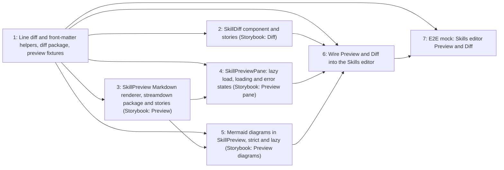

<!-- dev-plan: kind=plan id=skills-review-diff rev=1 hash=ea14f84895f7 spec=docs/superpowers/specs/2026-11-20-skills-review-diff-design.md spec-hash=b33d86d46056 -->
# Skills editor Preview and Diff views Implementation Plan

> **For agentic workers:** REQUIRED SUB-SKILL: Use superpowers:subagent-driven-development (recommended) or superpowers:executing-plans to implement this plan task-by-task. Steps use checkbox (`- [ ]`) syntax for tracking.

**Goal:** In the Desk Skills editor, Preview shows the editor's current text as formatted, read-only Markdown (tables and Mermaid diagrams included), and Diff shows in one column how that text differs from the skill as last loaded from main.

**Architecture:** Web app only. Two pure helpers (`lineDiff` on top of `diff`, `splitFrontMatter`) and the mock fixtures land first. Then three presentational component groups, each with its stories: `SkillDiff`; `SkillPreview` (the only module importing `streamdown` and `@streamdown/mermaid`), which gains Mermaid in its own task; and `SkillPreviewPane`, which lazy-loads `SkillPreview` and owns its loading and error states. `DeskSkills` then renders `CodeEditor`, `SkillPreviewPane` or `SkillDiff` from the same draft. A mock Playwright spec proves it in a real browser.

**Tech Stack:** React 19, TypeScript (strict), CSS Modules with `ds/tokens.css`, `diff` 9.0.0, `streamdown` 2.8.0, `@streamdown/mermaid` 1.0.4, `mermaid` 11.17.2, Storybook 10, Vitest + Testing Library (jsdom), MSW, Playwright (mock mode).

**Spec:** `docs/superpowers/specs/2026-11-20-skills-review-diff-design.md`. Read it with this plan. Its "Rendering untrusted skill text" section is binding on Tasks 3 and 5.

## Global Constraints

- AGENTS.md rules bind every task. Layering stays `web → contracts`. No contract, API, worker, core, db or route change. Nothing in `apps/web/src/app` or `apps/web/src/features` changes.
- Dependencies, approved by the human in writing, added to `apps/web/package.json` `dependencies` with `^` ranges and locked at exactly these versions: `diff` 9.0.0, `streamdown` 2.8.0, `@streamdown/mermaid` 1.0.4, `mermaid` 11.17.2. No other package (no `react-markdown`, `remark-frontmatter`, `rehype-raw`, `@streamdown/code`, Tailwind or shadcn).
- Streamdown is always rendered as `<Streamdown mode="static" parseIncompleteMarkdown={false} skipHtml controls={false} …>`. Streamdown's sanitizing chain (`rehype-sanitize`, `rehype-harden`) and default URL transform stay on. Its link-safety modal is off.
- The Mermaid plugin is created only as `createMermaidPlugin({ config: { securityLevel: 'strict', theme: 'dark', themeVariables } })`. No code path sets `securityLevel` to anything else or sets `htmlLabels`, `secure` or `startOnLoad`.
- App code adds no `dangerouslySetInnerHTML`. Markdown images are never fetched: they render as their alt text, or as the URL in text when there is no alt. Links open with `target="_blank"` and `rel="noopener noreferrer"`.
- Lazy loading: `SkillPreview` is reached only through `React.lazy` (in `SkillPreviewPane`). `@streamdown/mermaid` (and so `mermaid`) is reached only through a dynamic `import()`, and only when the text has a `mermaid` code fence. No module statically imports either.
- Copy, verbatim: "Changes against main" (Diff region label); "Removed" / "Added" (visually hidden row labels); "No changes. The editor matches main."; "Nothing to preview yet. Write the skill in Edit."; "Could not show the preview"; "Try again"; "Loading diagram…"; "This diagram could not be drawn".
- Diff rows: removed lines on `--term-del-bg` with a `−` (U+2212) glyph in `--fail`; added lines on `--term-add-bg` with a `+` glyph in `--ok`; two line-number columns (main's, then the draft's), blank where the line does not exist on that side; line text in `var(--mono)`, coloured with `highlightMarkdown`. The whole file is shown; unchanged runs are not collapsed. No `useMemo` around the diff.
- Preview and Diff fill the editor column's scroll area like `CodeEditor` (`flex: 1 1 auto; min-height: 0; overflow: auto`), so the skill header and the commit bar stay in view.
- Design tokens only (rule 10): no raw colours outside `tokens.css`, `--fs-*` for font sizes, `--radius-*` for radii. A new token only if none fits.
- Edit keeps today's behaviour exactly, including the story-only `changedLines` marks.
- **Storybook first (a blocker from the spec's "UI and Storybook" section, not an ordering preference):** the stories for every new or changed `components/` and `screens/` piece are added and reviewed before the UI is wired. Tasks 2, 3, 4 and 5 are the Storybook tasks (component groups Diff, Preview, Preview pane, Preview diagrams); Task 6, the only task that wires this UI into the editor, lists all four under **Depends on**. No prototype boards were drawn: register nothing in `canvas.json`, `boardStories` or `scripts/parity.mjs`. The existing `DeskSkills` board must show no new parity drift.
- E2E: Tasks 2 to 5 add components that nothing mounts yet, so they have no user-visible behaviour of their own. Every user-visible behaviour of this change gets a test in the one mock spec in Task 7. No local-stack spec (the spec's Agent call: nothing crosses the API, worker, runner or fake pod).
- Before every commit: `devbox run fix` until it prints `fix: clean.`. Conventional Commits with scope `web`. One task is one branch and one PR. This run builds the tasks one after another; **Depends on:** lists only real dependencies.

## Review Focus

1. **Skill files with Windows line endings (CRLF):** a person expects the front-matter fields shown as fields, not as a stray rule and heading, and a CRLF-only change listed as changed lines. Tests in Task 1 (`splitFrontMatter accepts CRLF`, `a CRLF-only change shows as changed lines`).
2. **Front-matter values that hold a colon, or run over several lines** (`description: Build: then test`, a folded `description: >` block): a person expects the whole value shown, never cut at the second colon or dropped. Test in Task 1 (`keeps colons in values and joins continuation lines`).
3. **A Mermaid fence that tries to loosen security** (`%%{init: {"securityLevel": "loose"}}%%`, an HTML label `A[""]`, a `click A call alert(1)` line): a person expects the diagram drawn, no image, no `onerror` attribute, and no dialog. Test in Task 7 (`a diagram that tries to loosen Mermaid security stays strict`).
4. **A wide table or a long code line in the preview:** a person expects the content reachable by scrolling inside the editor column, with no sideways page scroll and the header and commit bar still in view. Test in Task 7 (`wide preview content scrolls inside the editor column`).
5. **The preview chunk fails to load once (flaky network), then "Try again":** a person expects the load attempted again and the preview shown, not the same error from a cached failure. Test in Task 4 (`Try again loads the preview again after a failed load`).

## Needs approval

None. The four packages this plan installs were approved by the human for this spec. No other package, library, service, image, CI action, binary or workspace package is added.

## Agent calls made while planning

- Agent call: each approved package lands with its first use: `diff` in Task 1, `streamdown` in Task 3, `@streamdown/mermaid` and `mermaid` in Task 5. Reason: the reviewer sees each package beside the code that needs it, and no two tasks that can run at the same time edit `package.json` or `pnpm-lock.yaml`.
- Agent call: a new `SkillPreviewPane.tsx` holds the `React.lazy` load, the Skeleton loading state and the error boundary, and its stories hold the Loading and Error states. Reason: the spec puts those states around the view, and a piece in `components/` gets its own stories and tests.
- Agent call: `components/index.ts` exports `SkillDiff`, `SkillPreviewPane` and the type `SkillPreviewProps`, not the `SkillPreview` component. Reason: a static re-export would pull Streamdown into the main bundle and undo the lazy load the spec requires (frontend.md §12). `LiveTerminal` follows the same rule.
- Agent call: test and story seams. `SkillPreviewPane` takes an optional `load`. `SkillPreview` takes an optional `loadMermaid` that returns the plugin *module*; `SkillPreview` always builds the plugin itself with the strict config. `DeskSkills` gets the story-only props `initialDraft` and `preview`. Reason: the loading, error, diagram-loading and Diff-with-changes states must be fixed in stories and tests, as the existing story-only `dirty` and `changedLines` props do. A module seam cannot bypass the strict config.
- Agent call: "Try again" in the pane creates a fresh `lazy()`. Reason: React caches a rejected lazy component, so a remount alone shows the same error again.
- Agent call: Markdown headings render two levels down (`#` → `h3`, `##` → `h4`, deeper capped at `h6`) and are styled by their Markdown level. Reason: the skill name is the column's `h2`, and frontend.md §10 requires heading order.
- Agent call: the removed-line glyph uses `--fail`. Reason: the spec names `--err`, which `tokens.css` does not have. `--fail` is the colour the `err` tone uses.
- Agent call: the mock fixture extends the `qa-e2e` skill's body (same front matter) instead of adding a skill. Reason: only `code-build`'s body is on a board. A fifth skill would change the `DeskSkills` board's list and the skill counts in `contract.test.ts`.
- Agent call: the new screen stories are registered in `stateStories` in `screens/storyIds.ts` with `board: 'DeskSkills'`. `canvas.json`, `boardStories` and `parity.mjs` stay untouched. Reason: `src/test/coverage.test.ts` fails on any screen story export that is not registered. The spec's "not in storyIds.ts" concerns boards.
- Agent call: screen stories `DeskSkillsPreview` (rich fixture, so it shows front matter, a table, a drawn diagram and the diagram error), `DeskSkillsPreviewEmpty`, `DeskSkillsPreviewLoading`, `DeskSkillsPreviewError`, `DeskSkillsPreviewDiagramLoading`, `DeskSkillsDiff` and `DeskSkillsDiffEmpty`. Reason: one story for each screen state the spec lists.
- Agent call: the Preview region is named "Skill preview", and its loading state is `role="status"` with the visually hidden text "Loading the preview". Reason: the spec names neither, and tests and screen readers need them.
- Agent call: front-matter parsing. The block must start on the first line and close with a `---` line. A `key: value` line splits at the first colon. Any other non-blank line continues the previous field's value, joined with one space. If the first non-blank line in the block is not `key: value`, or the block never closes, the text has no front matter and is all body. `\r\n` is accepted. Reason: nothing in the skill text is ever dropped.
- Agent call: `DiffLine.text` drops the line's `\n` and any trailing `\r`. A CRLF-only change shows as a removed and an added row with the same visible text. Reason: the spec compares as stored and shows such a change as changed lines; it does not ask to show line endings.
- Agent call: Mermaid's `themeVariables` are read from the design tokens at runtime with `getComputedStyle`, as `terminalTheme.ts` does, and empty values are left out. Reason: Mermaid needs real colours, and raw colours are only allowed in `tokens.css`.
- Agent call: the jsdom double mocks `mermaid` (not the plugin), and rejects any chart whose first non-blank line does not start with `flowchart`, `graph` or `sequenceDiagram`. Reason: the real plugin and Streamdown code then run in unit tests, and the fixture's broken fence fails the same way in the double and in real Mermaid.
- Agent call: no ADR. Reason: the spec records the library choice and does not ask for one, and the change stays inside the web app.
- Agent call: Review Focus items 3 and 4, plus a check that the header and commit bar stay in view in Preview and Diff, are added to the Task 7 mock spec. Reason: the spec's own tests do not reach those failure modes, and they need a real browser.

---

<!-- dev-plan:graph:begin -->
## Task graph

Generated by `dev-plan.mjs graph --write` from each task's **Depends on:** line. Do not edit it by hand.
Tasks in the same wave touch no common file and can be built in parallel; a task starts when everything it depends on is merged.

| Wave | Task | Depends on |
| ---- | ---- | ---------- |
| 1 | Task 1: Line diff and front-matter helpers, diff package, preview fixtures | none |
| 2 | Task 2: SkillDiff component and stories (Storybook: Diff) | Task 1 |
| 2 | Task 3: SkillPreview Markdown renderer, streamdown package and stories (Storybook: Preview) | Task 1 |
| 3 | Task 4: SkillPreviewPane: lazy load, loading and error states (Storybook: Preview pane) | Task 1, Task 3 |
| 3 | Task 5: Mermaid diagrams in SkillPreview, strict and lazy (Storybook: Preview diagrams) | Task 1, Task 3 |
| 4 | Task 6: Wire Preview and Diff into the Skills editor | Task 1, Task 2, Task 4, Task 5 |
| 5 | Task 7: E2E mock: Skills editor Preview and Diff | Task 1, Task 6 |


<!-- dev-plan:graph:end -->

### Task 1: Line diff and front-matter helpers, `diff` package, preview fixtures

**Depends on:** none

**Files:**

- Modify: `apps/web/package.json`
- Modify: `pnpm-lock.yaml`
- Create: `apps/web/src/components/lineDiff.ts`
- Create: `apps/web/src/components/lineDiff.test.ts`
- Create: `apps/web/src/components/frontMatter.ts`
- Create: `apps/web/src/components/frontMatter.test.ts`
- Modify: `apps/web/src/mocks/skills.ts`
- Modify: `apps/web/src/mocks/index.ts`

**Interfaces:**

- Consumes: `diffLines` from `diff` 9.0.0.
- Produces:

```ts
// apps/web/src/components/lineDiff.ts
export interface DiffLine {
  kind: 'same' | 'add' | 'del';
  text: string;      // the line without its `\n` and without a trailing `\r`
  baseNo?: number;   // 1-based line number in main; absent for 'add'
  draftNo?: number;  // 1-based line number in the draft; absent for 'del'
}
export function lineDiff(base: string, draft: string): DiffLine[];

// apps/web/src/components/frontMatter.ts
export interface FrontMatter { fields: { key: string; value: string }[]; body: string }
export function splitFrontMatter(text: string): FrontMatter;

// apps/web/src/mocks/skills.ts, re-exported from '@/mocks'
export const skillPreviewSamples: {
  rich: string;            // === the qa-e2e skill's body (see Step 5)
  table: string;           // front matter + a GFM table, no diagram
  diagram: string;         // front matter + one valid ```mermaid flowchart (a node labelled "Explore")
  brokenDiagram: string;   // front matter + one ```mermaid fence whose first line is "this is not a diagram"
  frontMatterOnly: string; // the qa-e2e front matter and nothing else
};
export const skillDiffDraft: string; // code-build's body with step 5 reworded, a new step after it, and the "- Never push to `main`." rule removed
```

- [x] **Step 1: Add the `diff` package**

Run: `pnpm --filter @agentdesk/web add diff@9.0.0`
Expected: `apps/web/package.json` gets `"diff": "^9.0.0"`, and `pnpm --filter @agentdesk/web list diff` shows `diff 9.0.0`.

- [x] **Step 2: Write the failing tests**

`lineDiff.test.ts` (`DiffLine` objects written in full in the assertions):

- `it('unchanged text is all same, numbered on both sides')`: `lineDiff('a\nb', 'a\nb')` → `[{kind:'same',text:'a',baseNo:1,draftNo:1},{kind:'same',text:'b',baseNo:2,draftNo:2}]`.
- `it('empty against empty is no lines')`: `lineDiff('', '')` → `[]`. `it('a final newline adds no empty line')`: `lineDiff('a\n', 'a\n')` → one `same` row `a` 1/1.
- `it('a line added at the start, middle and end')`: `('b\nc', 'a\nb\nc')` → `add a (draft 1)`, `same b 1/2`, `same c 2/3`. `('a\nc', 'a\nb\nc')` → `same a 1/1`, `add b (draft 2)`, `same c 2/3`. `('a\nb\n', 'a\nb\nc\n')` → `same a`, `same b`, `add c (draft 3)`.
- `it('a line removed at the start, middle and end')`: the three cases above with base and draft swapped, `del` rows carrying only `baseNo`.
- `it('a changed line is removed, then added')`: `('a\nb\nc', 'a\nB\nc')` → `same a 1/1`, `del b (base 2)`, `add B (draft 2)`, `same c 3/3`.
- `it('adding a newline after the last line shows that line removed and added')`: `('a\nb', 'a\nb\n')` → `same a 1/1`, `del b (base 2)`, `add b (draft 2)`.
- `it('a CRLF-only change shows as changed lines')` (Review Focus 1): `('a\r\nb', 'a\nb')` → `del a (base 1)`, `add a (draft 1)`, `same b 2/2`.

`frontMatter.test.ts`:

- `it('splits a leading front-matter block into fields and body')`: `'---\nname: x\ndescription: Do this\n---\n\n# T'` → fields `[{key:'name',value:'x'},{key:'description',value:'Do this'}]`, body `'\n# T'`.
- `it('text without front matter is all body')`: `'# T'` → `{ fields: [], body: '# T' }`. A block that does not start on line 1 (`'\n---\nname: x\n---\n'`) is not front matter.
- `it('an unclosed block is not front matter')`: `'---\nname: x\n# T'` → `{ fields: [], body: <the whole text> }`.
- `it('an empty block gives no fields')`: `'---\n---\nbody'` → `{ fields: [], body: 'body' }`.
- `it('a block whose first line is not key: value is not front matter')`: `'---\njust text\n---\nbody'` → whole text as body.
- `it('keeps colons in values and joins continuation lines')` (Review Focus 2): `'---\ndescription: Build: then test\nnote: >\n  Long text\n  here\n---\n'` → `[{key:'description',value:'Build: then test'},{key:'note',value:'> Long text here'}]`.
- `it('splitFrontMatter accepts CRLF')` (Review Focus 1): `'---\r\nname: x\r\n---\r\nbody'` → fields `[{key:'name',value:'x'}]`, body `'body'`.

- [x] **Step 3: Run them and see them fail**

Run: `pnpm --filter @agentdesk/web test -- lineDiff frontMatter`
Expected: FAIL, the modules do not exist.

- [x] **Step 4: Implement `lineDiff` and `splitFrontMatter`**

`lineDiff` calls `diffLines(base, draft)` with default options (compare as stored). It splits each change's `value` on `\n`, drops the empty piece after a final `\n`, strips a trailing `\r` from each line, and numbers lines per side as it goes. `splitFrontMatter` follows the parsing Agent call above. A field line matches `/^([A-Za-z0-9_-]+):(?:[ \t]+(.*))?$/`, and the value is trimmed (`''` when absent).

- [x] **Step 5: Add the fixtures**

In `mocks/skills.ts`, the `qa-e2e` entry's body becomes `skillPreviewSamples.rich`. Its front matter stays exactly `name: qa-e2e` / `description: Exploratory QA pass with Playwright on a PR preview.`, then: an `# qa-e2e` heading and one paragraph; a `## Checks` heading over a GFM table with the header cells `Area`, `What to try`, `Done when` and two rows; a `## Flow` heading over a ```` ```mermaid ```` fence starting `flowchart LR` with a node labelled `Explore`; a `## Not drawn` heading over a ```` ```mermaid ```` fence whose first line is `this is not a diagram`. Build the other samples and `skillDiffDraft` as their comments in Interfaces say, and re-export both names from `mocks/index.ts` beside `skills`.

- [x] **Step 6: Run the tests, typecheck and lint**

Run: `pnpm --filter @agentdesk/web test -- lineDiff frontMatter mocks contract && pnpm --filter @agentdesk/web typecheck && pnpm --filter @agentdesk/web lint`
Expected: PASS. The `mocks` and `contract` tests still pass (four skills, unchanged descriptions).

- [x] **Step 7: Commit**

```bash
devbox run fix
git add apps/web/package.json pnpm-lock.yaml apps/web/src/components/lineDiff.ts apps/web/src/components/lineDiff.test.ts apps/web/src/components/frontMatter.ts apps/web/src/components/frontMatter.test.ts apps/web/src/mocks/skills.ts apps/web/src/mocks/index.ts
git commit -m "feat(web): line diff and front-matter helpers with preview fixtures"
```

---

### Task 2: `SkillDiff` component and stories (Storybook: Diff)

**Depends on:** Task 1

**Files:**

- Create: `apps/web/src/components/SkillDiff.tsx`
- Create: `apps/web/src/components/SkillDiff.module.css`
- Create: `apps/web/src/components/SkillDiff.stories.tsx`
- Create: `apps/web/src/components/SkillDiff.test.tsx`

**Interfaces:**

- Consumes: `lineDiff`, `DiffLine` (Task 1); `highlightMarkdown`, `MdSpan` (`./highlightMarkdown`); `skills`, `skillDiffDraft` (Task 1) in stories.
- Produces:

```ts
export interface SkillDiffProps {
  base: string;  // the skill as last loaded from main (skill.body)
  draft: string; // the editor's current text
}
export function SkillDiff(props: SkillDiffProps): JSX.Element;
// DOM contract used by Task 6 and Task 7: a <section aria-label="Changes against main">; one row element per
// DiffLine with data-kind="same" | "add" | "del"; rows "add"/"del" hold a visually hidden "Added"/"Removed".
```

- [x] **Step 1: Write the failing tests**

`SkillDiff.test.tsx`, with `base = 'a\nb\nc'` and `draft = 'a\nB\nc\nd'`:

- `it('is a region named "Changes against main"')`.
- `it('lists every line once with removed and added rows marked')`: rows in order `same a`, `del b`, `add B`, `same c`, `add d` (read `data-kind` and text). `getAllByText('Removed')` has length 1, `getAllByText('Added')` has length 2, each inside an `.sr-only` element.
- `it('shows main's and the draft's line numbers, blank where the line does not exist')`: the `b` row shows `2` and an empty draft cell; the `d` row shows an empty base cell and `4`.
- `it('marks removed rows with − and added rows with +')`: the glyph is `aria-hidden`.
- `it('shows "No changes. The editor matches main." when the draft equals main')`: no `[data-kind]` rows.
- `it('shows skill text as text')`: a draft line `<script>alert(1)</script>` gives no `script` element, and the text is visible.

- [x] **Step 2: Run them and see them fail**

Run: `pnpm --filter @agentdesk/web test -- SkillDiff`
Expected: FAIL.

- [x] **Step 3: Implement `SkillDiff` and its CSS**

Rows and colours follow Global Constraints. The text spans use the `highlightMarkdown` kinds, with the same token colours `CodeEditor.module.css` gives each kind. The root fills the column's scroll area. Compute `lineDiff(base, draft)` straight in render, with no memo.

- [x] **Step 4: Write the stories**

`Components/SkillDiff`: `WithChanges` (`base` = code-build's body from `skills`, `draft` = `skillDiffDraft`, which gives a changed line, an added line and a removed line) and `Empty` (`base` and `draft` the same body).

- [ ] **Step 5: Run the tests, smoke + axe, typecheck, lint and Storybook**

Run: `pnpm --filter @agentdesk/web test -- SkillDiff stories.smoke cssModules && pnpm --filter @agentdesk/web typecheck && pnpm --filter @agentdesk/web lint && pnpm --filter @agentdesk/web build-storybook`
Expected: PASS, with no axe violations and Storybook built.

- [x] **Step 6: Commit**

```bash
devbox run fix
git add apps/web/src/components/SkillDiff.tsx apps/web/src/components/SkillDiff.module.css apps/web/src/components/SkillDiff.stories.tsx apps/web/src/components/SkillDiff.test.tsx
git commit -m "feat(web): SkillDiff one-column diff against main with stories"
```

---

### Task 3: `SkillPreview` Markdown renderer, `streamdown` package and stories (Storybook: Preview)

**Depends on:** Task 1

**Files:**

- Modify: `apps/web/package.json`
- Modify: `pnpm-lock.yaml`
- Create: `apps/web/src/components/SkillPreview.tsx`
- Create: `apps/web/src/components/SkillPreview.module.css`
- Create: `apps/web/src/components/SkillPreview.stories.tsx`
- Create: `apps/web/src/components/SkillPreview.test.tsx`
- Modify: `apps/web/src/test/setup.ts` (only if Streamdown needs a browser API jsdom lacks; add the smallest stub and say so in the PR)

**Interfaces:**

- Consumes: `splitFrontMatter` (Task 1); `KeyValue` (`./KeyValue`); `skills`, `skillPreviewSamples` (Task 1) in stories.
- Produces:

```ts
export interface SkillPreviewProps {
  value: string; // the editor's current text, front matter included
}
export function SkillPreview(props: SkillPreviewProps): JSX.Element;
export default SkillPreview; // the React.lazy target of Task 4
// DOM contract: a <section aria-label="Skill preview"> holding the KeyValue fields, then the Markdown body.
```

- [x] **Step 1: Add the `streamdown` package**

Run: `pnpm --filter @agentdesk/web add streamdown@2.8.0`
Expected: `"streamdown": "^2.8.0"` in `apps/web/package.json`, and `pnpm --filter @agentdesk/web list streamdown` shows 2.8.0.

- [x] **Step 2: Write the failing tests**

`SkillPreview.test.tsx`:

- `it('renders Markdown headings two levels under the page title')`: `'# Build\n\n## Steps'` → `heading` level 3 "Build" and level 4 "Steps".
- `it('draws a GFM table as a table')`: `skillPreviewSamples.table` → `getByRole('table')` with column headers.
- `it('shows front-matter fields as text above the body')`: code-build's body → terms `name` / `description` with values `code-build` and its description. No `separator` role and no heading `name: code-build`.
- `it('keeps unfinished Markdown literal')`: `'Use **care'` → the text `Use **care`, no `strong` element (static mode, no repair).
- `it('drops raw HTML from skill text')`: text with `<script>alert(1)</script>`, `` and `<a href="javascript:alert(1)">x</a>` → the container has no `script`, no `img`, no `[onerror]` and no `a[href^="javascript:"]`.
- `it('drops unsafe link targets and opens safe links in a new tab')`: `[bad](javascript:alert(1))` has no `javascript:` href. `[docs](https://example.com)` has `target="_blank"` and `rel="noopener noreferrer"`.
- `it('shows an image as its alt text, or its URL, and loads nothing')`: `` → text `Architecture`. `` → text `https://example.com/b.png`. No `img` in either.
- `it('renders other code fences as plain mono blocks')`: a ```` ```bash ```` fence's text is inside `pre`/`code`.
- `it('shows the empty message for empty or whitespace-only text')`: `''` and `'  \n'` → "Nothing to preview yet. Write the skill in Edit.". `skillPreviewSamples.frontMatterOnly` → its fields and the same message.

- [x] **Step 3: Run them and see them fail**

Run: `pnpm --filter @agentdesk/web test -- SkillPreview`
Expected: FAIL.

- [x] **Step 4: Implement `SkillPreview` and its CSS**

Pipeline per the spec's "Preview" section: `splitFrontMatter(value)`, then `KeyValue` for the fields, then the empty message or `<Streamdown …>` on the body with the Global Constraints props. Its `components` prop overrides: `h1`–`h6` (the Agent call levels, styled by Markdown level), `a` (new tab; plain text when the transform removed the href), and `img` (alt text or URL as text). The link-safety modal is turned off. Check every prop name against the installed `streamdown` 2.8.0 types. Style every element Streamdown draws (headings, paragraphs, lists, task-list checkboxes, blockquote, inline code, code blocks, table parts, links, horizontal rule) in the CSS module, scoped to the section. `:global([data-streamdown="…"])` selectors are allowed. Tokens only. The section fills the column's scroll area.

- [x] **Step 5: Write the stories**

`Components/SkillPreview`: `Default` (code-build's body from `skills`), `WithTable` (`skillPreviewSamples.table`), `Empty` (`''`).

- [x] **Step 6: Run the tests, smoke + axe, typecheck, lint and Storybook**

Run: `pnpm --filter @agentdesk/web test -- SkillPreview stories.smoke cssModules && pnpm --filter @agentdesk/web typecheck && pnpm --filter @agentdesk/web lint && pnpm --filter @agentdesk/web build-storybook`
Expected: PASS, with no axe violations.

- [x] **Step 7: Commit**

```bash
devbox run fix
git add apps/web/package.json pnpm-lock.yaml apps/web/src/components/SkillPreview.tsx apps/web/src/components/SkillPreview.module.css apps/web/src/components/SkillPreview.stories.tsx apps/web/src/components/SkillPreview.test.tsx
git commit -m "feat(web): SkillPreview renders skill Markdown with Streamdown, no raw HTML"
```

(Add `apps/web/src/test/setup.ts` to `git add` only if Step 4 needed a stub.)

---

### Task 4: `SkillPreviewPane`: lazy load, loading and error states (Storybook: Preview pane)

**Depends on:** Task 1, Task 3

**Files:**

- Create: `apps/web/src/components/SkillPreviewPane.tsx`
- Create: `apps/web/src/components/SkillPreviewPane.module.css`
- Create: `apps/web/src/components/SkillPreviewPane.stories.tsx`
- Create: `apps/web/src/components/SkillPreviewPane.test.tsx`

**Interfaces:**

- Consumes: `SkillPreviewProps` and the default export of `./SkillPreview` (Task 3); `Skeleton`, `Banner`, `Button` from `@/ds`; `skillPreviewSamples` (Task 1) in stories.
- Produces:

```ts
export type SkillPreviewModule = { default: ComponentType<SkillPreviewProps> };
export interface SkillPreviewPaneProps extends SkillPreviewProps {
  /** Loads the renderer. Stories and tests pass a pending or failing loader. Default: () => import('./SkillPreview'). */
  load?: () => Promise<SkillPreviewModule>;
}
export function SkillPreviewPane(props: SkillPreviewPaneProps): JSX.Element;
// Forwards every SkillPreviewProps field (Task 5 adds loadMermaid) to the loaded component.
```

- [x] **Step 1: Write the failing tests**

`SkillPreviewPane.test.tsx`:

- `it('shows a text Skeleton with a loading status while the preview loads')`: `load` never resolves → `role="status"` with the text "Loading the preview".
- `it('shows the preview once loaded')`: default loader → `findByRole('region', { name: 'Skill preview' })`.
- `it('shows "Could not show the preview" when the module fails to load')`: `load` rejects → `Banner` with that title and a "Try again" button.
- `it('shows the error state when rendering throws')`: `load` resolves to a component that throws → the same banner.
- `it('Try again loads the preview again after a failed load')` (Review Focus 5): `load` rejects once, then resolves to a stub that renders `value`. Clicking "Try again" calls `load` a second time and shows the text.

- [x] **Step 2: Run them and see them fail**

Run: `pnpm --filter @agentdesk/web test -- SkillPreviewPane`
Expected: FAIL.

- [x] **Step 3: Implement the pane**

The pane renders an error-boundary class (`getDerivedStateFromError`), then `<Suspense>` with the Skeleton fallback (`variant="text"`, about 8 lines, inside the status element), then the lazy component. Keep an `attempt` number in state and build the lazy component from `load` for each attempt. "Try again" bumps `attempt` and resets the boundary (see the Agent call). The banner is `tone="err"`, `title="Could not show the preview"`, `live="assertive"`, with a small "Try again" `Button`. The root fills the column's scroll area.

- [x] **Step 4: Write the stories**

`Components/SkillPreviewPane`: `Loading` (`load={() => new Promise(() => {})}`) and `Error` (`load={() => Promise.reject(new Error('chunk failed'))}`), both with `value={skillPreviewSamples.table}`.

- [x] **Step 5: Run the tests, smoke + axe, typecheck, lint and Storybook**

Run: `pnpm --filter @agentdesk/web test -- SkillPreviewPane stories.smoke cssModules && pnpm --filter @agentdesk/web typecheck && pnpm --filter @agentdesk/web lint && pnpm --filter @agentdesk/web build-storybook`
Expected: PASS.

- [x] **Step 6: Commit**

```bash
devbox run fix
git add apps/web/src/components/SkillPreviewPane.tsx apps/web/src/components/SkillPreviewPane.module.css apps/web/src/components/SkillPreviewPane.stories.tsx apps/web/src/components/SkillPreviewPane.test.tsx
git commit -m "feat(web): SkillPreviewPane lazy-loads the preview with loading and error states"
```

---

### Task 5: Mermaid diagrams in `SkillPreview`, strict and lazy (Storybook: Preview diagrams)

**Depends on:** Task 1, Task 3

**Files:**

- Modify: `apps/web/package.json`
- Modify: `pnpm-lock.yaml`
- Modify: `apps/web/src/components/SkillPreview.tsx`
- Modify: `apps/web/src/components/SkillPreview.module.css`
- Modify: `apps/web/src/components/SkillPreview.stories.tsx`
- Modify: `apps/web/src/components/SkillPreview.test.tsx`
- Create: `apps/web/src/test/fakeMermaid.ts`
- Modify: `apps/web/src/test/setup.ts`

**Interfaces:**

- Consumes: `SkillPreview`, `SkillPreviewProps` (Task 3); `skillPreviewSamples.diagram`, `.brokenDiagram`, `.rich` (Task 1).
- Produces:

```ts
// SkillPreview.tsx: one new optional prop
export interface SkillPreviewProps {
  value: string;
  /** Loads the diagram plugin's module. Stories and tests pass a pending one. Default: () => import('@streamdown/mermaid').
   *  SkillPreview always builds the plugin itself: createMermaidPlugin({ config: { securityLevel: 'strict', theme: 'dark', themeVariables } }). */
  loadMermaid?: () => Promise<typeof import('@streamdown/mermaid')>;
}
// test/fakeMermaid.ts: the jsdom double installed by setup.ts with vi.mock('mermaid', () => import('./fakeMermaid'))
export const FakeMermaid: {
  hang: boolean;        // true: render never settles (diagram loading)
  configs: unknown[];   // every config passed to initialize
  reset(): void;        // called from setup.ts afterEach
};
// Its default export stands in for the mermaid entry points that @streamdown/mermaid 1.0.4 calls (read its dist).
// render resolves an <svg role="img" aria-label="diagram"> for charts whose first non-blank line starts with flowchart,
// graph or sequenceDiagram, and rejects others with Error('No diagram type detected').
```

- [ ] **Step 1: Add the Mermaid packages**

Run: `pnpm --filter @agentdesk/web add @streamdown/mermaid@1.0.4 mermaid@11.17.2`
Expected: both appear in `apps/web/package.json` with `^` ranges, and `pnpm --filter @agentdesk/web list @streamdown/mermaid mermaid` shows 1.0.4 and 11.17.2.

- [ ] **Step 2: Add the jsdom double**

Create `fakeMermaid.ts` per Interfaces. In `setup.ts`, mock `mermaid` next to the xterm mocks with a matching comment, and call `FakeMermaid.reset()` in `afterEach`. If the plugin path needs `IntersectionObserver`, add a minimal stub that reports every element visible at once.

- [ ] **Step 3: Write the failing tests**

Add to `SkillPreview.test.tsx`. Wrap `createMermaidPlugin` with `vi.fn` through `vi.mock('@streamdown/mermaid', async (importOriginal) => …)`.

- `it('creates the diagram plugin with securityLevel strict and nothing that loosens it')`: called once with `{ config: expect.objectContaining({ securityLevel: 'strict', theme: 'dark' }) }`. The config has no `htmlLabels`, `secure` or `startOnLoad` key.
- `it('does not load the diagram plugin when the text has no mermaid fence')`: a `loadMermaid` spy is not called for `skillPreviewSamples.table`.
- `it('draws a mermaid fence as a diagram')`: `skillPreviewSamples.diagram` → `findByRole('img', { name: 'diagram' })`.
- `it('shows "Loading diagram…" while the plugin loads')`: `loadMermaid` never resolves → the placeholder text is shown and the fence source is not.
- `it('shows "Loading diagram…" while a diagram renders')`: `FakeMermaid.hang = true` → the placeholder.
- `it('a diagram that cannot be drawn shows the notice, the error and the source; the rest renders')`: `skillPreviewSamples.rich` → "This diagram could not be drawn" once, the text `No diagram type detected`, `this is not a diagram` in a code block, plus the table and the drawn diagram.
- `it('Try again redraws a failed diagram')`: clicking "Try again" in the notice calls the plugin's `retry`, so `FakeMermaid` is asked to render again.

- [ ] **Step 4: Run them and see them fail**

Run: `pnpm --filter @agentdesk/web test -- SkillPreview`
Expected: FAIL.

- [ ] **Step 5: Implement diagrams in `SkillPreview`**

Detect a fence with `/^ {0,3}(`{3,}|~{3,})[ \t]*mermaid\b/m`. Only then call `loadMermaid` (once per mount), build the plugin with the strict config, and pass it to `<Streamdown>`. `themeVariables` come from tokens via `getComputedStyle` (Agent call). Until the plugin is ready, mermaid fences show the "Loading diagram…" placeholder. Restyle Streamdown's own diagram placeholder with tokens in the CSS module, or route mermaid fences through a `components` override that keeps the strict plugin (spec "Left to the builder"). It must never be a blank gap. Streamdown's `mermaid.errorComponent` renders an `err`-tone notice: "This diagram could not be drawn", the error message as text, the fence source as a plain code block, and a "Try again" button that calls `retry`. Check names against the installed types.

- [ ] **Step 6: Write the stories**

Add to `Components/SkillPreview`: `WithDiagram` (`skillPreviewSamples.diagram`), `DiagramLoading` (`loadMermaid={() => new Promise(() => {})}`), `DiagramError` (`skillPreviewSamples.brokenDiagram`).

- [ ] **Step 7: Run the tests, smoke + axe, typecheck, lint and Storybook**

Run: `pnpm --filter @agentdesk/web test && pnpm --filter @agentdesk/web typecheck && pnpm --filter @agentdesk/web lint && pnpm --filter @agentdesk/web build-storybook`
Expected: PASS (the whole web suite, since `setup.ts` changed). In the built Storybook, `WithDiagram` draws a real diagram and `DiagramError` shows the notice.

- [ ] **Step 8: Commit**

```bash
devbox run fix
git add apps/web/package.json pnpm-lock.yaml apps/web/src/components/SkillPreview.tsx apps/web/src/components/SkillPreview.module.css apps/web/src/components/SkillPreview.stories.tsx apps/web/src/components/SkillPreview.test.tsx apps/web/src/test/fakeMermaid.ts apps/web/src/test/setup.ts
git commit -m "feat(web): strict, lazy-loaded Mermaid diagrams in SkillPreview"
```

---

### Task 6: Wire Preview and Diff into the Skills editor

**Depends on:** Task 1, Task 2, Task 4, Task 5

**Files:**

- Modify: `apps/web/src/screens/DeskSkills.tsx`
- Modify: `apps/web/src/screens/desk.stories.tsx`
- Modify: `apps/web/src/screens/desk.test.tsx`
- Modify: `apps/web/src/screens/storyIds.ts`
- Modify: `apps/web/src/components/index.ts`

**Interfaces:**

- Consumes: `SkillDiff`, `SkillDiffProps` (Task 2); `SkillPreviewPane`, `SkillPreviewPaneProps` with `load` (Task 4) and `loadMermaid` (Task 5, through `SkillPreviewProps`); `skills`, `skillPreviewSamples`, `skillDiffDraft` (Task 1).
- Produces:

```ts
// components/index.ts
export { SkillDiff, type SkillDiffProps } from './SkillDiff';
export { SkillPreviewPane, type SkillPreviewPaneProps, type SkillPreviewModule } from './SkillPreviewPane';
export type { SkillPreviewProps } from './SkillPreview';
// DeskSkills.tsx: two new story-only props on DeskSkillsProps
/** Story-only: the draft starts from this text instead of the skill's body. */
initialDraft?: string;
/** Story-only: loaders for the Preview view. The defaults load the real modules. */
preview?: Pick<SkillPreviewPaneProps, 'load' | 'loadMermaid'>;
```

- [ ] **Step 1: Write the failing tests**

In `desk.test.tsx`, replace `'view switches Edit/Preview/Diff and read-only outside Edit'` with:

- `it('Preview shows the draft as formatted Markdown with no editable source')`: after clicking the Preview radio, `findByRole('region', { name: 'Skill preview' })` shows code-build's heading and `queryByLabelText('SKILL.md source')` is null.
- `it('Diff lists the draft's changes against main and is read-only')`: type `x` in Edit, switch to Diff → the region "Changes against main" has a `del` and an `add` row and no textbox.
- `it('Diff with no edits shows "No changes. The editor matches main."')`.
- `it('switching Edit → Preview → Diff → Edit keeps the draft')`: the textarea value is the edited text again, and "Unsaved changes" shows throughout.
- `it('Commit sends the draft from Preview and from Diff')`: `onCommit` is called with the edited body and the message from each view.
- `it('a failed preview leaves Diff, Discard and Commit usable')`: with `preview={{ load: () => Promise.reject(new Error('x')) }}` and an edit, Preview shows "Could not show the preview". Switching to Diff then lists the change, and Commit calls `onCommit` with the draft.
- `it('initialDraft starts the draft from the given text')`.

- [ ] **Step 2: Run them and see them fail**

Run: `pnpm --filter @agentdesk/web test -- desk.test`
Expected: FAIL.

- [ ] **Step 3: Implement**

Add the barrel lines. In `SkillEditor`, `value` starts from `initialDraft ?? skill.body`. Render `CodeEditor` only for Edit, with exactly today's props for Edit (`changedLines={changedLines}`, not read-only). Render `<SkillPreviewPane value={value} {...preview} />` for Preview and `<SkillDiff base={skill.body} draft={value} />` for Diff. The header, chip, Discard and commit bar stay as they are. Import both views from `@/components`.

- [ ] **Step 4: Add the screen stories and register them**

In `desk.stories.tsx` (same `artboard(900)` and `viewport(1440, 900)` as `DeskSkills`), add the seven stories from the Agent call. The Preview stories open `qa-e2e` with `view="preview"`: `DeskSkillsPreviewEmpty` with that skill's body set to `skillPreviewSamples.frontMatterOnly`; `Loading` and `Error` through `preview.load` (pending, rejecting); `DiagramLoading` through `preview.loadMermaid` (pending). `DeskSkillsDiff` opens code-build with `view="diff"` and `initialDraft={skillDiffDraft}`; `DeskSkillsDiffEmpty` has no draft. Register all seven in `stateStories` with `title: desk` and `board: 'DeskSkills'`.

- [ ] **Step 5: Run the tests, smoke + coverage, typecheck, lint, Storybook and parity**

Run: `pnpm --filter @agentdesk/web test && pnpm --filter @agentdesk/web typecheck && pnpm --filter @agentdesk/web lint && pnpm --filter @agentdesk/web build-storybook && pnpm --filter @agentdesk/web parity`
Expected: PASS. `coverage.test.ts` sees no orphan story. Parity shows no new drift on `DeskSkills` or `DeskSkillDelete`. If parity cannot run here (no browser), say so in the PR.

- [ ] **Step 6: Check the lazy split**

Run: `pnpm --filter @agentdesk/web exec vite build`
Expected: no "dynamic import will not move module into another chunk" warning. The entry chunk `apps/web/dist/assets/index-*.js` contains neither `data-streamdown` nor `securityLevel` (`grep -c` gives 0). Both strings are found in separate chunks.

- [ ] **Step 7: Commit**

```bash
devbox run fix
git add apps/web/src/screens/DeskSkills.tsx apps/web/src/screens/desk.stories.tsx apps/web/src/screens/desk.test.tsx apps/web/src/screens/storyIds.ts apps/web/src/components/index.ts
git commit -m "feat(web): Preview and Diff views in the Skills editor"
```

---

### Task 7: E2E mock: Skills editor Preview and Diff

**Depends on:** Task 1, Task 6

**Files:**

- Create: `apps/web/e2e/mock/skills-preview-diff.spec.ts`

**Interfaces:**

- Consumes: `ORG`, `INVOICER_API` from `./mock`; the `qa-e2e` fixture (Task 1), served by MSW at `/o/${ORG}/p/${INVOICER_API}/desk/skills?skill=qa-e2e`; the DOM contracts of Tasks 2, 3 and 6 (region names, `data-kind` rows, the "Editor view" radiogroup, the "SKILL.md source" textbox, the "Discard" and "Commit to main" buttons).

- [ ] **Step 1: Write the spec**

Each test starts from one `page.goto` (the store reseeds on every load) and then moves by clicks:

- `test('Preview shows the skill as formatted Markdown with its diagram')`: on `qa-e2e`, Preview shows the term `name` with value `qa-e2e`, a level-3 heading `qa-e2e`, a table with column header `What to try`, an `svg` in the place of the `Explore` flowchart, and "This diagram could not be drawn" exactly once. There is no "SKILL.md source" textbox.
- `test('Preview shows an unsaved edit')`: fill the textbox with `# Draft heading\n\nNew text`, then Preview shows a level-3 heading "Draft heading" and the "Unsaved changes" chip.
- `test('Diff with no edits says the editor matches main')`: "No changes. The editor matches main.".
- `test('Diff shows removed and added lines, and Discard empties it')`: change one line in Edit, then Diff shows one `[data-kind="del"]` row with the old text and "Removed", and one `[data-kind="add"]` row with the new text and "Added". Discard → the empty message.
- `test('switching views keeps the draft, and Commit works from Preview and Diff')`: edit, Preview → Diff → Edit keeps the edited text. Commit from Diff → the chip goes away and Diff shows the empty message. Edit again, commit from Preview → the chip goes away.
- `test('a diagram that tries to loosen Mermaid security stays strict')` (Review Focus 3): fill a ```` ```mermaid ```` fence holding `%%{init: {"securityLevel": "loose"}}%%`, `flowchart LR`, `A[""] --> B`, `click A call alert(1)`. Preview draws an `svg`. The preview region has no `img` and no `[onerror]`. Clicking node `A` opens no dialog (`page.on('dialog')` fails the test).
- `test('wide preview content scrolls inside the editor column')` (Review Focus 4): fill a table with one 400-character cell and a 400-character code line. In Preview, `document.documentElement.scrollWidth` equals `innerWidth`, and the skill heading and "Commit to main" stay in view.
- `test('Preview and Diff keep the header and commit bar in view')`: at a 1280×300 viewport, for Preview and for Diff, the `h2` and "Commit to main" are inside the viewport and the page does not scroll (`scrollHeight` equals `innerHeight`).

- [ ] **Step 2: Build the mock app and run the spec**

Run: `pnpm --filter @agentdesk/web exec vite build --mode mock && pnpm --filter @agentdesk/web exec playwright test e2e/mock/skills-preview-diff.spec.ts`
Expected: 8 passed. Run only this spec, never the full e2e suite. If a test fails because of app code, fix it in the task that owns that code, not here.

- [ ] **Step 3: Typecheck and lint**

Run: `pnpm --filter @agentdesk/web typecheck && pnpm --filter @agentdesk/web lint`
Expected: PASS.

- [ ] **Step 4: Commit**

```bash
devbox run fix
git add apps/web/e2e/mock/skills-preview-diff.spec.ts
git commit -m "test(web): mock e2e for the Skills editor Preview and Diff views"
```
