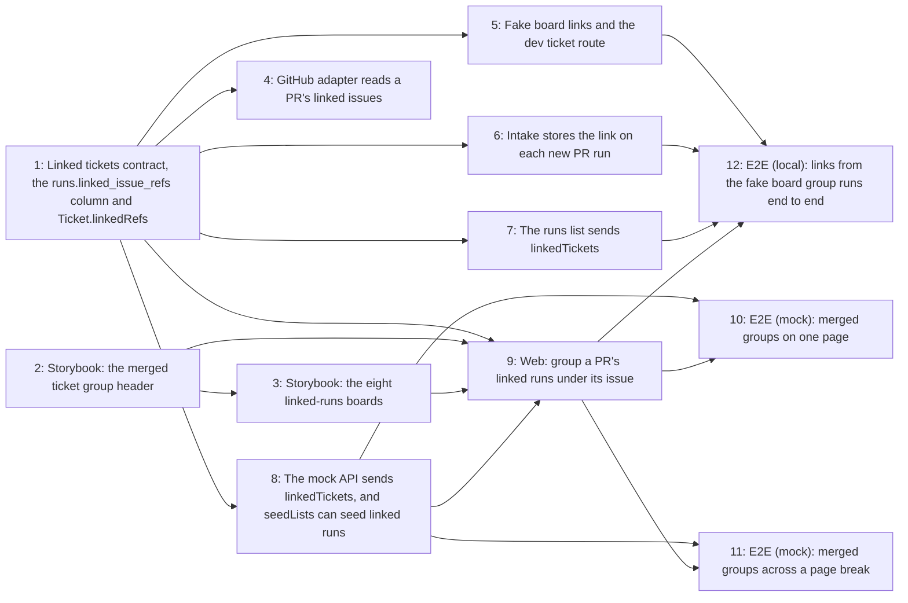

<!-- dev-plan: kind=plan id=group-issue-pr-runs rev=1 hash=b6470a291281 spec=docs/superpowers/specs/2026-11-21-group-issue-pr-runs-design.md spec-hash=9759ce583d9d -->
# Group issue and related PR runs Implementation Plan

> **For agentic workers:** REQUIRED SUB-SKILL: Use superpowers:subagent-driven-development (recommended) or superpowers:executing-plans to implement this plan task-by-task. Steps use checkbox (`- [ ]`) syntax for tracking.

**Goal:** With "Grouped by ticket" on, the Runs page shows an issue's runs and the runs of the PRs linked to it in one group, led by the issue, with each ticket's own "N of max runs" in the chain note ("Issue #142 (1 of 10 runs) → PR #148 (1 of 10 runs)") and nothing on the right. Only PR runs created after this change carry a link.

**Architecture:** The shared pieces land first: the `LinkedTicketDto` contract and `RunListItem.linkedTickets` (served as `[]` until the API task), the `runs.linked_issue_refs` column, `Ticket.linkedRefs` on the adapter seam (`[]` until the adapter tasks), and one ref-normalising helper. The Storybook tasks start at the same time, since they only use the web view model. Then the slices that share no file run in parallel: the GitHub adapter (body keywords plus one GraphQL query), the fake adapter and dev route, the intake write, the API assembly of `linkedTickets`, the MSW mock API, and the eight new boards. The web mapper is wired last, followed by the mock and local e2e specs.

**Tech Stack:** TypeScript (strict), Zod 4, Drizzle + Postgres, NestJS/Fastify, `@octokit/rest` (`octokit.graphql`), undici `MockAgent`, React 19 + TanStack Router/Query, MSW, Storybook 10, Vitest, Playwright.

**Spec:** `docs/superpowers/specs/2026-11-21-group-issue-pr-runs-design.md`. Read it with this plan. The approved boards `design/prototype/project/{RunsLinked,RunsLinkedSeveralPrs,RunsLinkedSplitPr,RunsLinkedFiltered,RunsLinkedLongChain,RunsPagedLinkedPrOnly,RunsPagedLinkedIssueOnly,RunsPageLoadingLinked}.dc.html` decide layout and copy. They supersede `Runs.dc.html` and `RunsPaged.dc.html`, which stay untouched. Where the spec and a board differ, the board wins.

## Global Constraints

- AGENTS.md rules 1 to 11 bind every task. Layering is `apps → core → db → contracts`, and `web → contracts` only. Names stay generic (`linkedTickets`, `linked_issue_refs`, `linkedRefs`, `linked`). GitHub code stays in `packages/core/src/adapters/github/`.
- No new dependency: no package, library, service, image, CI action, binary or workspace package. `octokit.graphql` comes with the existing `@octokit/rest`.
- Migration `packages/db/migrations/0022_runs_add_linked_issue_refs.sql` adds `runs.linked_issue_refs text[] not null default '{}'`. No backfill, no index, no RLS change. Never edit 0000 to 0021.
- Link data is untrusted. Only same-repo positive integer refs (1 to 2147483647) are kept, as strings, deduplicated, lowest first, at most 10 per PR run. They are written on PR runs only. Issue runs always store `'{}'`. Ticket text is never stored in this column and never interpolated (Drizzle parameters, GraphQL `variables`).
- A failed or slow link lookup never blocks a run. The run is stored with `'{}'` and shows in the PR's own group.
- Counting and the run limit stay per `ticketRef` (`ticketRunCount`, `runsForTicket`, `ignored_max_runs`).
- Lead issue of a PR: the lowest-numbered ticket of kind `issue` with at least one run in the project, among the refs of that PR's newest run with a non-empty link (`queued_at desc, id desc`). The API picks it, never the web.
- `RunListItem.linkedTickets` is required (`[]` when none). The issue comes first, then PRs by number:
  - A PR run with a non-empty own snapshot whose PR has a lead gets `[lead, ...the lead's other PRs]`.
  - A PR run with an empty snapshot, or whose PR has no lead, gets `[]`.
  - An issue run gets the PRs whose lead is that issue.
  - Title, url and labels come from that ticket's newest run. `ticketRunCount` is its per-ref count over all statuses.
- Copy, verbatim:
  - Merged chain note: "Issue #142 (1 of 10 runs) → PR #148 (1 of 10 runs)". Several PRs: "Issue #142 (1 of 10 runs) → PR #148 (1 of 10 runs), PR #150 (2 of 10 runs)", PRs in number order.
  - Always "runs", also for one.
  - A merged header has nothing on the right. A single-ticket header keeps "N of 10 runs" on the right.
  - The chain note's full text is its `title` tooltip on every merged header. External link label "Open #142 in GitHub" (unchanged).
- **Storybook first (a blocker from the spec's "UI and Storybook" section, not an ordering preference):** no task that implements or wires this UI in `apps/web/src/{app,features}` starts before the Storybook tasks (Task 2 and Task 3) are merged and reviewed. Task 9, the task that wires this UI, lists both under **Depends on**.
- Sensitive tasks (label `review:sensitive`, high-effort security review): Task 1 (migration), Task 4 (new GitHub API call), Task 6 (intake pipeline behind the webhooks).
- Before every commit: run `devbox run fix` until it prints `fix: clean.`. Conventional Commits with the package as scope. Each task is one branch and one PR.

## Review Focus

1. **A PR description that names a PR, including itself** ("Closes #148" in PR #148, or "Fixes #150" where #150 is a PR). A person expects the PR's runs never to group under another PR, and to stay in their own group when no issue is named. Tests:
   - Task 7: `a ref that names a PR, or the PR itself, is never a lead`.
   - Task 9: `groupKeyOf ignores pr entries in a PR run's linked tickets`.
2. **Odd numbers in link data** (`#0`, `#007`, `#99999999999`, `1e3`, `' 12'`, `12.5`, `-3`). A person expects them to be dropped, never stored, and never to crash intake. Test in Task 1: `normalizeLinkedRefs keeps only 1..2147483647 written as plain digits`.
3. **Keywords written in many ways** ("CLOSES #142.", "fixes: #142", "Resolved #142", the same issue three times, "Closes #142, #150"). A person expects each named issue to be kept once. In "Closes #142, #150" only #142 counts, because GitHub needs a keyword before each number. Test in Task 4: `closingRefsInBody reads case, colon and punctuation variants and needs a keyword per number`.
4. **A GraphQL answer that is HTTP 200 with an `errors` array** (PR not visible to the App, rate limit). A person expects the run to start with the description refs, as on any GraphQL failure. Test in Task 4: `a GraphQL errors payload keeps the description refs and logs the error name`.
5. **An unsafe or odd lead snapshot** (a `javascript:` url, a label colour that is not 6-digit hex). A person expects the header to show no link and a label with no swatch, as single-ticket headers do today. Test in Task 9: `a lead taken from linked tickets goes through safeHref and labelColor`.

## Needs approval

None. No new package, library, service, image, CI action, binary or workspace package.

## Agent calls made while planning

- Agent call: Task 1 holds every shared shape: the contract, the column, `Ticket.linkedRefs` and `normalizeLinkedRefs`. It also does the minimal "keep compiling" edits: the API sends `linkedTickets: []`, the adapters return `linkedRefs: []`, and web literals gain `linkedTickets: []`. Reason: the GitHub, fake, intake, API and MSW tasks then share no file and run in parallel.
- Agent call: `normalizeLinkedRefs` lives in `packages/core/src/adapters/linked-refs.ts` and is not exported from the core barrel. Reason: only the GitHub adapter, the fake adapter and intake use it. Intake applies it again as a second guard.
- Agent call: the upper bound is 2147483647. Reason: `runs.ticket_number` is a Postgres `integer`.
- Agent call: refs are kept lowest first, and the cap of 10 is applied after sorting. Reason: the output is deterministic, and the lead is the lowest-numbered issue.
- Agent call: the body scan reads at most the first 65,536 characters. Reason: that is GitHub's body limit, and it bounds the work on a hostile body. The regex has no nested quantifiers.
- Agent call: `GithubBoardAdapter` gains an optional `log?: AdapterLog` constructor argument. `RegistryOptions` gains `log?: AdapterLog`. The API and worker registry factories each pass a Nest `Logger` warn (one line each). Reason: the spec asks the adapter to log a GraphQL failure by error name, and core adapters have no logger today. The worker change is wiring only, with no workflow or activity change.
- Agent call: `DevTicketBody.linked` is limited to 10 numbers, each 1 to 1,000,000,000 (the same bounds as `number`). Reason: it mirrors the cap and the existing field.
- Agent call: the API assembly lives in a new `apps/api/src/runs/linked-tickets.ts`, with pure `assembleLinkedTickets` and the two SQL reads. `runs.service.ts` only calls it. Reason: the service file is already 500+ lines. The pure part can be read on its own, and every rule stays proved by `runs.int.test.ts`, as the spec says.
- Agent call: one `ticketRunCountsFor` call counts the page refs and the linked refs together, replacing today's call. Reason: it gives the same numbers, adds one query fewer than the spec's bound, and keeps both counts from one snapshot.
- Agent call: a ref whose newest snapshot has kind `pr` is never a lead. Reason: the spec's lead is an issue, and the count query alone cannot tell kinds apart.
- Agent call: Task 5 is not labelled sensitive. The fake adapter and `dev/fake` route are dev-only (404 unless the fake provider is on), and webhook verification does not change. Task 7 reads inside the existing `withOrg` without changing it.
- Agent call: the mock DB marks links with an optional `linkedIssueRefs?: string[]` on a `MockRun = RunDto & {...}` type in `mocks/dto/runs.ts`. Every handler response strips it. Reason: the spec keeps the link as a field of the mock run, and responses must stay contract-shaped.
- Agent call: `seedLists` gains `ticketRuns`: explicit runs, oldest first, numbered 1..n and queued before every generated run, which shift to n+1..n+total. Issue entries carry the label `{ name: 'user-story', color: '0e8a16' }`. PR entries use ref `pr-<n>`. Reasons:
  - The page-break cases need the pair at the oldest end of the list.
  - The issue-led header must show labels.
  - The `pr-<n>` ref keeps an issue and a PR with the same number apart, as on a host with separate numbering (TC-7.2).
- Agent call: the Storybook work is two tasks. Task 2 covers the merged-header component, its stories, the updated `Runs` and `RunsPaged` data and the `Runs.tsx` key. Task 3 covers the eight new boards and their registration. Reason: Task 3 renders Task 2's component, and together they pass 600 lines. `canvas.json`, `storyIds.ts`, `parity.mjs` and `coverage.test.ts` change only in Task 3.
- Agent call: `RunsPaged`'s `lastPageGroups` becomes "Issue #139 (2 of 10 runs) → PR #140 (2 of 10 runs)" with nothing on the right. Reason: the story keeps today's total of 4, and both of its rows are issue #139 runs, which is BR-21. Its old board draws the summed count and stays untouched, so that one parity pair differs on purpose.
- Agent call: the eight boards go into `canvas.json` `order` right after `RunsProblemsEmpty.dc.html`, as 1440×1000 entries placed on a free row of the canvas, with the boards' own `<title>`. Reasons: they are Runs-list boards, and every one of them is drawn at 1440×1000. `viewports.ts` already has that artboard.
- Agent call: the mock e2e is two tasks, cut by flow: one page (`runs-board.spec.ts`) and a page break (`runs-paging.spec.ts`). Reason: they are separate files and can be built at the same time.
- Agent call: the local spec cancels a ticket's previous run and waits for `cancelled` before it comments on that ticket again. Reason: the router ignores a second run of the same skill while one is active (`ignored_active_run`). The run-limit check comes first, so TC-9 still sees "Ticket reached its run limit".
- Agent call: local issues get the `user-story` label and use `/code-build`, and local PRs use `/code-review`. Reason: these are the wizard's two rules (the first targets issues with label `user-story`, the second targets PRs). This answers the spec's E2E Q2.
- Agent call: page moves use the `navigation "Pagination"` buttons ("Next", "Page N"), with the default page size of 20, as in `pagination.spec.ts`. This answers the spec's E2E Q1.

---

<!-- dev-plan:graph:begin -->
## Task graph

Generated by `dev-plan.mjs graph --write` from each task's **Depends on:** line. Do not edit it by hand.
Tasks in the same wave touch no common file and can be built in parallel; a task starts when everything it depends on is merged.

| Wave | Task | Depends on |
| ---- | ---- | ---------- |
| 1 | Task 1: Linked tickets contract, the runs.linked_issue_refs column and Ticket.linkedRefs | none |
| 1 | Task 2: Storybook: the merged ticket group header | none |
| 2 | Task 3: Storybook: the eight linked-runs boards | Task 2 |
| 2 | Task 4: GitHub adapter reads a PR's linked issues | Task 1 |
| 2 | Task 5: Fake board links and the dev ticket route | Task 1 |
| 2 | Task 6: Intake stores the link on each new PR run | Task 1 |
| 2 | Task 7: The runs list sends linkedTickets | Task 1 |
| 2 | Task 8: The mock API sends linkedTickets, and seedLists can seed linked runs | Task 1 |
| 3 | Task 9: Web: group a PR's linked runs under its issue | Task 1, Task 2, Task 3, Task 8 |
| 4 | Task 10: E2E (mock): merged groups on one page | Task 8, Task 9 |
| 4 | Task 11: E2E (mock): merged groups across a page break | Task 8, Task 9 |
| 4 | Task 12: E2E (local): links from the fake board group runs end to end | Task 5, Task 6, Task 7, Task 9 |


<!-- dev-plan:graph:end -->

### Task 1: Linked tickets contract, the `runs.linked_issue_refs` column and `Ticket.linkedRefs`

**Depends on:** none

**Files:**

- Modify: `packages/contracts/src/schemas/runs.ts`
- Modify: `packages/contracts/src/schemas/runs.test.ts`
- Modify: `packages/db/src/schema/app.ts`
- Create: `packages/db/migrations/0022_runs_add_linked_issue_refs.sql` (generated, then checked)
- Create: `packages/db/migrations/meta/0022_snapshot.json` (generated)
- Modify: `packages/db/migrations/meta/_journal.json` (generated)
- Modify: `packages/db/test/migrate.int.test.ts`
- Modify: `packages/core/src/adapters/types.ts`
- Create: `packages/core/src/adapters/linked-refs.ts`
- Create: `packages/core/test/adapters/linked-refs.test.ts`
- Modify: `packages/core/src/adapters/github/board.ts` (`linkedRefs: []` only)
- Modify: `packages/core/src/adapters/fake/board.ts` (`linkedRefs: []` only)
- Modify: `packages/core/test/adapters/github.test.ts` (expectation only)
- Modify: `packages/core/test/adapters/fake.test.ts` (expectation only)
- Modify: `packages/core/test/router.test.ts`
- Modify: `packages/core/test/intake.int.test.ts` (`ticket()` literal only)
- Modify: `apps/api/src/runs/runs.service.ts` (`linkedTickets: []` only)
- Modify: `apps/web/src/features/runs/queries.ts`
- Modify: `apps/web/src/mocks/msw/handlers.ts` (`linkedTickets: []` only)
- Modify: `apps/web/src/features/runs/map.test.ts` (literals only)
- Modify: `apps/web/src/features/runs/runs.route.test.tsx` (literals only)
- Modify: `apps/web/src/features/runs/realtime.test.tsx` (literals only)
- Modify: `apps/web/src/features/runs/applyEvents.test.ts` (literals only)

**Interfaces:**

- Consumes: nothing new.
- Produces (`@agentdesk/contracts`, `schemas/runs.ts`):

```ts
/** Another ticket of a run's merged group (spec 2026-11-21): the lead issue, or a PR led by that issue. */
export const LinkedTicketDto = z.object({
  ref: z.string(),
  kind: TicketKind,
  number: z.number().int(),
  title: z.string(),
  url: z.string(),
  labels: TicketDto.shape.labels,
  /** Runs this ticket has had in the project, all statuses. */
  ticketRunCount: z.number().int().min(1),
});
export type LinkedTicketDto = z.infer<typeof LinkedTicketDto>;
// RunListItem.extend({ ticketRunCount, ... }) gains:
/** The other tickets of this run's merged group: the lead issue first, then PRs by number; [] when none. */
linkedTickets: z.array(LinkedTicketDto),
```

- Produces (`@agentdesk/db`): `runs.linkedIssueRefs` = `text('linked_issue_refs').array().notNull().default(sql\`'{}'::text[]\`)`. Its doc: "Issue refs a PR run was linked to when it was created (same repo, positive integers, at most 10); '{}' for issue runs and runs from before links."
- Produces (core):

```ts
// adapters/types.ts, Ticket gains:
/** Same-repo issue refs this PR is linked to (closing references); [] for issues. Untrusted: normalised by normalizeLinkedRefs. */
linkedRefs: string[];
// adapters/linked-refs.ts
export const MAX_LINKED_REFS = 10;
/** Refs 1..2147483647 written as plain digits (numbers must be safe integers in range), as strings,
 *  deduplicated, ascending by number, at most MAX_LINKED_REFS. Anything else is dropped. */
export function normalizeLinkedRefs(refs: readonly (string | number)[]): string[];
```

- Produces (api): `RunsService.toListItem(row, agent, ticketRunCount, linkedTickets: LinkedTicketDto[] = [])`. `toBase` returns `Omit<RunListItem, 'ticketRunCount' | 'linkedTickets'>`.
- Produces (web): `RunCore = Omit<RunListItem, 'ticketRunCount' | 'linkedTickets'>` in `features/runs/queries.ts`.

- [x] **Step 1: Write the failing contract tests** in `runs.test.ts`, in a new `describe('LinkedTicketDto and RunListItem.linkedTickets')`:
  - A full `LinkedTicketDto` parses. Leaving out any one of `ref`, `kind`, `number`, `title`, `url`, `labels` or `ticketRunCount` fails. `ticketRunCount: 0` fails.
  - A `RunListItem` with `linkedTickets: []` parses, and one without `linkedTickets` fails. One entry round-trips unchanged.
  - `RunStatsDto` parses with `idleRun` carrying `linkedTickets: [entry]`.
  - Update the existing `RunListItem ticketRunCount` fixtures with `linkedTickets: []`.
- [x] **Step 2: Run** `pnpm --filter @agentdesk/contracts test runs`. Expected: FAIL (`LinkedTicketDto` is not exported).
- [x] **Step 3: Add `LinkedTicketDto` and `linkedTickets`** in `packages/contracts/src/schemas/runs.ts`. Run the same command. Expected: PASS.
- [x] **Step 4: Write the failing migration test** in `migrate.int.test.ts`, named `runs.linked_issue_refs is text[] not null default '{}', existing rows read '{}', and the app role writes it`:
  - `information_schema.columns` gives `data_type 'ARRAY'`, `udt_name '_text'`, `is_nullable 'NO'` and a default containing `'{}'`.
  - A runs row inserted without the column reads `[]`.
  - An insert and an update of `linked_issue_refs = '{142}'` through the app role (`env.appUrl`, inside the test org's settings like the other app-role tests) succeed.
  - The SQL file holds only `ALTER TABLE "runs" ADD COLUMN "linked_issue_refs" text[] DEFAULT '{}'::text[] NOT NULL;`. It matches no `update|delete|insert … runs`, the same regex as "the pause and resume migration changes no runs rows".
- [x] **Step 5: Add the column** in `packages/db/src/schema/app.ts` after `pauseReason`. Then run `pnpm --filter @agentdesk/db db:generate -- --name runs_add_linked_issue_refs`. Check that the file is named `0022_runs_add_linked_issue_refs.sql` and holds only that one statement.
- [x] **Step 6: Run** `pnpm --filter @agentdesk/db test:integration migrate`. Expected: PASS.
- [x] **Step 7: Write the failing unit test** `packages/core/test/adapters/linked-refs.test.ts`, named `normalizeLinkedRefs keeps only 1..2147483647 written as plain digits` (Review Focus 2):

```ts
expect(normalizeLinkedRefs(['150', 142, '142', '9'])).toEqual(['9', '142', '150']);
expect(normalizeLinkedRefs(['0', '-1', '007', ' 12', '12.5', '1e3', 'abc', 'acme/other#5', '', '2147483648', 0, -3, 1.5, Number.NaN]))
  .toEqual([]);
expect(normalizeLinkedRefs(['2147483647', 2147483647])).toEqual(['2147483647']);
expect(normalizeLinkedRefs(Array.from({ length: 14 }, (_, i) => String(20 - i)))).toEqual(
  ['7', '8', '9', '10', '11', '12', '13', '14', '15', '16']);
expect(MAX_LINKED_REFS).toBe(10);
```

- [x] **Step 8: Run** `pnpm --filter @agentdesk/core test linked-refs`. Expected: FAIL. **Implement** `linked-refs.ts` (string refs must match `/^[1-9]\d{0,9}$/` and be ≤ 2147483647). **Add** `linkedRefs` to `Ticket`.
- [x] **Step 9: Keep core compiling.** Both `getTicket` implementations return `linkedRefs: []`. The issue expectation in `github.test.ts` "getTicket maps issues and PRs" and the stored-ticket expectation in `fake.test.ts` gain `linkedRefs: []`. `router.test.ts` `ticketOf` and `intake.int.test.ts` `ticket()` gain `linkedRefs: []`. Run `pnpm --filter @agentdesk/core typecheck && pnpm --filter @agentdesk/core test linked-refs github fake router`. Expected: PASS.
- [x] **Step 10: Keep the API compiling.** `toListItem` gains `linkedTickets` (default `[]`), and `toBase`'s return type omits it. Run `pnpm --filter @agentdesk/api typecheck && pnpm --filter @agentdesk/api test:integration runs.int`. Expected: PASS: every `expectContract('runs.list' | 'runs.stats')` parses with `linkedTickets: []`.
- [x] **Step 11: Keep the web compiling.**
  - `RunCore` omits `linkedTickets`.
  - `handlers.ts` `withTicketRunCount` adds `linkedTickets: []`.
  - Every `RunListItem` or `CachedRun` literal in `map.test.ts`, `runs.route.test.tsx`, `realtime.test.tsx` and `applyEvents.test.ts` gains `linkedTickets: []`.

  Run `pnpm --filter @agentdesk/web typecheck && pnpm --filter @agentdesk/web test`. Expected: PASS.
- [x] **Step 12: Commit** (one commit per package): `feat(contracts): LinkedTicketDto and RunListItem.linkedTickets`, `feat(db): runs.linked_issue_refs column`, `feat(core): Ticket.linkedRefs and normalizeLinkedRefs`, `chore(api): send linkedTickets []`, `chore(web): type list items with linkedTickets`.

---

### Task 2: Storybook: the merged ticket group header

**Depends on:** none

**Files:**

- Modify: `apps/web/src/mocks/types.ts`
- Modify: `apps/web/src/components/RunRow.tsx`
- Modify: `apps/web/src/components/RunList.module.css`
- Modify: `apps/web/src/components/RunList.test.tsx`
- Modify: `apps/web/src/components/RunRow.stories.tsx`
- Modify: `apps/web/src/screens/Runs.tsx` (header key only)
- Modify: `apps/web/src/screens/runs.stories.tsx` (`lastPageGroups` only)
- Modify: `apps/web/src/mocks/runs.ts` (`ticketGroups` only)
- Modify: `apps/web/src/mocks/mocks.test.ts`

This task is the first half of the spec's **Storybook-first blocker**. Task 9 may not start until it and Task 3 are merged and reviewed.

**Interfaces:**

- Consumes: nothing new (view model only).
- Produces (`@/mocks/types`):

```ts
export type TicketGroup = {
  /** The lead ticket: the issue of a merged group, else the group's own ticket. */
  ticket: Ticket;
  /** Display-ready, built by features/runs/map.ts; on a merged group it carries every ticket's count. */
  chainNote?: string;
  /** The lead ticket's runs, all statuses. */
  runsUsed: number;
  runsMax: number;
  runs: RunSummary[];
  /** The group's other tickets (PRs by number) with their own counts; non-empty only on a merged group. */
  linked?: { ticket: { kind: TicketKind; number: number }; runsUsed: number }[];
};
```

- Produces (`TicketGroupRow`):
  - When `group.linked` is non-empty, the right-side "N of max runs" is not rendered. The chain note `<span className={styles.chain}>` carries `title={group.chainNote}`.
  - A single-ticket group renders exactly as today.
  - CSS (tokens only): the title gives way first, then `.chain` shrinks with `min-width: 0; overflow: hidden; text-overflow: ellipsis`. The header stays one line.
- Produces (`Runs.tsx`): the header row key is `` `g${g.ticket.kind}:${g.ticket.number}` ``, so a merged `issue:148` group and PR #148's own `pr:148` group stay apart.
- Produces (`@/mocks`):
  - `ticketGroups[0]` = #142 with `linked: [{ ticket: { kind: 'pr', number: 148 }, runsUsed: 1 }]`, `runsUsed: 1`, `chainNote: 'Issue #142 (1 of 10 runs) → PR #148 (1 of 10 runs)'`.
  - The #131 group has `linked` PR #133 `runsUsed: 2`, `runsUsed: 1`, `chainNote: 'Issue #131 (1 of 10 runs) → PR #133 (2 of 10 runs)'`.
  - These are the counts on `RunsLinked.dc.html`.

- [x] **Step 1: Write the failing component tests** in `RunList.test.tsx` `describe('TicketGroupRow')`:
  - `a merged header shows the chain note with its full text as title, and no count on the right`. A group with `linked` PR #148 `runsUsed: 1` and chain note `'Issue #142 (1 of 10 runs) → PR #148 (1 of 10 runs)'` gives:
    - the chain note text, with the `title` attribute equal to it;
    - `queryByText(/^\d+ of 10 runs$/)` null;
    - the link "Issue #142" and the link "Open #142 in GitHub" still there.
  - `a single-ticket header keeps N of max runs on the right`. With no `linked` (and with `linked: []`), "2 of 10 runs" shows. This keeps the existing test.
  - The existing fixture's `chainNote` becomes the new copy. Its assertions are updated, never deleted.
- [x] **Step 2: Run** `pnpm --filter @agentdesk/web test RunList`. Expected: FAIL.
- [x] **Step 3: Implement** the type, `TicketGroupRow`, the CSS and the `Runs.tsx` key. Run the same command. Expected: PASS.
- [x] **Step 4: Update the stories.**
  - `RunRow.stories.tsx`: the `group()` helper builds a linked PR #148 and the new chain note. Add these stories:
    - `GroupHeaderIssueAndPr`;
    - `GroupHeaderSeveralPrs` (PR #148 1, PR #150 2);
    - `GroupHeaderLongChain`, in a narrow artboard (`decorators` with a 720px wide container), with PRs #148, #150, #153, #157, #160, #164 and a long title, so the title and then the chain note ellipsise;
    - `GroupHeaderSplitPr`: merged #142 with a new `PR #148` row, then PR #148's own group with an older `PR #148` row and "2 of 10 runs" on the right;
    - `GroupHeaderPrRunsOnly`: the issue-led header over only `PR #148` rows.

    `Connectors` mixes `#142` and `PR #148` rows.
  - `runs.stories.tsx` `lastPageGroups` becomes "Issue #139 (2 of 10 runs) → PR #140 (2 of 10 runs)" with `linked` PR #140 `runsUsed: 2` (see Agent calls).
  - `mocks/runs.ts` `ticketGroups` becomes as in Interfaces.
- [x] **Step 5: Extend `mocks.test.ts`.** Every `ticketGroups` entry with `linked` has `runsUsed <= runsMax` for itself and for each linked entry. Its `chainNote` contains `(${l.runsUsed} of ${g.runsMax} runs)` for each linked entry, and `(${g.runsUsed} of ${g.runsMax} runs)` for the lead.
- [x] **Step 6: Run** `pnpm --filter @agentdesk/web test && pnpm --filter @agentdesk/web typecheck`. Expected: PASS, including the axe smoke test over the new stories.
- [ ] **Step 7: Visual check.** Run `pnpm --filter @agentdesk/web build-storybook && pnpm --filter @agentdesk/web parity`.
  - The `Runs` pair should match `RunsLinked.dc.html`'s headers. Its own `Runs.dc.html` draws the old summed note, which is superseded.
  - Check `GroupHeaderLongChain` by eye against `RunsLinkedLongChain.dc.html`.
  - Do not commit `storybook-static/` or `parity-out/`.
- [x] **Step 8: Commit:** `feat(web): merged ticket group header with per-ticket counts in Storybook`.

---

### Task 3: Storybook: the eight linked-runs boards

**Depends on:** Task 2

**Files:**

- Create: `apps/web/src/mocks/runsLinked.ts`
- Modify: `apps/web/src/mocks/index.ts`
- Modify: `apps/web/src/mocks/mocks.test.ts`
- Modify: `apps/web/src/screens/runs.stories.tsx`
- Modify: `apps/web/src/screens/storyIds.ts`
- Modify: `apps/web/scripts/parity.mjs`
- Modify: `design/prototype/project/canvas.json`
- Modify: `apps/web/src/test/coverage.test.ts`

This task is the second half of the spec's **Storybook-first blocker**.

**Interfaces:**

- Consumes: `TicketGroup.linked`, `TicketGroupRow` merged state, `ticketGroups` (Task 2).
- Produces (`@/mocks`): `export const linkedGroups: Record<'severalPrs' | 'splitPr' | 'filtered' | 'longChain' | 'pagedPrOnly' | 'pagedIssueOnly' | 'pageLoading', TicketGroup[]>` in `mocks/runsLinked.ts`, re-exported from `mocks/index.ts`. Each group list holds the rows, tickets, counts and chain notes its board draws.

| Board (canvas.json) | Story export (`Screens/Runs`) | Data | What it must show |
| --- | --- | --- | --- |
| `RunsLinked` | `RunsLinked` | `ticketGroups` | #142 + PR #148, #131 + PR #133, per-ticket notes, nothing on the right |
| `RunsLinkedSeveralPrs` | `RunsLinkedSeveralPrs` | `linkedGroups.severalPrs` | "Issue #142 (1 of 10 runs) → PR #148 (1 of 10 runs), PR #150 (2 of 10 runs)" |
| `RunsLinkedSplitPr` | `RunsLinkedSplitPr` | `linkedGroups.splitPr` | merged #142 with "PR #148 (2 of 10 runs)", then PR #148's own group (run 47) with "2 of 10 runs" |
| `RunsLinkedFiltered` | `RunsLinkedFiltered` | `linkedGroups.filtered`, `filter="needs_you"` | only run 62 under the full #142 note |
| `RunsLinkedLongChain` | `RunsLinkedLongChain` | `linkedGroups.longChain` | six PRs, title then note ellipsised, both with `title` tooltips |
| `RunsPagedLinkedPrOnly` | `RunsPagedLinkedPrOnly` | `linkedGroups.pagedPrOnly`, page 4 of 4 | "Issue #12 (1 of 10 runs) → PR #13 (2 of 10 runs)" over only `PR #13` rows |
| `RunsPagedLinkedIssueOnly` | `RunsPagedLinkedIssueOnly` | `linkedGroups.pagedIssueOnly`, page 4 of 4 | "Issue #12 (2 of 10 runs) → PR #13 (1 of 10 runs)" over only `#12` rows |
| `RunsPageLoadingLinked` | `RunsPageLoadingLinked` | `linkedGroups.pageLoading`, `pagination(4, 63, true)` | the page stays shown, busy, with "Issue #12 (2 of 10 runs) → PR #13 (2 of 10 runs)" |

Registration (all together, in canvas order):
- `canvas.json` gets the eight boards and their `order` entries (see Agent calls).
- `storyIds.ts` `boardStories` gets eight entries `{ title: runs, exportName: <same name> }`, and its doc comment says "79 boards".
- `parity.mjs` `stories` gets eight `['Screens/Runs', '<name>']` entries.
- In `coverage.test.ts`, "71 boards" and `toHaveLength(71)` become 79.

- [x] **Step 1: Write the failing coverage check.** Change 71 to 79 in `coverage.test.ts`. Run `pnpm --filter @agentdesk/web test coverage`. Expected: FAIL (71 boards in canvas).
- [x] **Step 2: Register the eight boards** in `canvas.json`, `storyIds.ts` and `parity.mjs`. Run the same command. Expected: FAIL, now only on `board RunsLinked… has a story`.
- [x] **Step 3: Add the fixtures and the eight stories.** Use the existing `artboard(1000)`, `pagination()` and `pagedCommon` helpers of `runs.stories.tsx`. In `mocks.test.ts`, extend the Task 2 `runsUsed <= runsMax` and chain-note checks to every list in `linkedGroups`.
- [ ] **Step 4: Run** `pnpm --filter @agentdesk/web test && pnpm --filter @agentdesk/web typecheck`. Expected: PASS (79 boards, axe smoke test included).
- [ ] **Step 5: Visual check:** `pnpm --filter @agentdesk/web build-storybook && pnpm --filter @agentdesk/web parity`. Compare the eight new `parity-out/<board>.{story,proto}.png` pairs, and fix any difference in layout or copy. Do not commit `storybook-static/` or `parity-out/`.
- [x] **Step 6: Commit:** `feat(web): Storybook boards for issue and PR runs in one group`.

---

### Task 4: GitHub adapter reads a PR's linked issues

**Depends on:** Task 1

**Files:**

- Modify: `packages/core/src/adapters/github/board.ts`
- Modify: `packages/core/src/adapters/registry.ts`
- Modify: `packages/core/test/adapters/github.test.ts`
- Create: `packages/core/test/fixtures/github/graphql.pr-closing-issues.json`
- Create: `packages/core/test/fixtures/github/pull.closes.json`
- Modify: `apps/api/src/adapters/adapter-registry.module.ts` (pass `log`, one line)
- Modify: `apps/worker/src/worker.module.ts` (pass `log`, one line)

**Interfaces:**

- Consumes: `Ticket.linkedRefs`, `normalizeLinkedRefs` (Task 1).
- Produces (`github/board.ts`, exported for tests):

```ts
/** Minimal logger the adapter warns through; fields carry error names only, never ticket text. */
export interface AdapterLog { warn(fields: { err: string }, msg: string): void }
/** Same-repo issue numbers named by closing keywords in a PR description: close[sd]?|fix(e[sd])?|resolve[sd]?,
 *  optional ':', whitespace, '#<digits>', case-insensitive; reads the first 65,536 characters; `owner/repo#n`,
 *  URLs and bare '#n' without a keyword are not matched. Raw strings; normalizeLinkedRefs cleans them. */
export function closingRefsInBody(body: string): string[];
/** Variables only: { owner: string; repo: string; number: number }. */
export const CLOSING_ISSUES_QUERY: string; // repository(owner,name){ pullRequest(number){ closingIssuesReferences(first: 10){ nodes { number repository { nameWithOwner } } } } }
// constructor(clients, clock, fallbackSecret?, log?: AdapterLog)
// RegistryOptions gains: log?: AdapterLog (passed to GithubBoardAdapter)
```

- `getTicket` for a PR:
  - `linkedRefs = normalizeLinkedRefs([...closingRefsInBody(body ?? ''), ...graphqlRefs])`.
  - `graphqlRefs` are the node numbers whose `repository.nameWithOwner` equals the project's `owner/repo`, case-insensitively.
  - If `octokit.graphql` throws (HTTP error, `errors` payload, schema mismatch), it calls `log?.warn({ err: <error name> }, 'ticket links unavailable')`, uses `graphqlRefs = []`, and still resolves.
- `getTicket` for an issue makes no GraphQL call and returns `linkedRefs: []`.
- `IssueBody` gains `body: z.string().nullable().optional()`.

- [x] **Step 1: Add the fixtures.**
  - `pull.closes.json` is `pull.json` (PR #7, `acme/widgets`) with `"body": "Fixes the flaky test.\n\nCloses #5\nfixes: #12\nSee also #99 and other/repo#3"`.
  - `graphql.pr-closing-issues.json` is `{"data":{"repository":{"pullRequest":{"closingIssuesReferences":{"nodes":[{"number":5,"repository":{"nameWithOwner":"acme/widgets"}},{"number":21,"repository":{"nameWithOwner":"Acme/Widgets"}},{"number":8,"repository":{"nameWithOwner":"acme/other"}}]}}}}}`.
  - Both are scrubbed, with no real tokens or users.
- [x] **Step 2: Write the failing tests** in `github.test.ts`. Intercept `POST /graphql` on `gh()` and capture the request body.
  - "getTicket maps issues and PRs" gains a GraphQL intercept for PR #7 (empty nodes). The issue #5 fetch makes no GraphQL call: `vi.spyOn(clients.installation('4242'), 'graphql')` (the client is cached) is not called for #5, and is called once for #7. The adapter swallows GraphQL errors, so a missing intercept alone would not show a call.
  - `a PR's linkedRefs is the union of description keywords and closingIssuesReferences, same repo only`. `pull.closes.json` plus the GraphQL fixture gives `['5', '12', '21']`.
  - `the GraphQL request carries the PR number only in variables`. Parsed body `{ query: CLOSING_ISSUES_QUERY, variables: { owner: 'acme', repo: 'widgets', number: 7 } }`.
  - `refs from closingIssuesReferences alone link a PR whose description names nothing` (BR-14). `pull.json` (no body) plus nodes `[5]` gives `['5']`.
  - `a GraphQL failure keeps the description refs, resolves, and logs the error name only` (BR-15). GraphQL answers 502. `getTicket` resolves with `linkedRefs: ['5', '12']`. `log.warn` is called once with `{ err: expect.any(String) }`, and its arguments do not contain `'Closes'` or the body.
  - `a GraphQL errors payload keeps the description refs and logs the error name` (Review Focus 4). An HTTP 200 answer `{"data":null,"errors":[{"type":"NOT_FOUND","message":"x"}]}` behaves the same.
  - `closingRefsInBody reads case, colon and punctuation variants and needs a keyword per number` (Review Focus 3, rule 6):

```ts
expect(closingRefsInBody('CLOSES #142.\nfixes: #150, Resolved #9')).toEqual(['142', '150', '9']);
expect(closingRefsInBody('Closes #142, #150')).toEqual(['142']);
expect(closingRefsInBody('closes owner/repo#5 and see #7 and https://github.com/acme/widgets/issues/8')).toEqual([]);
expect(closingRefsInBody('<b>Fixes</b> #3 `closes #4` **resolves #5**')).toEqual(['4', '5']);
expect(normalizeLinkedRefs(closingRefsInBody('Closes #0 fixes #-1 closes #00012'))).toEqual([]);
expect(closingRefsInBody('x'.repeat(70_000) + ' Closes #1')).toEqual([]);
expect(closingRefsInBody('Closes #142 '.repeat(5_000)).length).toBeGreaterThan(0); // linear time, no catastrophic backtracking
```

  - `more than ten refs are capped at ten, lowest first`. A body naming #1 to #12 gives `['1', … '10']`.
- [x] **Step 3: Run** `pnpm --filter @agentdesk/core test github`. Expected: FAIL.
- [x] **Step 4: Implement** `closingRefsInBody`, `CLOSING_ISSUES_QUERY`, the private `closingIssueRefs(octokit, owner, repo, number): Promise<string[]>` (parsed with a Zod schema), the `log` constructor argument and `RegistryOptions.log`.
- [x] **Step 5: Pass a logger.** The API's `createAdapterRegistry(config, systemClock, { log })` passes `{ warn: (f, m) => logger.warn(\`${m} ${JSON.stringify(f)}\`) }` from a `new Logger('BoardAdapter')`. The worker's factory passes the same shape.
- [x] **Step 6: Run** `pnpm --filter @agentdesk/core test github && pnpm --filter @agentdesk/core typecheck && pnpm --filter @agentdesk/api typecheck && pnpm --filter @agentdesk/worker typecheck`. Expected: PASS.
- [x] **Step 7: Commit:** `feat(core): read a PR's linked issues from its description and closingIssuesReferences`.

---

### Task 5: Fake board links and the dev ticket route

**Depends on:** Task 1

**Files:**

- Modify: `packages/core/src/adapters/fake/store.ts`
- Modify: `packages/core/src/adapters/fake/board.ts`
- Modify: `packages/core/test/adapters/fake.test.ts`
- Modify: `apps/api/src/dev/fake.controller.ts`
- Modify: `apps/api/test/webhooks.int.test.ts`

**Interfaces:**

- Consumes: `Ticket.linkedRefs`, `normalizeLinkedRefs` (Task 1).
- Produces:
  - `StoredTicket` gains `linked: z.array(z.number().int()).optional()`. On a PR it names the issues the PR closes. On an issue it names the PRs linked to it. Older `tickets.json` files without the field still parse.
  - Fake `getTicket`: for a PR, `linkedRefs = normalizeLinkedRefs([...(t.linked ?? []), ...issues in the same repo whose linked includes t.number])`. For an issue, `[]`.
  - `DevTicketBody` gains `linked: z.array(z.number().int().positive().max(1_000_000_000)).max(10).optional()`, which `addTicket` stores. Re-posting a ticket replaces it, so a link can be added later (BR-20).

- [x] **Step 1: Write the failing tests.**
  - `fake.test.ts`:
    - `a fake PR's linkedRefs is its own linked ∪ the issues whose linked lists it`. PR 10 `linked: [3]`, issue 4 `linked: [10]`, issue 5 `linked: [99]` give `['3', '4']`.
    - `a fake issue's linkedRefs is [] even with linked`.
    - `an issue in another repo never links`.
    - `a tickets.json without linked still parses`.
  - `webhooks.int.test.ts` `describe('dev fake routes')`:
    - `POST /dev/fake/tickets accepts linked on PRs and issues`: 201, and `new FakeStore(dir).getTicket(...)` has `linked`.
    - `rejects linked with 0, -1, 1.5, a string or 11 numbers`: 400 problem.
- [x] **Step 2: Run** `pnpm --filter @agentdesk/core test fake && pnpm --filter @agentdesk/api test:integration webhooks`. Expected: FAIL.
- [x] **Step 3: Implement** the store field, the fake `getTicket` union and `DevTicketBody.linked`.
- [x] **Step 4: Run** the same commands and `pnpm --filter @agentdesk/api typecheck`. Expected: PASS.
- [x] **Step 5: Commit:** `feat(core): fake tickets carry links on either side`, then `feat(api): dev fake tickets accept linked`.

---

### Task 6: Intake stores the link on each new PR run

**Depends on:** Task 1

**Files:**

- Modify: `packages/core/src/intake/process-ticket-event.ts`
- Modify: `packages/core/test/intake.int.test.ts`

**Interfaces:**

- Consumes: `runs.linkedIssueRefs`, `Ticket.linkedRefs`, `normalizeLinkedRefs` (Task 1).
- Produces: the run insert sets `linkedIssueRefs: kind === 'pr' ? normalizeLinkedRefs(ticket?.linkedRefs ?? []) : []`. Nothing else in intake changes. `runsForTicket` still counts `ticketRef` only. The existing `'ticket snapshot unavailable'` warn (error name only) covers a failed lookup.

- [x] **Step 1: Write the failing tests** in `intake.int.test.ts` (`harness(over, getTicketImpl)`). The two lookup-failure cases use an event with `ticketKind: 'pr'` and a PR rule without a label filter (like `/code-review`), so the router does not need the ticket. A router that needs it still fails as today.
  - `a PR run stores linked_issue_refs from the prefetched ticket`. A PR ticket with `linkedRefs: ['150', '142']` stores `{142,150}`.
  - `an issue run stores '{}' even when its ticket has linkedRefs`.
  - `stored refs are positive integers only, deduplicated and capped at 10` (BR-10, rule 6). `linkedRefs: ['acme/other#5', '0', '-1', 'x', '142', '142', ...12 more numbers]` stores the ten lowest valid ones, and `'acme/other#5'` never appears.
  - `a failed lookup still starts the PR run, with '{}'` (BR-15). `getTicketImpl` rejects, the outcome is `run_created`, and the row reads `{}`. `log.warn` gets `{ err: 'Error' }`, and its JSON holds no ticket text.
  - `a lookup slower than ticketTimeoutMs still starts the PR run, with '{}'`. `ticketTimeoutMs: 50` with a never-resolving `getTicket` gives `run_created` and `{}`, with a warn of `{ err: 'TicketFetchTimeoutError' }`.
  - `the run limit stays per ref` (BR-9). With `maxRunsPerTicket: 2`:
    - PR 148, linked to `142`, has 2 runs. A third PR comment gives `ignored_max_runs`, while issue 142 has 1 run.
    - An issue 142 comment gives `run_created`.
    - The reverse: issue at 2, PR at 1, gives an issue comment `ignored_max_runs` and a PR comment `run_created`.
- [x] **Step 2: Run** `pnpm --filter @agentdesk/core test:integration intake`. Expected: FAIL (column not written).
- [x] **Step 3: Implement** the one insert field.
- [x] **Step 4: Run** the same command and `pnpm --filter @agentdesk/core typecheck`. Expected: PASS.
- [x] **Step 5: Commit:** `feat(core): intake stores a PR run's linked issue refs`.

---

### Task 7: The runs list sends `linkedTickets`

**Depends on:** Task 1

**Files:**

- Create: `apps/api/src/runs/linked-tickets.ts`
- Modify: `apps/api/src/runs/runs.service.ts`
- Modify: `apps/api/test/runs.int.test.ts`

**Interfaces:**

- Consumes: `LinkedTicketDto`, `RunListItem.linkedTickets`, `runs.linkedIssueRefs`, `toListItem(…, linkedTickets)` (Task 1).
- Produces (`linked-tickets.ts`):

```ts
/** The newest run with a non-empty link of each PR: for the page's PR refs, and for PRs whose newest link
 *  overlaps the page's issue refs or the refs of the page PRs' newest links (one statement, CTE + distinct on). */
export interface NewestLink { ref: string; number: number; refs: string[] }
export function newestLinks(tx: Tx, projectId: string, pagePrRefs: string[], pageIssueRefs: string[]): Promise<NewestLink[]>;
/** Newest run snapshot per ref (distinct on (ticket_ref) … order by ticket_ref, queued_at desc, id desc). */
export interface TicketSnapshot { ref: string; kind: TicketKind; number: number; title: string; url: string; labels: TicketDto['labels'] }
export function newestSnapshots(tx: Tx, projectId: string, refs: string[]): Promise<Map<string, TicketSnapshot>>;
/** Pure: each page row's linkedTickets by the contract rules (Global Constraints). Refs with count 0 or no
 *  snapshot are dropped; a ref whose snapshot kind is 'pr' is never a lead. */
export function assembleLinkedTickets(
  rows: Pick<RunRow, 'id' | 'ticketRef' | 'ticketKind' | 'linkedIssueRefs'>[],
  links: NewestLink[],
  counts: ReadonlyMap<string, number>,
  snapshots: ReadonlyMap<string, TicketSnapshot>,
): Map<string, LinkedTicketDto[]>; // keyed by run id
```

- `RunsService.listItems` calls these in its order, all inside the existing `withOrg` transaction:
  1. `agentsFor`;
  2. `newestLinks`;
  3. one `ticketRunCountsFor` over page refs ∪ linked refs ∪ fetched PR refs;
  4. `newestSnapshots` over linked refs ∪ fetched PR refs.

  Each item's own `ticketRunCount` is unchanged. Both "newest" orders are `queued_at desc, id desc`. `runs.stats` `idleRun` gets the field through `listItems`.

- [ ] **Step 1: Write the failing tests** in `runs.int.test.ts`, in a new `describe('runs list linkedTickets')`. Each test makes its own project and inserts with `insertRun({ ticketRef, ticketKind, ticketNumber, ticketTitle, ticketUrl, ticketLabels, linkedIssueRefs, queuedAt })`, using explicit, distinct `queuedAt`. Every response goes through `expectContract('runs.list' | 'runs.stats', …)`.
  - `a PR run linked to an issue with runs lists the lead issue, and the issue run lists the PR` (BR-1):
    - issue 142 has 1 run; PR 148 has 1 run with `['142']`;
    - the PR item's `linkedTickets` is `[{ ref: '142', kind: 'issue', number: 142, title, url, labels, ticketRunCount: 1 }]`;
    - the issue item's `linkedTickets` is `[{ ref: '148', kind: 'pr', …, ticketRunCount: 1 }]`.
  - `a linked entry takes kind, number, title, url and labels from the newest snapshot and counts every status, whatever the filter`:
    - issue 142 has an older run titled "Old" and a newer failed run titled "New" with labels `[{ name: 'bug', color: 'd73a4a' }]`;
    - `?filter=needs_you` with only an idle PR run gives the issue entry with title "New", those labels, and `ticketRunCount: 2`.
  - `a page holding only PR runs still lists the issue` (BR-3). With `?pageSize=2&page=1` holding only the two newest PR runs, every PR item has the issue entry first.
  - `an issue with two PRs: each PR run lists the issue then the other PR, and the issue run lists both PRs by number` (BR-4, BR-21):
    - PR 150 has 2 runs and PR 148 has 1, both linked to `['142']`;
    - PR 150's runs get `[142, 148]`, PR 148's get `[142, 150]`, and the issue run gets `[148, 150]`;
    - counts are 1, 1, 2.
  - `a linked issue with no runs in the project is dropped` (BR-12). PR `['142']` with no 142 run gives `[]`.
  - `a run with an empty snapshot gets [] even when a newer run of the same PR is linked` (BR-16).
  - `the newest linked run decides for all linked runs of the PR` (BR-17):
    - issues 142 and 150 have runs;
    - PR 148 has run A `['150']` and newer run B `['142']`, and both get `[142]`;
    - then a newest run C with `'{}'` gets `[]`, while A and B still get `[142]`.
  - `a PR linked to two issues with runs joins the lower-numbered one` (BR-11):
    - PR `['150', '142']` gets `[142]`;
    - issue 142's run lists the PR;
    - issue 150's run gets `[]`.
  - `a ref that names a PR, or the PR itself, is never a lead` (Review Focus 1):
    - PR 148 `['148']` gives `[]`;
    - PR 148 `['150']` where 150 is a PR with runs gives `[]`;
    - PR 148 `['150', '142']` with issue 142 gives `[142]`.
  - `each item's own ticketRunCount is unchanged`. The PR item's `ticketRunCount` is its own count, never the sum.
  - `links stay inside the project` (security, rule 4):
    - a P1 PR run with `['142']`, where #142 has runs only in P2 (same org), gets `[]`;
    - a P2 issue 142 run never lists the P1 PR;
    - bob's request for P1 is 404 (unchanged).
  - `stats.idleRun carries linkedTickets`. An idle linked PR run gives `idleRun.linkedTickets[0].ref === '142'`.
- [ ] **Step 2: Run** `pnpm --filter @agentdesk/api test:integration runs.int`. Expected: FAIL (every `linkedTickets` is `[]`).
- [ ] **Step 3: Implement** `linked-tickets.ts`. Both SQL reads use Drizzle `sql` with bound parameters only (`= any(${refs})`, `&& ${refs}::text[]`). Wire `listItems`.
- [ ] **Step 4: Run** the same command and `pnpm --filter @agentdesk/api typecheck && pnpm --filter @agentdesk/api test:unit`. Expected: PASS.
- [ ] **Step 5: Commit:** `feat(api): runs list items carry their linked tickets`.

---

### Task 8: The mock API sends `linkedTickets`, and `seedLists` can seed linked runs

**Depends on:** Task 1

**Files:**

- Create: `apps/web/src/mocks/msw/linkedTickets.ts`
- Modify: `apps/web/src/mocks/msw/handlers.ts`
- Modify: `apps/web/src/mocks/msw/db.ts`
- Modify: `apps/web/src/mocks/dto/runs.ts`
- Modify: `apps/web/src/mocks/msw/contract.test.ts`
- Modify: `apps/web/src/mocks/msw/e2eLists.ts`
- Modify: `apps/web/src/mocks/msw/e2eLists.test.ts`

**Interfaces:**

- Consumes: `LinkedTicketDto`, `RunListItem.linkedTickets` (Task 1).
- Produces:

```ts
// mocks/dto/runs.ts
/** A mock DB run: the DTO plus the issue refs it was linked to when created (mirrors runs.linked_issue_refs). */
export type MockRun = RunDto & { linkedIssueRefs?: string[] };
// mocks/msw/linkedTickets.ts
/** The API's linkedTickets rules over the project's mock runs (newest = queuedAt desc, id desc). */
export function linkedTicketsFor(run: MockRun, projectRuns: readonly MockRun[]): LinkedTicketDto[];
/** The DTO without mock-only fields. */
export function toDto(run: MockRun): RunDto;
// mocks/msw/e2eLists.ts, MockLists gains:
/** Explicit runs, oldest first, numbered 1..n and queued before every generated run (which shift to n+1..).
 *  Issues carry label user-story; PR refs are `pr-<n>`; `linked` (PR entries only) becomes linkedIssueRefs. */
ticketRuns: z.array(z.object({
  kind: z.enum(['issue', 'pr']),
  number: z.number().int().min(1),
  linked: z.array(z.number().int().min(1)).max(10).optional(),
  status: RunStatus.optional(),
})).optional(),
```

- Further changes:
  - The mock DB state's `runs` field (`db.ts`) becomes `MockRun[]`, and so does `runFixtures`.
  - In `dto/runs.ts` `fromSummary`, PR #148 runs get `linkedIssueRefs: ['142']` and PR #133 runs get `['131']`.
  - `runs.list` and `runs.stats` add `linkedTickets: linkedTicketsFor(r, projectRuns)`.
  - Every runs response goes through `toDto`.
  - `applyMockLists` replaces the project's runs when `runs`, `needsYou` or `ticketRuns` is set.

- [ ] **Step 1: Write the failing tests.**
  - `contract.test.ts`, `describe('runs.list linkedTickets follow the API rules')`:
    - with the default fixtures, run 62 (PR #148) lists `[issue 142, ticketRunCount 1]`, and run 60 (#142) lists `[PR 148, ticketRunCount 1]`;
    - over `linkedTicketsFor` directly:
      - a PR whose linked issue has no runs gives `[]`;
      - a `'{}'` PR run gives `[]` when a newer run of the PR is linked;
      - the newest linked run decides;
      - a PR linked to two issues joins the lower one;
      - an issue with two PRs lists them by number;
      - a PR's entries are the issue first, then the other PRs;
      - a ref whose newest run is a PR is never a lead;
    - every `runs.list` and `runs.stats` response parses against the contract, and no item has `linkedIssueRefs`.
  - `e2eLists.test.ts`:
    - `ticketRuns are the oldest runs, numbered 1..n in order, and generated runs follow`;
    - `a PR entry's linked becomes linkedIssueRefs; an issue entry never carries one`;
    - `issue entries carry the user-story label and PR entries use ref pr-<n> and a pull url`;
    - `ticketRuns alone replace the project's runs`;
    - one seed for each scenario the e2e uses parses and gives the expected `linkedTicketsFor` result: a pair, an issue with two PRs (one page and split), a PR with two issues, a PR linked to a zero-run issue, a split pair across pages, and a PR with an old unlinked and a new linked run.
- [ ] **Step 2: Run** `pnpm --filter @agentdesk/web test contract e2eLists`. Expected: FAIL.
- [ ] **Step 3: Implement** `MockRun`, `linkedTicketsFor`, `toDto`, the handler changes, the fixture links and `ticketRuns`.
- [ ] **Step 4: Run** `pnpm --filter @agentdesk/web test && pnpm --filter @agentdesk/web typecheck`. Expected: PASS. The route tests are unchanged, because the web still ignores `linkedTickets`.
- [ ] **Step 5: Commit:** `feat(web): mock API serves linkedTickets and seeds linked runs`.

---

### Task 9: Web: group a PR's linked runs under its issue

**Depends on:** Task 1, Task 2, Task 3, Task 8

**Files:**

- Modify: `apps/web/src/features/runs/map.ts`
- Modify: `apps/web/src/features/runs/map.test.ts`
- Modify: `apps/web/src/app/routes/o.$org.p.$project.runs.index.tsx`
- Modify: `apps/web/src/features/runs/runs.route.test.tsx`
- Modify, only if Step 7 finds an assertion on the default grouped list broken: `apps/web/e2e/mock/runs-board.spec.ts`, `apps/web/e2e/mock/runs-paging.spec.ts`, `apps/web/e2e/mock/external-links.spec.ts`

Task 2 and Task 3 are the spec's Storybook-first blocker for this task.

**Interfaces:**

- Consumes:
  - `RunListItem.linkedTickets`, `LinkedTicketDto` (Task 1);
  - `TicketGroup.linked` and the merged `TicketGroupRow` (Task 2), and the boards (Task 3);
  - MSW `linkedTickets` and the fixture links (Task 8).
- Produces (`features/runs/map.ts`):

```ts
/** Each listed run's linked tickets, by run number. */
export function linkedTicketsByRun(items: RunListItem[]): Map<number, LinkedTicketDto[]>;
/** Group identity: for a PR run, `issue:<n>` of the lowest-numbered issue in its own linked tickets;
 *  otherwise ticketKey(run.ticket). Entries of kind pr never decide a group. */
export function groupKeyOf(run: Pick<RunSummary, 'ticket'>, linked: readonly LinkedTicketDto[]): string;
/** "Issue #142 (1 of 10 runs) → PR #148 (1 of 10 runs), PR #150 (2 of 10 runs)" (linked already in number order). */
export function chainNoteOf(lead: { kind: TicketKind; number: number }, leadUsed: number,
  linked: NonNullable<TicketGroup['linked']>, runsMax: number): string;
export function groupByTicket(runs: RunSummary[], maxRunsPerTicket: number,
  used?: ReadonlyMap<string, number>, linked?: ReadonlyMap<number, readonly LinkedTicketDto[]>): TicketGroup[];
```

- `groupByTicket` rules:
  - Groups by `groupKeyOf`.
  - The lead `ticket` comes from a run in the group whose `ticketKey` is the group key. Otherwise it comes from the lead entry in the runs' linked tickets: labels through `labelColor`, href through `safeHref`.
  - `runsUsed` = `max(used.get(key) ?? leadEntry?.ticketRunCount ?? 0, lead rows on the page)`.
  - `linked` = the group's PR rows' tickets plus every `kind: 'pr'` entry of the group's runs' linked tickets, deduplicated, sorted by number. Each count is `max(used.get(prKey) ?? entry.ticketRunCount, its rows in this group)`.
  - `chainNote = chainNoteOf(...)` only when `linked` is non-empty.
  - Runs inside a group stay oldest first, and groups are ordered by their newest run (BR-5).
  - Calls without `linked` behave as today.
- The route passes `linkedTicketsByRun(listed.items)` as the fourth argument.

- [ ] **Step 1: Write the first failing test** (spec "Test order"): `map.test.ts` › `groupByTicket` › `puts runs of an issue and its linked PR under one group, each with its own run count`. Issue 142 run 60 with `[pr 148 (1)]`, and PR 148 run 62 with `[issue 142 (1)]`, give one group:
  - `ticket.number` 142 and `runsUsed` 1;
  - `linked` `[{ ticket: { kind: 'pr', number: 148 }, runsUsed: 1 }]`;
  - `chainNote` `'Issue #142 (1 of 10 runs) → PR #148 (1 of 10 runs)'`;
  - runs `[60, 62]`.

  Run `pnpm --filter @agentdesk/web test map`. Expected: FAIL (two groups).
- [ ] **Step 2: Write the other failing mapper tests** in `map.test.ts`:
  - `a page with only the PR's linked runs is led by the issue, with title, labels and url from linkedTickets` (BR-3).
  - `a page with only the issue's runs shows the merged header with the PR counts` (BR-21).
  - `an issue with two PRs lists both in number order, even when only one PR's runs are on the page` (BR-4).
  - `runs are oldest first across tickets and the group sits by its newest run` (BR-5).
  - `an unlinked PR keeps its own group with no chain note` (BR-6).
  - `an issue and a PR with the same number and no link stay apart` (BR-7).
  - `a PR whose linked tickets name two issues joins the lowest-numbered one` (BR-11).
  - `a PR run with [] keeps its own group, even when another run of the PR is merged; the two group keys differ` (BR-12, BR-16, BR-17).
  - `counts are per ticket and never summed` (BR-2): no `runsUsed` equals the sum.
  - `groupKeyOf ignores pr entries in a PR run's linked tickets` (Review Focus 1).
  - `a lead taken from linked tickets goes through safeHref and labelColor` (Review Focus 5). Url `'javascript:alert(1)'` gives href `''`, and colour `'red'` gives `''`.
  - `chainNoteOf writes "runs" for one and lists PRs in the given order`.
  - The existing `groupByTicket` and `ticketRunCounts` tests stay as they are.
- [ ] **Step 3: Implement** the four functions in `map.ts` and wire the route. Run `pnpm --filter @agentdesk/web test map`. Expected: PASS.
- [ ] **Step 4: Write the failing route tests** in `runs.route.test.tsx` (MSW default fixtures):
  - `shows issue #142 and PR #148 under one ticket header`:
    - one row header with the link "Issue #142" and the text "Issue #142 (1 of 10 runs) → PR #148 (1 of 10 runs)";
    - no header link "PR #148";
    - rows Run 60 (`#142`) and Run 62 (`PR #148`) under it.
  - `a PR's old unlinked run and its new linked run show two headers` (BR-16). Add an older PR #148 run without `linkedIssueRefs` to `mockDb.state.runs`. There are two headers, "Issue #142" and "PR #148", and the "PR #148" header shows "2 of 10 runs".
  - `grouped, a page holding only the PR's linked runs is led by the issue` (BR-3). Call `applyMockLists({ runs: { total: 19 }, ticketRuns: [issue 12, pr 13 linked [12]] })`, which gives 21 runs. Page 1 then holds the PR run (run 2) but not the issue run (run 1, on page 2). Assert the "Issue #12" header and note "Issue #12 (1 of 10 runs) → PR #13 (1 of 10 runs)" on page 1.
  - Update, never delete:
    - the group-order assertion in "lists every run grouped by ticket" (run 62 now follows run 60 in the #142 group);
    - the "#131 … 2 of 10 runs" assertion in "runs used per ticket count every run of the ticket" (the #131 group is now merged, so assert its chain note "Issue #131 (2 of 10 runs) → PR #133 (2 of 10 runs)").
- [ ] **Step 5: Run** `pnpm --filter @agentdesk/web test runs.route`. Expected: PASS after the wiring.
- [ ] **Step 6: Run** `pnpm --filter @agentdesk/web test && pnpm --filter @agentdesk/web typecheck`. Expected: PASS.
- [ ] **Step 7: Check the existing mock specs that read the default grouped list still pass.** Build once with `pnpm --filter @agentdesk/web exec vite build --mode mock`. Then run `pnpm --filter @agentdesk/web exec playwright test e2e/mock/runs-board.spec.ts e2e/mock/runs-paging.spec.ts e2e/mock/external-links.spec.ts`. Expected: PASS. If one breaks because the PR #148 or PR #133 header is gone, fix only that assertion and say so in the PR.
- [ ] **Step 8: Commit:** `feat(web): group a PR's linked runs under its issue with per-ticket counts`.

---

### Task 10: E2E (mock): merged groups on one page

**Depends on:** Task 8, Task 9

**Files:**

- Modify: `apps/web/e2e/mock/runs-board.spec.ts`

Covers BR-1, BR-2, BR-4 (TC-4.1), BR-5, BR-6, BR-7, BR-8, BR-11, BR-12, BR-16, BR-17 and BR-18 (mock cases), in one `test.describe` per rule, with test titles starting with the case id.

**Interfaces:**

- Consumes: `seedLists(page, { ticketRuns })` (Task 8, through `e2e/mock/mock.ts`) and the default fixtures (#142 + PR #148, #131 + PR #133).
- Produces: none.

Locators:
- `header(page, label)` is the row holding the link named `label` (`'Issue #142'`, `'PR #148'`) and no `Run N` link.
- The chain note is matched by its exact text.
- "Nothing on the right" is `expect(header).not.toContainText(/\d+ of \d+ runs$/)`.

Seeds (`ticketRuns`, oldest first; `p(n, [issues])` is a PR entry with `linked`):

| Case | Seed | Expected (spec `## E2E requirements`) |
| --- | --- | --- |
| TC-1.1 | default fixtures | one "Issue #142" header with rows `#142` and `PR #148`, no "PR #148" header |
| TC-2.1 | default fixtures | note "Issue #142 (1 of 10 runs) → PR #148 (1 of 10 runs)", nothing on the right |
| TC-2.2 | `[i142, i142, p(148,[142])]` | "Issue #142 (2 of 10 runs) → PR #148 (1 of 10 runs)", no "3 of 10 runs" on the page |
| TC-4.1 | `[i142, p(148,[142]), p(150,[142]), p(150,[142])]` | one "Issue #142" group, note "Issue #142 (1 of 10 runs) → PR #148 (1 of 10 runs), PR #150 (2 of 10 runs)" (PR #148 before PR #150), no PR header |
| TC-5.1 | `[i142, p(148,[142]), i142]` | rows Run 1, 2, 3 in that order: `#142`, `PR #148`, `#142` |
| TC-5.2 | `[i139, i142, p(148,[142])]` | the "Issue #142" header comes before "Issue #139" |
| TC-6.1 | `[p(160), p(160)]` | "PR #160" header, "2 of 10 runs" on the right, no chain note, rows `PR #160` |
| TC-7.1 | `[i131, p(148)]` | separate "Issue #131" and "PR #148" headers, each with "1 of 10 runs", no chain note |
| TC-7.2 | `[i148, p(148)]` | separate "Issue #148" and "PR #148" headers, rows stay in their own group, no chain note |
| TC-8.1 | default fixtures | toggle off: no headers, no chain note, every #142 and PR #148 run is a row with its own Ticket value, same rows and order as the flat list |
| TC-11.1, TC-11.2 | `[i142, i150, p(148,[142,150])]` | PR #148's run once, under "Issue #142", whose note has "PR #148 (1 of 10 runs)"; "Issue #150" holds only its own run, with "1 of 10 runs" on the right and no note |
| TC-12.1 | `[p(148,[142])]` | "PR #148" header with "1 of 10 runs" on the right, no note, no "Issue #142" header |
| TC-16.1 | `[p(148), i142, p(148,[142])]` | "Issue #142" group with runs 2 and 3 and "PR #148 (2 of 10 runs)"; "PR #148" group with run 1 and "2 of 10 runs" on the right; the merged group first |
| TC-17.1 | `[i150, i142, p(148,[150]), p(148,[142])]` | runs 3 and 4 under "Issue #142", none under "Issue #150", "PR #148" once in the note |
| TC-17.2 | `[i142, p(148,[142]), p(148,[142]), p(148)]` | runs 2 and 3 under "Issue #142"; a separate "PR #148" group holds only run 4, with "3 of 10 runs" on the right |
| TC-18.1 | `[i139, i139, i139]` | "Issue #139" header with "3 of 10 runs" on the right, no chain note |

- [ ] **Step 1: Write the cases** in the table. The existing tests in the file stay unchanged.
- [ ] **Step 2: Build and run:** `pnpm --filter @agentdesk/web exec vite build --mode mock && pnpm --filter @agentdesk/web exec playwright test e2e/mock/runs-board.spec.ts`. Expected: PASS for every new and existing test.
- [ ] **Step 3: Commit:** `test(web): mock e2e for issue and PR runs in one group`.

---

### Task 11: E2E (mock): merged groups across a page break

**Depends on:** Task 8, Task 9

**Files:**

- Modify: `apps/web/e2e/mock/runs-paging.spec.ts`

Covers BR-3 (TC-3.1, TC-3.2), BR-4 (TC-4.2) and BR-21 (TC-21.1), in one `test.describe` per rule. TC-4.1 is in Task 10, as the spec's `## Testing` row for BR-4 says.

**Interfaces:**

- Consumes: `seedLists(page, { runs: { total }, ticketRuns })` (Task 8). Pagination is the `navigation "Pagination"` control with the default page size of 20 (spec E2E Q1).
- Produces: none.

Locators: a merged header row is a row with a link `Issue #N` and the text `→`. The existing `groupHeaderRows` helper (single-ticket headers) stays unchanged.

| Case | Seed | Steps and expected |
| --- | --- | --- |
| TC-3.1 | `{ runs: { total: 59 }, ticketRuns: [p(13,[12]), p(13,[12]), i12] }` (62 runs) | page 4: header "Issue #12" with title and label `user-story`, note "Issue #12 (1 of 10 runs) → PR #13 (2 of 10 runs)", only `PR #13` rows, nothing on the right |
| TC-3.2 | same seed | page 3 and page 4 headers have identical issue number, title, label and chain note |
| TC-4.2 | `{ runs: { total: 17 }, ticketRuns: [p(148,[142]), i142, p(150,[142]), p(150,[142])] }` (21 runs) | page 2 holds only run 1 (`PR #148`) under "Issue #142" with the full two-PR note |
| TC-21.1 | `{ runs: { total: 59 }, ticketRuns: [i12, i12, p(13,[12])] }` (62 runs) | page 4: header "Issue #12", note "Issue #12 (2 of 10 runs) → PR #13 (1 of 10 runs)", only `#12` rows, nothing on the right |

- [ ] **Step 1: Write the four cases.**
- [ ] **Step 2: Build and run:** `pnpm --filter @agentdesk/web exec vite build --mode mock && pnpm --filter @agentdesk/web exec playwright test e2e/mock/runs-paging.spec.ts`. Expected: PASS for every new and existing test.
- [ ] **Step 3: Commit:** `test(web): mock e2e for a merged group across a page break`.

---

### Task 12: E2E (local): links from the fake board group runs end to end

**Depends on:** Task 5, Task 6, Task 7, Task 9

**Files:**

- Modify: `apps/web/e2e/local/helpers.ts`
- Create: `apps/web/e2e/local/ticket-groups.spec.ts`

Covers the local cases TC-1.2, TC-2.3, TC-3.3, TC-9.1, TC-9.2, TC-9.3, TC-12.2, TC-13.1, TC-14.1, TC-16.2 and TC-20.1, in one `test.describe` per rule. BR-10 and BR-15 are "Not e2e". The GitHub adapter test (Task 4) and the intake int tests (Task 6) prove them, as the spec's `## Testing` says.

**Interfaces:**

- Consumes:
  - `DevTicketBody.linked` (Task 5);
  - the intake write (Task 6);
  - `linkedTickets` (Task 7);
  - the web grouping (Task 9);
  - the existing `signInAndCreateProject`, `waitForStatus`, `ok`, `CommentResult`, `REPO`.
- Produces (`helpers.ts`, next to `commentOnNewTicket`):

```ts
/** A fake ticket with a random number (or `number` to re-add one with a new link). Issues carry the user-story label
 *  the /code-build rule needs. `linked`: on a PR, the issues it closes; on an issue, its linked PRs. Returns its number. */
export async function addFakeTicket(page: Page, kind: 'issue' | 'pr', opts?: { number?: number; linked?: number[] }): Promise<number>;
/** A webhook-delivered comment on an existing fake ticket of the project. */
export async function commentOn(page: Page, projectId: string, ticketNumber: number, body: string): Promise<{ outcome: string; runId?: string }>;
/** Cancels a run and waits for `cancelled` (a second run of one skill on a ticket is refused while one is active). */
export async function cancelRun(page: Page, runId: string): Promise<void>;
```

Every test uses its own `signInAndCreateProject` project and random ticket numbers. It asserts only inside that project and has no sleeps. Issues are commented with `/code-build` and PRs with `/code-review`. Before a repeat comment on the same ticket, the spec cancels that ticket's previous run (see Agent calls). The run limit is set with `PATCH /api/projects/:id { maxRunsPerTicket: 2 }`. The Ignored list is `…/runs?filter=ignored`.

| Case | Given and steps | Expected |
| --- | --- | --- |
| TC-1.2 | issue (commented), PR `linked: [issue]`, comment on the PR | one header led by the issue holding both runs, rows `#N` and `PR #M`, no PR header |
| TC-2.3 | TC-1.2's state, cancel the PR run, comment on the PR again, reload | note "Issue #N (1 of 10 runs) → PR #M (2 of 10 runs)", nothing on the right |
| TC-3.3 | issue commented; then 20 runs on new PRs (`commentOnNewTicket`); then PR `linked: [issue]` commented | the page holding only the PR run shows "Issue #N (1 of 10 runs) → PR #M (1 of 10 runs)" over only the `PR #M` row |
| TC-9.1 | limit 2; issue 1 run; PR `linked: [issue]` 2 runs; third PR comment | outcome `ignored_max_runs`, PR count stays 2, Ignored shows "Ticket reached its run limit" |
| TC-9.2 | TC-9.1's state, comment on the issue | `run_created`; note "Issue #N (2 of 2 runs) → PR #M (2 of 2 runs)"; no limit row in Ignored for it |
| TC-9.3 | limit 2; issue 2 runs; linked PR 1 run; third issue comment | outcome `ignored_max_runs`, issue count stays 2, Ignored shows "Ticket reached its run limit" |
| TC-12.2 | issue never commented; PR `linked: [issue]` commented | PR's own header with "1 of 10 runs" on the right, no chain note, no issue header |
| TC-13.1 | issue commented; PR created with `linked: [issue]` (description side), the issue's `linked` empty | the PR run sits under "Issue #N" whose note has "PR #M (1 of 10 runs)" |
| TC-14.1 | issue commented, re-added with `linked: [pr]`; PR with no `linked` | the PR run sits under "Issue #N" whose note has "PR #M (1 of 10 runs)" |
| TC-16.2 | issue commented; PR with no link commented once; cancel; PR re-added with `linked: [issue]`; comment again | two groups: the PR's own group ("2 of 10 runs" on the right) with run 1, and the issue's group with run 2 and "PR #M (2 of 10 runs)" |
| TC-20.1 | as TC-16.2, and before the link the page shows the PR's own group with "1 of 10 runs" | before: "1 of 10 runs" on the PR header; after: PR header "2 of 10 runs" over run 1, issue group over run 2 with "PR #M (2 of 10 runs)" |

- [ ] **Step 1: Add the three helpers** to `helpers.ts`.
- [ ] **Step 2: Write the spec.** At the top, put the same `readyz` `beforeAll` and file comment style as `pagination.spec.ts`, naming the spec and the "Not e2e" rules.
- [ ] **Step 3: Run with the stack up** (tests-and-e2e.md §3a): `pnpm --filter @agentdesk/web exec playwright test e2e/local/ticket-groups.spec.ts`. Expected: PASS. If the stack cannot start, say so in the PR and list the cases as written but not run.
- [ ] **Step 4: Commit:** `test(web): local e2e for runs grouped by linked issue`.
