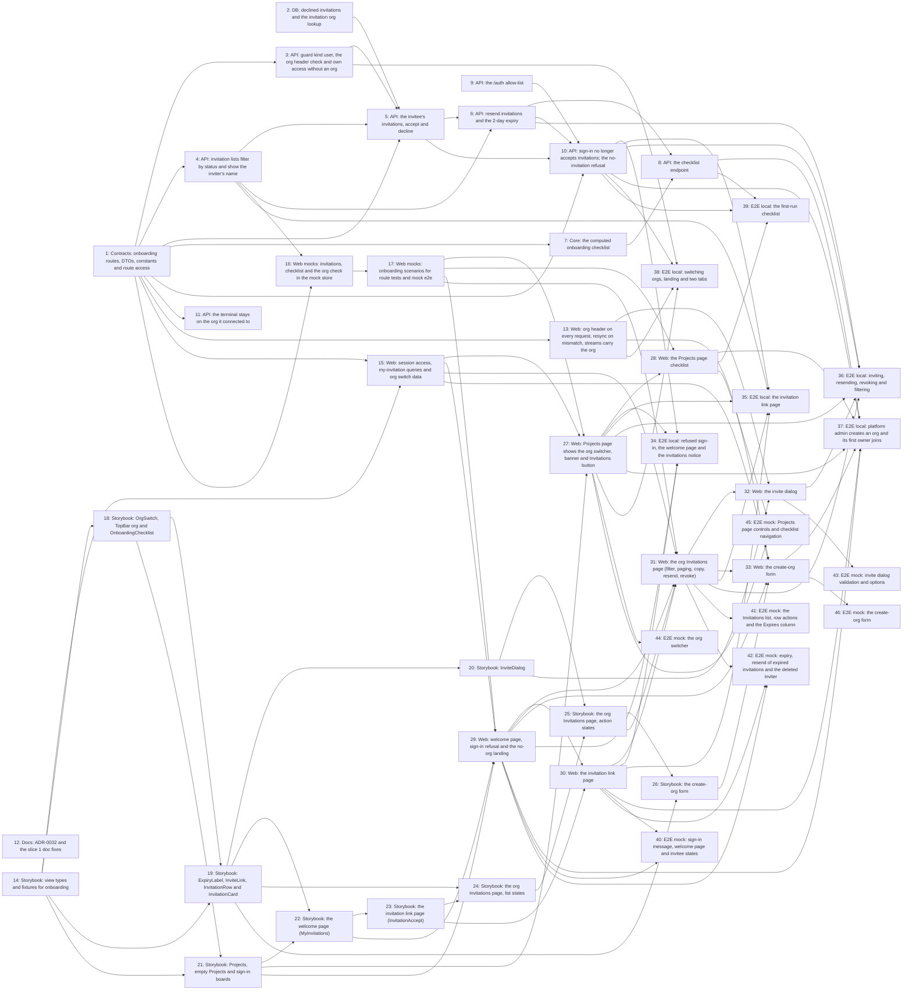

<!-- dev-plan: kind=plan id=org-onboarding rev=1 hash=eefb553da513 spec=docs/superpowers/specs/2026-11-21-org-onboarding-design.md spec-hash=9002c1e6b646 -->
# Org onboarding Implementation Plan

> **For agentic workers:** REQUIRED SUB-SKILL: Use superpowers:subagent-driven-development (recommended) or superpowers:executing-plans to implement this plan task-by-task. Steps use checkbox (`- [ ]`) syntax for tracking.

**Goal:** A person gets from sign-in to a working org without operator help: platform admins create orgs and invite the first owner, owners and admins invite with a copy link and manage invitations, invitees accept or decline, members switch orgs with every request pinned to the org in the URL, and a new org's owners and admins follow a first-run checklist.

**Architecture:** The shared pieces land first: every new route, DTO and constant in contracts (Task 1), the `declined` status and the `invitation_org_for_email` definer in db (Task 2), the view types and fixtures for Storybook (Task 14). The api then grows along one chain that keeps `authz.int.test.ts` single-writer (guard, invitee routes, resend, checklist), while the inviter lists, the `/auth` allow-list, terminal pinning and the checklist computation run beside it; sign-in stops auto-accepting only after the accept endpoint exists. On the web, the client org header and resync, the session queries and the mock store come first; Storybook tasks build every new component and screen against the approved boards; route wiring follows per screen; e2e specs come last, split by flow.

**Tech Stack:** TypeScript (strict), Zod 4, Drizzle + Postgres 18 (RLS, `SECURITY DEFINER`), NestJS 11 on Fastify, better-auth 1.7.22, TanStack Router and Query, TanStack Form, MSW, Storybook 10, Vitest + Testcontainers, Playwright.

**Spec:** `docs/superpowers/specs/2026-11-21-org-onboarding-design.md`. Read it with this plan: the business rules (BR-n), the API table, the copy list in "UI and Storybook", the Testing table and the E2E test cases (TC-n.m) are not repeated here. Slice 1 (`docs/superpowers/specs/2026-11-20-rbac-foundation-design.md`) is built on `main` (commit `a3ab2b2`); this plan changes that code.

## Global Constraints

- AGENTS.md rules 1 to 11 bind every task. Layering `apps → core → db → contracts`; `web → contracts` only; db cannot import contracts. Names stay generic: invitation, organization, connection, code host, checklist, `x-org-id`. No provider name in tables, types, routes, modules or new copy (existing copy such as the Projects "GitHub" column stays).
- No new dependency of any kind. Copy-link uses `navigator.clipboard.writeText`.
- Never edit migrations 0000 to 0029. New: `0030_invitations_declined` (generated), `0031_invitation_org_for_email` (hand-written).
- `INVITATION_EXPIRY_SECONDS = 172800` (2 days) in contracts is the only expiry source; SQL `now() + make_interval(secs => $1)`; never `Date.now()` or `new Date()` in api invitation logic. Stored rows keep their `expires_at` (no backfill).
- `ORG_HEADER = 'x-org-id'` (org id, not slug); `ORG_QUERY_PARAM = 'orgId'` on SSE and terminal URLs; mismatch → 409 problem with `type: 'org-mismatch'`, WS close `4412`; `NO_INVITATION_CODE = 'no_invitation'`.
- `/auth/*` allow-list, exactly: `/get-session`, `/sign-in/social`, `/callback/*`, `/sign-out`, `/organization/list`, `/organization/set-active`, `/ok`, `/error`. Everything else under `/auth` answers 404 (dev-login is its own controller).
- Limits: invitation email valid, ≤ 254 chars, lowercased; scope org or 1 to 100 projects (duplicates collapse); org name 1 to 100 chars; slug `^[a-z0-9](?:[a-z0-9-]*[a-z0-9])?$`, 1 to 63 chars, unique (409 `/slug`); one pending invitation per (org, email) (409 `/email`).
- Status semantics on lists: `pending` = stored pending and `expires_at > now()`; `expired` = stored expired, or pending with `expires_at <= now()`; `all` = every status; default `pending`.
- Logs at `info`: mismatch `{requestId, userId, sessionOrgId, headerOrgId}`; accept, decline, resend `{requestId, orgId, invitationId}`. Never an email at `info`.
- Web: tokens only, no new colour, size, radius or spacing; copy verbatim from the spec's "UI and Storybook › Copy"; query keys `['org', slug, …]` except `['session', …]`; mappers take `now`; no optimistic updates; invitee email, org, project and inviter names render as React text only.
- **Storybook first is a blocker from the spec ("Blocker: Storybook first"), not an ordering preference.** Every task that implements or wires the new UI depends on the Storybook task(s) for that UI (Tasks 14 and 18 to 26).
- Sensitive tasks (label `review:sensitive`, high-effort security review): Tasks 2, 3, 4, 5, 6, 9, 10, 11.
- Before every commit: `devbox run fix` until it prints `fix: clean.`. Conventional Commits with the package as scope. One task = one branch = one PR. Before saying done: `pnpm typecheck` and `pnpm test` for the touched packages, plus the e2e the task names.

## Review Focus

1. **A session with no active org sends `x-org-id`** (a user on the welcome page in one tab whose other tab still names an org). Expected: 409 `org-mismatch` (null is not the header's org), nothing written; the web's resync then sets the URL org active or shows not found. Test: Task 3 (`a header with no active org in the session is 409 org-mismatch`).
2. **Several queries hit 409 at once** (a stale tab's page fires four reads together). Expected: one `set-active` call, one reload, no loop. Test: Task 13 (`four reads failing with org-mismatch together send one set-active`).
3. **The invitee is already a member when they accept** (granted directly after the invitation was sent). Expected: accept succeeds, still one `member` row, the invited assignments are added, no 500. Test: Task 5 (`accepting while already a member adds the assignments and keeps one member row`).
4. **A malformed invitation id in the link** (`/invitations/not-a-uuid`, a truncated paste). Expected: the "This invitation is not available" state, not an error page. Test: Task 30 (`a link with a malformed id shows not available without calling the API`).
5. **The account email has upper case** (`Ada@X.dev` signs in; the invitation is stored as `ada@x.dev`). Expected: listed, readable and acceptable. Test: Task 5 (`an invitee whose stored email has upper case lists and accepts the invitation`).

## Needs approval

None. The spec adds no dependency and this plan adds none.

## Agent calls made while planning

- Agent call: slice 1 is already built on `main` (`a3ab2b2`), so the spec's "slice 1 is not built, fix its spec in the same PR, not migrated" becomes: change the built code and its tests in the tasks below, and fix the slice 1 spec and ADR-0031 in Task 12 (the spec predates the merge).
- Agent call: the route table is two-level, so the spec's `me.invitations.list/get/accept/decline` become `me.listInvitations`, `me.getInvitation`, `me.acceptInvitation`, `me.declineInvitation`, `platform.invitations.resend` becomes `platform.resendInvitation` and `platform.invitations.list` is the existing `platform.listInvitations` (slice 1's `platform.<verb><Noun>` naming).
- Agent call: accept, decline, resend and my-invitations live in `apps/api` (`MyInvitationsService`, `InvitationsService`, `accept-invitations.ts`), not `packages/core`: slice 1 built acceptance and the audit helpers in `apps/api`, and core cannot import them (rule 2). Only `orgChecklist` goes in core, as the spec says.
- Agent call: the guard's org check also covers the `project-list` kind (slice 1 added it for `projects.list`; it is org-scoped like `org`, and leaving it out would let a stale tab read the other org's project list).
- Agent call: `GET /api/me/access` answers a session with no active org (empty assignments, `platformAdmin` from config) instead of 403, because the spec has the welcome and create-org pages read `platformAdmin` from it under `['session','access']`.
- Agent call: `invitation_org_for_email` reads through a second definer policy limited to the one id it was asked for (a transaction-local setting the function sets and clears), so slice 1's rule that definer policies expose only rows a function may return still holds.
- Agent call: the api checklist passes every project id of the org to `orgChecklist`, because only org-scope `project:create` holders (owner, org admin) reach the route and they see every project.
- Agent call: checklist "Start" targets: no project → `/o/<org>/projects/new/repo` for every step; with a focus project, `connect_code_host` and `create_project` → the wizard, `add_agent` → `/o/<org>/p/<id>/desk/agent`, `add_rule` → `/o/<org>/p/<id>/desk/rules`.
- Agent call: the spec's "onb int" splits into `my-invitations.int.test.ts`, `invitation-resend.int.test.ts`, `checklist.int.test.ts` and `org-check.int.test.ts`, so parallel tasks never share a test file; BR-31's int test goes in `invitations.int.test.ts` (Task 4).
- Agent call: Task 1 lists the new route keys in `NOT_REGISTERED_YET` and the denial table skips those keys until each controller task deletes its line (the existing stale-entry check forces that); `platform.resendInvitation` sits before `platform.removeInvitation` in `DENIAL_TABLE` so it sees the seeded pending invitation.
- Agent call: until Task 3, a `user` route entry fails closed (403) in `checkTenantAccess`; no `user` route is registered before Task 3 anyway.
- Agent call: the per-user lock and `for update` re-read of slice 1's acceptance are kept by extracting `acceptInvitationInTx`, which both the accept endpoint and (until Task 10) sign-in use.
- Agent call: Task 4 exports `effectiveStatus`, `roleRefs` and `projectRefs` from `invitations.service.ts` so `MyInvitationsService` reuses them instead of copying them.
- Agent call: the T12 text reaches every existing form through `fieldErrorsFromProblem` (form-level message) and every toast through `toastFromError`; the invite dialog and create-org form show it as a Toast, as the boards draw.
- Agent call: the e2e files split further than the spec's seven so each task stays reviewable and parallel tasks never share a file: local `onboarding-signin`, `onboarding-link`, `onboarding-inviter`, `onboarding-platform`, `org-switch`, `checklist`; mock `onboarding`, `invitations`, `invitations-expiry`, `invite-dialog`, `org-switch`, `checklist`, `create-org`.
- Agent call: the new local e2e helpers are named `signInAs(context, handle, redirect?)`, `platformAdminContext(browser)`, `inviteViaApi(...)` and `acceptViaApi(...)`; the existing `asPlatformAdmin()` (an API context) keeps its name.
- Agent call: all onboarding mock scenarios live in one module (Task 17), selected through the sessionStorage key `agentdesk.mock.onboarding`, so no e2e task edits the mocks.
- Agent call: Storybook view types and fixtures for every new component and screen land in one task (Task 14); later Storybook tasks compose state inline in their story files and never edit `@/mocks`, so they can run beside each other.
- Agent call: the `Projects` and `ProjectsEmpty` stories pass the new props as a one-org owner sees them (org name, Invitations button); their drift from the unchanged boards goes in `design/parity-notes.md`.
- Agent call: the Projects page's 403 state renders the global top bar with the org switcher above `Forbidden` through the route's own `errorComponent` (board `ProjectsNoAccess`, BR-44).
- Agent call: the docs task leaves line 1 (the dev-plan version line) of the slice 1 spec as is and says in its PR that the slice 1 spec changed after its plan was built.

## E2E coverage

| Rules and cases | Proved by |
| --- | --- |
| BR-1 (TC-1.1, 1.2), BR-2 (2.1 to 2.3), BR-3 (3.1, 3.2), BR-41 (41.1), BR-45 (45.1, 45.2) | Task 34 `e2e/local/onboarding-signin.spec.ts` |
| BR-5 (5.1 to 5.3), BR-21 (21.1, 21.2), BR-22 (22.1 to 22.3), BR-23 (23.1 to 23.4), BR-24 (24.1), BR-25 (25.1, 25.2), BR-26 (26.1 to 26.3), BR-42 (42.1, 42.2), BR-52 (52.1) | Task 35 `e2e/local/onboarding-link.spec.ts` |
| BR-18 (18.1, 18.2), BR-27 (27.1 to 27.3), BR-30 (30.1), BR-31 (31.1), BR-32 (32.1, 32.2), BR-47 (47.1 to 47.4) | Task 36 `e2e/local/onboarding-inviter.spec.ts` |
| BR-34 (34.1), BR-35 (35.1 to 35.3), BR-38 (38.1), BR-40 (40.1 to 40.3) | Task 37 `e2e/local/onboarding-platform.spec.ts` |
| BR-7 (7.1, 7.2), BR-8 (8.1), BR-11 (11.1 to 11.3), BR-43 (43.1) | Task 38 `e2e/local/org-switch.spec.ts` |
| BR-13 (13.1 to 13.3), BR-14 (14.1 to 14.4), BR-16 (16.1 to 16.3) | Task 39 `e2e/local/checklist.spec.ts` |
| BR-1 (1.3 to 1.5), BR-4 (4.1 to 4.3), BR-25 (25.3, 25.4), BR-26 (26.4, 26.5), BR-37 (37.1, 37.2), BR-46 (46.2), BR-52 (52.3, 52.5) | Task 40 `e2e/mock/onboarding.spec.ts` |
| BR-19 (19.1 to 19.4), BR-20 (20.3, 20.4), BR-30 (30.2 to 30.4), BR-33 (33.1, 33.2), BR-51 (51.1 to 51.5), BR-52 (52.2) | Task 41 `e2e/mock/invitations.spec.ts` |
| BR-48 (48.1 to 48.4), BR-49 (49.1, 49.2), BR-50 (50.1), BR-52 (52.4) | Task 42 `e2e/mock/invitations-expiry.spec.ts` |
| BR-28 (28.1 to 28.6), BR-29 (29.1 to 29.3) | Task 43 `e2e/mock/invite-dialog.spec.ts` |
| BR-6 (6.1, 6.2), BR-9 (9.1), BR-10 (10.1), BR-12 (12.1, 12.2), BR-44 (44.1, 44.2), BR-46 (46.1) | Task 44 `e2e/mock/org-switch.spec.ts` |
| BR-15 (15.1 to 15.5), BR-17 (17.1 to 17.3), BR-20 (20.1, 20.2) | Task 45 `e2e/mock/checklist.spec.ts` |
| BR-36 (36.1 to 36.10), BR-37 (37.3), BR-39 (39.1, 39.2), BR-46 (46.3) | Task 46 `e2e/mock/create-org.spec.ts` |
| Not e2e on local, per spec "Not provable by e2e": expiry (BR-4, 18, 23, 48, 49, 50 expired parts), BR-51 over 3 days, social `error=no_invitation`, unverified email, BR-19 race, BR-46 API 403 | integration in Tasks 4, 5, 6, 10; mock e2e above |
| N-1, N-4 | Task 9 · N-2 Tasks 5, 6 · N-3 Tasks 3, 5, 6 · N-5 Task 3 · N-6 Tasks 3, 11 · N-7 Task 2 · N-8 Tasks 1, 6 · N-9 Task 5 |

---

<!-- dev-plan:graph:begin -->
## Task graph

Generated by `dev-plan.mjs graph --write` from each task's **Depends on:** line. Do not edit it by hand.
Tasks in the same wave touch no common file and can be built in parallel; a task starts when everything it depends on is merged.

| Wave | Task | Depends on |
| ---- | ---- | ---------- |
| 1 | Task 1: Contracts: onboarding routes, DTOs, constants and route access | none |
| 1 | Task 2: DB: declined invitations and the invitation org lookup | none |
| 1 | Task 9: API: the /auth allow-list | none |
| 1 | Task 12: Docs: ADR-0032 and the slice 1 doc fixes | none |
| 1 | Task 14: Storybook: view types and fixtures for onboarding | none |
| 2 | Task 3: API: guard kind user, the org header check and own access without an org | Task 1 |
| 2 | Task 4: API: invitation lists filter by status and show the inviter's name | Task 1 |
| 2 | Task 7: Core: the computed onboarding checklist | Task 1 |
| 2 | Task 11: API: the terminal stays on the org it connected to | Task 1 |
| 2 | Task 13: Web: org header on every request, resync on mismatch, streams carry the org | Task 1 |
| 2 | Task 15: Web: session access, my-invitation queries and org switch data | Task 1, Task 14 |
| 2 | Task 18: Storybook: OrgSwitch, TopBar org and OnboardingChecklist | Task 14 |
| 3 | Task 5: API: the invitee's invitations, accept and decline | Task 1, Task 2, Task 3, Task 4 |
| 3 | Task 16: Web mocks: invitations, checklist and the org check in the mock store | Task 1, Task 4 |
| 3 | Task 19: Storybook: ExpiryLabel, InviteLink, InvitationRow and InvitationCard | Task 14, Task 18 |
| 3 | Task 21: Storybook: Projects, empty Projects and sign-in boards | Task 14, Task 18 |
| 4 | Task 6: API: resend invitations and the 2-day expiry | Task 4, Task 5 |
| 4 | Task 17: Web mocks: onboarding scenarios for route tests and mock e2e | Task 16 |
| 4 | Task 20: Storybook: InviteDialog | Task 19 |
| 4 | Task 22: Storybook: the welcome page (MyInvitations) | Task 19, Task 21 |
| 5 | Task 8: API: the checklist endpoint | Task 6, Task 7 |
| 5 | Task 10: API: sign-in no longer accepts invitations; the no-invitation refusal | Task 1, Task 5, Task 6, Task 9 |
| 5 | Task 23: Storybook: the invitation link page (InvitationAccept) | Task 22 |
| 5 | Task 27: Web: Projects page shows the org switcher, banner and Invitations button | Task 15, Task 17, Task 21 |
| 5 | Task 29: Web: welcome page, sign-in refusal and the no-org landing | Task 15, Task 17, Task 21, Task 22 |
| 6 | Task 24: Storybook: the org Invitations page, list states | Task 19, Task 23 |
| 6 | Task 28: Web: the Projects page checklist | Task 17, Task 27 |
| 6 | Task 30: Web: the invitation link page | Task 23, Task 29 |
| 6 | Task 38: E2E local: switching orgs, landing and two tabs | Task 3, Task 10, Task 13, Task 27 |
| 6 | Task 44: E2E mock: the org switcher | Task 27 |
| 7 | Task 25: Storybook: the org Invitations page, action states | Task 20, Task 24 |
| 7 | Task 34: E2E local: refused sign-in, the welcome page and the invitations notice | Task 10, Task 27, Task 29, Task 30 |
| 7 | Task 39: E2E local: the first-run checklist | Task 8, Task 10, Task 28 |
| 7 | Task 40: E2E mock: sign-in message, welcome page and invitee states | Task 29, Task 30 |
| 7 | Task 45: E2E mock: Projects page controls and checklist navigation | Task 27, Task 28 |
| 8 | Task 26: Storybook: the create-org form | Task 19, Task 25 |
| 8 | Task 31: Web: the org Invitations page (filter, paging, copy, resend, revoke) | Task 15, Task 17, Task 25, Task 29, Task 30 |
| 9 | Task 32: Web: the invite dialog | Task 13, Task 20, Task 31 |
| 9 | Task 33: Web: the create-org form | Task 13, Task 15, Task 26, Task 29, Task 31 |
| 9 | Task 35: E2E local: the invitation link page | Task 4, Task 10, Task 27, Task 30, Task 31 |
| 9 | Task 41: E2E mock: the Invitations list, row actions and the Expires column | Task 31 |
| 9 | Task 42: E2E mock: expiry, resend of expired invitations and the deleted inviter | Task 29, Task 30, Task 31 |
| 10 | Task 36: E2E local: inviting, resending, revoking and filtering | Task 6, Task 10, Task 27, Task 31, Task 32 |
| 10 | Task 37: E2E local: platform admin creates an org and its first owner joins | Task 8, Task 10, Task 27, Task 28, Task 29, Task 30, Task 33 |
| 10 | Task 43: E2E mock: invite dialog validation and options | Task 32 |
| 10 | Task 46: E2E mock: the create-org form | Task 33 |


<!-- dev-plan:graph:end -->

### Task 1: Contracts: onboarding routes, DTOs, constants and route access

**Depends on:** none

**Files:**

- Create: `packages/contracts/src/org-context.ts`, `packages/contracts/src/org-context.test.ts`
- Modify: `packages/contracts/src/index.ts`
- Modify: `packages/contracts/src/access.ts`, `packages/contracts/src/access.test.ts`
- Modify: `packages/contracts/src/schemas/access.ts`, `packages/contracts/src/schemas/access.test.ts`
- Modify: `packages/contracts/src/routes.ts`, `packages/contracts/src/routes.test.ts`
- Modify: `packages/contracts/src/route-access.ts`, `packages/contracts/src/route-access.test.ts`
- Modify: `apps/api/src/auth/session.guard.ts`, `apps/api/src/access/check-access.ts`, `apps/api/src/access/authorize.ts`
- Modify: `apps/api/test/authz.int.test.ts`
- Create: `apps/web/src/mocks/dto/invitations.ts`
- Modify: `apps/web/src/mocks/msw/handlers.ts`, `apps/web/src/mocks/msw/contract.test.ts`

**Interfaces:**

- Consumes: slice 1 `PageQuery`, `pageOf`, `Id`, `Timestamp`, `RoleRef`, `InvitationDto`, `orgParams`, `orgInvitationParams`.
- Produces:

```ts
// org-context.ts
export const ORG_HEADER = 'x-org-id';
export const ORG_QUERY_PARAM = 'orgId';
export const ORG_MISMATCH_PROBLEM_TYPE = 'org-mismatch';
export const TERMINAL_CLOSE_ORG_CHANGED = 4412;
export const NO_INVITATION_CODE = 'no_invitation';
// access.ts: PLATFORM_PERMISSIONS gains 'platform-invitation:update'
// schemas/access.ts
export const INVITATION_EXPIRY_SECONDS = 172800;
export const InvitationStatus = z.enum(['pending', 'accepted', 'declined', 'revoked', 'expired']);
export const InvitationListStatus = z.enum(['pending', 'accepted', 'declined', 'revoked', 'expired', 'all']);
export const InvitationListQuery = PageQuery.extend({ status: InvitationListStatus.default('pending') });
export const InvitationScopeDto = z.discriminatedUnion('type', [/* {type:'org'} | {type:'project', projects:{id,name}[]} */]); // InvitationDto.scope now uses it
export const InviterDto = z.object({ name: z.string(), handle: z.string() });
export const MyInvitationDto = z.object({ id: Id, org: z.object({ id: Id, name: z.string(), slug: z.string() }),
  role: z.object({ key: z.string(), name: z.string() }), scope: InvitationScopeDto, invitedBy: InviterDto.nullable(),
  expiresAt: Timestamp, status: InvitationStatus });
export const AcceptInvitationResponse = z.object({ org: z.object({ id: Id, name: z.string(), slug: z.string() }) });
export const ChecklistStepKey = z.enum(['connect_code_host', 'create_project', 'add_agent', 'add_rule']);
export const OrgChecklistDto = z.object({ complete: z.boolean(), projectId: Id.nullable(),
  steps: z.array(z.object({ key: ChecklistStepKey, done: z.boolean() })) });
// route-access.ts: RouteAccess gains { scope: 'user' }
```

  Routes (`routes.ts`), each with a `routeAccess` entry:

  | Key | Method, path | Request | Response | Access |
  | --- | --- | --- | --- | --- |
  | `me.listInvitations` | GET `/api/me/invitations` | query `PageQuery` | `pageOf(MyInvitationDto)` | `{scope:'user'}` |
  | `me.getInvitation` | GET `/api/me/invitations/:invitationId` | params `{invitationId: Id}` | `MyInvitationDto` | `{scope:'user'}` |
  | `me.acceptInvitation` | POST `/api/me/invitations/:invitationId/accept` | params | `AcceptInvitationResponse` | `{scope:'user'}` |
  | `me.declineInvitation` | POST `/api/me/invitations/:invitationId/decline` | params | empty (204) | `{scope:'user'}` |
  | `invitations.resend` | POST `/api/orgs/:orgId/invitations/:invitationId/resend` | `orgInvitationParams` | `InvitationDto` | `orgAdmin('member:create','assignment:create')` |
  | `platform.resendInvitation` | POST `/api/platform/orgs/:orgId/invitations/:invitationId/resend` | `orgInvitationParams` | `PlatformInvitationDto` | `platform('platform-invitation:update')` |
  | `orgs.checklist` | GET `/api/orgs/:orgId/checklist` | `orgParams` | `OrgChecklistDto` | `org('project:create')` |
  | `invitations.list`, `platform.listInvitations` (changed) | unchanged | query `InvitationListQuery` | unchanged | unchanged |
  | `runs.events`, `projects.events`, `setupTests.events` (changed) | unchanged | query gains `orgId: Id.optional()` | unchanged | unchanged |
  | `runs.terminal`, `setupTests.terminal` (changed) | unchanged | query `{ orgId: Id.optional() }`; doc comment close list `4401/4403/4409/4410/4412` | unchanged | unchanged |

  `apps/web/src/mocks/dto/invitations.ts`: `myInvitationFixtures: Record<'pending' | 'pendingProjects' | 'pendingInviterHandle' | 'pendingInviterDeleted' | 'accepted' | 'declined' | 'revoked' | 'expired', MyInvitationDto>` (inviter `{name:'Ada Lovelace', handle:'ada'}`, `{name:'ada', handle:'ada'}`, `null`), `checklistFixtures: Record<'none' | 'partial' | 'complete', OrgChecklistDto>`.

- [x] **Step 1: Write the failing tests**
  - `org-context.test.ts`: the five constants have exactly the values above.
  - `schemas/access.test.ts`: `INVITATION_EXPIRY_SECONDS === 172800` (N-8); `InvitationStatus` accepts `declined`; `InvitationListQuery.parse({})` gives `status: 'pending'`; it accepts each of the six values and rejects `bogus`; `MyInvitationDto` parses a fixture with `invitedBy: null` and one with an `InviterDto`, and a parsed object carries no `link` or `token` key even when the input has one (Zod strips unknown keys); `OrgChecklistDto` rejects an unknown step key.
  - `access.test.ts`: the platform permission list includes `platform-invitation:update` and `isPlatformPermission` is true for it.
  - `routes.test.ts`: `flattenRoutes(routes)` has the seven new keys with the methods and paths above; `invitations.list.query.parse({}).status === 'pending'`; `runs.events.query.parse({orgId: <uuid>})` keeps `orgId`.
  - `route-access.test.ts`: extend `expected` with the seven entries; `{scope:'user'}` only on `me.*` keys other than `me.access`; every `routeAccess` key is in the route table (existing check).
  - `contract.test.ts`: every fixture in `myInvitationFixtures` and `checklistFixtures` parses with its schema.
- [x] **Step 2: Run** `pnpm --filter @agentdesk/contracts exec vitest run` and `pnpm --filter @agentdesk/web exec vitest run src/mocks/msw/contract.test.ts`. Expected: FAIL (missing exports).
- [x] **Step 3: Implement** the contracts above. Compile fixes outside contracts, failing closed: `preTargetDecision` takes `Exclude<RouteAccess, { scope: 'platform' | 'user' }>`; `checkTenantAccess` returns `{ ok: false, status: 403, reason: 'user-route' }` for `user` before calling it; `permissionLabel` returns `null` for `user`. In `authz.int.test.ts`: add `DENIAL_TABLE` rows `me.listInvitations: { none: 200, viewer: 200, pa: 200 }`, `me.getInvitation`, `me.acceptInvitation`, `me.declineInvitation`: `{ none: 404, viewer: 404, pa: 404 }` (the seeded invitation is another email's), `invitations.resend: tenant(403)`, `orgs.checklist: tenant(403)`, `platform.resendInvitation: platformRoute(200)` placed before `platform.removeInvitation`; put the seven new keys in `NOT_REGISTERED_YET` and filter `ALL_KEYS` by it. In `handlers.ts`: fixture-backed `impl` entries for the seven keys (`me.declineInvitation` and nothing else at 204), so the exhaustive `Impl` type compiles.
- [x] **Step 4: Run** the Step 2 commands, then `pnpm --filter @agentdesk/api typecheck`, `pnpm --filter @agentdesk/web typecheck` and `pnpm --filter @agentdesk/api exec vitest run test/authz.int.test.ts`. Expected: PASS.
- [x] **Step 5: Commit** `feat(contracts): onboarding routes, invitation DTOs and the org header constants`.

---

### Task 2: DB: declined invitations and the invitation org lookup

**Depends on:** none

**Files:**

- Modify: `packages/db/src/schema/access.ts`
- Create: `packages/db/migrations/0030_invitations_declined.sql`, `packages/db/migrations/0031_invitation_org_for_email.sql`
- Create: `packages/db/migrations/meta/0030_snapshot.json`, `packages/db/migrations/meta/0031_snapshot.json`
- Modify: `packages/db/migrations/meta/_journal.json`
- Modify: `packages/db/src/functions.ts`
- Test: `packages/db/test/functions.int.test.ts`, `packages/db/test/migrate.int.test.ts`, `packages/db/test/rls.int.test.ts`

**Interfaces:**

- Produces:

```ts
/** The org id of the invitation when its email equals lower(email), in any status; null otherwise (SECURITY DEFINER). */
export async function invitationOrgForEmail(db: Db, invitationId: string, email: string): Promise<string | null>;
```

  SQL: `invitations_status_check` becomes `status in ('pending','accepted','declined','revoked','expired')` (generated `0030`). `0031` (hand-written, runs as `agentdesk_owner`): policy `definer_read_lookup` on `invitations` `FOR SELECT TO agentdesk_owner USING (id = nullif(current_setting('agentdesk.invitation_lookup', true), '')::uuid)`; `invitation_org_for_email(p_invitation_id uuid, p_email text) RETURNS uuid LANGUAGE plpgsql VOLATILE SECURITY DEFINER SET search_path = public, pg_temp` that sets `agentdesk.invitation_lookup` (transaction-local) to the id, selects `org_id` where `id = p_invitation_id and email = lower(p_email)`, clears the setting and returns the id or null; `REVOKE ALL … FROM PUBLIC`; `GRANT EXECUTE … TO agentdesk_app`.

- [x] **Step 1: Write the failing tests**
  - `migrate.int.test.ts` (N-7): on a database at 0029 holding pending (including a 7-day `expires_at`), accepted, revoked and expired rows, applying 0030 and 0031 leaves every row and its `expires_at` unchanged; afterwards a `declined` row inserts and `status = 'bogus'` still fails the check.
  - `functions.int.test.ts`: `invitationOrgForEmail` returns the org id for the matching email in each of the five statuses and for an upper-case email argument; returns null for another email, a random uuid, and another org's invitation id with the wrong email; it is `SECURITY DEFINER` with a pinned `search_path`, executable by `agentdesk_app` only (no PUBLIC); after a call in a transaction, `current_setting('agentdesk.invitation_lookup', true)` is empty; a plain `select` by the app role still sees no other org's invitation; the existing `pendingInvitationsForEmail` still omits declined rows.
  - `rls.int.test.ts`: the invitations leak test seeds a `declined` row in org B and org A's session reads none of B's rows.
- [x] **Step 2: Run** `pnpm --filter @agentdesk/db exec vitest run test/functions.int.test.ts test/migrate.int.test.ts test/rls.int.test.ts`. Expected: FAIL.
- [x] **Step 3: Implement** the schema check, `pnpm --filter @agentdesk/db db:generate` for 0030 (read the SQL: only the check changes), the hand-written 0031 with its journal entry and snapshot, and `invitationOrgForEmail`.
- [x] **Step 4: Run** the Step 2 command and `pnpm --filter @agentdesk/db test`. Expected: PASS.
- [x] **Step 5: Commit** `feat(db): declined invitations and the invitation org lookup function`.

---

### Task 3: API: guard kind `user`, the org header check and own access without an org

**Depends on:** Task 1

**Files:**

- Create: `apps/api/src/common/org-mismatch.ts`, `apps/api/src/access/session-user.ts`
- Modify: `apps/api/src/common/problem.filter.ts`, `apps/api/src/common/problem.filter.test.ts`
- Modify: `apps/api/src/auth/session.guard.ts`, `apps/api/src/auth/session.guard.test.ts`
- Modify: `apps/api/src/access/check-access.ts`
- Create: `apps/api/test/org-check.int.test.ts`
- Modify: `apps/api/test/sse.int.test.ts`, `apps/api/test/authz.int.test.ts`

**Interfaces:**

- Consumes: `ORG_HEADER`, `ORG_QUERY_PARAM`, `ORG_MISMATCH_PROBLEM_TYPE` (Task 1).
- Produces:

```ts
// common/org-mismatch.ts
export class OrgMismatchException extends ConflictException { readonly problemType = ORG_MISMATCH_PROBLEM_TYPE; }
/** The org a request names: the x-org-id header, else the orgId query param; '' and non-strings are undefined. */
export function requestedOrgId(req: FastifyRequest): string | undefined;
// access/session-user.ts (with its own `declare module 'fastify'` augmentation)
export interface SessionUser { userId: string; email: string; emailVerified: boolean }
export const CurrentSessionUser: () => ParameterDecorator; // reads req.sessionUser, set by the guard for kind 'user'
```

  Guard order: public path → session (401) → route match → `platform` (unchanged; header ignored) → `user`: set `req.sessionUser` and pass (no org, no membership, header ignored) → org check for `org`, `project`, `project-list`, `self`, `org-admin`: `requestedOrgId(req)` present and `!== session.session.activeOrganizationId` → log `info` `{requestId, userId, sessionOrgId, headerOrgId}` "org mismatch" and throw `OrgMismatchException` → `self` with no active org: `req.authz = { access: { userId, grants: [] }, routeKey }`, pass → today's checks. The problem filter emits `type: exception.problemType` for an `OrgMismatchException` (detail "The organization in the request is not the active organization"), `about:blank` for everything else.

- [x] **Step 1: Write the failing tests**
  - `problem.filter.test.ts`: an `OrgMismatchException` becomes `{ type: 'org-mismatch', title: 'Conflict', status: 409, requestId }`; a plain `ConflictException` keeps `about:blank`.
  - `session.guard.test.ts`: `requestedOrgId` prefers the header over the query, ignores `''` and arrays of non-strings.
  - `org-check.int.test.ts` (N-5, a local `withOrgHeader(headers, orgId)` helper): a route-discovery table over every `org`, `project`, `project-list`, `self` and `org-admin` key (ids and bodies as `authz.int.test.ts` builds them) called by the owner of org A with `x-org-id: <org B>` (B is another org they belong to) → 409 `org-mismatch`, and no new row in `projects`, `rules`, `role_assignments`, `invitations` or `audit_log`, no Temporal start; the same with no header → today's status; with `x-org-id: <org A>` → today's status; a header naming an org the user is not in returns 409 and none of that org's data; `me.listInvitations` and every `platform.*` key ignore a mismatching header; Review Focus 1: `a header with no active org in the session is 409 org-mismatch`; N-3: a captured logger (`createTestApp({ logger })`) shows the mismatch line with exactly `requestId`, `userId`, `sessionOrgId`, `headerOrgId` and no email; `GET /api/me/access` for a platform admin with no org answers 200 `{ platformAdmin: true, assignments: [] }`.
  - `sse.int.test.ts` (N-6): `GET /api/runs/:runId/events?orgId=<other org>` and `/api/projects/:projectId/events?orgId=<other org>` answer 409 before any frame; `orgId` equal to the session org streams as today.
  - `authz.int.test.ts`: `'me.access'` row becomes `{ none: 200, viewer: 200, pa: 200 }`.
- [x] **Step 2: Run** `pnpm --filter @agentdesk/api exec vitest run src/common/problem.filter.test.ts src/auth/session.guard.test.ts test/org-check.int.test.ts test/sse.int.test.ts test/authz.int.test.ts`. Expected: FAIL.
- [x] **Step 3: Implement** the files above; remove Task 1's `user-route` refusal from `checkTenantAccess` (the guard no longer sends `user` entries there).
  - Agent call: the `user-route` refusal in `checkTenantAccess` (`apps/api/src/access/check-access.ts`) is kept, not removed. It is dead code for the guard but fails closed, and removing it would widen `entry` for the terminal gateway caller.
- [ ] **Step 4: Run** the Step 2 command and `pnpm --filter @agentdesk/api test`. Expected: PASS.
- [x] **Step 5: Commit** `feat(api): refuse a request whose org header is not the active org`.

---

### Task 4: API: invitation lists filter by status and show the inviter's name

**Depends on:** Task 1

**Files:**

- Create: `apps/api/src/invitations/inviter.ts`, `apps/api/src/invitations/inviter.test.ts`
- Modify: `packages/contracts/src/schemas/access.ts`, `packages/contracts/src/schemas/access.test.ts`
- Modify: `apps/api/src/invitations/invitations.service.ts`
- Modify: `apps/api/src/invitations/invitations.controller.ts`, `apps/api/src/invitations/platform-invitations.controller.ts`
- Modify: `apps/web/src/mocks/dto/access.ts`
- Test: `apps/api/test/invitations.int.test.ts`, `apps/api/test/platform.int.test.ts`

**Interfaces:**

- Consumes: `InvitationListQuery`, `InviterDto`, `InvitationStatus` (Task 1).
- Produces:

```ts
// inviter.ts: the BR-52 fallback, the one place it lives
export function toInviterDto(row: { name: string; handle: string | null } | null | undefined): InviterDto | null;
// name = row.name.trim(), or the handle when that is empty; handle = row.handle ?? ''; null row → null
// schemas/access.ts: InvitationDto.invitedBy becomes InviterDto.nullable() (PlatformInvitationDto follows by spread)
// invitations.service.ts (exported for Task 5)
export const effectiveStatus: SQL<string>;
export async function roleRefs(tx: Tx, ids: string[]): Promise<Map<string, RoleRef>>;
export async function projectRefs(tx: Tx, orgId: string, ids: string[]): Promise<ProjectRef[]>;
// InvitationsService.list(actor, orgId, q: InvitationListQuery): Page<InvitationDto>
```

  `list` adds the status condition (Global Constraints semantics) to both the page query and the count, keeps slice 1's project-admin rule (only invitations whose every project they administer), and left-joins better-auth `user` on `invited_by` for `name` and `handle`. `create` and `revoke` return the same `InviterDto | null`.

- [x] **Step 1: Write the failing tests**
  - `inviter.test.ts` (`it.each`): `{name:'Ada Lovelace', handle:'ada'}` → name `Ada Lovelace`; `'  '` → `ada`; `''` → `ada`; ` Bob ` → `Bob`; handle null with empty name → `{name:'', handle:''}`; null → null.
  - `invitations.int.test.ts`: BR-30 the default list holds only stored-pending unexpired rows; BR-47 each of `pending`, `accepted`, `declined`, `revoked`, `expired`, `all` returns only its rows and `total` follows; BR-48 a pending row with `expires_at` in the past is listed under `expired`, not `pending`, with `status: 'expired'`; BR-31 a project admin of P1 sees, under `all`, the P1-only invitation and not the P2, P1-and-P2 or org-scope ones (the filter never widens it); BR-52 `invitedBy` is `{name, handle}` from the inviter's row, falls back to the handle for a blank name (direct `update "user" set name = ' '`), and is null after the inviter's user row is deleted; HTML and SQL metacharacters in the invitee email round-trip unchanged; `?status=bogus` → 400.
  - `platform.int.test.ts`: `platform.listInvitations` takes the same `status` filter (default pending) and returns `invitedBy` as `InviterDto | null`.
  - `schemas/access.test.ts`: `InvitationDto` requires `invitedBy` to be an `InviterDto` or null.
- [x] **Step 2: Run** `pnpm --filter @agentdesk/api exec vitest run src/invitations/inviter.test.ts test/invitations.int.test.ts test/platform.int.test.ts` and `pnpm --filter @agentdesk/contracts exec vitest run src/schemas/access.test.ts`. Expected: FAIL.
- [x] **Step 3: Implement** the contract change, `inviter.ts`, the service and controller query types (`InvitationListQuery`), and the web DTO fixtures (`invitationFixtures`, platform ones) with `InviterDto` values.
- [x] **Step 4: Run** the Step 2 commands, `pnpm --filter @agentdesk/api test` and `pnpm --filter @agentdesk/web exec vitest run src/mocks/msw/contract.test.ts`. Expected: PASS.
- [x] **Step 5: Commit** `feat(api): filter invitation lists by status and show the inviter's name`.

---

### Task 5: API: the invitee's invitations, accept and decline

**Depends on:** Task 1, Task 2, Task 3, Task 4

**Files:**

- Create: `apps/api/src/invitations/my-invitations.service.ts`, `apps/api/src/invitations/my-invitations.controller.ts`
- Modify: `apps/api/src/invitations/invitations.module.ts`
- Modify: `apps/api/src/auth/accept-invitations.ts`
- Modify: `apps/api/src/audit/audit-entry.ts`, `apps/api/src/audit/audit-entry.test.ts`
- Modify: `apps/api/test/helpers/auth.ts`
- Create: `apps/api/test/my-invitations.int.test.ts`
- Modify: `apps/api/test/authz.int.test.ts`

**Interfaces:**

- Consumes: `invitationOrgForEmail` (Task 2); `CurrentSessionUser`, `SessionUser` (Task 3); `toInviterDto`, `effectiveStatus`, `roleRefs`, `projectRefs` (Task 4); `pendingInvitationsForEmail`, `withOrg` (slice 1).
- Produces:

```ts
export class MyInvitationsService {
  list(user: SessionUser, q: PageQuery): Promise<Page<MyInvitationDto>>;          // pending, unexpired, own verified email; unverified → empty page
  get(user: SessionUser, invitationId: string): Promise<MyInvitationDto>;          // any status; else NotFoundException('Not found')
  accept(user: SessionUser, invitationId: string): Promise<AcceptInvitationResponse>; // not pending → ConflictException(`Invitation is ${status}`)
  decline(user: SessionUser, invitationId: string): Promise<void>;                 // same 404 / 409 split
}
// accept-invitations.ts: the body of slice 1's per-invitation loop, unchanged in effect
export async function acceptInvitationInTx(tx: Tx, invitation: typeof invitations.$inferSelect, user: { id: string }): Promise<void>;
// audit-entry.ts: AuditAction gains 'invitation.declined' | 'invitation.resent'
// test helpers
export async function invite(t: TestApp, orgId: string, email: string, roleKey: RoleKey,
  scope: { type: 'org' } | { type: 'project'; projectIds: string[] }): Promise<{ id: string }>; // platform invitation create
export async function myInvitations(t: TestApp, cookie: string): Promise<Page<MyInvitationDto>>;
export async function acceptInvite(t: TestApp, cookie: string, invitationId: string): Promise<LightMyRequestResponse>;
export async function declineInvite(t: TestApp, cookie: string, invitationId: string): Promise<LightMyRequestResponse>;
```

  `list`: `pendingInvitationsForEmail(email)` then one `withOrg(orgId)` read per org (org name and slug from `organization`, role, projects, inviter), sorted by `createdAt` desc, sliced by `PageQuery`. `get`, `accept`, `decline`: `invitationOrgForEmail(id, email)` → null or unverified email → 404; then under `withOrg(orgId)`, `pg_advisory_xact_lock(hashtext(userId))` and a `for update` read where id matches and `email = lower(<email>)`; effective status not pending → 409; accept calls `acceptInvitationInTx`; decline sets `declined` and audits `invitation.declined` `{ email }` with `actor_user_id` = the invitee, same transaction. Logs `info` `{requestId, orgId, invitationId}`. Slice 1's `acceptPendingInvitations` keeps working on top of `acceptInvitationInTx` until Task 10.

- [x] **Step 1: Write the failing tests** in `my-invitations.int.test.ts`. Invitees are existing users signed in before their invitation is created (sign-in still auto-accepts until Task 10):
  - BR-3, BR-41: a user in org A invited by orgs B and C lists both with org name, role, scope and `invitedBy`; accepting B leaves C pending in the list.
  - BR-4, BR-48: a revoked row and a pending row with past `expires_at` are absent from the list; accept on each → 409 (`Invitation is revoked`, `Invitation is expired`) and nothing changes.
  - BR-21: accepting a member invitation on P1 and P2 of an org with P1 to P3 gives one `member` row and exactly two assignments; a deleted listed project is skipped; the response is `{ org: { id, name, slug } }`.
  - BR-22: decline sets `declined`, adds no member row; the inviter's list under `declined` shows it.
  - BR-23: accept and decline on revoked, expired, accepted and declined invitations → 409 with the status in `detail`, no row changed.
  - BR-25, BR-26: `get` returns `MyInvitationDto` with `status` for pending, accepted, declined, revoked and expired rows, `invitedBy` an `InviterDto` (null once the inviter's row is gone).
  - BR-42: `Promise.all` of two accepts → one member row, one `invitation.accepted` row; one 200 and one 409 whose `get` shows `accepted`.
  - BR-45: a user whose only invitation is declined keeps an account with no org; a new session has `activeOrganizationId` null.
  - N-9 and T9: `get`, `accept`, `decline` answer the same 404 body for another email's invitation and for a random uuid; an unverified email (`update "user" set email_verified = false`) gets an empty list and 404 on accept; no session → 401.
  - N-2: `invitation.accepted` plus `assignment.granted` (slice 1 shapes) and `invitation.declined` rows are in the target org's `audit_log` (read under `withOrg`).
  - N-3: the captured logger has `{requestId, orgId, invitationId}` on accept and decline and no email at `info`.
  - Review Focus 3: `accepting while already a member adds the assignments and keeps one member row` (platform grant after the invitation).
  - Review Focus 5: `an invitee whose stored email has upper case lists and accepts the invitation`.
  - Untrusted text: an org name with `<b>` and `';--` comes back unchanged in `org.name`.
  - `audit-entry.test.ts`: `buildAuditRow` accepts the two new actions.
- [x] **Step 2: Run** `pnpm --filter @agentdesk/api exec vitest run test/my-invitations.int.test.ts src/audit/audit-entry.test.ts`. Expected: FAIL.
- [x] **Step 3: Implement** the service, controller (four routes, `@CurrentSessionUser()`), module registration, `acceptInvitationInTx` extraction, audit actions and helpers; delete the four `me.*` lines from `NOT_REGISTERED_YET`.
- [x] **Step 4: Run** the Step 2 command, `pnpm --filter @agentdesk/api exec vitest run test/authz.int.test.ts test/invitations.int.test.ts` and `pnpm --filter @agentdesk/api test`. Expected: PASS.
- [x] **Step 5: Commit** `feat(api): list, read, accept and decline your own invitations`.

---

### Task 6: API: resend invitations and the 2-day expiry

**Depends on:** Task 4, Task 5

**Files:**

- Modify: `apps/api/src/invitations/invitations.service.ts`
- Modify: `apps/api/src/invitations/invitations.controller.ts`, `apps/api/src/invitations/platform-invitations.controller.ts`
- Create: `apps/api/test/invitation-resend.int.test.ts`
- Modify: `apps/api/test/invitations.int.test.ts`, `apps/api/test/authz.int.test.ts`

**Interfaces:**

- Consumes: `INVITATION_EXPIRY_SECONDS`, routes `invitations.resend` and `platform.resendInvitation` (Task 1); `'invitation.resent'` (Task 5); `InviterDto` mapping (Task 4).
- Produces:

```ts
// InvitationsService
resend(actor: Actor, orgId: string, invitationId: string): Promise<InvitationDto>;
// create: expires_at = now() + make_interval(secs => INVITATION_EXPIRY_SECONDS); INVITATION_TTL is deleted
```

  `resend`: missing or other org → 404; slice 1's revoke rights check (same as create and revoke) → 403; one statement `update invitations set status = 'pending', expires_at = now() + make_interval(secs => $s) where org_id = $o and id = $i and status in ('pending','expired') returning *`; zero rows → `ConflictException('Invitation is no longer pending')`; unique violation on `invitations_org_email_pending_key` → `ConflictProblemException` pointer `/email`, detail "This email already has a pending invitation."; audit `invitation.resent` `{ expiresAt }` (`actorKind` `member` or `platform_admin`) in the same transaction; log `info` `{requestId, orgId, invitationId}`.

- [x] **Step 1: Write the failing tests** (a local `resend(t, cookie, orgId, id, platform?)` helper in the new file):
  - BR-18: resend of a pending row → `status: 'pending'`, same `id`, `expires_at` within a minute of the database `now()` (read in the test) + 172800 s.
  - BR-49: resend of a pending row with past `expires_at`, and of a stored `expired` row → pending again; the invitee's `GET /api/me/invitations/:id` shows `pending` and accept works.
  - BR-19: resend of accepted, declined and revoked rows → 409, row unchanged; `Promise.all` of resend and revoke on one pending row ends with exactly one of them applied and the other 409 (assert final state, not order).
  - BR-50: resend of an expired row while a newer pending invitation exists for the same email → 409 with pointer `/email`, both rows unchanged.
  - Rights: member and viewer → 403; a project admin on a P2 invitation they do not administer → 403; another org's id → 404; the platform mirror works for a platform admin and returns `PlatformInvitationDto`.
  - N-2: one `invitation.resent` row per resend; N-3: the logger line has no email.
  - `invitations.int.test.ts` (N-8): slice 1's 7-day expectations become `now()` + 2 days on create.
- [x] **Step 2: Run** `pnpm --filter @agentdesk/api exec vitest run test/invitation-resend.int.test.ts test/invitations.int.test.ts`. Expected: FAIL.
- [x] **Step 3: Implement** `resend`, the two controller routes and the create expiry; delete the two resend lines from `NOT_REGISTERED_YET`.
- [x] **Step 4: Run** the Step 2 command, `pnpm --filter @agentdesk/api exec vitest run test/authz.int.test.ts` and `pnpm --filter @agentdesk/api test`. Expected: PASS.
- [x] **Step 5: Commit** `feat(api): resend pending or expired invitations with a 2-day expiry`.

---

### Task 7: Core: the computed onboarding checklist

**Depends on:** Task 1

**Files:**

- Create: `packages/core/src/access/checklist.ts`
- Modify: `packages/core/src/access/index.ts`
- Create: `packages/core/test/access/checklist.int.test.ts`

**Interfaces:**

- Consumes: `OrgChecklistDto` (Task 1); `connections`, `projects`, `agents`, `rules`, `Tx` (db).
- Produces:

```ts
/** Runs inside the caller's withOrg transaction. Steps in the order connect_code_host, create_project, add_agent, add_rule. */
export async function orgChecklist(tx: Tx, visibleProjectIds: readonly string[]): Promise<OrgChecklistDto>;
```

  `connect_code_host`: an `active` connection with `capabilities.code = true`; `create_project`: `visibleProjectIds.length > 0`; focus project: the visible project with the most of {agent `credential_secret_name is not null`, at least one rule}, ties to the newest `created_at` (then id desc); `add_agent`, `add_rule`: the focus project's; `complete`: the focus project has both; `projectId`: the focus id or null.

- [x] **Step 1: Write the failing tests** (real database, org under `withOrg`):
  - nothing → all four not done, `complete: false`, `projectId: null`.
  - an active code connection only → `connect_code_host` done; an inactive one or a board-only one → not done.
  - one project with no credential and no rule → `create_project` done, focus is it, the other two not done.
  - BR-14: setting the agent credential marks `add_agent`; adding a rule marks `add_rule`; both → `complete: true`.
  - BR-16 and the split case: P1 with only a credential and P2 with only a rule → not complete; P1 complete and P2 empty → complete with `projectId` P1.
  - ties: two empty projects → the newer one is the focus.
  - only ids in `visibleProjectIds` count (a project outside the list with both steps does not complete it).
- [x] **Step 2: Run** `pnpm --filter @agentdesk/core exec vitest run test/access/checklist.int.test.ts`. Expected: FAIL.
- [x] **Step 3: Implement** `orgChecklist` and export it.
- [x] **Step 4: Run** the Step 2 command and `pnpm --filter @agentdesk/core test`. Expected: PASS.
- [x] **Step 5: Commit** `feat(core): compute the onboarding checklist from an org's projects`.

---

### Task 8: API: the checklist endpoint

**Depends on:** Task 6, Task 7

**Files:**

- Create: `apps/api/src/orgs/checklist.controller.ts`
- Modify: `apps/api/src/orgs/orgs.module.ts`
- Create: `apps/api/test/checklist.int.test.ts`
- Modify: `apps/api/test/authz.int.test.ts`

**Interfaces:**

- Consumes: `orgChecklist` (Task 7); route `orgs.checklist` (Task 1); `acceptInvite`, `invite` helpers (Task 5).
- Produces: `GET /api/orgs/:orgId/checklist` → `OrgChecklistDto`, computed under `withOrg(orgId)` over every project id of the org.

- [x] **Step 1: Write the failing tests**
  - BR-13, BR-14, BR-16 at the API: an owner's checklist moves through each step (fake connection install, project create, agent credential put, rule create) and is `complete` once one project has all four, with one and with two projects.
  - BR-17 and T11: a project admin, a member and a viewer get 403; an org admin gets 200.
  - BR-38: a platform-created org whose first owner joined through `inviteAndLogin(t, orgId, handle, 'owner', { type: 'org' })` (it accepts explicitly once Task 10 lands, with the same signature) → owner assignment at org scope, checklist with all four not done.
  - another org's id in the path → 404.
- [x] **Step 2: Run** `pnpm --filter @agentdesk/api exec vitest run test/checklist.int.test.ts`. Expected: FAIL.
- [x] **Step 3: Implement** the controller and module registration; delete the `orgs.checklist` line from `NOT_REGISTERED_YET`.
- [x] **Step 4: Run** the Step 2 command, `pnpm --filter @agentdesk/api exec vitest run test/authz.int.test.ts` and `pnpm --filter @agentdesk/api test`. Expected: PASS.
- [x] **Step 5: Commit** `feat(api): serve the org onboarding checklist`.

---

### Task 9: API: the `/auth` allow-list

**Depends on:** none

**Files:**

- Create: `apps/api/src/auth/allowed-paths.ts`, `apps/api/src/auth/allowed-paths.test.ts`
- Modify: `apps/api/src/auth/auth.ts`, `apps/api/src/auth/auth.controller.ts`
- Test: `apps/api/test/auth.int.test.ts`

**Interfaces:**

- Produces:

```ts
export const ALLOWED_AUTH_PATHS: readonly string[]; // Global Constraints list; '/callback/*' matches one segment after /callback/
/** pathname is lowercased, slashes collapsed, trailing slash removed, dot segments resolved (as auth.controller computes it). */
export function isBlockedAuthPath(pathname: string): boolean;
```

  `auth.controller.ts` uses `isBlockedAuthPath`; `auth.ts` drops `ALLOWED_ORGANIZATION_PATHS` and `isDisabledPath` and keeps passing its `DISABLED_PATHS` list to better-auth's `disabledPaths`.

- [x] **Step 1: Write the failing tests**
  - `allowed-paths.test.ts` (`it.each`): each allowed path is open, `/auth/callback/github` is open, `/auth/callback` and `/auth/callback/a/b` are blocked, `/auth/organization/list-members`, `/auth/sign-in/email`, `/auth/update-user`, `/auth/list-sessions` are blocked.
  - `auth.int.test.ts` (N-1): replace the three slice 1 path tests with one table over every endpoint better-auth installs (walk `auth.api` endpoints' `path`, so a new endpoint fails the test): as a signed-in owner, each path outside the allow-list answers 404 with the problem body, each allowed one does not; normalization variants of a blocked path (`//`, trailing `/`, upper case, `/./`, `%2e`) also 404.
  - N-4: `POST /auth/organization/set-active` to an org the user is not a member of → 403 and `get-session` shows the old active org.
  - dev-login still signs in (its own controller).
- [x] **Step 2: Run** `pnpm --filter @agentdesk/api exec vitest run src/auth/allowed-paths.test.ts test/auth.int.test.ts`. Expected: FAIL.
- [x] **Step 3: Implement** `allowed-paths.ts` and the controller switch.
- [x] **Step 4: Run** the Step 2 command and `pnpm --filter @agentdesk/api test`. Expected: PASS.
- [x] **Step 5: Commit** `feat(api): answer only an allow-list of better-auth routes`.

---

### Task 10: API: sign-in no longer accepts invitations; the no-invitation refusal

**Depends on:** Task 1, Task 5, Task 6, Task 9

**Files:**

- Modify: `apps/api/src/auth/auth.ts`, `apps/api/src/auth/dev-login.controller.ts`, `apps/api/src/auth/accept-invitations.ts`
- Modify: `apps/api/test/helpers/auth.ts`
- Test: `apps/api/test/auth.int.test.ts`, `apps/api/test/invitations.int.test.ts`
- Modify: `apps/web/e2e/local/helpers.ts`, `apps/web/e2e/local/rbac-invitations.spec.ts`

**Interfaces:**

- Consumes: `NO_INVITATION_CODE` (Task 1); the accept endpoint, `acceptInvitationInTx`, `invite`, `acceptInvite` (Task 5); `isBlockedAuthPath` (Task 9).
- Produces:
  - `user.create.before` throws `new APIError('FORBIDDEN', { message: 'Sign-up needs an invitation', code: NO_INVITATION_CODE })`; `user.create.after` is removed; `session.create.before` only sets the oldest membership (or null) as active org. `acceptPendingInvitations` is deleted.
  - Dev-login: a sign-up response whose JSON `code` is `no_invitation` → 302 `/sign-in?error=no_invitation`, no cookie, no user row; any other failure stays 401.
  - `inviteAndLogin(t, orgId, handle, roleKey, scope)` keeps its signature: platform invite, dev-login, then `acceptInvite`.
  - `apps/web/e2e/local/helpers.ts`:

```ts
export async function signInAs(context: BrowserContext, handle: string, redirect?: string): Promise<Page>; // dev-login in a new page
export async function platformAdminContext(browser: Browser): Promise<BrowserContext>;               // admin@dev.local signed in
export async function inviteViaApi(api: APIRequestContext, orgId: string, email: string, roleKey: RoleKey,
  scope: { type: 'org' } | { type: 'project'; projectIds: string[] }, via?: 'tenant' | 'platform'): Promise<{ id: string }>;
export async function acceptViaApi(page: Page, invitationId: string): Promise<void>;                 // POST /api/me/invitations/:id/accept
```

    `inviteAndSignIn` and `signInAndCreateProject` call `acceptViaApi` after dev-login, so other specs do not change.

- [x] **Step 1: Write the failing tests**
  - `auth.int.test.ts`: BR-1 dev-login of an uninvited handle → 302 `Location: /sign-in?error=no_invitation`, no `set-cookie`, no user row, and a second attempt the same; BR-1 social path with `GITHUB_CLIENT_ID`/`SECRET` set and `globalThis.fetch` stubbed for the token and user endpoints (no network): `POST /auth/sign-in/social` with `errorCallbackURL: '/sign-in'`, then `/auth/callback/github?code=x&state=<state>` → 302 to `/sign-in?error=no_invitation`, no user row; BR-2 an invited new handle's first dev-login creates the account but no member row, and its invitation stays pending; BR-3 an existing user invited to a second org is not a member after a new sign-in; BR-43 a user in orgs A (joined first) and B gets A as active org in a new session; the slice 1 test "an invited handle's first dev-login … lands in the invited org" becomes "lands with no active org until accept".
  - `invitations.int.test.ts`: slice 1's BR-55 and BR-56 tests become accept tests (sign-in, `acceptInvite`, then the invited scope).
  - `rbac-invitations.spec.ts`: TC-54.1 expects the redirect to `/sign-in?error=no_invitation`; the BR-55 and BR-56 cases accept through `acceptViaApi` before asserting the landing org.
- [x] **Step 2: Run** `pnpm --filter @agentdesk/api exec vitest run test/auth.int.test.ts test/invitations.int.test.ts`. Expected: FAIL.
- [x] **Step 3: Implement** the hook, refusal code, dev-login redirect, helper and e2e helper changes. Other int files and e2e specs reach invitations only through `inviteAndLogin` and `inviteAndSignIn`, which now accept explicitly, so they do not change; if `pnpm --filter @agentdesk/api test` shows one that does, stop and report it rather than widening this task.
- [ ] **Step 4: Run** the Step 2 command, `pnpm --filter @agentdesk/api test`, then with the stack up `pnpm --filter @agentdesk/web exec playwright test e2e/local/rbac-invitations.spec.ts e2e/local/rbac-platform.spec.ts`. Expected: PASS.
- [x] **Step 5: Commit** `feat(api): invitations wait for accept; refuse uninvited sign-up with no_invitation`.

---

### Task 11: API: the terminal stays on the org it connected to

**Depends on:** Task 1

**Files:**

- Modify: `apps/api/src/terminal/terminal.gateway.ts`
- Test: `apps/api/test/terminal.int.test.ts`

**Interfaces:**

- Consumes: `ORG_QUERY_PARAM`, `TERMINAL_CLOSE_ORG_CHANGED` (Task 1).
- Produces: `CLOSE.orgChanged = TERMINAL_CLOSE_ORG_CHANGED`; at connect, an `orgId` query param that is not the session's active org closes 4412 "org changed" before any byte; `reauth` re-checks session, membership and permission in `conn.orgId` (fixed at connect), never the session's current org.

- [x] **Step 1: Write the failing tests** (N-6):
  - connect with `?orgId=<other org>` → close 4412, no bytes; `?orgId=<active org>` and no param → attaches as today.
  - after connect, the user switches the session's active org (`set-active` to their other org); the next reauth keeps the socket open.
  - after connect, the user's assignment in the connect org is revoked; the next reauth closes 4403.
  - an existing test that expects 4403 after an org switch (if any) changes to "stays open".
- [x] **Step 2: Run** `pnpm --filter @agentdesk/api exec vitest run test/terminal.int.test.ts`. Expected: FAIL.
- [x] **Step 3: Implement** the connect check and the pinned reauth.
- [ ] **Step 4: Run** the Step 2 command and `pnpm --filter @agentdesk/api test`. Expected: PASS.
- [x] **Step 5: Commit** `feat(api): pin a terminal to the org it connected to`.

---

### Task 12: Docs: ADR-0032 and the slice 1 doc fixes

**Depends on:** none

**Files:**

- Create: `docs/adr/0032-per-request-org-check-and-auth-allow-list.md`
- Modify: `docs/adr/README.md`
- Modify: `docs/adr/0003-vite-spa-tanstack-router.md`, `docs/adr/0008-better-auth-in-process.md`, `docs/adr/0014-terminal-over-websocket-exec-relay.md`, `docs/adr/0031-scoped-rbac-roles-assignments.md`
- Modify: `docs/superpowers/specs/2026-11-20-rbac-foundation-design.md`
- Modify: `docs/conventions/database.md`

**Interfaces:**

- Produces: ADR-0032 "Per-request org check and the /auth allow-list" (Accepted, 2026-11-21): the `x-org-id` header and `orgId` param, 409 `org-mismatch` and close 4412 before any side effect, terminal reauth pinned to the connect org, the `/auth` allow-list, and the `setActive` latency check closed by reasoning (one POST only when the URL org differs from the session org; same-org navigation sends none); it amends ADR-0003, ADR-0008 and ADR-0014.

- [x] **Step 1: Write** ADR-0032 in the house ADR shape (context, decision, alternatives table, consequences) and its README row.
- [x] **Step 2: Add** an "Amended by [0032](…)" line to the status of ADR-0003 (the URL org wins per request), ADR-0008 (allow-list, `setActive` latency closed) and ADR-0014 (4412, reauth pinned).
- [x] **Step 3: Fix** the slice 1 spec and ADR-0031: BR-55 and BR-56 (explicit accept and decline, no auto-accept), BR-57 and §Limits (2 days, resend revives an expired invitation, `declined` final), §States, the API table (lists return every status with a `status` filter, default pending), `invitedBy: InviterDto | null` on `InvitationDto` and `PlatformInvitationDto`, the 7-day line in the tenant invitation create rule, and the fourth cross-org function. Leave the slice 1 spec's line 1 as is.
- [x] **Step 4: Fix** `database.md`: four cross-tenant functions, adding `invitation_org_for_email(invitation_id, email)` (org id only, any status, one id per call).
- [x] **Step 5: Commit** `docs(adr): ADR-0032 per-request org check and auth allow-list; slice 1 doc fixes`. PR body flags, unfixed: ADR-0006, ADR-0008 and the control-plane spec still say "personal org per user"; the frontend design spec lists the org switcher and invitations UI as out of scope; the slice 1 spec changed after its plan was built.

---

### Task 13: Web: org header on every request, resync on mismatch, streams carry the org

**Depends on:** Task 1

**Files:**

- Modify: `packages/contracts/src/client/api.ts`, `packages/contracts/src/client/api.test.ts`
- Modify: `apps/web/src/features/api.ts`, `apps/web/src/app/router.tsx`, `apps/web/src/app/boundaries.tsx`
- Create: `apps/web/src/features/auth/orgResync.ts`, `apps/web/src/features/auth/orgResync.test.ts`
- Modify: `apps/web/src/features/desk/problem.ts`, `apps/web/src/features/desk/problem.test.ts`
- Modify: `apps/web/src/features/runs/useRunEvents.ts`, `apps/web/src/features/runs/useProjectEvents.ts`, `apps/web/src/features/runs/useTerminal.ts`, `apps/web/src/features/runs/useTerminal.test.tsx`
- Modify: `apps/web/src/features/setup-script/useSetupTest.ts`

**Interfaces:**

- Consumes: `ORG_HEADER`, `ORG_QUERY_PARAM`, `ORG_MISMATCH_PROBLEM_TYPE`, `TERMINAL_CLOSE_ORG_CHANGED` (Task 1).
- Produces:

```ts
// contracts client
interface ApiOptions { /* … */ orgId?: () => string | undefined; onOrgMismatch?: () => Promise<void> }
// sends ORG_HEADER when orgId() returns a value; on 409 with type org-mismatch awaits onOrgMismatch() then throws the ApiError
export const sseRunPath: (runId: string, after?: string | number, orgId?: string) => string;
export const sseProjectPath: (projectId: string, orgId?: string) => string;
export const terminalPath: (runId: string, orgId?: string) => string;
// apps/web/src/features/auth/orgResync.ts
export const ORG_SWITCHED_MESSAGE = 'This organization was switched in another tab. Try again.';
export function registerOrgResyncTarget(next: { router: AnyRouter; queryClient: QueryClient }): void;
export function urlOrgId(): string | undefined;   // the $org slug of the current match → id from ['session','orgs']
export function resyncOrg(): Promise<void>;        // one in flight: set-active(url org) → cancelQueries + removeQueries(['org']) → router.invalidate()
export function isOrgMismatch(e: unknown): boolean;
```

  `fieldErrorsFromProblem` and `toastFromError` return `ORG_SWITCHED_MESSAGE` for an org-mismatch error. EventSource and WebSocket URLs carry `orgId=urlOrgId()`; an SSE error and a WS close 4412 call `resyncOrg()` before the existing reconnect.

- [x] **Step 1: Write the failing tests**
  - `api.test.ts` (contracts client): the header is sent when `orgId()` returns an id and absent when it returns undefined; a 409 `org-mismatch` calls `onOrgMismatch` once then rejects; any other 409 does not call it; the three path helpers append `orgId` (and keep `after`).
  - `orgResync.test.ts` (MSW answers 409 `org-mismatch` once, then normally; spec Testing BR-11): a read hits the handler twice and renders the data with `set-active` called once for the URL org; a write (rule update) hits it once, is not re-sent, and the form shows `ORG_SWITCHED_MESSAGE` with the input kept; a second 409 after the resync shows the normal error; Review Focus 2: `four reads failing with org-mismatch together send one set-active`.
  - `problem.test.ts`: an org-mismatch `ApiError` maps to `{ fields: {}, form: ORG_SWITCHED_MESSAGE }`.
  - `useTerminal.test.tsx`: a close 4412 calls `resyncOrg` and reconnects with the URL org's `orgId`; the connect URL carries `orgId`.
- [x] **Step 2: Run** `pnpm --filter @agentdesk/contracts exec vitest run src/client/api.test.ts` and `pnpm --filter @agentdesk/web exec vitest run src/features/auth/orgResync.test.ts src/features/desk/problem.test.ts src/features/runs/useTerminal.test.tsx`. Expected: FAIL.
- [x] **Step 3: Implement** the client options and paths, `orgResync.ts` (single in-flight promise, next to the 401 handler pattern in `signOut.ts`), registration in `createAppRouter` and `createRouterForTree`, the app client wiring in `features/api.ts`, the two error mappers and the stream URLs.
- [ ] **Step 4: Run** the Step 2 commands and `pnpm --filter @agentdesk/web test`. Expected: PASS.
- [x] **Step 5: Commit** `feat(web): send the URL org on every request and resync when it changed`.

---

### Task 14: Storybook: view types and fixtures for onboarding

**Depends on:** none

**Files:**

- Modify: `apps/web/src/mocks/types.ts`, `apps/web/src/mocks/index.ts`, `apps/web/src/mocks/mocks.test.ts`
- Create: `apps/web/src/mocks/orgs.ts`, `apps/web/src/mocks/onboarding.ts`, `apps/web/src/mocks/invitations.ts`

**Interfaces:**

- Produces (view types in `types.ts`, exported through `@/mocks`):

```ts
export interface OrgOption { id: string; slug: string; name: string }
export interface OrgSwitchData { current: OrgOption | null; orgs: OrgOption[]; platformAdmin: boolean }
export type ChecklistStepKey = 'connect_code_host' | 'create_project' | 'add_agent' | 'add_rule';
export interface ChecklistStep { key: ChecklistStepKey; label: string; done: boolean; href: string }
export type InvitationStatusView = 'pending' | 'accepted' | 'declined' | 'revoked' | 'expired';
export interface ExpiryView { kind: 'relative' | 'exact' | 'none'; text: string; title?: string; dateTime?: string }
export interface OrgInvitationRowView { id: string; email: string; role: string; access: string; status: InvitationStatusView;
  expires: ExpiryView; invitedBy: string | null; actions: ('copy' | 'resend' | 'revoke')[] }
export interface InvitationCardView { id: string; orgName: string; roleName: string; access: string; inviter: string | null;
  expires: { text: string; title: string; dateTime: string } }
export interface InvitationDetailsView extends InvitationCardView { orgSlug: string; status: InvitationStatusView }
export interface InviteOption { id: string; label: string }
```

  Fixtures: `orgs.ts` `orgOptions` (Acme, Beta, a 60-character name), `orgSwitchFixtures: Record<'oneOrg' | 'severalOrgs' | 'platformAdmin' | 'platformAdminNoOrg' | 'longName', OrgSwitchData>`; `onboarding.ts` `checklistSteps: Record<'none' | 'partial' | 'complete', ChecklistStep[]>` (labels from the spec copy), `pendingInvitationsCount = 2`; `invitations.ts` `invitationCards` (default, project scope, inviter deleted), `invitationDetails` per status (including expired with inviter deleted), `orgInvitationRows` (pending, expiring soon, expired recently, expired long ago with the exact date, accepted, declined, revoked, project scope, long email, inviter deleted), `pagedInvitationRows(n: number): OrgInvitationRowView[]`, `inviteRoleOptions: Record<'owner' | 'orgAdmin' | 'projectAdmin', InviteOption[]>`, `inviteProjectOptions`, `invitationLink = 'https://agentdesk.example/invitations/…'`. Dates in fixtures use the spec format ("23 Nov, 14:05", title "23 Nov 2026, 14:05").

- [x] **Step 1: Write the failing test** in `mocks.test.ts`: every fixture is exported from `@/mocks`; `orgInvitationRows` covers all five statuses; rows with status accepted, declined or revoked have `actions` without `resend` and `revoke` and `expires.kind === 'none'`; the expired row offers `resend` and not `revoke` (BR-19 shape).
- [x] **Step 2: Run** `pnpm --filter @agentdesk/web exec vitest run src/mocks/mocks.test.ts`. Expected: FAIL.
- [x] **Step 3: Implement** the types and fixtures.
- [x] **Step 4: Run** the Step 2 command and `pnpm --filter @agentdesk/web typecheck`. Expected: PASS.
- [x] **Step 5: Commit** `feat(web): view fixtures for the org onboarding stories`.

---

### Task 15: Web: session access, my-invitation queries and org switch data

**Depends on:** Task 1, Task 14

**Files:**

- Create: `apps/web/src/features/access/queries.ts`, `apps/web/src/features/access/queries.test.ts`
- Create: `apps/web/src/features/invitations/queries.ts`
- Create: `apps/web/src/features/orgs/orgSwitch.ts`, `apps/web/src/features/orgs/orgSwitch.test.ts`
- Modify: `apps/web/src/app/routes/o.$org.tsx`

**Interfaces:**

- Consumes: `me.access`, `me.listInvitations`, `me.getInvitation` (Task 1); `OrgSwitchData` (Task 14); `orgsQuery`, `Organization` (existing).
- Produces:

```ts
// features/access/queries.ts
export const sessionAccessQuery: /* queryOptions, key ['session','access'] → AccessDto */;
export const orgAccessQuery: (org: string) => /* key ['org', org, 'access'] → AccessDto */;
export function toAccess(dto: AccessDto): Access;       // for can() and holdsAnywhere()
export function canInvite(access: Access): boolean;     // holdsAnywhere(access, 'assignment:create')
// features/invitations/queries.ts
export const myInvitationsQuery: /* key ['session','invitations'] → Page<MyInvitationDto>, pageSize 100 */;
export const myInvitationQuery: (id: string) => /* key ['session','invitations', id] → MyInvitationDto */;
// features/orgs/orgSwitch.ts
export function toOrgSwitch(orgs: Organization[], currentSlug: string | null, platformAdmin: boolean): OrgSwitchData;
```

  `o.$org.tsx` ensures `orgAccessQuery(slug)` after the org resolves (and after `setActive`), so every org page can call `can()`.

- [x] **Step 1: Write the failing tests**
  - `queries.test.ts`: `toAccess` maps org and project assignments to grants (`can(access, 'project:create')` true for an org owner, false for a project admin; `canInvite` true for both, false for a member).
  - `orgSwitch.test.ts`: current org found by slug; `platformAdmin` passed through; `currentSlug: null` gives `current: null`.
- [x] **Step 2: Run** `pnpm --filter @agentdesk/web exec vitest run src/features/access/queries.test.ts src/features/orgs/orgSwitch.test.ts`. Expected: FAIL.
- [x] **Step 3: Implement** the queries, mappers and the layout ensure.
- [x] **Step 4: Run** the Step 2 command and `pnpm --filter @agentdesk/web test`. Expected: PASS.
- [x] **Step 5: Commit** `feat(web): session access, my invitations and org switch queries`.

---

### Task 16: Web mocks: invitations, checklist and the org check in the mock store

**Depends on:** Task 1, Task 4

**Files:**

- Modify: `apps/web/src/mocks/msw/db.ts`, `apps/web/src/mocks/msw/handlers.ts`, `apps/web/src/mocks/msw/auth-handlers.ts`
- Modify: `apps/web/src/mocks/dto/invitations.ts`, `apps/web/src/mocks/msw/contract.test.ts`
- Create: `apps/web/src/mocks/msw/onboarding.test.ts`

**Interfaces:**

- Consumes: every new route and DTO (Task 1); `InvitationDto.invitedBy: InviterDto | null` (Task 4).
- Produces: `mockDb.state` gains `users` (email, verified, `platformAdmin`), `memberships` (userId, orgId, role key, optional projectIds), `invitations` (org, email, role, scope, stored status, `expiresAt`, `createdAt`, `invitedBy`), `checklists` (per org), `setActiveDelayMs`, `failNextOrgInvitationCreate`; `orgInvitationFixtures` (every status) and `INVITATIONS_MOCK_NOW = '2026-11-23T14:05:00.000Z'` in `dto/invitations.ts`. Handlers follow the API rules: status filter and paging, lowercased email, 409 `/email` for already member and already invited, resend (pending or expired → pending at now + 172800 s; else 409 "Invitation is no longer pending"; slot taken → 409 `/email`), revoke (pending only), accept and decline (own email only, else 404; not pending → 409), `platform.createOrg` (409 `/slug` when taken), `orgs.checklist` (403 unless owner or org admin), `me.access` (`platformAdmin`), and the org check (a request whose `x-org-id` is not the session's active org → 409 `org-mismatch`). Auth handlers list only the session user's orgs and honour `setActiveDelayMs`.

- [x] **Step 1: Write the failing tests** in `onboarding.test.ts` (MSW node server and the contracts client): each list status returns only its rows; resend of an expired row becomes pending, of an accepted row 409, of an expired row with a newer pending one 409 `/email`; create with `P@X.dev` when `p@x.dev` is pending → 409 `/email`; accept twice → second 409; a header naming another org → 409 `org-mismatch`; checklist as a member → 403; `contract.test.ts` parses `orgInvitationFixtures`.
- [x] **Step 2: Run** `pnpm --filter @agentdesk/web exec vitest run src/mocks/msw/onboarding.test.ts src/mocks/msw/contract.test.ts`. Expected: FAIL.
- [x] **Step 3: Implement** the store and handlers (replacing Task 1's fixture stubs).
- [x] **Step 4: Run** the Step 2 command and `pnpm --filter @agentdesk/web test`. Expected: PASS.
- [x] **Step 5: Commit** `feat(web): mock invitations, checklist and the org check`.

---

### Task 17: Web mocks: onboarding scenarios for route tests and mock e2e

**Depends on:** Task 16

**Files:**

- Create: `apps/web/src/mocks/msw/onboardingScenarios.ts`, `apps/web/src/mocks/msw/onboardingScenarios.test.ts`
- Modify: `apps/web/src/mocks/msw/scenarios.ts`, `apps/web/src/mocks/msw/browser.ts`
- Modify: `apps/web/e2e/mock/mock.ts`

**Interfaces:**

- Consumes: the mock store (Task 16).
- Produces:

```ts
export type OnboardingScenario =
  | 'noOrgInvited' | 'noOrgInvitedStates' | 'noOrgUninvited' | 'platformAdminNoOrg' | 'platformAdminOneOrg'
  | 'singleOrg' | 'twoOrgs' | 'twoOrgsSlowSwitch' | 'twoOrgsNoRoleInSecond'
  | 'owner' | 'orgAdmin' | 'projectAdmin' | 'member' | 'viewer'
  | 'invitationsPaged' | 'invitationsExpiry' | 'invitationChanged'
  | 'checklistNoProject' | 'checklistPartial' | 'checklistTwoProjects' | 'checklistComplete'
  | 'ownerInvitationFailsOnce';
export const ONBOARDING_SCENARIO_KEY = 'agentdesk.mock.onboarding';
export function applyOnboardingScenario(name: OnboardingScenario): void; // resets and seeds mockDb
// scenarios.onboarding(name) for route tests; browser.ts reads ONBOARDING_SCENARIO_KEY once at start
// e2e/mock/mock.ts
export async function seedOnboarding(page: Page, name: OnboardingScenario): Promise<void>; // addInitScript before navigation
```

  Seeds: `noOrgInvited` has the invitee's pending (inviter "Ada Lovelace"/`ada`, one with name `ada`, one inviter deleted), expired, revoked, declined and accepted invitations; `owner` is an Acme owner with org invitations in every status, `member@x.dev` a member and `p@x.dev` pending; `projectAdmin` administers P1 not P2; `invitationsExpiry` holds rows relative to `INVITATIONS_MOCK_NOW` (created 2 days 1 minute before; expiring 1 minute after; expiring in 2 days and in 5 hours; expired 1 day, 2 days 23 hours, exactly 3 days, 3 days 1 hour and 5 days ago; an expired row plus a newer pending one for the same email; an expired row with the inviter deleted); `invitationChanged` answers 409 to resend and revoke of its first pending row and flips it to accepted; `checklistTwoProjects` has P1 with a credential and P2 empty; `ownerInvitationFailsOnce` fails the next `platform.createInvitation` with 500 once; `twoOrgsSlowSwitch` sets `setActiveDelayMs` to 1500. `noOrgInvitedStates` has exactly one pending, one expired and one revoked invitation for the same invitee.

- [x] **Step 1: Write the failing test** `onboardingScenarios.test.ts`: each scenario seeds what its name says (spot checks: `member` has no `assignment:create`; `platformAdminNoOrg` lists no org and `me.access` says `platformAdmin: true`; `invitationsExpiry` lists 5 expired rows under `expired` at `INVITATIONS_MOCK_NOW`).
- [x] **Step 2: Run** `pnpm --filter @agentdesk/web exec vitest run src/mocks/msw/onboardingScenarios.test.ts`. Expected: FAIL.
- [x] **Step 3: Implement** the module, the `scenarios.onboarding` entry, the browser read and `seedOnboarding`.
- [ ] **Step 4: Run** the Step 2 command and `pnpm --filter @agentdesk/web test`. Expected: PASS.
- [x] **Step 5: Commit** `feat(web): onboarding mock scenarios`.

Agent call: `invitationsExpiry` lists 8 expired rows, not the 5 of the spot check: the five named ages, `again@x.dev`'s expired row, the deleted-inviter row and the lapsed stored-pending row of TC-48.1 that the cases (TC-48, TC-49, TC-52) need.

Agent call: add a 22nd scenario `noOrgInvitedStates` (exactly one pending, one expired, one revoked invitation for the invitee) for TC-4.1 to TC-4.3, because TC-4.1's Given is exactly those three while other cases need several pending cards from `noOrgInvited`.

---

### Task 18: Storybook: OrgSwitch, TopBar org and OnboardingChecklist

**Depends on:** Task 14

**Files:**

- Create: `apps/web/src/components/OrgSwitch.tsx`, `apps/web/src/components/OrgSwitch.module.css`, `apps/web/src/components/OrgSwitch.stories.tsx`, `apps/web/src/components/OrgSwitch.test.tsx`
- Modify: `apps/web/src/components/TopBar.tsx`, `apps/web/src/components/TopBar.stories.tsx`
- Create: `apps/web/src/components/OnboardingChecklist.tsx`, `apps/web/src/components/OnboardingChecklist.module.css`, `apps/web/src/components/OnboardingChecklist.stories.tsx`, `apps/web/src/components/OnboardingChecklist.test.tsx`
- Modify: `apps/web/src/components/index.ts`

**Interfaces:**

- Consumes: `OrgSwitchData`, `ChecklistStep`, `orgSwitchFixtures`, `checklistSteps` (Task 14).
- Produces:

```ts
export interface OrgSwitchProps extends OrgSwitchData { orgHref: (org: OrgOption) => string; createHref: string }
export function OrgSwitch(props: OrgSwitchProps): JSX.Element;
// TopBarProps gains org?: OrgSwitchProps, rendered after Brand on the global variant only
export type OnboardingChecklistState =
  | { kind: 'loading' } | { kind: 'error'; requestId?: string; onRetry: () => void } | { kind: 'ready'; steps: ChecklistStep[] };
export function OnboardingChecklist(props: { state: OnboardingChecklistState }): JSX.Element;
```

  OrgSwitch: one org and not a platform admin → plain text (BR-9); otherwise a `<button aria-haspopup="dialog" aria-expanded>` labelled "Switch organization, currently <name>" (no org: text "No organization", label "Switch organization") opening a `Popover` menu "Organizations": org links with a check and `aria-current` on the current one, a divider, then "Create organization" for platform admins (BR-40); `ProjectSwitch`'s keyboard model; long names ellipsize with `title`. OnboardingChecklist: `SurfaceCard` with h2 "Get started", rows with the `succeeded`/`queued` glyph (titles "Done"/"Not done"), "Done" or a small "Start" link button; loading uses `Skeleton` rows; error an inline `Banner` "Internal server error" / "Request ID: <id>" plus "Retry".

- [x] **Step 1: Write the failing tests**
  - `OrgSwitch.test.tsx`: BR-6 several orgs → menu lists both, current has `aria-current`; BR-9 one org, not admin → no button; BR-40 platform admin with one org → "Create organization" after the orgs; with no org → button text "No organization", menu holds only "Create organization"; keyboard: ArrowDown opens, ArrowDown/Home/End move focus, Escape closes and focus returns to the button.
  - `OnboardingChecklist.test.tsx`: four rows with the spec labels; a done row shows "Done", a todo row a "Start" link to its `href`; loading shows skeleton rows; error shows the Banner and Retry calls `onRetry`; the heading is an h2.
- [x] **Step 2: Run** `pnpm --filter @agentdesk/web exec vitest run src/components/OrgSwitch.test.tsx src/components/OnboardingChecklist.test.tsx`. Expected: FAIL.
- [x] **Step 3: Implement** the components and stories: `Components/OrgSwitch` (OneOrg, SeveralOrgs, Open, PlatformAdmin, PlatformAdminNoOrg, LongName), `Components/OnboardingChecklist` (NoneDone, Partial, Loading, Error), `Components/TopBar` (GlobalWithOrg, GlobalWithOrgSwitch).
- [x] **Step 4: Run** the Step 2 command and `pnpm --filter @agentdesk/web exec vitest run src/test/stories.smoke.test.tsx`. Expected: PASS.
- [x] **Step 5: Commit** `feat(web): OrgSwitch, TopBar org and OnboardingChecklist with stories`.

---

### Task 19: Storybook: ExpiryLabel, InviteLink, InvitationRow and InvitationCard

**Depends on:** Task 14, Task 18

**Files:**

- Create: `apps/web/src/components/ExpiryLabel.tsx`, `apps/web/src/components/ExpiryLabel.stories.tsx`
- Create: `apps/web/src/components/InviteLink.tsx`, `apps/web/src/components/InviteLink.stories.tsx`
- Create: `apps/web/src/components/InvitationRow.tsx`, `apps/web/src/components/InvitationRow.stories.tsx`
- Create: `apps/web/src/components/InvitationCard.tsx`, `apps/web/src/components/InvitationCard.stories.tsx`
- Create: `apps/web/src/components/Invitations.module.css`, `apps/web/src/components/Invitations.test.tsx`
- Modify: `apps/web/src/components/index.ts`

**Interfaces:**

- Consumes: `ExpiryView`, `OrgInvitationRowView`, `InvitationCardView`, fixtures (Task 14).
- Produces:

```ts
export function ExpiryLabel(props: { expires: ExpiryView }): JSX.Element;
// relative → <time dateTime title>text</time> + sr-only exact date; exact → the date with the full date in title; none → muted dash
export function InviteLink(props: { link: string; onCopy: () => void; copyFailed?: boolean }): JSX.Element;
// StaticInput labelled "Invitation link" + "Copy link"; copyFailed selects the field text
export function InvitationRow(props: { row: OrgInvitationRowView; busy?: boolean;
  onCopy: () => void; onResend: () => void; onRevoke: () => void }): JSX.Element;
export function InvitationCard(props: { card: InvitationCardView; pending: 'accept' | 'decline' | null;
  onAccept: () => void; onDecline: () => void }): JSX.Element;
```

  InvitationRow: email (ellipsis + `title`), role, access, `StatusIcon` glyph plus text with the spec tones (pending `off` empty circle, accepted `ok` check, declined `off` slashed circle, revoked `off` crossed circle, expired `late` clock), `ExpiryLabel`, "Invited by" (`invitedBy` or a plain dash), and a `useRowMenu` menu "Actions for <email>" offering only the row's `actions` ("Copy link", "Resend", "Revoke" in red); `busy` disables the menu. InvitationCard: "<Org> invited you as <Role>", the access line, "Invited by <inviter>, expires <date>" or "Expires <date>" when the inviter is null, Decline left and Accept (primary) right; the pressed one reads "Accepting…"/"Declining…" disabled and the other disabled.

- [x] **Step 1: Write the failing tests** in `Invitations.test.tsx`: BR-19 an accepted, declined or revoked row's menu has no Resend or Revoke, an expired row's has Resend only; menu items call their handlers; BR-52 a null inviter shows a dash in the row and "Expires <date>" with no "Invited by" on the card; BR-51 a relative ExpiryLabel has the exact date in `title` and an sr-only span, an exact one shows the date; InviteLink's button calls `onCopy`; the card disables both buttons while one is pending.
- [x] **Step 2: Run** `pnpm --filter @agentdesk/web exec vitest run src/components/Invitations.test.tsx`. Expected: FAIL.
- [x] **Step 3: Implement** the components and stories: `Components/InvitationRow` (Pending, ExpiringSoon, ExpiredRecently, ExpiredLongAgo, Accepted, Declined, Revoked, ProjectScope, LongEmail, InviterDeleted), `Components/InvitationCard` (Default, ProjectScope, Accepting, InviterDeleted), `Components/InviteLink` (Default, CopyFailed), `Components/ExpiryLabel` (Relative, Exact, None).
- [x] **Step 4: Run** the Step 2 command and `pnpm --filter @agentdesk/web exec vitest run src/test/stories.smoke.test.tsx`. Expected: PASS.
- [x] **Step 5: Commit** `feat(web): invitation row, card, link and expiry label with stories`.

---

### Task 20: Storybook: InviteDialog

**Depends on:** Task 19

**Files:**

- Create: `apps/web/src/components/InviteDialog.tsx`, `apps/web/src/components/InviteDialog.module.css`, `apps/web/src/components/InviteDialog.stories.tsx`, `apps/web/src/components/InviteDialog.test.tsx`
- Modify: `apps/web/src/components/index.ts`

**Interfaces:**

- Consumes: `InviteLink` (Task 19); `InviteOption`, `inviteRoleOptions`, `inviteProjectOptions`, `invitationLink` (Task 14).
- Produces:

```ts
export interface InviteDialogValues { email: string; roleId: string; scope: 'org' | 'projects'; projectIds: string[] }
export type InviteDialogStep =
  | { kind: 'form'; values: InviteDialogValues; errors: Partial<Record<'email' | 'roleId' | 'projectIds', string>>;
      formError?: string; saving: boolean }
  | { kind: 'created'; email: string; expiresOn: string; link: string };
export interface InviteDialogProps { open: boolean; step: InviteDialogStep; roles: InviteOption[]; projects: InviteOption[];
  projectsOnly: boolean; onChange: (v: InviteDialogValues) => void; onSubmit: () => void; onCancel: () => void;
  onCopy: () => void; onDone: () => void }
export function InviteDialog(props: InviteDialogProps): JSX.Element;
```

  Title "Invite people"; fields Email, Role (`Select`), Access (`RadioCard` "Whole organization" / "Some projects" with project `Checkbox`es; `projectsOnly` shows "Some projects" as text); "Cancel" and "Create invitation" ("Creating…" while saving); field errors through `Field error`; `formError` as a form `Banner`; created step "Invitation created", "Send this link to <email>. It works only for that email and expires on <date>.", `InviteLink`, "Done"; `useFocusTrap`, first field focused, focus to "Copy link" on created, back to the opener on close.

- [x] **Step 1: Write the failing tests** in `InviteDialog.test.tsx`: BR-29 `projectsOnly` hides "Whole organization" and lists only the given projects; the role select offers exactly `roles`; field errors render with `aria-invalid`; the created step focuses "Copy link"; Cancel calls `onCancel`.
- [x] **Step 2: Run** `pnpm --filter @agentdesk/web exec vitest run src/components/InviteDialog.test.tsx`. Expected: FAIL.
- [x] **Step 3: Implement** the component and `Components/InviteDialog` stories (Default, ProjectScope, ProjectAdmin, Saving, FieldError, FormError, Created).
- [x] **Step 4: Run** the Step 2 command and `pnpm --filter @agentdesk/web exec vitest run src/test/stories.smoke.test.tsx`. Expected: PASS.
- [x] **Step 5: Commit** `feat(web): invite dialog with stories`.

---

### Task 21: Storybook: Projects, empty Projects and sign-in boards

**Depends on:** Task 14, Task 18

**Files:**

- Modify: `apps/web/src/screens/Projects.tsx`, `apps/web/src/screens/ProjectsEmpty.tsx`, `apps/web/src/screens/SignIn.tsx`, `apps/web/src/screens/index.ts`
- Modify: `apps/web/src/screens/entry.stories.tsx`, `apps/web/src/screens/entry.test.tsx`
- Modify: `design/prototype/project/canvas.json`, `apps/web/src/screens/storyIds.ts`, `apps/web/scripts/parity.mjs`, `apps/web/src/test/coverage.test.ts`
- Modify: `design/parity-notes.md`

**Interfaces:**

- Consumes: `OrgSwitch`, `TopBar` `org`, `OnboardingChecklist` (Task 18); fixtures (Task 14).
- Produces:

```ts
// ProjectsProps and ProjectsEmptyProps gain:
org?: OrgSwitchProps; checklist?: OnboardingChecklistState; invitationsBanner?: { count: number; href: string };
invitationsHref?: string; canCreate?: boolean; // default true
// screens/SignIn.tsx
export function SignInNoInvitationError(): JSX.Element; // Banner "No invitation found for your email" / "Ask an owner or admin of your organization to invite you, then sign in again."
```

  Projects: the banner (neutral, mail icon, "You have N pending invitation(s)." singular or plural, "View") above the page head; header buttons "Invitations" (when `invitationsHref`) and "New project" (when `canCreate`); the checklist card between the head and the table. ProjectsEmpty: the checklist replaces `StepCardGrid` when given; without `canCreate`, `EmptyState` "No projects yet" / "An owner or admin of this organization creates projects." and no "Create project".

- [x] **Step 1: Write the failing tests** in `entry.test.tsx`: the banner says "You have 1 pending invitation." and "You have 2 pending invitations."; a member view has no "Invitations" and no "New project"; ProjectsEmpty with a checklist renders it instead of the step cards; ProjectsEmpty without `canCreate` shows "No projects yet".
- [x] **Step 2: Run** `pnpm --filter @agentdesk/web exec vitest run src/screens/entry.test.tsx src/test/coverage.test.ts`. Expected: FAIL (after adding the boards to `coverage.test.ts`'s count).
- [x] **Step 3: Implement** the screen props and `Screens/Entry` stories, one per board, matching it: ProjectsChecklist, ProjectsChecklistDone, ProjectsChecklistError, ProjectsChecklistLoading, ProjectsEmptyChecklist, ProjectsEmptyNoCreate, ProjectsMember, ProjectsNoAccess (top bar with the switcher over `Forbidden`), ProjectsOrgSwitchAdmin, ProjectsOrgSwitchOpen, ProjectsSwitching (new org in the top bar over the pending skeleton), SignInNoInvitation; update the `Projects` and `ProjectsEmpty` stories (one-org owner). Register the 12 boards in `canvas.json` (one new row, `x` 0/1520/3040/4560, wrapping every four, 1440x900, title from the board's `<title>`), `storyIds.ts` and `parity.mjs`, in canvas order; `coverage.test.ts` count 79 → 91. Record the drift of the unchanged `Projects`, `ProjectsEmpty` and `ProjectsPaged` boards in `parity-notes.md`.
- [ ] **Step 4: Run** the Step 2 command, `pnpm --filter @agentdesk/web exec vitest run src/test/stories.smoke.test.tsx`, then `pnpm --filter @agentdesk/web build-storybook && pnpm --filter @agentdesk/web parity` and compare the 12 new pairs in `apps/web/parity-out/`. Expected: PASS, pairs match. Not fully run: the vitest parts (entry.test.tsx, coverage.test.ts, stories.smoke.test.tsx) were run and pass; `build-storybook` and `pnpm parity` were NOT run (runner pod has no Chromium), so the 12 pixel pairs are unchecked.
- [x] **Step 5: Commit** `feat(web): projects and sign-in onboarding boards in Storybook`.

---

### Task 22: Storybook: the welcome page (MyInvitations)

**Depends on:** Task 19, Task 21

**Files:**

- Create: `apps/web/src/screens/MyInvitations.tsx`, `apps/web/src/screens/invitations.stories.tsx`, `apps/web/src/screens/invitations.test.tsx`
- Modify: `apps/web/src/screens/index.ts`, `apps/web/src/screens/Screens.module.css`
- Modify: `design/prototype/project/canvas.json`, `apps/web/src/screens/storyIds.ts`, `apps/web/scripts/parity.mjs`, `apps/web/src/test/coverage.test.ts`

**Interfaces:**

- Consumes: `InvitationCard` (Task 19); `TopBar`, `OrgSwitchProps` (Task 18); fixtures (Task 14).
- Produces:

```ts
export type MyInvitationsState =
  | { kind: 'loading' } | { kind: 'error'; requestId?: string; onRetry: () => void }
  | { kind: 'list'; cards: InvitationCardView[]; pending: { id: string; action: 'accept' | 'decline' } | null }
  | { kind: 'empty'; email: string; platformAdmin: boolean; createHref: string };
export function MyInvitations(props: { user: Actor; org?: OrgSwitchProps; state: MyInvitationsState;
  onAccept: (id: string) => void; onDecline: (id: string) => void; onSignOut: () => void }): JSX.Element;
```

  Centered `emptyMain`/`emptyCol` column under the global top bar; list h1 "Invitations"; empty: "You're not a member of any organization", "No invitations for <email>. Ask an owner or admin to invite you." and "Sign out", or for a platform admin "Create an organization and invite its first owner." with "Create organization" and "Sign out".

- [x] **Step 1: Write the failing tests** in `invitations.test.tsx`: BR-37 the non-admin empty state has the exact heading, body and "Sign out" and no "Create organization"; BR-34 the platform admin variant has "Create organization" linking to `createHref`; the list renders one card per invitation; loading and error states render.
- [x] **Step 2: Run** `pnpm --filter @agentdesk/web exec vitest run src/screens/invitations.test.tsx src/test/coverage.test.ts`. Expected: FAIL.
- [x] **Step 3: Implement** the screen and `Screens/Invitations` stories MyInvitations, MyInvitationsAccepting, MyInvitationsEmpty, MyInvitationsEmptyPlatformAdmin, MyInvitationsError, MyInvitationsLoading; register the 6 boards (canvas row, `storyIds.ts` with `const invitations = 'Screens/Invitations'`, `parity.mjs`); `coverage.test.ts` count 91 → 97 and screens stories files 7 → 8.
- [ ] **Step 4: Run** the Step 2 command, the stories smoke test, and parity for the 6 boards. Expected: PASS, pairs match. Not fully run: the vitest parts (invitations.test.tsx, coverage.test.ts, stories.smoke.test.tsx) were run and pass; `build-storybook` and `pnpm parity` were NOT run (runner pod has no Chromium), so the 6 pixel pairs are unchecked.
- [x] **Step 5: Commit** `feat(web): welcome page boards in Storybook`.

---

### Task 23: Storybook: the invitation link page (InvitationAccept)

**Depends on:** Task 22

**Files:**

- Create: `apps/web/src/screens/InvitationAccept.tsx`
- Modify: `apps/web/src/screens/index.ts`, `apps/web/src/screens/invitations.stories.tsx`, `apps/web/src/screens/invitations.test.tsx`
- Modify: `design/prototype/project/canvas.json`, `apps/web/src/screens/storyIds.ts`, `apps/web/scripts/parity.mjs`, `apps/web/src/test/coverage.test.ts`

**Interfaces:**

- Consumes: `InvitationDetailsView` (Task 14); `ConfirmDeleteDialog`, `EmptyState`, `KeyValue` (existing).
- Produces:

```ts
export type InvitationAcceptState =
  | { kind: 'loading' }
  | { kind: 'pending'; details: InvitationDetailsView; busy: 'accept' | 'decline' | null; confirmDecline: boolean }
  | { kind: 'accepted'; orgName: string; orgHref: string } | { kind: 'declined'; invitationsHref: string }
  | { kind: 'expired'; orgName: string; inviter: string | null } | { kind: 'revoked' }
  | { kind: 'notAvailable'; email: string } | { kind: 'error'; requestId?: string; onRetry: () => void };
export function InvitationAccept(props: { user: Actor; state: InvitationAcceptState; onAccept: () => void;
  onDecline: () => void; onConfirmDecline: () => void; onCancelDecline: () => void; onSignOut: () => void }): JSX.Element;
```

  Copy from the spec: h1 "Join <Org>", details labelled Role, Access, Invited by (dropped when null), Expires, Accept first then Decline; decline confirm "Decline invitation to <Org>?" / "You will need a new invitation to join later." / "Decline" / "Cancel"; resolved and not-available states in the `RouteError` centered `EmptyState`, with no Accept or Decline.

- [x] **Step 1: Write the failing tests** (append to `invitations.test.tsx`): BR-26 accepted, declined, revoked and expired states show their copy and no Accept or Decline; BR-5 not available shows no org name, role or email, only "Signed in as <email>" and "Sign out"; BR-52 expired with a null inviter reads "Ask an owner or admin of <Org> to resend it."; an org name with `` renders as text.
- [x] **Step 2: Run** `pnpm --filter @agentdesk/web exec vitest run src/screens/invitations.test.tsx src/test/coverage.test.ts`. Expected: FAIL.
- [x] **Step 3: Implement** the screen and stories InvitationAccept, InvitationAcceptAccepted, InvitationAcceptAccepting, InvitationAcceptDeclineConfirm, InvitationAcceptDeclined, InvitationAcceptDeclining, InvitationAcceptError, InvitationAcceptExpired, InvitationAcceptExpiredInviterDeleted, InvitationAcceptLoading, InvitationAcceptNotAvailable, InvitationAcceptRevoked; register the 12 boards; count 97 → 109.
- [ ] **Step 4: Run** the Step 2 command, the stories smoke test, and parity for the 12 boards. Expected: PASS, pairs match. Not fully run: the vitest parts (invitations.test.tsx, coverage.test.ts, stories.smoke.test.tsx) were run and pass; `build-storybook` and `pnpm parity` were NOT run (runner pod has no Chromium), so the 12 pixel pairs are unchecked.
- [x] **Step 5: Commit** `feat(web): invitation link page boards in Storybook`.

---

### Task 24: Storybook: the org Invitations page, list states

**Depends on:** Task 19, Task 23

**Files:**

- Create: `apps/web/src/screens/OrgInvitations.tsx`
- Modify: `apps/web/src/screens/index.ts`, `apps/web/src/screens/invitations.stories.tsx`, `apps/web/src/screens/invitations.test.tsx`
- Modify: `design/prototype/project/canvas.json`, `apps/web/src/screens/storyIds.ts`, `apps/web/scripts/parity.mjs`, `apps/web/src/test/coverage.test.ts`

**Interfaces:**

- Consumes: `InvitationRow` (Task 19); `FilterChips`, `DataTable`, `Pagination`, `EmptyState`, `RouteLoadError` (existing); fixtures (Task 14).
- Produces:

```ts
export type InvitationFilter = 'pending' | 'accepted' | 'declined' | 'revoked' | 'expired' | 'all';
export interface OrgInvitationsProps {
  user: Actor; org: OrgSwitchProps; filter: InvitationFilter; onFilterChange: (f: InvitationFilter) => void;
  state: { kind: 'loading' } | { kind: 'error'; requestId?: string; onRetry: () => void } | { kind: 'forbidden' }
    | { kind: 'ready'; rows: OrgInvitationRowView[]; busyRowId: string | null; pagination?: PaginationProps };
  onInvite: () => void; onCopy: (id: string) => void; onResend: (id: string) => void; onRevoke: (id: string) => void;
  openMenuRowId?: string; // stories only: render a row menu open
  children?: ReactNode;   // the dialog and toasts layer (Task 25)
}
export function OrgInvitations(props: OrgInvitationsProps): JSX.Element;
```

  `listMain`/`listHead` with h1 "Invitations" and "Invite people"; filter group "Filter by status" with chips Pending, Accepted, Declined, Revoked, Expired, All (no counts); columns Email, Role, Access, Status, Expires, Invited by, Actions; empty copy per filter: Pending "No pending invitations" plus "Invite people", others "No <status> invitations", All "No invitations yet"; forbidden reuses `Forbidden`.

- [x] **Step 1: Write the failing tests** (append): BR-30 the Pending chip is pressed for `filter: 'pending'`; each empty copy per filter; the forbidden state shows "You don't have access" and no rows; a busy row's menu button is disabled.
- [x] **Step 2: Run** `pnpm --filter @agentdesk/web exec vitest run src/screens/invitations.test.tsx src/test/coverage.test.ts`. Expected: FAIL.
- [x] **Step 3: Implement** the screen and stories OrgInvitations, OrgInvitationsAll, OrgInvitationsEmpty, OrgInvitationsEmptyAll, OrgInvitationsEmptyFiltered, OrgInvitationsError, OrgInvitationsFiltered, OrgInvitationsForbidden, OrgInvitationsLoading, OrgInvitationsPaged, OrgInvitationsRowMenu, OrgInvitationsRowMenuExpired; register the 12 boards; count 109 → 121.
- [ ] **Step 4: Run** the Step 2 command, the stories smoke test, and parity for the 12 boards. Expected: PASS, pairs match. Not fully run: the vitest parts (invitations.test.tsx, coverage.test.ts, stories.smoke.test.tsx) were run and pass; `build-storybook` and `pnpm parity` were NOT run (runner pod has no Chromium), so the 12 pixel pairs are unchecked.
- [x] **Step 5: Commit** `feat(web): org invitations list boards in Storybook`.

---

### Task 25: Storybook: the org Invitations page, action states

**Depends on:** Task 20, Task 24

**Files:**

- Modify: `apps/web/src/screens/OrgInvitations.tsx`, `apps/web/src/screens/invitations.stories.tsx`, `apps/web/src/screens/invitations.test.tsx`
- Modify: `design/prototype/project/canvas.json`, `apps/web/src/screens/storyIds.ts`, `apps/web/scripts/parity.mjs`, `apps/web/src/test/coverage.test.ts`

**Interfaces:**

- Consumes: `InviteDialog` (Task 20); `ConfirmDeleteDialog`, `Toast`, `Popover`, `InviteLink` (existing and Task 19).
- Produces: `OrgInvitationsProps` gains `revokeConfirm?: { email: string; onConfirm: () => void; onCancel: () => void }`, `copyFailed?: { rowId: string; link: string }` (the small popover with the "Invitation link" field), and `notice?: { tone: 'ok' | 'error'; title: string; onDismiss: () => void }` rendered as a dismissible `Toast` (`role="status"`). Copy: revoke confirm "Revoke invitation for <email>?" / "The link stops working." / "Cancel" / "Revoke"; toasts "Link copied", "Could not copy. Select the link and copy it.", "Invitation renewed. It now expires on <date>.", "Invitation revoked", "Invitation is no longer pending", and the T12 text.

- [x] **Step 1: Write the failing tests** (append): the revoke confirm shows the email and its two buttons call their handlers; a copy failure shows the popover's "Invitation link" field holding the link; a notice renders with `role="status"` and a dismiss button.
- [x] **Step 2: Run** `pnpm --filter @agentdesk/web exec vitest run src/screens/invitations.test.tsx src/test/coverage.test.ts`. Expected: FAIL.
- [x] **Step 3: Implement** the props and stories OrgInvitationsCopyFailed, OrgInvitationsCreated, OrgInvitationsInvite, OrgInvitationsInviteFieldError, OrgInvitationsInviteFormError, OrgInvitationsInviteProjectAdmin, OrgInvitationsInviteProjects, OrgInvitationsInviteSaving, OrgInvitationsInviteTabSwitched, OrgInvitationsLinkCopied, OrgInvitationsRenewed, OrgInvitationsResendConflict, OrgInvitationsResending, OrgInvitationsRevokeConfirm, OrgInvitationsRevoked (under the All filter); register the 15 boards; count 121 → 136.
- [ ] **Step 4: Run** the Step 2 command, the stories smoke test, and parity for the 15 boards. Expected: PASS, pairs match. Not fully run: the vitest parts (invitations.test.tsx, coverage.test.ts, stories.smoke.test.tsx) were run and pass; `build-storybook` and `pnpm parity` were NOT run (runner pod has no Chromium), so the 15 pixel pairs are unchecked.
- [x] **Step 5: Commit** `feat(web): org invitations action boards in Storybook`.

---

### Task 26: Storybook: the create-org form

**Depends on:** Task 19, Task 25

**Files:**

- Create: `apps/web/src/screens/CreateOrg.tsx`
- Modify: `apps/web/src/screens/index.ts`, `apps/web/src/screens/Screens.module.css`, `apps/web/src/screens/invitations.stories.tsx`, `apps/web/src/screens/invitations.test.tsx`
- Modify: `design/prototype/project/canvas.json`, `apps/web/src/screens/storyIds.ts`, `apps/web/scripts/parity.mjs`, `apps/web/src/test/coverage.test.ts`

**Interfaces:**

- Consumes: `InviteLink` (Task 19); `Field`, `TextInput`, `PrefixInput`, `Banner`, `SurfaceCard`, `Forbidden` (existing).
- Produces:

```ts
export interface CreateOrgValues { name: string; slug: string; email: string }
export type CreateOrgState =
  | { kind: 'form'; values: CreateOrgValues; errors: Partial<Record<'name' | 'slug' | 'email', string>>;
      formError?: { title: string; requestId?: string }; saving: boolean }
  | { kind: 'invitationFailed'; values: CreateOrgValues; errors: Partial<Record<'email', string>>; title: string; retrying: boolean }
  | { kind: 'created'; email: string; expiresOn: string; link: string } | { kind: 'forbidden' };
export function CreateOrg(props: { user: Actor; org?: OrgSwitchProps; state: CreateOrgState;
  onChange: (v: CreateOrgValues) => void; onSubmit: () => void; onRetry: () => void; onCopy: () => void; onDone: () => void }): JSX.Element;
```

  A 560px centered column: h1 "Create an organization", fields "Name", "URL" (`PrefixInput` `/o/`, accessible description), "First owner email" (hint "They get the owner role. Send them the link that appears next."), submit "Create organization" ("Creating…"); invitation failed: Banner with the problem title, "The organization was created. Retry to create the owner invitation." and "Retry" ("Retrying…"), Create hidden, Name and URL read-only, email editable; created: card h2 "Organization created" (focused), "Send this link to <email>. It works only for that email and expires on <date>.", `InviteLink`, "Done".

- [x] **Step 1: Write the failing tests** (append): BR-39 the invitation-failed state hides "Create organization", makes Name and URL read-only and keeps the email editable; the created state focuses its heading; field errors render on their fields; forbidden shows "You don't have access".
- [x] **Step 2: Run** `pnpm --filter @agentdesk/web exec vitest run src/screens/invitations.test.tsx src/test/coverage.test.ts`. Expected: FAIL.
- [x] **Step 3: Implement** the screen and stories CreateOrg, CreateOrgCreated, CreateOrgError, CreateOrgFieldErrors, CreateOrgForbidden, CreateOrgInvitationFailed, CreateOrgRetrying, CreateOrgSaving, CreateOrgSlugAuto, CreateOrgSlugEdited, CreateOrgSlugTaken; register the 11 boards; count 136 → 147.
- [ ] **Step 4: Run** the Step 2 command, the stories smoke test, and parity for the 11 boards. Expected: PASS, pairs match. Not fully run: the vitest parts (invitations.test.tsx, coverage.test.ts, stories.smoke.test.tsx) were run and pass; `build-storybook` and `pnpm parity` were NOT run (runner pod has no Chromium), so the 11 pixel pairs are unchecked.
- [x] **Step 5: Commit** `feat(web): create-org boards in Storybook`.

---

### Task 27: Web: Projects page shows the org switcher, banner and Invitations button

**Depends on:** Task 15, Task 17, Task 21

**Files:**

- Modify: `apps/web/src/app/routes/o.$org.projects.index.tsx`
- Modify: `apps/web/src/features/projects/projects.route.test.tsx`
- Create: `apps/web/src/features/orgs/orgSwitch.route.test.tsx`

**Interfaces:**

- Consumes: `orgAccessQuery`, `toAccess`, `canInvite`, `myInvitationsQuery`, `toOrgSwitch` (Task 15); onboarding scenarios (Task 17); the Projects screen props (Task 21).
- Produces: the Projects route passes `org` (from `['session','orgs']`, the URL slug and `platformAdmin`; org items link to `/o/<slug>/projects`, "Create organization" to `/orgs/new`), `invitationsBanner` (count from `myInvitationsQuery`, hidden at 0 and when the query fails, "View" → `/invitations`), `invitationsHref` (`/o/<org>/invitations` when `canInvite`), `canCreate` (`can(access, 'project:create')`); a route `errorComponent` that renders the global top bar with the switcher over `Forbidden` for a 403.

- [x] **Step 1: Write the failing tests**
  - `orgSwitch.route.test.tsx`: BR-6 `twoOrgs` lists both orgs, current marked; BR-7 picking Beta goes to `/o/beta/projects` and shows Beta's projects; BR-9 `singleOrg` shows plain text; BR-10 `twoOrgsSlowSwitch` shows the pending skeleton and none of Acme's project names under Beta's URL until `set-active` answers; BR-12 `/o/unknown/projects` shows not found; BR-40 `platformAdminOneOrg` offers "Create organization"; BR-44 `twoOrgsNoRoleInSecond` shows `Forbidden` with the switcher still switching back; BR-46 an owner who is not a platform admin sees no "Create organization".
  - `projects.route.test.tsx`: BR-3 the banner shows the pending count and "View" goes to `/invitations`; it is hidden at 0 and when `me.listInvitations` fails; BR-20 `member` and `viewer` see no "Invitations" and no "New project"; an owner sees both.
- [x] **Step 2: Run** `pnpm --filter @agentdesk/web exec vitest run src/features/orgs/orgSwitch.route.test.tsx src/features/projects/projects.route.test.tsx`. Expected: FAIL.
- [x] **Step 3: Implement** the route wiring.
- [ ] **Step 4: Run** the Step 2 command and `pnpm --filter @agentdesk/web test`. Expected: PASS. Only the Step 2 command was run (the full web suite is the Verifier's).
- [x] **Step 5: Commit** `feat(web): org switcher, invitations banner and button on the Projects page`.

---

### Task 28: Web: the Projects page checklist

**Depends on:** Task 17, Task 27

**Files:**

- Create: `apps/web/src/features/onboarding/checklist.ts`, `apps/web/src/features/onboarding/checklist.test.ts`
- Modify: `apps/web/src/app/routes/o.$org.projects.index.tsx`
- Modify: `apps/web/src/features/desk/mutations.ts`, `apps/web/src/features/desk/agent.form.ts`, `apps/web/src/features/setup/mutations.ts`
- Modify: `apps/web/src/features/projects/projects.route.test.tsx`

**Interfaces:**

- Consumes: `orgs.checklist` (Task 1); onboarding scenarios (Task 17); the route (Task 27).
- Produces:

```ts
export const checklistKey = (org: string) => ['org', org, 'checklist'] as const;
export const checklistQuery: (org: string, orgId: string) => /* queryOptions → OrgChecklistDto */;
export function toChecklistSteps(dto: OrgChecklistDto, org: string): ChecklistStep[]; // labels from the spec copy; hrefs per the Agent call
```

  The route fetches the checklist only when `can(access, 'project:create')` at org scope, renders nothing when `complete`, and passes loading, error (Retry refetches; the rest of the page stays usable) or ready to `Projects`/`ProjectsEmpty`. Project create, agent credential put (setup and desk), rule create (setup and desk) and connection install or sync invalidate `checklistKey(org)` on success.

- [x] **Step 1: Write the failing tests**
  - `checklist.test.ts`: BR-15 hrefs: no project → every step links to `/o/acme/projects/new/repo`; with `projectId` → `add_agent` to `/o/acme/p/<id>/desk/agent`, `add_rule` to `/o/acme/p/<id>/desk/rules`; labels match the spec.
  - `projects.route.test.tsx`: BR-13 `checklistNoProject` (owner) shows "Get started" with four "Not done" rows on the empty page in place of the step cards; `checklistPartial` shows it above the table; BR-16 `checklistComplete` shows no card; BR-17 `projectAdmin`, `member`, `viewer` show no card and never call `orgs.checklist`; BR-15 `checklistTwoProjects` "Start" on "Add a rule" links to P1's rules; a failing checklist shows the inline Banner and Retry while the project list still renders; BR-14 creating a rule invalidates the checklist query.
- [x] **Step 2: Run** `pnpm --filter @agentdesk/web exec vitest run src/features/onboarding/checklist.test.ts src/features/projects/projects.route.test.tsx`. Expected: FAIL.
- [x] **Step 3: Implement** the query, mapper, route wiring and invalidations.
- [ ] **Step 4: Run** the Step 2 command and `pnpm --filter @agentdesk/web test`. Expected: PASS. Only the Step 2 command was run (the full web suite is the Verifier's).
- [x] **Step 5: Commit** `feat(web): first-run checklist on the Projects page`.

---

### Task 29: Web: welcome page, sign-in refusal and the no-org landing

**Depends on:** Task 15, Task 17, Task 21, Task 22

**Files:**

- Create: `apps/web/src/app/routes/invitations.index.tsx`
- Modify: `apps/web/src/app/routes/index.tsx`, `apps/web/src/app/routes/projects.tsx`, `apps/web/src/app/routes/sign-in.tsx`, `apps/web/src/app/routeTree.gen.ts`
- Create: `apps/web/src/features/invitations/mutations.ts`, `apps/web/src/features/invitations/map.ts`, `apps/web/src/features/invitations/map.test.ts`
- Create: `apps/web/src/features/invitations/dates.ts`, `apps/web/src/features/invitations/dates.test.ts`
- Create: `apps/web/src/features/invitations/welcome.route.test.tsx`
- Modify: `apps/web/src/features/auth/auth.test.tsx`

**Interfaces:**

- Consumes: `myInvitationsQuery`, `sessionAccessQuery`, `toOrgSwitch` (Task 15); scenarios (Task 17); `SignInNoInvitationError` (Task 21); `MyInvitations` (Task 22); `NO_INVITATION_CODE` (Task 1).
- Produces:

```ts
// dates.ts (pinned time zone through an optional argument for tests)
export function formatShortDate(iso: string, timeZone?: string): string; // "23 Nov, 14:05"
export function formatFullDate(iso: string, timeZone?: string): string;  // "23 Nov 2026, 14:05"
// map.ts
export function accessLine(scope: MyInvitationDto['scope']): string;     // "Whole organization" or the project names
export function toInvitationCard(dto: MyInvitationDto): InvitationCardView;
// mutations.ts
export function useAcceptInvitation(): UseMutationResult<AcceptInvitationResponse, ApiError, string>;
// success: invalidate ['session','orgs'] and ['session','invitations'], navigate to /o/<slug>/projects
export function useDeclineInvitation(): UseMutationResult<null, ApiError, string>; // success: invalidate ['session','invitations']
```

  `/` and `/projects` with no org → `/invitations`. `/invitations` renders `MyInvitations` (list, empty with the session email and `platformAdmin`, loading, error) under the global top bar (with the switcher for a platform admin). Sign-in: `error` search param → `'no_invitation'` for that exact value, `'other'` for any other value, absent otherwise; `no_invitation` shows `SignInNoInvitationError`, `'other'` "Sign-in failed"; `signIn.social` gets `errorCallbackURL` `/sign-in` keeping `redirect`.

- [x] **Step 1: Write the failing tests**
  - `dates.test.ts`: both formats at a pinned time zone; midnight and year boundaries.
  - `map.test.ts`: `accessLine` for org and project scope; `toInvitationCard` keeps `invitedBy.name` as given and null as null (BR-52).
  - `welcome.route.test.tsx`: BR-2 `noOrgInvited` at `/` lands on `/invitations` with one card per pending invitation and Accept and Decline; BR-37 `noOrgUninvited` shows the exact heading and body with the session email, "Sign out" signs out to `/sign-in`, no "Create organization"; BR-34 `platformAdminNoOrg` shows "Create organization" and a switcher reading "No organization"; Accept invalidates and navigates to `/o/<slug>/projects`; Decline asks for confirmation then removes the card; BR-41 after accepting one, the others stay listed.
  - `auth.test.tsx`: BR-1 `/sign-in?error=no_invitation` shows the no-invitation Banner; `?error=other` and `?error=<b>x</b>` show "Sign-in failed" and never render the value; the social sign-in passes `errorCallbackURL: '/sign-in?redirect=…'`; the slice 1 test for `/` with no org now expects `/invitations`.
- [x] **Step 2: Run** `pnpm --filter @agentdesk/web exec vitest run src/features/invitations src/features/auth/auth.test.tsx`. Expected: FAIL.
- [x] **Step 3: Implement** the routes (regenerate `routeTree.gen.ts` with the Vite plugin), mappers, dates and mutations.
- [ ] **Step 4: Run** the Step 2 command and `pnpm --filter @agentdesk/web test`. Expected: PASS. Only the Step 2 command was run (the full web suite is the Verifier's).
- [x] **Step 5: Commit** `feat(web): welcome page with invitations and the no-invitation sign-in message`.

---

### Task 30: Web: the invitation link page

**Depends on:** Task 23, Task 29

**Files:**

- Create: `apps/web/src/app/routes/invitations.$invitation.tsx`
- Modify: `apps/web/src/app/routeTree.gen.ts`
- Modify: `apps/web/src/features/invitations/map.ts`, `apps/web/src/features/invitations/map.test.ts`
- Create: `apps/web/src/features/invitations/accept.route.test.tsx`
- Modify: `apps/web/src/features/auth/auth.test.tsx`

**Interfaces:**

- Consumes: `myInvitationQuery` (Task 15); `useAcceptInvitation`, `useDeclineInvitation`, `formatShortDate`, `formatFullDate`, `accessLine` (Task 29); `InvitationAccept` (Task 23).
- Produces: `toAcceptState(dto: MyInvitationDto): InvitationAcceptState` in `map.ts`; the route validates `$invitation` as a uuid (anything else → `notAvailable` without a request), reads `myInvitationQuery`, maps 404 to `notAvailable`, and on a 409 from Accept or Decline refetches the invitation and shows its new state (a second 409 after that falls to the error state).

- [x] **Step 1: Write the failing tests** in `accept.route.test.tsx`
  - BR-25 a pending own invitation shows "Join <Org>", Role, Access, Invited by (`name` as given), Expires ("23 Nov, 14:05", title the full date), Accept then Decline.
  - BR-26 accepted, declined, revoked and expired show their states with no buttons; BR-48 expired reads "Ask <inviter> to resend it.", or the org-wide line with a null inviter.
  - BR-5 a 404 shows "This invitation is not available" with "Signed in as <email>" and "Sign out", and no org, role or email.
  - BR-23 and BR-42: Accept answered 409 refetches and shows "You already joined <Org>" with "Go to <Org>"; Decline answered 409 on a revoked one shows "This invitation was revoked"; nothing navigates.
  - BR-21 Accept success navigates to `/o/<slug>/projects`.
  - Decline → confirm → "You declined this invitation" with "Go to invitations"; Cancel keeps the pending state.
  - network error → Banner with Retry.
  - Review Focus 4: `a link with a malformed id shows not available without calling the API`.
  - `auth.test.tsx`: BR-24 signed out at `/invitations/<id>` goes to `/sign-in?redirect=/invitations/<id>`, and that redirect passes `safeRedirect` (one case added to the existing table).
- [x] **Step 2: Run** `pnpm --filter @agentdesk/web exec vitest run src/features/invitations src/features/auth/auth.test.tsx`. Expected: FAIL.
- [x] **Step 3: Implement** the route (regenerate `routeTree.gen.ts`) and the state mapper.
- [ ] **Step 4: Run** the Step 2 command and `pnpm --filter @agentdesk/web test`. Expected: PASS. Only the Step 2 command was run (the full web suite is the Verifier's).
- [x] **Step 5: Commit** `feat(web): accept or decline from the invitation link`.

---

### Task 31: Web: the org Invitations page (filter, paging, copy, resend, revoke)

**Depends on:** Task 15, Task 17, Task 25, Task 29, Task 30

**Files:**

- Create: `apps/web/src/app/routes/o.$org.invitations.tsx`
- Modify: `apps/web/src/app/routeTree.gen.ts`
- Create: `apps/web/src/features/orgInvitations/queries.ts`, `apps/web/src/features/orgInvitations/mutations.ts`
- Create: `apps/web/src/features/orgInvitations/map.ts`, `apps/web/src/features/orgInvitations/map.test.ts`
- Create: `apps/web/src/features/orgInvitations/link.ts`, `apps/web/src/features/orgInvitations/link.test.ts`
- Modify: `apps/web/src/features/invitations/dates.ts`, `apps/web/src/features/invitations/dates.test.ts`
- Create: `apps/web/src/features/orgInvitations/list.route.test.tsx`

**Interfaces:**

- Consumes: `orgAccessQuery`, `canInvite` (Task 15); scenarios (Task 17); `OrgInvitations` (Tasks 24, 25); `formatShortDate`, `formatFullDate`, `accessLine` (Task 29).
- Produces:

```ts
// dates.ts
export function expiresView(expiresAt: string, status: InvitationStatus, now: Date, timeZone?: string): ExpiryView;
// pending or expired ≤ 3 days → relative ("Expires in <n> days" / "Expires in <n> hours" / "Expired <n> days ago") with the full date as title;
// expired > 3 days → exact (short date, full date as title); accepted, declined, revoked → none
// orgInvitations
export const orgInvitationsListKey: (org: string) => readonly ['org', string, 'invitations', 'list'];
export const orgInvitationsQuery: (org: string, orgId: string, q: { status: InvitationListStatus; page: number; pageSize: number }) => /* queryOptions */;
export function toOrgInvitationRow(dto: InvitationDto, now: Date): OrgInvitationRowView; // actions per BR-19
export function invitationUrl(id: string, origin?: string): string;                   // `${origin}/invitations/${id}`
export async function copyText(text: string): Promise<boolean>;                        // navigator.clipboard.writeText; false on failure
export function useResendInvitation(org: string): UseMutationResult<InvitationDto, ApiError, string>;
export function useRevokeInvitation(org: string): UseMutationResult<null, ApiError, string>;
```

  Search `?status=` (Zod enum, bad value → `pending`, `pending` left out of the URL) and `?page=` (shared pagination, `usePageSize()`); changing the filter resets to page 1; `useClampToLastPage`. Without `canInvite` the page shows the forbidden state and fetches nothing. Copy link → "Link copied" or the failure toast plus popover; Resend → refetch and "Invitation renewed. It now expires on <date>.", 409 → "Invitation is no longer pending" (or the `/email` detail for BR-50) and a refetch; Revoke → confirm → "Invitation revoked", 409 → error toast and a refetch. Mutations invalidate the list key.

- [x] **Step 1: Write the failing tests**
  - `dates.test.ts` (BR-30, BR-51, `it.each` with injected `now` and a pinned zone): in 2 days → "Expires in 2 days"; in 5 hours → "Expires in 5 hours"; expired 1 day → relative; expired exactly 3 days, 2 days 23 hours → relative; 3 days 1 hour and 5 days → exact; relative ones carry the full date in `title`; accepted → none.
  - `map.test.ts`: actions per status (BR-19); `invitedBy` null → null (dash), name as given (BR-52).
  - `link.test.ts`: `invitationUrl` builds `<origin>/invitations/<id>`; `copyText` returns false when `writeText` rejects.
  - `list.route.test.tsx`: BR-30 default Pending, no `status` in the URL, paged; `?status=bogus` → Pending; BR-47 choosing a chip updates `?status=`, the rows and the page count, and resets page 2 to 1; BR-20 `member` and `viewer` see the forbidden state; BR-33 Copy link with a stubbed clipboard copies `<origin>/invitations/<id>` and shows "Link copied", a failing clipboard shows the failure toast and the popover; BR-18 Resend shows the renewed toast and the new expiry; BR-19 `invitationChanged` Resend → "Invitation is no longer pending" and the row's new status after refetch, Revoke → error toast and refetch; BR-32 Revoke → confirm → "Invitation revoked"; BR-50 resend of an expired row with a newer pending one shows the "already invited" error and leaves the list; BR-51 the Expires column under `invitationsExpiry` with the fixed clock; BR-52 the Invited by column shows `name` as given and a dash for null.
- [x] **Step 2: Run** `pnpm --filter @agentdesk/web exec vitest run src/features/orgInvitations src/features/invitations/dates.test.ts`. Expected: FAIL.
- [x] **Step 3: Implement** the route (regenerate `routeTree.gen.ts`), queries, mutations, mapper, link helpers and `expiresView`.
- [ ] **Step 4: Run** the Step 2 command and `pnpm --filter @agentdesk/web test`. Expected: PASS. Only the Step 2 command was run (the full web suite is the Verifier's).
- [x] **Step 5: Commit** `feat(web): org invitations page with filter, copy, resend and revoke`.

---

### Task 32: Web: the invite dialog

**Depends on:** Task 13, Task 20, Task 31

**Files:**

- Modify: `apps/web/src/app/routes/o.$org.invitations.tsx`
- Modify: `apps/web/src/features/orgInvitations/mutations.ts`
- Create: `apps/web/src/features/orgInvitations/inviteForm.ts`, `apps/web/src/features/orgInvitations/inviteForm.test.ts`
- Create: `apps/web/src/features/orgInvitations/invite.route.test.tsx`

**Interfaces:**

- Consumes: `InviteDialog` (Task 20); `ORG_SWITCHED_MESSAGE`, `isOrgMismatch` (Task 13); `invitationUrl`, `copyText`, the route and list key (Task 31); `roles.list`, `projects.list`, `orgAccessQuery` (existing and Task 15).
- Produces:

```ts
export function roleOptions(roles: RoleDto[], access: Access): InviteOption[];   // owner only for an owner; never owner for an org admin; admin, member, viewer for a project admin
export function projectOptions(projects: ProjectDto[], access: Access): InviteOption[]; // a project admin sees only projects where they hold assignment:create
export function projectsOnly(access: Access): boolean;                            // no org-scope assignment:create
export const INVITE_FIELD_POINTERS = { '/email': 'email', '/roleId': 'roleId', '/scope/projectIds': 'projectIds', '/projectIds': 'projectIds' };
export function useCreateInvitation(org: string): UseMutationResult<InvitationDto, ApiError, CreateInvitationRequest>;
```

  TanStack Form validated by `CreateInvitationRequest` (errors on submit, then on change); "Create invitation" → created step with the link; "Done" closes and refetches; 409 `/email` → the Email field error ("This email already has a pending invitation." for already invited; the server detail for already a member); 400 and 422 by pointer; 403 and network → form Banner; org-mismatch → Toast with the T12 text, input kept, button re-enabled; input kept on every failure.

- [x] **Step 1: Write the failing tests**
  - `inviteForm.test.ts`: BR-29 role options for owner, org admin and project admin; project options for a project admin of P1 only; `projectsOnly`.
  - `invite.route.test.tsx`: BR-27 an owner creates a whole-org and a some-projects invitation and sees "Invitation created" with the link, then the list shows it pending; BR-28 invalid email, 255 characters, no project chosen, already a member, already invited (`P@X.dev`) each show their field error and create nothing; 254 characters succeeds; BR-29 org admin has no owner role; project admin has no "Whole organization" and only P1; the org-mismatch answer shows the T12 Toast and keeps the input; Cancel closes without a request.
- [x] **Step 2: Run** `pnpm --filter @agentdesk/web exec vitest run src/features/orgInvitations/inviteForm.test.ts src/features/orgInvitations/invite.route.test.tsx`. Expected: FAIL.
- [x] **Step 3: Implement** the form, options and mutation, and open the dialog from "Invite people".
- [ ] **Step 4: Run** the Step 2 command and `pnpm --filter @agentdesk/web test`. Expected: PASS. Only the Step 2 command was run (the full web suite is the Verifier's).
- [x] **Step 5: Commit** `feat(web): invite people with a copy link`.

---

### Task 33: Web: the create-org form

**Depends on:** Task 13, Task 15, Task 26, Task 29, Task 31

**Files:**

- Create: `apps/web/src/app/routes/orgs.new.tsx`
- Modify: `apps/web/src/app/routeTree.gen.ts`
- Create: `apps/web/src/features/orgs/createOrg.ts`, `apps/web/src/features/orgs/createOrg.test.ts`
- Create: `apps/web/src/features/orgs/createOrg.route.test.tsx`

**Interfaces:**

- Consumes: `CreateOrg` (Task 26); `sessionAccessQuery`, `toOrgSwitch` (Task 15); `ORG_SWITCHED_MESSAGE`, `isOrgMismatch` (Task 13); `formatShortDate` (Task 29); `invitationUrl`, `copyText` (Task 31); `slugFromName`, `CreateOrgRequest`, `CreateInvitationRequest` (slice 1 contracts).
- Produces:

```ts
export function nextSlug(prev: { name: string; slug: string; edited: boolean }, change: { name?: string; slug?: string }):
  { slug: string; edited: boolean }; // auto-fill from slugFromName until edited; clearing the slug resumes auto-fill
export const CREATE_ORG_FIELD_POINTERS = { '/name': 'name', '/slug': 'slug', '/email': 'email' };
export function useCreateOrgWithOwner(): { submit(v: CreateOrgValues): Promise<void>; retry(email: string): Promise<void>;
  state: /* form | invitationFailed | created */ };
// platform.createOrg, then platform.createInvitation (owner role id from platform.listRoles, scope org); the org id is kept so retry sends only the invitation
```

  Non-platform-admin (`sessionAccessQuery().platformAdmin === false`) → the forbidden state, no request. 409 `/slug` → "This URL is taken. Try another."; field errors copy from the spec; network or 5xx on create → form Banner, input kept; an invitation 4xx on email → the email field error and Retry after the fix; created → "Done" goes to `/`; `['session','orgs']` invalidated after create.

- [x] **Step 1: Write the failing tests**
  - `createOrg.test.ts`: `nextSlug` auto-fills "Acme Labs" → `acme-labs`; an edit wins over later name changes; clearing resumes; a name of only symbols gives `org` (slice 1 fallback, never empty).
  - `createOrg.route.test.tsx`: BR-35 create with name, auto slug and email shows "Organization created" with the link and "Done" goes to `/`; BR-36 empty name, 101 characters, `Bad_Slug`, `-abc`, 64 characters, taken `acme`, `nope`, 255-character email each show their error and send no org create; 100-character name and 63-character slug succeed; BR-39 `ownerInvitationFailsOnce` shows the Banner with Retry, Name and URL read-only, and Retry sends one invitation create and no second org create (request log); BR-46 a non-admin sees `Forbidden` and no request is sent; the org-mismatch answer shows the T12 Toast.
- [x] **Step 2: Run** `pnpm --filter @agentdesk/web exec vitest run src/features/orgs/createOrg.test.ts src/features/orgs/createOrg.route.test.tsx`. Expected: FAIL.
- [x] **Step 3: Implement** the route (regenerate `routeTree.gen.ts`), slug logic and the two-step mutation.
- [ ] **Step 4: Run** the Step 2 command and `pnpm --filter @agentdesk/web test`. Expected: PASS. (Not ticked: only the Step 2 command was run; the full web suite was not.)
- [x] **Step 5: Commit** `feat(web): create an organization and its owner invitation`.

---

### Task 34: E2E local: refused sign-in, the welcome page and the invitations notice

**Depends on:** Task 10, Task 27, Task 29, Task 30

**Files:**

- Create: `apps/web/e2e/local/onboarding-signin.spec.ts`

**Interfaces:**

- Consumes: `signInAs`, `platformAdminContext`, `inviteViaApi`, `acceptViaApi`, `createOrg`, `asPlatformAdmin` (Task 10 and slice 1 helpers).

- [x] **Step 1: Write the spec**, one `test('TC-x.y: …')` per case, fresh `e2e-<rand>` handles and orgs per test, one browser context per person: TC-1.1, TC-1.2 (BR-1: redirect to `/sign-in?error=no_invitation`, the Banner, `/auth/get-session` null, twice); TC-2.1 to TC-2.3 (BR-2: welcome card with P1 and P2, the accept page through `redirect`, not found on the org); TC-3.1, TC-3.2 (BR-3: the banner count 2 and "View", switcher lists A and D only, B not found); TC-41.1 (BR-41); TC-45.1, TC-45.2 (BR-45: decline both, welcome copy, same page after a new sign-in). Waits on URLs and headings, never timeouts.
- [x] **Step 2: Run** with the stack up `pnpm --filter @agentdesk/web exec playwright test e2e/local/onboarding-signin.spec.ts`. Expected: PASS (if the stack cannot start, say so in the PR and list the specs as written but not run).
- [x] **Step 3: Commit** `test(web): e2e for refused sign-in, the welcome page and the invitations notice`.

---

### Task 35: E2E local: the invitation link page

**Depends on:** Task 4, Task 10, Task 27, Task 30, Task 31

**Files:**

- Create: `apps/web/e2e/local/onboarding-link.spec.ts`

**Interfaces:**

- Consumes: Task 10 helpers.

- [x] **Step 1: Write the spec**: TC-5.1 to TC-5.3 (BR-5); TC-21.1, TC-21.2 (BR-21: exactly P1 and P2, switcher lists A and O); TC-22.1 to TC-22.3 (BR-22: decline, the inviter's Declined chip, Cancel keeps pending); TC-23.1 to TC-23.4 (BR-23: revoked after open, declined and accepted in another page); TC-24.1 (BR-24); TC-25.1, TC-25.2 (BR-25); TC-26.1 to TC-26.3 (BR-26); TC-42.1, TC-42.2 (BR-42: two pages and a double click, one membership checked through the members API); TC-52.1 (BR-52: handle in the Invited by column and on the accept page).
- [x] **Step 2: Run** `pnpm --filter @agentdesk/web exec playwright test e2e/local/onboarding-link.spec.ts` with the stack up. Expected: PASS.
- [x] **Step 3: Commit** `test(web): e2e for the invitation link page`.

---

### Task 36: E2E local: inviting, resending, revoking and filtering

**Depends on:** Task 6, Task 10, Task 27, Task 31, Task 32

**Files:**

- Create: `apps/web/e2e/local/onboarding-inviter.spec.ts`

**Interfaces:**

- Consumes: Task 10 helpers; a local `inviteByUi(page, email, role, scope): Promise<string>` that drives the dialog and returns the link read from the "Invitation link" field.

- [x] **Step 1: Write the spec**: TC-27.1 to TC-27.3 (BR-27); TC-18.1, TC-18.2 (BR-18: renewed toast, a relative label about 2 days out (assert it changed, not its text), the copied link equals L with a stubbed clipboard); TC-30.1 (BR-30); TC-31.1 (BR-31: project admin granted with the slice 1 grant helper); TC-32.1, TC-32.2 (BR-32); TC-47.1 to TC-47.4 (BR-47: each chip, `?status=`, page count, the Expired and empty states).
- [x] **Step 2: Run** `pnpm --filter @agentdesk/web exec playwright test e2e/local/onboarding-inviter.spec.ts` with the stack up. Expected: PASS.
- [x] **Step 3: Commit** `test(web): e2e for inviting, resending, revoking and filtering invitations`.

---

### Task 37: E2E local: platform admin creates an org and its first owner joins

**Depends on:** Task 8, Task 10, Task 27, Task 28, Task 29, Task 30, Task 33

**Files:**

- Create: `apps/web/e2e/local/onboarding-platform.spec.ts`

**Interfaces:**

- Consumes: `platformAdminContext`, `signInAs`, `grant` (Task 10 and slice 1 helpers).

- [x] **Step 1: Write the spec**: TC-34.1 (BR-34); TC-35.1 to TC-35.3 (BR-35: URL auto-filled and matching the slug format, an edited slug becomes the org URL, "Done" → `/`); TC-38.1 (BR-38: the owner context opens the link, signs in, accepts, sees "Get started" with four "Not done" rows; the platform admin does not list the org); TC-40.1 to TC-40.3 (BR-40: the admin granted on one org sees "Create organization" after a divider; no org → "No organization"; a non-admin owner of two orgs has no create item). The shared platform admin only creates orgs and never accepts an invitation.
- [x] **Step 2: Run** `pnpm --filter @agentdesk/web exec playwright test e2e/local/onboarding-platform.spec.ts` with the stack up. Expected: PASS.
- [x] **Step 3: Commit** `test(web): e2e for platform org creation and the first owner`.

---

### Task 38: E2E local: switching orgs, landing and two tabs

**Depends on:** Task 3, Task 10, Task 13, Task 27

**Files:**

- Create: `apps/web/e2e/local/org-switch.spec.ts`

**Interfaces:**

- Consumes: Task 10 helpers; the rule editor of the desk (existing).

- [x] **Step 1: Write the spec**: TC-7.1, TC-7.2 (BR-7); TC-8.1 (BR-8); TC-43.1 (BR-43); TC-11.1 to TC-11.3 (BR-11: two pages in one context; page B switches and the test waits for B's URL and heading; page A's reload shows only A's data with no error; page A's rule save shows "This organization was switched in another tab. Try again." with the input kept and the button enabled, exactly one write request counted with `page.on('request')` filtered to the rule's write route, the rule unchanged in A and B; saving again applies to A only).
- [x] **Step 2: Run** `pnpm --filter @agentdesk/web exec playwright test e2e/local/org-switch.spec.ts` with the stack up. Expected: PASS.
- [x] **Step 3: Commit** `test(web): e2e for org switching, landing and the stale tab`.

---

### Task 39: E2E local: the first-run checklist

**Depends on:** Task 8, Task 10, Task 28

**Files:**

- Create: `apps/web/e2e/local/checklist.spec.ts`

**Interfaces:**

- Consumes: Task 10 helpers; `installFake` and the project setup steps of `signInAndCreateProject` (existing helpers, through the API).

- [x] **Step 1: Write the spec**: TC-13.1 to TC-13.3 (BR-13, org admin granted with the slice 1 helper); TC-14.1 to TC-14.4 (BR-14: each step through the API, then reload); TC-16.1 to TC-16.3 (BR-16: one project, two projects, split steps).
- [x] **Step 2: Run** `pnpm --filter @agentdesk/web exec playwright test e2e/local/checklist.spec.ts` with the stack up. Expected: PASS.
- [x] **Step 3: Commit** `test(web): e2e for the first-run checklist`.

---

### Task 40: E2E mock: sign-in message, welcome page and invitee states

**Depends on:** Task 29, Task 30

**Files:**

- Create: `apps/web/e2e/mock/onboarding.spec.ts`

**Interfaces:**

- Consumes: `seedOnboarding` (Task 17); `page.clock` at `INVITATIONS_MOCK_NOW`.

- [x] **Step 1: Write the spec**: TC-1.3 to TC-1.5 (BR-1); TC-4.1 to TC-4.3 (BR-4, `noOrgInvitedStates`); TC-25.3, TC-25.4 (BR-25); TC-26.4, TC-26.5 (BR-26); TC-37.1, TC-37.2 (BR-37, `noOrgUninvited`); TC-46.2 (BR-46); TC-52.3, TC-52.5 (BR-52).
- [x] **Step 2: Run** `pnpm --filter @agentdesk/web exec vite build --mode mock` then `pnpm --filter @agentdesk/web exec playwright test e2e/mock/onboarding.spec.ts`. Expected: PASS.
- [x] **Step 3: Commit** `test(web): mock e2e for the welcome page and invitee states`.

---

### Task 41: E2E mock: the Invitations list, row actions and the Expires column

**Depends on:** Task 31

**Files:**

- Create: `apps/web/e2e/mock/invitations.spec.ts`

**Interfaces:**

- Consumes: `seedOnboarding` (Task 17); clipboard stubbed with `addInitScript`.

- [x] **Step 1: Write the spec**: TC-19.1 to TC-19.4 (BR-19, `owner` and `invitationChanged`); TC-20.3, TC-20.4 (BR-20, `member`, `viewer`); TC-30.2 to TC-30.4 (BR-30, `invitationsPaged`); TC-33.1, TC-33.2 (BR-33); TC-51.1 to TC-51.5 (BR-51, `invitationsExpiry` with `page.clock`); TC-52.2 (BR-52).
- [x] **Step 2: Run** the mock build, then `pnpm --filter @agentdesk/web exec playwright test e2e/mock/invitations.spec.ts`. Expected: PASS.
- [x] **Step 3: Commit** `test(web): mock e2e for the invitations list and row actions`.

---

### Task 42: E2E mock: expiry, resend of expired invitations and the deleted inviter

**Depends on:** Task 29, Task 30, Task 31

**Files:**

- Create: `apps/web/e2e/mock/invitations-expiry.spec.ts`

**Interfaces:**

- Consumes: `seedOnboarding('invitationsExpiry')` (Task 17); `page.clock` at `INVITATIONS_MOCK_NOW`.

- [ ] **Step 1: Write the spec**: TC-48.1 to TC-48.4 (BR-48, the 2-minute clock advance and reload); TC-49.1, TC-49.2 (BR-49, the same page's store across inviter and invitee steps by switching the mock session user); TC-50.1 (BR-50); TC-52.4 (BR-52: the dash in the column, "Expires <date>" on the invitee card).
- [ ] **Step 2: Run** the mock build, then `pnpm --filter @agentdesk/web exec playwright test e2e/mock/invitations-expiry.spec.ts`. Expected: PASS.
- [ ] **Step 3: Commit** `test(web): mock e2e for invitation expiry and resend`.

---

### Task 43: E2E mock: invite dialog validation and options

**Depends on:** Task 32

**Files:**

- Create: `apps/web/e2e/mock/invite-dialog.spec.ts`

**Interfaces:**

- Consumes: `seedOnboarding` (`owner`, `orgAdmin`, `projectAdmin`) (Task 17).

- [ ] **Step 1: Write the spec**: TC-28.1 to TC-28.6 (BR-28); TC-29.1 to TC-29.3 (BR-29).
- [ ] **Step 2: Run** the mock build, then `pnpm --filter @agentdesk/web exec playwright test e2e/mock/invite-dialog.spec.ts`. Expected: PASS.
- [ ] **Step 3: Commit** `test(web): mock e2e for the invite dialog`.

---

### Task 44: E2E mock: the org switcher

**Depends on:** Task 27

**Files:**

- Create: `apps/web/e2e/mock/org-switch.spec.ts`

**Interfaces:**

- Consumes: `seedOnboarding` (`twoOrgs`, `singleOrg`, `twoOrgsSlowSwitch`, `twoOrgsNoRoleInSecond`) (Task 17).

- [ ] **Step 1: Write the spec**: TC-6.1, TC-6.2 (BR-6, keyboard); TC-9.1 (BR-9); TC-10.1 (BR-10); TC-12.1, TC-12.2 (BR-12); TC-44.1, TC-44.2 (BR-44); TC-46.1 (BR-46).
- [ ] **Step 2: Run** the mock build, then `pnpm --filter @agentdesk/web exec playwright test e2e/mock/org-switch.spec.ts`. Expected: PASS.
- [ ] **Step 3: Commit** `test(web): mock e2e for the org switcher`.

---

### Task 45: E2E mock: Projects page controls and checklist navigation

**Depends on:** Task 27, Task 28

**Files:**

- Create: `apps/web/e2e/mock/checklist.spec.ts`

**Interfaces:**

- Consumes: `seedOnboarding` (`checklistNoProject`, `checklistPartial`, `checklistTwoProjects`, `projectAdmin`, `member`, `viewer`) (Task 17).

- [ ] **Step 1: Write the spec**: TC-15.1 to TC-15.5 (BR-15: the wizard, the agent and rule steps of the focus project); TC-17.1 to TC-17.3 (BR-17); TC-20.1, TC-20.2 (BR-20).
- [ ] **Step 2: Run** the mock build, then `pnpm --filter @agentdesk/web exec playwright test e2e/mock/checklist.spec.ts`. Expected: PASS.
- [ ] **Step 3: Commit** `test(web): mock e2e for the Projects controls and checklist`.

---

### Task 46: E2E mock: the create-org form

**Depends on:** Task 33

**Files:**

- Create: `apps/web/e2e/mock/create-org.spec.ts`

**Interfaces:**

- Consumes: `seedOnboarding` (`platformAdminNoOrg`, `ownerInvitationFailsOnce`, `noOrgUninvited`, `singleOrg`) (Task 17); the mock request log.

- [ ] **Step 1: Write the spec**: TC-36.1 to TC-36.10 (BR-36); TC-39.1, TC-39.2 (BR-39: exactly one org create and two invitation creates in the request log); TC-37.3 (BR-37); TC-46.3 (BR-46).
- [ ] **Step 2: Run** the mock build, then `pnpm --filter @agentdesk/web exec playwright test e2e/mock/create-org.spec.ts`. Expected: PASS.
- [ ] **Step 3: Commit** `test(web): mock e2e for the create-org form`.
