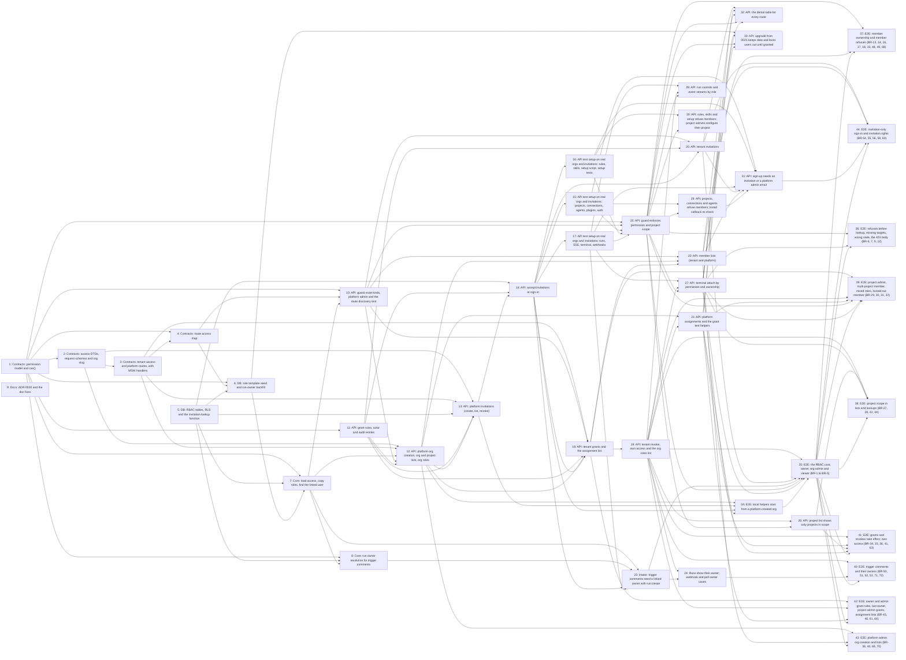

<!-- dev-plan: kind=plan id=rbac-foundation rev=1 hash=131656f590e0 spec=docs/superpowers/specs/2026-11-20-rbac-foundation-design.md spec-hash=38ffcc62851d -->
# Scoped RBAC foundation Implementation Plan

> **For agentic workers:** REQUIRED SUB-SKILL: Use superpowers:subagent-driven-development (recommended) or superpowers:executing-plans to implement this plan task-by-task. Steps use checkbox (`- [ ]`) syntax for tracking.

**Goal:** Every HTTP, SSE and terminal endpoint and every run started from a ticket comment checks a permission from the caller's role assignments (org or project scope); sign-up needs an invitation; platform admins come from config and create orgs through their own `/api/platform/*` endpoints.

**Architecture:** The shared pieces land first: the permission model, DTOs, routes and route-access map in contracts; the new tables, RLS, seed and backfill in db; `loadAccess`, `copyRoleTemplates`, `findLinkedUser` and `resolveRunOwner` in core. The api then grows in a fixed order so `main` stays green: the guard learns the new route kinds, the platform org and invitation endpoints and invitation acceptance give tests a real way to build a cast, every existing api int file moves its setup onto those helpers, and only then do the switches land (intake owner check, guard enforcement, terminal ownership, invitation-only sign-up). The e2e specs come last, split by flow over one shared cast builder.

**Tech Stack:** TypeScript (strict), Zod 4, Drizzle + Postgres 18 (RLS, `SECURITY DEFINER`), NestJS 11 on Fastify, better-auth 1.7 hooks, Temporal TS SDK (unchanged), MSW, Vitest + Testcontainers, Playwright.

**Spec:** `docs/superpowers/specs/2026-11-20-rbac-foundation-design.md`. Read it with this plan: the business rules (BR-n), the v1 matrix, the API table, the endpoint rules and the "E2E requirements" cases (TC-n.m) are not repeated here.

## Global Constraints

- AGENTS.md rules 1 to 11 bind every task. Layering `apps → core → db → contracts`; `web → contracts` only; db cannot import contracts. Names stay generic: permission, role, scope, assignment, invitation, platform admin, run owner, linked account; ignored outcomes `ignored_owner_unlinked` and `ignored_owner_not_permitted`. No provider name in tables, types, modules or routes.
- No new dependency of any kind (package, library, service, image, CI action, binary, workspace package).
- Never edit migrations 0000 to 0021. New migrations: `0022_rbac_tables` (generated), `0023_rbac_rls_functions` (custom), `0024_seed_role_templates` (custom), `0025_backfill_run_owner` (custom).
- Permission names (shape D), exactly: `project:create|read|update|delete`, `connection:create|read`, `agent:read|update`, `secret:update`, `skill:read|update|delete`, `rule:create|read|update|delete`, `setup:read|update`, `setup:test`, `run:read|create|update`, `run:cancel`, `terminal:attach`, `member:read|create|update|delete`, `assignment:read|create|delete`, `org:update|delete`; platform: `platform-org:create|read`, `platform-project:read`, `platform-role:read`, `platform-member:read`, `platform-assignment:read|create|delete`, `platform-invitation:read|create|delete`. `OWNABLE_PERMISSIONS` = `run:update`, `run:cancel`, `terminal:attach`.
- Org-level permissions (count only from an org-scope grant): `project:create`, `project:delete`, `connection:*`, `member:*`, `org:*`. Every other tenant permission is project-level.
- Built-in roles (seeded templates, copied per org): `owner` (scopes `{org}`; all 33 tenant permissions, `any`); `admin` (`{org,project}`; all but `org:delete`, `any`); `member` (`{org,project}`; `project:read`, `agent:read`, `skill:read`, `rule:read`, `setup:read`, `run:read`, `run:create` with `any`; `run:update`, `run:cancel`, `terminal:attach` with `own`); `viewer` (`{org,project}`; the six `*:read` with `any`). No tenant role row ever holds a `platform-*` permission.
- Status codes: 401 no session; 403 permission (problem `detail` "Not allowed for your role here", plus `requestId`); 404 missing, other org or out of scope; terminal closes 4401 / 4403; 400 schema failure; 422 semantically invalid reference with pointer (`/roleId`, `/userId`, `/scope/projectId`, `/scope/projectIds/<i>`); 409 state conflict (pointer `/slug` or `/email` where a field is at fault). Permission is checked before the target is looked up.
- Limits: invitation expires 7 days after creation (constant, no env); email valid, ≤ 254 chars, lowercased; `projectIds` 1 to 100, duplicates collapse; org name 1 to 100 chars; slug 1 to 63 chars matching `^[a-z0-9](?:[a-z0-9-]*[a-z0-9])?$`.
- `PLATFORM_ADMIN_EMAILS`: comma list, trimmed, lowercased, default empty, in `packages/core/src/config.ts` and `.env.example` (`admin@dev.local`). Checked against the session user's verified email on every request.
- No `Date.now()` / `new Date()` in guard, resolver, invitation or intake logic: invitation expiry is SQL `now()`, intake uses the comment's `createdAt` and the injected `Clock`.
- Audit payloads go through `redactBody`; platform actions carry `payload.actorKind = 'platform_admin'`, tenant ones `'member'`.
- Sensitive tasks (label `review:sensitive`, high-effort security review): Tasks 5, 6, 7, 8, 10, 11, 12, 13, 14, 18, 19, 20, 21, 23, 25, 27, 29, 31, 33.
- Before every commit: `devbox run fix` until it prints `fix: clean.`. Conventional Commits with the package as scope. One task = one branch = one PR. Before saying done: `pnpm typecheck` and `pnpm test` for the touched packages.
- Api int tests written by any task from Task 14 on build users only through `createOrg`, `inviteAndLogin`, `grant`, `revoke` (`apps/api/test/helpers/auth.ts`) or direct DB writes for off-list data; never through a bare dev-login of an uninvited handle (Task 31 refuses those).

## Review Focus

1. **Invitation email in another case** (`Mixed@Example.COM` invited, the person signs in as `mixed@example.com`). Expected: stored lowercased, a second invite for the lower-case form is 409, sign-in accepts it. Tests: Task 13 (`a second invitation differing only in case is 409`), Task 14 (`an invitation sent in upper case is accepted at sign-in`).
2. **Two identical grants at the same moment** (double click). Expected: one assignment, one 201 and one 200, no 500. Test: Task 18 (`two concurrent identical grants give 201 and 200 and one row`).
3. **Two org creations with the same slug at the same moment.** Expected: one 201, one 409 with pointer `/slug`, never 500. Test: Task 12 (`concurrent creates with one slug give 201 and 409`).
4. **`PLATFORM_ADMIN_EMAILS` written by hand** (`" Admin@Dev.Local , ,ops@x.io"`). Expected: parsed to `['admin@dev.local','ops@x.io']`; the admin signing in as `admin@dev.local` is a platform admin. Test: Task 10 (`config trims, lowercases and drops empty platform admin emails`).
5. **A bot comment written exactly at the origin run's start or end time.** Expected: both bounds count (`started_at <= createdAt <= finished_at`). Test: Task 8 (`a bot comment at the origin's started_at or finished_at still matches it`).

## Needs approval

None. The spec adds no dependency and this plan adds none.

## Agent calls made while planning

- Agent call: the seed-versus-catalog checks (every seeded name parses, `own` only on ownable permissions, every `routeAccess` permission granted by a template) live in `packages/core/test/access/role-templates.int.test.ts`, not `migrate.int.test.ts`, because db cannot import contracts.
- Agent call: build order keeps `main` green. Invitation acceptance (Task 14) lands before the sign-up gate (Task 31); until the gate an uninvited dev-login still gets a personal org, so old tests pass while Tasks 15 to 17 move them onto the new helpers.
- Agent call: Task 10's guard enforces only the new route kinds (`platform`, `self`, `org-admin`); `org`, `project` and `project-list` entries keep today's membership-only behaviour until Task 25 switches them, after every int file's setup is migrated.
- Agent call: acceptance writes `member.role = 'owner'` for an `owner` invitation at org scope and `'member'` otherwise, so the legacy creator/owner checks stay consistent until Task 25 and Task 27 remove them; afterwards `member.role` decides nothing.
- Agent call: a sixth route kind `{ scope: 'project-list', permission }` for `projects.list` (passes when the permission is held somewhere; the service filters), because an `org` entry would refuse project-scoped users the spec lets list their projects (BR-27).
- Agent call: `org-admin` entries carry `anyOf: Permission[]`, because the spec's members and invitation routes name two alternative permissions.
- Agent call: `roles.list` is `org-admin` with `anyOf: ['project:read']`: every built-in role holds it, so it equals "any assignment in that org" without a new kind.
- Agent call: the 403 text goes in the problem `detail` ("Not allowed for your role here"); `title` stays "Forbidden" as `problem.filter.ts` sets it (spec E2E Q4).
- Agent call: dev-login runs sign-up inside an `AsyncLocalStorage` scope that the `user.create.before` hook reads to set `emailVerified: true`, and marks existing dev users verified on sign-in; dev-only, absent in production.
- Agent call: invitation expiry uses SQL (`now() + interval '7 days'`, `expires_at <= now()`), so the service reads no clock and tests move `expires_at` into the past.
- Agent call: invitation lists return every invitation with its status (pending, accepted, revoked, expired): the API table says "pending and expired", but the States section and TC-55.4, TC-56.3 and TC-60.9 read accepted and revoked rows.
- Agent call: audit entries written at acceptance carry `actor_user_id` = the inviter and no `actorKind` (the action is the invitee's sign-in, neither a member nor a platform request).
- Agent call: the grant subset rule compares only the role lines that take effect at the target scope (org-level lines are ignored at project scope); otherwise a project admin could never grant `admin` on their project, which BR-61 requires.
- Agent call: `assignments.list?projectId=` for a project outside the caller's scope is 404 (spec E2E Q8; out of scope counts as missing).
- Agent call: a project admin sees every member in `members.list`, with assignments filtered to scopes they hold `assignment:read` on (they need to pick a user to grant).
- Agent call: `AssignmentDto = { id, userId, role: {id,key,name}, scope, grantedBy, grantedAt }`; `AccessDto.assignments[].permissions` are `{ permission, condition }` lines (spec leaves both shapes open).
- Agent call: `RunDto.ownerUserId: string | null` is the field that shows a run's owner (spec "a run started from a comment shows its owner"; E2E Q3).
- Agent call: `findLinkedUser` takes the routing transaction (`Tx`) so the lookup runs inside intake's transaction.
- Agent call: ignored details: "commenter is not linked to an Agent Desk user", "bot comment has no single originating run", "originating run has no owner", "commenter lacks run:create on this project", "originating run's owner lacks run:create on this project".
- Agent call: the fake provider lists `dev/demo`, `dev/demo-2` and `dev/demo-3`, because the cast needs P1 to P3 in one org and a connection holds one project per repo.
- Agent call: the spec's one `rbac.spec.ts` becomes ten flow files in `apps/web/e2e/local/` sharing `rbac-cast.ts`: about 200 cases cannot be one reviewable task, and parallel tasks must not share a file.
- Agent call: the e2e cast sets projects up through the API with a prompt rule `/rbac-run` (no skill needed on the extra repos); e2e orgs use the owner's handle as slug so existing specs' `/o/<handle>/…` URLs keep working.
- Agent call: read-only cases of one rule may share a cast built in that rule's `beforeAll`; every state-changing case builds its own.
- Agent call: TC-35.1 runs only when `E2E_TERMINAL_REAUTH_MS` is set (stack started with a small `TERMINAL_REAUTH_MS`), like the existing idle-time specs.
- Agent call: TC-71.2 finishes RP2 before posting, otherwise RP2 is the single P2 origin run and a run would start, contradicting the expected "not linked".
- Agent call: BR-70's int proof is in the `authz.int.test.ts` denial table (Task 32), not `platform.int.test.ts`, to keep parallel tasks off one file.
- Agent call: tenant member-list tests go in a new `apps/api/test/members.int.test.ts`.
- Agent call: the `grant` / `revoke` test helpers call the platform routes ("platform-side invite and grant go through `/api/platform/*`").
- Agent call: `slugFromName` lowercases, maps `[^a-z0-9-]` to `-`, collapses and trims `-`, cuts to 63 and re-trims, and falls back to `org`.
- Agent call: `CreateAssignmentRequest.userId` is a string of 1 to 255 chars (better-auth ids are text).
- Agent call: app privileges: `role_templates`, `role_template_permissions` SELECT; `roles`, `role_permissions` SELECT, INSERT (spec); `role_assignments` SELECT, INSERT, DELETE; `invitations` SELECT, INSERT, UPDATE; a `definer_read` policy on `invitations` for the lookup function, as 0001 does for `resolve_project`.
- Agent call: `ensurePersonalOrg` is deleted with its calls; `slug.ts` and `unique-slug.ts` stay (still tested, `isUniqueViolation` is used elsewhere).
- Agent call: the required release note ("every existing user loses access at deploy until granted; grant operators first") goes in ADR-0030 and the Task 31 PR body.

## E2E coverage

| Rules | Proved by |
| --- | --- |
| BR-1, 2, 3, 4, 5 | Task 35 `rbac-roles.spec.ts` |
| BR-6, 7, 9, 12 | Task 36 `rbac-denials.spec.ts` |
| BR-13, 14, 16, 17, 18, 33, 48, 49, 68 | Task 37 `rbac-ownership.spec.ts` |
| BR-27, 28, 42, 44 | Task 38 `rbac-scope.spec.ts` |
| BR-29, 30, 31, 32 | Task 39 `rbac-project-admin.spec.ts` |
| BR-50, 51, 52, 53, 71, 72 | Task 40 `rbac-triggers.spec.ts` |
| BR-34, 35, 36, 41, 63 | Task 41 `rbac-grants.spec.ts` |
| BR-45, 46, 61, 64 | Task 42 `rbac-owner-grants.spec.ts` |
| BR-38, 40, 69, 70 | Task 43 `rbac-platform.spec.ts` |
| BR-54, 55, 56, 58, 60 | Task 44 `rbac-invitations.spec.ts` |
| Not e2e: BR-8 | Task 32 (`authz.int`), Task 27 (`terminal.int`) |
| Not e2e: BR-26, BR-71 ownerless origin | Task 23 (routing unit), Task 24 (`webhooks.int`) |
| Not e2e: BR-37 | Task 2 (contract unit), Tasks 18 and 21 (`assignments.int`) |
| Not e2e: BR-39, BR-73 | Task 2 (contract unit), Task 12 (`platform.int`) |
| Not e2e: BR-57, BR-59 | Task 2 (contract unit), Tasks 13, 14, 31 (`invitations.int`) |
| Not e2e: BR-62, N9 | Task 31 (`platform.int`) |
| Not e2e: BR-66 | Task 28 (`runs.int`), Task 27 (`terminal.int`), Task 33 (`upgrade.int`) |
| Not e2e: BR-35 stream part | Task 28 (`sse.int`) |
| N1 | Task 6, Task 12 · N2, N3, N4 Tasks 10, 32 · N5 Tasks 13, 14, 18, 19, 21 · N6 Task 24 · N7 Task 7 · N8 Task 5 |

---

<!-- dev-plan:graph:begin -->
## Task graph

Generated by `dev-plan.mjs graph --write` from each task's **Depends on:** line. Do not edit it by hand.
Tasks in the same wave touch no common file and can be built in parallel; a task starts when everything it depends on is merged.

| Wave | Task | Depends on |
| ---- | ---- | ---------- |
| 1 | Task 1: Contracts: permission model and can() | none |
| 1 | Task 5: DB: RBAC tables, RLS and the invitation lookup function | none |
| 1 | Task 9: Docs: ADR-0030 and the doc fixes | none |
| 2 | Task 2: Contracts: access DTOs, request schemas and org slug | Task 1 |
| 2 | Task 11: API: grant rules, actor and audit entries | Task 1 |
| 3 | Task 3: Contracts: tenant access and platform routes, with MSW handlers | Task 2 |
| 4 | Task 4: Contracts: route access map | Task 1, Task 3 |
| 5 | Task 6: DB: role template seed and run-owner backfill | Task 1, Task 4, Task 5 |
| 6 | Task 7: Core: load access, copy roles, find the linked user | Task 1, Task 5, Task 6 |
| 7 | Task 8: Core: run owner resolution for trigger comments | Task 1, Task 5, Task 7 |
| 7 | Task 10: API: guard route kinds, platform admin and the route discovery test | Task 1, Task 4, Task 7 |
| 8 | Task 12: API: platform org creation, org and project lists, org roles | Task 2, Task 3, Task 7, Task 10, Task 11 |
| 9 | Task 13: API: platform invitations (create, list, revoke) | Task 2, Task 3, Task 5, Task 11, Task 12 |
| 10 | Task 14: API: accept invitations at sign-in | Task 5, Task 11, Task 13 |
| 11 | Task 15: API test setup on real orgs and invitations: projects, connections, agents, plugins, auth | Task 14 |
| 11 | Task 16: API test setup on real orgs and invitations: rules, skills, setup script, setup tests | Task 14 |
| 11 | Task 17: API test setup on real orgs and invitations: runs, SSE, terminal, webhooks | Task 14 |
| 11 | Task 18: API: tenant grants and the assignment list | Task 3, Task 10, Task 11, Task 12, Task 14 |
| 11 | Task 20: API: tenant invitations | Task 10, Task 11, Task 14 |
| 12 | Task 19: API: tenant revoke, own access and the org roles list | Task 18 |
| 12 | Task 22: API: member lists (tenant and platform) | Task 10, Task 12, Task 18 |
| 12 | Task 23: Intake: trigger comments need a linked owner with run:create | Task 7, Task 8, Task 14, Task 17 |
| 12 | Task 25: API: guard enforces permission and project scope | Task 1, Task 10, Task 15, Task 16, Task 17 |
| 13 | Task 21: API: platform assignments and the grant test helpers | Task 12, Task 19 |
| 13 | Task 24: Runs show their owner; webhook and poll owner cases | Task 19, Task 23 |
| 13 | Task 26: API: project list shows only projects in scope | Task 19, Task 25 |
| 13 | Task 27: API: terminal attach by permission and ownership | Task 17, Task 19, Task 25 |
| 13 | Task 28: API: run controls and event streams by role | Task 17, Task 19, Task 25 |
| 13 | Task 29: API: projects, connections and agents refuse members; install callback re-check | Task 15, Task 25 |
| 13 | Task 30: API: rules, skills and setup refuse members; project admins configure their project | Task 16, Task 25 |
| 14 | Task 31: API: sign-up needs an invitation or a platform admin email | Task 15, Task 16, Task 17, Task 20, Task 22, Task 29 |
| 14 | Task 32: API: the denial table for every route | Task 20, Task 21, Task 22, Task 25, Task 27 |
| 14 | Task 33: API: upgrade from 0021 keeps data and locks users out until granted | Task 6, Task 21, Task 25, Task 27 |
| 14 | Task 34: E2E: local helpers start from a platform-created org | Task 12, Task 13, Task 14, Task 21 |
| 15 | Task 35: E2E: the RBAC cast, owner, org admin and viewer (BR-1 to BR-5) | Task 19, Task 20, Task 23, Task 25, Task 27, Task 34 |
| 16 | Task 36: E2E: refusals before lookup, missing targets, wrong state, the 403 body (BR-6, 7, 9, 12) | Task 25, Task 27, Task 35 |
| 16 | Task 37: E2E: member ownership and member refusals (BR-13, 14, 16, 17, 18, 33, 48, 49, 68) | Task 25, Task 27, Task 35 |
| 16 | Task 38: E2E: project scope in lists and lookups (BR-27, 28, 42, 44) | Task 19, Task 26, Task 27, Task 35 |
| 16 | Task 39: E2E: project admin, multi-project member, mixed roles, locked-out member (BR-29, 30, 31, 32) | Task 18, Task 19, Task 21, Task 25, Task 27, Task 35 |
| 16 | Task 40: E2E: trigger comments and their owners (BR-50, 51, 52, 53, 71, 72) | Task 19, Task 24, Task 35 |
| 16 | Task 41: E2E: grants and revokes take effect; own access (BR-34, 35, 36, 41, 63) | Task 19, Task 21, Task 26, Task 27, Task 35 |
| 16 | Task 42: E2E: owner and admin grant rules, last owner, project admin grants, assignment lists (BR-45, 46, 61, 64) | Task 18, Task 19, Task 21, Task 35 |
| 16 | Task 43: E2E: platform admin org creation and lists (BR-38, 40, 69, 70) | Task 12, Task 22, Task 35 |
| 16 | Task 44: E2E: invitation-only sign-in and invitation rights (BR-54, 55, 56, 58, 60) | Task 20, Task 22, Task 31, Task 35 |


<!-- dev-plan:graph:end -->

### Task 1: Contracts: permission model and `can()`

**Depends on:** none

**Files:**

- Create: `packages/contracts/src/access.ts`
- Create: `packages/contracts/src/access.test.ts`
- Modify: `packages/contracts/src/index.ts`

**Interfaces:**

- Consumes: nothing.
- Produces (`packages/contracts/src/access.ts`, exported from the package root):

```ts
export const Permission: z.ZodEnum<...>;            // the 44 names in Global Constraints, tenant then platform
export type Permission = z.infer<typeof Permission>;
export type PlatformPermission = Extract<Permission, `platform-${string}`>;
export const PermissionCondition: z.ZodEnum<['any', 'own']>;
export type PermissionCondition = z.infer<typeof PermissionCondition>;
export const OWNABLE_PERMISSIONS: readonly ['run:update', 'run:cancel', 'terminal:attach'];
export const PermissionLevel: z.ZodEnum<['org', 'project', 'platform']>;
export const PERMISSION_LEVEL: Record<Permission, z.infer<typeof PermissionLevel>>;
export const ScopeType: z.ZodEnum<['org', 'project']>;
export type ScopeType = z.infer<typeof ScopeType>;
export type Scope = { type: 'org' } | { type: 'project'; projectId: string };
export interface GrantLine { permission: Permission; condition: PermissionCondition }
export interface Grant { roleId: string; roleKey: string; scope: Scope; lines: GrantLine[] }
export interface Access { userId: string; grants: Grant[] }
export interface AccessTarget { projectId?: string; ownerUserId?: string | null }
export function isPlatformPermission(name: string): boolean;
/** A grant counts when its scope is org, or project === target.projectId (project-level permissions only);
 *  a line counts when condition is 'any', or 'own' and ownerUserId === access.userId. Platform permissions: always false. */
export function can(access: Access, permission: Permission, target?: AccessTarget): boolean;
/** Held at some scope with any condition; an org-level permission counts only from an org-scope grant. */
export function holdsAnywhere(access: Access, permission: Permission): boolean;
/** Some grant covers the project: an org-scope grant, or a project grant on it. */
export function inScope(access: Access, projectId: string): boolean;
/** 'all' when an org-scope grant lists the permission, else the sorted unique project ids whose grant lists it. */
export function visibleProjects(access: Access, permission: Permission): 'all' | string[];
```

- [x] **Step 1: Write the failing tests** in `access.test.ts`. Role fixtures are written in the test (never read from the seed): `OWNER`, `ADMIN`, `MEMBER`, `VIEWER` as in Global Constraints, plus made-up `READ_RUNS_ONLY = [{run:read, any}]` and `PROJECT_DELETER = [{project:delete, any}]`. `it.each` rows `[name, grants, permission, target, expected]`, at least:
  - union: member on P1 + viewer on P2 → `run:create` P1 `true`, P2 `false`, P3 `false`.
  - org vs project: viewer at org → `project:read` on a random new project id `true`; viewer on P1 → P2 `false`.
  - org-level at project scope: `PROJECT_DELETER` on P1 → `can(project:delete, {projectId:P1})` `false`, `holdsAnywhere(project:delete)` `false`; same role at org → `true`.
  - own: member on P1, `run:cancel` with `ownerUserId` = self `true`, = other `false`, `null` `false`; admin on P1 with `null` `true`.
  - confirmed cells: owner `org:delete` `true`; admin `org:delete` `false`; admin `member:create` and `org:update` `true`; member and viewer `member:read` `false`.
  - `can(OWNER at org, 'platform-org:create')` `false`.
  - `visibleProjects`: viewer at org → `'all'`; member on P2 and P1 → `[P1, P2]` sorted; no grants → `[]`.
  - `inScope`: org grant → any id `true`; project grant P1 → P1 `true`, P2 `false`.
  - `Object.keys(PERMISSION_LEVEL).sort()` equals `Permission.options.slice().sort()`; every `platform-*` has level `platform`; `project:create`, `project:delete`, `connection:*`, `member:*`, `org:*` are `org`.
- [x] **Step 2: Run** `pnpm --filter @agentdesk/contracts exec vitest run src/access.test.ts`. Expected: FAIL (module not found).
- [x] **Step 3: Implement** `access.ts` with the exports above and add `export * from './access';` to `index.ts`.
- [x] **Step 4: Run** the same command. Expected: PASS. Then `pnpm --filter @agentdesk/contracts typecheck`.
- [x] **Step 5: Commit** `feat(contracts): permission model with scope and ownership conditions`.

---

### Task 2: Contracts: access DTOs, request schemas and org slug

**Depends on:** Task 1

**Files:**

- Create: `packages/contracts/src/slug.ts`
- Create: `packages/contracts/src/slug.test.ts`
- Create: `packages/contracts/src/schemas/access.ts`
- Create: `packages/contracts/src/schemas/access.test.ts`
- Create: `packages/contracts/src/schemas/platform.ts`
- Create: `packages/contracts/src/schemas/platform.test.ts`
- Modify: `packages/contracts/src/index.ts`

**Interfaces:**

- Consumes: `Permission`, `PermissionCondition`, `ScopeType` (Task 1).
- Produces:

```ts
// slug.ts
export const ORG_SLUG_MAX = 63;
export const OrgSlug: z.ZodString;                 // min 1, max 63, /^[a-z0-9](?:[a-z0-9-]*[a-z0-9])?$/
export function slugFromName(name: string): string; // see Agent calls; result always parses with OrgSlug
// schemas/access.ts
export const ScopeDto;            // { type: 'org' } | { type: 'project', projectId: Id }
export const RoleRef;             // { id: Id, key: string, name: string }
export const RoleDto;             // { id, key, name, builtIn, assignableScopes: ScopeType[], permissions: {permission, condition}[] }
export const AssignmentDto;       // { id, userId: string, role: RoleRef, scope: ScopeDto, grantedBy: string|null, grantedAt: Timestamp }
export const CreateAssignmentRequest;  // { userId: string(1..255), roleId: Id, scope: ScopeDto }
export const AssignmentListQuery;      // PageQuery.extend({ projectId: Id.optional() })
export const InvitationEmail;          // z.email().max(254) → lowercased
export const InvitationScopeRequest;   // { type:'org' } | { type:'project', projectIds: Id[] 1..100 → deduplicated, order kept }
export const CreateInvitationRequest;  // { email: InvitationEmail, roleId: Id, scope: InvitationScopeRequest }
export const InvitationStatus;         // 'pending' | 'accepted' | 'revoked' | 'expired'
export const InvitationDto;       // { id, email, role: RoleRef, scope: {type:'org'} | {type:'project', projects:{id,name}[]}, status, expiresAt, invitedBy, createdAt, acceptedAt: Timestamp|null }
export const MemberDto;           // { userId, handle: string|null, name, assignments: AssignmentDto[] }  (no email)
export const AccessDto;           // { userId, platformAdmin: boolean, assignments: { roleKey, scope: ScopeDto, permissions: {permission, condition}[] }[] }
// schemas/platform.ts
export const OrgName;             // z.string().min(1).max(100)
export const CreateOrgRequest;    // { name: OrgName, slug: OrgSlug }
export const CreateOrgResponse;   // { id: Id, name, slug }
export const PlatformOrgDto;      // { id, name, slug, memberCount: int ≥ 0, createdAt }
export const PlatformProjectDto;  // { id, name }
export const PlatformMemberDto;   // { userId, handle, name, email: string, assignments: AssignmentDto[] }
export const PlatformRoleDto, PlatformAssignmentDto, PlatformInvitationDto; // own z.object schemas with the RoleDto / AssignmentDto / InvitationDto fields
```

Every schema has its `export type X = z.infer<typeof X>`.

- [x] **Step 1: Write the failing tests** (contract unit for BR-37, BR-59, BR-73):
  - `slug.test.ts`: `slugFromName('Acme Corp')` is `'acme-corp'`; `'  Hello__World!! '` → `'hello-world'`; `''` and `'ÄÖ'` → `'org'`; a 200-char name gives ≤ 63 chars, no trailing `-`; for 50 random strings the result parses with `OrgSlug`. `OrgSlug` rejects `''`, `'-a'`, `'a-'`, `'A'`, `'a_b'`, 64 chars; accepts `'acme-eu-1'` and 63 chars.
  - `schemas/access.test.ts`: `CreateAssignmentRequest` rejects a missing `roleId`, `{type:'project'}` without `projectId`, `{type:'team'}`, `userId: ''`; accepts org and project scopes. `CreateInvitationRequest` rejects `'not-an-email'`, a 255-char email (accepts 254), `projectIds: []`, 101 ids (accepts 100); `'Mixed@Example.COM'` parses to `'mixed@example.com'`; `[P1, P1, P2]` parses to `[P1, P2]`. `MemberDto.shape` has no `email` key. `InvitationStatus.options` equals the four statuses.
  - `schemas/platform.test.ts`: `CreateOrgRequest` rejects missing name, missing slug, 101-char name (accepts 100), slug `'-x'`, with the issue path `['slug']`; `PlatformMemberDto` rejects a member without `email`; `PlatformRoleDto` parses a `RoleDto` fixture.
- [x] **Step 2: Run** `pnpm --filter @agentdesk/contracts exec vitest run src/slug.test.ts src/schemas/access.test.ts src/schemas/platform.test.ts`. Expected: FAIL.
- [x] **Step 3: Implement** the three files and export them from `index.ts`.
- [x] **Step 4: Run** the same command. Expected: PASS.
- [x] **Step 5: Commit** `feat(contracts): access, invitation and platform DTOs and the org slug helper`.

---

### Task 3: Contracts: tenant access and platform routes, with MSW handlers

**Depends on:** Task 2

**Files:**

- Modify: `packages/contracts/src/routes.ts`
- Modify: `packages/contracts/src/routes.test.ts`
- Create: `apps/web/src/mocks/dto/access.ts`
- Modify: `apps/web/src/mocks/msw/handlers.ts`
- Modify: `apps/web/src/mocks/msw/contract.test.ts`

**Interfaces:**

- Consumes: the Task 2 schemas.
- Produces: 20 new keys in `routes` (68 in all), every path under `/api/`:

| Key | Method | Path | Query / body | Response |
| --- | --- | --- | --- | --- |
| `me.access` | GET | `/api/me/access` | | `AccessDto` |
| `roles.list` | GET | `/api/orgs/:orgId/roles` | | `z.array(RoleDto)` |
| `members.list` | GET | `/api/orgs/:orgId/members` | `PageQuery` | `pageOf(MemberDto)` |
| `assignments.list` | GET | `/api/orgs/:orgId/assignments` | `AssignmentListQuery` | `pageOf(AssignmentDto)` |
| `assignments.create` | POST | `/api/orgs/:orgId/assignments` | `CreateAssignmentRequest` | `AssignmentDto` |
| `assignments.remove` | DELETE | `/api/orgs/:orgId/assignments/:assignmentId` | | `empty` |
| `invitations.list` | GET | `/api/orgs/:orgId/invitations` | `PageQuery` | `pageOf(InvitationDto)` |
| `invitations.create` | POST | `/api/orgs/:orgId/invitations` | `CreateInvitationRequest` | `InvitationDto` |
| `invitations.remove` | DELETE | `/api/orgs/:orgId/invitations/:invitationId` | | `empty` |
| `platform.createOrg` | POST | `/api/platform/orgs` | `CreateOrgRequest` | `CreateOrgResponse` |
| `platform.listOrgs` | GET | `/api/platform/orgs` | `PageQuery` | `pageOf(PlatformOrgDto)` |
| `platform.listProjects` | GET | `/api/platform/orgs/:orgId/projects` | `PageQuery` | `pageOf(PlatformProjectDto)` |
| `platform.listRoles` | GET | `/api/platform/orgs/:orgId/roles` | | `z.array(PlatformRoleDto)` |
| `platform.listMembers` | GET | `/api/platform/orgs/:orgId/members` | `PageQuery` | `pageOf(PlatformMemberDto)` |
| `platform.listAssignments` | GET | `/api/platform/orgs/:orgId/assignments` | `AssignmentListQuery` | `pageOf(PlatformAssignmentDto)` |
| `platform.createAssignment` | POST | `/api/platform/orgs/:orgId/assignments` | `CreateAssignmentRequest` | `PlatformAssignmentDto` |
| `platform.removeAssignment` | DELETE | `/api/platform/orgs/:orgId/assignments/:assignmentId` | | `empty` |
| `platform.listInvitations` | GET | `/api/platform/orgs/:orgId/invitations` | `PageQuery` | `pageOf(PlatformInvitationDto)` |
| `platform.createInvitation` | POST | `/api/platform/orgs/:orgId/invitations` | `CreateInvitationRequest` | `PlatformInvitationDto` |
| `platform.removeInvitation` | DELETE | `/api/platform/orgs/:orgId/invitations/:invitationId` | | `empty` |

  Params: `orgId`, `assignmentId`, `invitationId` are `z.uuid()`. Web fixtures in `apps/web/src/mocks/dto/access.ts`: `roleFixtures`, `assignmentFixtures`, `invitationFixtures`, `memberFixtures`, `accessFixture`, `platformOrgFixtures`, `platformProjectFixtures`, `platformMemberFixtures`.

- [ ] **Step 1: Write the failing tests.** `routes.test.ts`: the key count becomes 68; `flat['assignments.remove']` matches `{ method: 'DELETE', path: '/api/orgs/:orgId/assignments/:assignmentId' }`; every `platform.*` path starts with `/api/platform/orgs`; `routes.assignments.list.query.parse({ projectId: P })` keeps `projectId`. `contract.test.ts`: add each new fixture list to "every DTO fixture parses with its contracts schema".
- [ ] **Step 2: Run** `pnpm --filter @agentdesk/contracts exec vitest run src/routes.test.ts` and `pnpm --filter @agentdesk/web exec vitest run src/mocks/msw/contract.test.ts`. Expected: FAIL.
- [ ] **Step 3: Implement** the routes; in `handlers.ts` add one `impl` entry per new JSON route answering from the fixtures (create routes echo a fixture; `STATUS` gets 201 for the four create routes and 204 for the three removes).
- [ ] **Step 4: Run** both commands plus `pnpm --filter @agentdesk/web typecheck`. Expected: PASS ("has a handler for every route key" included).
- [ ] **Step 5: Commit** `feat(contracts): routes for access, assignments, invitations and the platform`.

---

### Task 4: Contracts: route access map

**Depends on:** Task 1, Task 3

**Files:**

- Create: `packages/contracts/src/route-access.ts`
- Create: `packages/contracts/src/route-access.test.ts`
- Modify: `packages/contracts/src/index.ts`

**Interfaces:**

- Consumes: `routes`, `Routes`, `flattenRoutes` (Task 3); `Permission`, `PlatformPermission` (Task 1).
- Produces:

```ts
export type RouteKey = { [G in keyof Routes]: `${G & string}.${keyof Routes[G] & string}` }[keyof Routes];
export type ProjectParam = 'projectId' | 'runId' | 'ruleId' | 'agentId' | 'setupTestId';
export type RouteAccess =
  | { scope: 'org'; permission: Permission }
  | { scope: 'project'; permission: Permission; param: ProjectParam }
  | { scope: 'project-list'; permission: Permission }
  | { scope: 'self' }
  | { scope: 'org-admin'; anyOf: readonly Permission[] }
  | { scope: 'platform'; permission: PlatformPermission };
export const routeAccess: Record<RouteKey, RouteAccess>;   // a missing key fails typecheck
```

  Entries: the spec's "Route to permission map" for the 48 existing keys, with `projects.list` = `project-list` `project:read`; `connections.*` and `projects.create` = `org`; every other existing key = `project` with the param its path carries (`agents.putCredential`/`agents.models` → `agentId`, `rules.update`/`rules.remove` → `ruleId`, `setupTests.end|events|terminal` → `setupTestId`, `runs.get|log|transcript|events|cancel|stop|finish|resume|terminal` → `runId`, others → `projectId`). New keys: `me.access` → `self`; `roles.list` → `org-admin ['project:read']`; `members.list` → `['member:read','assignment:create']`; `assignments.list` → `['assignment:read']`; `assignments.create` → `['assignment:create']`; `assignments.remove` → `['assignment:delete']`; `invitations.create` and `invitations.remove` → `['member:create','assignment:create']`; `invitations.list` → `['member:read','assignment:read']`; `platform.createOrg` → `platform-org:create`, `listOrgs` → `platform-org:read`, `listProjects` → `platform-project:read`, `listRoles` → `platform-role:read`, `listMembers` → `platform-member:read`, `listAssignments|createAssignment|removeAssignment` → `platform-assignment:read|create|delete`, `listInvitations|createInvitation|removeInvitation` → `platform-invitation:read|create|delete`.

- [ ] **Step 1: Write the failing tests** in `route-access.test.ts`: the expected map for all 68 keys written out in the test and compared with `toEqual`; keys equal `Object.keys(flattenRoutes(routes))`; an entry is `platform` exactly when its path starts with `/api/platform/` and then `isPlatformPermission(permission)`; `org-admin` only on `/api/orgs/` paths; `self` only on `me.access`; every `project` entry's `param` appears as `:<param>` in its path.
- [ ] **Step 2: Run** `pnpm --filter @agentdesk/contracts exec vitest run src/route-access.test.ts`. Expected: FAIL.
- [ ] **Step 3: Implement** `route-access.ts`; export it from `index.ts`.
- [ ] **Step 4: Run** the same command and `pnpm --filter @agentdesk/contracts typecheck`. Expected: PASS.
- [ ] **Step 5: Commit** `feat(contracts): route access map for every route`.

---

### Task 5: DB: RBAC tables, RLS and the invitation lookup function

**Depends on:** none

**Files:**

- Create: `packages/db/src/schema/access.ts`
- Modify: `packages/db/src/schema/index.ts`
- Modify: `packages/db/src/schema/app.ts`
- Create: `packages/db/migrations/0022_rbac_tables.sql`
- Create: `packages/db/migrations/meta/0022_snapshot.json`
- Create: `packages/db/migrations/0023_rbac_rls_functions.sql`
- Create: `packages/db/migrations/meta/0023_snapshot.json`
- Modify: `packages/db/migrations/meta/_journal.json`
- Modify: `packages/db/src/functions.ts`
- Modify: `packages/db/src/index.ts`
- Modify: `packages/db/test/helpers/seed.ts`
- Modify: `packages/db/test/rls.int.test.ts`
- Modify: `packages/db/test/functions.int.test.ts`
- Modify: `packages/db/test/migrate.int.test.ts`

**Interfaces:**

- Consumes: nothing.
- Produces: Drizzle tables `roleTemplates`, `roleTemplatePermissions`, `roles`, `rolePermissions`, `roleAssignments`, `invitations` with the columns, keys, checks, FKs and indexes of the spec's "Data model" (composite FKs `(org_id, role_id) → roles(org_id, id)`, unique `(org_id, user_id, role_id, project_id)` `nullsNotDistinct()`, partial unique `invitations (org_id, email) where status = 'pending'`, index `(email) where status = 'pending'`); `runs.ownerUserId` (`owner_user_id text` → `user.id` on delete set null) and `runs.originRunId` (`origin_run_id uuid` → `runs.id` on delete set null) with index `runs_origin_run_id_idx`, plus `runs_owner_user_idx` on `owner_user_id` (FK index rule). In `functions.ts`:

```ts
/** Sign-up gate and acceptance: pending, unexpired invitations for an email across orgs (SECURITY DEFINER). Ids only. */
export async function pendingInvitationsForEmail(db: Db, email: string): Promise<{ id: string; orgId: string }[]>;
```

  `0023_rbac_rls_functions.sql` (custom, `drizzle-kit generate --custom`): `FORCE ROW LEVEL SECURITY` on the four org tables; grants per Agent calls; `CREATE POLICY "definer_read" ON "invitations" FOR SELECT TO agentdesk_owner USING (true)`; `pending_invitations_for_email(p_email text) RETURNS TABLE (id uuid, org_id uuid) LANGUAGE sql STABLE SECURITY DEFINER SET search_path = public, pg_temp` selecting `status = 'pending' AND expires_at > now() AND email = lower(p_email)`; `REVOKE ALL … FROM PUBLIC`; `GRANT EXECUTE … TO agentdesk_app`.

- [ ] **Step 1: Write the failing tests.**
  - `seed.ts`: `seedOrg` also inserts, per org, two roles (`owner`, `member`) with one permission line each, a second project, one org assignment and one project assignment for a seeded user, and one pending invitation; returns their ids.
  - `rls.int.test.ts`: add `roles`, `role_permissions`, `role_assignments`, `invitations` to `inserts`, so the existing `describe.each` leak tests (select only own org, cannot insert for org B with 42501, raw query sees 0 rows) run on them. New cases: as `agentdesk_app`, `update roles` and `delete from roles` fail with 42501; `select` on `role_templates` works and `insert` fails with 42501; a second identical org assignment fails with 23505; scope check rejects `scope_type='org'` with a project id (23514); a second pending invitation for one org and email fails with 23505 while a revoked one does not.
  - `functions.int.test.ts` (N8): `pendingInvitationsForEmail(db, 'Bob@X.io')` returns `{id, orgId}` for pending unexpired rows of both orgs; the raw function's result columns are exactly `['id','org_id']`; an expired (`expires_at = now() - interval '1 second'`), an accepted and a revoked row are absent; it is `prosecdef`, has a pinned `search_path`, and only `agentdesk_app` may execute it.
  - `migrate.int.test.ts`: `APP_TABLES` gains the four org tables (so "org_id not null" and "rls is forced" cover them); `runs.owner_user_id` and `runs.origin_run_id` are nullable and existing rows read back null; `runs_origin_run_id_idx` exists.
- [ ] **Step 2: Run** `pnpm --filter @agentdesk/db exec vitest run test/rls.int.test.ts test/functions.int.test.ts test/migrate.int.test.ts`. Expected: FAIL.
- [ ] **Step 3: Implement** the schema; `pnpm --filter @agentdesk/db db:generate --name rbac_tables`; read the SQL (no drops); `pnpm --filter @agentdesk/db exec drizzle-kit generate --custom --name rbac_rls_functions` and write it; add `pendingInvitationsForEmail` and export it.
- [ ] **Step 4: Run** the same command. Expected: PASS.
- [ ] **Step 5: Commit** `feat(db): role, assignment and invitation tables with RLS and the invitation lookup`.

---

### Task 6: DB: role template seed and run-owner backfill

**Depends on:** Task 1, Task 4, Task 5

**Files:**

- Create: `packages/db/migrations/0024_seed_role_templates.sql`
- Create: `packages/db/migrations/meta/0024_snapshot.json`
- Create: `packages/db/migrations/0025_backfill_run_owner.sql`
- Create: `packages/db/migrations/meta/0025_snapshot.json`
- Modify: `packages/db/migrations/meta/_journal.json`
- Modify: `packages/db/src/testing.ts`
- Modify: `packages/db/test/migrate.int.test.ts`
- Create: `packages/core/test/access/role-templates.int.test.ts`

**Interfaces:**

- Consumes: the Task 5 tables; `Permission`, `OWNABLE_PERMISSIONS`, `isPlatformPermission` (Task 1); `routeAccess` (Task 4).
- Produces: the four built-in templates (Global Constraints) and their copy into every existing org; the backfill; and in `@agentdesk/db/testing`:

```ts
/** A fresh Postgres migrated up to and including `tag` (e.g. '0021_agent_auto_resume_max'), using a temp copy of
 *  migrations/ with a trimmed meta/_journal.json; `migrateRest()` then applies the remaining migrations. */
export async function startPgAt(tag: string): Promise<TestPg & { migrateRest: () => Promise<void> }>;
```

  `0024`: insert templates and lines `on conflict do nothing`; then a `DO` loop over `organization.id` that runs `set_config('app.org_id', id, true)` and copies templates into `roles` (`built_in = true`, `template_id`) and `role_permissions`, `on conflict do nothing`. `0025`: a `DO` loop per org (set `app.org_id`) updating `runs.owner_user_id` from `account.user_id` where `account.provider_id` = the project's board connection provider and `account.account_id = runs.triggered_by_external_id`, `owner_user_id is null`, in batches of 1000 until none change.

- [ ] **Step 1: Write the failing tests.**
  - `migrate.int.test.ts` (new `describe` using `startPgAt('0021_agent_auto_resume_max')`): seed two orgs with users, `member` rows, connections, projects and runs (one run whose `triggered_by_external_id` matches a linked `account`, one that matches none); snapshot `member`, `projects`, `connections`; `migrateRest()`; then each org has exactly the roles `admin, member, owner, viewer` once; `role_assignments` is empty; the snapshots are unchanged; the matched run's `owner_user_id` is the linked user and the other is null; running the `0024` and `0025` SQL files again changes no counts; no `roles`/`role_permissions`/`role_template_permissions` row has `permission like 'platform-%'`.
  - `role-templates.int.test.ts` (core, `startPg()`): every template line parses with `Permission`; `own` appears only on `OWNABLE_PERMISSIONS`; every non-`self` tenant permission used in `routeAccess` is granted by at least one template; the template matrix equals the expected matrix written in the test (owner 33 lines, admin 32 without `org:delete`, member 10 with the three `own` lines, viewer 6).
- [ ] **Step 2: Run** `pnpm --filter @agentdesk/db exec vitest run test/migrate.int.test.ts` and `pnpm --filter @agentdesk/core exec vitest run test/access/role-templates.int.test.ts`. Expected: FAIL.
- [ ] **Step 3: Implement** both custom migrations (`drizzle-kit generate --custom --name seed_role_templates`, then `backfill_run_owner`) and `startPgAt`.
- [ ] **Step 4: Run** the same commands. Expected: PASS.
- [ ] **Step 5: Commit** `feat(db): seed built-in roles into every org and backfill run owners`.

---

### Task 7: Core: load access, copy roles, find the linked user

**Depends on:** Task 1, Task 5, Task 6

**Files:**

- Create: `packages/core/src/access/index.ts`
- Create: `packages/core/src/access/load-access.ts`
- Create: `packages/core/src/access/copy-role-templates.ts`
- Create: `packages/core/src/access/linked-user.ts`
- Modify: `packages/core/src/index.ts`
- Create: `packages/core/test/access/to-access.test.ts`
- Create: `packages/core/test/access/access.int.test.ts`

**Interfaces:**

- Consumes: `Access`, `Grant`, `Permission`, `PermissionCondition`, `isPlatformPermission` (Task 1); Task 5 tables; Task 6 templates.
- Produces (exported from `@agentdesk/core`):

```ts
export interface AccessLog { warn(obj: object, msg: string): void }
export interface AccessRow { roleId: string; roleKey: string; scopeType: string; projectId: string | null; permission: string; condition: string }
/** Groups rows by (roleId, scope); unknown permission names or conditions are skipped with one warn each (N7). */
export function toAccess(userId: string, rows: AccessRow[], log?: AccessLog): Access;
/** One query over role_assignments ⨝ roles ⨝ role_permissions for the user, inside the caller's withOrg tx. */
export async function loadAccess(tx: Tx, userId: string, log?: AccessLog): Promise<Access>;
/** Copies role_templates into roles/role_permissions for orgId (tx must be withOrg(orgId)); idempotent;
 *  throws when a template line holds a platform-* permission. */
export async function copyRoleTemplates(tx: Tx, orgId: string): Promise<void>;
/** The Agent Desk user signed in with this provider account (account.provider_id, account.account_id), or null. */
export async function findLinkedUser(tx: Tx, provider: string, externalId: string): Promise<string | null>;
```

- [ ] **Step 1: Write the failing tests.**
  - `to-access.test.ts`: two rows of one role and scope become one grant with two lines; an org row and a project row become two grants; `permission: 'project:explode'` is skipped and `warn` is called once with `{ permission: 'project:explode' }`; `condition: 'sometimes'` is skipped; no rows → `{ userId, grants: [] }`.
  - `access.int.test.ts`: `copyRoleTemplates` into a new org gives four roles whose lines equal the templates; a second call adds nothing; `loadAccess` returns the user's org and project grants in that org and nothing from another org's assignment of the same user; `findLinkedUser(tx, 'fake', 'alice')` returns alice's id, `'bob'` returns null, `('github', 'alice')` returns null; a template line `platform-org:read` inserted as the owner makes `copyRoleTemplates` throw and writes no role.
- [ ] **Step 2: Run** `pnpm --filter @agentdesk/core exec vitest run test/access/to-access.test.ts test/access/access.int.test.ts`. Expected: FAIL.
- [ ] **Step 3: Implement** the four files and `export * from './access';` in `src/index.ts`.
- [ ] **Step 4: Run** the same command. Expected: PASS.
- [ ] **Step 5: Commit** `feat(core): load a user's access, copy built-in roles and find a linked user`.

---

### Task 8: Core: run owner resolution for trigger comments

**Depends on:** Task 1, Task 5, Task 7

**Files:**

- Create: `packages/core/src/access/run-owner.ts`
- Modify: `packages/core/src/access/index.ts`
- Create: `packages/core/test/access/run-owner.int.test.ts`

**Interfaces:**

- Consumes: `loadAccess`, `findLinkedUser` (Task 7); `can` (Task 1); `runs.ownerUserId`, `runs.startedAt`, `runs.finishedAt`, `runs.ticketRef` (Task 5); `TicketEvent`.
- Produces:

```ts
export type RunOwner =
  | { kind: 'owner'; userId: string; originRunId: string | null }
  | { kind: 'ignored'; outcome: 'ignored_owner_unlinked' | 'ignored_owner_not_permitted'; detail: string };
export interface RunOwnerInput {
  projectId: string;
  boardProvider: string;
  event: Pick<TicketEvent, 'author' | 'authorId' | 'ticketRef' | 'createdAt'>;
  botLogin: string;
}
/** Human: findLinkedUser(boardProvider, authorId). Bot (author === botLogin): runs of this project with
 *  started_at <= createdAt and (finished_at is null or createdAt <= finished_at); the single one on ticketRef, else the
 *  single one in the project; zero or several → unlinked. Then the owner must hold run:create at projectId.
 *  Details: see Agent calls. Runs inside the caller's withOrg tx. */
export async function resolveRunOwner(tx: Tx, input: RunOwnerInput): Promise<RunOwner>;
```

- [ ] **Step 1: Write the failing tests** in `run-owner.int.test.ts` (one org, roles copied, P1 and P2, users B (member P1), V (viewer org), linked `fake` accounts):
  - B's comment on P1 → `{ kind: 'owner', userId: B, originRunId: null }`; V's → `ignored_owner_not_permitted`; B's on P2 → not permitted; unknown author id → `ignored_owner_unlinked`; missing `authorId` → unlinked.
  - bot: one active run of B on the ticket → owner B, `originRunId` that run; none on the ticket and one in the project → that run; two on the ticket → unlinked "bot comment has no single originating run"; none on the ticket and two in the project → unlinked; the only candidate is in P2 while the event is for P1 → unlinked; origin with `owner_user_id` null → unlinked "originating run has no owner"; origin owner B lost his P1 assignment → `ignored_owner_not_permitted`; a run that finished before `createdAt` is not a candidate.
  - Review Focus 5: `a bot comment at the origin's started_at or finished_at still matches it`.
- [ ] **Step 2: Run** `pnpm --filter @agentdesk/core exec vitest run test/access/run-owner.int.test.ts`. Expected: FAIL.
- [ ] **Step 3: Implement** `run-owner.ts` (bound parameters only; author text is never interpolated) and export it.
- [ ] **Step 4: Run** the same command. Expected: PASS.
- [ ] **Step 5: Commit** `feat(core): resolve a trigger comment's run owner, including bot follow-ups`.

---

### Task 9: Docs: ADR-0030 and the doc fixes

**Depends on:** none

**Files:**

- Create: `docs/adr/0030-scoped-rbac-roles-assignments.md`
- Modify: `docs/adr/README.md`
- Modify: `docs/adr/0014-terminal-over-websocket-exec-relay.md`
- Modify: `docs/adr/0013-webhook-and-polling-intake.md`
- Modify: `docs/conventions/security.md`
- Modify: `docs/conventions/backend.md`
- Modify: `docs/superpowers/specs/2026-11-12-control-plane-design.md`

**Interfaces:**

- Consumes: the spec only.
- Produces: ADR-0030 in the `0000-template.md` shape recording the decisions listed under the spec's "ADR" paragraph, the `role_templates` exception to "every app table has org_id", the departure from epic §9 (own invitations table), and the release note (Agent calls). ADR-0014 and ADR-0013 get an "Amended by ADR-0030" line and the new terminal and trigger rules. `security.md` §5 (trigger: association, then a linked owner with `run:create`) and §6 (terminal: `terminal:attach` with ownership; project scope; 404 out of scope). `backend.md` §4: the 403 row becomes "lacks the permission for this action (problem detail 'Not allowed for your role here')" and a 404 row for out-of-scope projects. Control-plane spec §7.5: attach needs `terminal:attach` on the run's project with ownership for members; 4403 otherwise.

- [ ] **Step 1: Write** ADR-0030 and add its row to `docs/adr/README.md` (status Accepted, 2026-11-21).
- [ ] **Step 2: Edit** the five other docs as above; keep each change to the paragraph that states the old rule.
- [ ] **Step 3: Check** `pnpm exec prettier --check` on the changed files. Expected: clean.
- [ ] **Step 4: Commit** `docs(adr): scoped RBAC with roles, assignments and invitation-only sign-up`.

---

### Task 10: API: guard route kinds, platform admin and the route discovery test

**Depends on:** Task 1, Task 4, Task 7

**Files:**

- Modify: `packages/core/src/config.ts`
- Modify: `packages/core/test/config.test.ts`
- Modify: `.env.example`
- Create: `apps/api/src/access/route-entry.ts`
- Create: `apps/api/src/access/route-entry.test.ts`
- Create: `apps/api/src/access/platform-admin.ts`
- Create: `apps/api/src/access/platform-admin.test.ts`
- Create: `apps/api/src/access/authorize.ts`
- Create: `apps/api/src/access/authorize.test.ts`
- Create: `apps/api/src/access/current-access.ts`
- Modify: `apps/api/src/auth/session.guard.ts`
- Modify: `apps/api/src/auth/org-context.ts`
- Create: `apps/api/test/authz.int.test.ts`

**Interfaces:**

- Consumes: `routeAccess`, `RouteAccess`, `RouteKey` (Task 4); `Access`, `can`, `holdsAnywhere` (Task 1); `loadAccess` (Task 7).
- Produces:

```ts
// packages/core/src/config.ts
PLATFORM_ADMIN_EMAILS: string[]   // comma list → trimmed, lowercased, empties dropped; default []
// apps/api/src/access/route-entry.ts
export type RouteMatch = { kind: 'route'; key: RouteKey; entry: RouteAccess } | { kind: 'dev' } | { kind: 'unknown' };
/** By method + Fastify route url (`req.routeOptions.url`); `GET /api/connections/:provider/callback` → connections.install. */
export function routeEntryFor(method: string, routeUrl: string): RouteMatch;
// apps/api/src/access/platform-admin.ts
export function isPlatformAdmin(config: Pick<Config, 'PLATFORM_ADMIN_EMAILS'>, user: { email: string; emailVerified: boolean }): boolean;
// apps/api/src/access/authorize.ts
export type PreTarget = 'allow' | 'forbidden' | 'needs-target';
/** self → allow; org-admin → any of anyOf held somewhere; project-list → held somewhere; org → held somewhere and
 *  can() at org scope; project → held somewhere ? needs-target : forbidden. (platform is decided before access loads.) */
export function preTargetDecision(entry: Exclude<RouteAccess, { scope: 'platform' }>, access: Access): PreTarget;
export const FORBIDDEN_DETAIL = 'Not allowed for your role here';
// apps/api/src/access/current-access.ts
export interface RequestAuthz { access: Access; routeKey: RouteKey; projectId?: string; ownerUserId?: string | null }
export interface PlatformAdminContext { userId: string; email: string }
declare module 'fastify' { interface FastifyRequest { authz?: RequestAuthz; platformAdmin?: PlatformAdminContext } }
export const CurrentAccess: ParameterDecorator;         // → RequestAuthz, throws when the guard did not set it
export const CurrentPlatformAdmin: ParameterDecorator;  // → PlatformAdminContext
```

  Guard after this task: public paths as today → no session 401 → `dev` matches keep today's member check → `platform` entry: `isPlatformAdmin` else 403 (`FORBIDDEN_DETAIL`), sets `req.platformAdmin`, needs no org → `unknown` under `/api` → 403 → active org and `member` row else 403 → a `:orgId` path param other than the active org → 404 → `loadAccess` under `withOrg` → `req.orgContext`, `req.authz` → `self` and `org-admin` entries enforce `preTargetDecision` (403 + an `info` deny log `{requestId, orgId, userId, routeKey, permission}`); `org`, `project`, `project-list` pass (Task 25 enforces them).

- [ ] **Step 1: Write the failing tests.**
  - `config.test.ts` (Review Focus 4): `config trims, lowercases and drops empty platform admin emails` (`" Admin@Dev.Local , ,ops@x.io"` → `['admin@dev.local','ops@x.io']`); unset → `[]`.
  - `route-entry.test.ts`: `('GET','/api/projects/:projectId')` → `projects.get`; the callback url → `connections.install`; `('POST','/dev/fake/comments')` → `dev`; an unlisted `/api` url → `unknown`.
  - `platform-admin.test.ts`: listed + verified → true; listed + unverified → false; case differs → true; unlisted → false.
  - `authorize.test.ts`: `it.each` over viewer-at-org, member-on-P1, project-admin-on-P1, owner and no-grants against one entry of each kind (expected table in the test), e.g. `projects.list` with no grants → `forbidden`; `connections.list` for project admin → `forbidden`; `runs.cancel` for viewer → `forbidden`, for member → `needs-target`; `assignments.create` for project admin → `allow`; `me.access` with no grants → `allow`.
  - `authz.int.test.ts` (N3 route discovery): list every Nest controller route with `DiscoveryService` + `PATH_METADATA`/`METHOD_METADATA`; each one under `/api` resolves to `kind: 'route'` and each under `/dev` to `dev`; every `routeAccess` key is registered (HTTP) or is `runs.terminal`/`setupTests.terminal`.
- [ ] **Step 2: Run** `pnpm --filter @agentdesk/core exec vitest run test/config.test.ts`, `pnpm --filter @agentdesk/api exec vitest run src/access test/authz.int.test.ts`. Expected: FAIL.
- [ ] **Step 3: Implement** the config key and `.env.example` line `PLATFORM_ADMIN_EMAILS=admin@dev.local`, the four access files, and the guard flow above.
- [ ] **Step 4: Run** the same commands, then `pnpm --filter @agentdesk/api test` (every existing int file still passes: old routes keep membership-only behaviour). Expected: PASS.
- [ ] **Step 5: Commit** `feat(api): guard resolves route access, platform admins and org-admin routes`.

---

### Task 11: API: grant rules, actor and audit entries

**Depends on:** Task 1

**Files:**

- Create: `apps/api/src/access/actor.ts`
- Create: `apps/api/src/access/grant-rules.ts`
- Create: `apps/api/src/access/grant-rules.test.ts`
- Create: `apps/api/src/audit/audit-entry.ts`
- Create: `apps/api/src/audit/audit-entry.test.ts`

**Interfaces:**

- Consumes: `Access`, `Scope`, `ScopeType`, `GrantLine`, `PERMISSION_LEVEL`, `can` (Task 1); `redactBody`.
- Produces:

```ts
// actor.ts
export type Actor = { kind: 'member'; access: Access } | { kind: 'platform_admin'; userId: string };
export function actorUserId(actor: Actor): string;
// grant-rules.ts
export interface RoleForGrant { id: string; key: string; name: string; builtIn: boolean; assignableScopes: ScopeType[]; lines: GrantLine[] }
export type GrantCheck = { ok: true } | { ok: false; reason: 'no-right' | 'escalation' | 'owner-only' };
export function isOrgOwner(access: Access): boolean;   // an org-scope grant with roleKey 'owner'
/** Tenant rules (T3): holds `permission` at `scope`; owner role only by an org owner; every line of `role` that takes
 *  effect at `scope` is held by the actor at `scope` (an `own` line is covered by `own` or `any`). */
export function checkTenantAssign(access: Access, permission: 'assignment:create' | 'assignment:delete', role: RoleForGrant, scope: Scope): GrantCheck;
// audit-entry.ts
export type AuditAction = 'assignment.granted' | 'assignment.revoked' | 'invitation.created' | 'invitation.revoked'
  | 'invitation.expired' | 'invitation.accepted' | 'org.created';
export interface AuditEntry { orgId: string; actorUserId: string; actorKind?: 'member' | 'platform_admin';
  action: AuditAction; targetType: 'user' | 'invitation' | 'org'; targetId: string; payload: Record<string, unknown> }
/** The audit_log row; payload = redactBody({ ...payload, actorKind }) (actorKind left out when undefined). */
export function buildAuditRow(entry: AuditEntry): typeof auditLog.$inferInsert;
export async function writeAuditEntry(tx: Tx, entry: AuditEntry): Promise<void>;
```

- [ ] **Step 1: Write the failing tests.**
  - `grant-rules.test.ts` (`it.each`, expected table in the test): org owner grants `owner` at org → ok; org admin grants `owner` → `owner-only`; org admin grants `admin` at org → ok; project admin on P1 grants `admin`/`member`/`viewer` on P1 → ok; on P2 → `no-right`; at org → `no-right`; member grants anything → `no-right`; a made-up role holding `setup:test` granted by an actor whose P1 role lacks it → `escalation`; `own` member lines covered by the admin's `any` lines; revoke rules with `assignment:delete` mirror these.
  - `audit-entry.test.ts`: `buildAuditRow` keeps `{to: {roleId, roleKey, scope}}`, adds `actorKind: 'platform_admin'`, drops a `token` and a `password` key at any depth, and omits `actorKind` when undefined.
- [ ] **Step 2: Run** `pnpm --filter @agentdesk/api exec vitest run src/access/grant-rules.test.ts src/audit/audit-entry.test.ts`. Expected: FAIL.
- [ ] **Step 3: Implement** the three source files.
- [ ] **Step 4: Run** the same command. Expected: PASS.
- [ ] **Step 5: Commit** `feat(api): tenant grant rules, the request actor and typed audit entries`.

---

### Task 12: API: platform org creation, org and project lists, org roles

**Depends on:** Task 2, Task 3, Task 7, Task 10, Task 11

**Files:**

- Create: `apps/api/src/orgs/orgs.module.ts`
- Create: `apps/api/src/orgs/orgs.service.ts`
- Create: `apps/api/src/orgs/roles.ts`
- Create: `apps/api/src/orgs/platform-orgs.controller.ts`
- Modify: `apps/api/src/app.module.ts`
- Create: `apps/api/src/auth/dev-signup.ts`
- Modify: `apps/api/src/auth/auth.ts`
- Modify: `apps/api/src/auth/dev-login.controller.ts`
- Modify: `apps/api/test/helpers/app.ts`
- Modify: `apps/api/test/helpers/auth.ts`
- Create: `apps/api/test/platform.int.test.ts`

**Interfaces:**

- Consumes: `copyRoleTemplates` (Task 7); `CurrentPlatformAdmin` (Task 10); `writeAuditEntry`, `RoleForGrant` (Task 11); `platform.createOrg|listOrgs|listProjects|listRoles` routes (Task 3).
- Produces:

```ts
// orgs.service.ts (OrgsModule exports OrgsService)
export class OrgsService {
  /** One withOrg(newId) tx: organization row (id = randomUUID) + copyRoleTemplates + audit org.created
   *  (actorKind platform_admin, payload {name, slug}). Unique slug violation → ConflictProblemException pointer /slug. */
  createOrg(actorUserId: string, req: CreateOrgRequest): Promise<CreateOrgResponse>;
  listOrgs(q: PageQuery): Promise<Page<PlatformOrgDto>>;                 // createdAt desc, id
  listProjects(orgId: string, q: PageQuery): Promise<Page<PlatformProjectDto>>;
  listRoles(orgId: string): Promise<RoleDto[]>;
  /** 404 NotFoundException('Organization not found') unless the org exists. */
  requireOrg(orgId: string): Promise<void>;
}
// roles.ts
export async function loadRole(tx: Tx, roleId: string): Promise<RoleForGrant | null>;   // within the org's withOrg tx
export function toRoleDto(role: RoleForGrant): RoleDto;
// dev-signup.ts
export const devSignUp: AsyncLocalStorage<true>;   // user.create.before sets emailVerified: true inside it
// test helpers (apps/api/test/helpers/auth.ts)
export async function asPlatformAdmin(t: TestApp): Promise<string>;   // dev-login 'admin' → cookie
export async function createOrg(t: TestApp, name: string, slug: string): Promise<CreateOrgResponse>;
```

  `validEnv` gains `PLATFORM_ADMIN_EMAILS: 'admin@dev.local'`. Dev-login wraps `signUpEmail` in `devSignUp.run(true, …)` and, after a successful sign-in, sets `email_verified = true` for that dev user.

- [ ] **Step 1: Write the failing tests** in `platform.int.test.ts`:
  - BR-69 / N1: `POST /api/platform/orgs {name:'Acme', slug:'acme'}` → 201 `{id, name, slug:'acme'}`; `GET …/roles` → the four built-in roles with their lines; `GET …/members` is not yet routed, so assert `select count(*) from member where organization_id = id` is 0; `audit_log` of the new org holds `org.created` with `actor_user_id` = admin, `payload {name, slug, actorKind:'platform_admin'}`.
  - same slug again → 409 with `errors[0].pointer === '/slug'`; Review Focus 3: `concurrent creates with one slug give 201 and 409`; an edited slug (`'acme-eu-7'` for name `'Acme Corp'`) is stored as sent.
  - BR-73: missing name, missing slug, 101-char name, slug `'Bad_Slug'` → 400 with pointers `/name` or `/slug`.
  - BR-40: `GET /api/platform/orgs` items have exactly the keys `createdAt, id, memberCount, name, slug`; `GET …/projects` items exactly `id, name`; both parse with `expectContract`.
  - unknown `:orgId` on projects and roles → 404.
  - BR-39: a second `createTestApp({ env: { PLATFORM_ADMIN_EMAILS: '' } })` → the same admin cookie gets 403 with detail "Not allowed for your role here".
  - dev-login of `admin` leaves `user.email_verified` true.
- [ ] **Step 2: Run** `pnpm --filter @agentdesk/api exec vitest run test/platform.int.test.ts`. Expected: FAIL.
- [ ] **Step 3: Implement** the module, service, `roles.ts`, the controller (four routes, `@CurrentPlatformAdmin()`), `dev-signup.ts`, the hook and dev-login changes, and the helpers; register `OrgsModule` in `AppModule`.
- [ ] **Step 4: Run** the same command and `pnpm --filter @agentdesk/api test`. Expected: PASS.
- [ ] **Step 5: Commit** `feat(api): platform admins create orgs with built-in roles and list orgs and projects`.

---

### Task 13: API: platform invitations (create, list, revoke)

**Depends on:** Task 2, Task 3, Task 5, Task 11, Task 12

**Files:**

- Create: `apps/api/src/invitations/invitations.module.ts`
- Create: `apps/api/src/invitations/invitations.service.ts`
- Create: `apps/api/src/invitations/platform-invitations.controller.ts`
- Modify: `apps/api/src/app.module.ts`
- Create: `apps/api/test/invitations.int.test.ts`

**Interfaces:**

- Consumes: `invitations` table (Task 5); `Actor`, `writeAuditEntry` (Task 11); `OrgsService.requireOrg`, `loadRole` (Task 12); `asPlatformAdmin`, `createOrg` helpers.
- Produces:

```ts
export const INVITATION_TTL = "interval '7 days'";   // SQL fragment; expiry is computed in SQL
export class InvitationsService {
  /** Role in org and allowed at the scope type, else 422 /roleId; projects in org, else 422 /scope/projectIds/<i>;
   *  existing member with that email → 409 /email ("grant instead"); an expired pending row for (org,email) is set
   *  'expired' (audit invitation.expired) first; a live pending one → 409 /email (unique key, not read-then-insert).
   *  Audit invitation.created. Tenant-actor rules are added by Task 20. */
  create(actor: Actor, orgId: string, req: CreateInvitationRequest): Promise<InvitationDto>;
  /** Every invitation, createdAt desc; status 'expired' for pending rows with expires_at <= now(). */
  list(actor: Actor, orgId: string, q: PageQuery): Promise<Page<InvitationDto>>;
  /** Missing → 404; computed status not pending → 409; else 'revoked' + audit invitation.revoked. */
  revoke(actor: Actor, orgId: string, invitationId: string): Promise<void>;
}
export function toInvitationDto(row: InvitationRow, role: RoleRef, projects: { id: string; name: string }[]): InvitationDto;
```

- [ ] **Step 1: Write the failing tests** in `invitations.int.test.ts` (platform routes; org and projects created through `createOrg` plus direct project rows where a project is needed):
  - create → 201 `pending`, `expiresAt` 7 days after `createdAt` (± 5 s); project scope lists `{id, name}`.
  - BR-59: bad email 400 `/email`; `projectIds: []` 400; another org's role id 422 `/roleId`; `owner` with project scope 422 `/roleId`; another org's project 422 `/scope/projectIds/0`; a second pending invite for the email 409 `/email`; Review Focus 1: `a second invitation differing only in case is 409`.
  - BR-57: with `expires_at` moved into the past, the list shows `expired`, revoke gives 409, and a new invitation for that email succeeds while the old row becomes `expired` with an `invitation.expired` audit row.
  - BR-58: revoke → 204 and list shows `revoked`; revoke again → 409.
  - N5: `invitation.created` and `invitation.revoked` rows have `target_type 'invitation'`, `payload {email, to: {roleId, roleKey, scope}, actorKind: 'platform_admin'}` and no key matching `/token|secret|password/`.
  - unknown `:orgId` → 404; an invitation id of another org → 404.
- [ ] **Step 2: Run** `pnpm --filter @agentdesk/api exec vitest run test/invitations.int.test.ts`. Expected: FAIL.
- [ ] **Step 3: Implement** the service, the platform controller (three routes, `{ kind: 'platform_admin', userId }` actor, `requireOrg` first) and the module; register it in `AppModule`.
- [ ] **Step 4: Run** the same command. Expected: PASS.
- [ ] **Step 5: Commit** `feat(api): platform admins invite, list and revoke invitations`.

---

### Task 14: API: accept invitations at sign-in

**Depends on:** Task 5, Task 11, Task 13

**Files:**

- Create: `apps/api/src/auth/accept-invitations.ts`
- Modify: `apps/api/src/auth/auth.ts`
- Modify: `apps/api/src/auth/dev-login.controller.ts`
- Modify: `apps/api/test/helpers/auth.ts`
- Modify: `apps/api/test/invitations.int.test.ts`

**Interfaces:**

- Consumes: `pendingInvitationsForEmail` (Task 5); `writeAuditEntry` (Task 11); the platform invitation routes (Task 13).
- Produces:

```ts
/** For a verified email: each pending, unexpired invitation in its own withOrg tx, after pg_advisory_xact_lock(hashtext(userId))
 *  and a `for update` re-read; inserts `member` if absent (role 'owner' for an owner invitation at org scope, else 'member');
 *  one role_assignments row for org scope or per still-existing listed project (on conflict do nothing, granted_by = inviter);
 *  marks it accepted (accepted_by, accepted_at = now()); audit invitation.accepted {email, to, skippedProjectIds?, acceptedBy}
 *  and one assignment.granted {to, via:{invitationId}} per row created (actor = inviter, no actorKind). Unverified: no-op. */
export async function acceptPendingInvitations(db: Db, user: { id: string; email: string; emailVerified: boolean }): Promise<void>;
// test helpers
export async function inviteAndLogin(t: TestApp, orgId: string, handle: string, roleKey: 'owner' | 'admin' | 'member' | 'viewer',
  scope: { type: 'org' } | { type: 'project'; projectIds: string[] }): Promise<string>;   // platform invite of `${handle}@dev.local`, then dev-login → cookie
export async function userIdOf(t: TestApp, handle: string): Promise<string>;
```

  Hooks: `user.create.after` and `session.create.before` call `acceptPendingInvitations` first; `session.create.before` then sets `activeOrganizationId` to the oldest membership (today's `ensurePersonalOrg` still runs for users with none, until Task 31). Dev-login inserts an `account` row `(provider_id 'fake', account_id = handle)` for the user when absent.

- [ ] **Step 1: Write the failing tests** (append to `invitations.int.test.ts`):
  - BR-55: `inviteAndLogin(t, org, 'h1', 'viewer', {type:'org'})` → `get-session` shows `activeOrganizationId === org`; one `member` row; one org assignment `viewer`; no personal org created for `h1`. An owner (via `inviteAndLogin` owner) creates P1 and P2; a `member` invitation listing P1 and P2 gives two project assignments.
  - BR-56: an existing user invited to a second org joins it on the next dev-login; the invitation lists as `accepted`.
  - BR-57: an invitation whose `expires_at` is in the past is not applied and stays non-accepted.
  - all listed projects deleted before sign-in → accepted, membership only, `invitation.accepted` payload has both ids in `skippedProjectIds`.
  - a repeat sign-in creates nothing new (one member row, same assignment count).
  - N5: audit rows `invitation.accepted` and `assignment.granted` (`via.invitationId`) with `actor_user_id` = the inviter.
  - Review Focus 1: `an invitation sent in upper case is accepted at sign-in` (`'H5@DEV.LOCAL'` then dev-login `h5`).
  - "already a member" (deferred from Task 13): inviting `h1`'s email again → 409 `/email`.
  - `acceptPendingInvitations(db, { …, emailVerified: false })` changes nothing.
  - dev-login of `h1` leaves an `account` row `('fake', 'h1')`.
- [ ] **Step 2: Run** `pnpm --filter @agentdesk/api exec vitest run test/invitations.int.test.ts`. Expected: FAIL.
- [ ] **Step 3: Implement** `accept-invitations.ts`, the hook calls, the dev-login link and the two helpers.
- [ ] **Step 4: Run** the same command and `pnpm --filter @agentdesk/api test`. Expected: PASS.
- [ ] **Step 5: Commit** `feat(api): accept pending invitations at sign-in`.

---

### Task 15: API test setup on real orgs and invitations: projects, connections, agents, plugins, auth

**Depends on:** Task 14

**Files:**

- Modify: `apps/api/test/projects.int.test.ts`
- Modify: `apps/api/test/connections.int.test.ts`
- Modify: `apps/api/test/agents.int.test.ts`
- Modify: `apps/api/test/plugins.int.test.ts`
- Modify: `apps/api/test/auth.int.test.ts`

**Interfaces:**

- Consumes: `createOrg`, `inviteAndLogin`, `userIdOf` (Tasks 12, 14).
- Produces: no new interface. Each file's `beforeAll` builds users as `createOrg(t, '<name>', '<slug>')` then `inviteAndLogin(…, 'owner', {type:'org'})`; the "carol" users become `inviteAndLogin(…, 'member', {type:'project', projectIds:[projectId]})` after the project exists; raw `insert into member` / `update session set active_organization_id` SQL is removed. Personal-org assertions (`auth.int` slug tests; `connections.int` "two orgs can both install" `organization where slug in (…)`) keep using a bare dev-login until Task 31 replaces them; every other test in these files uses the helpers.

- [ ] **Step 1: Change** each file's setup as above, assertions untouched.
- [ ] **Step 2: Run** `pnpm --filter @agentdesk/api exec vitest run test/projects.int.test.ts test/connections.int.test.ts test/agents.int.test.ts test/plugins.int.test.ts test/auth.int.test.ts`. Expected: PASS, with the same test count as before the change.
- [ ] **Step 3: Commit** `test(api): build projects, connections, agents, plugins and auth test users through invitations`.

---

### Task 16: API test setup on real orgs and invitations: rules, skills, setup script, setup tests

**Depends on:** Task 14

**Files:**

- Modify: `apps/api/test/rules.int.test.ts`
- Modify: `apps/api/test/skills.int.test.ts`
- Modify: `apps/api/test/setup-script.int.test.ts`
- Modify: `apps/api/test/setup-tests.int.test.ts`

**Interfaces:**

- Consumes: as Task 15.
- Produces: as Task 15, for these four files.

- [ ] **Step 1: Change** each file's setup as in Task 15.
- [ ] **Step 2: Run** `pnpm --filter @agentdesk/api exec vitest run test/rules.int.test.ts test/skills.int.test.ts test/setup-script.int.test.ts test/setup-tests.int.test.ts`. Expected: PASS, same test count.
- [ ] **Step 3: Commit** `test(api): build rules, skills and setup test users through invitations`.

---

### Task 17: API test setup on real orgs and invitations: runs, SSE, terminal, webhooks

**Depends on:** Task 14

**Files:**

- Modify: `apps/api/test/runs.int.test.ts`
- Modify: `apps/api/test/sse.int.test.ts`
- Modify: `apps/api/test/terminal.int.test.ts`
- Modify: `apps/api/test/webhooks.int.test.ts`

**Interfaces:**

- Consumes: as Task 15.
- Produces: as Task 15, for these four files.

- [ ] **Step 1: Change** each file's setup as in Task 15.
- [ ] **Step 2: Run** `pnpm --filter @agentdesk/api exec vitest run test/runs.int.test.ts test/sse.int.test.ts test/terminal.int.test.ts test/webhooks.int.test.ts`. Expected: PASS, same test count.
- [ ] **Step 3: Commit** `test(api): build runs, SSE, terminal and webhook test users through invitations`.

---

### Task 18: API: tenant grants and the assignment list

**Depends on:** Task 3, Task 10, Task 11, Task 12, Task 14

**Files:**

- Create: `apps/api/src/assignments/assignments.module.ts`
- Create: `apps/api/src/assignments/assignments.service.ts`
- Create: `apps/api/src/assignments/assignments.controller.ts`
- Modify: `apps/api/src/app.module.ts`
- Create: `apps/api/test/assignments.int.test.ts`

**Interfaces:**

- Consumes: `CurrentAccess` (Task 10); `Actor`, `checkTenantAssign`, `isOrgOwner`, `writeAuditEntry` (Task 11); `loadRole`, `OrgsModule` (Task 12); `inviteAndLogin`, `userIdOf` (Task 14).
- Produces:

```ts
export class AssignmentsService {
  /** Role in org (else 422 /roleId), allowed at scope type (else 422 /roleId), project in org (else 422 /scope/projectId),
   *  user is a member (else 422 /userId, same for unknown users); member actor: checkTenantAssign else 403.
   *  Insert on conflict do nothing; created → audit assignment.granted {to} and created: true; else the existing row. */
  grant(actor: Actor, orgId: string, req: CreateAssignmentRequest): Promise<{ created: boolean; assignment: AssignmentDto }>;
  /** Member actor: with projectId → assignment:read there (out of scope → 404, held nowhere there → 403);
   *  without → org-scope holders see all, others see the projects they hold assignment:read on. */
  list(actor: Actor, orgId: string, q: AssignmentListQuery): Promise<Page<AssignmentDto>>;
}
export function toAssignmentDto(row: AssignmentRow): AssignmentDto;
```

  Controller: `POST /api/orgs/:orgId/assignments` answers 201 when created, 200 for a repeat (`@Res({ passthrough: true })` status); `GET` lists.

- [ ] **Step 1: Write the failing tests** in `assignments.int.test.ts` (cast via `createOrg` + `inviteAndLogin`: owner O, org admin D, A admin on P1, B member on P1 and P2, V viewer on org, C member with project scope). "Next request" is proven through an `org-admin` route (`GET …/assignments`), already enforced since Task 10:
  - BR-36 (grant): B and V granting → 403; A granting C `member` on P2 → 403.
  - BR-37: unknown role 422 `/roleId`; another org's role id 422 `/roleId` (N2 second half); `owner` on a project 422 `/roleId`; another org's project 422 `/scope/projectId`; unknown user and a non-member user both 422 `/userId`; malformed body 400; another org id in the path → 404.
  - BR-41: the same grant twice → 201 then 200 with the same `id`; one row. Review Focus 2: `two concurrent identical grants give 201 and 200 and one row`.
  - BR-45 (grant): O grants V `admin` at org → 201 and V's next `GET …/assignments` is 200; O grants A `owner` → 201; D grants C `owner` → 403 and no row.
  - BR-61 (grant): A grants V `member`, `admin`, `viewer` on P1 → 201 each; on P2 → 403; at org → 403.
  - BR-64: O and D list all; A lists only P1's with and without `projectId`; A with `projectId` = P2 → 404; B and V → 403.
  - N5: `assignment.granted` has `target_type 'user'`, `target_id` = user, `payload.to {roleId, roleKey, scope}`, no `from`, `actorKind 'member'`.
- [ ] **Step 2: Run** `pnpm --filter @agentdesk/api exec vitest run test/assignments.int.test.ts`. Expected: FAIL.
- [ ] **Step 3: Implement** the service, controller (`{ kind: 'member', access }` actor) and module; register it in `AppModule`.
- [ ] **Step 4: Run** the same command. Expected: PASS.
- [ ] **Step 5: Commit** `feat(api): grant roles and list assignments on tenant routes`.

---

### Task 19: API: tenant revoke, own access and the org roles list

**Depends on:** Task 18

**Files:**

- Modify: `apps/api/src/assignments/assignments.service.ts`
- Modify: `apps/api/src/assignments/assignments.controller.ts`
- Create: `apps/api/src/assignments/me.controller.ts`
- Create: `apps/api/src/assignments/roles.controller.ts`
- Modify: `apps/api/src/assignments/assignments.module.ts`
- Modify: `apps/api/test/assignments.int.test.ts`

**Interfaces:**

- Consumes: Task 18's service; `OrgsService.listRoles` (Task 12); `isPlatformAdmin` (Task 10).
- Produces:

```ts
// AssignmentsService
/** Missing or other org → 404; member actor: checkTenantAssign(access, 'assignment:delete', role, scope) else 403,
 *  and removing the org's last owner assignment → 409; platform actor skips both. Delete + audit assignment.revoked {from}. */
revoke(actor: Actor, orgId: string, assignmentId: string): Promise<void>;
/** AccessDto for the caller in the active org (self route). */
accessOf(access: Access, platformAdmin: boolean): AccessDto;
```

  `GET /api/me/access` (`me.access`), `GET /api/orgs/:orgId/roles` (`roles.list`), `DELETE /api/orgs/:orgId/assignments/:assignmentId` → 204.

- [ ] **Step 1: Write the failing tests** (append):
  - BR-36 (revoke): B revoking C's P1 assignment → 403, row kept; A revoking B's P2 assignment → 403.
  - BR-45 (revoke): O revokes V's org `viewer` → 204 and V's next `GET /api/me/access` lists none; D revoking A's `owner` → 403.
  - BR-46: O revoking O's own only `owner` assignment → 409 and it stays; with a second owner O2, O revokes O2's → 204.
  - BR-61 (revoke): A revokes the `member` on P1 A granted → 204.
  - BR-63: a member whose only assignment was revoked gets `GET /api/me/access` 200 `{userId, platformAdmin:false, assignments:[]}`; after O grants `member` on P2 it lists one assignment `member` / project P2 with its lines; O's shows `owner` at org.
  - roles: any assignment holder gets the four roles; the member with none → 403.
  - N5: `assignment.revoked` has `payload.from {roleId, roleKey, scope}` and no `to`.
- [ ] **Step 2: Run** `pnpm --filter @agentdesk/api exec vitest run test/assignments.int.test.ts`. Expected: FAIL.
- [ ] **Step 3: Implement** `revoke`, `accessOf`, the DELETE handler and the two controllers; register them.
- [ ] **Step 4: Run** the same command. Expected: PASS.
- [ ] **Step 5: Commit** `feat(api): revoke assignments, read own access and list org roles`.

---

### Task 20: API: tenant invitations

**Depends on:** Task 10, Task 11, Task 14

**Files:**

- Create: `apps/api/src/invitations/invitations.controller.ts`
- Modify: `apps/api/src/invitations/invitations.service.ts`
- Modify: `apps/api/src/invitations/invitations.module.ts`
- Modify: `apps/api/test/invitations.int.test.ts`

**Interfaces:**

- Consumes: `CurrentAccess` (Task 10); `checkTenantAssign`, `isOrgOwner` (Task 11); Task 13's service.
- Produces: member-actor rules in `InvitationsService` (spec "Tenant invitation create"): org scope needs `member:create` at org scope plus the grant rules (`owner` only by an org owner); project scope needs `member:create` at org scope, or `checkTenantAssign(access, 'assignment:create', role, {type:'project', projectId})` ok on every listed project, else 403. `list` for a member actor without `member:read` at org scope returns only invitations whose every project the caller administers. `revoke` uses the create rules on the stored invitation. Controller for the three tenant routes.

- [ ] **Step 1: Write the failing tests** (append; cast as in Task 18), BR-60:
  - A invites a new email as `member` on [P1] → 201 `pending`; at org scope → 403; on [P1, P2] → 403; B and V invite → 403.
  - O invites a new email as `owner` at org → 201; D does the same → 403.
  - A's list shows the P1 invitation and not O's P2 one; B's list → 403; O's list shows every invitation.
  - A revokes the P1 invitation → 204, then lists `revoked`; A revoking O's P2 invitation → 403 and it stays `pending`.
  - audit rows carry `actorKind 'member'`.
- [ ] **Step 2: Run** `pnpm --filter @agentdesk/api exec vitest run test/invitations.int.test.ts`. Expected: FAIL.
- [ ] **Step 3: Implement** the rules and the controller; register it in `InvitationsModule`.
- [ ] **Step 4: Run** the same command. Expected: PASS.
- [ ] **Step 5: Commit** `feat(api): owners, org admins and project admins invite on tenant routes`.

---

### Task 21: API: platform assignments and the grant test helpers

**Depends on:** Task 12, Task 19

**Files:**

- Create: `apps/api/src/assignments/platform-assignments.controller.ts`
- Modify: `apps/api/src/assignments/assignments.module.ts`
- Modify: `apps/api/test/helpers/auth.ts`
- Modify: `apps/api/test/assignments.int.test.ts`

**Interfaces:**

- Consumes: `AssignmentsService.grant|list|revoke` (Tasks 18, 19); `OrgsService.requireOrg`; `CurrentPlatformAdmin`.
- Produces: the three `platform.*Assignment*` routes (actor `{ kind: 'platform_admin', userId }`, `requireOrg` first, 201/200 as Task 18). Helpers:

```ts
export async function grant(t: TestApp, orgId: string, userId: string, roleKey: 'owner' | 'admin' | 'member' | 'viewer',
  scope: { type: 'org' } | { type: 'project'; projectId: string }): Promise<AssignmentDto>;   // POST /api/platform/orgs/:orgId/assignments
export async function revoke(t: TestApp, orgId: string, assignmentId: string): Promise<void>;  // DELETE …/assignments/:id
```

- [ ] **Step 1: Write the failing tests** (append):
  - BR-34: `grant(…, C, 'member', P2)` → C's next `GET /api/me/access` lists it.
  - BR-41: the same platform grant twice → 201 then 200, one row; listed once by `GET /api/platform/orgs/:orgId/assignments?projectId=P2`.
  - BR-45: the platform admin grants C `owner` at org → 201.
  - BR-46: the platform admin removes the org's last `owner` assignment → 204.
  - BR-37 on platform routes: the same 422 pointers as Task 18; unknown org 404; an assignment id of another org via this org's path → 404.
  - audit rows carry `actorKind 'platform_admin'`; responses parse as `PlatformAssignmentDto`.
- [ ] **Step 2: Run** `pnpm --filter @agentdesk/api exec vitest run test/assignments.int.test.ts`. Expected: FAIL.
- [ ] **Step 3: Implement** the controller and the helpers; register the controller.
- [ ] **Step 4: Run** the same command. Expected: PASS.
- [ ] **Step 5: Commit** `feat(api): platform admins grant and revoke roles in any org`.

---

### Task 22: API: member lists (tenant and platform)

**Depends on:** Task 10, Task 12, Task 18

**Files:**

- Create: `apps/api/src/members/members.module.ts`
- Create: `apps/api/src/members/members.service.ts`
- Create: `apps/api/src/members/members.controller.ts`
- Create: `apps/api/src/members/platform-members.controller.ts`
- Modify: `apps/api/src/app.module.ts`
- Create: `apps/api/test/members.int.test.ts`
- Modify: `apps/api/test/platform.int.test.ts`

**Interfaces:**

- Consumes: `toAssignmentDto` (Task 18); `OrgsService.requireOrg` (Task 12); `CurrentAccess`, `CurrentPlatformAdmin` (Task 10).
- Produces:

```ts
export class MembersService {
  /** Every member of the org (user ⨝ member), handle asc; assignments: all for org-scope member:read holders,
   *  else only those on projects where the caller holds assignment:read. No email. */
  list(access: Access, orgId: string, q: PageQuery): Promise<Page<MemberDto>>;
  /** Same members with email and every assignment. */
  listForPlatform(orgId: string, q: PageQuery): Promise<Page<PlatformMemberDto>>;
}
```

- [ ] **Step 1: Write the failing tests.**
  - `members.int.test.ts`: O lists every member with all assignments and no `email` key (parses `MemberDto`); A (project admin on P1) lists every member but sees only P1 assignments; B → 403.
  - `platform.int.test.ts`: BR-40 `GET /api/platform/orgs/:orgId/members` items have `userId, handle, name, email, assignments` and parse as `PlatformMemberDto`; BR-38 (positive part) the platform admin gets 200 on platform projects and members while `GET /api/orgs/:orgId/members` and `GET /api/orgs/:orgId/invitations` with the same cookie are refused (403 or 404) with no data.
- [ ] **Step 2: Run** `pnpm --filter @agentdesk/api exec vitest run test/members.int.test.ts test/platform.int.test.ts`. Expected: FAIL.
- [ ] **Step 3: Implement** the module, service and both controllers; register the module in `AppModule`.
- [ ] **Step 4: Run** the same command. Expected: PASS.
- [ ] **Step 5: Commit** `feat(api): list org members with their assignments`.

---

### Task 23: Intake: trigger comments need a linked owner with `run:create`

**Depends on:** Task 7, Task 8, Task 14, Task 17

**Files:**

- Modify: `packages/core/src/router/route-event.ts`
- Modify: `packages/core/src/intake/process-ticket-event.ts`
- Modify: `packages/core/src/adapters/fake/board.ts`
- Create: `packages/core/test/fixtures/bot-comment.ts`
- Modify: `packages/core/test/router.test.ts`
- Modify: `packages/core/test/intake.int.test.ts`
- Modify: `packages/core/test/adapters/fake.test.ts`
- Modify: `apps/worker/test/poll.int.test.ts`
- Modify: `apps/api/test/webhooks.int.test.ts`

**Interfaces:**

- Consumes: `resolveRunOwner`, `RunOwner` (Task 8); `copyRoleTemplates` (Task 7, for test seeds); the dev-login `fake` account link (Task 14).
- Produces:

```ts
// route-event.ts
export type IgnoredOutcome = /* existing */ | 'ignored_owner_unlinked' | 'ignored_owner_not_permitted';
export type OwnerCheck = { kind: 'ok'; userId: string; originRunId: string | null }
  | { kind: 'ignored'; outcome: 'ignored_owner_unlinked' | 'ignored_owner_not_permitted'; detail: string };
export interface RouteInput { /* existing */ owner: () => Promise<OwnerCheck> }   // called once, after the association check
export type RouteDecision = | { kind: 'run'; /* existing */ owner: { userId: string; originRunId: string | null } } | /* ignored */;
// fixtures/bot-comment.ts
export function botTriggerEvent(base: TicketEvent, createdAt: string, botLogin?: string): TicketEvent;
```

  Order: command → association → owner → rule matching (spec). `decideInTx` passes `owner: () => resolveRunOwner(tx, …)` mapped to `OwnerCheck` and writes `ownerUserId` and `originRunId` on the run insert. The fake board sets `authorId` to the comment's `author`.

- [ ] **Step 1: Write the failing tests.**
  - `router.test.ts`: association `NONE` → `ignored_unauthorized` and `owner` is never called; unlinked → `ignored_owner_unlinked` even when no rule exists (owner before rule); not permitted → `ignored_owner_not_permitted`; ok → the decision carries `owner`.
  - `intake.int.test.ts`: seed helper links the comment author (`account ('fake', author)`) and grants it `member` on the project (`copyRoleTemplates` + `role_assignments`); the existing cases keep their expectations with that seed. New: the run row has `owner_user_id` = the author and `origin_run_id` null; an unlinked author → inbound outcome `ignored_owner_unlinked`, no run, `startRun` not called; `botTriggerEvent` during the author's active run on the ticket → `origin_run_id` = that run and the same owner.
  - `fake.test.ts`: webhook and polled events carry `authorId === author`.
  - `poll.int.test.ts` and `webhooks.int.test.ts`: existing run-creating cases comment as the linked owner (poll: seeded as in intake; webhooks: the owner handle from `inviteAndLogin`, GitHub-fixture cases get an `account ('github', <fixture user id>)` row and an owner assignment by SQL).
- [ ] **Step 2: Run** `pnpm --filter @agentdesk/core exec vitest run test/router.test.ts test/intake.int.test.ts test/adapters/fake.test.ts`. Expected: FAIL.
- [ ] **Step 3: Implement** the router input, the intake wiring, the fake author id and the fixture.
- [ ] **Step 4: Run** the core command, `pnpm --filter @agentdesk/worker exec vitest run test/poll.int.test.ts` and `pnpm --filter @agentdesk/api exec vitest run test/webhooks.int.test.ts`. Expected: PASS. E2E for this behaviour: Task 40.
- [ ] **Step 5: Commit** `feat(core): trigger comments start runs only for a linked owner with run:create`.

---

### Task 24: Runs show their owner; webhook and poll owner cases

**Depends on:** Task 19, Task 23

**Files:**

- Modify: `packages/contracts/src/schemas/runs.ts`
- Modify: `packages/contracts/src/schemas/runs.test.ts`
- Modify: `apps/api/src/runs/runs.service.ts`
- Modify: `apps/web/src/mocks/dto/runs.ts`
- Modify: `apps/web/src/mocks/msw/e2eLists.ts`
- Modify: `apps/web/src/features/runs/map.test.ts`
- Modify: `apps/api/test/webhooks.int.test.ts`
- Modify: `apps/worker/test/poll.int.test.ts`

**Interfaces:**

- Consumes: `runs.ownerUserId` (Task 5); intake owner (Task 23); tenant `revoke` route (Task 19).
- Produces: `RunDto.ownerUserId: z.string().nullable()`, mapped from `runs.owner_user_id` in every `RunDto` the api returns. Any other web `RunDto` literal that `pnpm --filter @agentdesk/web typecheck` flags gets `ownerUserId: null` (list the file in the PR).

- [ ] **Step 1: Write the failing tests.**
  - `runs.test.ts`: `RunDto` rejects a run without `ownerUserId` and accepts `null`.
  - `webhooks.int.test.ts` (cast via helpers: O, B member P1+P2, V viewer, A admin P1, an unlinked author): BR-26 association `NONE` → no run; BR-50 B's trigger → `runs.get` shows `ownerUserId` = B; BR-51 V on P1 and A on P2 → `ignored_owner_not_permitted` in `projects.ignored`, no Temporal start (`t.temporal` has no start call); BR-52 unlinked → `ignored_owner_unlinked`; BR-53 a bot comment during B's active run on the ticket → follow-up run owned by B; BR-71 bot comment with no active run, with the only active run in P1 while commenting on P2, and with an origin whose `owner_user_id` was set null by SQL → no run, `ignored_owner_unlinked`; BR-72 after O revokes B's P1 assignment, a bot comment from B's earlier P1 run → `ignored_owner_not_permitted`; N6 a human unlinked comment whose body names an active run's id → still `ignored_owner_unlinked`.
  - `poll.int.test.ts`: BR-50, BR-51, BR-52 and BR-53 through `pollOnce`; a refused comment still advances the cursor; running the same tick twice adds no run and no second ignored row.
- [ ] **Step 2: Run** `pnpm --filter @agentdesk/contracts exec vitest run src/schemas/runs.test.ts`, `pnpm --filter @agentdesk/api exec vitest run test/webhooks.int.test.ts`, `pnpm --filter @agentdesk/worker exec vitest run test/poll.int.test.ts`. Expected: FAIL.
- [ ] **Step 3: Implement** the field, the api mapping and the web fixture updates.
- [ ] **Step 4: Run** the same commands plus `pnpm --filter @agentdesk/web typecheck` and `pnpm --filter @agentdesk/web exec vitest run src/mocks`. Expected: PASS.
- [ ] **Step 5: Commit** `feat(contracts): runs show their owner`.

---

### Task 25: API: guard enforces permission and project scope

**Depends on:** Task 1, Task 10, Task 15, Task 16, Task 17

**Files:**

- Modify: `apps/api/src/access/authorize.ts`
- Modify: `apps/api/src/access/authorize.test.ts`
- Create: `apps/api/src/access/target-resolver.ts`
- Create: `apps/api/src/access/check-access.ts`
- Modify: `apps/api/src/auth/session.guard.ts`
- Modify: `apps/api/src/auth/org-context.ts`
- Modify: `apps/api/src/projects/project-access.ts`
- Modify: `apps/api/src/projects/projects.service.ts`
- Modify: `apps/api/src/setup/setup-tests.service.ts`
- Modify: `apps/api/src/setup/setup-script.service.ts`
- Modify: `apps/api/test/authz.int.test.ts`

**Interfaces:**

- Consumes: `preTargetDecision`, `routeEntryFor` (Task 10); `can`, `inScope` (Task 1); `loadAccess`.
- Produces:

```ts
// target-resolver.ts
export interface ResolvedTarget { projectId: string; ownerUserId?: string | null }
/** projectId → projects; runId → runs.project_id, owner_user_id; ruleId → rules; agentId → agents;
 *  setupTestId → setup_tests.project_id, started_by. Non-uuid or missing → null. Inside withOrg. */
export async function resolveTarget(tx: Tx, param: ProjectParam, id: string | undefined): Promise<ResolvedTarget | null>;
// authorize.ts
export function targetDecision(entry: { permission: Permission }, access: Access, target: ResolvedTarget | null): 'allow' | 'forbidden' | 'not-found';
// check-access.ts
export type AccessCheck = { ok: true; access: Access; target?: ResolvedTarget }
  | { ok: false; status: 403 | 404; reason: string; permission?: Permission };
/** member check, loadAccess, preTargetDecision, resolveTarget + targetDecision (out of scope = not-found). */
export async function checkTenantAccess(db: Db, who: { userId: string; orgId: string }, entry: RouteAccess,
  params: Record<string, string | undefined>): Promise<AccessCheck>;
```

  The guard now enforces every tenant kind through `checkTenantAccess` and puts `projectId`/`ownerUserId` on `req.authz`. `OrgContext` loses `role`. `assertCanEditProject` is deleted; its callers (`projects.service` `pollNow`, `setup-tests.service` create and end, `setup-script.service` put) use `assertProjectVisible`.

- [ ] **Step 1: Write the failing tests.**
  - `authorize.test.ts`: `targetDecision` → `not-found` for `null` and for a project outside every grant; `forbidden` for a visible project without the permission (org viewer + admin on P1, `rule:update` on P2) and for a member on someone else's run (`ownerUserId` other) and on an ownerless run; `allow` for the owner's own run and for a project admin on any run in P1.
  - `authz.int.test.ts` (cast via helpers): BR-6 a viewer `PATCH /api/rules/<random uuid>`, `/api/rules/not-a-uuid` and a real rule with an invalid body → 403 each; a member `PUT /api/agents/<other org agent>/credential` → 403; BR-7 A `GET /api/projects/<other org project>` → 404, A `PATCH /api/rules/<random uuid>` → 404; BR-12 the 403 body has `detail` "Not allowed for your role here" and a `requestId`, and names no other-org id; A gets 403 on `GET /api/connections`; legacy removal: A (project admin, not the creator) `PATCH /api/projects/P1`, `PUT …/setup-script`, `POST …/setup-tests` → 2xx, and B (member) `POST …/connection/poll` passes the permission (202 or the state 409); N4 one refused write leaves no row, no audit row and no Temporal call.
- [ ] **Step 2: Run** `pnpm --filter @agentdesk/api exec vitest run src/access/authorize.test.ts test/authz.int.test.ts`. Expected: FAIL.
- [ ] **Step 3: Implement** the resolver, `targetDecision`, `checkTenantAccess`, the guard switch, the `OrgContext` change and the legacy removal.
- [ ] **Step 4: Run** the same command and `pnpm --filter @agentdesk/api test`. Expected: PASS. E2E for this behaviour: Tasks 35 to 39.
- [ ] **Step 5: Commit** `feat(api): every endpoint checks the caller's permission and project scope`.

---

### Task 26: API: project list shows only projects in scope

**Depends on:** Task 19, Task 25

**Files:**

- Modify: `apps/api/src/projects/projects.service.ts`
- Create: `apps/api/test/scope.int.test.ts`

**Interfaces:**

- Consumes: `visibleProjects` (Task 1); `req.authz.access` (Task 10).
- Produces: `ProjectsService.list(org, access, q)` filters page and `count(*)` by `visibleProjects(access, 'project:read')` (`'all'` = no filter); the controller passes `@CurrentAccess()`.

- [ ] **Step 1: Write the failing tests** in `scope.int.test.ts` (cast: O, A admin P1, B member P1+P2, V viewer org; projects P1, P2, P3):
  - BR-27: A's list is P1 with `total` 1; B's is P1, P2 with `total` 2, and `pageSize=1` gives one item per page with `total` 2 on both; V's has `total` 3.
  - BR-28: for A, every `project`-scoped route key with a P2 id (project, runs list, run by number, run get/log/transcript, rules, skills, setup script, setup test latest, agent, agent put, both SSE routes) → 404; the expected table is written in the test.
  - BR-42: A's `GET /api/connections` and `…/repos` → 403.
  - BR-44: O deletes P2 → B's list is P1 with `total` 1; B's `GET /api/me/access` still lists the P1 assignment and nothing for P2; B's `runs.list` on P1 is 200.
- [ ] **Step 2: Run** `pnpm --filter @agentdesk/api exec vitest run test/scope.int.test.ts`. Expected: FAIL.
- [ ] **Step 3: Implement** the filter.
- [ ] **Step 4: Run** the same command and `test/projects.int.test.ts`. Expected: PASS.
- [ ] **Step 5: Commit** `feat(api): the project list shows only projects in the caller's scope`.

---

### Task 27: API: terminal attach by permission and ownership

**Depends on:** Task 17, Task 19, Task 25

**Files:**

- Modify: `apps/api/src/terminal/terminal.gateway.ts`
- Modify: `apps/api/src/terminal/terminal-targets.ts`
- Modify: `apps/api/test/terminal.int.test.ts`

**Interfaces:**

- Consumes: `checkTenantAccess` (Task 25); `routeAccess['runs.terminal']`, `routeAccess['setupTests.terminal']` (Task 4).
- Produces: `TerminalTarget.lookup` returns `{ active, sessionEnded, jobName }` (no `createdBy`); `check()` = session (4401) → `checkTenantAccess(db, who, entry, { runId | setupTestId: id })` → any refusal 4403 → state checks as today. `reauth` runs the same `check()` on its timer.

- [ ] **Step 1: Write the failing tests** (terminal.int; the old carol cases become these):
  - BR-5: a viewer on an active run and on an active setup test → close 4403 with no bytes received.
  - BR-13: B attaches to B's own active run → stays open.
  - BR-48: B on C's run → 4403.
  - BR-66: an ownerless run (`owner_user_id` set null by SQL): B (member) → 4403, A (project admin) → attaches.
  - BR-7: the owner on another org's run and on a random run id → 4403.
  - BR-35: with `TERMINAL_REAUTH_MS` small (test env), A attached to C's run, O revokes A's P1 assignment (A keeps another) → the socket closes 4403 on the re-check (await the close, no sleep).
  - BR-8: no session → 4401; a user whose active org is not theirs → 4403.
- [ ] **Step 2: Run** `pnpm --filter @agentdesk/api exec vitest run test/terminal.int.test.ts`. Expected: FAIL.
- [ ] **Step 3: Implement** the gateway and target changes.
- [ ] **Step 4: Run** the same command. Expected: PASS.
- [ ] **Step 5: Commit** `feat(api): terminal attach checks terminal:attach and run ownership`.

---

### Task 28: API: run controls and event streams by role

**Depends on:** Task 17, Task 19, Task 25

**Files:**

- Modify: `apps/api/test/runs.int.test.ts`
- Modify: `apps/api/test/sse.int.test.ts`

**Interfaces:**

- Consumes: the guard (Task 25); tenant revoke (Task 19).
- Produces: tests only (behaviour delivered by Task 25).

- [ ] **Step 1: Write the tests** (runs inserted by SQL with `owner_user_id`, as the files do today):
  - `runs.int.test.ts`: BR-9 on a finished run V `cancel` → 403 and A `cancel`, `stop`, `finish` → 409; on an active run A `resume` → 409, V `resume` → 403. BR-14 B cancels, stops, finishes and resumes B's own run → accepted. BR-49 B on C's run → 403 each, run unchanged. BR-66 ownerless run: B → 403, A → accepted. BR-68 B `POST …/connection/poll` on a polling P1 → 202 and the schedule trigger is recorded; V → 403.
  - `sse.int.test.ts`: BR-3 V connects to `runs.events` of a P1 run and `projects.events` of P2 → 200, and a status change commits a frame V reads; BR-28 A connects to P2's streams → 404; BR-35 (stream part) A's open P1 stream keeps receiving a frame committed after O revokes A's P1 assignment, then a new connect → 404.
- [ ] **Step 2: Run** `pnpm --filter @agentdesk/api exec vitest run test/runs.int.test.ts test/sse.int.test.ts`. Expected: PASS (a failure here is a Task 25 bug: fix it with this failing test first).
- [ ] **Step 3: Commit** `test(api): run controls and streams follow role, scope and ownership`.

---

### Task 29: API: projects, connections and agents refuse members; install callback re-check

**Depends on:** Task 15, Task 25

**Files:**

- Modify: `apps/api/src/connections/connections.service.ts`
- Modify: `apps/api/test/connections.int.test.ts`
- Modify: `apps/api/test/projects.int.test.ts`
- Modify: `apps/api/test/agents.int.test.ts`

**Interfaces:**

- Consumes: `loadAccess`, `can` (Tasks 1, 7).
- Produces: `ConnectionsService.complete` loads the state user's access under `withOrg(state.orgId)` and refuses with 403 unless `can(access, 'connection:create')` (org scope).

- [ ] **Step 1: Write the failing tests:**
  - `connections.int.test.ts`: BR-16 B's `GET /api/connections`, `POST …/fake/install`, `POST …/fake/sync` → 403; install callback: an install state minted for O, redeemed after O's org `owner` assignment is replaced by `member` on P1 → 403 and no connection row.
  - `projects.int.test.ts`: BR-18 B's `POST /api/projects` and `DELETE /api/projects/P1` → 403, list unchanged; BR-33 B's `PATCH /api/projects/P1` → 403, reread unchanged; BR-29 A's `PATCH` P1 → 200, A's create and delete → 403.
  - `agents.int.test.ts`: BR-17 B's `PUT /api/agents/:agentId/credential` → 403, body has no value, `MemorySecretStore` unchanged; BR-33 B's `PUT …/agent` → 403; BR-29 A's agent put and credential put on P1 → 2xx.
- [ ] **Step 2: Run** `pnpm --filter @agentdesk/api exec vitest run test/connections.int.test.ts test/projects.int.test.ts test/agents.int.test.ts`. Expected: FAIL (the callback case).
- [ ] **Step 3: Implement** the re-check.
- [ ] **Step 4: Run** the same command. Expected: PASS.
- [ ] **Step 5: Commit** `feat(api): the install callback re-checks connection:create`.

---

### Task 30: API: rules, skills and setup refuse members; project admins configure their project

**Depends on:** Task 16, Task 25

**Files:**

- Modify: `apps/api/test/rules.int.test.ts`
- Modify: `apps/api/test/skills.int.test.ts`
- Modify: `apps/api/test/setup-script.int.test.ts`
- Modify: `apps/api/test/setup-tests.int.test.ts`

**Interfaces:**

- Consumes: the guard (Task 25).
- Produces: tests only.

- [ ] **Step 1: Write the tests:** BR-33 B's `rules.create|update|remove`, `skills.put|remove`, `setupScript.put`, `setupTests.create` → 403 with rereads unchanged, and B's `rules.list` → 200 with the rule; BR-29 A's rule create, skill put, setup script put and setup test create on P1 → 2xx.
- [ ] **Step 2: Run** `pnpm --filter @agentdesk/api exec vitest run test/rules.int.test.ts test/skills.int.test.ts test/setup-script.int.test.ts test/setup-tests.int.test.ts`. Expected: PASS (a failure is a Task 25 bug).
- [ ] **Step 3: Commit** `test(api): rules, skills and setup follow role and scope`.

---

### Task 31: API: sign-up needs an invitation or a platform admin email

**Depends on:** Task 15, Task 16, Task 17, Task 20, Task 22, Task 29

**Files:**

- Modify: `apps/api/src/auth/auth.ts`
- Modify: `apps/api/test/auth.int.test.ts`
- Modify: `apps/api/test/invitations.int.test.ts`
- Modify: `apps/api/test/platform.int.test.ts`
- Modify: `apps/api/test/connections.int.test.ts`

**Interfaces:**

- Consumes: `pendingInvitationsForEmail` (Task 5); `isPlatformAdmin` (Task 10); `devSignUp` (Task 12); acceptance (Task 14).
- Produces: `user.create.before` throws (no user row) unless the email is verified and (`pendingInvitationsForEmail` returns a row or `isPlatformAdmin`); `ensurePersonalOrg` and its calls are removed; `session.create.before` sets `activeOrganizationId` to the oldest membership or `null`. The PR body carries the release note.

- [ ] **Step 1: Write the failing tests.**
  - `invitations.int.test.ts`: BR-54 dev-login of an uninvited handle → 401, no `user` row, a second try → 401; BR-57 a handle whose only invitation is expired → refused, no user; BR-58 a revoked invitation's handle → refused, no user.
  - `platform.int.test.ts`: BR-62 on a fresh app the config email signs up with no invitation → 302, the user exists with no membership, `GET /api/platform/orgs` → 200, `get-session` shows `activeOrganizationId` null; N9 with `NODE_ENV=production` config, `/auth/dev-login` → 404.
  - `auth.int.test.ts`: the personal-org cases are replaced by "an invited handle's first dev-login creates no personal org and lands in the invited org" and "an uninvited handle is refused"; the slug-collision and concurrent-colliding-slug cases are removed with the behaviour.
  - `connections.int.test.ts`: "two orgs can both install" builds its two orgs with `createOrg` + `inviteAndLogin` and asserts both connections.
- [ ] **Step 2: Run** `pnpm --filter @agentdesk/api exec vitest run test/auth.int.test.ts test/invitations.int.test.ts test/platform.int.test.ts test/connections.int.test.ts`. Expected: FAIL.
- [ ] **Step 3: Implement** the gate and the session change; delete `ensurePersonalOrg`.
- [ ] **Step 4: Run** the same command and `pnpm --filter @agentdesk/api test`. Expected: PASS. E2E for this behaviour: Task 44.
- [ ] **Step 5: Commit** `feat(api): sign-up needs an invitation or a platform admin email`.

---

### Task 32: API: the denial table for every route

**Depends on:** Task 20, Task 21, Task 22, Task 25, Task 27

**Files:**

- Modify: `apps/api/test/authz.int.test.ts`

**Interfaces:**

- Consumes: every route (Tasks 3, 12 to 22); the guard (Task 25); the terminal check (Task 27).
- Produces: tests only.

- [ ] **Step 1: Write the tests** (one org with the cast, plus a user with no assignment, a platform admin with no membership, and the org owner as a non-platform caller):
  - for every key of `flattenRoutes(routes)`, a request with valid ids from the cast and the expected status per caller written in the test: the no-assignment member gets 403 everywhere except `me.access` (200); the viewer gets 403 on every write; the platform admin with no membership gets 403 on every tenant route and on `/api/orgs/<other>/…` (no active org) and 2xx on every platform route; the org owner and A get 403 on every `/api/platform/*` route, `platform.createOrg` included (BR-70); BR-38 the platform admin's tenant project list is refused with no data; both terminals for the viewer close 4403; `/dev/fake/posted` answers with a session and 401 without.
  - N3: the table's keys equal every `routeAccess` key (a new route without a row fails the test).
  - N2: an owner-role SQL update removing `project:create` from org A's `admin` role makes A's org admin get 403 on `projects.create` while org B's admin still gets 201.
  - N4: after the refused writes of the table, no new rows in `projects`, `rules`, `role_assignments`, `invitations`, `audit_log`, no `MemorySecretStore` write and no Temporal start or signal.
  - BR-8: a signed-in user whose active org is not theirs → 403; no session → 401.
- [ ] **Step 2: Run** `pnpm --filter @agentdesk/api exec vitest run test/authz.int.test.ts`. Expected: PASS (a failure is a bug in the route's task: fix it test-first).
- [ ] **Step 3: Commit** `test(api): denial table over every route, stream and terminal`.

---

### Task 33: API: upgrade from 0021 keeps data and locks users out until granted

**Depends on:** Task 6, Task 21, Task 25, Task 27

**Files:**

- Modify: `apps/api/test/helpers/app.ts`
- Create: `apps/api/test/upgrade.int.test.ts`

**Interfaces:**

- Consumes: `startPgAt` (Task 6); `grant` helper (Task 21); the guard and terminal checks.
- Produces: `TestAppOptions.pg?: TestPg` (use this database instead of the shared one).

- [ ] **Step 1: Write the test:** `startPgAt('0021_agent_auto_resume_max')`; as the owner seed user alice (credential account for dev-login plus `account ('fake', '777')`), a personal org with alice as `owner` member, a fake connection, a project, a run with `triggered_by_external_id = '777'` and an active run with none; `migrateRest()`; `createTestApp({ pg })`; dev-login alice (existing user):
  - BR-32: `projects.list`, `runs.list`, `rules.list` → 403; the terminal of the active run → 4403.
  - `grant(…, alice, 'member', {type:'project', projectId})` → the project and both runs read back unchanged; the backfilled run's `ownerUserId` is alice.
  - BR-66: alice cancelling the ownerless run → 403 and its terminal → 4403; a second user granted `admin` on the project cancels it → accepted.
- [ ] **Step 2: Run** `pnpm --filter @agentdesk/api exec vitest run test/upgrade.int.test.ts`. Expected: PASS after adding the `pg` option.
- [ ] **Step 3: Commit** `test(api): upgrade from 0021 keeps data and denies until granted`.

---

### Task 34: E2E: local helpers start from a platform-created org

**Depends on:** Task 12, Task 13, Task 14, Task 21

**Files:**

- Modify: `apps/web/e2e/local/helpers.ts`
- Modify: `scripts/e2e-local.ts`

**Interfaces:**

- Consumes: platform org, invitation and assignment routes; acceptance; dev-login `fake` link.
- Produces (`helpers.ts`):

```ts
export const PLATFORM_ADMIN_HANDLE = 'admin';   // admin@dev.local, from .env.example
export async function asPlatformAdmin(): Promise<APIRequestContext>;
export async function createOrg(pa: APIRequestContext, name: string, slug: string): Promise<CreateOrgResponse>;
export async function inviteAndSignIn(page: Page, pa: APIRequestContext, orgId: string, handle: string, roleKey: RoleKey,
  scope: { type: 'org' } | { type: 'project'; projectIds: string[] }): Promise<{ userId: string }>;
export async function grant(pa: APIRequestContext, orgId: string, userId: string, roleKey: RoleKey,
  scope: { type: 'org' } | { type: 'project'; projectId: string }): Promise<AssignmentDto>;
export async function revoke(pa: APIRequestContext, orgId: string, assignmentId: string): Promise<void>;
```

  `signInAndCreateProject` and `signInAndStartProject` create the org with slug = the new handle and invite that handle as `owner` before the dev-login, so their URLs stay `/o/<handle>/…`. `commentOnNewTicket` comments as `author ?? handle` (the signed-in user's linked identity). `scripts/e2e-local.ts` `setup` does the same over `fetch`.

- [ ] **Step 1: Change** the helpers and the script as above.
- [ ] **Step 2: Run** with the stack up: `pnpm --filter @agentdesk/web exec playwright test e2e/local/run.spec.ts -g "comment"` and `pnpm exec tsx scripts/e2e-local.ts`. Expected: PASS. If the stack cannot start, say so in the PR and list these as not run.
- [ ] **Step 3: Commit** `test(web): local e2e users come from a platform-created org and an owner invitation`.

---

### Task 35: E2E: the RBAC cast, owner, org admin and viewer (BR-1 to BR-5)

**Depends on:** Task 19, Task 20, Task 23, Task 25, Task 27, Task 34

**Files:**

- Create: `apps/web/e2e/local/rbac-cast.ts`
- Create: `apps/web/e2e/local/rbac-roles.spec.ts`
- Modify: `packages/core/src/adapters/fake/store.ts`
- Modify: `packages/core/test/adapters/fake.test.ts`

**Interfaces:**

- Consumes: Task 34 helpers.
- Produces (`rbac-cast.ts`):

```ts
export interface Actor { handle: string; userId: string; ctx: BrowserContext; api: APIRequestContext }
export interface Cast { orgId: string; slug: string; pa: APIRequestContext; o: Actor; d: Actor; a: Actor; b: Actor; c: Actor; v: Actor;
  p1: string; p2: string; rb: string; rc: string; rp2: string; roleIds: Record<RoleKey, string> }
/** The spec's Cast in a fresh org: PA creates it, O is invited owner; P1 (dev/demo) and P2 (dev/demo-2) set up over the API
 *  with a credential and the prompt rule /rbac-run, maxConcurrentRuns 3; A admin P1, B member P1+P2, C member P1,
 *  V viewer org, D admin org, all invited and signed in; RB, RC (P1) and RP2 (P2) started by B's, C's and O's trigger
 *  comments and awaited active with waitForStatus. */
export async function buildCast(browser: Browser): Promise<Cast>;
export async function secondOrg(browser: Browser, pa: APIRequestContext): Promise<{ orgId: string; owner: Actor; project: string; run: string }>;
export async function openTerminal(who: Actor, path: string): Promise<{ code: number | null; bytes: number }>; // close code, or null if still open after attach
export async function streamStatus(who: Actor, path: string): Promise<number>;
```

  `FAKE_REPOS` becomes `['dev/demo', 'dev/demo-2', 'dev/demo-3']`.

- [ ] **Step 1: Write the spec** `rbac-roles.spec.ts`, one `test('TC-x.y: …')` per case: BR-1 TC-1.1 to TC-1.4; BR-2 TC-2.1 to TC-2.4; BR-3 TC-3.1 to TC-3.3; BR-4 TC-4.1 to TC-4.4; BR-5 TC-5.1, TC-5.2 (O starts setup test T on P1 first). Assertions as the spec's Expected column; 403 cases also check the reread.
- [ ] **Step 2: Update** `FAKE_REPOS` and the `listRepos` expectation in `fake.test.ts`; run `pnpm --filter @agentdesk/core exec vitest run test/adapters/fake.test.ts`. Expected: PASS.
- [ ] **Step 3: Run** with the stack up: `pnpm --filter @agentdesk/web exec playwright test e2e/local/rbac-roles.spec.ts`. Expected: PASS (or report not run, as in Task 34).
- [ ] **Step 4: Commit** `test(web): e2e cast and owner, org admin and viewer cases`.

---

### Task 36: E2E: refusals before lookup, missing targets, wrong state, the 403 body (BR-6, 7, 9, 12)

**Depends on:** Task 25, Task 27, Task 35

**Files:**

- Create: `apps/web/e2e/local/rbac-denials.spec.ts`

**Interfaces:**

- Consumes: `buildCast`, `secondOrg`, `openTerminal` (Task 35).
- Produces: tests only.

- [ ] **Step 1: Write the spec:** BR-6 TC-6.1 to TC-6.4; BR-7 TC-7.1 to TC-7.5; BR-9 TC-9.1 to TC-9.6 (RC finished by O first where the Given says so); BR-12 TC-12.1 to TC-12.3 (assert `/not allowed for your role here/i` in the body, a `requestId`, and for TC-12.2 that the body contains neither Y's ids nor the credential value).
- [ ] **Step 2: Run** `pnpm --filter @agentdesk/web exec playwright test e2e/local/rbac-denials.spec.ts`. Expected: PASS (or report not run).
- [ ] **Step 3: Commit** `test(web): e2e refusals, missing targets and wrong-state controls`.

---

### Task 37: E2E: member ownership and member refusals (BR-13, 14, 16, 17, 18, 33, 48, 49, 68)

**Depends on:** Task 25, Task 27, Task 35

**Files:**

- Create: `apps/web/e2e/local/rbac-ownership.spec.ts`

**Interfaces:**

- Consumes: Task 35 cast.
- Produces: tests only.

- [ ] **Step 1: Write the spec:** TC-13.1; TC-14.1 to TC-14.4; TC-16.1 to TC-16.3; TC-17.1; TC-18.1, TC-18.2; TC-33.1 to TC-33.9 (P1 rule R and skill S created by O first); TC-48.1; TC-49.1 to TC-49.4; TC-68.1, TC-68.2 (P1 switched to polling by O; B's identity's comment queued with `deliver: 'poll'`; TC-68.1 awaits a run owned by B).
- [ ] **Step 2: Run** `pnpm --filter @agentdesk/web exec playwright test e2e/local/rbac-ownership.spec.ts`. Expected: PASS (or report not run).
- [ ] **Step 3: Commit** `test(web): e2e member ownership and member refusals`.

---

### Task 38: E2E: project scope in lists and lookups (BR-27, 28, 42, 44)

**Depends on:** Task 19, Task 26, Task 27, Task 35

**Files:**

- Create: `apps/web/e2e/local/rbac-scope.spec.ts`

**Interfaces:**

- Consumes: Task 35 cast.
- Produces: tests only.

- [ ] **Step 1: Write the spec:** TC-27.1 to TC-27.4; TC-28.1 to TC-28.7; TC-42.1, TC-42.2; TC-44.1 to TC-44.3.
- [ ] **Step 2: Run** `pnpm --filter @agentdesk/web exec playwright test e2e/local/rbac-scope.spec.ts`. Expected: PASS (or report not run).
- [ ] **Step 3: Commit** `test(web): e2e project scope in lists and lookups`.

---

### Task 39: E2E: project admin, multi-project member, mixed roles, locked-out member (BR-29, 30, 31, 32)

**Depends on:** Task 18, Task 19, Task 21, Task 25, Task 27, Task 35

**Files:**

- Create: `apps/web/e2e/local/rbac-project-admin.spec.ts`

**Interfaces:**

- Consumes: Task 35 cast; Task 34 `grant`, `revoke`.
- Produces: tests only.

- [ ] **Step 1: Write the spec:** TC-29.1 to TC-29.7; TC-30.1 to TC-30.3 (O creates P3 on `dev/demo-3`); TC-31.1 to TC-31.3 (O grants V `admin` on P1); TC-32.1 to TC-32.4 (O revokes C's P1 assignment; PA grants C `member` on P2).
- [ ] **Step 2: Run** `pnpm --filter @agentdesk/web exec playwright test e2e/local/rbac-project-admin.spec.ts`. Expected: PASS (or report not run).
- [ ] **Step 3: Commit** `test(web): e2e project admin, mixed roles and locked-out member`.

---

### Task 40: E2E: trigger comments and their owners (BR-50, 51, 52, 53, 71, 72)

**Depends on:** Task 19, Task 24, Task 35

**Files:**

- Create: `apps/web/e2e/local/rbac-triggers.spec.ts`

**Interfaces:**

- Consumes: Task 35 cast; `RunDto.ownerUserId` (Task 24).
- Produces: tests only.

- [ ] **Step 1: Write the spec:** TC-50.1, TC-50.2 (poll path triggered through Temporal as `scripts/e2e-local.ts` does); TC-51.1 to TC-51.4; TC-52.1, TC-52.2; TC-53.1, TC-53.2 (bot comment through `/dev/fake/comments` with `author: 'agentdesk[bot]'` from O's session); TC-71.1, TC-71.2 (RP2 finished first, Agent calls); TC-72.1. Ownership is asserted as `run.ownerUserId === b.userId`; outcomes as `ignored_owner_not_permitted` / `ignored_owner_unlinked` in `projects.ignored`.
- [ ] **Step 2: Run** `pnpm --filter @agentdesk/web exec playwright test e2e/local/rbac-triggers.spec.ts`. Expected: PASS (or report not run).
- [ ] **Step 3: Commit** `test(web): e2e trigger comments start runs only for permitted linked owners`.

---

### Task 41: E2E: grants and revokes take effect; own access (BR-34, 35, 36, 41, 63)

**Depends on:** Task 19, Task 21, Task 26, Task 27, Task 35

**Files:**

- Create: `apps/web/e2e/local/rbac-grants.spec.ts`

**Interfaces:**

- Consumes: Task 35 cast; Task 34 `grant`, `revoke`.
- Produces: tests only.

- [ ] **Step 1: Write the spec:** TC-34.1, TC-34.2; TC-35.1 (`test.skip` unless `E2E_TERMINAL_REAUTH_MS` is set; await the 4403 close), TC-35.2 (A also granted `member` on P2); TC-36.1 to TC-36.5; TC-41.1, TC-41.2; TC-63.1 to TC-63.3.
- [ ] **Step 2: Run** `pnpm --filter @agentdesk/web exec playwright test e2e/local/rbac-grants.spec.ts` (TC-35.1 with the stack started as `TERMINAL_REAUTH_MS=1000` and `E2E_TERMINAL_REAUTH_MS=1000`). Expected: PASS (or report not run).
- [ ] **Step 3: Commit** `test(web): e2e grants, revokes and own access`.

---

### Task 42: E2E: owner and admin grant rules, last owner, project admin grants, assignment lists (BR-45, 46, 61, 64)

**Depends on:** Task 18, Task 19, Task 21, Task 35

**Files:**

- Create: `apps/web/e2e/local/rbac-owner-grants.spec.ts`

**Interfaces:**

- Consumes: Task 35 cast.
- Produces: tests only.

- [ ] **Step 1: Write the spec:** TC-45.1 to TC-45.7; TC-46.1 to TC-46.3 (O2 invited and granted `owner` for TC-46.3); TC-61.1 to TC-61.6; TC-64.1 to TC-64.6.
- [ ] **Step 2: Run** `pnpm --filter @agentdesk/web exec playwright test e2e/local/rbac-owner-grants.spec.ts`. Expected: PASS (or report not run).
- [ ] **Step 3: Commit** `test(web): e2e owner rules, last owner and assignment lists`.

---

### Task 43: E2E: platform admin org creation and lists (BR-38, 40, 69, 70)

**Depends on:** Task 12, Task 22, Task 35

**Files:**

- Create: `apps/web/e2e/local/rbac-platform.spec.ts`

**Interfaces:**

- Consumes: Task 35 cast; Task 34 platform helpers.
- Produces: tests only.

- [ ] **Step 1: Write the spec:** TC-38.1 to TC-38.4; TC-40.1 to TC-40.4 (assert the exact key sets); TC-69.1 to TC-69.5 (slugs `e2e-<rand>`, `acme-eu-<rand>`); TC-70.1 to TC-70.4.
- [ ] **Step 2: Run** `pnpm --filter @agentdesk/web exec playwright test e2e/local/rbac-platform.spec.ts`. Expected: PASS (or report not run).
- [ ] **Step 3: Commit** `test(web): e2e platform admin org creation and lists`.

---

### Task 44: E2E: invitation-only sign-in and invitation rights (BR-54, 55, 56, 58, 60)

**Depends on:** Task 20, Task 22, Task 31, Task 35

**Files:**

- Create: `apps/web/e2e/local/rbac-invitations.spec.ts`

**Interfaces:**

- Consumes: Task 35 cast and `secondOrg`; Task 34 helpers.
- Produces: tests only.

- [ ] **Step 1: Write the spec:** TC-54.1, TC-54.2 (fresh handle; the refused dev-login leaves no session cookie); TC-55.1 to TC-55.4; TC-56.1 to TC-56.3 (second org Y via `secondOrg`); TC-58.1 to TC-58.3; TC-60.1 to TC-60.12.
- [ ] **Step 2: Run** `pnpm --filter @agentdesk/web exec playwright test e2e/local/rbac-invitations.spec.ts`. Expected: PASS (or report not run).
- [ ] **Step 3: Commit** `test(web): e2e invitation-only sign-in and invitation rights`.
