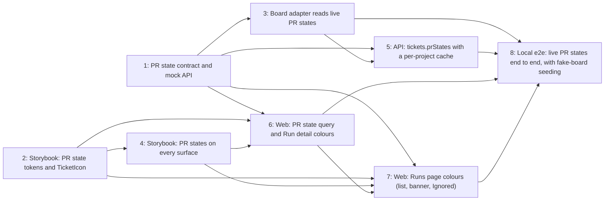

<!-- dev-plan: kind=plan id=show-pr-status-colors rev=1 hash=3af79a98ffb1 spec=docs/superpowers/specs/2026-11-21-show-pr-status-colors-design.md spec-hash=b266fc599be9 -->
# Show PR status colors Implementation Plan

> **For agentic workers:** REQUIRED SUB-SKILL: Use superpowers:subagent-driven-development (recommended) or superpowers:executing-plans to implement this plan task-by-task. Steps use checkbox (`- [ ]`) syntax for tracking.

**Goal:** Every PR icon on the Runs page (rows, PR-led group headers, Needs-you banner, Ignored rows that are already a PR) and on Run detail (top bar, Ticket card, run chain, collapsed rail) shows the PR's live state colour: open green, draft gray, merged purple, closed red. Unknown, loading and failed states stay neutral, and issue icons do not change.

**Architecture:** The shared pieces land first. These are the `PrState` enum, the `tickets.prStates` route and its mock API (Task 1), and the ds `TicketIcon` with the `--pr-*` tokens (Task 2). Then the board adapter gets `prStates` (GitHub GraphQL batch plus the fake), and the Storybook surfaces pass `prState` through. The API serves the route from one `withOrg` read, a per-project/PR TTL cache and one bounded adapter call. The web reads it in the route components through `useQueries` (groups of at most 100 refs), never in a loader, and merges the states into the view models by ticket number.

**Tech Stack:** TypeScript (strict), Zod 4, NestJS/Fastify, Drizzle + Postgres, `@octokit/rest` (`graphql`), undici `MockAgent`, React 19 + TanStack Router/Query, MSW, Storybook, Vitest, Playwright.

**Spec:** `docs/superpowers/specs/2026-11-21-show-pr-status-colors-design.md`. Read it with this plan. No prototype board was drawn (the human skipped the prototype). The closest boards are `design/prototype/project/{Runs,RunsLinked,RunsProblems,RunIdle}.dc.html`.

## Global Constraints

- AGENTS.md rules 1 to 11 bind every task. Layering is `apps → core → db → contracts`, and `web → contracts` only. `ds` never imports contracts. Names stay generic (`prState`, `PrState`, `tickets.prStates`, `PrStateCache`). GitHub code lives only in `packages/core/src/adapters/github/`.
- No new dependency. Use the existing zod, `@octokit/rest` `graphql`, drizzle-orm, TanStack Query (`useQueries`, `keepPreviousData`) and MSW (`delay`).
- No migration, no column, no stored state. `TicketDto`, `LinkedTicketDto`, `RunListItem` and `RunDto` stay unchanged.
- `PrState` is `open | draft | merged | closed`. A ref missing from `items` means unknown. Only PR tickets get a state, never issues.
- Display precedence: merged > closed (draft or not) > open draft > open. GitHub: `merged === true` or `state === 'MERGED'` → merged; `CLOSED` → closed; `OPEN` + `isDraft` → draft; `OPEN` → open; anything else is left out.
- Route: `GET /api/projects/:projectId/tickets/pr-states?ref=12&ref=15`. A ref is `^[1-9]\d{0,9}$`. 1 to 100 refs, duplicates collapsed, anything else 400. Signed out 401. A project that is not visible (including another org's) 404, and the adapter is never called.
- Only refs that the project has a PR run for (`runs.ticket_kind = 'pr'`), or an ignored inbound event for (any kind), are looked up. They are looked up in the project's own repo, through its board connection.
- Cache: key `projectId:ref`, TTL `60_000` ms, at most `10_000` entries with the oldest evicted. It is read only after the project check and holds only `PrState` values. Lookup timeout `5_000` ms. A failure, timeout, rate limit or unregistered adapter gives 200 without those refs, is not cached, and logs one `warn` with `projectId`, the ref count and the error name only.
- PR numbers go into GraphQL variables only (`$n0: Int!`, aliases `p0..pN`). Owner and repo are variables too (rule 6).
- Tokens: `--pr-open: var(--ok)`, `--pr-draft: var(--faint)`, `--pr-merged: #c8a2f0`, `--pr-closed: var(--fail)`. Only the glyph is coloured. The "PR #148" text stays `--text`, and every state keeps the `pull-request` glyph.
- Copy, verbatim: state words "Open", "Draft", "Merged", "Closed". They are the coloured glyph's accessible name and `title` tooltip, so a `TicketRef` reads "Merged PR #148". The collapsed rail item's title and aria-label is "Merged PR #148", and an unknown state keeps "PR #148". There is no new visible text and no error text.
- Failure is silent in the UI: no banner, toast or retry control. A page with no PR on screen sends no request.
- **Storybook first. This is a blocker from the spec's "UI and Storybook" section, not an ordering preference.** No task that implements or wires this UI in `apps/web/src/{app,features}` starts before the Storybook tasks (Task 2 and Task 4) are merged and reviewed. Task 6 and Task 7 list both under **Depends on**.
- Sensitive tasks (high-effort security review): Task 3 (new GitHub API call with the installation token) and Task 5 (new authenticated read endpoint).
- The human chose one implementation PR holding the spec, this plan and all tasks. That PR carries `review:sensitive`. Each task is built in its own worktree and merged into that branch as its own commit(s).
- Before every commit, run `devbox run fix` until it prints `fix: clean.`. Use Conventional Commits with the package as scope.

## Review Focus

1. **Ticket refs that are not plain numbers in web data.** The mock lists use `pr-102` as a PR's `ticket.ref`. A person expects the icon coloured anyway, because the web asks by ticket number. Test in Task 7: `a PR run whose ticket ref is pr-102 is asked as ref=102 and coloured`.
2. **Refs that sort differently as text and as numbers (9, 10, 148), and the same PR on a row and in the banner.** A person expects one request per group of at most 100, with a stable key and no duplicate. Test in Task 6: `prStateChunks sorts by number, drops duplicates and splits at 100`.
3. **A request that mixes cached and new refs.** A person expects only the new refs to reach GitHub, and both to come back coloured. Test in Task 5: `a request with cached and new refs sends only the new refs to the adapter and answers both`.
4. **A lookup that rejects after the timeout has already answered.** A person expects the API not to crash (no unhandled rejection) and the next request to work. Test in Task 5: `a lookup that rejects after the timeout causes no unhandled rejection`.
5. **A GraphQL node whose `number` was not asked.** A person expects it to be ignored, never returned or cached under another ref. Test in Task 3: `a node whose number was not asked is left out`.

## Needs approval

None. No new package, library, service, image, CI action, binary or workspace package.

## Agent calls made while planning

- Agent call: the schemas go in a new `packages/contracts/src/schemas/tickets.ts`, under route group `tickets`. Reason: the spec names the `tickets` group, and `runs.ts` holds run shapes.
- Agent call: the 100-ref cap applies to the refs as sent, before duplicates are collapsed. Reason: it bounds parsing work, and the web never sends duplicates.
- Agent call: the response lists items in the order of the deduplicated request. Reason: the result is deterministic, and the web looks states up by ref anyway.
- Agent call: Task 1 also ships the whole mock API: the MSW handler, the default state map, the `agentdesk.mock.prStates` scenario and `setPrStates`. Reason: the MSW contract test and the `Impl` type require a handler for every route. It is mock code (not `app`/`features`), so the Storybook blocker does not apply to it.
- Agent call: the mock state map (`mocks/dto/prStates.ts`) is:
  - #148 merged and #133 open, from the existing fixtures;
  - #102 open, #104 draft, #106 merged, #108 closed, and #110 with no state. These numbers match the PR rows that `seedLists({ ignored: 10 })` generates and the `ticketRuns` the e2e seeds.

  Reason: the map adds no run or ignored fixture, so every existing count in unit tests and e2e stays as it is.
- Agent call: the mock `partial` scenario leaves out every draft and closed ref. Reason: it is deterministic per ref, whatever the chunking. The MSW handler does not filter by known refs. The API does, proved in `tickets.int.test.ts`.
- Agent call: the web sends ticket numbers (`String(ticket.number)`) as refs, never `ticket.ref`. Reason: view models carry only the number, the real `ticket_ref` is the number, and mock lists use `pr-<n>`.
- Agent call: chunks are sorted by number. Reason: query keys are stable, and refs read naturally.
- Agent call: the query helper and `withPrState` land with Run detail (Task 6), and the Runs page (Task 7) depends on it. Both add to the one mock spec `e2e/mock/pr-state.spec.ts`. Reason: the helper is `features` code under the Storybook blocker, so it cannot go into Task 1. Run detail is the smaller consumer.
- Agent call: the GitHub `prStates` rejects on an HTTP or network failure (including a rate limit), and the API turns that into unknown. A GraphQL error whose `data` parses gives the partial states and one warn. A GraphQL error without usable `data` rejects. The adapter has no timer of its own; the API bounds the call. Reason: the spec puts the timeout and the 200 fallback in the API, and partial data in the adapter.
- Agent call: refs that are not plain digits are dropped in the adapter before the query is built. Reason: defence in depth behind the contract.
- Agent call: refs the adapter leaves out are not cached, and a late answer after the timeout is dropped. Reason: the cache holds only `PrState`, and failures are not cached.
- Agent call: a cache entry has expired once `now − storedAt ≥ ttlMs`. Reason: this satisfies the spec's hit at 60 s − 1 ms and miss at 60 s + 1 ms.
- Agent call: the options token is `PR_STATE_LOOKUP` (`{ clock, ttlMs, timeoutMs, maxEntries }`). `createTestApp` gains `prStateLookup?: Partial<PrStateLookupOptions>`. Reason: the spec asks for an injected `Clock` and options through a Nest token, settable from tests.
- Agent call: the Storybook work is two tasks: Task 2 (ds tokens and `TicketIcon`) and Task 4 (every surface, its stories and fixtures). Reason: every surface renders Task 2's primitive, and together they pass 500 lines.
- Agent call: the four new screen stories are registered in `stateStories` (`screens/storyIds.ts`) against the closest boards: `RunsPrStates` → `Runs`, `RunsProblemsPrStates` → `RunsProblems`, `RunPrMerged` and `RunPrMergedCollapsed` → `RunIdle`. Reason: no board was drawn, so `canvas.json` and `parity.mjs` stay unchanged. `coverage.test.ts` rejects screen stories that map to no board or state.
- Agent call: `mocks/runsLinked.ts` stays unchanged. Reason: `RunsPrStates` builds its merged group from `ticketGroups`.
- Agent call: `DevTicketBody.prState` on an issue is a 400. Reason: the spec says "PRs only", and dev input stays strict.
- Agent call: ADR 0033 lands with the adapter seam (Task 3). Reason: that task introduces the seam it records.

---

<!-- dev-plan:graph:begin -->
## Task graph

Generated by `dev-plan.mjs graph --write` from each task's **Depends on:** line. Do not edit it by hand.
Tasks in the same wave touch no common file and can be built in parallel; a task starts when everything it depends on is merged.

| Wave | Task | Depends on |
| ---- | ---- | ---------- |
| 1 | Task 1: PR state contract and mock API | none |
| 1 | Task 2: Storybook: PR state tokens and TicketIcon | none |
| 2 | Task 3: Board adapter reads live PR states | Task 1 |
| 2 | Task 4: Storybook: PR states on every surface | Task 2 |
| 3 | Task 5: API: tickets.prStates with a per-project cache | Task 1, Task 3 |
| 3 | Task 6: Web: PR state query and Run detail colours | Task 1, Task 2, Task 4 |
| 4 | Task 7: Web: Runs page colours (list, banner, Ignored) | Task 1, Task 2, Task 4, Task 6 |
| 5 | Task 8: Local e2e: live PR states end to end, with fake-board seeding | Task 3, Task 5, Task 6, Task 7 |


<!-- dev-plan:graph:end -->

### Task 1: PR state contract and mock API

**Depends on:** none

**Files:**

- Modify: `packages/contracts/src/enums.ts`
- Create: `packages/contracts/src/schemas/tickets.ts`
- Create: `packages/contracts/src/schemas/tickets.test.ts`
- Modify: `packages/contracts/src/index.ts`
- Modify: `packages/contracts/src/routes.ts`
- Modify: `packages/contracts/src/routes.test.ts`
- Modify: `packages/contracts/src/client/api.ts` (stale array comment only)
- Modify: `packages/contracts/src/client/api.test.ts`
- Create: `apps/web/src/mocks/dto/prStates.ts`
- Create: `apps/web/src/mocks/msw/prStates.ts`
- Create: `apps/web/src/mocks/msw/prStates.test.ts`
- Modify: `apps/web/src/mocks/msw/db.ts`
- Modify: `apps/web/src/mocks/msw/scenarios.ts`
- Modify: `apps/web/src/mocks/msw/handlers.ts`
- Modify: `apps/web/src/mocks/msw/browser.ts`
- Modify: `apps/web/src/mocks/msw/contract.test.ts`
- Modify: `apps/web/e2e/mock/mock.ts`

**Interfaces:**

- Consumes: nothing new.
- Produces (`@agentdesk/contracts`):

```ts
// enums.ts
export const PrState = z.enum(['open', 'draft', 'merged', 'closed']);
export type PrState = z.infer<typeof PrState>;
// schemas/tickets.ts
export const PR_STATES_MAX_REFS = 100;
/** A provider-local ticket number as a ref (shape of normalizeLinkedRefs). */
export const TicketNumberRef = z.string().regex(/^[1-9]\d{0,9}$/);
/** One `ref` key gives a string, several an array; 1..100 refs as sent, then deduplicated (first-seen order). */
export const PrStatesQuery = z.object({ ref: /* preprocess string → [string]; array(TicketNumberRef).min(1).max(100); dedupe */ });
export type PrStatesQuery = z.infer<typeof PrStatesQuery>; // { ref: string[] }
export const PrStatesResponse = z.object({ items: z.array(z.object({ ref: z.string(), prState: PrState })) });
export type PrStatesResponse = z.infer<typeof PrStatesResponse>;
// routes.ts
tickets: {
  prStates: { method: 'GET', path: '/api/projects/:projectId/tickets/pr-states', params: projectParams, query: PrStatesQuery, response: PrStatesResponse },
},
```

- Produces (web mocks):

```ts
// mocks/dto/prStates.ts — live states per project id and ticket number; refs not listed are unknown
export const prStateFixtures: Record<string, Record<string, PrState>>; // invoicer-api: 133 open, 148 merged, 102 open, 104 draft, 106 merged, 108 closed
// mocks/msw/prStates.ts
export type PrStatesScenario = 'slow' | 'error' | 'pending' | 'partial';
export const PR_STATES_SCENARIO_KEY = 'agentdesk.mock.prStates';
export const PR_STATES_SLOW_MS = 3000;
/** Known states of `refs`, in request order; `partial` leaves out draft and closed. */
export function prStateItems(states: Readonly<Record<string, PrState>>, refs: readonly string[], partial: boolean): PrStatesResponse['items'];
// mockDb.state gains: prStates: Record<string, Record<string, PrState>> (seeded from prStateFixtures, reset with the store); prStatesScenario?: PrStatesScenario
// scenarios.prStates(scenario: PrStatesScenario | undefined): void
// e2e/mock/mock.ts
export async function setPrStates(page: Page, scenario: PrStatesScenario): Promise<void>; // before the first goto, like setAgentModels
```

- Handler `tickets.prStates`: scopes with `projectRow(params.projectId)` (404 for another org). Then:
  - `pending` never resolves;
  - `error` throws a 500 `Problem`, as `agents.models` does;
  - `slow` waits `PR_STATES_SLOW_MS` with MSW `delay`, then answers;
  - otherwise it answers `{ items: prStateItems(db().prStates[projectId] ?? {}, query.ref, scenario === 'partial') }`.

  `browser.ts` reads `PR_STATES_SCENARIO_KEY` once at start, parses it with `z.enum([...])`, ignores anything else, and calls `scenarios.prStates`.

- [x] **Step 1: Write the failing contract tests** in `tickets.test.ts`:
  - `PrState` accepts the four values and rejects `'MERGED'` and `'locked'`.
  - `PrStatesQuery.parse({ ref: '12' })` gives `{ ref: ['12'] }`. `{ ref: ['15', '12', '15'] }` gives `['15', '12']`.
  - Each of these fails: `'0'`, `'-1'`, `'1.5'`, `'abc'`, `'012'`, `'12345678901'`, `[]`, a missing `ref`, and 101 distinct refs. Exactly 100 refs pass.
  - `PrStatesResponse` parses `{ items: [] }` and `{ items: [{ ref: '12', prState: 'merged' }] }`, and rejects `prState: 'unknown'`.
  - In `routes.test.ts`, 48 becomes 49, and `flat['tickets.prStates']` matches `{ method: 'GET', path: '/api/projects/:projectId/tickets/pr-states' }`.
  - In `api.test.ts`, `tickets.prStates sends each ref as a repeated key`: the request URL ends with `?ref=12&ref=15`.
- [x] **Step 2: Run** `pnpm --filter @agentdesk/contracts test tickets routes api`. Expected: FAIL (`PrStatesQuery` is not exported).
- [x] **Step 3: Implement** the enum, the schemas, the barrel export and the route. Change the stale "(none in current query schemas)" comment in `api.ts` to name `tickets.prStates`. Run the same command. Expected: PASS.
- [x] **Step 4: Write the failing mock tests.**
  - `prStates.test.ts`: `prStateItems` answers known refs in request order, leaves out unknown refs, and with `partial` leaves out `draft` and `closed`.
  - `contract.test.ts`: every `prStateFixtures` project map, as `{ items }`, parses with `PrStatesResponse`. The existing "every route has a handler" test now covers `tickets.prStates`.
  - Also in `contract.test.ts`, a handler test through `createApi`: `ref=148&ref=133&ref=999` for invoicer-api gives `[{ ref: '148', prState: 'merged' }, { ref: '133', prState: 'open' }]`. Another org's project gives 404, and `ref=0` gives 400.
- [x] **Step 5: Run** `pnpm --filter @agentdesk/web test prStates contract`. Expected: FAIL.
- [x] **Step 6: Implement** the fixtures, db state, scenario, handler, the `browser.ts` loader and `setPrStates`. Run `pnpm --filter @agentdesk/web test prStates contract && pnpm --filter @agentdesk/web typecheck && pnpm --filter @agentdesk/contracts typecheck`. Expected: PASS.
- [x] **Step 7: Commit:** `feat(contracts): PrState and the tickets.prStates route`, then `feat(web): mock API for PR states with scenarios`.

---

### Task 2: Storybook: PR state tokens and `TicketIcon`

**Depends on:** none

**Files:**

- Modify: `apps/web/src/ds/tokens.css`
- Modify: `apps/web/src/ds/tokens.ts`
- Modify: `apps/web/src/ds/tokens.test.ts`
- Modify: `apps/web/src/ds/TicketRef.tsx`
- Modify: `apps/web/src/ds/Chips.module.css`
- Modify: `apps/web/src/ds/index.ts`
- Modify: `apps/web/src/ds/Chips.stories.tsx`
- Modify: `apps/web/src/ds/Chips.test.tsx`
- Modify: `apps/web/src/ds/Colors.stories.tsx`

This task is the first half of the spec's **Storybook-first blocker**.

**Interfaces:**

- Consumes: nothing new (no contracts import in ds).
- Produces (`@/ds`):

```ts
// tokens.ts
export type PrState = 'open' | 'draft' | 'merged' | 'closed';
export const PR_STATES: readonly PrState[] = ['open', 'draft', 'merged', 'closed'];
export const prStateTokens: Record<PrState, { label: string; colorVar: string }>;
// open: { label: 'Open', colorVar: '--pr-open' }, draft: 'Draft' '--pr-draft', merged: 'Merged' '--pr-merged', closed: 'Closed' '--pr-closed'
// TicketRef.tsx
export interface TicketIconProps { kind: TicketKind; prState?: PrState; size?: number } // size default 14
export function TicketIcon(props: TicketIconProps): JSX.Element;
// TicketRefProps gains: prState?: PrState (used only when kind === 'pr'); TicketRef renders TicketIcon
// index.ts: export { TicketIcon, type TicketIconProps } (tokens already re-exported)
```

- Coloured glyph (a PR with a `prState`): `<span className={`${styles.prIcon} ${variant}`} title={label}>` wrapping `<Icon name="pull-request" size={size} aria-label={label} />`.
  - `variant` comes from a const map to `styles.prOpen | prDraft | prMerged | prClosed`, each `color: var(--pr-…)`.
  - The wrapper is not focusable.
- Neutral glyph (no state, or an issue): today's `<Icon … />`, `aria-hidden`, with no title.

- [x] **Step 1: Write the failing tests.** In `Chips.test.tsx` `describe('TicketRef')`:
  - `TicketRef colours a merged PR icon with the merged token` (the spec's first red test). `<TicketRef kind="pr" number={148} prState="merged" />` gives:
    - `getByRole('img', { name: 'Merged' })`;
    - the parent has class `prMerged` and `title="Merged"`;
    - the text is "PR #148".
  - `it.each(PR_STATES)` gives each state its word and its class (`prOpen`, `prDraft`, `prMerged`, `prClosed`).
  - `a linked coloured TicketRef reads "Merged PR #148"`: `getByRole('link', { name: 'Merged PR #148' })`.
  - `an unknown PR keeps the neutral glyph`: no `img` role, the svg has `aria-hidden="true"`, and there is no `title`.
  - `an issue ignores prState`: `<TicketRef kind="issue" number={142} prState="merged" />` has no `img` role and no `prMerged` class.
  - `TicketIcon renders 16 px`: the svg's `width` is `16`.

  In `tokens.test.ts`, the css contains `--pr-open:var(--ok)`, `--pr-draft:var(--faint)`, `--pr-merged:#c8a2f0` and `--pr-closed:var(--fail)`. Every `prStateTokens[s].colorVar` is defined in `tokens.css`, and the labels are exactly Open, Draft, Merged, Closed.
- [x] **Step 2: Run** `pnpm --filter @agentdesk/web test Chips tokens`. Expected: FAIL.
- [x] **Step 3: Implement** the tokens (group comment "pull request states", next to the `--label-*` aliases), `prStateTokens`, `TicketIcon`, `TicketRef.prState` and the CSS. Run the same command. Expected: PASS.
- [x] **Step 4: Update the stories.**
  - `Chips.stories.tsx` `All` gets two new rows of PR `TicketRef`s. Each row has open, draft, merged, closed and unknown, one row plain and one linked. Add an issue with `prState="merged"`, and `TicketIcon` per state at 14 and 16 px.
  - `Colors.stories.tsx` shows the four `--pr-*` tokens in a "Pull request states" group, in the file's existing swatch pattern.
- [x] **Step 5: Run** `pnpm --filter @agentdesk/web test && pnpm --filter @agentdesk/web typecheck`. Expected: PASS, including the Storybook smoke and axe test.
- [x] **Step 6: Commit:** `feat(web): PR state tokens and TicketIcon in the design system`.

---

### Task 3: Board adapter reads live PR states

**Depends on:** Task 1

**Files:**

- Modify: `packages/core/src/adapters/types.ts`
- Modify: `packages/core/src/adapters/github/board.ts`
- Modify: `packages/core/src/adapters/fake/board.ts`
- Modify: `packages/core/src/adapters/fake/store.ts`
- Create: `packages/core/test/fixtures/github/graphql.pr-states.json`
- Modify: `packages/core/test/adapters/github.test.ts`
- Modify: `packages/core/test/adapters/fake.test.ts`
- Create: `docs/adr/0033-live-pr-state-through-the-board-adapter.md`
- Modify: `docs/adr/README.md`

**Interfaces:**

- Consumes: `PrState` (Task 1).
- Produces (core):

```ts
// adapters/types.ts, BoardAdapter gains:
/** Live state of each PR among `refs` (ticket numbers) in the project's repo. Refs that are not PRs, are not found or
 *  have an unknown state are left out. Rejects when the provider cannot be asked. Stores nothing. */
prStates(project: AdapterProject, refs: string[]): Promise<Map<string, PrState>>;
// github/board.ts (exported for tests)
/** `query PrStates($owner: String!, $repo: String!, $n0: Int!, …) { repository(owner: $owner, name: $repo) { p0: pullRequest(number: $n0) { number state isDraft merged } … } }` */
export function prStatesQuery(count: number): string;
export function prStateOf(node: { state: string; isDraft: boolean; merged: boolean }): PrState | undefined;
// fake/store.ts, StoredTicket gains: prState: z.enum(PrState.options).optional()  (provider-neutral; unset = unknown)
```

- GitHub `prStates`:
  - It keeps only refs matching `^[1-9]\d{0,9}$`. With none left, it returns an empty `Map` and makes no request.
  - One call: `clients.installation(project.connectionExternalId).graphql(prStatesQuery(n), { owner, repo, n0, … })`.
  - Each alias node is parsed on its own with Zod (`number`, `state`, `isDraft`, `merged`). A null node, a node that fails the schema, a node whose `number` was not asked, and an unknown state are each left out. The key is `String(node.number)`.
  - On a thrown error whose `data` parses as the same response shape (GraphQL errors with partial data), it uses that data and calls `log?.warn({ err: <error name> }, 'pr states partial')`. Any other error rethrows.
- Fake `prStates`: for each ref, the stored ticket of `project.repoPath` with `kind === 'pr'` and a `prState`.

- [x] **Step 1: Add the fixture** `graphql.pr-states.json`. It is `{ "full": …, "partial": … }`, scrubbed, with no real users or tokens.
  - `full.data.repository` has aliases in shuffled order: p0 #1 OPEN; p1 #2 OPEN draft; p2 #3 MERGED `merged: true`; p3 #4 CLOSED; p4 #5 CLOSED draft; p5 `null`; p6 #7 `"LOCKED"`.
  - `partial` is `data.repository` `{ p0: #1 OPEN, p1: null }` plus `errors: [{ "type": "NOT_FOUND", "path": ["repository","p1"], "message": "Could not resolve to a PullRequest with the number of 2." }]`.
- [x] **Step 2: Write the failing tests** in `github.test.ts`, in a new `describe('github prStates')`. Use the existing `mockInstallationToken`, `gh()` and the captured request body.
  - `maps a merged PR to merged` (the spec's first red test).
  - `prStateOf` in `it.each`:
    - `OPEN/false/false` gives `open`; `OPEN/true/false` gives `draft`; `MERGED/false/true` gives `merged`;
    - `CLOSED/false/true` gives `merged`; `CLOSED/false/false` gives `closed`; `CLOSED/true/false` gives `closed`;
    - `LOCKED/false/false` gives `undefined`.
  - `one batched call maps the answer by number, whatever its order`. Refs `['1'..'7']` with `full` give exactly `{1: open, 2: draft, 3: merged, 4: closed, 5: closed}`. The intercept is hit once.
  - `the query text is the same for any numbers; owner, repo and numbers are variables only`. Calls with `['12','15']` and `['99','100']` send the same `query`. The variables are `{ owner: 'acme', repo: 'widgets', n0: 12, n1: 15 }`, and the query contains neither `acme` nor `12`.
  - `GraphQL errors with partial data colour what came back and warn with the error name only`. `partial` gives `{1: open}`. `log.warn` is called once with `{ err: expect.any(String) }`, and its arguments do not contain `Could not resolve`.
  - `an HTTP failure, a rate limit and a network error reject`. Use a 502; a 403 with `x-ratelimit-remaining: 0`; and `replyWithError`.
  - `no refs means no request`.
  - `a node whose number was not asked is left out` (Review Focus 5). Refs `['1']` answered with p0 `#9 OPEN` give an empty map.

  In `fake.test.ts`, `prStates returns the stored state for PR tickets; unset, issues and unknown refs are left out`.
- [x] **Step 3: Run** `pnpm --filter @agentdesk/core test github fake`. Expected: FAIL.
- [x] **Step 4: Implement** the interface method, the GitHub and fake implementations and `StoredTicket.prState`. Run `pnpm --filter @agentdesk/core typecheck && pnpm --filter @agentdesk/core test github fake`. Expected: PASS.
- [x] **Step 5: Write ADR 0033.** Status Accepted, dated 2026-11-21, in the format of 0030. It covers:
  - a live provider read at request time instead of a stored column;
  - a separate, non-blocking endpoint;
  - the `BoardAdapter.prStates` seam;
  - the per-project/PR TTL cache in the API (60 s, 10,000 entries);
  - failure means unknown.

  Add its row to `docs/adr/README.md`.
- [x] **Step 6: Commit:** `feat(core): BoardAdapter.prStates with a batched GitHub lookup and the fake`, then `docs(adr): 0033 live PR state through the board adapter`.

---

### Task 4: Storybook: PR states on every surface

**Depends on:** Task 2

**Files:**

- Modify: `apps/web/src/mocks/types.ts`
- Modify: `apps/web/src/mocks/runs.ts`
- Modify: `apps/web/src/mocks/ignored.ts`
- Modify: `apps/web/src/mocks/runDetail.tsx`
- Modify: `apps/web/src/components/ChainTimeline.tsx`
- Modify: `apps/web/src/components/RunRow.tsx`
- Modify: `apps/web/src/components/NeedsYouBanner.tsx`
- Modify: `apps/web/src/components/IgnoredRow.tsx`
- Modify: `apps/web/src/components/TicketSummary.tsx`
- Modify: `apps/web/src/screens/RunDetail.tsx`
- Modify: `apps/web/src/screens/RunSidePanel.tsx`
- Modify: `apps/web/src/components/RunRow.stories.tsx`
- Modify: `apps/web/src/components/NeedsYouBanner.stories.tsx`
- Modify: `apps/web/src/components/IgnoredRow.stories.tsx`
- Modify: `apps/web/src/components/ChainTimeline.stories.tsx`
- Modify: `apps/web/src/components/SidePanel.stories.tsx`
- Modify: `apps/web/src/screens/runs.stories.tsx`
- Modify: `apps/web/src/screens/runDetail.stories.tsx`
- Modify: `apps/web/src/screens/storyIds.ts`
- Modify: `apps/web/src/screens/runs.test.tsx`
- Modify: `apps/web/src/screens/runDetail.test.tsx`

This task is the second half of the spec's **Storybook-first blocker**.

**Interfaces:**

- Consumes: `PrState`, `prStateTokens`, `TicketIcon`, `TicketRef.prState` (Task 2).
- Produces (view models, `@/mocks/types` and `ChainTimeline`):

```ts
export type Ticket = { kind: TicketKind; number: number; title: string; labels: Label[]; state?: string; href: string; prState?: PrState };
// IgnoredCommand.ticket: { kind: TicketKind; number: number; prState?: PrState }
// ChainStep.ticket?: { kind: TicketKind; number: number; prState?: PrState }
```

- Pass-through, nothing else changes: `TicketRef … prState={ticket.prState}` in:
  - `TicketGroupRow` and `RunRow`;
  - `NeedsYouBanner`, `IgnoredRow`, `TicketSummary` and `ChainTimeline`;
  - the `RunDetail` top bar.
- `RunSidePanel` collapsed rail: the icon is `<TicketIcon kind={t.kind} prState={t.prState} size={16} />`. The title is `${prStateTokens[s].label} PR #${n}` when the PR has a state, else today's label.
- Produces (`@/mocks`): `prStateTickets: Record<PrState, Ticket>` (PR #170 open, #171 draft, #172 merged, #173 closed) and `prStateRuns: RunSummary[]` (one per state plus PR #174 unknown) in `mocks/runs.ts`; `ignoredPrStates: IgnoredCommand[]` (one per state plus unknown) in `mocks/ignored.ts`; `runDetailPrMerged: RunDetailData` (`RunIdle` with the run ticket, the PR chain step and a `pullRequest` ticket all `merged`) in `mocks/runDetail.tsx`. Existing fixtures stay without `prState`.
- Stories:

| File | New export | Shows |
| --- | --- | --- |
| `RunRow.stories.tsx` | `PrStates`, `GroupHeaderPrStates` | flat rows per state plus unknown; PR-led headers per state over their rows |
| `NeedsYouBanner.stories.tsx` | `OnMergedPr` | banner on a merged PR run |
| `IgnoredRow.stories.tsx` | `OnPullRequestStates` | `ignoredPrStates` |
| `ChainTimeline.stories.tsx` | `OnPullRequest` | steps on a merged PR |
| `SidePanel.stories.tsx` | `PullRequestStates`, `CollapsedOnPr` | merged Ticket card and Pull request section; rail item "Merged PR #148" |
| `screens/runs.stories.tsx` | `RunsPrStates`, `RunsProblemsPrStates` | `Runs` with `prStateRuns` grouped (plus the `ticketGroups[0]` merged group: issue header unchanged); `RunsProblems` with `ignoredPrStates` |
| `screens/runDetail.stories.tsx` | `RunPrMerged`, `RunPrMergedCollapsed` | `runDetailPrMerged`, panel open / `panelCollapsed: true` |

- `storyIds.ts` `stateStories` gains `RunsPrStates` → board `Runs`, `RunsProblemsPrStates` → `RunsProblems`, and `RunPrMerged` and `RunPrMergedCollapsed` → `RunIdle` (see Agent calls).

- [x] **Step 1: Write the failing screen tests.**
  - `runs.test.tsx`:
    - `every PR icon on the Runs screen shows its state`. With `prStateRuns` grouped, each row and each PR-led header has `img` "Open" / "Draft" / "Merged" / "Closed", and PR #174 has none.
    - `the banner's PR icon shows its state`: `OnMergedPr` data gives "Merged".
    - `Ignored PR rows show their state; issue rows do not`.
    - `a merged group's issue header and chain note stay plain` (BR-5, BR-12): no `img` role in the header.
  - `runDetail.test.tsx`:
    - `the top bar, Ticket card, chain step and Pull request section of a merged PR read "Merged"`;
    - `the collapsed rail names the state`: `getByRole('img', { name: 'Merged PR #148' })`, and that item's svg has the `prMerged` wrapper;
    - `an issue run keeps the issue icon everywhere`;
    - `an unknown PR keeps "PR #148" on the rail`.
- [x] **Step 2: Run** `pnpm --filter @agentdesk/web test runs.test runDetail.test`. Expected: FAIL.
- [x] **Step 3: Implement** the view model fields, the pass-through, the rail and the fixtures. Run the same command. Expected: PASS.
- [x] **Step 4: Add the stories** in the table, and the four `stateStories` entries.
- [x] **Step 5: Run** `pnpm --filter @agentdesk/web test && pnpm --filter @agentdesk/web typecheck`. Expected: PASS, including `coverage.test.ts` (no orphan screen story) and the smoke and axe test over every new story.
- [x] **Step 6: Visual check.** Run `pnpm --filter @agentdesk/web build-storybook`. Check by eye that each state has its colour and that the four tokens stand out on `--bg`, `--panel`, `--row-group` and the banner background. Do not commit `storybook-static/`.
- [x] **Step 7: Commit:** `feat(web): PR state colours on every PR icon in Storybook`.

---

### Task 5: API: `tickets.prStates` with a per-project cache

**Depends on:** Task 1, Task 3

**Files:**

- Create: `apps/api/src/tickets/pr-state-cache.ts`
- Create: `apps/api/src/tickets/pr-state-cache.test.ts`
- Create: `apps/api/src/tickets/tickets.service.ts`
- Create: `apps/api/src/tickets/tickets.controller.ts`
- Modify: `apps/api/src/app.module.ts`
- Modify: `apps/api/test/helpers/app.ts`
- Create: `apps/api/test/tickets.int.test.ts`

**Interfaces:**

- Consumes: `routes.tickets.prStates`, `PrStatesResponse`, `PrState` (Task 1). `BoardAdapter.prStates` and `StoredTicket.prState` (Task 3, used by the int test to seed the fake board).
- Produces (api):

```ts
// tickets/pr-state-cache.ts
export interface PrStateLookupOptions { clock: Clock; ttlMs: number; timeoutMs: number; maxEntries: number }
export const PR_STATE_LOOKUP = Symbol('PR_STATE_LOOKUP');
export const PR_STATE_LOOKUP_DEFAULTS: Omit<PrStateLookupOptions, 'clock'> = { ttlMs: 60_000, timeoutMs: 5_000, maxEntries: 10_000 };
export class PrStateCache {
  constructor(clock: Clock, opts: { ttlMs: number; maxEntries: number });
  /** undefined when absent or expired (now − storedAt ≥ ttlMs). Key `${projectId}:${ref}`. */
  get(projectId: string, ref: string): PrState | undefined;
  /** Re-setting moves the entry to newest; above maxEntries the oldest is dropped. */
  set(projectId: string, ref: string, state: PrState): void;
}
// tickets/tickets.service.ts
@Injectable() export class TicketsService { prStates(org: OrgContext, projectId: string, refs: string[]): Promise<PrStatesResponse> }
// tickets/tickets.controller.ts: @Get(routePath(routes.tickets.prStates)) with ZodPipe params and query, @CurrentOrg()
// app.module.ts: TicketsController; TicketsService; { provide: PR_STATE_LOOKUP, useValue: { clock: systemClock, ...PR_STATE_LOOKUP_DEFAULTS } }
// test/helpers/app.ts: TestAppOptions.prStateLookup?: Partial<PrStateLookupOptions> → overrideProvider(PR_STATE_LOOKUP)
```

- Service flow:
  1. One `withOrg` does three reads:
     - the project joined to its board connection (`projects.board_connection_id` → `connections.provider/external_id`, as in `process-ticket-event.ts`). With no row it throws `NotFoundException('Project not found')`.
     - the known refs, with `inArray`, never with SQL text: `runs` (`project_id`, `ticket_kind = 'pr'`, `ticket_ref`) union `inbound_events` (`project_id`, `ticket_ref`).
  2. Outside the transaction, cache hits are read, and the misses are kept.
  3. When there are misses, `registry.board(Provider.parse(provider)).prStates(toAdapterProject(row, externalId), misses)` runs inside `try`, raced against a `timeoutMs` timer.
     - The timer is always cleared.
     - The losing adapter promise gets a no-op `.catch`.
     - A success caches only the asked refs that have a state.
     - Any failure or timeout logs `pr states unavailable {"projectId","refs":<n>,"err":<name>}` once and adds nothing.
  4. The answer is `{ items }` for the known refs that have a state, in request order.

- [ ] **Step 1: Write the failing cache tests** in `pr-state-cache.test.ts`, with a mutable test `Clock`:
  - `a hit at 60 s − 1 ms, a miss at 60 s + 1 ms`;
  - `entry 10,001 evicts the oldest and keeps the newest`;
  - `project A's entry is never served to project B`;
  - `re-setting refreshes the time and the age order`.
- [ ] **Step 2: Run** `pnpm --filter @agentdesk/api test:unit pr-state-cache`. Expected: FAIL. **Implement** `PrStateCache` (a `Map` in insertion order). Run again. Expected: PASS.
- [ ] **Step 3: Write the failing int tests** in `tickets.int.test.ts`.

  Setup:
  - One app with `prStateLookup: { clock: testClock, timeoutMs: 50 }` and `wrapAdapters: (r) => spyBoard(wideFakeRepos(r))`. `spyBoard` wraps `board('fake')`, records each `prStates(project, refs)` call, and switches on a mutable `mode`: `real`, `throw` (an `Error` named `HttpError` with message `provider-text-xyz`), `hang`, `lateReject` (rejects 100 ms after the call), or `unregistered` (`board()` itself throws).
  - Logs are captured with `logger: pino(…, stream)`, as in `agents.int.test.ts`.
  - Fake tickets are seeded through `new FakeStore(stateDir, clock).addTicket({ …, prState })`. Run rows are added with an `insertRun` like `runs.int.test.ts`, and `inbound_events` rows with outcome `ignored_unauthorized`.
  - Every 200 goes through `expectContract('tickets.prStates', res)`.

  Tests:
  - `signed out is 401`.
  - `another org's project is 404 and the adapter is never called`.
  - `returns the states of the project's PR refs and leaves out the rest`:
    - PR runs on 11 (open), 12 (draft), 13 (merged), 14 (closed) and 15 (no state), plus an issue run on 16;
    - `?ref=11…17` gives items 11 to 14;
    - the adapter got exactly `['11','12','13','14','15']`.
  - `an ignored event's ref with no run is looked up` (BR-16): ref 21, a PR stored merged with only an ignored event, gives `merged`.
  - `another project's PR refs never reach the adapter`.
  - `the adapter gets the project's own repoPath and board connection`.
  - `bad refs are 400 problem+json with a pointer`: `0`, `-1`, `1.5`, `abc`, `012`, 11 digits, no ref, 101 refs.
  - `one key and repeated keys both work; duplicates are asked once`.
  - `a throwing adapter, a rate limit and an unregistered provider give 200 with those refs left out and one warn with the error name only`. The log contains `HttpError` and the project id. Neither the log nor the body contains `provider-text-xyz`.
  - `a hanging adapter is cut off at the timeout`: 200 with `items: []`.
  - `failures are not cached: the next request asks again`.
  - `a cache hit skips the adapter until the TTL passes`.
  - `a request with cached and new refs sends only the new refs to the adapter and answers both` (Review Focus 3).
  - `a lookup that rejects after the timeout causes no unhandled rejection` (Review Focus 4). A `process.on('unhandledRejection')` spy is not called within 300 ms, and the next request answers 200.
- [ ] **Step 4: Run** `pnpm --filter @agentdesk/api test:integration tickets.int`. Expected: FAIL (404 route).
- [ ] **Step 5: Implement** the service, the controller, the module wiring and the test-app option. Run `pnpm --filter @agentdesk/api typecheck && pnpm --filter @agentdesk/api test:integration tickets.int && pnpm --filter @agentdesk/api test:unit pr-state-cache`. Expected: PASS.
- [ ] **Step 6: Commit:** `feat(api): tickets.prStates reads live PR states through a per-project cache`.

---

### Task 6: Web: PR state query and Run detail colours

**Depends on:** Task 1, Task 2, Task 4

**Files:**

- Modify: `apps/web/src/features/runs/queries.ts`
- Create: `apps/web/src/features/runs/queries.test.ts`
- Modify: `apps/web/src/features/runs/map.ts`
- Modify: `apps/web/src/features/runs/map.test.ts`
- Modify: `apps/web/src/features/runs/detail.map.ts`
- Modify: `apps/web/src/features/runs/detail.map.test.ts`
- Modify: `apps/web/src/app/routes/o.$org.p.$project.runs.$run.tsx`
- Modify: `apps/web/src/features/runs/detail.route.test.tsx`
- Create: `apps/web/e2e/mock/pr-state.spec.ts`

**Interfaces:**

- Consumes:
  - from Task 1: `api.tickets.prStates`, the MSW handler and `prStateFixtures`, and `scenarios.prStates` and `setPrStates`;
  - from Task 2: `PrState` and `prStateTokens`;
  - from Task 4: `Ticket.prState`, `ChainStep.ticket.prState`, and the pass-through on every surface.
- Produces:

```ts
// queries.ts
/** Distinct refs, sorted by number, in groups of at most PR_STATES_MAX_REFS (from @agentdesk/contracts, Task 1). */
export function prStateChunks(refs: readonly string[]): string[][];
export const ticketsQueries = {
  // key ['org', org, 'projects', projectId, 'tickets', 'pr-states', refs]; placeholderData: keepPreviousData; global defaults otherwise
  prStates: (org: string, projectId: string, refs: string[]) => queryOptions({ … queryFn → PrStatesResponse['items'] }),
};
/** States of the refs on screen, merged across groups (useQueries + combine). Never suspends or throws; empty refs send nothing. */
export function usePrStates(org: string, projectId: string, refs: readonly string[]): ReadonlyMap<string, PrState>;
// map.ts
/** Ticket numbers of the PR tickets among `tickets`, as refs; issues are never asked. */
export function prRefsOf(tickets: Iterable<{ kind: TicketKind; number: number }>): string[];
/** `prState` set when the ticket is a PR with a known state; issues and unknown refs come back unchanged. */
export function withPrState<T extends { kind: TicketKind; number: number }>(ticket: T, states: ReadonlyMap<string, PrState>): T & { prState?: PrState };
// detail.map.ts
/** The run's ticket, every chain step's ticket and the Pull request section's ticket, through withPrState. */
export function withDetailPrStates(data: RunDetailData, states: ReadonlyMap<string, PrState>): RunDetailData;
```

- Route wiring: `const prStates = usePrStates(org, projectId, prRefsOf([dto.ticket]))`, read in the route component (not the loader), then `withDetailPrStates(mapped, prStates)` before `data` is built. The contracts and ds `PrState` are the same union, so the map passes as is.

- [x] **Step 1: Write the failing unit tests.**
  - `queries.test.ts`, `prStateChunks sorts by number, drops duplicates and splits at 100` (Review Focus 2):
    - `['10','9','148','9']` gives `[['9','10','148']]`;
    - 101 refs give groups of 100 and 1;
    - 250 refs give 100, 100 and 50;
    - `[]` gives `[]`.
  - `queries.test.ts`, `usePrStates` (`renderHook` with a `QueryClientProvider`, MSW node, requests recorded with `server.events`):
    - 101 refs send two requests, of 100 and 1, and the result holds both;
    - `[]` sends none;
    - the `error` scenario gives an empty map and no throw.
  - `map.test.ts`:
    - `prRefsOf` keeps PRs only, as numbers;
    - `withPrState` sets a known PR, leaves an unknown PR without the key, and leaves an issue unchanged even when its number is in the map.
  - `detail.map.test.ts`: `withDetailPrStates` sets the run ticket, the PR chain steps and `pullRequest.ticket`. The issue chain step (#142) and an issue run stay unchanged.
- [x] **Step 2: Run** `pnpm --filter @agentdesk/web test queries.test map.test detail.map`. Expected: FAIL. **Implement** them. Run again. Expected: PASS.
- [x] **Step 3: Write the failing route tests** in `detail.route.test.tsx`:
  - `run 62 on PR #148 shows "Merged" on the top bar, Ticket card and chain after the states load`. It uses `findBy`, and `ref=148` is the only ref asked.
  - `an issue run sends no PR-state request` (`mockDb.requests('GET', …/tickets/pr-states)` is 0).
  - `error and pending leave the icons neutral with no banner or toast` (`scenarios.prStates('error' | 'pending')`).
  - `the colour fills in without a reload` (BR-6). `server.use` holds the pr-states answer until the test releases it. The page and a neutral top-bar glyph show first, then "Merged" appears after the release.
- [x] **Step 4: Run** `pnpm --filter @agentdesk/web test detail.route`. Expected: FAIL. **Wire the route.** Run again. Expected: PASS.
- [x] **Step 5: Write the mock e2e** `e2e/mock/pr-state.spec.ts`. The header comment lists the BRs covered and the spec's "Not provable by e2e" reasons.
  - Helper `expectPrColour(icon: Locator, state: PrState | 'neutral')`:
    - it compares the icon's computed `color` with the token's computed colour, read at test time from a probe element styled `color: var(--pr-<state>)` (or `var(--muted)` for neutral);
    - it checks the `pr<State>` class on the wrapper for a state.
  - Tests:
    - `Run detail on a merged PR: top bar, Ticket card, chain steps and collapsed rail are purple and say "Merged"` (run 62; BR-3, BR-9, BR-15);
    - `Run detail in each state` (BR-3, BR-4). `seedLists({ ticketRuns: [{ kind: 'pr', number: 102 }, { kind: 'pr', number: 104 }, { kind: 'pr', number: 106 }, { kind: 'pr', number: 108 }] })`, then open runs 1 to 4: green, gray, purple, red;
    - `Run detail on an issue run keeps the issue icon and sends no PR-state request` (BR-5; count with `page.on('request')`);
    - `slow: Run detail shows neutral first, then purple without a reload` (BR-6, `setPrStates(page, 'slow')`);
    - `error and pending: Run detail stays neutral with no banner or toast, and the page works` (BR-7).
- [x] **Step 6: Run the new spec:** `pnpm --filter @agentdesk/web exec vite build --mode mock && pnpm --filter @agentdesk/web exec playwright test e2e/mock/pr-state.spec.ts`. Expected: PASS. Then run `pnpm --filter @agentdesk/web test && pnpm --filter @agentdesk/web typecheck`. Expected: PASS.
- [x] **Step 7: Commit:** `feat(web): read live PR states and colour them on Run detail`.

---

### Task 7: Web: Runs page colours (list, banner, Ignored)

**Depends on:** Task 1, Task 2, Task 4, Task 6

**Files:**

- Modify: `apps/web/src/features/runs/map.ts`
- Modify: `apps/web/src/features/runs/map.test.ts`
- Modify: `apps/web/src/app/routes/o.$org.p.$project.runs.index.tsx`
- Modify: `apps/web/src/features/runs/runs.route.test.tsx`
- Modify: `apps/web/e2e/mock/pr-state.spec.ts`

**Interfaces:**

- Consumes:
  - from Task 6: `usePrStates`, `prRefsOf`, `withPrState`, `expectPrColour`;
  - from Task 1: `setPrStates`, `prStateFixtures` (102 to 110);
  - from Task 2 and Task 4: `TicketGroup` and `IgnoredCommand` with `prState`, and the pass-through.
- Produces (`map.ts`):

```ts
/** Each group's header ticket and every row's ticket through withPrState; chainNote and everything else unchanged. */
export function withPrStates(groups: TicketGroup[], states: ReadonlyMap<string, PrState>): TicketGroup[];
```

- `ListView`:
  - `usePrStates(org, projectId, prRefsOf([...summaries.map((s) => s.ticket), ...(idle ? [idle.ticket] : [])]))`. The PR-led headers are among the rows, so they add nothing.
  - `groups` go through `withPrStates`, and `needsYouRun.run.ticket` through `withPrState`.
- `IgnoredView`: `usePrStates(org, projectId, prRefsOf(items.map((i) => i.ticket)))`, and each item's `ticket` goes through `withPrState`. Real rows have kind `issue` (`ticketKind: null`), so they send nothing.

- [ ] **Step 1: Write the failing tests.**
  - `map.test.ts`, `withPrStates`:
    - a PR-led group's header and rows get the state;
    - a merged group keeps its issue header and its `chainNote` string unchanged (BR-5, BR-12);
    - two rows of one PR get the same state.
  - `runs.route.test.tsx`:
    - `rows and the banner show their PR's state` (default mock: run 62 and the banner are #148 "Merged"; runs 56 and 57 are #133 "Open").
    - `a PR run whose ticket ref is pr-102 is asked as ref=102 and coloured` (Review Focus 1). Use `applyMockLists({ ticketRuns: [{ kind: 'pr', number: 102 }] })`; grouped on, the PR-led header and its row both say "Open".
    - `asks for an off-page idle run's PR` (BR-14). `applyMockLists({ runs: { total: 25 }, ticketRuns: [{ kind: 'pr', number: 106, status: 'idle' }] })`. The request refs include `106`, and the banner says "Merged".
    - `an issue-only page sends no PR-state request`.
    - `page 2 asks for its own refs and keeps known states meanwhile` (BR-13): assert the set of refs asked, not call counts.
    - `the Ignored view colours PR rows and leaves issue rows alone` (BR-16). `applyMockLists({ ignored: 10 })` asks refs `102,104,106,108,110` and shows "Open", "Draft", "Merged", "Closed"; #110 stays neutral.
    - `partial and error leave icons neutral with no banner or toast` (BR-7, BR-8).
- [ ] **Step 2: Run** `pnpm --filter @agentdesk/web test map.test runs.route`. Expected: FAIL. **Implement** `withPrStates` and the wiring. Run again. Expected: PASS.
- [ ] **Step 3: Extend the mock e2e** `e2e/mock/pr-state.spec.ts`:
  - `Runs rows in each state, flat and grouped; a PR-led header matches its rows` (BR-1, BR-2, BR-4, BR-9). Seed `ticketRuns` with PRs 102, 104, 106, 108 and 110 and issue 120. Check each colour, the hover `title` and the accessible name. #110 and the issue stay neutral or issue.
  - `a merged group keeps its issue header and a plain chain note` (BR-5, BR-12): issue 120, PR 106 `linked: [120]`.
  - `the Needs-you banner on a merged PR is purple, also when the run is off the current page` (BR-14).
  - `the Ignored view colours PR rows per state` (BR-16, `seedLists({ ignored: 10 })`).
  - `page 2 and a filter change colour the newly shown PRs` (BR-13).
  - `slow: the Runs page shows neutral first, then colours without a reload` (BR-6).
  - `error and pending: the Runs page stays neutral, silent, and works` (BR-7).
  - `partial: draft and closed stay neutral while the others are coloured` (BR-8).
  - `a page with only issues sends no PR-state request` (BR-5).
- [ ] **Step 4: Run the changed spec:** `pnpm --filter @agentdesk/web exec vite build --mode mock && pnpm --filter @agentdesk/web exec playwright test e2e/mock/pr-state.spec.ts`. Expected: PASS. Then run `pnpm --filter @agentdesk/web test && pnpm --filter @agentdesk/web typecheck`. Expected: PASS.
- [ ] **Step 5: Commit:** `feat(web): colour PR icons on the Runs list, banner and Ignored view`.

---

### Task 8: Local e2e: live PR states end to end, with fake-board seeding

**Depends on:** Task 3, Task 5, Task 6, Task 7

**Files:**

- Modify: `apps/api/src/dev/fake.controller.ts`
- Modify: `apps/api/test/webhooks.int.test.ts`
- Modify: `apps/web/e2e/local/helpers.ts`
- Create: `apps/web/e2e/local/pr-state.spec.ts`

**Interfaces:**

- Consumes:
  - from Task 3: `StoredTicket.prState`;
  - from Task 5: `tickets.prStates` on the real API;
  - from Task 6 and Task 7: Run detail and Runs page wiring.
- Produces:
  - `DevTicketBody` gains `prState: PrState.optional()`, refined so that it is only allowed when `kind === 'pr'` (a 400 otherwise). `addTicket` stores it when set.
  - `addFakeTicket(page, kind, opts: { number?: number; linked?: number[]; prState?: PrState })` sends `prState` when set.

- [ ] **Step 1: Write the failing int tests** in `webhooks.int.test.ts`:
  - `POST /dev/fake/tickets accepts prState on PRs`: the store reads it back.
  - `rejects prState on an issue or an unknown value`: 400.
- [ ] **Step 2: Run** `pnpm --filter @agentdesk/api test:integration webhooks.int`. Expected: FAIL. **Implement** the field. Run again. Expected: PASS.
- [ ] **Step 3: Write the local spec** `e2e/local/pr-state.spec.ts`.
  - Header comment: the BRs covered, and the spec's reasons for BR-4 closed-draft, BR-7, BR-10, BR-11 exact window and BR-16 not being local.
  - Setup, in the shape of `ticket-groups.spec.ts`: a `readyz` guard, its own user and project per test, and random ticket numbers. PRs get `/code-review` and issues `/code-build`. States are set before the first load.
  - Tests:
    - `Runs rows and a PR-led header show each PR's state; an issue keeps its icon; a PR without a state stays neutral` (BR-1, BR-2, BR-5, BR-8). Four PRs (open, draft, merged, closed), one PR with no state and one issue, one comment each. Check flat, then grouped.
    - `Run detail of a PR run shows its state on the top bar and the Ticket card` (BR-3, BR-15).
    - `a PR run that arrives live gets its colour` (BR-13). The Runs page is open, then a comment lands on a new merged PR, and the live row turns purple.
    - `a PR merged at the source shows purple after the cache window` (BR-11). The PR starts open and shows green. It is re-added `merged`, then `expect.poll` reloads until purple, with a 90 s timeout. The test timeout is 300 s.
- [ ] **Step 4: Run the new spec** with the stack up (`devbox run dev-bg`): `pnpm --filter @agentdesk/web exec playwright test e2e/local/pr-state.spec.ts`. Expected: PASS. If the stack cannot start (no Docker engine, runner pod), say so in the PR and list these specs as written but not run.
- [ ] **Step 5: Final checks:** `pnpm typecheck && pnpm test` for `@agentdesk/contracts`, `@agentdesk/core`, `@agentdesk/api` and `@agentdesk/web` (or `devbox run check`). Report the real results.
- [ ] **Step 6: Commit:** `feat(api): dev fake tickets accept prState`, then `test(web): local e2e for live PR state colours`.
