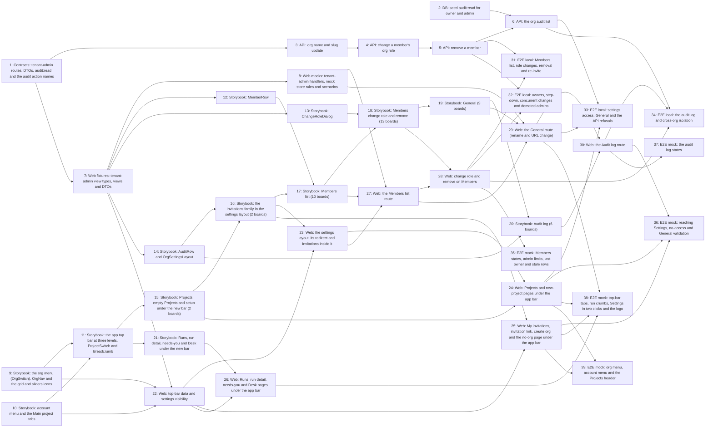

<!-- dev-plan: kind=plan id=org-tenant-admin rev=1 hash=ab8eaead0e65 spec=docs/superpowers/specs/2026-11-22-org-tenant-admin-design.md spec-hash=518911023ffa -->
# Org tenant admin Implementation Plan

> **For agentic workers:** REQUIRED SUB-SKILL: Use superpowers:subagent-driven-development (recommended) or superpowers:executing-plans to implement this plan task-by-task. Steps use checkbox (`- [ ]`) syntax for tracking.

**Goal:** Owners and org admins run their org without operator help through one Settings area (General, Members, Invitations, Audit log), reached from a Settings tab in one app top bar and from the org menu, while the API refuses every admin action to every other role.

**Architecture:** The shared pieces land first: the four routes, DTOs, the `audit:read` permission and the audit action names in contracts (Task 1, which also adds the API test helpers and the authz table rows), the `audit:read` data seed (Task 2), and the web view types and DTO fixtures (Task 7). The API grows along one chain (org update, change role, remove, audit list) because each controller removes its key from the single `authz.int.test.ts` allow-list. On the web, the chrome components (org menu, account menu, top bar) and the tenant-admin components are built with their stories in parallel; the screens and their 42 board stories follow one chain, because every board registration edits the same four registry files; route wiring then fans out per page, with the settings routes chained on `routeTree.gen.ts`; e2e specs come last, split by flow.

**Tech Stack:** TypeScript (strict), Zod 4, Drizzle + Postgres (RLS), NestJS 11 on Fastify, better-auth 1.7.22, TanStack Router, Query and Form, MSW, Storybook, Vitest + Testcontainers, Playwright.

**Spec:** `docs/superpowers/specs/2026-11-22-org-tenant-admin-design.md`. Read it with this plan: the business rules (BR-n), the API section, the copy list and role table in "UI and Storybook", the Testing table and the E2E test cases (TC-n.m) are not repeated here. Slices 1 and 2 (`2026-11-20-rbac-foundation-design.md`, `2026-11-21-org-onboarding-design.md`) are built on `main`; this plan changes that code.

## Global Constraints

- AGENTS.md rules 1 to 11 and the "Access control and tenant isolation" section bind every task. Layering `apps → core → db → contracts`; `web → contracts` only. Names stay generic: member, role, assignment, invitation, organization, owner, audit. No provider name in routes, tables, types or new copy ("Repo on GitHub" stays as it is).
- No new dependency of any kind (spec "Third-party libraries": none new).
- Never edit an applied migration (0000 to 0034). New: `0035_seed_audit_read.sql`, hand-written, idempotent (`on conflict do nothing`), DO loop setting `app.org_id`, as 0026 does. No schema change.
- Permissions: `member:read`, `member:update`, `member:delete`, `org:update` and the new `audit:read` are org-level; `own` does not apply; a project grant never gives them. `audit:read` is held by `owner` and `admin` only.
- Guard order (ADR-0036): org membership, permission (403 before any id lookup), target or scope (404), then `any`/`own`. `:orgId` must be the active org (404 otherwise); the `x-org-id` check applies (409 `org-mismatch`). The tenant comes from the session, never the body.
- Grant rules: `checkTenantAssign` (`apps/api/src/access/grant-rules.ts`) runs with `assignment:delete` on each removed role and `assignment:create` on the new one; only an org owner gives or takes `owner`. Last-owner rule: lock the org's org-scope owner rows `for update` in id order; refuse with 409 problem title "The organization needs at least one owner" when none would be left.
- Limits: org name 1 to 100 characters (`OrgName`); slug `OrgSlug` (lowercase a-z, 0-9, `-`, no leading or trailing `-`, 1 to 63), unique, a taken slug caught on the unique index (23505) → 409 with pointer `/slug`. Members and Audit use the shared offset paging (ADR-0028), page sizes 20, 50, 100. No search, filter, rate or count limit.
- Errors (spec "Other decisions"): 409 "The organization needs at least one owner"; 409 `/slug`; 422 `/roleId`; 404 "Member is no longer in the organization" problem title for a user who is not a member; 403 per the guard; self-removal 403 decided before any lookup.
- Logs at `info`, ids only, never an email: `{requestId, orgId, actorUserId, targetUserId, action}` on role change and remove; `{requestId, orgId}` on org update. Audit payloads pass `redactBody` on write and again on read; the audit route never returns a raw payload; the invitee email appears only in invitation entries.
- Web: tokens only, no new colour, size, radius or spacing; copy verbatim from spec "UI and Storybook › Copy"; query keys `['org', slug, …]` or `['session', …]`; no optimistic updates, invalidate on success; mappers take `now: Date`; every user string (names, emails, audit text, org name) renders as React text only, never HTML or a link.
- **Storybook first is a blocker from the spec ("Blocker: Storybook first"), not an ordering preference.** Tasks 9 to 21 build and story every changed or new `ds/`, `components/` and `screens/` piece; every task that implements or wires that UI in `apps/web/src/{app,features}` (Tasks 22 to 30) lists the Storybook task(s) for its UI under "Depends on".
- Sensitive tasks (label `review:sensitive`, high-effort security review): Tasks 1, 2, 3, 4, 5, 6 (access control, RLS/`withOrg`, migration) and Task 23 (settings access gating in the web is UI only; reviewed with the API tasks).
- Before every commit: `devbox run fix` until it prints `fix: clean.`. Conventional Commits with the package as scope. One task = one branch = one PR. Before saying done: `pnpm typecheck` and `pnpm test` for the touched packages, plus the targeted e2e the task names (tests-and-e2e.md §3a). If the stack cannot start, say so in the PR and list the specs written but not run.

## Review Focus

1. **An audit row whose payload lacks the fields its action normally carries** (rows written before this slice, a value replaced by `redactBody`, an `assignment.revoked` with no `from.roleKey`). Expected: the entry still lists with `changes: []` (or the fields it has) and its target label; the read never 500s. Test: Task 6 (`audit-view.test.ts`: `a known action with a payload missing its fields maps to empty changes and keeps the target`).
2. **Saving the org's own current slug together with a new name** (a client that sends both fields). Expected: 200, not "taken"; the audit entry lists only the name change. Test: Task 3 (`PATCH with the current slug and a new name is 200 and audits only name`).
3. **An org admin changes their own role to Viewer.** Expected: saved; the page re-renders as the no-access state (access invalidated), not an error page. Test: Task 28 (`an admin who demotes themselves to Viewer sees no-access after the save`).
4. **A slug change while the old URL's queries are still mounted.** Expected: the changer lands on `/o/<new>/settings/general` with no flash of "not found" for the old slug. Test: Task 29 (`after a slug change the page lands on the new URL without rendering not found`).
5. **Removing the only member listed on the last page.** Expected: the list moves to the previous page and shows its rows, not an empty table. Test: Task 28 (`removing the only row on the last page shows the previous page`).

## Needs approval

None. The spec adds no dependency and this plan adds none.

## Agent calls made while planning

- Agent call: contracts own the full list of audit action names (`AuditAction` enum, the nine existing ones plus `member.role_changed`, `member.removed`, `org.updated`); the API's `AuditAction` type in `audit-entry.ts` becomes that contract type, so the member and org tasks never edit `audit-entry.ts`.
- Agent call: Task 1 adds the four new keys to `NOT_REGISTERED_YET` and to `DENIAL_TABLE` in `apps/api/test/authz.int.test.ts`, and the API test helpers (`changeRole`, `removeMember`, `updateOrg`, `auditList`, `roleIdsOf`) to `apps/api/test/helpers/auth.ts`; the API tasks then run as a chain (3 → 4 → 5 → 6) because each deletes its key from that one allow-list.
- Agent call: the member last-owner lock is a new helper `lockOrgOwnerRows` in `apps/api/src/members/owner-lock.ts`; `AssignmentsService.requireAnotherOwner` is left as built (no refactor of slice 1 code).
- Agent call: a `roleId` whose role is not assignable at org scope is refused with 422 `/roleId`, like an unknown or foreign role id.
- Agent call: in `AuditEntryDto.changes`, a `role` value is the org's role name (`roles.name`), several names joined with ", ", `null` for no role; `invitation.created` and `invitation.accepted` carry `{field:'role', from:null, to:<role name>}` so "invited <email> as Viewer" and "accepted an invitation as Member" can be built; `member.removed` carries the removed org-scope role names as `from` (`to: null`); when that `from` is null the sentence leaves out "(was …)".
- Agent call: actions with no sentence in the spec's copy (`assignment.granted`, `assignment.revoked`, `invitation.expired`, `org.created`) and generic `METHOD route-key` rows show the raw action key in mono, followed by the target label; TC-23.6 (spec Q3) is asserted on the "accepted an invitation as Member" entry.
- Agent call: an invitation target's label is the `invitations` row's email (read under `withOrg` by target id), falling back to the payload `email`; a user target's label is the user's name or handle, `null` when the user row is gone; an org target's label is null (the sentence carries the values).
- Agent call: `ds/icons.tsx` gains `sliders` as well as `grid` (ds has no sliders icon); both paths are copied from `design/prototype/interactive/js/core.js`.
- Agent call: `OrgNav` has no needs-you prop: the designer toggle is off (spec Open questions Q2).
- Agent call: Storybook tasks only add optional props to existing screens and components; the wiring task removes each legacy prop together with its route change (Projects `invitationsHref` and its button in Task 24; `OrgInvitations` `user`/`org` and its own top bar in Task 23; `TopBar` `project.org` and `breadcrumb`, `NeedsYou` `topBar.links`/`projectMenu` in Task 26), so no merge leaves a page without its org crumb or a way to reach Invitations.
- Agent call: the board-registering Storybook tasks form one chain (15 → 16 → 17 → 18 → 19 → 20): `coverage.test.ts` counts, `storyIds.ts`, `parity.mjs`, `canvas.json`, `design/parity-notes.md` and the `components`/`screens` barrels are shared files. Order: Projects family, Invitations family, Members list, Members dialogs, General, Audit.
- Agent call: a new tenant-admin component is added to `components/index.ts` by the screen task that first imports it (MemberRow and OrgSettingsLayout: Task 16/17; ChangeRoleDialog: Task 18; AuditRow: Task 20), not by its component task, so Tasks 12, 13 and 14 run in parallel; component stories and tests import the component by relative path.
- Agent call: all `design/parity-notes.md` entries are written by Tasks 15 and 16; Task 15 also records the project-level boards (Runs, RunDetail, Desk, NeedsYou) whose stories change in Task 21, so Task 21 can run beside the chain.
- Agent call: the full-page story frame `OrgSettingsFrame` (top bar with Settings active, `OrgSettingsLayout`, content) lives in `apps/web/src/screens/orgSettingsFrame.tsx` (not a stories file, so the coverage globs ignore it).
- Agent call: the settings routes run as a chain (23 → 27 → 29 → 30) because each regenerates `apps/web/src/app/routeTree.gen.ts`.
- Agent call: the settings visibility helpers and the top-bar data hook live in `apps/web/src/features/chrome/appBar.ts` (`orgSettingsTabs`, `canOpenSettings`, `firstSettingsTab`, `useAppBar`).
- Agent call: the tenant-admin mock scenarios live in one new module `apps/web/src/mocks/msw/tenantAdminScenarios.ts` (key `agentdesk.mock.tenantAdmin`), and add `membersPaged`, `membersSlow`, `auditPaged`, `auditSlow` and `auditError` to the spec's list, for TC-1.4, TC-20.3 and TC-24.1, 24.3, 24.4 (spec Q7).
- Agent call: any `OrgSlug` failure, the empty slug included, shows "Use lowercase letters, numbers and dashes, with no dash at the start or end." (spec Q4); slug format errors show on "Save", before the confirm dialog, which opens only for a valid changed slug (spec Q5).
- Agent call: local e2e splits into `org-members.spec.ts`, `org-owners.spec.ts` (new), `org-settings.spec.ts` and `org-audit.spec.ts`; each spec keeps its own small helpers (API calls through the cast's request contexts), so no e2e task edits `helpers.ts` or `rbac-cast.ts`.
- Agent call: the run-level crumbs "Runs" and "Run N" come through a new `TopBar` prop `run: { runsHref: string; label: string }`.

## E2E coverage

| Rules and cases | Proved by |
| --- | --- |
| BR-1 (TC-1.1 to 1.3), BR-3 (3.1 to 3.4), BR-6 (6.1 to 6.4), BR-7 (7.1, 7.2), BR-10 (10.1) | Task 31 `e2e/local/org-members.spec.ts` |
| BR-5 (5.3), BR-8 (8.4), BR-36 (36.1), BR-40 (40.1, 40.2), BR-41 (41.1 to 41.3), BR-42 (42.1, 42.2) | Task 32 `e2e/local/org-owners.spec.ts` |
| BR-2 (2.4, 2.5), BR-13 (13.9), BR-14 (14.1, 14.2), BR-16 (16.3, 16.4), BR-18 (18.1 to 18.8) | Task 33 `e2e/local/org-settings.spec.ts` |
| BR-20 (20.1, 20.2), BR-21 (21.1 to 21.5), BR-22 (22.1, 22.2), BR-23 (23.1 to 23.6), BR-25 (25.1 to 25.4) | Task 34 `e2e/local/org-audit.spec.ts` |
| BR-1 (1.4), BR-4 (4.1 to 4.3), BR-5 (5.1, 5.2), BR-8 (8.1 to 8.3), BR-9 (9.1 to 9.3), BR-24 (24.1, 24.2) | Task 35 `e2e/mock/org-members.spec.ts` |
| BR-2 (2.1 to 2.3), BR-13 (13.1 to 13.8), BR-15 (15.1 to 15.4), BR-16 (16.1, 16.2), BR-17 (17.1 to 17.6) | Task 36 `e2e/mock/org-settings.spec.ts` |
| BR-20 (20.3 to 20.7), BR-24 (24.3 to 24.5) | Task 37 `e2e/mock/org-audit.spec.ts` |
| BR-43 (43.1 to 43.8), BR-46 (46.1 to 46.3), BR-47 (47.1 to 47.4), BR-48 (48.1, 48.2) | Task 38 `e2e/mock/top-bar.spec.ts` |
| BR-44 (44.1 to 44.7), BR-45 (45.1 to 45.6), BR-49 (49.1 to 49.6) | Task 39 `e2e/mock/org-switch.spec.ts`, `account-menu.spec.ts`, `checklist.spec.ts` |

Not provable by e2e (spec "Not provable by e2e"): NO-1 races (Tasks 4 and 5, `Promise.all`), the BR-5 remove-409 toast (Task 28 route test with an MSW 409, and the NO-1 races), NO-2 (Task 5), NO-3 (Tasks 3 to 6 run `org-check.int.test.ts`), NO-4 and the route table (Tasks 1 and 2).

---

<!-- dev-plan:graph:begin -->
## Task graph

Generated by `dev-plan.mjs graph --write` from each task's **Depends on:** line. Do not edit it by hand.
Tasks in the same wave touch no common file and can be built in parallel; a task starts when everything it depends on is merged.

| Wave | Task | Depends on |
| ---- | ---- | ---------- |
| 1 | Task 1: Contracts: tenant-admin routes, DTOs, audit:read and the audit action names | none |
| 1 | Task 2: DB: seed audit:read for owner and admin | none |
| 1 | Task 9: Storybook: the org menu (OrgSwitch), OrgNav and the grid and sliders icons | none |
| 1 | Task 10: Storybook: account menu and the Main project tabs | none |
| 2 | Task 3: API: org name and slug update | Task 1 |
| 2 | Task 7: Web fixtures: tenant-admin view types, views and DTOs | Task 1 |
| 2 | Task 11: Storybook: the app top bar at three levels, ProjectSwitch and Breadcrumb | Task 9, Task 10 |
| 3 | Task 4: API: change a member's org role | Task 3 |
| 3 | Task 8: Web mocks: tenant-admin handlers, mock store rules and scenarios | Task 7 |
| 3 | Task 12: Storybook: MemberRow | Task 7 |
| 3 | Task 13: Storybook: ChangeRoleDialog | Task 7 |
| 3 | Task 14: Storybook: AuditRow and OrgSettingsLayout | Task 7 |
| 3 | Task 15: Storybook: Projects, empty Projects and setup under the new bar (2 boards) | Task 11 |
| 3 | Task 21: Storybook: Runs, run detail, needs-you and Desk under the new bar | Task 11 |
| 3 | Task 22: Web: top-bar data and settings visibility | Task 7, Task 9, Task 10 |
| 4 | Task 5: API: remove a member | Task 4 |
| 4 | Task 16: Storybook: the Invitations family in the settings layout (2 boards) | Task 14, Task 15 |
| 4 | Task 26: Web: Runs, run detail, needs-you and Desk pages under the app bar | Task 21, Task 22 |
| 5 | Task 6: API: the org audit list | Task 2, Task 5 |
| 5 | Task 17: Storybook: Members list (10 boards) | Task 12, Task 16 |
| 5 | Task 23: Web: the settings layout, its redirect and Invitations inside it | Task 16, Task 22 |
| 5 | Task 25: Web: My invitations, invitation link, create org and the no-org page under the app bar | Task 16, Task 22 |
| 6 | Task 18: Storybook: Members change role and remove (13 boards) | Task 13, Task 17 |
| 6 | Task 24: Web: Projects and new-project pages under the app bar | Task 15, Task 23 |
| 6 | Task 27: Web: the Members list route | Task 8, Task 17, Task 23 |
| 7 | Task 19: Storybook: General (9 boards) | Task 18 |
| 7 | Task 28: Web: change role and remove on Members | Task 18, Task 27 |
| 7 | Task 39: E2E mock: org menu, account menu and the Projects header | Task 24, Task 25 |
| 8 | Task 20: Storybook: Audit log (6 boards) | Task 14, Task 19 |
| 8 | Task 29: Web: the General route (rename and URL change) | Task 8, Task 19, Task 27 |
| 8 | Task 31: E2E local: Members list, role changes, removal and re-invite | Task 5, Task 28 |
| 8 | Task 32: E2E local: owners, step-down, concurrent changes and demoted admins | Task 5, Task 28 |
| 8 | Task 35: E2E mock: Members states, admin limits, last owner and stale rows | Task 28 |
| 9 | Task 30: Web: the Audit log route | Task 20, Task 29 |
| 9 | Task 33: E2E local: settings access, General and the API refusals | Task 6, Task 24, Task 29 |
| 9 | Task 38: E2E mock: top-bar tabs, run crumbs, Settings in two clicks and the logo | Task 24, Task 25, Task 26, Task 29 |
| 10 | Task 34: E2E local: the audit log and cross-org isolation | Task 6, Task 28, Task 30 |
| 10 | Task 36: E2E mock: reaching Settings, no-access and General validation | Task 24, Task 25, Task 30 |
| 10 | Task 37: E2E mock: the audit log states | Task 30 |


<!-- dev-plan:graph:end -->

### Task 1: Contracts: tenant-admin routes, DTOs, `audit:read` and the audit action names

**Depends on:** none

**Files:**

- Modify: `packages/contracts/src/access.ts`, `packages/contracts/src/access.test.ts`
- Modify: `packages/contracts/src/schemas/access.ts`, `packages/contracts/src/schemas/access.test.ts`
- Modify: `packages/contracts/src/schemas/platform.ts`, `packages/contracts/src/schemas/platform.test.ts`
- Create: `packages/contracts/src/schemas/audit.ts`, `packages/contracts/src/schemas/audit.test.ts`
- Modify: `packages/contracts/src/index.ts`
- Modify: `packages/contracts/src/routes.ts`, `packages/contracts/src/routes.test.ts`
- Modify: `packages/contracts/src/route-access.ts`, `packages/contracts/src/route-access.test.ts`
- Modify: `apps/api/src/audit/audit-entry.ts`
- Modify: `apps/api/test/authz.int.test.ts`, `apps/api/test/helpers/auth.ts`
- Modify: `apps/web/src/mocks/msw/handlers.ts`
- Modify: `docs/adr/0036-rbac-permissions-roles-scope.md`

**Interfaces:**

- Consumes: `Id`, `Timestamp`, `PageQuery`, `pageOf`, `empty`, `orgParams`, `MemberDto`, `OrgName`, `OrgSlug`, `CreateAssignmentRequest`.
- Produces:

```ts
// access.ts: TENANT_PERMISSIONS gains 'audit:read' (after 'org:delete'); ORG_LEVEL gains 'audit:read'
// schemas/access.ts
export const MemberUserId = CreateAssignmentRequest.shape.userId; // z.string().min(1).max(255)
export const UpdateMemberRoleRequest = z.object({ roleId: Id.nullable() }); // null = no org role
// schemas/platform.ts
export const UpdateOrgRequest = z
  .object({ name: OrgName.optional(), slug: OrgSlug.optional() })
  .refine((r) => r.name !== undefined || r.slug !== undefined, { message: 'Send a name or a slug' });
export const OrgDto = z.object({ id: Id, name: z.string(), slug: z.string() });
// schemas/audit.ts
export const AuditAction = z.enum(['assignment.granted', 'assignment.revoked', 'invitation.created',
  'invitation.revoked', 'invitation.expired', 'invitation.accepted', 'invitation.declined', 'invitation.resent',
  'org.created', 'member.role_changed', 'member.removed', 'org.updated']);
export const AuditChange = z.object({ field: z.enum(['role', 'name', 'slug']), from: z.string().nullable(), to: z.string().nullable() });
export const AuditActorKind = z.enum(['member', 'platform_admin']);
export const AuditEntryDto = z.object({
  id: Id, at: Timestamp,
  actor: z.object({ userId: z.string(), name: z.string(), handle: z.string() }).nullable(),
  actorKind: AuditActorKind.nullable(),
  action: z.string(),
  target: z.object({ type: z.string().nullable(), id: z.string().nullable(), label: z.string().nullable() }),
  changes: z.array(AuditChange),
});
// apps/api/src/audit/audit-entry.ts: `export type { AuditAction } from '@agentdesk/contracts'` replaces the local union
// apps/api/test/helpers/auth.ts (each sends the session cookie and the `x-org-id` header as `grant` does)
export function changeRole(t: TestApp, cookie: string, orgId: string, userId: string, roleId: string | null): ReturnType<TestApp['app']['inject']>;
export function removeMember(t: TestApp, cookie: string, orgId: string, userId: string): ReturnType<TestApp['app']['inject']>;
export function updateOrg(t: TestApp, cookie: string, orgId: string, body: Record<string, unknown>): ReturnType<TestApp['app']['inject']>;
export function auditList(t: TestApp, cookie: string, orgId: string, query?: { page?: number; pageSize?: number }): ReturnType<TestApp['app']['inject']>;
export async function roleIdsOf(t: TestApp, cookie: string, orgId: string): Promise<Record<'owner' | 'admin' | 'member' | 'viewer', string>>; // via roles.list
```

  Routes (`routes.ts`), each with a `routeAccess` entry; `const orgMemberParams = z.object({ orgId: Id, userId: MemberUserId })`:

  | Key | Method, path | Request | Response | Access |
  | --- | --- | --- | --- | --- |
  | `members.updateRole` | PUT `/api/orgs/:orgId/members/:userId/role` | `orgMemberParams`, body `UpdateMemberRoleRequest` | `MemberDto` | `org('member:update')` |
  | `members.remove` | DELETE `/api/orgs/:orgId/members/:userId` | `orgMemberParams` | `empty` (204) | `org('member:delete')` |
  | `orgs.update` | PATCH `/api/orgs/:orgId` | `orgParams`, body `UpdateOrgRequest` | `OrgDto` | `org('org:update')` |
  | `audit.list` | GET `/api/orgs/:orgId/audit` | `orgParams`, query `PageQuery` | `pageOf(AuditEntryDto)` | `org('audit:read')` |

- [x] **Step 1: Write the failing tests**
  - `access.test.ts` (NO-4): `PERMISSION_LEVEL['audit:read'] === 'org'`; `can()` with a project-scope admin grant listing `audit:read` is false; with an org-scope grant it is true.
  - `schemas/access.test.ts`: `UpdateMemberRoleRequest` accepts a uuid and `null`, rejects `''` and a missing key; `MemberUserId` rejects `''` and 256 characters.
  - `schemas/platform.test.ts` (BR-15, BR-17): `UpdateOrgRequest` rejects `{}`, `{name: ''}`, `{name: 'a'.repeat(101)}`, `{slug: 'Acme'}`, `{slug: '-acme'}`, `{slug: 'a'.repeat(64)}`; accepts `{name: 'a'}`, `{name: 'a'.repeat(100)}`, `{slug: 'a'.repeat(63)}`, `{name, slug}`.
  - `schemas/audit.test.ts`: `AuditEntryDto` parses an entry with `actor: null` and `actorKind: null`; a parsed entry carries no `payload` key even when the input has one; `AuditChange` rejects `field: 'email'`; `AuditAction.options` contains the three new names.
  - `routes.test.ts`: `flattenRoutes(routes)` has the four keys with the methods and paths above.
  - `route-access.test.ts`: `expected` gains the four entries.
- [ ] **Step 2: Run** `pnpm --filter @agentdesk/contracts exec vitest run`. Expected: FAIL (missing exports).
- [x] **Step 3: Implement** the contracts above and export `schemas/audit.ts` from `index.ts`. Compile fixes outside contracts: `audit-entry.ts` re-exports the contract `AuditAction`; `handlers.ts` gets fixture-backed `impl` entries so the exhaustive `Impl` type compiles (`members.updateRole` returns the first `memberFixtures` row, `members.remove` 204, `orgs.update` echoes the org with the sent fields, `audit.list` an empty page). In `authz.int.test.ts`: `DENIAL_TABLE` rows `'members.updateRole': tenant(403)`, `'members.remove': tenant(403)`, `'orgs.update': tenant(403)`, `'audit.list': tenant(403)`, and the four keys in `NOT_REGISTERED_YET` (the existing filter skips them until each controller task deletes its line). Add the five helpers. In ADR-0036 §Decision "Each permission has a level", the org-level list reads `` `member:*`, `org:update`, `org:delete`, `audit:read` ``.
- [ ] **Step 4: Run** the Step 2 command, then `pnpm --filter @agentdesk/api typecheck`, `pnpm --filter @agentdesk/web typecheck`, `pnpm --filter @agentdesk/api exec vitest run test/authz.int.test.ts` and `pnpm --filter @agentdesk/web exec vitest run src/mocks/msw/contract.test.ts`. Expected: PASS.
- [x] **Step 5: Commit** `feat(contracts): tenant admin routes, audit DTO and the audit:read permission`.

---

### Task 2: DB: seed `audit:read` for owner and admin

**Depends on:** none

**Files:**

- Create: `packages/db/migrations/0035_seed_audit_read.sql`, `packages/db/migrations/meta/0035_snapshot.json`
- Modify: `packages/db/migrations/meta/_journal.json`
- Test: `packages/db/test/migrate.int.test.ts`, `packages/core/test/access/role-templates.int.test.ts`
- Modify: `apps/web/e2e/local/rbac-grants.spec.ts`

**Interfaces:**

- Produces: `role_template_permissions` rows `('owner','audit:read','any')`, `('admin','audit:read','any')`; every existing org's `owner` and `admin` roles gain `('audit:read','any')` in `role_permissions`. New orgs get them through `copyRoleTemplates`.

- [x] **Step 1: Write the failing tests**
  - `migrate.int.test.ts` (NO-4): on a database stopped at 0032 (the `startPgAt` helper) with two orgs, applying 0035 adds exactly one `audit:read` line to each org's `owner` and `admin` roles and none to `member` or `viewer`; a second apply changes no row count; an org created after 0032 holds it through `copyRoleTemplates`. Update the "every existing org gets exactly the four built-in roles" counts to admin 33, owner 34, member 6, viewer 2 (the rule change, not to get green).
  - `role-templates.int.test.ts`: `ADMIN_PERMISSIONS` gains `audit:read`; the lengths read `[34, 33, 6, 2]`.
  - `rbac-grants.spec.ts`: the owner permission list gains `'audit:read'` (sorted as today).
- [ ] **Step 2: Run** `pnpm --filter @agentdesk/db exec vitest run test/migrate.int.test.ts` and `pnpm --filter @agentdesk/core exec vitest run test/access/role-templates.int.test.ts`. Expected: FAIL.
- [x] **Step 3: Implement** `0035_seed_audit_read.sql` (template insert from `role_templates` keys `owner`, `admin`, then a DO loop over `organization` that sets `app.org_id` and inserts into `role_permissions` for that org's built-in `owner` and `admin` roles; every insert `on conflict do nothing`), its journal entry (idx 35) and a snapshot copied from 0034 (no schema change).
- [ ] **Step 4: Run** the Step 2 commands and `pnpm --filter @agentdesk/db test`. Expected: PASS. The `rbac-grants.spec.ts` change is run with the stack up: `pnpm --filter @agentdesk/web exec playwright test e2e/local/rbac-grants.spec.ts`.
- [x] **Step 5: Commit** `feat(db): seed the audit:read permission for owner and admin`.

---

### Task 3: API: org name and slug update

**Depends on:** Task 1

**Files:**

- Create: `apps/api/src/orgs/orgs.controller.ts`
- Modify: `apps/api/src/orgs/orgs.service.ts`, `apps/api/src/orgs/orgs.module.ts`
- Create: `apps/api/test/org-settings.int.test.ts`
- Modify: `apps/api/test/authz.int.test.ts`

**Interfaces:**

- Consumes: `routes.orgs.update`, `UpdateOrgRequest`, `OrgDto`, `updateOrg` helper (Task 1).
- Produces: `OrgsService.update(actorUserId: string, orgId: string, req: UpdateOrgRequest): Promise<OrgDto>`; `OrgsController` with `@Patch(routePath(routes.orgs.update))` using `CurrentAccess` and `ZodPipe` like `MembersController`.

- [x] **Step 1: Write the failing tests** in `org-settings.int.test.ts` (owner, org admin, P1 admin, member, viewer of org A; owner of org B):
  - BR-14, BR-22: owner renames → 200 `OrgDto`, `organization.name` changed, one `org.updated` audit row in the same transaction with payload `{from:{name}, to:{name}}`; slug change likewise with `slug`; both at once → one row with both fields.
  - Review Focus 2: `PATCH {name: 'New', slug: <current slug>}` → 200 and the audit `from`/`to` list only `name`; `PATCH` with the current name and slug → 200, no audit row.
  - BR-15, BR-17: `{}`, empty name, 101-character name → 400 with pointer `/name` (or the form-level issue for `{}`), nothing changed; bad slug format → 400 `/slug`; a slug taken by org B → 409 with pointer `/slug`; the old slug is free at once (org B can take it).
  - BR-18: member, viewer and P1 admin → 403, nothing changed, no audit row; org admin → 200.
  - BR-25 and security: owner of A sending `PATCH /api/orgs/<B id>` → 404 and B unchanged; an `:orgId` other than the active org → 404; body `orgId` ignored.
  - Untrusted text: a name with `<b>x</b>'; drop table` round-trips unchanged.
  - Logs: with `createTestApp({ logger })` the update logs `{requestId, orgId}` at `info` and no email.
- [ ] **Step 2: Run** `pnpm --filter @agentdesk/api exec vitest run test/org-settings.int.test.ts`. Expected: FAIL (404 route).
- [x] **Step 3: Implement** `update`: one `withOrg(orgId)` transaction reads the current row (`organization.id = orgId`, no RLS on this table), computes the changed fields, returns early with no write when none changed, updates `name`/`slug`, writes `org.updated` with `writeAuditEntry` (`actorKind: 'member'`, `targetType: 'org'`, `targetId: orgId`); catch `isUniqueViolation` → `ConflictProblemException('Slug already in use', [{ pointer: '/slug', detail: 'this slug is already taken' }])`. Delete `'orgs.update'` from `NOT_REGISTERED_YET`.
- [ ] **Step 4: Run** the Step 2 command, `pnpm --filter @agentdesk/api exec vitest run test/authz.int.test.ts test/org-check.int.test.ts` (NO-3 picks up the route) and `pnpm --filter @agentdesk/api typecheck`. Expected: PASS. E2E: covered by Tasks 33 and 34.
- [x] **Step 5: Commit** `feat(api): owners and admins change the org name and slug`.

---

### Task 4: API: change a member's org role

**Depends on:** Task 3

**Files:**

- Create: `apps/api/src/members/owner-lock.ts`
- Modify: `apps/api/src/members/members.service.ts`, `apps/api/src/members/members.controller.ts`
- Modify: `apps/api/test/members.int.test.ts`, `apps/api/test/authz.int.test.ts`

**Interfaces:**

- Consumes: `routes.members.updateRole`, `UpdateMemberRoleRequest`, `checkTenantAssign`, `isOrgOwner`, `loadRole` (`apps/api/src/orgs/roles.ts`), `toAssignmentDto`, `changeRole`/`roleIdsOf` helpers.
- Produces:

```ts
// owner-lock.ts
/** Locks every org-scope owner assignment of the org (id order, `for update`) and returns them. */
export async function lockOrgOwnerRows(tx: Tx, orgId: string): Promise<{ id: string; userId: string }[]>;
// members.service.ts
updateRole(access: Access, orgId: string, userId: string, roleId: string | null): Promise<MemberDto>;
/** Exported for Task 5: 404 problem title for a user who is not a member. */
export const NOT_A_MEMBER = 'Member is no longer in the organization';
```

- [x] **Step 1: Write the failing tests** in `members.int.test.ts` (cast: owner O, P1 admin A, member B, org viewer V, no-role N; extra owners made through `changeRole`):
  - BR-3: O sets B to admin → 200 `MemberDto`, B's org-scope assignments are exactly `admin`, B's P1 project role kept; B's next request follows the new role; same role again → 200 and no audit row; `roleId: null` removes org-scope assignments and keeps project ones.
  - BR-21: one `member.role_changed` row per change, in the same transaction, payload `{from: [roleKeys], to: roleKey | null}`; a refused change writes none.
  - BR-40, BR-41, BR-42: O makes B owner; B can then grant owner and demote O; with two owners, demoting the other → 200; O steps down while B is owner → 200 and O's next request gets 403 on an owner change.
  - BR-5: demoting the only owner, self included → 409 "The organization needs at least one owner", nothing changed.
  - BR-18: member, viewer and P1 admin → 403 before any lookup (random, malformed and real user id give the same 403); org admin giving `owner`, changing an owner, or making themselves owner → 403 before the last-owner check.
  - BR-8: a user who is not a member → 404 `NOT_A_MEMBER`; change after another change → 200, audit `from` is the current role.
  - BR-36: an admin demoted to member → their next change 403.
  - Security: a `roleId` from org B, unknown, or not assignable at org scope → 422 `/roleId`; owner of A on org B's member → 404; tenant from the session, not the body.
  - NO-1 (a), (c): two owners demote each other with `Promise.all` → exactly one 200 and one 409, one owner left; A steps down while A removes owner B → one owner left, exactly one 409.
  - Logs: `{requestId, orgId, actorUserId, targetUserId, action}` at `info`, no email.
- [x] **Step 2: Run** `pnpm --filter @agentdesk/api exec vitest run test/members.int.test.ts`. Expected: FAIL.
- [x] **Step 3: Implement** `updateRole` in one `withOrg` transaction: 403 (`FORBIDDEN_DETAIL`) unless `can(access, 'member:update')`; the target's `member` row filtered by `organization_id = orgId` (else 404 `NOT_A_MEMBER`); load the new role (422 `/roleId` when missing or not org-assignable); read the target's org-scope assignments; `checkTenantAssign` delete on each removed role and create on the new one (403 on any failure); when an org-scope `owner` row is removed, `lockOrgOwnerRows` and 409 unless another owner remains; return early (no audit) when the set is already exactly `roleId`; delete and insert under `withOrg`; `writeAuditEntry` `member.role_changed`; log; return the member as `list` builds it. Controller `@Put(routePath(routes.members.updateRole))`. Delete `'members.updateRole'` from `NOT_REGISTERED_YET`.
- [x] **Step 4: Run** the Step 2 command and `pnpm --filter @agentdesk/api exec vitest run test/authz.int.test.ts test/org-check.int.test.ts test/assignments.int.test.ts`. Expected: PASS. E2E: covered by Tasks 31 to 33.
- [x] **Step 5: Commit** `feat(api): owners and admins change a member's org role`.

---

### Task 5: API: remove a member

**Depends on:** Task 4

**Files:**

- Modify: `apps/api/src/members/members.service.ts`, `apps/api/src/members/members.controller.ts`
- Modify: `apps/api/test/members.int.test.ts`, `apps/api/test/authz.int.test.ts`

**Interfaces:**

- Consumes: `lockOrgOwnerRows`, `NOT_A_MEMBER` (Task 4), `removeMember` helper.
- Produces: `MembersService.remove(access: Access, orgId: string, userId: string): Promise<void>`; controller `@Delete(routePath(routes.members.remove))` with `@HttpCode(204)`.

- [x] **Step 1: Write the failing tests** in `members.int.test.ts`:
  - BR-6: O removes B → 204; B's `member` row and every org and project assignment in the org are gone; B's next org request 403; one `member.removed` row `{from: [assignments]}` in the same transaction.
  - BR-7: B's run keeps its status and `owner_user_id` after the removal (the terminal close stays proved by `terminal.int.test.ts:361`).
  - BR-41: with two owners, removing the other owner → 204; with three owners the same twice.
  - BR-5 and NO-1 (b): A removes B while B demotes A (`Promise.all`) → one owner left, exactly one 409.
  - NO-2: owner and admin removing themselves → 403, decided before any lookup, nothing changed.
  - BR-18: member, viewer, P1 admin → 403; org admin removing an owner → 403.
  - BR-8: removing a user who is not a member → 404 `NOT_A_MEMBER`.
  - BR-10: removed B invited again as viewer and accepted → exactly one org-scope `viewer` assignment, no project role.
  - BR-25: owner of A removing a member of B → 404.
  - Logs: ids only.
- [x] **Step 2: Run** `pnpm --filter @agentdesk/api exec vitest run test/members.int.test.ts`. Expected: FAIL.
- [x] **Step 3: Implement** `remove`: 403 when `userId === access.userId` or without `can(access, 'member:delete')`, before any lookup; in one `withOrg` transaction the member row (404), every assignment of the user in the org, `checkTenantAssign` delete on each (403), `lockOrgOwnerRows` and 409 when an org-scope owner row goes and none would remain; delete the assignments, then the `member` row filtered by `organization_id = orgId`; audit; log. Delete `'members.remove'` from `NOT_REGISTERED_YET`.
- [x] **Step 4: Run** the Step 2 command and `pnpm --filter @agentdesk/api exec vitest run test/authz.int.test.ts test/org-check.int.test.ts test/terminal.int.test.ts`. Expected: PASS. E2E: covered by Tasks 31 and 32.
- [x] **Step 5: Commit** `feat(api): owners and admins remove members`.

---

### Task 6: API: the org audit list

**Depends on:** Task 2, Task 5

**Files:**

- Create: `apps/api/src/audit/audit.module.ts`, `apps/api/src/audit/audit.controller.ts`, `apps/api/src/audit/audit.service.ts`
- Create: `apps/api/src/audit/audit-view.ts`, `apps/api/src/audit/audit-view.test.ts`
- Modify: `apps/api/src/app.module.ts`
- Create: `apps/api/test/audit.int.test.ts`
- Modify: `apps/api/test/authz.int.test.ts`

**Interfaces:**

- Consumes: `AuditEntryDto`, `AuditAction`, `redactBody`, `loadAllRoles`, the helpers `changeRole`, `removeMember`, `updateOrg`, `auditList`, `invite`, `acceptInvite`, `declineInvite`.
- Produces:

```ts
// audit-view.ts (pure)
export interface AuditRowIn { id: string; at: Date; actorUserId: string | null; action: string; targetType: string | null;
  targetId: string | null; payload: Record<string, unknown> }
export interface AuditLookups { users: Map<string, { name: string; handle: string }>; invitationEmails: Map<string, string>;
  roleNames: Map<string, string> /* role key → name */ }
export function toAuditEntry(row: AuditRowIn, lookups: AuditLookups): AuditEntryDto;
// audit.service.ts
list(orgId: string, q: PageQuery): Promise<Page<AuditEntryDto>>;
```

- [x] **Step 1: Write the failing tests**
  - `audit-view.test.ts` (`it.each` over every action): `member.role_changed` → one `role` change with role names (several joined with ", "), `org.updated` → `name` and/or `slug` changes, `member.removed` → `role` from names to null, `invitation.created`/`invitation.accepted` → `role` to the role name, the other known actions and generic rows → `changes: []`; the payload is passed through `redactBody` before reading (a `token` value never reaches a label); the output has exactly the DTO keys (fields picked one by one, no `payload`); `actorKind` from `payload.actorKind`, else null; Review Focus 1: `a known action with a payload missing its fields maps to empty changes and keeps the target`; the invitee email is a label only for invitation targets.
  - `audit.int.test.ts`: BR-20 newest first by `at` then `id` (rows at seeded times by direct `withOrg` inserts), offset paging with `total`, actor name or handle, a deleted actor → `actor: null`, a platform admin row → `actorKind: 'platform_admin'`; BR-21, BR-22 entries made through the real endpoints show from/to; BR-23 invitation created, resent, revoked, accepted and declined entries carry the invitee email as `target.label` for an owner and an org admin, and no other entry kind carries an email; generic `METHOD route-key` rows list with `changes: []`; BR-18 member, viewer, P1 admin → 403 with no entry data; BR-25 org B's rows never in org A's list and the owner of A on `/api/orgs/<B>/audit` → 404; untrusted HTML and SQL text round-trips as text; a secret-shaped payload value never appears in the response; logs carry no email.
- [x] **Step 2: Run** `pnpm --filter @agentdesk/api exec vitest run src/audit/audit-view.test.ts test/audit.int.test.ts`. Expected: FAIL.
- [x] **Step 3: Implement** `AuditService.list` under `withOrg(orgId)` only: `count(*)` and the page ordered `at desc, id desc` on `audit_log` (index `(org_id, at)`), then one lookup each for the page's actor and user-target ids (`user`), invitation-target emails (`invitations`) and the org's role names (`loadAllRoles`), then `toAuditEntry`. Controller `@Get(routePath(routes.audit.list))`; register `AuditModule` in `app.module.ts`. Delete `'audit.list'` from `NOT_REGISTERED_YET` (the list is now empty).
- [x] **Step 4: Run** the Step 2 command and `pnpm --filter @agentdesk/api exec vitest run test/authz.int.test.ts test/org-check.int.test.ts test/scope.int.test.ts`. Expected: PASS. E2E: covered by Tasks 33 and 34.
- [x] **Step 5: Commit** `feat(api): owners and admins read the org audit log`.

---

### Task 7: Web fixtures: tenant-admin view types, views and DTOs

**Depends on:** Task 1

**Files:**

- Modify: `apps/web/src/mocks/types.ts`, `apps/web/src/mocks/index.ts`
- Create: `apps/web/src/mocks/members.ts`, `apps/web/src/mocks/audit.ts`, `apps/web/src/mocks/orgSettings.ts`
- Create: `apps/web/src/mocks/dto/members.ts`, `apps/web/src/mocks/dto/audit.ts`
- Modify: `apps/web/src/mocks/dto/access.ts`, `apps/web/src/mocks/orgs.ts`
- Test: `apps/web/src/mocks/msw/contract.test.ts`, `apps/web/src/mocks/mocks.test.ts`

**Interfaces:**

- Produces (`mocks/types.ts`):

```ts
export type OrgSettingsTabKey = 'general' | 'members' | 'invitations' | 'audit';
export type OrgRoleKey = 'owner' | 'admin' | 'member' | 'viewer';
export interface MemberRowView {
  userId: string; name: string; handle: string; you: boolean;
  role: { key: OrgRoleKey; name: string } | null;  // null renders "No role"
  projectRoles: string;                            // "Alpha (Admin), Beta (Member)" or "—"
  canChangeRole: boolean; canRemove: boolean;      // from the caller's rights (BR-4, BR-9)
}
export interface RoleCardOption { roleId: string | null; key: OrgRoleKey | 'none'; name: string; description: string }
export interface AuditTextPart { text: string; strong: boolean }
export interface AuditRowView {
  id: string;
  when: { label: string; exact: string; iso: string };       // "2 min ago", "22 Nov 2026, 10:58"
  who: { label: string; tag: 'deleted' | 'platform' | null };
  what: { kind: 'sentence'; parts: AuditTextPart[]; title: string } | { kind: 'raw'; key: string; target: string | null };
}
```

  Views: `memberRows: Record<'owner' | 'admin' | 'paged', MemberRowView[]>` (several owners, "No role", project roles, a long name; `admin` = the admin caller's view with owner rows unactionable), `roleCards: Record<'ownerCaller' | 'adminCaller', RoleCardOption[]>` (copy from the spec), `auditRows: AuditRowView[]` (newest first: role change, owner grant, URL change, name change, removal, invitation, generic request, platform actor, deleted user, HTML and long text), `pagedAuditRows(n: number): AuditRowView[]`, `orgSettingsFixtures: { org: { name: 'Harbor Labs'; slug: 'harbor-labs' }; tabs: Record<'owner' | 'admin' | 'projectAdmin', OrgSettingsTabKey[]> }`. DTOs: `tenantMemberFixtures: Record<'soleOwner' | 'twoOwners' | 'paged25', MemberDto[]>` (paged25 has 25 members), `auditEntryFixtures: AuditEntryDto[]` (every action above), `pagedAuditFixtures(n: number): AuditEntryDto[]`, `AUDIT_MOCK_NOW: string`, `tenantAccessFixtures: Record<'owner' | 'admin' | 'projectAdmin' | 'member' | 'viewer' | 'noRole', AccessDto>`. Top bar: `orgSwitchFixtures` entries gain `projectsHref`/`settingsHref` variants; `accountFixture: { name: 'Alice Doe'; handle: 'alice'; invitationsHref: '/invitations'; pendingCount: 2 }`.

- [x] **Step 1: Write the failing tests**: `contract.test.ts` parses every new DTO fixture with its contract schema; `mocks.test.ts` asserts `memberRows.owner` holds at least two owners and one `role: null`, `memberRows.paged` has 25 rows, every `MemberRowView` with `you: true` has `canRemove: false`, and `auditRows` is ordered newest first by `when.iso`.
- [x] **Step 2: Run** `pnpm --filter @agentdesk/web exec vitest run src/mocks/msw/contract.test.ts src/mocks/mocks.test.ts`. Expected: FAIL.
- [x] **Step 3: Implement** the types, views and DTOs above (ids from `mocks/dto/ids.ts`, times relative to `AUDIT_MOCK_NOW`) and export them from `mocks/index.ts`.
- [x] **Step 4: Run** the Step 2 command and `pnpm --filter @agentdesk/web typecheck`. Expected: PASS.
- [x] **Step 5: Commit** `feat(web): fixtures for members, audit and org settings`.

---

### Task 8: Web mocks: tenant-admin handlers, mock store rules and scenarios

**Depends on:** Task 7

**Files:**

- Modify: `apps/web/src/mocks/msw/handlers.ts`, `apps/web/src/mocks/msw/db.ts`, `apps/web/src/mocks/msw/browser.ts`
- Create: `apps/web/src/mocks/msw/tenantAdminScenarios.ts`, `apps/web/src/mocks/msw/tenantAdminScenarios.test.ts`
- Modify: `apps/web/e2e/mock/mock.ts`

**Interfaces:**

- Consumes: Task 7 DTO fixtures.
- Produces:

```ts
export const TENANT_ADMIN_SCENARIO_KEY = 'agentdesk.mock.tenantAdmin';
export const TENANT_ADMIN_SCENARIOS = ['soleOwner', 'twoOwners', 'admin', 'projectAdmin', 'member', 'viewer',
  'memberRemovedMeanwhile', 'roleChangedMeanwhile', 'membersError', 'membersSlow', 'membersPaged',
  'auditEmpty', 'auditError', 'auditSlow', 'auditPaged'] as const;
export type TenantAdminScenario = (typeof TENANT_ADMIN_SCENARIOS)[number];
export function applyTenantAdminScenario(db: MockDb, scenario: TenantAdminScenario): void;
// e2e/mock/mock.ts
export async function seedTenantAdmin(page: Page, scenario: TenantAdminScenario): Promise<void>;
```

  Mock store rules (spec "Fakes and fixtures"): `members.updateRole` and `members.remove` answer 409 problem "The organization needs at least one owner" by counting owners after the change (the web never pre-checks); 403 to self-removal and to an admin touching an owner or giving `owner`; 404 problem "Member is no longer in the organization" for a removed member; `orgs.update` keeps slugs unique (409 `/slug`, the seed includes an org with slug `taken`) and updates the org list `/auth/organization/list` returns; `audit.list` pages the audit fixtures newest first. `memberRemovedMeanwhile` drops B from the store after the first list read; `roleChangedMeanwhile` changes B to viewer after it; the `*Slow` scenarios hold the answer back 1500 ms; the `*Error` scenarios answer 500 with a request id until one retry.

- [x] **Step 1: Write the failing tests** in `tenantAdminScenarios.test.ts`: each rule above against the in-memory store (sole owner demoting self → 409; two owners → 200; admin on an owner → 403; self remove → 403; removed member → 404; taken slug → 409 `/slug`; rename changes the org list); every scenario name applies without throwing; `memberRemovedMeanwhile` returns B on the first list and 404 on a later change.
- [x] **Step 2: Run** `pnpm --filter @agentdesk/web exec vitest run src/mocks/msw/tenantAdminScenarios.test.ts`. Expected: FAIL.
- [x] **Step 3: Implement** the store state and rules in `db.ts`, replace Task 1's placeholder `impl` entries in `handlers.ts`, read the scenario key in `browser.ts` as the onboarding key is read, and add `seedTenantAdmin` to `mock.ts` (writes the key before the first page load, like `seedOnboarding`).
- [x] **Step 4: Run** the Step 2 command, `pnpm --filter @agentdesk/web exec vitest run src/mocks` and `pnpm --filter @agentdesk/web typecheck`. Expected: PASS.
- [x] **Step 5: Commit** `feat(web): mock handlers and scenarios for tenant admin`.

---

### Task 9: Storybook: the org menu (OrgSwitch), OrgNav and the grid and sliders icons

**Depends on:** none

**Files:**

- Modify: `apps/web/src/components/OrgSwitch.tsx`, `apps/web/src/components/OrgSwitch.module.css`, `apps/web/src/components/OrgSwitch.stories.tsx`, `apps/web/src/components/OrgSwitch.test.tsx`
- Create: `apps/web/src/components/OrgNav.tsx`, `apps/web/src/components/OrgNav.stories.tsx`, `apps/web/src/components/OrgNav.test.tsx`
- Modify: `apps/web/src/ds/icons.tsx`, `apps/web/src/ds/Icon.stories.tsx`, `apps/web/src/ds/Icon.test.tsx`
- Modify: `apps/web/src/features/orgs/orgSwitch.route.test.tsx`
- Modify: `apps/web/e2e/mock/org-switch.spec.ts`, `apps/web/e2e/local/org-switch.spec.ts`

**Interfaces:**

- Produces:

```ts
export interface OrgSwitchProps extends OrgSwitchData {
  orgHref: (org: OrgOption) => string; createHref: string;
  projectsHref?: string; settingsHref?: string;   // absent = no item
}
export interface OrgNavProps { active?: 'projects' | 'settings'; projectsHref: string; settingsHref?: string }
export function OrgNav(props: OrgNavProps): JSX.Element; // <nav aria-label="Main">, aria-current="page" on the active tab
// IconName gains 'grid' and 'sliders'
```

  `orgSwitchVisible` keeps its current result (Task 11 removes its use), so the top bar is unchanged until Task 11.

- [x] **Step 1: Write the failing tests**
  - `OrgSwitch.test.tsx` (BR-44): one org → a button labelled "Organization menu, <name>" whose menu lists, in order, the org name heading, "Projects", "Settings" only with `settingsHref`, and no "Switch organization"; two orgs → label "Switch organization, currently <name>" and a "Switch organization" group with `aria-current="true"` on the current org; platform admin → the group and "Create organization"; no org and not a platform admin → plain text "No organization"; no org platform admin → "No organization ▾" with Create only; long name → ellipsis with `title`; keyboard (ArrowDown opens, arrows, Home, End, Escape returns focus). Replace the "BR-9 plain text" cases with the button cases (the rule changed; spec Testing "Existing tests that change").
  - `OrgNav.test.tsx` (BR-43): Projects and Settings in `nav` "Main" with `aria-current` on the active one; no Settings tab without `settingsHref`; no active tab when `active` is absent.
  - `Icon.test.tsx`: `grid` and `sliders` render paths.
  - `orgSwitch.route.test.tsx`: the BR-9 case becomes "one org shows a button whose menu has Projects and no Switch organization"; BR-6 and BR-40 cases pick orgs under "Switch organization".
- [x] **Step 2: Run** `pnpm --filter @agentdesk/web exec vitest run src/components/OrgSwitch.test.tsx src/components/OrgNav.test.tsx src/ds/Icon.test.tsx src/features/orgs/orgSwitch.route.test.tsx`. Expected: FAIL.
- [x] **Step 3: Implement** the menu, `OrgNav` (tabs with the `grid` and `sliders` icons, `Chrome.module.css` `.tabs` classes) and the icons; stories OneOrg, OneOrgNoSettings, SeveralOrgs, Open, PlatformAdmin, PlatformAdminNoOrg, NoOrg, LongName (OrgSwitch) and ProjectsActive, SettingsActive, NoSettings, NoneActive (OrgNav); update `Primitives/Icon`. Re-point the e2e specs: mock TC-9.1 asserts the one-org button and its menu; TC-6.1, 6.2, 10.1 and 44.x open the org menu and pick under "Switch organization"; local TC-7.1, 7.2 the same navigation, assertions on URL, heading and projects kept.
- [ ] **Step 4: Run** the Step 2 command; `pnpm --filter @agentdesk/web exec vite build --mode mock` then `pnpm --filter @agentdesk/web exec playwright test e2e/mock/org-switch.spec.ts`; with the stack up `pnpm --filter @agentdesk/web exec playwright test e2e/local/org-switch.spec.ts`. Expected: PASS.
- [x] **Step 5: Commit** `feat(web): org menu with Projects and Settings, org tabs and grid icon`.

---

### Task 10: Storybook: account menu and the "Main" project tabs Removed by #230: the account menu has no My invitations link or pending count and keeps main's name, email, Logout; the account prop, AccountMenu.test.tsx and the menu assertions of this task are dropped.

**Depends on:** none

**Files:**

- Modify: `apps/web/src/components/AccountMenu.tsx`, `apps/web/src/components/AccountMenu.module.css`, `apps/web/src/components/AccountMenu.stories.tsx`
- Create: `apps/web/src/components/AccountMenu.test.tsx`
- Modify: `apps/web/src/components/ProjectNav.tsx`, `apps/web/src/components/ProjectNav.stories.tsx`, `apps/web/src/components/Chrome.test.tsx`
- Modify: `apps/web/src/features/desk/skills.route.test.tsx`, `apps/web/src/features/runs/runs.route.test.tsx`
- Modify: `apps/web/e2e/mock/agent-model.spec.ts`, `apps/web/e2e/mock/desk-default.spec.ts`, `apps/web/e2e/mock/agent-limits.spec.ts`

**Interfaces:**

- Produces:

```ts
export interface AccountMenuAccount { name: string; handle: string; invitationsHref: string; pendingCount?: number; current?: boolean }
export interface AccountMenuProps { user: Actor; account?: AccountMenuAccount }
// ProjectNav: <nav aria-label="Main">
```

- [x] **Step 1: Write the failing tests**
  - `AccountMenu.test.tsx` (BR-45): button "Account menu for <handle>"; `role="menu"` labelled "Account" with name and handle at the top, "My invitations" linking to `invitationsHref` with "<n> pending" in its text when `pendingCount > 0`, none for 0 or undefined, `aria-current="page"` when `current`, a divider, then "Logout" calling the `SignOutProvider` action; no "Settings" item; Escape closes and returns focus; without `account` only Logout shows (static boards keep the plain avatar without a provider). Removed by #230: the account menu has no My invitations link or pending count and keeps main's name, email, Logout; the account prop, AccountMenu.test.tsx and the menu assertions of this task are dropped.
  - Rename every `navigation` query named "Project" to "Main" in `Chrome.test.tsx`, `skills.route.test.tsx`, `runs.route.test.tsx` and the three mock e2e specs (the label changed; assertions kept).
- [x] **Step 2: Run** `pnpm --filter @agentdesk/web exec vitest run src/components/AccountMenu.test.tsx src/components/Chrome.test.tsx src/features/desk/skills.route.test.tsx src/features/runs/runs.route.test.tsx`. Expected: FAIL.
- [x] **Step 3: Implement** the menu (amber `idle` count, as `CountBadge` tones allow) and the label; stories Default, Open, OpenWithPending, OnMyInvitations; ProjectNav stories updated.
- [ ] **Step 4: Run** the Step 2 command; mock build, then `pnpm --filter @agentdesk/web exec playwright test e2e/mock/agent-model.spec.ts e2e/mock/desk-default.spec.ts e2e/mock/agent-limits.spec.ts`. Expected: PASS.
- [x] **Step 5: Commit** `feat(web): account menu with My invitations and pending count`.

---

### Task 11: Storybook: the app top bar at three levels, ProjectSwitch and Breadcrumb

**Depends on:** Task 9, Task 10

**Files:**

- Modify: `apps/web/src/components/TopBar.tsx`, `apps/web/src/components/Chrome.module.css`, `apps/web/src/components/TopBar.stories.tsx`, `apps/web/src/components/Chrome.test.tsx`
- Modify: `apps/web/src/components/ProjectSwitch.tsx`, `apps/web/src/components/ProjectSwitch.stories.tsx`, `apps/web/src/components/ProjectSwitch.test.tsx`
- Modify: `apps/web/src/components/Breadcrumb.tsx`
- Create: `apps/web/src/components/Breadcrumb.stories.tsx`

**Interfaces:**

- Consumes: `OrgSwitchProps`, `OrgNav` (Task 9), `AccountMenuAccount` (Task 10).
- Produces:

```ts
export interface TopBarProps {
  variant: 'global' | 'project' | 'run';          // global = org level
  user: Actor;
  account?: AccountMenuAccount;
  org?: OrgSwitchProps;                            // the org crumb, on every level
  tabs?: 'org' | 'project' | 'none';               // default: 'project' on the project variant, else 'none'
  active?: 'projects' | 'settings' | 'runs' | 'desk';
  project?: { name: string; repoUrl: string; /** legacy, removed by Task 26 */ org?: string };
  projectMenu?: ProjectSwitchMenu;
  needsYou?: number;
  run?: { runsHref: string; label: string };       // run level: "Runs" link and "Run N"
  /** legacy, removed by Task 26 */ breadcrumb?: { label: ReactNode; href?: string }[];
  children?: ReactNode; actions?: ReactNode;
  links?: { projects?: string; runs?: string; desk?: string };
}
// ProjectSwitch: props { project: string; onClick?; menu? } (no org); button "Switch project, currently <name>"
```

  Org level: Brand, `OrgSwitch` crumb, `OrgNav` when `tabs === 'org'` (`projectsHref` = `links.projects`, `settingsHref` = `org.settingsHref`), bell, account menu. Project level: Brand, org crumb (or the legacy `project.org` text when `org` is absent), "/", `ProjectSwitch`, `ProjectNav`, "Repo on GitHub", bell, account menu. Run level: Brand, `nav` "Breadcrumb" with org crumb / project crumb / "Runs" link / "Run N" (`aria-current="page"`), children, actions, account menu, no bell. The `orgSwitchVisible` gate is removed.

- [x] **Step 1: Write the failing tests** in `Chrome.test.tsx` (BR-43, BR-46, BR-48): the org bar renders the org crumb and Projects and Settings in `nav` "Main" with Projects `aria-current`; without `settingsHref` only Projects; `tabs: 'none'` renders no "Main" nav; the project bar renders org crumb, project crumb, Runs and Desk, the repo link and the bell; the run bar renders the four crumbs with "Runs" linking to `run.runsHref`, no "Main" nav and no bell; a no-org `org` renders "No organization" with the bell; long names cut with `title`; the brand link is "Agent Desk, all projects". Replace "TopBar global has no tabs and no switch" and the separator cases (the rule changed). `ProjectSwitch.test.tsx`: the button shows only the project name.
- [x] **Step 2: Run** `pnpm --filter @agentdesk/web exec vitest run src/components/Chrome.test.tsx src/components/ProjectSwitch.test.tsx`. Expected: FAIL.
- [x] **Step 3: Implement** the bar (classes `.top`, `.tabs`, `.sep` from `Chrome.module.css`, copied from `design/prototype/interactive/js/chrome.js`; fixed height on every level), Breadcrumb items that hold switch buttons, and the stories OrgLevelOwner, OrgLevelMember, OrgLevelSettingsActive, PersonalNoTabActive, CreateOrgNoTabs, NoOrg, ProjectLevel, ProjectLevelDesk, RunLevel, LongOrgName; ProjectSwitch and Breadcrumb stories.
- [x] **Step 4: Run** the Step 2 command, `pnpm --filter @agentdesk/web exec vitest run src/test/stories.smoke.test.tsx` and `pnpm --filter @agentdesk/web typecheck`. Expected: PASS.
- [x] **Step 5: Commit** `feat(web): one app top bar with org, project and run levels`.

---

### Task 12: Storybook: MemberRow

**Depends on:** Task 7

**Files:**

- Create: `apps/web/src/components/MemberRow.tsx`, `apps/web/src/components/MemberRow.module.css`, `apps/web/src/components/MemberRow.stories.tsx`, `apps/web/src/components/MemberRow.test.tsx`

**Interfaces:**

- Consumes: `MemberRowView` (Task 7), `useRowMenu`, `Avatar`.
- Produces:

```ts
export interface MemberRowProps {
  row: MemberRowView; busy?: boolean; menuOpen?: boolean /* stories only */;
  onChangeRole: (row: MemberRowView) => void; onRemove: (row: MemberRowView) => void;
}
export const memberColumns: DataTableColumn[]; // Name, Role, Project roles, Actions (sr-only)
export function MemberRow(props: MemberRowProps): JSX.Element;
```

- [x] **Step 1: Write the failing tests** in `MemberRow.test.tsx`: name with the handle in muted mono; "You" tag on `you`; Role shows the role name or "No role"; Project roles text with `title`, or "—"; the menu button "Actions for <name>" lists "Change role" when `canChangeRole` and "Remove from organization" when `canRemove` (BR-9: none on the own row); no menu button when neither (BR-4 admin on an owner row); `busy` disables the menu; HTML-like names render as text.
- [x] **Step 2: Run** `pnpm --filter @agentdesk/web exec vitest run src/components/MemberRow.test.tsx`. Expected: FAIL.
- [x] **Step 3: Implement** the row and the stories Owner, Admin, Member, Viewer, NoRole, ProjectRoles, You, OwnerRowForOwner, OwnerRowForAdmin, LongName, Busy (no disabled story), matching `design/prototype/project/OrgMembers.dc.html`.
- [x] **Step 4: Run** the Step 2 command and `pnpm --filter @agentdesk/web exec vitest run src/test/stories.smoke.test.tsx`. Expected: PASS.
- [x] **Step 5: Commit** `feat(web): member row with role, project roles and row menu`.

---

### Task 13: Storybook: ChangeRoleDialog

**Depends on:** Task 7

**Files:**

- Create: `apps/web/src/components/ChangeRoleDialog.tsx`, `apps/web/src/components/ChangeRoleDialog.module.css`, `apps/web/src/components/ChangeRoleDialog.stories.tsx`, `apps/web/src/components/ChangeRoleDialog.test.tsx`

**Interfaces:**

- Consumes: `RoleCardOption` (Task 7), `Dialog`, `RadioCard`, `Banner`, `useFocusTrap`.
- Produces:

```ts
export interface ChangeRoleDialogProps {
  memberName: string; orgName: string;
  options: RoleCardOption[];            // Owner card only for owner callers
  current: string | null;               // the member's current roleId (null = No role)
  self: boolean;                        // own row: step-down warning when a card below Owner is picked from Owner
  currentIsOwner: boolean;
  saving: boolean;
  error?: { kind: 'lastOwner' } | { kind: 'forbidden'; requestId?: string };
  onSave: (roleId: string | null) => void; onCancel: () => void;
}
export function ChangeRoleDialog(props: ChangeRoleDialogProps): JSX.Element;
```

- [x] **Step 1: Write the failing tests** (BR-3, BR-4, BR-5, BR-40, BR-42): title "Change role for <name>"; cards in a radio group with legend "Role" and the spec's one-line descriptions; the current role preselected and focused; "Save role" disabled until the choice differs; picking Owner shows the note "Owners can change or remove every member, including other owners." (`role="status"`, `aria-describedby`); on the own owner row picking a lower card shows the warn Banner "You will lose owner rights in <Org>."; `error.lastOwner` shows `role="alert"` Banner "An organization needs at least one owner." and keeps the dialog open; `error.forbidden` shows "You don't have access" and "Request ID: <id>"; while `saving` the button reads "Saving…" and Escape and Cancel do nothing.
- [x] **Step 2: Run** `pnpm --filter @agentdesk/web exec vitest run src/components/ChangeRoleDialog.test.tsx`. Expected: FAIL.
- [x] **Step 3: Implement** the dialog and stories Default (admin caller, no Owner card), OwnerCaller, OwnerPicked, StepDown, LastOwner, Saving, Error, matching `OrgMembersChangeRole*.dc.html` and the invite role cards.
- [x] **Step 4: Run** the Step 2 command and the stories smoke test. Expected: PASS.
- [x] **Step 5: Commit** `feat(web): change role dialog with owner note and step-down warning`.

---

### Task 14: Storybook: AuditRow and OrgSettingsLayout

**Depends on:** Task 7

**Files:**

- Create: `apps/web/src/components/AuditRow.tsx`, `apps/web/src/components/AuditRow.module.css`, `apps/web/src/components/AuditRow.stories.tsx`, `apps/web/src/components/AuditRow.test.tsx`
- Create: `apps/web/src/components/OrgSettingsLayout.tsx`, `apps/web/src/components/OrgSettingsLayout.module.css`, `apps/web/src/components/OrgSettingsLayout.stories.tsx`, `apps/web/src/components/OrgSettingsLayout.test.tsx`

**Interfaces:**

- Consumes: `AuditRowView`, `OrgSettingsTabKey` (Task 7), `SubNav`.
- Produces:

```ts
export const auditColumns: DataTableColumn[]; // When, Who, What
export function AuditRow({ row }: { row: AuditRowView }): JSX.Element;
export interface OrgSettingsLayoutProps {
  tabs: Partial<Record<OrgSettingsTabKey, string>>;  // href per visible tab
  active: OrgSettingsTabKey | null; children: ReactNode;
}
export function OrgSettingsLayout(props: OrgSettingsLayoutProps): JSX.Element;
```

- [x] **Step 1: Write the failing tests**
  - `AuditRow.test.tsx` (BR-20, BR-23): When is `<time dateTime>` with the exact date in `title` and `sr-only`; Who shows the label, "Deleted user" tag, "Platform admin" tag; a sentence renders its parts as text with `strong` parts in `<b>` and the full sentence in `title`; a raw entry shows the key in mono and the target; an email or `<b>x</b>` renders literally, never as a link or markup.
  - `OrgSettingsLayout.test.tsx` (BR-2, BR-13): `<nav aria-label="Organization settings">` with heading "Organization" and only the tabs given, in the order General, Members, Invitations, Audit log; `aria-current="page"` on `active`; children render in the scrolling content area.
- [x] **Step 2: Run** `pnpm --filter @agentdesk/web exec vitest run src/components/AuditRow.test.tsx src/components/OrgSettingsLayout.test.tsx`. Expected: FAIL.
- [x] **Step 3: Implement** both (fixed-width side menu like `DeskLayout`) and stories RoleChanged, MadeOwner, MemberRemoved, InvitationCreated, OrgRenamed, SlugChanged, GenericRequest, PlatformAdminActor, DeletedActor, LongText (AuditRow) and Owner, Admin, ProjectAdmin (layout).
- [x] **Step 4: Run** the Step 2 command and the stories smoke test. Expected: PASS.
- [x] **Step 5: Commit** `feat(web): audit row and the org settings side menu`.

---

### Task 15: Storybook: Projects, empty Projects and setup under the new bar (2 boards)

**Depends on:** Task 11

**Files:**

- Modify: `apps/web/src/screens/Projects.tsx`, `apps/web/src/screens/ProjectsEmpty.tsx`, `apps/web/src/components/SetupLayout.tsx`
- Modify: `apps/web/src/screens/entry.stories.tsx`, `apps/web/src/screens/setup.stories.tsx`, `apps/web/src/components/SetupLayout.stories.tsx`
- Modify: `apps/web/src/screens/storyIds.ts`, `apps/web/scripts/parity.mjs`, `design/prototype/project/canvas.json`, `apps/web/src/test/coverage.test.ts`
- Modify: `design/parity-notes.md`

**Interfaces:**

- Consumes: `TopBarProps` (Task 11).
- Produces: `ProjectsProps`, `ProjectsEmptyProps` and `SetupLayoutProps` gain optional `account?: AccountMenuAccount` and pass `tabs: 'org'`, `active: 'projects'` to the bar; `org` (already a prop) carries `projectsHref`/`settingsHref`. `invitationsHref` stays for now (Task 24 removes it).

- [x] **Step 1: Write the failing tests**: register boards `ProjectsChecklistDoneSettings` and `ProjectsEmptyChecklistSettings` (title `Screens/Entry`) in `boardStories`, `parity.mjs` and `canvas.json` (the board files exist under `design/prototype/project/`); `coverage.test.ts` count 147 → 149.
- [x] **Step 2: Run** `pnpm --filter @agentdesk/web exec vitest run src/test/coverage.test.ts`. Expected: FAIL (no story).
- [x] **Step 3: Implement** the props and stories: the two new boards (owner, Settings tab, no Settings or Invitations button in the head), the existing Projects and ProjectsEmpty stories without `invitationsHref` and with the Projects tab active, setup stories with the org bar. `parity-notes.md`: one entry "intentional: Option A app bar" per existing board whose header now differs and is not redrawn: Projects, ProjectsEmpty, Setup boards, Runs, RunsProblems, NeedsYou, the RunDetail boards and the Desk boards (the project-level stories change in Task 21).
- [ ] **Step 4: Run** the Step 2 command, `pnpm --filter @agentdesk/web exec vitest run src/test/stories.smoke.test.tsx src/screens/entry.test.tsx` and the parity pass for the touched boards (storybook-and-parity.md). Expected: PASS.
- [x] **Step 5: Commit** `feat(web): Projects and setup stories under the app bar`.

---

### Task 16: Storybook: the Invitations family in the settings layout (2 boards)

**Depends on:** Task 14, Task 15

**Files:**

- Modify: `apps/web/src/screens/OrgInvitations.tsx`, `apps/web/src/screens/MyInvitations.tsx`, `apps/web/src/screens/InvitationAccept.tsx`, `apps/web/src/screens/CreateOrg.tsx`
- Create: `apps/web/src/screens/orgSettingsFrame.tsx`
- Modify: `apps/web/src/screens/invitations.stories.tsx`, `apps/web/src/screens/invitations.test.tsx`
- Modify: `apps/web/src/components/index.ts`
- Modify: `apps/web/src/screens/storyIds.ts`, `apps/web/scripts/parity.mjs`, `design/prototype/project/canvas.json`, `apps/web/src/test/coverage.test.ts`, `design/parity-notes.md`

**Interfaces:**

- Consumes: `OrgSettingsLayout` (Task 14), `TopBarProps` (Task 11).
- Produces:

```ts
// orgSettingsFrame.tsx (stories only)
export function OrgSettingsFrame(props: { role: 'owner' | 'admin' | 'projectAdmin' | 'member';
  active: OrgSettingsTabKey | null; sideMenu?: boolean; children: ReactNode }): JSX.Element;
// OrgInvitationsProps: `user` and `org` become optional; without them the screen renders no top bar (Task 23 removes them)
// MyInvitations, InvitationAccept, CreateOrg props gain optional `account?: AccountMenuAccount`
// components/index.ts exports OrgSettingsLayout and its props type
```

- [x] **Step 1: Write the failing tests**: register boards `OrgInvitationsSettings` and `OrgInvitationsSettingsProjectAdmin` (title `Screens/Invitations`); `coverage.test.ts` 149 → 151; `invitations.test.tsx`: `OrgInvitations` without `user`/`org` renders no `banner` header and keeps its table and dialogs.
- [x] **Step 2: Run** `pnpm --filter @agentdesk/web exec vitest run src/test/coverage.test.ts src/screens/invitations.test.tsx`. Expected: FAIL.
- [x] **Step 3: Implement** the frame and the stories: the two new boards (owner with the full side menu; project admin with only Invitations); every older `OrgInvitations*` story keeps its export name and state but renders inside `OrgSettingsFrame` (Invitations active); MyInvitations and InvitationAccept stories show the org bar with no tab active; CreateOrg shows the org crumb with no tabs. `parity-notes.md`: the group entry for `OrgInvitations*` (slice-2 drafts) worded as in the spec, and "intentional: Option A app bar" entries for the MyInvitations, InvitationAccept and CreateOrg boards.
- [ ] **Step 4: Run** the Step 2 command, the stories smoke test and the parity pass for the touched boards. Expected: PASS.
- [x] **Step 5: Commit** `feat(web): Invitations stories inside the settings layout`.

---

### Task 17: Storybook: Members list (10 boards)

**Depends on:** Task 12, Task 16

**Files:**

- Create: `apps/web/src/screens/OrgMembers.tsx`, `apps/web/src/screens/orgMembers.test.tsx`, `apps/web/src/screens/orgSettings.stories.tsx`
- Modify: `apps/web/src/screens/index.ts`, `apps/web/src/components/index.ts`
- Modify: `apps/web/src/screens/storyIds.ts`, `apps/web/scripts/parity.mjs`, `design/prototype/project/canvas.json`, `apps/web/src/test/coverage.test.ts`

**Interfaces:**

- Consumes: `MemberRow`, `memberColumns` (Task 12), `OrgSettingsFrame` (Task 16), `memberRows` (Task 7).
- Produces:

```ts
export interface OrgMembersProps {
  state:
    | { kind: 'loading' }
    | { kind: 'error'; requestId?: string; onRetry: () => void }
    | { kind: 'forbidden' }
    | { kind: 'ready'; rows: MemberRowView[]; busyUserId: string | null; pagination?: PaginationProps };
  onChangeRole: (row: MemberRowView) => void;
  onRemove: (row: MemberRowView) => void;
  openMenuUserId?: string;                                           // stories only
  notice?: { tone: 'ok' | 'error'; title: string; onDismiss: () => void };
  children?: ReactNode;                                              // the dialog layer (Task 18)
}
export function OrgMembers(props: OrgMembersProps): JSX.Element; // h1 "Members", focusable for the post-remove focus
```

- [x] **Step 1: Write the failing tests**
  - `orgMembers.test.tsx` (BR-1, BR-24): loading skeleton; error "Internal server error", "Request ID: <id>", Retry calls `onRetry`; empty "No members"; forbidden "You don't have access" and "Ask an owner of this organization to give you access."; ready lists rows with pagination "Showing 21–25 of 25".
  - Register `OrgMembers`, `OrgMembersAdmin`, `OrgMembersPaged`, `OrgMembersEmpty`, `OrgMembersLoading`, `OrgMembersError`, `OrgMembersForbidden`, `OrgMembersRowMenu`, `OrgMembersRowMenuSelf`, `OrgMembersBusy` (title `Screens/OrgSettings`); `coverage.test.ts` 151 → 161 and the screens module count 8 → 9.
- [x] **Step 2: Run** `pnpm --filter @agentdesk/web exec vitest run src/screens/orgMembers.test.tsx src/test/coverage.test.ts`. Expected: FAIL.
- [x] **Step 3: Implement** the screen and `orgSettings.stories.tsx` (`parameters.layout: 'fullscreen'`, each story in `OrgSettingsFrame`; `OrgMembersForbidden` renders the member frame with no side menu and no Settings tab); export `OrgMembers` from `screens/index.ts` and `MemberRow` from `components/index.ts`.
- [ ] **Step 4: Run** the Step 2 command, the stories smoke test and the parity pass for the ten boards. Expected: PASS.
- [x] **Step 5: Commit** `feat(web): Members screen and its list states`.

---

### Task 18: Storybook: Members change role and remove (13 boards)

**Depends on:** Task 13, Task 17

**Files:**

- Modify: `apps/web/src/screens/OrgMembers.tsx`, `apps/web/src/screens/orgMembers.test.tsx`, `apps/web/src/screens/orgSettings.stories.tsx`
- Modify: `apps/web/src/components/index.ts`
- Modify: `apps/web/src/screens/storyIds.ts`, `apps/web/scripts/parity.mjs`, `design/prototype/project/canvas.json`, `apps/web/src/test/coverage.test.ts`

**Interfaces:**

- Consumes: `ChangeRoleDialog` (Task 13).
- Produces: `OrgMembersProps` gains `removeConfirm?: { memberName: string; orgName: string; busy?: boolean; onConfirm: () => void; onCancel: () => void }`; the change-role dialog comes in through `children` as a `ChangeRoleDialog`.

- [x] **Step 1: Write the failing tests**: `orgMembers.test.tsx` remove confirm title "Remove <name> from <Org>?", body "They lose access to every project in <Org>.", buttons "Cancel" and "Remove" (`solid-danger`), "Removing…" while busy with Escape ignored; register `OrgMembersChangeRole`, `OrgMembersChangeRoleAdmin`, `OrgMembersMakeOwner`, `OrgMembersStepDown`, `OrgMembersChangeRoleSaving`, `OrgMembersChangeRoleError`, `OrgMembersLastOwner`, `OrgMembersRoleChanged`, `OrgMembersGone`, `OrgMembersRemoveConfirm`, `OrgMembersRemoving`, `OrgMembersRemoved`, `OrgMembersRemoveLastOwner`; `coverage.test.ts` 161 → 174.
- [x] **Step 2: Run** `pnpm --filter @agentdesk/web exec vitest run src/screens/orgMembers.test.tsx src/test/coverage.test.ts`. Expected: FAIL.
- [x] **Step 3: Implement** the confirm and the 13 stories (toasts "Role changed", "<name> removed", "Member is no longer in the organization", "The organization needs at least one owner"); export `ChangeRoleDialog` from `components/index.ts`.
- [ ] **Step 4: Run** the Step 2 command, the stories smoke test and the parity pass for the 13 boards. Expected: PASS.
- [x] **Step 5: Commit** `feat(web): Members change role and remove states`.

---

### Task 19: Storybook: General (9 boards)

**Depends on:** Task 18

**Files:**

- Create: `apps/web/src/screens/OrgGeneral.tsx`, `apps/web/src/screens/orgGeneral.test.tsx`
- Modify: `apps/web/src/screens/orgSettings.stories.tsx`, `apps/web/src/screens/index.ts`
- Modify: `apps/web/src/screens/storyIds.ts`, `apps/web/scripts/parity.mjs`, `design/prototype/project/canvas.json`, `apps/web/src/test/coverage.test.ts`

**Interfaces:**

- Produces:

```ts
export interface OrgGeneralProps {
  state: { kind: 'forbidden' } | { kind: 'ready' };
  name: { value: string; error?: string; onChange: (v: string) => void };
  slug: { value: string; error?: string; onChange: (v: string) => void };
  dirty: boolean; saving: boolean;
  formError?: { title: string; requestId?: string };
  onSave: () => void;
  slugConfirm?: { from: string; to: string; onConfirm: () => void; onCancel: () => void };
  notice?: { tone: 'ok'; title: string; onDismiss: () => void };
}
export function OrgGeneral(props: OrgGeneralProps): JSX.Element;
```

- [x] **Step 1: Write the failing tests**: `orgGeneral.test.tsx` (BR-15, BR-16, BR-17): h1 "General", section "Organization", fields "Name" and "URL" with the `/o/` prefix and help "Links that use the old URL will show "not found"."; Save disabled while not `dirty`, "Saving…" while saving; field errors render under their field with the input kept; the slug confirm "Change the organization URL?" with the spec body, "Cancel" and "Change URL" (focused); the form Banner shows the request id; forbidden shows the no-access copy. Register `OrgGeneral`, `OrgGeneralSaving`, `OrgGeneralSaved`, `OrgGeneralFieldErrors`, `OrgGeneralNameTooLong`, `OrgGeneralSlugTaken`, `OrgGeneralSlugConfirm`, `OrgGeneralFormError`, `OrgGeneralForbidden`; `coverage.test.ts` 174 → 183.
- [x] **Step 2: Run** `pnpm --filter @agentdesk/web exec vitest run src/screens/orgGeneral.test.tsx src/test/coverage.test.ts`. Expected: FAIL.
- [x] **Step 3: Implement** the screen (one `SettingsSection` column, `PrefixInput`) and the nine stories (`OrgGeneralForbidden`: project admin frame with only Invitations in the side menu); export `OrgGeneral`.
- [ ] **Step 4: Run** the Step 2 command, the stories smoke test and the parity pass. Expected: PASS.
- [x] **Step 5: Commit** `feat(web): General screen for the org name and URL`.

---

### Task 20: Storybook: Audit log (6 boards)

**Depends on:** Task 14, Task 19

**Files:**

- Create: `apps/web/src/screens/OrgAudit.tsx`, `apps/web/src/screens/orgAudit.test.tsx`
- Modify: `apps/web/src/screens/orgSettings.stories.tsx`, `apps/web/src/screens/index.ts`, `apps/web/src/components/index.ts`
- Modify: `apps/web/src/screens/storyIds.ts`, `apps/web/scripts/parity.mjs`, `design/prototype/project/canvas.json`, `apps/web/src/test/coverage.test.ts`

**Interfaces:**

- Consumes: `AuditRow`, `auditColumns` (Task 14), `auditRows` (Task 7).
- Produces:

```ts
export interface OrgAuditProps {
  state:
    | { kind: 'loading' } | { kind: 'error'; requestId?: string; onRetry: () => void } | { kind: 'forbidden' }
    | { kind: 'ready'; rows: AuditRowView[]; pagination?: PaginationProps };
}
export function OrgAudit(props: OrgAuditProps): JSX.Element;
```

- [x] **Step 1: Write the failing tests**: `orgAudit.test.tsx` (BR-20, BR-24): h1 "Audit log", columns "When", "Who", "What"; loading skeleton; error with request id and Retry; empty "No activity yet"; forbidden copy. Register `OrgAudit`, `OrgAuditPaged`, `OrgAuditEmpty`, `OrgAuditLoading`, `OrgAuditError`, `OrgAuditForbidden`; `coverage.test.ts` 183 → 189 (147 + the 42 approved boards).
- [x] **Step 2: Run** `pnpm --filter @agentdesk/web exec vitest run src/screens/orgAudit.test.tsx src/test/coverage.test.ts`. Expected: FAIL.
- [x] **Step 3: Implement** the screen and the six stories; export `OrgAudit` and `AuditRow`.
- [ ] **Step 4: Run** the Step 2 command, the stories smoke test and the parity pass. Expected: PASS.
- [x] **Step 5: Commit** `feat(web): Audit log screen`.

---

### Task 21: Storybook: Runs, run detail, needs-you and Desk under the new bar

**Depends on:** Task 11

**Files:**

- Modify: `apps/web/src/screens/RunsPage.tsx`, `apps/web/src/screens/RunDetail.tsx`, `apps/web/src/screens/NeedsYou.tsx`, `apps/web/src/screens/DeskFrame.tsx`
- Modify: `apps/web/src/screens/runs.stories.tsx`, `apps/web/src/screens/runDetail.stories.tsx`, `apps/web/src/screens/desk.stories.tsx`, `apps/web/src/components/DeskLayout.stories.tsx`
- Modify: `apps/web/src/screens/runDetail.test.tsx`, `apps/web/src/screens/runs.test.tsx`

**Interfaces:**

- Consumes: `TopBarProps` (Task 11).
- Produces: `RunsPageProps`, `RunDetailProps` and `DeskFrame` props gain optional `org?: OrgSwitchProps`, `account?: AccountMenuAccount`; `RunDetailProps` gains `run?: { runsHref: string; label: string }`; `NeedsYouProps['topBar']` gains optional `org` and `account`, and with `org` it renders the org bar (`variant: 'global'`, `tabs: 'org'`, no tab active). Legacy props stay (Task 26 removes them).

- [x] **Step 1: Write the failing tests**: `runDetail.test.tsx` (BR-46): with `org` and `run`, the crumbs read org / project / "Runs" / "Run 61" and "Runs" links to `run.runsHref`; the layout assertions (no page scroll, terminal height) kept. `runs.test.tsx` (BR-43): with `org`, the project bar shows the org crumb, Runs and Desk; NeedsYou with `topBar.org` renders `nav` "Main" with Projects and no `aria-current`.
- [x] **Step 2: Run** `pnpm --filter @agentdesk/web exec vitest run src/screens/runDetail.test.tsx src/screens/runs.test.tsx`. Expected: FAIL.
- [x] **Step 3: Implement** the optional props and update every story of the four screens and `DeskLayout.stories.tsx` to pass `org` and `account` (project level: Runs active with the needs-you count, Desk active; run level: crumbs, no bell; needs-you: org bar, no tab active).
- [x] **Step 4: Run** the Step 2 command and the stories smoke test. Expected: PASS.
- [x] **Step 5: Commit** `feat(web): project and run screens under the app bar`.

---

### Task 22: Web: top-bar data and settings visibility

**Depends on:** Task 7, Task 9, Task 10

**Files:**

- Create: `apps/web/src/features/chrome/appBar.ts`, `apps/web/src/features/chrome/appBar.test.tsx`

**Interfaces:**

- Consumes: `OrgSwitchProps` (Task 9), `AccountMenuAccount` (Task 10), `OrgSettingsTabKey` (Task 7), `toOrgSwitch`, `orgAccessQuery`, `sessionAccessQuery`, `myInvitationsQuery`, `orgsQuery`, `sessionQuery`, `canInvite`, `can`.
- Produces:

```ts
/** href per tab the access may open: general (org:update), members (member:read), invitations (canInvite), audit (audit:read); org-scope checks via can(). */
export function orgSettingsTabs(slug: string, access: Access): Partial<Record<OrgSettingsTabKey, string>>;
export function canOpenSettings(access: Access): boolean;
/** The first of general, members, invitations, audit that the access may open. */
export function firstSettingsTab(access: Access): OrgSettingsTabKey | null;
export interface AppBarData { user: Actor; org: OrgSwitchProps; account: AccountMenuAccount }
/** Org pages pass the URL slug (access `['org', slug, 'access']`); personal pages pass null (the session's active org, `['session','access']`). */
export function useAppBar(orgSlug: string | null, opts?: { onMyInvitations?: boolean }): AppBarData;
```

- [x] **Step 1: Write the failing tests** (`it.each` over `tenantAccessFixtures`; BR-2, BR-13, BR-44, BR-45): owner and admin → four tabs, first `general`; project admin → only `invitations`; member, viewer, no-role → none and `canOpenSettings` false; `useAppBar` gives `settingsHref` `/o/<slug>/settings` only when allowed, none while access is pending, `projectsHref` `/o/<slug>/projects`, `pendingCount` from the `me.listInvitations` total, undefined while pending, on error or when 0, `account.current` from the option.
- [x] **Step 2: Run** `pnpm --filter @agentdesk/web exec vitest run src/features/chrome/appBar.test.tsx`. Expected: FAIL.
- [x] **Step 3: Implement** the helpers and the hook.
- [ ] **Step 4: Run** the Step 2 command and `pnpm --filter @agentdesk/web typecheck`. Expected: PASS.
- [x] **Step 5: Commit** `feat(web): top bar data and settings visibility per role`.

---

### Task 23: Web: the settings layout, its redirect and Invitations inside it

**Depends on:** Task 16, Task 22

**Files:**

- Create: `apps/web/src/app/routes/o.$org.settings.tsx`, `apps/web/src/app/routes/o.$org.settings.index.tsx`, `apps/web/src/app/routes/o.$org.settings.invitations.tsx`
- Modify: `apps/web/src/app/routes/o.$org.invitations.tsx`, `apps/web/src/app/routeTree.gen.ts`
- Modify: `apps/web/src/screens/OrgInvitations.tsx`, `apps/web/src/screens/invitations.test.tsx`
- Create: `apps/web/src/features/orgSettings/layout.route.test.tsx`
- Modify: `apps/web/src/features/orgInvitations/list.route.test.tsx`, `apps/web/src/features/orgInvitations/invite.route.test.tsx`
- Modify: `apps/web/e2e/mock/invitations.spec.ts`, `apps/web/e2e/mock/invite-dialog.spec.ts`, `apps/web/e2e/mock/invitations-expiry.spec.ts`, `apps/web/e2e/local/onboarding-inviter.spec.ts`

**Interfaces:**

- Consumes: `orgSettingsTabs`, `canOpenSettings`, `firstSettingsTab`, `useAppBar` (Task 22), `OrgSettingsLayout` (Task 14), the Invitations stories (Task 16).
- Produces: route `/o/$org/settings` (layout: the top bar with `tabs: 'org'`, `active: 'settings'`; `OrgSettingsLayout` with the visible tabs and the active one from the location; `Outlet`; without any tab the top bar and `Forbidden` with the no-access copy and no side menu); `/o/$org/settings/` (`beforeLoad` redirect, replace, to `firstSettingsTab`); `/o/$org/settings/invitations` (the old page's content, `validateSearch` `status` and `page`); `/o/$org/invitations` (`beforeLoad` redirect to `/o/$org/settings/invitations` keeping `status` and `page`). `OrgInvitations` loses `user`, `org` and its own top bar.

- [x] **Step 1: Write the failing tests** in `layout.route.test.tsx` (BR-2, BR-13, BR-25): owner and admin on `/o/alice/settings` land on `/o/alice/settings/general` with the four side-menu items and Settings `aria-current` in "Main"; project admin lands on Invitations with only that item; member and viewer see "You don't have access" under the bar with no side menu and no Settings tab; `/o/alice/invitations?status=accepted&page=2` lands on `/o/alice/settings/invitations?status=accepted&page=2`; an org the user is not in shows not found. Re-point the invitation route tests and e2e path constants to `/o/<org>/settings/invitations`, assertions kept.
- [x] **Step 2: Run** `pnpm --filter @agentdesk/web exec vitest run src/features/orgSettings/layout.route.test.tsx src/features/orgInvitations`. Expected: FAIL.
- [x] **Step 3: Implement** the routes (regenerate `routeTree.gen.ts` with the Vite plugin) and the `OrgInvitations` prop removal.
- [ ] **Step 4: Run** the Step 2 command and `pnpm --filter @agentdesk/web typecheck`; mock build, then `pnpm --filter @agentdesk/web exec playwright test e2e/mock/invitations.spec.ts e2e/mock/invite-dialog.spec.ts e2e/mock/invitations-expiry.spec.ts`; stack up, `pnpm --filter @agentdesk/web exec playwright test e2e/local/onboarding-inviter.spec.ts`. Expected: PASS.
- [x] **Step 5: Commit** `feat(web): settings layout with Invitations inside it`.

---

### Task 24: Web: Projects and new-project pages under the app bar

**Depends on:** Task 15, Task 23

**Files:**

- Modify: `apps/web/src/app/routes/o.$org.projects.index.tsx`, `apps/web/src/app/routes/o.$org.projects.new.$step.tsx`
- Modify: `apps/web/src/screens/Projects.tsx`, `apps/web/src/screens/ProjectsEmpty.tsx`, `apps/web/src/screens/entry.test.tsx`
- Modify: `apps/web/src/features/projects/projects.route.test.tsx`, `apps/web/src/features/setup/setup.route.test.tsx`
- Modify: `apps/web/e2e/mock/checklist.spec.ts`

**Interfaces:**

- Consumes: `useAppBar` (Task 22), the settings routes (Task 23), the Projects props (Task 15).
- Produces: `invitationsHref` and the "Invitations" header button removed from `Projects` and `ProjectsEmpty`.

- [x] **Step 1: Write the failing tests**: `projects.route.test.tsx` (BR-43, BR-49) replaces the "Invitations link" assertions: owner, admin and project admin see Projects and Settings tabs with Projects active and no Settings or Invitations button in the head; member and viewer see only Projects; the account menu shows "2 pending" with the fixture. `setup.route.test.tsx`: the wizard shows the org bar with Projects active. `checklist.spec.ts` TC-20.1, 20.2 and the "BR-20 control" case: the Invitations link becomes the Settings tab (owner, admin, project admin) or nothing (member, viewer); "member/viewer sees no invite entry" kept.
- [x] **Step 2: Run** `pnpm --filter @agentdesk/web exec vitest run src/features/projects/projects.route.test.tsx src/features/setup/setup.route.test.tsx src/screens/entry.test.tsx`. Expected: FAIL.
- [x] **Step 3: Implement** the routes with `useAppBar(slug)` and remove the prop and button.
- [ ] **Step 4: Run** the Step 2 command; mock build, then `pnpm --filter @agentdesk/web exec playwright test e2e/mock/checklist.spec.ts`. Expected: PASS.
- [x] **Step 5: Commit** `feat(web): Projects page reaches Settings from the top bar`.

---

### Task 25: Web: My invitations, invitation link, create org and the no-org page under the app bar

**Depends on:** Task 16, Task 22

**Files:**

- Modify: `apps/web/src/app/routes/invitations.index.tsx`, `apps/web/src/app/routes/invitations.$invitation.tsx`, `apps/web/src/app/routes/orgs.new.tsx`
- Modify: `apps/web/src/features/invitations/welcome.route.test.tsx`, `apps/web/src/features/invitations/accept.route.test.tsx`, `apps/web/src/features/orgs/createOrg.route.test.tsx`

**Interfaces:**

- Consumes: `useAppBar(null, { onMyInvitations })` (Task 22), the screen props (Task 16).

- [x] **Step 1: Write the failing tests** (BR-43, BR-45, BR-13): My invitations and the invitation page show the org bar for the session's active org with no tab active and the org menu's Settings item for an owner; the account menu marks My invitations `aria-current="page"` on `/invitations`; a person with no org sees "No organization" with no tabs and the bell; Create organization shows the org crumb and no tabs. Removed by #230: the account menu has no My invitations link or pending count and keeps main's name, email, Logout; the account prop, AccountMenu.test.tsx and the menu assertions of this task are dropped.
- [x] **Step 2: Run** `pnpm --filter @agentdesk/web exec vitest run src/features/invitations src/features/orgs/createOrg.route.test.tsx`. Expected: FAIL.
- [x] **Step 3: Implement** the three routes with `useAppBar`.
- [ ] **Step 4: Run** the Step 2 command and `pnpm --filter @agentdesk/web typecheck`. Expected: PASS. E2E: covered by Tasks 36, 38 and 39.
- [x] **Step 5: Commit** `feat(web): personal pages under the org bar`.

---

### Task 26: Web: Runs, run detail, needs-you and Desk pages under the app bar

**Depends on:** Task 21, Task 22

**Files:**

- Modify: `apps/web/src/app/routes/o.$org.p.$project.runs.index.tsx`, `apps/web/src/app/routes/o.$org.p.$project.runs.$run.tsx`, `apps/web/src/app/routes/o.$org.p.$project.needs-you.tsx`
- Modify: `apps/web/src/features/desk/frame.ts`
- Modify: `apps/web/src/components/TopBar.tsx`, `apps/web/src/components/Chrome.test.tsx`
- Modify: `apps/web/src/screens/RunsPage.tsx`, `apps/web/src/screens/RunDetail.tsx`, `apps/web/src/screens/NeedsYou.tsx`, `apps/web/src/screens/DeskFrame.tsx`
- Modify: `apps/web/src/features/runs/detail.route.test.tsx`, `apps/web/src/features/runs/runs.route.test.tsx`
- Modify: `apps/web/e2e/mock/run-detail-layout.spec.ts`, `apps/web/e2e/mock/top-bar-sticky.spec.ts`

**Interfaces:**

- Consumes: `useAppBar` (Task 22), the screen props (Task 21).
- Produces: `TopBarProps.project` is `{ name; repoUrl }` and `breadcrumb` is gone; `NeedsYouProps['topBar']` loses `links` and `projectMenu`; the legacy-org fallback is removed from `TopBar` and its `Chrome.test.tsx` case.

- [x] **Step 1: Write the failing tests**: `detail.route.test.tsx` (BR-46, BR-47): crumbs org / project / "Runs" / "Run 62"; "Runs" opens `/o/alice/p/<id>/runs`; the project crumb opens the project switcher; org menu → Settings → `/o/alice/settings/general` for the owner. `runs.route.test.tsx` (BR-43, BR-48): the project bar shows the org crumb and Runs and Desk; the logo goes to `/o/alice/projects`; the needs-you page shows the org bar with no tab active. `run-detail-layout.spec.ts`: the crumb assertions follow; layout assertions kept. `top-bar-sticky.spec.ts`: run on org, project and Desk pages.
- [x] **Step 2: Run** `pnpm --filter @agentdesk/web exec vitest run src/features/runs/detail.route.test.tsx src/features/runs/runs.route.test.tsx src/components/Chrome.test.tsx`. Expected: FAIL.
- [x] **Step 3: Implement** the routes and `useDeskFrame` with `useAppBar(slug)`, then remove the legacy props.
- [ ] **Step 4: Run** the Step 2 command, `pnpm --filter @agentdesk/web exec vitest run src/features/desk src/screens` and `pnpm --filter @agentdesk/web typecheck`; mock build, then `pnpm --filter @agentdesk/web exec playwright test e2e/mock/run-detail-layout.spec.ts e2e/mock/top-bar-sticky.spec.ts`. Expected: PASS.
- [x] **Step 5: Commit** `feat(web): project and run pages under the app bar`.

---

### Task 27: Web: the Members list route

**Depends on:** Task 8, Task 17, Task 23

**Files:**

- Create: `apps/web/src/app/routes/o.$org.settings.members.tsx`
- Modify: `apps/web/src/app/routeTree.gen.ts`
- Create: `apps/web/src/features/members/queries.ts`, `apps/web/src/features/members/map.ts`, `apps/web/src/features/members/map.test.ts`, `apps/web/src/features/members/members.route.test.tsx`

**Interfaces:**

- Consumes: `OrgMembers` (Task 17), `members.list`, `inviteProjectsQuery` (project names), `orgAccessQuery`, `isOrgOwner`-equivalent from access grants, Task 8 handlers and scenarios.
- Produces:

```ts
export const membersListKey = (org: string) => ['org', org, 'members', 'list'] as const;
export const membersQuery = (org: string, orgId: string, q: { page: number; pageSize: number }) => queryOptions(...); // key [...membersListKey(org), page, pageSize], keeps old rows across pages
export interface CallerRights { userId: string; owner: boolean; canUpdate: boolean; canDelete: boolean }
export function toMemberRow(dto: MemberDto, caller: CallerRights, projectNames: Map<string, string>): MemberRowView;
```

  `canChangeRole`: `canUpdate` and (target not an owner or caller is owner); `canRemove`: `canDelete`, not self, and (target not an owner or caller is owner).

- [x] **Step 1: Write the failing tests**
  - `map.test.ts` (`it.each`; BR-1, BR-4, BR-9): role from the org-scope assignment or null; project roles "Alpha (Admin), Beta (Member)" sorted by project name, "—" when none; owner caller on an owner row → both actions; admin caller on an owner row → none; own row → no Remove.
  - `members.route.test.tsx` (BR-1, BR-2, BR-24, BR-25): owner sees the rows, several owners, "No role" and project roles; paging page 2 of 2 with `?page=2`; loading skeleton; 500 → error with request id, Retry refetches; project admin typing the URL → no-access inside the layout; member → no-access under the bar; no email anywhere.
- [x] **Step 2: Run** `pnpm --filter @agentdesk/web exec vitest run src/features/members`. Expected: FAIL.
- [x] **Step 3: Implement** the route (`validateSearch` `PageSearch`, `useClampToLastPage`, `usePaginationProps`), the query and the mapper; regenerate `routeTree.gen.ts`.
- [ ] **Step 4: Run** the Step 2 command and `pnpm --filter @agentdesk/web typecheck`. Expected: PASS. E2E: Task 35.
- [x] **Step 5: Commit** `feat(web): Members page lists the org's members`.

---

### Task 28: Web: change role and remove on Members

**Depends on:** Task 18, Task 27

**Files:**

- Modify: `apps/web/src/app/routes/o.$org.settings.members.tsx`, `apps/web/src/features/members/members.route.test.tsx`
- Create: `apps/web/src/features/members/mutations.ts`, `apps/web/src/features/members/roleCards.ts`, `apps/web/src/features/members/roleCards.test.ts`

**Interfaces:**

- Consumes: `ChangeRoleDialog`, the remove confirm (Task 18), `inviteRolesQuery` (`['org', slug, 'roles']`), `toastFromError`, `ORG_SWITCHED_MESSAGE`.
- Produces:

```ts
export function useChangeRole(org: string, orgId: string): UseMutationResult<MemberDto, ApiError, { userId: string; roleId: string | null }>;
export function useRemoveMember(org: string, orgId: string): UseMutationResult<void, ApiError, { userId: string }>;
/** Owner, Admin, Member, Viewer and No role cards; Owner only for an owner caller. Copy from the spec. */
export function roleCards(roles: RoleDto[], callerIsOwner: boolean): RoleCardOption[];
```

  Both invalidate `membersListKey(org)` on success and on 404/409; a change to the caller's own row also invalidates `['org', slug, 'access']`.

- [x] **Step 1: Write the failing tests**
  - `roleCards.test.ts`: owner caller → five cards in order with the spec descriptions; admin caller → no Owner card.
  - `members.route.test.tsx`: BR-3 change role → toast "Role changed", list refetched; BR-40 owner picks Owner → note shown; BR-42 own row step-down → warning, save, access refetched, Settings follows; BR-5 MSW 409 on change → Banner "An organization needs at least one owner.", dialog stays open; BR-5 MSW 409 on remove → toast with the problem title and refetch; BR-8 404 → dialog closes, error toast "Member is no longer in the organization", refetch; 200 after a concurrent change → refetch; BR-36 403 → dialog Banner with the request id, then no-access after the access refetch; BR-6 remove → confirm, toast "<name> removed", focus on the "Members" heading; the two-tab 409 shows the T12 toast with the choice kept; Review Focus 3 (`an admin who demotes themselves to Viewer sees no-access after the save`); Review Focus 5 (`removing the only row on the last page shows the previous page`).
- [x] **Step 2: Run** `pnpm --filter @agentdesk/web exec vitest run src/features/members`. Expected: FAIL.
- [x] **Step 3: Implement** the mutations (`mutateAsync`, no optimistic update; the row menu disabled and the dialog unclosable while in flight) and wire the dialog and confirm into the route.
- [ ] **Step 4: Run** the Step 2 command and `pnpm --filter @agentdesk/web typecheck`. Expected: PASS. E2E: Tasks 31, 32 and 35.
- [x] **Step 5: Commit** `feat(web): change a member's role and remove members`.

---

### Task 29: Web: the General route (rename and URL change)

**Depends on:** Task 8, Task 19, Task 27

**Files:**

- Create: `apps/web/src/app/routes/o.$org.settings.general.tsx`
- Modify: `apps/web/src/app/routeTree.gen.ts`
- Create: `apps/web/src/features/orgSettings/general.form.ts`, `apps/web/src/features/orgSettings/general.form.test.ts`, `apps/web/src/features/orgSettings/mutations.ts`, `apps/web/src/features/orgSettings/general.route.test.tsx`
- Modify: `apps/web/src/app/orgRoute.test.tsx`

**Interfaces:**

- Consumes: `OrgGeneral` (Task 19), `UpdateOrgRequest`, `orgs.update`, `orgsQuery`, `fieldErrorsFromProblem`, `useAppBar`.
- Produces:

```ts
/** Only the changed fields; null when nothing changed. */
export function changedFields(initial: { name: string; slug: string }, values: { name: string; slug: string }): UpdateOrgRequest | null;
export const GENERAL_ERRORS: { nameEmpty: 'Enter a name.'; nameLong: 'Use 100 characters or fewer.';
  slugFormat: 'Use lowercase letters, numbers and dashes, with no dash at the start or end.'; slugTaken: 'This URL is taken. Try another.' };
export function useGeneralForm(org: { id: string; name: string; slug: string }): /* TanStack Form validated with UpdateOrgRequest */;
export function useUpdateOrg(org: string, orgId: string): UseMutationResult<OrgDto, ApiError, UpdateOrgRequest>;
```

- [x] **Step 1: Write the failing tests**
  - `general.form.test.ts` (BR-15, BR-17): `changedFields` sends only changed fields and null for none; validation maps empty, 101-character, `Acme`, `-acme`, `acme-`, `my_org`, `my org`, 64 characters and empty slug to the `GENERAL_ERRORS` text (agent call: one format message for every slug failure).
  - `general.route.test.tsx` (BR-14, BR-16, BR-17): rename → toast "Organization updated", `['session','orgs']` refetched, the org crumb shows the new name; slug change → confirm → `/o/<new>/settings/general` (replace), `['org', old]` removed; 409 `/slug` → "This URL is taken. Try another." with input kept; an unmapped problem → form Banner with request id; project admin → no-access inside the layout; Review Focus 4 (`after a slug change the page lands on the new URL without rendering not found`).
  - `orgRoute.test.tsx` (BR-16): after a slug change `/o/<old>/projects` shows not found and `/o/<new>/projects` resolves.
- [x] **Step 2: Run** `pnpm --filter @agentdesk/web exec vitest run src/features/orgSettings src/app/orgRoute.test.tsx`. Expected: FAIL.
- [x] **Step 3: Implement** the route (name and slug from `['session','orgs']`; Save disabled while nothing changed; errors on submit, then on change; the slug never refilled from the name), the form and the mutation; regenerate `routeTree.gen.ts`.
- [x] **Step 4: Run** the Step 2 command and `pnpm --filter @agentdesk/web typecheck`. Expected: PASS. E2E: Tasks 33 and 36.
- [x] **Step 5: Commit** `feat(web): rename the org and change its URL on General`.

---

### Task 30: Web: the Audit log route

**Depends on:** Task 20, Task 29

**Files:**

- Create: `apps/web/src/app/routes/o.$org.settings.audit.tsx`
- Modify: `apps/web/src/app/routeTree.gen.ts`
- Create: `apps/web/src/features/audit/queries.ts`, `apps/web/src/features/audit/map.ts`, `apps/web/src/features/audit/map.test.ts`, `apps/web/src/features/audit/audit.route.test.tsx`

**Interfaces:**

- Consumes: `OrgAudit` (Task 20), `audit.list`, `relativeTime` (`features/relativeTime.ts`), `formatFullDate` (`features/invitations/dates.ts`), Task 8 handlers.
- Produces:

```ts
export const auditQuery = (org: string, orgId: string, q: { page: number; pageSize: number }) => queryOptions(...); // ['org', org, 'audit', 'list', page, pageSize], staleTime 30_000
export function toAuditRow(dto: AuditEntryDto, now: Date, timeZone?: string): AuditRowView;
```

- [x] **Step 1: Write the failing tests**
  - `map.test.ts` (`it.each`, injected `now`, pinned TZ; BR-20 to BR-23): "2 min ago" / "yesterday" / "12 Nov" with exact "22 Nov 2026, 10:58"; Who: name, "Deleted user" (`actor: null`), the "Platform admin" tag; What, without the actor: "changed <member>'s role from Admin to Owner", "changed the organization URL from /o/<old> to /o/<new>", "changed the organization name from <old> to <new>", "removed <member> from the organization (was Member)" and without "(was …)" when `from` is null, "invited <email> as Viewer", "resent the invitation for <email>", "revoked the invitation for <email>", "accepted an invitation as Member" (no email), "declined an invitation"; `assignment.*`, `invitation.expired`, `org.created` and generic rows → `raw` with the key; names and role values are `strong` parts.
  - `audit.route.test.tsx` (BR-20, BR-24): newest first, paging page 2 of 2, skeleton, error with Retry, empty "No activity yet", HTML text shown literally, project admin → no-access inside the layout.
- [x] **Step 2: Run** `pnpm --filter @agentdesk/web exec vitest run src/features/audit`. Expected: FAIL.
- [x] **Step 3: Implement** the route (`validateSearch` `PageSearch`, `useNow()`), the query and the mapper; regenerate `routeTree.gen.ts`.
- [x] **Step 4: Run** the Step 2 command and `pnpm --filter @agentdesk/web typecheck`. Expected: PASS. E2E: Tasks 34 and 37.
- [x] **Step 5: Commit** `feat(web): Audit log page`.

---

### Task 31: E2E local: Members list, role changes, removal and re-invite

**Depends on:** Task 5, Task 28

**Files:**

- Create: `apps/web/e2e/local/org-members.spec.ts`

**Interfaces:**

- Consumes: `buildCast`, `disposeCast`, `secondOrg`, `watchTerminal`, `roleIdsOf` (`rbac-cast.ts`); `signInAs`, `inviteViaApi`, `acceptViaApi` (`helpers.ts`); fresh `e2e-<rand>` handles and org per test.

- [ ] **Step 1: Write the specs** for BR-1 (TC-1.1 to 1.3), BR-3 (TC-3.1 to 3.4), BR-6 (TC-6.1 to 6.4), BR-7 (TC-7.1, 7.2: the terminal closes within `E2E_TERMINAL_REAUTH_MS`; the run still shows B as owner) and BR-10 (TC-10.1: re-invite through Settings → Invitations). Labels from the spec copy; waits on URLs, headings and awaited responses, no sleeps; the run-start control for TC-3.2 is asserted absent (spec Q1).
- [ ] **Step 2: Run** with the stack up (§4 env with a short `E2E_TERMINAL_REAUTH_MS`): `pnpm --filter @agentdesk/web exec playwright test e2e/local/org-members.spec.ts`. Expected: PASS.
- [ ] **Step 3: Commit** `test(web): local e2e for Members, role changes and removal`.

---

### Task 32: E2E local: owners, step-down, concurrent changes and demoted admins

**Depends on:** Task 5, Task 28

**Files:**

- Create: `apps/web/e2e/local/org-owners.spec.ts`

**Interfaces:**

- Consumes: as Task 31.

- [ ] **Step 1: Write the specs** for BR-5 (TC-5.3: the real API's 409 Banner), BR-8 (TC-8.4: the second context opens its dialog, the first removes C and awaits the response, then the second saves), BR-36 (TC-36.1), BR-40 (TC-40.1, 40.2), BR-41 (TC-41.1 to 41.3) and BR-42 (TC-42.1, 42.2).
- [ ] **Step 2: Run** with the stack up: `pnpm --filter @agentdesk/web exec playwright test e2e/local/org-owners.spec.ts`. Expected: PASS.
- [ ] **Step 3: Commit** `test(web): local e2e for owner grants, step-down and races`.

---

### Task 33: E2E local: settings access, General and the API refusals

**Depends on:** Task 6, Task 24, Task 29

**Files:**

- Create: `apps/web/e2e/local/org-settings.spec.ts`

**Interfaces:**

- Consumes: as Task 31; the cast's request contexts for the BR-18 API calls.

- [ ] **Step 1: Write the specs** for BR-2 (TC-2.4, 2.5), BR-13 (TC-13.9), BR-14 (TC-14.1, 14.2), BR-16 (TC-16.3, 16.4) and BR-18 (TC-18.1 to 18.8; the role-based case: member, viewer and P1 admin get 403 on PATCH org, PUT role, DELETE member and GET audit; org admin gets 403 on owner changes and 200 on TC-18.7; afterwards the owner sees nothing changed).
- [ ] **Step 2: Run** with the stack up: `pnpm --filter @agentdesk/web exec playwright test e2e/local/org-settings.spec.ts`. Expected: PASS.
- [ ] **Step 3: Commit** `test(web): local e2e for settings access, General and refusals`.

---

### Task 34: E2E local: the audit log and cross-org isolation

**Depends on:** Task 6, Task 28, Task 30

**Files:**

- Create: `apps/web/e2e/local/org-audit.spec.ts`

**Interfaces:**

- Consumes: as Task 31; `secondOrg` for BR-25.

- [ ] **Step 1: Write the specs** for BR-20 (TC-20.1, 20.2), BR-21 (TC-21.1 to 21.5), BR-22 (TC-22.1, 22.2), BR-23 (TC-23.1 to 23.6; TC-23.6 on the "accepted an invitation as Member" entry, spec Q3) and BR-25 (TC-25.1 to 25.4). Assert the entry text, not the relative time.
- [ ] **Step 2: Run** with the stack up: `pnpm --filter @agentdesk/web exec playwright test e2e/local/org-audit.spec.ts`. Expected: PASS.
- [ ] **Step 3: Commit** `test(web): local e2e for the audit log`.

---

### Task 35: E2E mock: Members states, admin limits, last owner and stale rows

**Depends on:** Task 28

**Files:**

- Create: `apps/web/e2e/mock/org-members.spec.ts`

**Interfaces:**

- Consumes: `seedTenantAdmin` (Task 8), `ORG` from `mock.ts`.

- [ ] **Step 1: Write the specs** for BR-1 (TC-1.4, `membersPaged`), BR-4 (TC-4.1 to 4.3), BR-5 (TC-5.1 `soleOwner`, TC-5.2 `twoOwners`), BR-8 (TC-8.1, 8.2 `memberRemovedMeanwhile`; TC-8.3 `roleChangedMeanwhile`), BR-9 (TC-9.1 to 9.3) and BR-24 (TC-24.1 `membersSlow`, TC-24.2 `membersError`).
- [ ] **Step 2: Run** `pnpm --filter @agentdesk/web exec vite build --mode mock`, then `pnpm --filter @agentdesk/web exec playwright test e2e/mock/org-members.spec.ts`. Expected: PASS.
- [ ] **Step 3: Commit** `test(web): mock e2e for the Members page`.

---

### Task 36: E2E mock: reaching Settings, no-access and General validation

**Depends on:** Task 24, Task 25, Task 30

**Files:**

- Create: `apps/web/e2e/mock/org-settings.spec.ts`

**Interfaces:**

- Consumes: `seedTenantAdmin`, `seedOnboarding` (`mock.ts`).

- [ ] **Step 1: Write the specs** for BR-2 (TC-2.1 to 2.3), BR-13 (TC-13.1 to 13.8), BR-15 (TC-15.1 to 15.4), BR-16 (TC-16.1, 16.2) and BR-17 (TC-17.1 to 17.6; TC-17.5 expects the slug format message, spec Q4; errors show on "Save", spec Q5).
- [ ] **Step 2: Run** the mock build, then `pnpm --filter @agentdesk/web exec playwright test e2e/mock/org-settings.spec.ts`. Expected: PASS.
- [ ] **Step 3: Commit** `test(web): mock e2e for Settings access and General`.

---

### Task 37: E2E mock: the audit log states

**Depends on:** Task 30

**Files:**

- Create: `apps/web/e2e/mock/org-audit.spec.ts`

**Interfaces:**

- Consumes: `seedTenantAdmin`, `AUDIT_MOCK_NOW` (Task 7) with `page.clock`.

- [ ] **Step 1: Write the specs** for BR-20 (TC-20.3 `auditPaged`, TC-20.4 to 20.7 with `page.clock` set to `AUDIT_MOCK_NOW`) and BR-24 (TC-24.3 `auditSlow`, TC-24.4 `auditError`, TC-24.5 `auditEmpty`).
- [ ] **Step 2: Run** the mock build, then `pnpm --filter @agentdesk/web exec playwright test e2e/mock/org-audit.spec.ts`. Expected: PASS.
- [ ] **Step 3: Commit** `test(web): mock e2e for the audit log`.

---

### Task 38: E2E mock: top-bar tabs, run crumbs, Settings in two clicks and the logo

**Depends on:** Task 24, Task 25, Task 26, Task 29

**Files:**

- Create: `apps/web/e2e/mock/top-bar.spec.ts`

**Interfaces:**

- Consumes: `seedTenantAdmin`, `SCRIPTED_RUN`, `INVOICER_API` (`mock.ts`).

- [x] **Step 1: Write the specs** for BR-43 (TC-43.1 to 43.8), BR-46 (TC-46.1 to 46.3), BR-47 (TC-47.1 to 47.4) and BR-48 (TC-48.1, 48.2).
- [x] **Step 2: Run** the mock build, then `pnpm --filter @agentdesk/web exec playwright test e2e/mock/top-bar.spec.ts`. Expected: PASS.
- [x] **Step 3: Commit** `test(web): mock e2e for the app top bar`.

---

### Task 39: E2E mock: org menu, account menu and the Projects header

**Depends on:** Task 24, Task 25

**Files:**

- Modify: `apps/web/e2e/mock/org-switch.spec.ts`, `apps/web/e2e/mock/account-menu.spec.ts`, `apps/web/e2e/mock/checklist.spec.ts`

**Interfaces:**

- Consumes: `seedTenantAdmin`, `seedOnboarding` (one org, two orgs, platform admin scenarios; the `me.listInvitations` fixtures for 2 pending, none and error).
 Removed by #230: TC-45.1 and TC-45.2 (My invitations in the account menu) are dropped.
- [ ] **Step 1: Write the specs**: `org-switch.spec.ts` BR-44 (TC-44.1 to 44.7); `account-menu.spec.ts` BR-45 (TC-45.1 to 45.6; the existing Logout assertions kept); `checklist.spec.ts` BR-49 (TC-49.1 to 49.6, folded into the re-pointed TC-20 cases).
- [ ] **Step 2: Run** the mock build, then `pnpm --filter @agentdesk/web exec playwright test e2e/mock/org-switch.spec.ts e2e/mock/account-menu.spec.ts e2e/mock/checklist.spec.ts`. Expected: PASS.
- [ ] **Step 3: Commit** `test(web): mock e2e for the org menu, account menu and Projects header`. Removed by #230: the account menu has no My invitations link or pending count and keeps main's name, email, Logout; the account prop, AccountMenu.test.tsx and the menu assertions of this task are dropped.
