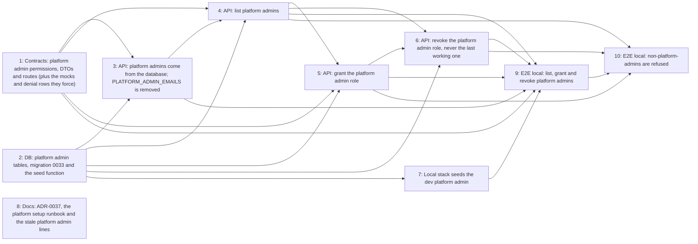

<!-- dev-plan: kind=plan id=platform-admin-role rev=1 hash=d8bcf9366cdb spec=docs/superpowers/specs/2026-11-22-platform-admin-role-design.md spec-hash=09619d7db012 -->
# Platform admin role Implementation Plan

> **For agentic workers:** REQUIRED SUB-SKILL: Use superpowers:subagent-driven-development (recommended) or superpowers:executing-plans to implement this plan task-by-task. Steps use checkbox (`- [ ]`) syntax for tracking.

**Goal:** Platform admins are read only from a new `platform_admins` table (the `PLATFORM_ADMIN_EMAILS` env var is removed), the first one is seeded by hand with one SQL statement, the local stack seeds `admin@dev.local` itself, and platform admins list, grant and revoke the role through `/api/platform/admins`.

**Architecture:** The shared pieces land first and in parallel: the contract (three permissions, `PlatformAdminDto`, three routes and their `routeAccess`, plus the web mock handlers the route table forces) in Task 1, and the two platform tables, migration `0033_platform_admins` and `seedPlatformAdmin` in Task 2. The api then switches the resolver, guard, `/me/access` and the sign-up gate to the table and drops the config key (Task 3), and grows the `platform-admins` module one route at a time (list, grant, revoke: Tasks 4 to 6, one chain because they share the controller, service and int test file). The dev seed entrypoint and its wiring into the local stack starters (Task 7) and the docs (Task 8) run beside that chain. Two local API-level e2e specs come last.

**Tech Stack:** TypeScript (strict), Zod 4, Drizzle + Postgres 18, NestJS 11 on Fastify, better-auth 1.7.22, MSW, Vitest + Testcontainers, Playwright (`APIRequestContext` only), bash.

**Spec:** `docs/superpowers/specs/2026-11-22-platform-admin-role-design.md`. Read it with this plan: the business rules (BR-n), the API table, the data model tables, the Testing table and the E2E test cases (TC-n.m) are not repeated here.

## Global Constraints

- AGENTS.md rules 1 to 11 bind every task. Layering `apps → core → db → contracts`; `web → contracts` only. No provider name in the new tables, types, routes or modules.
- No new dependency of any kind (package, image, binary, CI action). Every library used already exists (spec "Third-party libraries").
- Never edit migrations `0000` to `0032`. New: `packages/db/migrations/0033_platform_admins.sql` (generated tables plus hand-written grants).
- `platform_admins`: `id uuid pk default gen_random_uuid()`, `email text not null` (unique `platform_admins_email_key`, CHECK `platform_admins_email_check (email = lower(btrim(email)) and email <> '')`), `granted_by text null` (no FK), `granted_at timestamptz not null default now()`. Grants: `agentdesk_app` SELECT, INSERT, DELETE. No `org_id`, no RLS.
- `platform_audit_log`: `id uuid pk`, `actor_user_id text null`, `action text not null`, `target_type text not null`, `target_id text not null`, `payload jsonb not null default '{}'`, `created_at timestamptz not null default now()`, index `platform_audit_log_created_at_idx (created_at, id)`. Grants: `agentdesk_app` SELECT, INSERT only. No `org_id`, no RLS.
- Permissions: `platform-admin:read`, `platform-admin:create`, `platform-admin:delete` (platform level; 12 → 15 platform permissions, 33 tenant). Changed only in `packages/contracts/src/access.ts`; never seeded into role tables (no role migration).
- Routes (all `scope: 'platform'`): `platform.listAdmins` `GET /api/platform/admins` (`PageQuery` → `Page<PlatformAdminDto>`, order `granted_at desc, id`); `platform.grantAdmin` `POST /api/platform/admins` (`{ email }` → 201 new / 200 existing; 400; 404 `/email`; 422 `/email`); `platform.revokeAdmin` `DELETE /api/platform/admins/:adminId` (204; 400 bad uuid; 404; 409 last working admin).
- Guard order for the platform branch is unchanged: session (401) → `isPlatformAdmin(db, user)` false → logged deny and 403 `FORBIDDEN_DETAIL` before any lookup. `X-Org` is ignored. The actor comes from the session, never the body.
- "Working admin" = an entry whose email equals `lower(user.email)` of an existing user with `email_verified = true`. Revoke refuses (409) when no working entry other than the target would remain.
- Writes run in one `db.orm.transaction` under `select pg_advisory_xact_lock(hashtext('platform_admins'))`: re-read, change, write the `platform_audit_log` row. A repeat grant and any 4xx write no audit row.
- Audit row: `action` `platform_admin.granted` | `platform_admin.revoked`, `target_type 'platform_admin'`, `target_id` = entry id, `payload = redactBody({ email, userId })` (`userId` null when no account).
- Logs: `info` on grant and revoke with `{ requestId, actorUserId, adminId, targetUserId }` (ids only, never an email).
- The dev seed email is the literal `admin@dev.local`; the dev seed runs only when `parseConfig(env).AUTH_DEV_LOGIN` is true and connects with `DATABASE_APP_URL`.
- Removing `PLATFORM_ADMIN_EMAILS` adds no startup warning; a leftover value is dropped by the config schema and grants nothing.
- **Sensitive tasks** (label `review:sensitive`, high-effort security review): Tasks 1, 2, 3, 4, 5, 6, 7.
- Before every commit: `devbox run fix` until it prints `fix: clean.`. Conventional Commits with the package as scope. One task = one branch = one PR. Before saying done: `pnpm typecheck` and `pnpm test` for the touched packages, plus the e2e the task names (local stack up; if it cannot start, say so in the PR and list the specs not run).

## Review Focus

1. **The account's stored email has upper case** (`user.email = 'Pa-Case@Dev.Local'`, granted as `pa-case@dev.local`). Expected: grant finds the user (201, entry email lowercased), the list shows that entry's `userId`, `name`, `handle`, and the user's `/api/me/access` answers `platformAdmin: true`. Test: Task 5 (`grant matches an account whose stored email has upper case`).
2. **Two grants of the same email at the same moment** (a double click, two admins). Expected: one 201 and one 200, one entry, one audit row. Test: Task 5 (`concurrent grants of one email give one 201, one 200, one row and one audit row`).
3. **Grant to an email that has a seeded entry but no account yet.** Expected: 404 pointing at `/email` (no user has it), the entry unchanged, no audit row. Test: Task 5 (`grant to a seeded email with no account is 404 and changes nothing`).
4. **List paging when entries share a `granted_at`** (several rows inserted in one transaction, so `now()` is equal). Expected: ordered by `id` within the tie; `pageSize=1` over every page returns each entry exactly once. Test: Task 4 (`entries with the same granted_at page by id, each exactly once`).
5. **An entry whose account exists but is unverified** while the actor is the only verified admin. Expected: it does not count as working; the actor's self-revoke is 409 and nothing changes. Test: Task 6 (`an entry whose account is unverified does not count as a working admin`).

## Needs approval

None. The spec adds no dependency and this plan adds none.

## Agent calls made while planning

- Agent call: Task 1 also adds the three web MSW handlers, the `platformAdminFixtures` list and the three `authz.int.test.ts` denial-table rows, because the new route keys break `apps/web` (`Impl` is keyed by `JsonKey`) and `apps/api` (`DENIAL_TABLE: Record<HttpKey, …>`) typecheck otherwise.
- Agent call: Task 1 lists the three route keys in `NOT_REGISTERED_YET` (the existing mechanism the denial table and the stale-entry check already honour); Tasks 4, 5 and 6 each delete their key's line when they register the controller method.
- Agent call: `GrantPlatformAdminRequest = z.object({ email: z.string().trim().pipe(InvitationEmail) }).strict()`. `InvitationEmail` lowercases and caps at 254 but does not trim; changing it would change invitation create, which is out of scope.
- Agent call: the MSW grant handler answers 200 for a repeat through a small `withStatus(body, status)` wrapper that `contractHandler` unwraps; the static `STATUS` map cannot give one route two success codes, and N-6 asks for the repeat 200.
- Agent call: the MSW platform admin list lives in a new `apps/web/src/mocks/msw/platformAdmins.ts`, reset through `mockDb.onReset`, so `handlers.ts` only gains three one-line entries and the unwrap.
- Agent call: grant checks the user first (404 no account, 422 unverified) and the existing entry second (200), because a grant targets existing verified users and neither refusal changes data.
- Agent call: the 404 with an `/email` pointer uses a new `NotFoundProblemException` next to `UnprocessableProblemException` in `apps/api/src/common/zod-validation.ts`, rendered by `problem.filter.ts`; the revoke 404 and 409 are plain `NotFoundException` / `ConflictException` (no field to point at).
- Agent call: `seedPlatformAdmin` trims and lowercases in TypeScript and runs exactly the runbook statement with a bound parameter (`insert into platform_admins (email) values ($1) on conflict (email) do nothing`), so the function and the runbook show the same SQL.
- Agent call: `createTestApp` gains `seedDevAdmin?: boolean` (default `true`); count-sensitive cases pass `false` with their own `startPg()` database, which is the spec's "seeding controlled per case".
- Agent call: `apps/api/src/access/platform-admin.test.ts` (config-based unit test) is deleted; the resolver is proven against real Postgres in a new `apps/api/test/platform-admin-source.int.test.ts`, which is also the file the spec leaves to the plan for BR-26 and BR-27.
- Agent call: `SessionGuard` and `MeController` drop their `CONFIG` injection (its only use was the env list) and `MeController` injects `DB`.
- Agent call: the stale "config-listed platform admin" comments in `actor.ts`, `current-access.ts` and the four platform controllers are reworded in Task 3 (the newer accepted doc wins; leaving them would describe removed behaviour).
- Agent call: the env-based "removing the email from config" case in `platform.int.test.ts` becomes "deleting the row makes the same session a 403 on the next call" in Task 3 (direct delete), and the route-level BR-11 lands with revoke in Task 6, so the guarantee is never untested between merges.
- Agent call: the api routes are built in three tasks (list, grant, revoke) for review size; they are one chain because they share `platform-admins.controller.ts`, `platform-admins.service.ts`, `apps/api/test/platform-admins.int.test.ts` and `authz.int.test.ts`.
- Agent call: the denial table's `platform.revokeAdmin` target is a seeded entry with no account (`dt-revoke@dev.local`), so the platform admin's expected status is 204 without touching `admin@dev.local`.
- Agent call: `seed-dev-admin.ts` keeps its logic in an exported `runDevAdminSeed(env, seed)` and runs `main()` only when it is the process entry (`import.meta.url === pathToFileURL(process.argv[1]).href`), so the gate test imports it without connecting anywhere.
- Agent call: the scripts wiring test copies `scripts/dev.sh`, `scripts/runner-stack.sh` and `scripts/runner-env.sh` into a temp root (with its own `.env` and `apps/web/package.json`) and stubs `pnpm`, the compose command, `pg_ctl`, `temporal` and `setsid` on `PATH`, so it never writes `.env` into the checkout.
- Agent call: `scripts/runner-stack.sh` runs the seed right after migrate, before the `RUNNER_STACK_APPS=0` early return, so a services-only start also leaves a seeded database.
- Agent call: the spec's single e2e file is split into `platform-admins.spec.ts` (list, grant, revoke flows and the local seed) and `platform-admins-denials.spec.ts` (BR-15), each under about 400 lines; the shared helpers live in `apps/web/e2e/local/helpers.ts`.
- Agent call: the e2e "fresh user" is invited (viewer, org scope) into one org the spec file creates in `beforeAll` and signs in through dev login without accepting, so it has an account, a verified email and no org; the BR-15 role cast reuses `rbac-cast.ts` `buildCast`.
- Agent call: the note on #192 listing the deferred UI and tests is posted by the docs task (Task 8) with `gh issue comment`.

## E2E coverage

| Rules and cases | Proved by |
| --- | --- |
| BR-1 (TC-1.1, 1.2), BR-4 (4.1, 4.2), BR-5 (5.1, 5.2), BR-6 (6.1 to 6.5), BR-7 (7.1), BR-9 (9.1, 9.2), BR-10 (10.1 to 10.4), BR-11 (11.1, 11.2), BR-13 (13.1, 13.2), BR-28 (28.1) | Task 9 `apps/web/e2e/local/platform-admins.spec.ts` |
| BR-15 (TC-15.1 to 15.11) | Task 10 `apps/web/e2e/local/platform-admins-denials.spec.ts` |
| Not e2e (spec "Not provable by e2e"): BR-8, BR-12, BR-14, BR-29, BR-30, N-4 | integration in Tasks 5 (BR-8) and 6 (BR-12, BR-14, BR-29, BR-30, N-4) |
| Not e2e: BR-23 | existing N9 in `apps/api/test/platform.int.test.ts` and the production refine in `packages/core/test/config.test.ts`, both kept by Task 3 |
| Not e2e: BR-25, BR-26, BR-27 | integration in Task 3 |
| N-1 Tasks 5, 6 · N-2 Task 2 · N-3 Task 1 · N-5 Tasks 2, 7 · N-6 Task 1 | unit, contract, db and api integration, scripts test |

---

<!-- dev-plan:graph:begin -->
## Task graph

Generated by `dev-plan.mjs graph --write` from each task's **Depends on:** line. Do not edit it by hand.
Tasks in the same wave touch no common file and can be built in parallel; a task starts when everything it depends on is merged.

| Wave | Task | Depends on |
| ---- | ---- | ---------- |
| 1 | Task 1: Contracts: platform admin permissions, DTOs and routes (plus the mocks and denial rows they force) | none |
| 1 | Task 2: DB: platform admin tables, migration 0033 and the seed function | none |
| 1 | Task 8: Docs: ADR-0037, the platform setup runbook and the stale platform admin lines | none |
| 2 | Task 3: API: platform admins come from the database; PLATFORM_ADMIN_EMAILS is removed | Task 1, Task 2 |
| 2 | Task 7: Local stack seeds the dev platform admin | Task 2 |
| 3 | Task 4: API: list platform admins | Task 1, Task 2, Task 3 |
| 4 | Task 5: API: grant the platform admin role | Task 1, Task 2, Task 4 |
| 5 | Task 6: API: revoke the platform admin role, never the last working one | Task 2, Task 4, Task 5 |
| 6 | Task 9: E2E local: list, grant and revoke platform admins | Task 1, Task 3, Task 4, Task 5, Task 6, Task 7 |
| 7 | Task 10: E2E local: non-platform-admins are refused | Task 4, Task 5, Task 6, Task 9 |


<!-- dev-plan:graph:end -->

### Task 1: Contracts: platform admin permissions, DTOs and routes (plus the mocks and denial rows they force)

**Depends on:** none

**Files:**

- Modify: `packages/contracts/src/access.ts`, `packages/contracts/src/access.test.ts`
- Modify: `packages/contracts/src/schemas/platform.ts`, `packages/contracts/src/schemas/platform.test.ts`
- Modify: `packages/contracts/src/routes.ts`, `packages/contracts/src/routes.test.ts`
- Modify: `packages/contracts/src/route-access.ts`, `packages/contracts/src/route-access.test.ts`, `packages/contracts/src/role-matrix.test.ts`
- Modify: `apps/web/src/mocks/dto/access.ts`
- Create: `apps/web/src/mocks/msw/platformAdmins.ts`
- Modify: `apps/web/src/mocks/msw/handlers.ts`, `apps/web/src/mocks/msw/contract.test.ts`
- Modify: `apps/api/test/authz.int.test.ts`

**Interfaces:**

- Produces (contracts, exported through `schemas/platform.ts` and the route table):

```ts
// access.ts Permission enum gains:
'platform-admin:read' | 'platform-admin:create' | 'platform-admin:delete'

// schemas/platform.ts
export const PlatformAdminDto = z.object({
  id: Id,
  email: z.string(),
  userId: z.string().nullable(),
  name: z.string().nullable(),
  handle: z.string().nullable(),
  grantedAt: Timestamp,
  grantedBy: InviterDto.nullable(),
});
export type PlatformAdminDto = z.infer<typeof PlatformAdminDto>;
export const GrantPlatformAdminRequest = z.object({ email: z.string().trim().pipe(InvitationEmail) }).strict();
export type GrantPlatformAdminRequest = z.infer<typeof GrantPlatformAdminRequest>;

// routes.ts, under platform:
listAdmins:  { method: 'GET',    path: '/api/platform/admins', query: PageQuery, response: pageOf(PlatformAdminDto) },
grantAdmin:  { method: 'POST',   path: '/api/platform/admins', body: GrantPlatformAdminRequest, response: PlatformAdminDto },
revokeAdmin: { method: 'DELETE', path: '/api/platform/admins/:adminId', params: z.object({ adminId: z.uuid() }), response: empty },

// route-access.ts
'platform.listAdmins':  platform('platform-admin:read'),
'platform.grantAdmin':  platform('platform-admin:create'),
'platform.revokeAdmin': platform('platform-admin:delete'),
```

- Produces (web mocks): `platformAdminFixtures: PlatformAdminDto[]` in `apps/web/src/mocks/dto/access.ts` with three entries: `admin@dev.local` hand-seeded with an account (`grantedBy: null`), one granted entry with an account and `grantedBy` set, one seeded email with no account (`userId`, `name`, `handle`, `grantedBy` null). `apps/web/src/mocks/msw/platformAdmins.ts` exports `listPlatformAdmins(q: PageQuery): Page<PlatformAdminDto>`, `grantPlatformAdmin(body: GrantPlatformAdminRequest): WithStatus<PlatformAdminDto> | PlatformAdminDto`, `revokePlatformAdmin(adminId: string): null`, over a list copied from the fixtures and restored on `mockDb.onReset`.
- Produces (api test): `NOT_REGISTERED_YET` = `['platform.listAdmins', 'platform.grantAdmin', 'platform.revokeAdmin']`; `DENIAL_TABLE` rows `'platform.listAdmins': platformRoute(200)`, `'platform.grantAdmin': platformRoute(201)`, `'platform.revokeAdmin': platformRoute(204)`.

- [x] **Step 1: Write the failing tests**
  - `access.test.ts`: the count test becomes `has 33 tenant and 15 platform permissions` (`Permission.options` length 48); `platform-admin:read`, `:create`, `:delete` are platform level, `isPlatformPermission` true, and the owner holds none of them (`holdsAnywhere(access(org('owner', OWNER)), 'platform-admin:read')` false).
  - `schemas/platform.test.ts` (BR-6 contract, BR-1 contract): `GrantPlatformAdminRequest` rejects `{}`, `{ email: 'not-an-email' }`, a 255-character email and `{ email: 'a@b.co', extra: 1 }`, each with an issue at path `['email']` (or the unrecognized key); accepts a 254-character email (64 × `a` @ labels of 63, 63 and 57 characters, then `com`); parses `'  E2E-AB@DEV.LOCAL  '` to `'e2e-ab@dev.local'`. `PlatformAdminDto` parses an entry with all account fields null and `grantedBy: null`, and `pageOf(PlatformAdminDto)` parses a page of the three mock fixtures; it rejects `grantedBy: { name: 'x' }` (no handle).
  - `routes.test.ts` (N-3): `every platform route lives under /api/platform/` with 15 entries; `platform.revokeAdmin.params` rejects `{ adminId: 'not-a-uuid' }`.
  - `route-access.test.ts`, `role-matrix.test.ts` (N-3): the three expected entries; the three keys are `NOBODY` in the role matrix.
  - `apps/web/src/mocks/msw/contract.test.ts` (N-6): `platformAdminFixtures` joins the fixture-parse list as `[PlatformAdminDto, platformAdminFixtures]`; the existing "handler for every route key" and "every GET through its schema" cases cover the new keys; a new case `grants and revokes platform admins: repeat 200, unknown 404, last-admin 409` signs in the mock user as platform admin, POSTs the granted fixture's email (200, same id), POSTs an email no mock user has (404 with an error pointer `/email`), POSTs `alice@example.com` (201), DELETEs entries until one working entry (non-null `userId`) remains and gets 409 on deleting it, and a DELETE of a random uuid gets 404.
  - `apps/api/test/authz.int.test.ts`: the three `NOT_REGISTERED_YET` keys and `DENIAL_TABLE` rows above (N3 "a row for every route key" stays green).
- [x] **Step 2: Run** `pnpm --filter @agentdesk/contracts exec vitest run src/access.test.ts src/routes.test.ts src/route-access.test.ts src/role-matrix.test.ts src/schemas/platform.test.ts` and `pnpm --filter @agentdesk/web exec vitest run src/mocks/msw/contract.test.ts`. Expected: FAIL.
- [x] **Step 3: Implement** the contracts above; the fixtures; `platformAdmins.ts` (grant: existing email → `withStatus(entry, 200)`; no mock user with that email → `Problem` 404 with `errors: [{ pointer: '/email', … }]`; else append `{ userId, name, handle }` of that user and `grantedBy` of the session user, return it (201 from `STATUS`); revoke: unknown id → 404; no other entry with non-null `userId` would remain → `Problem` 409; else remove → `null`); in `handlers.ts` add `export class WithStatus<T> { constructor(readonly body: T, readonly status: number) {} }` plus `withStatus`, widen `Impl` to `ResponseOf<K> | WithStatus<ResponseOf<K>>`, unwrap it in `contractHandler` before `def.response.parse`, add the three `impl` entries and `'platform.grantAdmin': 201` / `'platform.revokeAdmin': 204` to `STATUS`.
- [x] **Step 4: Run** the Step 2 commands, `pnpm --filter @agentdesk/contracts test`, `pnpm --filter @agentdesk/web test`, `pnpm --filter @agentdesk/api exec vitest run test/authz.int.test.ts` and `pnpm typecheck`. Expected: PASS.
- [x] **Step 5: Commit** `feat(contracts): platform admin list, grant and revoke routes`.

---

### Task 2: DB: platform admin tables, migration 0033 and the seed function

**Depends on:** none

**Files:**

- Create: `packages/db/src/schema/platform.ts`
- Modify: `packages/db/src/schema/index.ts`
- Create: `packages/db/migrations/0033_platform_admins.sql`, `packages/db/migrations/meta/0033_snapshot.json`
- Modify: `packages/db/migrations/meta/_journal.json`
- Create: `packages/db/src/platform-admins.ts`
- Modify: `packages/db/src/index.ts`
- Test: `packages/db/test/migrate.int.test.ts`
- Create: `packages/db/test/seed-platform-admin.int.test.ts`

**Interfaces:**

- Produces:

```ts
// schema/platform.ts (exported from @agentdesk/db)
export const platformAdmins: PgTable;    // columns: id, email, grantedBy, grantedAt (Global Constraints)
export const platformAuditLog: PgTable;  // columns: id, actorUserId, action, targetType, targetId, payload, createdAt

// platform-admins.ts (exported from @agentdesk/db)
/** Adds `email` (trimmed, lowercased) to platform_admins; a second call for the same email changes nothing. */
export async function seedPlatformAdmin(db: Db, email: string): Promise<void>;
```

- [x] **Step 1: Write the failing tests**
  - `migrate.int.test.ts` (N-2): on `startPgAt('0032_revoke_desk_reads_member_viewer')` with a `user` row inserted, `migrateRest()` succeeds and both new tables are empty; a second insert of the same email fails with `23505`; inserting `'Ops@x.io'`, `''` or `' ops@x.io'` fails with `23514`; `has_table_privilege('agentdesk_app', 'platform_admins', p)` is true for SELECT, INSERT, DELETE and false for UPDATE; on `platform_audit_log` true for SELECT, INSERT and false for UPDATE, DELETE; index `platform_audit_log_created_at_idx` is on `(created_at, id)`; neither table has an `org_id` column (so `APP_TABLES` and the RLS cases stay unchanged).
  - `seed-platform-admin.int.test.ts` (BR-28 integration, N-5): on its own `startPg()`, as the app role (`createDb(env.appUrl)`), `seedPlatformAdmin(db, '  Ops@Example.COM ')` leaves exactly one row `{ email: 'ops@example.com', granted_by: null }` with a `granted_at`; a second call resolves and still leaves one row; `seedPlatformAdmin(db, '   ')` rejects and adds no row.
- [x] **Step 2: Run** `pnpm --filter @agentdesk/db exec vitest run test/migrate.int.test.ts test/seed-platform-admin.int.test.ts`. Expected: FAIL.
- [x] **Step 3: Implement** the schema (unique and check constraints with the spec's names, the created-at index), `pnpm --filter @agentdesk/db db:generate --name platform_admins` (read the SQL: two `CREATE TABLE`s, the index, nothing else), append `GRANT SELECT, INSERT, DELETE ON "platform_admins" TO agentdesk_app;--> statement-breakpoint` and `GRANT SELECT, INSERT ON "platform_audit_log" TO agentdesk_app;` with a header comment that the tables have no `org_id` and no RLS by ADR-0037, and `seedPlatformAdmin` (`db.pool.query` with the runbook statement and `[email.trim().toLowerCase()]`).
- [x] **Step 4: Run** the Step 2 command and `pnpm --filter @agentdesk/db test`. Expected: PASS.
- [x] **Step 5: Commit** `feat(db): platform_admins and platform_audit_log tables with a seed function`.

---

### Task 3: API: platform admins come from the database; `PLATFORM_ADMIN_EMAILS` is removed

**Depends on:** Task 1, Task 2

**Files:**

- Modify: `packages/core/src/config.ts`, `packages/core/test/config.test.ts`, `.env.example`
- Modify: `apps/api/src/access/platform-admin.ts`
- Delete: `apps/api/src/access/platform-admin.test.ts`
- Modify: `apps/api/src/auth/session.guard.ts`, `apps/api/src/auth/session.guard.test.ts`
- Modify: `apps/api/src/assignments/me.controller.ts`, `apps/api/src/auth/auth.ts`
- Modify (comments only): `apps/api/src/access/actor.ts`, `apps/api/src/access/current-access.ts`, `apps/api/src/orgs/platform-orgs.controller.ts`, `apps/api/src/members/platform-members.controller.ts`, `apps/api/src/invitations/platform-invitations.controller.ts`, `apps/api/src/assignments/platform-assignments.controller.ts`
- Modify: `apps/api/test/helpers/app.ts`
- Test: `apps/api/test/authz.int.test.ts`, `apps/api/test/invitations.int.test.ts`, `apps/api/test/platform.int.test.ts`, `apps/api/test/auth.int.test.ts`
- Create: `apps/api/test/platform-admin-source.int.test.ts`

**Interfaces:**

- Consumes: `platformAdmins`, `seedPlatformAdmin` (Task 2).
- Produces:

```ts
// apps/api/src/access/platform-admin.ts
/** False for an unverified session email; else true when platform_admins has lower(trim(email)). A DB error rejects (fails closed). */
export async function isPlatformAdmin(db: Db, user: { email: string; emailVerified: boolean }): Promise<boolean>;

// apps/api/test/helpers/app.ts
export interface TestAppOptions { /* existing fields */ seedDevAdmin?: boolean } // default true: seeds admin@dev.local after the db is created
// validEnv() no longer sets PLATFORM_ADMIN_EMAILS
```

  `SessionGuard` constructor becomes `(auth, db, logger)`; `MeController` injects `DB` instead of `CONFIG`; the sign-up gate's exception becomes `await isPlatformAdmin(db, { email, emailVerified: true })` with the same `NO_INVITATION_CODE` refusal. `Config` no longer has `PLATFORM_ADMIN_EMAILS`.

- [x] **Step 1: Write the failing tests**
  - `packages/core/test/config.test.ts` (BR-26 unit): the `PLATFORM_ADMIN_EMAILS` describe is replaced by `drops a leftover PLATFORM_ADMIN_EMAILS`: `'PLATFORM_ADMIN_EMAILS' in parseConfig({ ...base, PLATFORM_ADMIN_EMAILS: 'a@x.io' })` is false. The production refine cases (BR-23) stay.
  - `platform-admin-source.int.test.ts` (resolver, BR-26, BR-27; each case on its own `createTestApp({ pg: await startPg(), seedDevAdmin: false, … })`, pg stopped in `finally`):
    - `a seeded email signs in as platform admin, whatever the case of the session email`: seed `src-pa@dev.local`, dev-login `src-pa`, `/api/me/access` `platformAdmin: true`, `GET /api/platform/orgs` 200; `isPlatformAdmin(t.db, { email: ' SRC-PA@Dev.Local ', emailVerified: true })` true and `emailVerified: false` false; `xsrc-pa@dev.local` and `src-pa@dev.local.evil.io` false.
    - `BR-27: with no matching entry everyone is refused`: seed `src-a@dev.local`, sign in, create an org and invite `src-b`, sign `src-b` in, delete the row (app role); both sessions get `platformAdmin: false` and 403 `FORBIDDEN_DETAIL` on `GET /api/platform/orgs`.
    - `BR-26: a leftover PLATFORM_ADMIN_EMAILS grants nothing`: `env: { PLATFORM_ADMIN_EMAILS: 'stale@dev.local' }`, `seedDevAdmin: true`; `'PLATFORM_ADMIN_EMAILS' in t.config` false; dev-login `stale` → 302 to `/sign-in?error=no_invitation`, no cookie, no `user` row; after admin invites `stale@dev.local` and it signs in, its `/api/me/access` is false and `GET /api/platform/orgs` 403.
    - `a resolver error fails closed`: with `t.db.pool.query` spied to reject for the platform_admins lookup, `GET /api/platform/orgs` as admin answers 500 and creates nothing.
  - `session.guard.test.ts`: constructor updated; `a platform route rejects, and never passes, when the resolver throws` (mock `../access/platform-admin`).
  - `authz.int.test.ts`: `runGuard` loses `opts.admins`; the platform-branch cases seed what they need with `seedPlatformAdmin(t.db, …)` and remove it after (the "empty list" case uses a person with no row; the "platform admin has no tenant power" case seeds `az-nobody@dev.local` and deletes it in `finally`). Every existing expectation stays.
  - `invitations.int.test.ts`: `refuses a seeded platform admin email when it is not verified` (seed `gate-pa@example.com` on `t`, `signUpEmail` without dev sign-up rejects, no user row) and `accepts a seeded platform admin email whatever its case at sign-in` (`seedPlatformAdmin(t.db, 'Gate-Mixed@Example.COM')`, dev sign-up of `GATE-mixed@example.com` makes one user) replace the two env cases.
  - `platform.int.test.ts`: the "platform admin from config" config case becomes `deleting the entry makes the same session a 403 on the next call` (seed `cfg-rm@dev.local`, dev-login, 200 on `/api/platform/orgs`, delete the row, same cookie → 403 `FORBIDDEN_DETAIL`); BR-62 becomes `BR-62: a seeded email signs up with no invitation, has no membership and no active org` (seed `fresh-pa@dev.local` on `t`, same assertions). N9 (BR-23) stays as is.
  - `auth.int.test.ts` (BR-25, one `startPg()` app with `seedDevAdmin: false` for the describe): dev-login `admin` is refused (`no_invitation`, no user); after `seedPlatformAdmin(t.db, 'ops@dev.local')` dev-login `ops` signs up and `/api/me/access` is true; the GitHub case `BR-25: a seeded GitHub account with a verified email and no invitation signs up and is platform admin` (seed `ghadmin@example.com`); `a seeded GitHub account with an unverified email is refused with no_invitation and no user row`; `a seeded email whose entry is deleted before first sign-in is refused`; `a failing platform_admins lookup at sign-up refuses and creates no user` (pool query spied to reject, as the existing invitation-lookup case). `githubCallback` takes the app to use instead of reading `t`, and no longer takes a config override. "BR-1: a platform admin with no invitation signs in" stays (admin is seeded by `createTestApp`).
- [x] **Step 2: Run** `pnpm --filter @agentdesk/core exec vitest run test/config.test.ts` and `pnpm --filter @agentdesk/api exec vitest run src/auth/session.guard.test.ts test/platform-admin-source.int.test.ts test/authz.int.test.ts test/invitations.int.test.ts test/platform.int.test.ts test/auth.int.test.ts`. Expected: FAIL.
- [x] **Step 3: Implement** the resolver (one `select id from platform_admins where email = $1 limit 1` through `db.orm`), the guard and `/me/access` awaiting it, the gate, the config key removal (`.env.example` loses the key and its comment line), `createTestApp` seeding (`await seedPlatformAdmin(db, 'admin@dev.local')` unless `seedDevAdmin === false`), the comment rewording ("a platform admin (a `platform_admins` entry matching the verified session email)"), and delete the old unit test.
- [ ] **Step 4: Run** the Step 2 commands, `pnpm --filter @agentdesk/core test`, `pnpm --filter @agentdesk/api test` and `pnpm typecheck`. Expected: PASS.
- [x] **Step 5: Commit** `feat(api): read platform admins from platform_admins and drop PLATFORM_ADMIN_EMAILS`.

---

### Task 4: API: list platform admins

**Depends on:** Task 1, Task 2, Task 3

**Files:**

- Create: `apps/api/src/platform-admins/platform-admins.module.ts`, `apps/api/src/platform-admins/platform-admins.controller.ts`, `apps/api/src/platform-admins/platform-admins.service.ts`
- Modify: `apps/api/src/app.module.ts`
- Modify: `apps/api/test/authz.int.test.ts`
- Create: `apps/api/test/platform-admins.int.test.ts`

**Interfaces:**

- Consumes: `routes.platform.listAdmins`, `PlatformAdminDto` (Task 1); `platformAdmins` (Task 2); `createTestApp({ seedDevAdmin })` (Task 3); `toInviterDto` (`apps/api/src/invitations/inviter.ts`), `pageWindow` (contracts).
- Produces:

```ts
// platform-admins.service.ts
@Injectable() export class PlatformAdminsService {
  list(q: PageQuery): Promise<Page<PlatformAdminDto>>;
}
/** One entry by id, read with the same two left joins as the list; undefined when it does not exist. */
export async function findPlatformAdmin(tx: Db['orm'] | Tx, id: string): Promise<PlatformAdminDto | undefined>;
// platform-admins.controller.ts: PlatformAdminsController with list(); PlatformAdminsModule registered in AppModule
```

  The list is one query: `platform_admins pa left join "user" u on lower(u.email) = pa.email left join "user" g on g.id = pa.granted_by`, order `pa.granted_at desc, pa.id`, plus a count; `grantedBy = toInviterDto(g)`.

- [x] **Step 1: Write the failing tests** in `platform-admins.int.test.ts` (shared `createTestApp()`, admin cookie from `asPlatformAdmin`; `expectContract('platform.listAdmins', res)` on every 200):
  - `BR-1: lists every entry with exactly the documented keys`: raw item keys are exactly `email, grantedAt, grantedBy, handle, id, name, userId`; `admin@dev.local` has its account fields and `grantedBy: null`; a row inserted as `{ email: 'lst-granted@dev.local', granted_by: <admin id> }` for a signed-in `lst-granted` has `grantedBy` `{ name, handle: 'admin' }`; a row with `granted_by` set to a random id has `grantedBy: null`; a seeded `lst-noacct@dev.local` has `userId`, `name`, `handle` and `grantedBy` null (BR-29 list part).
  - `orders by granted_at desc, then id`, and Review Focus 4 `entries with the same granted_at page by id, each exactly once` (insert three rows in one transaction; walking `pageSize=1` gives each id once, in id order within the tie).
  - `BR-15: every non-platform caller gets 403 before any lookup on the list`: owner, org admin, project admin, member, viewer of a fresh org, and a signed-in user with no org (invited, not accepted) → 403 with `FORBIDDEN_DETAIL` and no `items`; a captured logger (`createTestApp({ logger })` in its own app) shows the `access denied` line with `routeKey: 'platform.listAdmins'` and no email.
  - `ignores an org header`: the list with `x-org-id: <some org>` still answers 200.
  - `authz.int.test.ts`: `platform.listAdmins` leaves `NOT_REGISTERED_YET`.
- [x] **Step 2: Run** `pnpm --filter @agentdesk/api exec vitest run test/platform-admins.int.test.ts test/authz.int.test.ts`. Expected: FAIL.
- [x] **Step 3: Implement** the module, `list` and `findPlatformAdmin`, and the controller method (`@CurrentPlatformAdmin() _admin`, `@Query(new ZodPipe(routes.platform.listAdmins.query))`).
- [ ] **Step 4: Run** the Step 2 command and `pnpm --filter @agentdesk/api test`. Expected: PASS.
- [x] **Step 5: Commit** `feat(api): list platform admins`.

---

### Task 5: API: grant the platform admin role

**Depends on:** Task 1, Task 2, Task 4

**Files:**

- Create: `apps/api/src/audit/platform-audit-entry.ts`, `apps/api/src/audit/platform-audit-entry.test.ts`
- Modify: `apps/api/src/common/zod-validation.ts`, `apps/api/src/common/problem.filter.ts`, `apps/api/src/common/problem.filter.test.ts`
- Modify: `apps/api/src/platform-admins/platform-admins.controller.ts`, `apps/api/src/platform-admins/platform-admins.service.ts`
- Modify: `apps/api/test/helpers/auth.ts`, `apps/api/test/authz.int.test.ts`
- Test: `apps/api/test/platform-admins.int.test.ts`

**Interfaces:**

- Consumes: `GrantPlatformAdminRequest`, `routes.platform.grantAdmin` (Task 1); `platformAuditLog` (Task 2); `PlatformAdminsService`, `findPlatformAdmin` (Task 4).
- Produces:

```ts
// audit/platform-audit-entry.ts
export type PlatformAuditAction = 'platform_admin.granted' | 'platform_admin.revoked';
export interface PlatformAuditEntry {
  actorUserId: string;
  action: PlatformAuditAction;
  targetType: 'platform_admin';
  targetId: string;
  payload: { email: string; userId: string | null };
}
export function buildPlatformAuditRow(entry: PlatformAuditEntry): typeof platformAuditLog.$inferInsert; // payload = redactBody(payload)
export async function writePlatformAuditEntry(tx: Tx, entry: PlatformAuditEntry): Promise<void>;

// common/zod-validation.ts
/** 404 whose problem body carries `errors[]` pointers. */
export class NotFoundProblemException extends NotFoundException { constructor(message: string, readonly issues: ValidationIssue[]) }

// PlatformAdminsService
grant(actorUserId: string, req: GrantPlatformAdminRequest): Promise<{ entry: PlatformAdminDto; created: boolean }>;

// apps/api/test/helpers/auth.ts
export async function grantPlatformAdmin(t: TestApp, cookie: string, email: string): Promise<{ statusCode: number; entry: PlatformAdminDto }>;
```

  Grant, inside the transaction and lock: user by `lower(email) = req.email` → none: `NotFoundProblemException('User not found', [{ pointer: '/email', detail: 'no account has this email' }])`; not verified: `UnprocessableProblemException('Email not verified', [{ pointer: '/email', detail: 'this account has no verified email' }])`; entry exists → `{ entry, created: false }`; else insert `{ email, grantedBy: actorUserId }`, write the audit row, log `platform admin granted`. Controller sets 201 or 200 (`@Res({ passthrough: true })`, as `platform-assignments.controller.ts`).

- [x] **Step 1: Write the failing tests**
  - `platform-audit-entry.test.ts`: `buildPlatformAuditRow` keeps actor, action, target and passes the payload through `redactBody` (a `token` key is redacted; `email` and `userId` kept).
  - `problem.filter.test.ts`: a `NotFoundProblemException` renders 404 with its `errors[]`.
  - `platform-admins.int.test.ts`:
    - `BR-4: grants an existing verified user (201), stored lowercased and listed`; N-1 grant: one `platform_audit_log` row read as owner with `action 'platform_admin.granted'`, `actor_user_id` = admin's id, `target_type 'platform_admin'`, `target_id` = entry id, payload `{ email, userId }`, `created_at` `expect.any(String)`; the info log line has ids only.
    - `BR-5: the grantee's same cookie gets platformAdmin true and 200 on /api/platform/orgs`.
    - `BR-6: empty, malformed, 255-character, extra-key bodies are 400 with an /email pointer (or the key) and grant nothing`; `trims and lowercases the email`.
    - `BR-7: no user with the email is 404 pointing at /email, no row, no audit`.
    - `BR-8: an unverified user is 422 pointing at /email, no row, no audit` (set `email_verified = false` as owner) and `an entry plus an unverified session is 403`.
    - `BR-9: a repeat grant is 200 with the same id, one row, no second audit row`.
    - `BR-15: every non-platform caller gets 403 before any lookup on grant, with the same body for a known and an unknown email` (the six callers of Task 4).
    - `BR-15: a granted platform admin with no assignment gets 403 or 404 and no data on another org's /api/orgs/:orgId routes, with and without x-org-id`.
    - Review Focus 1 `grant matches an account whose stored email has upper case`, 2 `concurrent grants of one email give one 201, one 200, one row and one audit row` (`Promise.all`; assert the set of statuses), 3 `grant to a seeded email with no account is 404 and changes nothing`.
  - `authz.int.test.ts`: `platform.grantAdmin` leaves `NOT_REGISTERED_YET`; `bodies['platform.grantAdmin'] = { email: 'dt-spare@dev.local' }`.
- [x] **Step 2: Run** `pnpm --filter @agentdesk/api exec vitest run src/audit/platform-audit-entry.test.ts src/common/problem.filter.test.ts test/platform-admins.int.test.ts test/authz.int.test.ts`. Expected: FAIL.
- [x] **Step 3: Implement** the audit writer, the exception and its filter branch, `grant`, the controller method and the test helper.
- [x] **Step 4: Run** the Step 2 command and `pnpm --filter @agentdesk/api test`. Expected: PASS.
- [x] **Step 5: Commit** `feat(api): grant the platform admin role`.

---

### Task 6: API: revoke the platform admin role, never the last working one

**Depends on:** Task 2, Task 4, Task 5

**Files:**

- Modify: `apps/api/src/platform-admins/platform-admins.controller.ts`, `apps/api/src/platform-admins/platform-admins.service.ts`
- Modify: `apps/api/test/helpers/auth.ts`, `apps/api/test/authz.int.test.ts`
- Test: `apps/api/test/platform-admins.int.test.ts`

**Interfaces:**

- Consumes: `routes.platform.revokeAdmin` (Task 1); `seedPlatformAdmin` (Task 2); `writePlatformAuditEntry`, `grantPlatformAdmin` (Task 5).
- Produces:

```ts
// PlatformAdminsService
revoke(actorUserId: string, adminId: string): Promise<void>;
// apps/api/test/helpers/auth.ts
export async function revokePlatformAdmin(t: TestApp, cookie: string, adminId: string): Promise<number>; // the status code
```

  Revoke, inside the transaction and lock: entry by id → none: `NotFoundException`; count entries other than `adminId` joined to a `user` with `lower(email) = pa.email and email_verified` → 0: `ConflictException('Cannot revoke the last platform admin')`; else delete, write the `platform_admin.revoked` audit row (payload `userId` = the matching account id or null), log `platform admin revoked`. Controller `@HttpCode(204)`.

- [x] **Step 1: Write the failing tests** in `platform-admins.int.test.ts` (count-sensitive cases on their own `createTestApp({ pg: await startPg() })`, which seeds only `admin@dev.local`):
  - `BR-10: revoking another entry is 204 and it leaves the list`; N-1 revoke: one `platform_admin.revoked` row with the entry id and payload `{ email, userId }`, and the `platform admin revoked` info line carries ids only; `a second revoke is 404`; `a malformed adminId is 400`.
  - `BR-11: the revoked user's same cookie gets platformAdmin false and 403 on list, grant and /api/platform/orgs`.
  - `BR-12: revoking the last working admin is 409 and nothing changes, no audit` (fresh DB, admin revokes its own entry).
  - `BR-13: self-revoke while another working admin remains is 204, then 403`.
  - `BR-14: two last admins revoking each other at once give one 204 and one 409; one entry remains` (fresh DB; `Promise.all`; assert the set of statuses).
  - `BR-15: every non-platform caller gets 403 before any lookup on revoke, the same for a real and a random adminId`.
  - `BR-29: a seeded email with no account is revocable (204) and never counts as the last working admin` (fresh DB: seed `noacct@dev.local`; admin's self-revoke is 409; revoking the seeded entry is 204).
  - `BR-30: an entry whose account was deleted` (fresh DB: `orphan` is invited into an org and signs in, admin grants `orphan@dev.local`, then its `user` row is deleted as owner; the list shows null `userId`, `name`, `handle` and unchanged `grantedBy`; admin's self-revoke is 409 (N-4: the orphan does not count); the pending invitation is revoked, and dev-login `orphan` still signs up with no invitation, `/api/me/access` true, `/api/platform/orgs` 200; admin revokes the entry, the `user` row is deleted again, and dev-login `orphan` is refused `no_invitation` with no user row).
  - Review Focus 5 `an entry whose account is unverified does not count as a working admin` (fresh DB: grant `unv@dev.local`, then set its `email_verified = false` as owner; admin's self-revoke is 409).
  - `authz.int.test.ts`: `platform.revokeAdmin` leaves `NOT_REGISTERED_YET`; `beforeAll` seeds `dt-revoke@dev.local` and sets `ids.adminId` to its entry id.
- [x] **Step 2: Run** `pnpm --filter @agentdesk/api exec vitest run test/platform-admins.int.test.ts test/authz.int.test.ts`. Expected: FAIL.
- [x] **Step 3: Implement** `revoke`, the controller method (`@Param(new ZodPipe(routes.platform.revokeAdmin.params))`) and the test helper.
- [x] **Step 4: Run** the Step 2 command and `pnpm --filter @agentdesk/api test`. Expected: PASS.
- [x] **Step 5: Commit** `feat(api): revoke the platform admin role, never the last one`.

---

### Task 7: Local stack seeds the dev platform admin

**Depends on:** Task 2

**Files:**

- Create: `apps/api/src/seed-dev-admin.ts`
- Modify: `apps/api/package.json`
- Create: `apps/api/test/seed-dev-admin.int.test.ts`
- Modify: `process-compose.yaml`, `scripts/dev.sh`, `scripts/runner-stack.sh`, `devbox.json`
- Create: `scripts/seed-dev-admin-wiring.test.ts`

**Interfaces:**

- Consumes: `seedPlatformAdmin`, `createDb` (Task 2 and existing `@agentdesk/db`); `parseConfig` (`apps/api/src/config/config.schema`).
- Produces:

```ts
// apps/api/src/seed-dev-admin.ts
export const DEV_ADMIN_EMAIL = 'admin@dev.local';
export function devAdminSeedEnabled(config: Pick<Config, 'AUTH_DEV_LOGIN'>): boolean;
/** Parses env with parseConfig; when the gate is off returns 'skipped' without calling seed, else seeds DEV_ADMIN_EMAIL once. */
export async function runDevAdminSeed(
  env: Record<string, string | undefined>,
  seed: (databaseAppUrl: string, email: string) => Promise<void>,
): Promise<'skipped' | 'seeded'>;
```

  Package script `"seed:dev-admin": "tsx --env-file-if-exists=../../.env src/seed-dev-admin.ts"`. `main()` passes a seed that opens `createDb(url)`, calls `seedPlatformAdmin` and closes it; prints `seed-dev-admin: skipped (dev login is off)` or `seed-dev-admin: done`; exits 1 with the message on error.

- [x] **Step 1: Write the failing tests**
  - `apps/api/test/seed-dev-admin.int.test.ts` (BR-28 gate, N-5): `devAdminSeedEnabled` is true only for `AUTH_DEV_LOGIN: true`; `runDevAdminSeed(validEnv({ AUTH_DEV_LOGIN: 'false' }), seed)` resolves `'skipped'` and `seed` is not called; with `'true'` it resolves `'seeded'` and `seed` was called once with `(env.DATABASE_APP_URL, 'admin@dev.local')`; with `NODE_ENV: 'production'` and `AUTH_DEV_LOGIN: 'true'` it rejects (config refusal) and `seed` is not called.
  - `scripts/seed-dev-admin-wiring.test.ts` (BR-28 wiring): copies the scripts into a temp root as the Agent call says; a stub `pnpm` appends `"$*"` to `calls.log`. `dev.sh up` with `COMPOSE=<stub>` logs `--filter @agentdesk/api migrate`, then `--filter @agentdesk/api seed:dev-admin`, then `exec turbo run dev …`, in that order; a failing stub for `seed:dev-admin` stops the script (non-zero, no turbo call). `runner-stack.sh up` with `RUNNER_STACK_APPS=0`, `TEST_PG_BIN_DIR=<stub dir>`, `RUNNER_STACK_DIR=<tmp>` (with `pgdata/PG_VERSION`) logs migrate before `seed:dev-admin`; a failing seed stub makes it exit non-zero with `seed-dev-admin failed`.
- [x] **Step 2: Run** `pnpm --filter @agentdesk/api exec vitest run test/seed-dev-admin.int.test.ts` and `pnpm exec vitest run --root scripts seed-dev-admin-wiring.test.ts`. Expected: FAIL.
- [x] **Step 3: Implement** the entrypoint and script; `process-compose.yaml` process `seed-dev-admin` (command `pnpm --filter @agentdesk/api run seed:dev-admin`, same `availability` as `migrate`, depends on `migrate: process_completed_successfully`) and `api` depending on `seed-dev-admin: process_completed_successfully` (the start-order comment updated); `scripts/dev.sh` runs `pnpm --filter @agentdesk/api seed:dev-admin` after migrate; `scripts/runner-stack.sh` adds `echo "==> seed dev admin"` and `pnpm --filter @agentdesk/api seed:dev-admin >"$logs/seed-dev-admin.log" 2>&1 || die "seed-dev-admin failed (log: $logs/seed-dev-admin.log)"` after migrate; `devbox.json` `db-reset` message ends `Next \`devbox run dev\` re-runs migrations and seeds admin@dev.local on an empty database.`
- [ ] **Step 4: Run** the Step 2 commands, `pnpm --filter @agentdesk/api test`, `pnpm test:scripts`; then `devbox run db-reset`, `devbox run dev-bg`, and `devbox run db-psql` with `select email, granted_by from platform_admins;` → one row `admin@dev.local`, null. Expected: PASS (if the stack cannot start, say so in the PR). The sign-in side (BR-28, TC-28.1) is proved by Task 9.
- [x] **Step 5: Commit** `feat(api): seed the dev platform admin when the local stack starts`.

---

### Task 8: Docs: ADR-0037, the platform setup runbook and the stale platform admin lines

**Depends on:** none

**Files:**

- Create: `docs/adr/0037-platform-admins-in-database.md`, `docs/runbooks/platform-setup.md`
- Modify: `docs/adr/0031-scoped-rbac-roles-assignments.md`, `docs/adr/README.md`, `docs/conventions/database.md`
- Modify: `docs/superpowers/specs/2026-11-20-rbac-foundation-design.md`, `docs/superpowers/specs/2026-11-22-desk-access-matrix.md`, `docs/superpowers/specs/2026-11-21-org-onboarding-design.md`
- Modify: `docs/runbooks/local-dev.md`, `docs/runbooks/tests-and-e2e.md`, `docs/runbooks/database-local.md`, `docs/runbooks/README.md`

**Interfaces:**

- Produces: `docs/runbooks/platform-setup.md` ("Set up the platform") with steps 1 to 6, Upgrade, Recovery, Local stack and Troubleshooting exactly as the spec's "Platform setup runbook" lists them; step 5 quotes `INSERT INTO platform_admins (email) VALUES ('ops@example.com') ON CONFLICT (email) DO NOTHING;`, the role (`agentdesk_app` or `agentdesk_owner`), the lowercase-email rule and "not audited".

- [x] **Step 1: Write** ADR-0037 "Platform admins are stored in the database and seeded by hand" (context: the env list and its restart; decision: `platform_admins` keyed by email, hand seed as bootstrap and recovery, `platform_audit_log`, both without `org_id` or RLS, reached only through `scope: 'platform'` routes, `/me/access` and the sign-up gate; consequences: upgrade needs a seed; amends ADR-0031's platform admin line) and add it to `docs/adr/README.md`.
- [x] **Step 2: Edit** ADR-0031 line 18 (platform admins are `platform_admins` entries matched on the verified session email, see ADR-0037); `database.md` §2 exceptions (the two platform tables); rbac-foundation spec lines 9, 23, 183, 262, desk-access-matrix line 57 and org-onboarding line 33 (config list → database entries, link ADR-0037); `local-dev.md` §4 step 1, `tests-and-e2e.md` line 87, `database-local.md` "Seed data" and the `README.md` Operations row, each as the spec's "How it fits with the other docs" says. Leave `docs/superpowers/plans/2026-11-21-rbac-foundation.md` as is.
- [x] **Step 3: Write** `docs/runbooks/platform-setup.md`, taking each value from the files the spec names (`packages/core/src/config.ts`, `apps/api/src/migrate.ts`, the Dockerfiles, `.env.example`).
- [x] **Step 4: Check** `grep -rn PLATFORM_ADMIN_EMAILS docs` returns only `docs/superpowers/plans/2026-11-21-rbac-foundation.md`, this plan and the spec; every runbook link resolves.
- [ ] **Step 5: Post** the #192 note: `gh issue comment 192 --body-file -` listing the deferred UI (platform admins page, nav entry, grant dialog, loading/empty/error states, stories, mock e2e) and its deferred tests (BR-3, BR-24), linking the spec.
- [x] **Step 6: Commit** `docs(adr): platform admins live in the database (ADR-0037) and the platform setup runbook`.

---

### Task 9: E2E local: list, grant and revoke platform admins

**Depends on:** Task 1, Task 3, Task 4, Task 5, Task 6, Task 7

**Files:**

- Modify: `apps/web/e2e/local/helpers.ts`
- Create: `apps/web/e2e/local/platform-admins.spec.ts`
- Modify (comments only): `scripts/e2e-local.ts`, `apps/web/e2e/local/onboarding-platform.spec.ts`, `apps/web/e2e/local/run.spec.ts`

**Interfaces:**

- Consumes: `PlatformAdminDto`, `AccessDto`, `pageOf` (contracts); the three routes (Tasks 4 to 6); the stack seeding `admin@dev.local` (Task 7).
- Produces (`apps/web/e2e/local/helpers.ts`):

```ts
/** A new e2e-<rand> user invited (viewer, org scope) into orgId and signed in through dev login in its own context, not accepted (no org). */
export async function freshUser(pa: APIRequestContext, orgId: string): Promise<{ api: APIRequestContext; handle: string; email: string; userId: string }>;
export async function grantPlatformAdmin(pa: APIRequestContext, email: string): Promise<{ status: number; entry: PlatformAdminDto }>; // 200 or 201, else throws
export async function revokePlatformAdmin(pa: APIRequestContext, adminId: string): Promise<void>; // exactly 204
export async function allPlatformAdmins(pa: APIRequestContext): Promise<PlatformAdminDto[]>; // reads every page
```

  `asPlatformAdmin()` now fails fast after sign-in: if `GET /api/platform/orgs?pageSize=1` answers 403 it disposes the context and throws `admin@dev.local is not a platform admin on this stack: seed it (docs/runbooks/platform-setup.md, step 5)`.

- [x] **Step 1: Write the spec** (`test.describe.configure({ timeout: 120_000 })`; `beforeAll` checks `/readyz` and creates one org `e2e-pa-<rand>`; every response parsed with the contracts schemas and raw keys checked as in `rbac-platform.spec.ts`; every grant revoked in `finally`, cleanup errors swallowed; `admin@dev.local`'s entry never touched). One `test('TC-n.m: …')` per case: TC-1.1, 1.2 (BR-1); TC-4.1, 4.2 (BR-4); TC-5.1, 5.2 (BR-5); TC-6.1 to 6.5 (BR-6, the 400 pointing at the email field per the spec's Q1); TC-7.1 (BR-7); TC-9.1, 9.2 (BR-9); TC-10.1 to 10.4 (BR-10); TC-11.1, 11.2 (BR-11); TC-13.1, 13.2 (BR-13); TC-28.1 (BR-28).
- [x] **Step 2: Run** with the stack up from this branch (`devbox run dev-bg`): `pnpm --filter @agentdesk/web exec playwright test e2e/local/platform-admins.spec.ts`. Expected: PASS (before the helpers exist: FAIL).
- [x] **Step 3: Implement** the helpers, the fail-fast, and replace "the `PLATFORM_ADMIN_EMAILS` default in `.env.example`" in the comments of `helpers.ts`, `scripts/e2e-local.ts`, `onboarding-platform.spec.ts` and `run.spec.ts` with "seeded by the local stack start".
- [x] **Step 4: Run** the Step 2 command, then `pnpm --filter @agentdesk/web exec playwright test e2e/local/rbac-platform.spec.ts` (an existing user of `asPlatformAdmin`), and `pnpm --filter @agentdesk/web typecheck`. Expected: PASS.
- [x] **Step 5: Commit** `test(web): local e2e for listing, granting and revoking platform admins`.

---

### Task 10: E2E local: non-platform-admins are refused

**Depends on:** Task 4, Task 5, Task 6, Task 9

**Files:**

- Create: `apps/web/e2e/local/platform-admins-denials.spec.ts`

**Interfaces:**

- Consumes: `freshUser`, `grantPlatformAdmin`, `revokePlatformAdmin`, `allPlatformAdmins`, `asPlatformAdmin`, `createOrg` (Task 9 and existing helpers); `buildCast`, `disposeCast` (`rbac-cast.ts`: `o` owner, `d` org admin, `a` project admin on P1, `b` member, `v` viewer).

- [x] **Step 1: Write the spec** (one cast built in `beforeAll` and disposed in `afterAll`; a real entry E from a fresh user granted in `beforeAll` and revoked in `afterAll`; T a fresh verified non-admin user; N a fresh user with no org). One `test('TC-15.n: …')` per case: TC-15.1 to 15.5 as the owner (15.4 and 15.5 compare status and error code with 15.2 and 15.3), TC-15.6 org admin, 15.7 project admin, 15.8 member, 15.9 viewer, 15.10 no-org user (each list, grant and revoke → 403), TC-15.11 admin on another org's `/api/orgs/<X>/members` with and without `x-org-id` → without the header 403 or 404, with it exactly 409 `org-mismatch` (ADR-0035), and no body text of org X in either (per the spec's Q2).
- [x] **Step 2: Run** with the stack up: `pnpm --filter @agentdesk/web exec playwright test e2e/local/platform-admins-denials.spec.ts`. Expected: PASS.
- [x] **Step 3: Run** `pnpm --filter @agentdesk/web typecheck`. Expected: PASS.
- [ ] **Step 4: Commit** `test(web): local e2e for platform admin route denials`.
