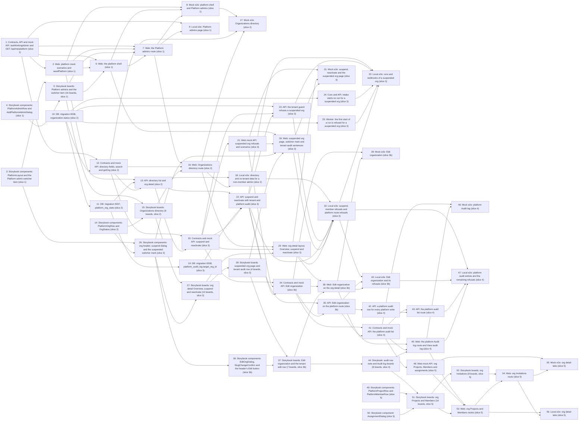

<!-- dev-plan: kind=plan id=platform-admin-dashboard rev=1 hash=10f6c59c576c spec=docs/superpowers/specs/2026-11-23-platform-admin-dashboard-design.md spec-hash=955deb1e0f73 -->
# Platform Admin Dashboard Implementation Plan

> **For agentic workers:** REQUIRED SUB-SKILL: Use superpowers:subagent-driven-development (recommended) or superpowers:executing-plans to implement this plan task-by-task. Steps use checkbox (`- [ ]`) syntax for tracking.

**Goal:** A platform admin gets a `/platform` area in the web app (platform admins, organizations directory, organization detail with Projects, Members and Invitations, Edit organization, suspend and reactivate, platform audit log), a suspended organization is refused to every member and starts no new run from any entry point, and every platform write is audited, without the platform admin ever reading tenant content or secrets.

**Architecture:** Each of the spec's PR slices (1, 2, 3, 3b, 4, 5) opens with a contracts task that also carries the mock API (MSW handlers, DTO fixtures, scenarios) and the `authz.int.test.ts` denial rows for its new route keys, because both tables are complete by type. Backend work then fans out by package: three migrations (0036 status, 0037 `platform_org_stats`, 0038 `platform_audit_log.target_org_id`), the API (platform org list and detail, suspend and reactivate, the tenant guard's org-active step, edit, audit writes and the audit list), the core intake and the worker's first-start refusal. The web side builds presentational components with their stories in parallel, registers the 73 boards along one Storybook chain (the registry files are shared), then wires routes along one chain (`routeTree.gen.ts` is shared), and ends each slice with its mock and local e2e specs.

**Tech Stack:** Zod (contracts), Drizzle and Postgres RLS with a `SECURITY DEFINER` function (db), NestJS on Fastify and better-auth's organization plugin (api), Temporal activities (worker), React, TanStack Router, Query and Form, MSW, Storybook (web), Vitest and Testcontainers, Playwright (mock and local e2e).

**Spec:** `docs/superpowers/specs/2026-11-23-platform-admin-dashboard-design.md` (read it with this plan: BR ids, TC ids, the Copy section, the board list and the per-screen states are defined there and are not repeated here).

## Global Constraints

- Org status: `organization.status text not null default 'active'` with `organization_status_check (status in ('active','suspended'))`; `organization.suspended_at timestamptz null` with `organization_suspended_at_check ((status = 'suspended') = (suspended_at is not null))`. No reason column on `organization`. `OrgStatus = z.enum(['active','suspended'])`.
- better-auth: `status` is declared as an additional organization field with `input: false`; `suspended_at` is not declared.
- `platform_audit_log.target_org_id uuid null`, no FK, index `platform_audit_log_target_org_idx (target_org_id, created_at, id)`; grants stay SELECT, INSERT for `agentdesk_app`; no RLS.
- `platform_org_stats(p_org_ids uuid[])`: `SECURITY DEFINER`, `SET search_path = public, pg_temp`, `REVOKE ALL FROM PUBLIC`, `GRANT EXECUTE TO agentdesk_app`, owner `agentdesk_owner`; raises above 100 ids; returns `org_id`, `project_count int`, `last_activity_at timestamptz` (latest `runs.queued_at`, null when none), `owner_user_id text` (earliest-created org-scope `owner` assignment, null when none). Two new `agentdesk_owner` read policies: `role_assignments` (`scope_type = 'org'`) and `roles` (`key = 'owner'`).
- Migrations are numbered 0036, 0037, 0038 in this plan. Other open plans (rbac-project-admin-space, workspace-env-secrets) also want numbers from 0036 on: renumber to the next free number at build time, with the matching snapshot and journal entry. Never edit an applied migration.
- New permissions, platform level, code only (never seeded into tenant roles): `platform-org:update` (suspend, reactivate, edit) and `platform-audit:read`.
- Suspend and reactivate reason: `OrgStatusChangeRequest = { reason }`, trimmed, 1 to 500 characters, `.strict()`; stored only in the platform audit `payload` through `redactBody`; never in the tenant audit, the problem body, `/api/me/access` or the web message.
- Directory query: `q` max 100 characters, case-insensitive contains on name or slug through a bound parameter with `%`, `_` and `\` escaped; `status` is `OrgStatus`; order `created_at desc, id`.
- Platform audit list: `?page&pageSize&orgId&action`, order `created_at desc, id desc`; `PlatformAuditAction` = `platform_admin.granted`, `platform_admin.revoked`, `org.created`, `org.updated`, `org.suspended`, `org.reactivated`, `assignment.granted`, `assignment.revoked`, `invitation.created`, `invitation.resent`, `invitation.revoked`.
- Tenant guard order: membership (plain 403 for a non-member), org active (403 problem `type: 'org-suspended'` for every member whatever their role, `/api/me/access` included), permission, scope. `ORG_SUSPENDED_PROBLEM_TYPE = 'org-suspended'`. Platform routes and `me.*` `scope: 'user'` routes keep working for a suspended org.
- Webhook: signature check first and unchanged; a verified delivery for a suspended org is recorded as `ignored_org_suspended` in `inbound_events` and answers the body `{ outcome: 'ignored' }`.
- Worker: only the first start (`!resume`) of `createRunSecretAndJob` refuses, right after the `isFinal` check and before any credential read, token mint or Secret write, with `ApplicationFailure.nonRetryable('the organization is suspended', 'OrgSuspended')`; the run reason reads "create run Job failed: the organization is suspended". No workflow code change.
- `GET /api/me/platform` (`scope: 'user'`) returns `PlatformSessionDto = { platformAdmin: boolean }` only.
- Web: `platformAdminQuery` key `['session','platform']`; platform keys `['platform','admins',q]`, `['platform','orgs',q]`, `['platform','orgs',orgId]`, `['platform','orgs',orgId,'members'|'projects'|'invitations',q]`, `['platform','audit',q]`; no optimistic updates. Platform org URLs use the org id.
- Copy strings are the spec's "UI and Storybook › Copy" and "User flows", character for character.
- Tokens only, every shared component has a story, loading, empty and error states required, strict TS (no `any`, no unexplained `!` or cast), no network in tests, never weaken, skip or delete an access test, never mock the access check.
- Storybook boards: 189 today; 262 after the last board task (16 + 6 + 10 + 4 + 7 + 8 + 14 + 8 new); Screens story files 9 to 10 (`screens/platform.stories.tsx`). Each board registers in `design/prototype/project/canvas.json`, `apps/web/src/screens/storyIds.ts` and `apps/web/scripts/parity.mjs` together, with the count in `apps/web/src/test/coverage.test.ts`, and `design/prototype/interactive/` is regenerated (`_tools/build-boards.mjs`, then `_checks/nav-check.mjs`) in the same task.
- **Storybook first (blocker from the spec, not an ordering preference):** no task that implements or wires this UI in `apps/web/src/{app,features}` starts before the Storybook tasks it lists under **Depends on** are merged.
- **Sensitive change:** Tasks 1, 10, 11, 12, 13, 19, 20, 22, 23, 24, 25, 34, 35, 41, 42 and 43 (routes and `routeAccess`, auth and the tenant guard, webhooks and intake, the run's first start, migrations, the definer function and policies, `withOrg` writes, audit writes) get the `review:sensitive` label and a high-effort security review. One concern per PR, about 800 lines or fewer; each task names its slice.

## Review Focus

Inputs the spec implies but no TC names; each has a test in the named task.

1. A platform admin whose role is revoked by another admin while a `/platform` page is open: the next platform request is 403 and the page shows the platform forbidden state (title "You don't have access"), not a crash or a load error: Task 6 (route test, child query answers 403).
2. `GET /api/me/platform` fails (500 or network): the top bar renders without the "Platform admin" item and no crash; `/platform` shows the load error with "Retry": Task 6.
3. A malformed `?org=` on the audit page (`/platform/audit?org=abc`): chip "Unknown organization", an empty list, no request with the bad id and no error state: Task 45.
4. Pressing "Suspend" twice quickly sends one request and writes one change: Task 29 (route test counts MSW requests) and Task 22 (the API already serializes on the row lock).
5. A typed directory URL past the last page after a filter (`/platform/orgs?page=5&q=acme` with one match) lands on the last real page, not an empty table: Task 16 (`useClampToLastPage`).

## Access and tenant data (per route, query, workflow, screen)

| Surface | Permission | Level | Tenant data touched |
| ------- | ---------- | ----- | ------------------- |
| GET `platform.listAdmins`, POST `platform.grantAdmin` (changed DTO) | `platform-admin:read`, `platform-admin:create` | platform | platform users only |
| GET `me.platform` (new) | none; `scope: 'user'`, own data | user | none (a boolean from `platform_admins` and the verified email) |
| GET `platform.listOrgs` (changed query and DTO) | `platform-org:read` | platform | org metadata, member and project counts, last run queue time, one owner's name, handle, email (`platform_org_stats`) |
| GET `platform.getOrg` (new) | `platform-org:read` | platform | same plus the suspension reason and actor (latest `org.suspended` platform audit row) |
| POST `platform.suspendOrg`, `platform.reactivateOrg` (new) | `platform-org:update` | platform | `organization.status`, `suspended_at`; tenant `audit_log` row (under `withOrg(orgId)`); `platform_audit_log` row |
| PATCH `platform.updateOrg` (new) | `platform-org:update` | platform | `organization.name`, `slug`; tenant and platform audit rows |
| GET `platform.listAudit` (new) | `platform-audit:read` | platform | platform audit rows, org ids and names, actor names, admin and invitee emails in labels |
| Existing platform writes (org create, assignment create/remove, invitation create/resend/remove) | unchanged | platform | adds one `platform_audit_log` row each |
| GET `platform.listProjects`, `listMembers`, `listRoles`, `listInvitations` (existing, used by slice 5) | unchanged | platform | project ids and names, member names, handles, emails and assignments, invited emails |
| Every org route, SSE, terminal attach and re-auth, install callback, dev routes (changed guard) | unchanged permission; new org-active step after membership | org/project | `organization.status` read in the membership query |
| Webhook intake and poll (changed) | signature (unchanged) | none | `organization.status` of the resolved org; `inbound_events` outcome |
| Worker `createRunSecretAndJob` first start (changed) | none (internal; `orgId` from the workflow input) | org | `organization.status` in `details()` |
| Web `/platform/*` | `platformAdminQuery` in the `platform.tsx` layout (UI only; API is the authority) | platform | the lists above |
| Web `/o/$org/*` (changed) | unchanged; a 403 `org-suspended` renders `OrgSuspended` | org | none for a suspended org |

Guard order everywhere: platform routes refuse non-admins with 403 before any lookup (an unknown org id gives the same 403); an admin gets 404 for an unknown or malformed org id. Tenant routes: membership, org active, permission (403 before any id lookup), scope (404), then `own`. Every task that adds or changes a route tests the platform admin (2xx), owner of that org, owner of another org, admin, project admin, member, viewer and a no-org user (403), signed out (401), and cross-org reads, through the real `SessionGuard` and `withOrg`.

## Needs approval

None. The spec adds no dependency; every library, service and tool here already exists.

## Agent calls

- Agent call: each slice's contracts task also carries that slice's MSW handlers, DTO fixtures, mock scenarios and `authz.int.test.ts` rows (`DENIAL_TABLE` plus `NOT_REGISTERED_YET`), because `Impl` in `handlers.ts` and `DENIAL_TABLE` are complete by type, so a route key cannot merge without them.
- Agent call: Task 12 fills the new `PlatformOrgDto` fields with placeholder values in `OrgsService.listOrgs` (`status: 'active'`, `suspendedAt: null`, `projectCount: 0`, `lastActivityAt: null`, `owner: null`) and Task 13, in the same slice, replaces them; the slice's PR carries both, so no placeholder ships.
- Agent call: `PlatformOrgDetailDto` and `platform.getOrg` are defined in slice 2 (Task 12) with `suspension` always null until Task 22, because the spec ships `getOrg` in slice 2 ("status shown, no suspension yet") and fixes its response to the detail DTO.
- Agent call: the `PlatformAuditAction` enum lands in Task 20 (slice 3), because the slice-3 audit writer types its actions from it and BR-53's contract test checks it holds `org.updated`; `PlatformAuditEntryDto` and `listAudit` stay in slice 4.
- Agent call: `GET /api/me/platform` is served by a new `apps/api/src/platform-admins/platform-session.controller.ts` in `PlatformAdminsModule`, because it reads `isPlatformAdmin` and nothing from the org modules.
- Agent call: platform view types live beside their fixtures in `apps/web/src/mocks/platform/<area>.ts` (not `mocks/types.ts`), and each board task adds the `@/components` and `@/mocks` barrel lines, so the component tasks share no file and run in parallel.
- Agent call: the board tasks form one chain (5, 15, 27, 28, 37, 44, 51, 52), because every board edits the same registry files, `screens/platform.stories.tsx` and the interactive prototype.
- Agent call: the web route tasks form one chain (6, 7, 16, 29, 38, 45, 53, 54), because each edits `routeTree.gen.ts` or the `features/platform/{queries,mutations,map}.ts` files.
- Agent call: the missing `runs (org_id, queued_at)` index (`runs_org_queued_idx`) is declared in the Drizzle schema and generated into 0036 as a plain `CREATE INDEX`, because the spec places it in 0036 and the migrator runs each file in one transaction (as `0034_user_email_lower_idx.sql`); flagged for review against database.md's concurrent-index row.
- Agent call: two mock scenarios beyond the spec's list, `platformEmpty` (every platform list empty) and `suspendedPlatformAdmin` (a platform admin whose active org is suspended), because TC-4.2, TC-4.5, TC-4.8, TC-4.10 and TC-51.1 have Givens no listed scenario covers.
- Agent call: slow and failing lists in mock e2e use the existing `seedLists` `hold` and `fail` options keyed by route key (`src/mocks/msw/e2eLists.ts`), so no new delay mechanism is added.
- Agent call: `e2e/local/platform-access.spec.ts` grows along one chain (Tasks 18, 32, 40, 47); TC-3.2 lands in Task 47 because it opens `/platform/audit`, which exists from slice 4.
- Agent call: TC-2.1 to TC-2.3 (land on the directory) are written in Task 17, because the directory route arrives in slice 2 and slice 1's `/platform` redirects to `/platform/admins`.
- Agent call: BR-25's API check ("project list returns exactly `{ id, name }`") goes in Task 13, the one task editing `apps/api/test/platform.int.test.ts`.
- Agent call: BR-45 and BR-46 API tests go in a new `apps/api/test/platform-audit-list.int.test.ts`, so Tasks 42 and 43 share no test file (the spec names `platform-audit.int.test.ts` for BR-44 only).
- Agent call: the API test helpers `suspendedOrgApp`, `suspendOrgRoute` and `reactivateOrgRoute` live in `apps/api/test/helpers/auth.ts` (Task 22), next to the other platform route helpers.
- Agent call: ADR-0038 and the guard-order doc updates land with the guard (Task 23); the definer list in database.md §2 and architecture.md §4 lands with 0037 (Task 11); frontend.md §3 with the first platform keys (Task 6); platform-setup.md with the suspend routes (Task 22).
- Agent call: `OrgGeneral.tsx` imports the extracted `SlugChangeConfirm` from `@/components/SlugChangeConfirm` (a deep import, as `@/components/InviteDialog` is used today), so Task 36 does not edit the barrel the board chain owns.
- Agent call: the web parses `?org=` on the audit page with `z.uuid()`; a malformed value shows "Unknown organization" and an empty list without calling the API, because `orgId` is a uuid in the contract and a 400 there would show an error for a typed URL.

Spec note: every TC of the spec's E2E requirements is planned (Tasks 8, 9, 17, 18, 31, 32, 33, 39, 40, 46, 47, 55, 56). The "Not e2e" rules are proved where the spec's Testing table says: BR-35 in Task 22, BR-47 in Task 25.

---

<!-- dev-plan:graph:begin -->
## Task graph

Generated by `dev-plan.mjs graph --write` from each task's **Depends on:** line. Do not edit it by hand.
Tasks in the same wave touch no common file and can be built in parallel; a task starts when everything it depends on is merged.

| Wave | Task | Depends on |
| ---- | ---- | ---------- |
| 1 | Task 1: Contracts, API and mock API: lastWorkingAdmin and GET /api/me/platform (slice 1) | none |
| 1 | Task 3: Storybook components: PlatformLayout and the Platform admin switcher item (slice 1) | none |
| 1 | Task 4: Storybook components: PlatformAdminRow and AddPlatformAdminDialog (slice 1) | none |
| 1 | Task 10: DB: migration 0036, organization status (slice 2) | none |
| 1 | Task 14: Storybook components: PlatformOrgRow and OrgStatus (slice 2) | none |
| 1 | Task 49: Storybook components: PlatformProjectRow and PlatformMemberRow (slice 5) | none |
| 1 | Task 50: Storybook component: AssignmentDialog (slice 5) | none |
| 2 | Task 2: Web: platform mock scenarios and seedPlatform (slice 1) | Task 1 |
| 2 | Task 5: Storybook boards: Platform admins and the switcher item (16 boards, slice 1) | Task 3, Task 4 |
| 2 | Task 11: DB: migration 0037, platform_org_stats (slice 2) | Task 10 |
| 2 | Task 24: Core and API: intake starts no run for a suspended org (slice 3) | Task 10 |
| 2 | Task 25: Worker: the first start of a run is refused for a suspended org (slice 3) | Task 10 |
| 2 | Task 26: Storybook components: org header, suspend dialog and the suspended switcher mark (slice 3) | Task 3, Task 14 |
| 3 | Task 6: Web: the platform shell (slice 1) | Task 1, Task 2, Task 5 |
| 3 | Task 12: Contracts and mock API: directory fields, search and getOrg (slice 2) | Task 1, Task 2 |
| 3 | Task 15: Storybook boards: Organizations directory (6 boards, slice 2) | Task 5, Task 14 |
| 3 | Task 19: DB: migration 0038, platform_audit_log.target_org_id (slice 3) | Task 11 |
| 3 | Task 36: Storybook components: EditOrgDialog, SlugChangeConfirm and the header's Edit button (slice 3b) | Task 26 |
| 4 | Task 7: Web: the Platform admins route (slice 1) | Task 1, Task 2, Task 5, Task 6 |
| 4 | Task 13: API: directory list and org detail (slice 2) | Task 10, Task 11, Task 12 |
| 4 | Task 27: Storybook boards: org detail Overview, suspend and reactivate (10 boards, slice 3) | Task 15, Task 26 |
| 5 | Task 8: Mock e2e: platform shell and Platform admins (slice 1) | Task 2, Task 6, Task 7 |
| 5 | Task 9: Local e2e: Platform admins page (slice 1) | Task 1, Task 7 |
| 5 | Task 16: Web: Organizations directory route (slice 2) | Task 7, Task 12, Task 15 |
| 5 | Task 20: Contracts and mock API: suspend and reactivate (slice 3) | Task 12, Task 13 |
| 5 | Task 28: Storybook boards: suspended org page and tenant audit row (4 boards, slice 3) | Task 27 |
| 6 | Task 17: Mock e2e: Organizations directory (slice 2) | Task 8, Task 12, Task 16 |
| 6 | Task 18: Local e2e: directory and no tenant data for a non-member admin (slice 2) | Task 13, Task 16 |
| 6 | Task 21: Web mock API: suspended org refusals and scenarios (slice 3) | Task 20 |
| 6 | Task 22: API: suspend and reactivate with tenant and platform audit (slice 3) | Task 13, Task 19, Task 20 |
| 6 | Task 29: Web: org detail layout, Overview, suspend and reactivate (slice 3) | Task 16, Task 20, Task 27 |
| 6 | Task 37: Storybook boards: Edit organization and the tenant edit row (7 boards, slice 3b) | Task 28, Task 36 |
| 7 | Task 23: API: the tenant guard refuses a suspended org (slice 3) | Task 10, Task 20, Task 22 |
| 7 | Task 30: Web: suspended org page, switcher mark and tenant audit sentences (slice 3) | Task 6, Task 21, Task 26, Task 28 |
| 7 | Task 34: Contracts and mock API: Edit organization (slice 3b) | Task 20, Task 21, Task 22 |
| 7 | Task 44: Storybook: audit row note and Audit log boards (8 boards, slice 4) | Task 37 |
| 8 | Task 31: Mock e2e: suspend, reactivate and the suspended org page (slice 3) | Task 21, Task 29, Task 30 |
| 8 | Task 32: Local e2e: suspend, member refusals and platform route refusals (slice 3) | Task 18, Task 22, Task 23, Task 29, Task 30 |
| 8 | Task 35: API: Edit organization on the platform route (slice 3b) | Task 22, Task 34 |
| 8 | Task 38: Web: Edit organization on the org detail (slice 3b) | Task 29, Task 34, Task 37 |
| 8 | Task 51: Storybook boards: org Projects and Members (14 boards, slice 5) | Task 44, Task 49, Task 50 |
| 9 | Task 33: Local e2e: runs and webhooks of a suspended org (slice 3) | Task 22, Task 23, Task 24, Task 25, Task 32 |
| 9 | Task 39: Mock e2e: Edit organization (slice 3b) | Task 34, Task 38 |
| 9 | Task 40: Local e2e: Edit organization and its refusals (slice 3b) | Task 32, Task 35, Task 38 |
| 9 | Task 41: Contracts and mock API: the platform audit list (slice 4) | Task 34, Task 35 |
| 9 | Task 42: API: a platform audit row for every platform write (slice 4) | Task 35 |
| 9 | Task 52: Storybook boards: org Invitations (8 boards, slice 5) | Task 51 |
| 10 | Task 43: API: the platform audit list route (slice 4) | Task 41, Task 42 |
| 10 | Task 45: Web: the platform Audit log route and View audit log (slice 4) | Task 38, Task 41, Task 44 |
| 10 | Task 48: Web mock API: org Projects, Members and assignments (slice 5) | Task 41 |
| 11 | Task 46: Mock e2e: platform Audit log (slice 4) | Task 41, Task 45 |
| 11 | Task 47: Local e2e: platform audit entries and the remaining refusals (slice 4) | Task 32, Task 40, Task 43, Task 45 |
| 11 | Task 53: Web: org Projects and Members routes (slice 5) | Task 45, Task 48, Task 51 |
| 12 | Task 54: Web: org Invitations route (slice 5) | Task 52, Task 53 |
| 13 | Task 55: Mock e2e: org detail tabs (slice 5) | Task 48, Task 54 |
| 13 | Task 56: Local e2e: org detail tabs (slice 5) | Task 53, Task 54 |


<!-- dev-plan:graph:end -->

### Task 1: Contracts, API and mock API: `lastWorkingAdmin` and `GET /api/me/platform` (slice 1)

**Depends on:** none

**Files:**

- Modify: `packages/contracts/src/schemas/platform.ts`, `packages/contracts/src/routes.ts`, `packages/contracts/src/route-access.ts`
- Test: `packages/contracts/src/schemas/platform.test.ts`, `packages/contracts/src/routes.test.ts`, `packages/contracts/src/route-access.test.ts`
- Modify: `apps/api/src/platform-admins/platform-admins.service.ts`, `apps/api/src/platform-admins/platform-admins.module.ts`
- Create: `apps/api/src/platform-admins/platform-session.controller.ts`, `apps/api/test/me-platform.int.test.ts`
- Test: `apps/api/test/platform-admins.int.test.ts`, `apps/api/test/authz.int.test.ts`
- Modify: `apps/web/src/mocks/dto/access.ts`, `apps/web/src/mocks/msw/platformAdmins.ts`, `apps/web/src/mocks/msw/handlers.ts`
- Test: `apps/web/src/mocks/msw/contract.test.ts`

**Interfaces:**

- Produces:

```ts
// schemas/platform.ts
PlatformAdminDto: + lastWorkingAdmin: z.boolean()
export const PlatformSessionDto = z.object({ platformAdmin: z.boolean() });
// routes.ts
routes.me.platform = { method: 'GET', path: '/api/me/platform', response: PlatformSessionDto }
// route-access.ts
'me.platform': { scope: 'user' }
// apps/web/src/mocks/msw/platformAdmins.ts
export function withLastWorkingAdmin(entries: PlatformAdminDto[], verifiedEmails: ReadonlySet<string>): PlatformAdminDto[];
```

- [x] **Step 1: Write the failing tests**
  - `platform.test.ts`: `PlatformAdminDto` requires `lastWorkingAdmin` (boolean); `PlatformSessionDto` rejects extra-less `{}`.
  - `routes.test.ts` and `route-access.test.ts`: `me.platform` is GET `/api/me/platform` with `{ scope: 'user' }`; route counts +1.
  - `platform-admins.int.test.ts` (BR-16, fresh DB): the flag is true only for the sole working admin; false on both when two working admins exist; a seeded entry with no account and an entry whose account is unverified or deleted are never flagged and do not count; same value on page 1 and page 2 of a paged list (`pageSize: 1`); list, grant and repeat-grant responses carry it; revoking the flagged entry is 409, any other 204.
  - `me-platform.int.test.ts`: a platform admin gets `{ platformAdmin: true }`, a verified non-admin and an unverified user whose email is in `platform_admins` get false; an `x-org-id` header is ignored; signed out 401; the body has exactly the key `platformAdmin`.
  - `authz.int.test.ts`: `DENIAL_TABLE['me.platform'] = { none: 200, viewer: 200, pa: 200 }`.
  - `contract.test.ts`: every admin fixture parses; `withLastWorkingAdmin` flags only the sole verified entry, none when two are verified.
- [x] **Step 2: Run** `pnpm --filter @agentdesk/contracts exec vitest run src/schemas/platform.test.ts src/routes.test.ts src/route-access.test.ts`. Expected: FAIL.
- [x] **Step 3: Implement** the contracts; in `platform-admins.service.ts`, `list` runs one `count(*)` of working admins (the revoke guard's verified-user join) and selects the matched account's `email_verified`; `toDto(row, workingCount)` sets `lastWorkingAdmin = verified && workingCount === 1`; `grant` and `findPlatformAdmin` use the same mapper. `PlatformSessionController.get(@CurrentSessionUser() user): Promise<PlatformSessionDto>` returns `{ platformAdmin: await isPlatformAdmin(db, user) }`. MSW: the admins store maps every answer through `withLastWorkingAdmin`; `me.platform` answers from the session user's platform flag.
- [x] **Step 4: Run** Step 2's command, `pnpm --filter @agentdesk/api exec vitest run test/platform-admins.int.test.ts test/me-platform.int.test.ts test/authz.int.test.ts`, `pnpm --filter @agentdesk/web exec vitest run src/mocks/msw/contract.test.ts`, and `pnpm --filter @agentdesk/api typecheck && pnpm --filter @agentdesk/web typecheck`. Expected: PASS.
- [x] **Step 5: Commit** (`devbox run fix` first): `feat(contracts): last working admin flag and the me.platform route`. Label `review:sensitive`.

---

### Task 2: Web: platform mock scenarios and `seedPlatform` (slice 1)

**Depends on:** Task 1

**Files:**

- Create: `apps/web/src/mocks/msw/platformScenarios.ts`, `apps/web/src/mocks/msw/platformScenarios.test.ts`
- Modify: `apps/web/src/mocks/msw/platformAdmins.ts`, `apps/web/src/mocks/msw/scenarios.ts`, `apps/web/src/mocks/msw/browser.ts`, `apps/web/e2e/mock/mock.ts`

**Interfaces:**

- Consumes: `withLastWorkingAdmin`, `me.platform` handler (Task 1).
- Produces:

```ts
export const PLATFORM_SCENARIO_KEY = 'agentdesk.mock.platform';
export const PLATFORM_SCENARIOS = ['platformAdminOrgs', 'platformAdminNoOrg', 'ownerNoPlatform', 'lastAdmin', 'revoke409', 'platformEmpty'] as const; // later tasks append
export type PlatformScenario = (typeof PLATFORM_SCENARIOS)[number];
export function applyPlatformScenario(name: PlatformScenario): void;
export function parsePlatformScenario(raw: string | null): PlatformScenario | undefined;
// scenarios.ts
scenarios.platform(name: PlatformScenario): void;
// e2e/mock/mock.ts
export async function seedPlatform(page: Page, scenario: PlatformScenario): Promise<void>;
```

  `platformAdminOrgs`: the signed-in user is a platform admin and an owner of one org. `platformAdminNoOrg`: delegates to the onboarding scenario of the same name. `ownerNoPlatform`: an org owner, not a platform admin. `lastAdmin`: one working admin plus seeded no-account entries filling three pages at the default page size, the working one on page 2 (a variant flag puts it on page 1). `revoke409`: `platform.revokeAdmin` answers 409 with a problem title. `platformEmpty`: no other admin rows (only the signed-in one is removed from the list answer), later tasks add empty orgs and audit.

- [x] **Step 1: Write the failing tests** in `platformScenarios.test.ts` (node MSW server): each scenario's `me.platform` value; `lastAdmin` flags exactly one entry, on page 2; `revoke409` answers 409; `platformEmpty` lists no admins; `parsePlatformScenario` rejects unknown names.
- [x] **Step 2: Run** `pnpm --filter @agentdesk/web exec vitest run src/mocks/msw/platformScenarios.test.ts`. Expected: FAIL.
- [x] **Step 3: Implement** the module (onboardingScenarios style, reset through `mockDb.onReset`), the `browser.ts` read of `PLATFORM_SCENARIO_KEY` from sessionStorage, `scenarios.platform`, and `seedPlatform` (same `addInitScript` pattern as `seedTenantAdmin`).
- [x] **Step 4: Run** Step 2's command, `pnpm --filter @agentdesk/web exec vitest run src/mocks`, `pnpm --filter @agentdesk/web typecheck`. Expected: PASS.
- [x] **Step 5: Commit**: `feat(web): platform mock scenarios`.

---

### Task 3: Storybook components: `PlatformLayout` and the "Platform admin" switcher item (slice 1)

**Depends on:** none

**Files:**

- Create: `apps/web/src/components/PlatformLayout.tsx`, `apps/web/src/components/PlatformLayout.module.css`, `apps/web/src/components/PlatformLayout.stories.tsx`, `apps/web/src/components/PlatformLayout.test.tsx`
- Modify: `apps/web/src/components/OrgSwitch.tsx`, `apps/web/src/components/OrgSwitch.stories.tsx`, `apps/web/src/components/OrgSwitch.test.tsx`

**Interfaces:**

- Produces:

```ts
export interface PlatformLayoutProps {
  active: 'orgs' | 'admins' | 'audit' | 'overview' | 'projects' | 'members' | 'invitations';
  links: { orgs: string; admins: string; audit: string };
  /** Present inside an org: group "<org name>"; an absent link hides its item. */
  org?: { name: string; links: { overview: string; projects?: string; members?: string; invitations?: string } };
  children: ReactNode;
}
export function PlatformLayout(props: PlatformLayoutProps): JSX.Element;
OrgSwitchProps: + platformHref?: string // item "Platform admin" in the bottom group above "Create organization", also in the no-org menu
```

- [x] **Step 1: Write the failing tests**
  - `PlatformLayout.test.tsx`: `nav` labelled "Platform admin" with items "Organizations", "Platform admins", "Audit log"; `active` sets `aria-current="page"`; with `org`, a group headed by the org name lists Overview and only the given links; a long org name renders as text with `title`.
  - `OrgSwitch.test.tsx` (BR-1): with `platformHref`, the menu shows "Platform admin" above "Create organization", also with no orgs and no current org; without it, no such item.
- [x] **Step 2: Run** `pnpm --filter @agentdesk/web exec vitest run src/components/PlatformLayout.test.tsx src/components/OrgSwitch.test.tsx`. Expected: FAIL.
- [x] **Step 3: Implement** the layout with `SubNav` and the geometry of `OrgSettingsLayout`; stories Default, OrgGroup, OrgGroupAllTabs; OrgSwitch stories WithPlatformItem and NoOrgPlatformItem.
- [x] **Step 4: Run** Step 2's command and `pnpm --filter @agentdesk/web exec vitest run src/test/stories.smoke.test.tsx`. Expected: PASS.
- [x] **Step 5: Commit**: `feat(web): platform layout and the platform switcher item in Storybook`.

---

### Task 4: Storybook components: `PlatformAdminRow` and `AddPlatformAdminDialog` (slice 1)

**Depends on:** none

**Files:**

- Create: `apps/web/src/components/PlatformAdminRow.tsx`, `apps/web/src/components/PlatformAdminRow.module.css`, `apps/web/src/components/PlatformAdminRow.stories.tsx`, `apps/web/src/components/PlatformAdminRow.test.tsx`
- Create: `apps/web/src/components/AddPlatformAdminDialog.tsx`, `apps/web/src/components/AddPlatformAdminDialog.stories.tsx`, `apps/web/src/components/AddPlatformAdminDialog.test.tsx`
- Create: `apps/web/src/mocks/platform/admins.ts`

**Interfaces:**

- Produces:

```ts
// mocks/platform/admins.ts
export interface PlatformAdminRowView {
  id: string; email: string; name: string | null; handle: string | null;
  addedAt: { label: string; title: string }; addedBy: string | null;
  you: boolean; neverSignedIn: boolean; lastWorkingAdmin: boolean;
}
export const platformAdminRows: PlatformAdminRowView[]; // you, another admin, a seeded never-signed-in entry
export const pagedPlatformAdminRows: PlatformAdminRowView[]; // 25
// components
export const platformAdminColumns: DataTableColumn[]; // Name, Email, Handle, Added, Added by, Actions
export function PlatformAdminRow(props: { row: PlatformAdminRowView; busy?: boolean; onRevoke: (row: PlatformAdminRowView) => void }): JSX.Element;
export interface AddPlatformAdminDialogProps {
  open: boolean; values: { email: string }; errors: { email?: string }; saving: boolean;
  formError?: { title: string; requestId?: string };
  onChange: (v: { email: string }) => void; onSubmit: () => void; onClose: () => void;
}
export function AddPlatformAdminDialog(props: AddPlatformAdminDialogProps): JSX.Element;
```

- [x] **Step 1: Write the failing tests**: "You" after the name; "Not signed in yet" in place of the name with "—" for handle and added by; `lastWorkingAdmin` disables "Revoke" with visible "Last admin", `title` "Grant the role to someone else first." and `aria-describedby`; the Revoke `aria-label` is "Revoke platform access for <email>"; a name with markup renders as text. Dialog: label "Email", hint text, "Add"/"Adding…", not closable while saving, field error under Email, Banner with problem title and request id.
- [x] **Step 2: Run** `pnpm --filter @agentdesk/web exec vitest run src/components/PlatformAdminRow.test.tsx src/components/AddPlatformAdminDialog.test.tsx`. Expected: FAIL.
- [x] **Step 3: Implement** both with stories (row: Default, You, NeverSignedIn, LastAdmin, Busy; dialog: Idle, Saving, FieldError, FormError).
- [x] **Step 4: Run** Step 2's command and `pnpm --filter @agentdesk/web exec vitest run src/test/stories.smoke.test.tsx`. Expected: PASS.
- [x] **Step 5: Commit**: `feat(web): platform admin row and add dialog in Storybook`.

---

### Task 5: Storybook boards: Platform admins and the switcher item (16 boards, slice 1)

**Depends on:** Task 3, Task 4

**Files:**

- Create: `apps/web/src/screens/PlatformAdmins.tsx`, `apps/web/src/screens/platformFrame.tsx`, `apps/web/src/screens/platform.stories.tsx`, `apps/web/src/screens/platform.test.tsx`
- Modify: `apps/web/src/screens/index.ts`, `apps/web/src/screens/entry.stories.tsx`, `apps/web/src/screens/invitations.stories.tsx`
- Modify: `apps/web/src/components/index.ts`, `apps/web/src/mocks/index.ts`
- Modify: `apps/web/src/screens/storyIds.ts`, `apps/web/scripts/parity.mjs`, `design/prototype/project/canvas.json`, `apps/web/src/test/coverage.test.ts`, `design/parity-notes.md`, `design/prototype/interactive/data/boards.js`, `design/prototype/interactive/board-styles.css`

**Interfaces:**

- Consumes: Tasks 3 and 4 components and fixtures.
- Produces:

```ts
export type PlatformAdminsView =
  | { kind: 'loading' } | { kind: 'error'; title: string; requestId?: string; onRetry: () => void } | { kind: 'forbidden' }
  | { kind: 'ready'; rows: PlatformAdminRowView[]; pagination: PaginationProps; busyId?: string };
export interface PlatformAdminsProps {
  view: PlatformAdminsView; onAdd: () => void; onRevoke: (row: PlatformAdminRowView) => void;
  revokeConfirm?: { row: PlatformAdminRowView; own: boolean; busy: boolean; onConfirm: () => void; onCancel: () => void };
  addDialog?: AddPlatformAdminDialogProps;
}
export function PlatformAdmins(props: PlatformAdminsProps): JSX.Element;
// platformFrame.tsx: top bar with the org switcher reading "No organization" (no Projects or Settings tabs) + PlatformLayout
export function PlatformFrame(props: { active: PlatformLayoutProps['active']; org?: PlatformLayoutProps['org']; children: ReactNode }): JSX.Element;
```

- [x] **Step 1: Write the failing tests** in `platform.test.tsx`: the ready view has h1 "Platform admins" (`tabIndex={-1}`) and the six columns; empty rows show "No platform admins"; the revoke confirm reads "Revoke platform access for <name or email>?" or, own, "Revoke your own platform access?" with "You lose access right away and go to the home page."; busy shows "Revoking…" and cannot close; forbidden shows "You don't have access" / "This area is for platform admins." / "Go to projects".
- [x] **Step 2: Run** `pnpm --filter @agentdesk/web exec vitest run src/screens/platform.test.tsx`. Expected: FAIL.
- [x] **Step 3: Implement** the screen (inline revoke confirm, as `OrgMembers.removeConfirm`), the frame, the stories `PlatformAdmins`, `…Loading`, `…Empty`, `…Error`, `…Forbidden`, `…Paged`, `…Add`, `…AddError`, `…AddFieldErrors`, `…AddSaving`, `…RevokeConfirm`, `…RevokeSelf`, `…Revoking`, `…LastAdmin` (title `Screens/Platform`, fullscreen), `ProjectsOrgSwitchAdminPlatform` in `entry.stories.tsx`, `MyInvitationsEmptyPlatformAdminMenu` in `invitations.stories.tsx`; barrel lines for Tasks 3 and 4; register the 16 boards; coverage 189 to 205 and Screens story files 9 to 10; regenerate the interactive prototype; parity notes.
- [ ] **Step 4: Run** Step 2's command, `pnpm --filter @agentdesk/web exec vitest run src/test/coverage.test.ts src/test/stories.smoke.test.tsx`, `pnpm --filter @agentdesk/web typecheck`, `pnpm --filter @agentdesk/web build-storybook && pnpm --filter @agentdesk/web parity`, then compare `parity-out/<board>.{story,proto}.png` for the 16 boards (never commit `parity-out/`). Expected: PASS.
- [x] **Step 5: Commit**: `feat(web): platform admins boards in Storybook`.

---

### Task 6: Web: the platform shell (slice 1)

**Depends on:** Task 1, Task 2, Task 5

**Files:**

- Modify: `apps/web/src/features/access/keys.ts`, `apps/web/src/features/access/queries.ts`, `apps/web/src/features/chrome/appBar.ts`, `apps/web/src/features/orgs/orgSwitch.ts`, `apps/web/src/app/boundaries.tsx`
- Create: `apps/web/src/app/routes/platform.tsx`, `apps/web/src/app/routes/platform.index.tsx`, `apps/web/src/features/platform/keys.ts`, `apps/web/src/features/platform/keys.test.ts`, `apps/web/src/features/platform/shell.route.test.tsx`
- Modify: `apps/web/src/app/routeTree.gen.ts`
- Test: `apps/web/src/features/chrome/appBar.test.tsx`, `apps/web/src/features/orgs/orgSwitch.route.test.tsx`
- Modify: `docs/conventions/frontend.md`

**Interfaces:**

- Consumes: `routes.me.platform` (Task 1), `scenarios.platform` (Task 2), `PlatformFrame`, `PlatformAdmins` forbidden view (Task 5).
- Produces:

```ts
accessKeys.platform = () => ['session', 'platform'] as const;
export const platformAdminQuery: UseQueryOptions<PlatformSessionDto>; // GET /api/me/platform
export const platformKeys = {
  all: () => ['platform'] as const,
  admins: (q: PageQuery) => ['platform', 'admins', q] as const,
  orgs: (q: object) => ['platform', 'orgs', q] as const,
  org: (orgId: string) => ['platform', 'orgs', orgId] as const,
  orgList: (orgId: string, list: 'members' | 'projects' | 'invitations', q: object) => ['platform', 'orgs', orgId, list, q] as const,
  audit: (q: object) => ['platform', 'audit', q] as const,
};
export function PlatformForbidden(): JSX.Element; // boundaries.tsx
// useAppBar: OrgSwitchProps.platformHref = '/platform' when platformAdminQuery says true (org and personal pages); the switcher's platformAdmin flag comes from the same query
```

- [x] **Step 1: Write the failing tests**
  - `keys.test.ts`: every platform key starts with `'platform'`; `setActiveOrganization` (removes `['org']`) keeps `['platform', …]` and `['session','platform']` data.
  - `appBar.test.tsx` and `orgSwitch.route.test.tsx` (BR-1): the item shows for a platform admin on an org page and in the no-org menu, never for `ownerNoPlatform`; Review Focus 2: `me.platform` 500 hides the item with no crash.
  - `shell.route.test.tsx` (BR-2, BR-3): `/platform` redirects to `/platform/admins`; the top bar shows "No organization" and no Projects or Settings tabs; `ownerNoPlatform` on `/platform/admins` sees "You don't have access" with the normal org top bar and MSW logs zero `/api/platform/*` requests; signed out goes to sign-in; Review Focus 1: a child platform query answering 403 shows the same forbidden state; Review Focus 2: `me.platform` 500 on `/platform` shows the load error with "Retry".
- [x] **Step 2: Run** `pnpm --filter @agentdesk/web exec vitest run src/features/platform src/features/chrome src/features/orgs/orgSwitch.route.test.tsx`. Expected: FAIL.
- [x] **Step 3: Implement** the query and keys, the `platform.tsx` layout (loader `ensureQueryData(platformAdminQuery)`, renders `PlatformForbidden` itself for a non-admin, `errorComponent` maps a 403 to it, `PlatformFrame` otherwise), `platform.index.tsx` redirect, the app-bar change; regenerate `routeTree.gen.ts` with the Vite plugin. frontend.md §3: platform keys start `['platform', …]` and `['session','platform']` (amends "every key starts `['org', slug]`").
- [ ] **Step 4: Run** Step 2's command and `pnpm --filter @agentdesk/web typecheck`. Expected: PASS.
- [ ] **Step 5: Commit**: `feat(web): platform area shell and the platform admin switcher item`.

---

### Task 7: Web: the Platform admins route (slice 1)

**Depends on:** Task 1, Task 2, Task 5, Task 6

**Files:**

- Create: `apps/web/src/app/routes/platform.admins.tsx`, `apps/web/src/features/platform/queries.ts`, `apps/web/src/features/platform/mutations.ts`, `apps/web/src/features/platform/map.ts`, `apps/web/src/features/platform/map.test.ts`, `apps/web/src/features/platform/admins.route.test.tsx`
- Modify: `apps/web/src/app/routeTree.gen.ts`

**Interfaces:**

- Consumes: `platformKeys`, `platformAdminQuery`, `PlatformForbidden` (Task 6); `PlatformAdmins` (Task 5); `lastAdmin`, `revoke409` (Task 2).
- Produces:

```ts
export const platformAdminsQuery: (q: PageQuery) => UseQueryOptions<Page<PlatformAdminDto>>;
export function useGrantPlatformAdmin(): UseMutationResult<PlatformAdminDto, ApiError, GrantPlatformAdminRequest>;
export function useRevokePlatformAdmin(): UseMutationResult<void, ApiError, { adminId: string; own: boolean }>;
export function toPlatformAdminRow(dto: PlatformAdminDto, sessionUserId: string, now: Date): PlatformAdminRowView;
```

- [x] **Step 1: Write the failing tests**
  - `map.test.ts` (BR-5 to BR-7, BR-16): "You" when `session.user.id === entry.userId`; `neverSignedIn` when `userId` is null; `lastWorkingAdmin` copied from the DTO; relative added time with the full date in `title` from a fixed `now`.
  - `admins.route.test.tsx`: paged list with `?page=N` (BR-5); grant closes the dialog, toasts "Platform admin added", refetches (BR-8); 400 shows the schema message, 404 "No account has this email yet.", 422 "This email is not verified yet." under Email with input kept (BR-9 to BR-11); 403/5xx show the dialog Banner; repeat grant 200 closes with no error and one entry (BR-12); confirm Revoke toasts "Platform admin revoked", refetches, focuses the h1 (BR-13); Cancel keeps the row (BR-14); own revoke removes `accessKeys.session()` and `['session','platform']` and lands on `/` (BR-15); `lastAdmin` disables Revoke with "Last admin" on page 2 and leaves page 1 enabled (BR-16); `revoke409` toasts the problem title and refetches (BR-17); loading, empty and `serverError` with Retry (BR-4); an admin name `` renders as text.
- [x] **Step 2: Run** `pnpm --filter @agentdesk/web exec vitest run src/features/platform`. Expected: FAIL.
- [x] **Step 3: Implement** the route (`Pagination` + `?page=N` + `usePageSize()`, `useClampToLastPage`), TanStack Form with `GrantPlatformAdminRequest` and `fieldErrorsFromProblem`, the mutations (invalidate `['platform','admins']`), the mapper; regenerate `routeTree.gen.ts`.
- [ ] **Step 4: Run** Step 2's command and `pnpm --filter @agentdesk/web typecheck`. Expected: PASS.
- [x] **Step 5: Commit**: `feat(web): platform admins page`.

---

### Task 8: Mock e2e: platform shell and Platform admins (slice 1)

**Depends on:** Task 2, Task 6, Task 7

**Files:**

- Create: `apps/web/e2e/mock/platform-shell.spec.ts`, `apps/web/e2e/mock/platform-admins.spec.ts`

**Interfaces:** Consumes `seedPlatform` with `platformAdminOrgs`, `platformAdminNoOrg`, `ownerNoPlatform`, `lastAdmin`, `revoke409`, `platformEmpty` (Task 2), `startSignedOut`, `seedLists` `hold`/`fail` on `platform.listAdmins`.

Covers: BR-1 (TC-1.1, TC-1.2, TC-1.3), BR-3 (TC-3.1, TC-3.3, TC-3.4) in `platform-shell.spec.ts`; BR-4 (TC-4.1, TC-4.2, TC-4.3), BR-5 (TC-5.1, TC-5.3), BR-6 (TC-6.1), BR-7 (TC-7.1), BR-9 (TC-9.1 to TC-9.4), BR-10 (TC-10.1), BR-11 (TC-11.1), BR-14 (TC-14.1), BR-15 (TC-15.1), BR-16 (TC-16.1, TC-16.2, TC-16.3), BR-17 (TC-17.1) in `platform-admins.spec.ts`. Role-based case: TC-1.3 and TC-3.1.

- [x] **Step 1: Write the specs** with the spec's strings; TC-3.1 records requests with `page.on('request')` and expects none to `/api/platform/`; TC-9.x assert only that an error shows at the Email field (spec open question Q1); fixed clock `SESSION_MOCK_NOW`, `timezoneId: 'UTC'`; never a sleep.
- [ ] **Step 2: Run** `pnpm --filter @agentdesk/web exec vite build --mode mock`, then `pnpm --filter @agentdesk/web exec playwright test e2e/mock/platform-shell.spec.ts e2e/mock/platform-admins.spec.ts`. Expected: PASS.
- [ ] **Step 3: Commit**: `test(web): mock e2e for the platform shell and admins page`.

---

### Task 9: Local e2e: Platform admins page (slice 1)

**Depends on:** Task 1, Task 7

**Files:**

- Create: `apps/web/e2e/local/platform-admins-ui.spec.ts`

**Interfaces:** Consumes `asPlatformAdmin`, `freshUser`, `grantPlatformAdmin`, `revokePlatformAdmin`, `platformAdminContext`, `signInAs` (`e2e/local/helpers.ts`).

Covers: BR-5 (TC-5.2), BR-6 (TC-6.2), BR-8 (TC-8.1), BR-12 (TC-12.1), BR-13 (TC-13.1), BR-15 (TC-15.2), BR-16 (TC-16.4). BR-11 and BR-16's disabled side are Not e2e on local (Task 1, Task 8).

- [x] **Step 1: Write the spec**: every granted user is revoked in `finally` (errors swallowed); never revoke `admin@dev.local`; rows found by email, never by position.
- [ ] **Step 2: Run** with the stack up (`devbox run dev`): `pnpm --filter @agentdesk/web exec playwright test e2e/local/platform-admins-ui.spec.ts`. Expected: PASS. If the stack cannot start, list the spec in the PR as written and not run.
- [ ] **Step 3: Commit**: `test(web): local e2e for the platform admins page`.

---

### Task 10: DB: migration 0036, organization status (slice 2)

**Depends on:** none

**Files:**

- Modify: `packages/db/src/schema/auth.ts`, `packages/db/src/schema/app.ts`
- Create: `packages/db/migrations/0036_organization_status.sql`, `packages/db/migrations/meta/0036_snapshot.json`
- Modify: `packages/db/migrations/meta/_journal.json`
- Test: `packages/db/test/migrate.int.test.ts`

**Interfaces:**

- Produces: Drizzle `organization.status` (`text('status').notNull().default('active')`, check `organization_status_check`), `organization.suspendedAt` (`timestamp('suspended_at', { withTimezone: true })`, check `organization_suspended_at_check`); index `runs_org_queued_idx` on `runs (org_id, queued_at)`.

- [x] **Step 1: Write the failing tests** in `migrate.int.test.ts`, new describe "organization status on an upgraded database": a DB migrated to 0035 with two orgs; after the rest, both read `status = 'active'`, `suspended_at` null; an update to `status = 'paused'` fails on `organization_status_check`; `status = 'suspended'` with null `suspended_at` and `status = 'active'` with a time both fail on `organization_suspended_at_check`; `runs_org_queued_idx` exists.
- [x] **Step 2: Run** `pnpm --filter @agentdesk/db exec vitest run test/migrate.int.test.ts`. Expected: FAIL.
- [x] **Step 3: Implement** the columns, checks and index in the schema and generate 0036 with drizzle-kit (review the SQL; constant defaults only).
- [x] **Step 4: Run** Step 2's command, `pnpm --filter @agentdesk/db exec vitest run test/rls.int.test.ts`, `pnpm --filter @agentdesk/db typecheck && pnpm --filter @agentdesk/api typecheck`. Expected: PASS.
- [x] **Step 5: Commit**: `feat(db): organization status and suspended_at`. Label `review:sensitive` (migration).

---

### Task 11: DB: migration 0037, `platform_org_stats` (slice 2)

**Depends on:** Task 10

**Files:**

- Create: `packages/db/migrations/0037_platform_org_stats.sql`, `packages/db/migrations/meta/0037_snapshot.json`
- Modify: `packages/db/migrations/meta/_journal.json`, `packages/db/src/functions.ts`, `packages/db/src/index.ts`
- Test: `packages/db/test/functions.int.test.ts`, `packages/db/test/migrate.int.test.ts`
- Modify: `docs/conventions/database.md`, `docs/conventions/architecture.md`

**Interfaces:**

- Produces:

```ts
export interface PlatformOrgStatsRow { orgId: string; projectCount: number; lastActivityAt: Date | null; ownerUserId: string | null }
/** Platform directory: counts, last run queue time and the earliest org-scope owner per org (SECURITY DEFINER). At most 100 ids. */
export async function platformOrgStats(db: Db, orgIds: readonly string[]): Promise<PlatformOrgStatsRow[]>;
```

- [x] **Step 1: Write the failing tests**
  - `functions.int.test.ts`: two orgs with projects, runs and owner assignments: counts per org, `lastActivityAt` = latest `queued_at`, the earliest of two owner assignments, null owner and null activity for a bare org; an empty array returns `[]`; 101 ids raise; an unknown id returns no row; the result columns are exactly the four (no ticket, run or comment text).
  - `migrate.int.test.ts`: the function is `prosecdef`, its `proconfig` pins `search_path=public, pg_temp`, `agentdesk_app` may execute it and PUBLIC may not; the two policies exist for `agentdesk_owner` with their predicates; as `agentdesk_app` without `withOrg`, `select count(*) from role_assignments` and `from roles` return 0.
- [x] **Step 2: Run** `pnpm --filter @agentdesk/db exec vitest run test/functions.int.test.ts test/migrate.int.test.ts`. Expected: FAIL.
- [x] **Step 3: Implement** the hand-written migration (like 0001 and 0025: function, owner, revoke, grant, the two `definer_read`-style policies), its journal entry and copied snapshot, the wrapper (`db.pool.query` with `$1::uuid[]`, throws above 100 before the call), the export. database.md §2 and architecture.md §4: five definer functions; "ids, counts and timestamps" (cite the spec; ADR-0038 follows in Task 23).
- [x] **Step 4: Run** Step 2's command, `pnpm --filter @agentdesk/db exec vitest run test/rls.int.test.ts`, `pnpm --filter @agentdesk/db typecheck`. Expected: PASS.
- [x] **Step 5: Commit**: `feat(db): platform_org_stats definer function`. Label `review:sensitive` (migration, definer, RLS policies).

---

### Task 12: Contracts and mock API: directory fields, search and `getOrg` (slice 2)

**Depends on:** Task 1, Task 2

**Files:**

- Modify: `packages/contracts/src/enums.ts`, `packages/contracts/src/schemas/platform.ts`, `packages/contracts/src/routes.ts`, `packages/contracts/src/route-access.ts`
- Test: `packages/contracts/src/schemas/platform.test.ts`, `packages/contracts/src/routes.test.ts`, `packages/contracts/src/route-access.test.ts`
- Modify: `apps/api/src/orgs/orgs.service.ts`, `apps/api/test/authz.int.test.ts`
- Create: `apps/web/src/mocks/dto/platform.ts`, `apps/web/src/mocks/msw/platformOrgs.ts`
- Modify: `apps/web/src/mocks/dto/access.ts`, `apps/web/src/mocks/msw/handlers.ts`, `apps/web/src/mocks/msw/platformScenarios.ts`
- Test: `apps/web/src/mocks/msw/contract.test.ts`, `apps/web/src/mocks/msw/platformScenarios.test.ts`

**Interfaces:**

- Produces:

```ts
export const OrgStatus = z.enum(['active', 'suspended']);
export const PlatformOrgOwnerDto = z.object({ userId: z.string(), name: z.string(), handle: z.string().nullable(), email: z.string() });
PlatformOrgDto: + status: OrgStatus, suspendedAt: Timestamp.nullable(), projectCount: z.number().int().min(0),
                 lastActivityAt: Timestamp.nullable(), owner: PlatformOrgOwnerDto.nullable()
export const PlatformOrgSuspensionDto = z.object({ at: Timestamp, reason: z.string(), by: z.object({ userId: z.string(), name: z.string(), handle: z.string().nullable() }).nullable() });
export const PlatformOrgDetailDto = PlatformOrgDto.extend({ suspension: PlatformOrgSuspensionDto.nullable() });
export const ORG_SEARCH_MAX = 100;
export const PlatformOrgListQuery = PageQuery.extend({ q: z.string().trim().max(ORG_SEARCH_MAX).optional(), status: OrgStatus.optional() });
routes.platform.listOrgs.query = PlatformOrgListQuery
routes.platform.getOrg = { method: 'GET', path: '/api/platform/orgs/:orgId', params: orgParams, response: PlatformOrgDetailDto }
routeAccess['platform.getOrg'] = platform('platform-org:read')
// mocks/msw/platformOrgs.ts (stateful, reset through mockDb.onReset)
export function listPlatformOrgs(q: PlatformOrgListQuery): Page<PlatformOrgDto>;
export function getPlatformOrg(orgId: string): PlatformOrgDetailDto; // throws notFound()
// mocks/dto/platform.ts
export const platformOrgDtoFixtures: PlatformOrgDto[]; // active, suspended, no owner, two owners (earliest shown), no activity, long name, "Acme"/acme, "Beta"/beta-labs
```

- [x] **Step 1: Write the failing tests**
  - `platform.test.ts` (BR-18 to BR-20 contract): the new keys; `owner` and `lastActivityAt` nullable; `PlatformOrgListQuery` accepts `{}`, `{q: 'a'.repeat(100)}`, `{status: 'suspended'}`; rejects `{q: 'a'.repeat(101)}`, `{status: 'deleted'}`.
  - `routes.test.ts`, `route-access.test.ts`: `platform.getOrg` path, method and entry; counts +1.
  - `authz.int.test.ts`: `'platform.getOrg': platformRoute(200)` and the key in `NOT_REGISTERED_YET`.
  - `contract.test.ts`: the fixtures parse; `listPlatformOrgs({q: 'ACME'})` returns only Acme, `{q: 'labs'}` only Beta, `{status: 'suspended'}` only suspended rows, `{q: '%'}` none; `getPlatformOrg('unknown')` is a 404.
  - `platformScenarios.test.ts`: `platformAdminOrgs` lists the directory fixtures; `platformEmpty` lists no org.
- [x] **Step 2: Run** `pnpm --filter @agentdesk/contracts exec vitest run`. Expected: FAIL.
- [x] **Step 3: Implement** the contracts; in `orgs.service.ts` `listOrgs` returns the placeholder values named in the Agent calls (Task 13 replaces them); the MSW store, handlers (`platform.listOrgs`, `platform.getOrg`, `platform.createOrg` adds to the store with `owner: null`) and the two scenarios' org data; move the old `platformOrgFixtures` users to the new store.
- [x] **Step 4: Run** Step 2's command, `pnpm --filter @agentdesk/api typecheck`, `pnpm --filter @agentdesk/api exec vitest run test/authz.int.test.ts`, `pnpm --filter @agentdesk/web exec vitest run src/mocks`, `pnpm --filter @agentdesk/web typecheck`. Expected: PASS.
- [x] **Step 5: Commit**: `feat(contracts): platform directory fields, search and org detail route`. Label `review:sensitive` (routeAccess).

---

### Task 13: API: directory list and org detail (slice 2)

**Depends on:** Task 10, Task 11, Task 12

**Files:**

- Modify: `apps/api/src/orgs/orgs.service.ts`, `apps/api/src/orgs/platform-orgs.controller.ts`
- Test: `apps/api/test/platform.int.test.ts`, `apps/api/test/authz.int.test.ts`

**Interfaces:**

- Consumes: `platformOrgStats` (Task 11), `organization.status` (Task 10), `PlatformOrgListQuery`, `PlatformOrgDetailDto` (Task 12).
- Produces:

```ts
OrgsService.listOrgs(q: PlatformOrgListQuery): Promise<Page<PlatformOrgDto>>;
OrgsService.getOrg(orgId: string): Promise<PlatformOrgDetailDto>; // 404 'Organization not found'; suspension null until Task 22
/** Escapes \, % and _ for a LIKE pattern bound as a parameter with ESCAPE '\'. */
export function likeContains(text: string): string; // in orgs.service.ts
PlatformOrgsController.get(@CurrentPlatformAdmin() admin, @Param() p: { orgId: string }): Promise<PlatformOrgDetailDto>;
```

- [x] **Step 1: Write the failing tests** in `platform.int.test.ts`:
  - BR-18, BR-19: exact keys per row; newest first; a no-owner org has `owner: null`; an org with two owners shows the earlier one; no run gives `lastActivityAt: null`, a run gives its `queued_at`; `pageSize: 100` cap; `status: 'active'` on every existing org.
  - BR-20: `q` case-insensitive on name and on slug; `%`, `_` and `\` match only literally; `status=suspended` (set through `withOrg` in the test until Task 22 adds the route) returns only it; `total` follows the same filter; 400 for a 101-character `q`.
  - BR-24: `getOrg` 200 with the detail and `suspension: null`; 404 unknown id and malformed id for the admin; 403 before lookup for owner, admin, project admin, member, viewer and a no-org user, with an unknown id giving the same 403; 401 signed out; `x-org-id` ignored.
  - BR-25: `listProjects` returns exactly `{ id, name }` per project.
  - BR-23: the existing "BR-38" case (platform admin gets no tenant data) stays green.
  - `authz.int.test.ts`: remove `platform.getOrg` from `NOT_REGISTERED_YET`.
- [x] **Step 2: Run** `pnpm --filter @agentdesk/api exec vitest run test/platform.int.test.ts`. Expected: FAIL.
- [x] **Step 3: Implement** `listOrgs` (one count and one page query with the same WHERE, `lower(name) like $1 escape '\' or lower(slug) like $1 escape '\'`, then one `platformOrgStats(ids)` call and one `user` lookup for the owner ids, on plain `db.orm`), `getOrg` (same row mapping for one id), the controller route; info log on nothing (reads only).
- [x] **Step 4: Run** Step 2's command, `pnpm --filter @agentdesk/api exec vitest run test/authz.int.test.ts test/scope.int.test.ts`, `pnpm --filter @agentdesk/api typecheck`. Expected: PASS.
- [x] **Step 5: Commit**: `feat(api): platform directory with owner, counts, status and search; org detail`. Label `review:sensitive`.

---

### Task 14: Storybook components: `PlatformOrgRow` and `OrgStatus` (slice 2)

**Depends on:** none

**Files:**

- Create: `apps/web/src/components/PlatformOrgRow.tsx`, `apps/web/src/components/PlatformOrgRow.module.css`, `apps/web/src/components/PlatformOrgRow.stories.tsx`, `apps/web/src/components/PlatformOrgRow.test.tsx`
- Create: `apps/web/src/components/OrgStatus.tsx`, `apps/web/src/components/OrgStatus.module.css`, `apps/web/src/components/OrgStatus.stories.tsx`, `apps/web/src/components/OrgStatus.test.tsx`
- Create: `apps/web/src/mocks/platform/orgs.ts`

**Interfaces:**

- Produces:

```ts
// mocks/platform/orgs.ts
export type OrgStatusView = 'active' | 'suspended';
export interface PlatformOrgRowView {
  id: string; name: string; slug: string; href: string; owner: string | null; members: number; projects: number;
  lastActivity: { label: string; title: string } | null; status: OrgStatusView; created: { label: string; title: string };
}
export const platformOrgRows: PlatformOrgRowView[]; // active, suspended, no owner, no activity, long name
export const pagedPlatformOrgRows: PlatformOrgRowView[]; // 25
// components
export function OrgStatus(props: { status: OrgStatusView }): JSX.Element; // "Active" green check disc (ok), "Suspended" orange pause disc (--late)
export const platformOrgColumns: DataTableColumn[]; // Organization, Owner, Members, Projects, Last activity, Status, Created
export function PlatformOrgRow(props: { row: PlatformOrgRowView }): JSX.Element;
```

- [x] **Step 1: Write the failing tests**: OrgStatus shows glyph plus text for both states; the row name is a link to `href` with `/o/<slug>` in mono beside it; "No owner yet" and "No activity yet"; relative times carry the full date in `title`; a long name ellipsizes with `title`; markup in a name renders as text.
- [x] **Step 2: Run** `pnpm --filter @agentdesk/web exec vitest run src/components/PlatformOrgRow.test.tsx src/components/OrgStatus.test.tsx`. Expected: FAIL.
- [x] **Step 3: Implement** both with stories (OrgStatus: Active, Suspended; row: Default, Suspended, NoOwner, NoActivity, LongName).
- [x] **Step 4: Run** Step 2's command and `pnpm --filter @agentdesk/web exec vitest run src/test/stories.smoke.test.tsx`. Expected: PASS.
- [x] **Step 5: Commit**: `feat(web): platform org row and org status in Storybook`.

---

### Task 15: Storybook boards: Organizations directory (6 boards, slice 2)

**Depends on:** Task 5, Task 14

**Files:**

- Create: `apps/web/src/screens/PlatformOrgs.tsx`
- Modify: `apps/web/src/screens/platform.stories.tsx`, `apps/web/src/screens/platform.test.tsx`, `apps/web/src/screens/index.ts`, `apps/web/src/components/index.ts`, `apps/web/src/mocks/index.ts`
- Modify: `apps/web/src/screens/storyIds.ts`, `apps/web/scripts/parity.mjs`, `design/prototype/project/canvas.json`, `apps/web/src/test/coverage.test.ts`, `design/parity-notes.md`, `design/prototype/interactive/data/boards.js`, `design/prototype/interactive/board-styles.css`

**Interfaces:**

- Produces:

```ts
export type PlatformOrgsView =
  | { kind: 'loading' } | { kind: 'error'; title: string; requestId?: string; onRetry: () => void }
  | { kind: 'ready'; rows: PlatformOrgRowView[]; pagination: PaginationProps; busy?: boolean };
export interface PlatformOrgsProps {
  view: PlatformOrgsView; filters: { q: string; status: 'all' | OrgStatusView; active: boolean };
  onSearch: (q: string) => void; onStatus: (s: 'all' | OrgStatusView) => void; onClearFilters: () => void; createHref: string;
}
export function PlatformOrgs(props: PlatformOrgsProps): JSX.Element;
```

- [x] **Step 1: Write the failing tests** in `platform.test.tsx`: h1 "Organizations", "Create organization" links to `createHref`, search labelled "Search organizations" (`maxLength` 100), status select "All statuses / Active / Suspended"; empty unfiltered "No organizations yet" / "Create one to invite its first owner."; empty filtered "No organizations match" with "Clear filters"; the table scrolls horizontally inside `main`.
- [x] **Step 2: Run** `pnpm --filter @agentdesk/web exec vitest run src/screens/platform.test.tsx`. Expected: FAIL.
- [x] **Step 3: Implement** the screen and stories `PlatformOrgs`, `…Loading`, `…Empty`, `…EmptyFiltered`, `…Error`, `…Paged`; barrel lines for Task 14; register the 6 boards; coverage 205 to 211; regenerate the interactive prototype; parity notes.
- [ ] **Step 4: Run** the same commands as Task 5 Step 4 for these 6 boards. Expected: PASS.
- [x] **Step 5: Commit**: `feat(web): organizations directory boards in Storybook`.

---

### Task 16: Web: Organizations directory route (slice 2)

**Depends on:** Task 7, Task 12, Task 15

**Files:**

- Create: `apps/web/src/app/routes/platform.orgs.index.tsx`, `apps/web/src/features/platform/orgs.route.test.tsx`
- Modify: `apps/web/src/app/routes/platform.index.tsx`, `apps/web/src/app/routeTree.gen.ts`, `apps/web/src/features/platform/queries.ts`, `apps/web/src/features/platform/map.ts`, `apps/web/src/features/platform/map.test.ts`

**Interfaces:**

- Consumes: `platform.listOrgs` with `PlatformOrgListQuery` (Task 12), `PlatformOrgs` (Task 15), `platformKeys.orgs` (Task 6).
- Produces:

```ts
export const platformOrgsQuery: (q: PlatformOrgListQuery) => UseQueryOptions<Page<PlatformOrgDto>>;
export function toPlatformOrgRow(dto: PlatformOrgDto, now: Date): PlatformOrgRowView; // href `/platform/orgs/<id>`
// route search: { page?: number; q?: string; status?: OrgStatus }
```

- [x] **Step 1: Write the failing tests**
  - `map.test.ts`: owner name or "No owner yet"; `lastActivity` null for no run, else relative with `title`; status passthrough.
  - `orgs.route.test.tsx` (BR-18 to BR-21): rows newest first; typing `ACME` puts `q` in the URL (fake timers if the input is debounced) and lists only Acme; the status select puts `status` in the URL; a filter change resets `page` to 1 (TC-20.5); "Clear filters" clears both; "Create organization" goes to `/orgs/new`; loading, empty, filtered empty and `serverError` with Retry (BR-4); `/platform` now redirects to `/platform/orgs`; Review Focus 5: `?page=5&q=acme` with one match lands on page 1.
- [x] **Step 2: Run** `pnpm --filter @agentdesk/web exec vitest run src/features/platform`. Expected: FAIL.
- [x] **Step 3: Implement** the route (search params validated with Zod, `keepPreviousData`, `useClampToLastPage`), the query and mapper, the index redirect change; regenerate `routeTree.gen.ts`.
- [ ] **Step 4: Run** Step 2's command, `pnpm --filter @agentdesk/web exec vitest run src/features/orgs/createOrg.route.test.tsx`, `pnpm --filter @agentdesk/web typecheck`. Expected: PASS.
- [x] **Step 5: Commit**: `feat(web): organizations directory with search and status filter`.

---

### Task 17: Mock e2e: Organizations directory (slice 2)

**Depends on:** Task 8, Task 12, Task 16

**Files:**

- Create: `apps/web/e2e/mock/platform-orgs.spec.ts`
- Modify: `apps/web/e2e/mock/platform-shell.spec.ts`

**Interfaces:** Consumes `seedPlatform` (`platformAdminOrgs`, `platformAdminNoOrg`, `platformEmpty`), `seedLists` `hold`/`fail` on `platform.listOrgs`.

Covers: BR-2 (TC-2.1, TC-2.2, TC-2.3) in `platform-shell.spec.ts`; BR-4 (TC-4.4, TC-4.5, TC-4.6), BR-18 (TC-18.1, TC-18.3), BR-19 (TC-19.1), BR-20 (TC-20.1 to TC-20.5), BR-21 (TC-21.1), BR-22 (TC-22.1 to TC-22.4) in `platform-orgs.spec.ts`.

- [x] **Step 1: Write the specs**; search uses `expect.poll`/`toHaveURL`, never a sleep.
- [ ] **Step 2: Run** the mock build, then `pnpm --filter @agentdesk/web exec playwright test e2e/mock/platform-orgs.spec.ts e2e/mock/platform-shell.spec.ts`. Expected: PASS.
- [x] **Step 3: Commit**: `test(web): mock e2e for the organizations directory`.

---

### Task 18: Local e2e: directory and no tenant data for a non-member admin (slice 2)

**Depends on:** Task 13, Task 16

**Files:**

- Create: `apps/web/e2e/local/platform-orgs.spec.ts`, `apps/web/e2e/local/platform-access.spec.ts`

**Interfaces:** Consumes `asPlatformAdmin`, `createOrg`, `inviteAndSignIn`, `signInAndCreateProject`, `platformAdminContext`.

Covers: BR-18 (TC-18.2), BR-19 (TC-19.2), BR-20 (TC-20.6), BR-21 (TC-21.2) in `platform-orgs.spec.ts`; BR-23 (TC-23.1, TC-23.2) in `platform-access.spec.ts` (role-based: platform admin without membership gets no org data).

- [x] **Step 1: Write the specs**: fresh `e2e-<rand>` orgs only; rows found by searching the fresh slug, never by position or global count.
- [ ] **Step 2: Run** with the stack up: `pnpm --filter @agentdesk/web exec playwright test e2e/local/platform-orgs.spec.ts e2e/local/platform-access.spec.ts`. Expected: PASS.
- [x] **Step 3: Commit**: `test(web): local e2e for the organizations directory`.

---

### Task 19: DB: migration 0038, `platform_audit_log.target_org_id` (slice 3)

**Depends on:** Task 11

**Files:**

- Modify: `packages/db/src/schema/platform.ts`
- Create: `packages/db/migrations/0038_platform_audit_target_org.sql`, `packages/db/migrations/meta/0038_snapshot.json`
- Modify: `packages/db/migrations/meta/_journal.json`
- Test: `packages/db/test/migrate.int.test.ts`

**Interfaces:**

- Produces: Drizzle `platformAuditLog.targetOrgId` (`uuid('target_org_id')`, nullable), index `platform_audit_log_target_org_idx` on `(target_org_id, created_at, id)`.

- [x] **Step 1: Write the failing test** in `migrate.int.test.ts`: a DB migrated to 0037 with two platform audit rows; after the rest, both have null `target_org_id`; the index exists with those columns; `agentdesk_app` holds SELECT and INSERT only on the table; no RLS on it.
- [x] **Step 2: Run** `pnpm --filter @agentdesk/db exec vitest run test/migrate.int.test.ts`. Expected: FAIL.
- [x] **Step 3: Implement** the column and index; generate 0038 with drizzle-kit.
- [x] **Step 4: Run** Step 2's command, `pnpm --filter @agentdesk/db exec vitest run test/rls.int.test.ts`, `pnpm --filter @agentdesk/db typecheck && pnpm --filter @agentdesk/api typecheck`. Expected: PASS.
- [x] **Step 5: Commit**: `feat(db): target org on platform audit rows`. Label `review:sensitive` (migration).

---

### Task 20: Contracts and mock API: suspend and reactivate (slice 3)

**Depends on:** Task 12, Task 13

**Files:**

- Modify: `packages/contracts/src/access.ts`, `packages/contracts/src/org-context.ts`, `packages/contracts/src/schemas/platform.ts`, `packages/contracts/src/schemas/audit.ts`, `packages/contracts/src/routes.ts`, `packages/contracts/src/route-access.ts`
- Test: `packages/contracts/src/access.test.ts`, `packages/contracts/src/org-context.test.ts`, `packages/contracts/src/schemas/platform.test.ts`, `packages/contracts/src/schemas/audit.test.ts`, `packages/contracts/src/routes.test.ts`, `packages/contracts/src/route-access.test.ts`
- Modify: `apps/api/test/authz.int.test.ts`
- Modify: `apps/web/src/mocks/msw/handlers.ts`, `apps/web/src/mocks/msw/platformOrgs.ts`
- Test: `apps/web/src/mocks/msw/contract.test.ts`

**Interfaces:**

- Produces:

```ts
// access.ts: PLATFORM permissions + 'platform-org:update'
export const ORG_SUSPENDED_PROBLEM_TYPE = 'org-suspended';
export const ORG_STATUS_REASON_MAX = 500;
export const OrgStatusChangeRequest = z.object({ reason: z.string().trim().min(1).max(ORG_STATUS_REASON_MAX) }).strict();
export const PlatformAuditAction = z.enum(['platform_admin.granted', 'platform_admin.revoked', 'org.created', 'org.updated', 'org.suspended',
  'org.reactivated', 'assignment.granted', 'assignment.revoked', 'invitation.created', 'invitation.resent', 'invitation.revoked']);
// schemas/audit.ts
AuditAction: + 'org.suspended', 'org.reactivated';  AuditChange.field: + 'status'
// routes.ts (response PlatformOrgDetailDto)
routes.platform.suspendOrg = { method: 'POST', path: '/api/platform/orgs/:orgId/suspend', params: orgParams, body: OrgStatusChangeRequest, response: PlatformOrgDetailDto }
routes.platform.reactivateOrg = { method: 'POST', path: '/api/platform/orgs/:orgId/reactivate', params: orgParams, body: OrgStatusChangeRequest, response: PlatformOrgDetailDto }
routeAccess: both platform('platform-org:update')
// mocks/msw/platformOrgs.ts
export function setPlatformOrgStatus(orgId: string, to: OrgStatus, reason: string): PlatformOrgDetailDto; // repeat is a no-op
```

- [x] **Step 1: Write the failing tests**
  - `access.test.ts`: `PERMISSION_LEVEL['platform-org:update'] === 'platform'`; platform count +1.
  - `platform.test.ts` (BR-33): `reason` empty, spaces only and 501 characters rejected; 1 and 500 accepted (trimmed); an extra key rejected; `PlatformAuditAction.options` has the eleven values and includes `org.updated` (BR-53).
  - `audit.test.ts`: the two actions and the `status` change field.
  - `routes.test.ts`, `route-access.test.ts`: both routes and entries; counts +2. `org-context.test.ts`: the constant.
  - `authz.int.test.ts`: both keys `platformRoute(200)` and in `NOT_REGISTERED_YET`; the platform write bodies `{ reason: 'x' }`.
  - `contract.test.ts`: suspend sets `status`, `suspendedAt` and `suspension.reason`; a repeat changes nothing; reactivate clears them.
- [x] **Step 2: Run** `pnpm --filter @agentdesk/contracts exec vitest run`. Expected: FAIL.
- [x] **Step 3: Implement** the contracts and the MSW store and handlers (400 with pointer `/reason` from the schema, 404 unknown org).
- [x] **Step 4: Run** Step 2's command, `pnpm --filter @agentdesk/api typecheck`, `pnpm --filter @agentdesk/api exec vitest run test/authz.int.test.ts`, `pnpm --filter @agentdesk/web exec vitest run src/mocks`, `pnpm --filter @agentdesk/web typecheck`. Expected: PASS.
- [x] **Step 5: Commit**: `feat(contracts): suspend and reactivate routes, org-suspended problem type, platform audit actions`. Label `review:sensitive` (permission, routeAccess).

---

### Task 21: Web mock API: suspended org refusals and scenarios (slice 3)

**Depends on:** Task 20

**Files:**

- Modify: `apps/web/src/mocks/msw/handlers.ts`, `apps/web/src/mocks/msw/db.ts`, `apps/web/src/mocks/msw/auth-handlers.ts`, `apps/web/src/mocks/msw/platformOrgs.ts`, `apps/web/src/mocks/msw/platformScenarios.ts`
- Test: `apps/web/src/mocks/msw/platformScenarios.test.ts`

**Interfaces:**

- Consumes: `ORG_SUSPENDED_PROBLEM_TYPE`, `setPlatformOrgStatus` (Task 20).
- Produces: `PLATFORM_SCENARIOS` + `'suspendedMember'`, `'suspendedPlatformAdmin'`. Every org-pinned mock route of a suspended org (`me.access` included) answers 403 problem `type: 'org-suspended'` after the membership check, with no reason in the body; `/auth/organization/list` rows carry `status`; platform routes keep answering for a suspended org. `suspendedMember`: a member of a suspended org (active org, its suspension reason `Billing hold`) and of an active org. `suspendedPlatformAdmin`: a platform admin whose active org is suspended.

- [x] **Step 1: Write the failing tests** in `platformScenarios.test.ts`: `suspendedMember` gets 403 `org-suspended` on `me.access` and on a project list of the suspended org, 200 on the other org; no response body contains "Billing hold"; the org list marks the suspended org; `suspendedPlatformAdmin` gets `me.platform` true and 200 on `platform.getOrg` of that org.
- [x] **Step 2: Run** `pnpm --filter @agentdesk/web exec vitest run src/mocks/msw/platformScenarios.test.ts`. Expected: FAIL.
- [x] **Step 3: Implement** the status field in the mock org rows, the refusal in the guard step of `handlers.ts` (after membership, before `requireRouteAccess`), the org-list field, the two scenarios.
- [ ] **Step 4: Run** `pnpm --filter @agentdesk/web exec vitest run src/mocks`, `pnpm --filter @agentdesk/web typecheck`. Expected: PASS.
- [ ] **Step 5: Commit**: `feat(web): mock refusals and scenarios for suspended orgs`.

---

### Task 22: API: suspend and reactivate with tenant and platform audit (slice 3)

**Depends on:** Task 13, Task 19, Task 20

**Files:**

- Modify: `apps/api/src/orgs/orgs.service.ts`, `apps/api/src/orgs/platform-orgs.controller.ts`, `apps/api/src/audit/platform-audit-entry.ts`, `apps/api/src/audit/audit-view.ts`
- Test: `apps/api/src/audit/platform-audit-entry.test.ts`, `apps/api/src/audit/audit-view.test.ts`
- Create: `apps/api/test/platform-suspend.int.test.ts`
- Modify: `apps/api/test/audit.int.test.ts`, `apps/api/test/authz.int.test.ts`, `apps/api/test/helpers/auth.ts`
- Modify: `docs/runbooks/platform-setup.md`

**Interfaces:**

- Consumes: `platformAuditLog.targetOrgId` (Task 19), `OrgStatusChangeRequest`, `PlatformAuditAction` (Task 20), `OrgsService.getOrg` (Task 13).
- Produces:

```ts
// platform-audit-entry.ts
export type PlatformAuditAction = z.infer<typeof contracts.PlatformAuditAction>;
export interface PlatformAuditEntry {
  actorUserId: string; action: PlatformAuditAction; targetType: 'platform_admin' | 'org' | 'assignment' | 'invitation';
  targetId: string; targetOrgId?: string; payload: Record<string, unknown>;
}
OrgsService.setStatus(actorUserId: string, orgId: string, to: OrgStatus, reason: string): Promise<PlatformOrgDetailDto>;
// getOrg now fills `suspension` from the latest `org.suspended` row of that org (target_org_id index); null unless suspended
// apps/api/test/helpers/auth.ts
export function suspendOrgRoute(t: TestApp, cookie: string, orgId: string, body: Record<string, unknown>): ReturnType<TestApp['app']['inject']>;
export function reactivateOrgRoute(t: TestApp, cookie: string, orgId: string, body: Record<string, unknown>): ReturnType<TestApp['app']['inject']>;
/** Suspends the org through the real route as admin@dev.local; throws unless 200. */
export async function suspendedOrgApp(t: TestApp, orgId: string, reason?: string): Promise<void>;
```

- [x] **Step 1: Write the failing tests**
  - `platform-suspend.int.test.ts`: BR-32, BR-34: suspend answers 200 `PlatformOrgDetailDto` with `status: 'suspended'`, `suspendedAt` from the injected `Clock`, `suspension.reason` and `by`; `getOrg` agrees; reactivate returns `active`, `suspension: null`; one `platform_audit_log` row each with `target_org_id`, the reason in `payload`, actor from the session; one tenant `audit_log` row each (`org.suspended`/`org.reactivated`, `actor_kind 'platform_admin'`, payload status from/to, no reason). BR-33: empty, spaces-only, 501-character reason and an extra key are 400 with pointer `/reason`, org unchanged, no rows. BR-35: a repeat is 200, no change, no row in either table; two concurrent suspends (`Promise.all`) give one change and one row each; suspend racing reactivate leaves audit rows equal to the real changes (outcome sets). BR-36: 403 before lookup for that org's owner, admin, project admin, member, viewer, another org's owner and a no-org user; an unknown id gives the same 403; 401 signed out; 404 unknown and malformed id for the admin. A seeded secret-looking reason (`ghp_` + 36 characters) is stored redacted.
  - `audit.int.test.ts` (BR-43): the org's owner reads both rows after reactivation through `audit.list`, tagged `platform_admin`, change field `status`, no reason anywhere in the DTO; none on a repeat.
  - `audit-view.test.ts`: `org.suspended` maps to one `status` change `active → suspended`.
  - `platform-audit-entry.test.ts`: `targetOrgId` is copied; payload goes through `redactBody`.
  - `authz.int.test.ts`: remove both keys from `NOT_REGISTERED_YET`.
- [x] **Step 2: Run** `pnpm --filter @agentdesk/api exec vitest run test/platform-suspend.int.test.ts test/audit.int.test.ts src/audit`. Expected: FAIL.
- [x] **Step 3: Implement** `setStatus` in one `withOrg(orgId)` transaction (`select … for update` on the org row; no change when already in `to`; else update `status` and `suspended_at`, write the tenant row and the platform row), the two controller routes, the audit-entry type, the view mapping, info log `{ requestId, actorUserId, orgId, action }` (never the reason), the helpers. platform-setup.md: how suspend and reactivate work and what members see.
- [x] **Step 4: Run** Step 2's command, `pnpm --filter @agentdesk/api exec vitest run test/authz.int.test.ts test/platform.int.test.ts`, `pnpm --filter @agentdesk/api typecheck`. Expected: PASS.
- [x] **Step 5: Commit**: `feat(api): suspend and reactivate an organization with tenant and platform audit`. Label `review:sensitive`.

---

### Task 23: API: the tenant guard refuses a suspended org (slice 3)

**Depends on:** Task 10, Task 20, Task 22

**Files:**

- Modify: `apps/api/src/access/check-access.ts`, `apps/api/src/auth/session.guard.ts`, `apps/api/src/common/problem.filter.ts`, `apps/api/src/auth/auth.ts`
- Create: `apps/api/src/common/org-suspended.ts`, `apps/api/test/org-suspended.int.test.ts`
- Test: `apps/api/src/access/check-access.test.ts`, `apps/api/src/auth/session.guard.test.ts`, `apps/api/src/common/problem.filter.test.ts`
- Create: `docs/adr/0038-suspended-orgs-refused-at-guard-intake-and-first-start.md`
- Modify: `docs/adr/0036-rbac-permissions-roles-scope.md`, `docs/adr/0037-platform-admins-in-database.md`, `docs/superpowers/specs/2026-11-20-rbac-foundation-design.md`

**Interfaces:**

- Consumes: `organization.status` (Task 10), `ORG_SUSPENDED_PROBLEM_TYPE` (Task 20), `suspendedOrgApp` (Task 22).
- Produces:

```ts
// check-access.ts
export async function orgMembership(db: Db, who: { userId: string; orgId: string }): Promise<'none' | 'active' | 'suspended'>; // one query, member join organization
AccessCheck refusal reason: + 'org-suspended' (status 403)
// common/org-suspended.ts
export class OrgSuspendedException extends ForbiddenException { readonly problemType: typeof ORG_SUSPENDED_PROBLEM_TYPE }
// problem.filter.ts reads `problemType` from any HttpException that carries one (OrgMismatchException and OrgSuspendedException)
// auth.ts: organization plugin schema.organization.additionalFields.status = { type: 'string', required: false, input: false }
```

- [x] **Step 1: Write the failing tests**
  - `check-access.test.ts`, `session.guard.test.ts`: order membership → org active → permission → scope; a non-member of a suspended org gets `not-a-member`; dev routes (`match.kind === 'dev'`) refuse a suspended org.
  - `problem.filter.test.ts`: `OrgSuspendedException` gives `type: 'org-suspended'` and no detail beyond the fixed text.
  - `org-suspended.int.test.ts` (BR-37, BR-38, BR-40, BR-42, BR-49, BR-51; org suspended through `suspendedOrgApp`): every role, owner included, gets 403 `org-suspended` on a read, a write, `/api/me/access`, SSE connect, terminal attach, a dev route; an open terminal closes at its next re-auth (small `TERMINAL_REAUTH_MS`); a start, resume and reopen of a run are refused and `FakeTemporalClient` saw no start or signal and no run row was added; the problem body holds no reason and no `suspended_at`; the member's other org answers 200; `/auth/organization/set-active` to the suspended org works and its list row carries `status: 'suspended'`; a non-member gets the plain 403 without the type; platform routes for that org still answer 200 to the admin; an invitation into the suspended org is accepted and creates the membership; `GET /api/me/platform` is `true` for a platform admin whose active org is suspended while `/api/me/access` is 403; after `reactivateOrgRoute` the member's next request is 200; a client cannot write `status` through any better-auth org path.
- [x] **Step 2: Run** `pnpm --filter @agentdesk/api exec vitest run test/org-suspended.int.test.ts src/access src/auth src/common`. Expected: FAIL.
- [x] **Step 3: Implement** `orgMembership` replacing `isOrgMember` inside `checkTenantAccess` (keep `isOrgMember` as a thin wrapper for its other callers), the exception and the generic filter, the dev branch in `SessionGuard`, the better-auth field. ADR-0038 (status model; guard order; first-start refusal with resume and auto-resume exempt; `/api/me/platform`; `target_org_id`; the fifth definer function), ADR-0036's guard order gains "org active" after membership, ADR-0037's "no org_id" line points to `target_org_id`, the rbac-foundation spec's guard-order lines.
- [x] **Step 4: Run** Step 2's command, `pnpm --filter @agentdesk/api exec vitest run test/org-check.int.test.ts test/terminal.int.test.ts test/sse.int.test.ts test/authz.int.test.ts test/my-invitations.int.test.ts`, `pnpm --filter @agentdesk/api typecheck`. Expected: PASS.
- [x] **Step 5: Commit**: `feat(api): refuse members of a suspended organization at the tenant guard`. Label `review:sensitive`.

---

### Task 24: Core and API: intake starts no run for a suspended org (slice 3)

**Depends on:** Task 10

**Files:**

- Modify: `packages/core/src/intake/process-ticket-event.ts`, `apps/api/src/intake/webhooks.controller.ts`
- Test: `packages/core/test/intake.int.test.ts`, `apps/api/test/webhooks.int.test.ts`, `apps/worker/test/poll.int.test.ts`

**Interfaces:**

- Consumes: `organization.status` (Task 10).
- Produces: intake outcome `'ignored_org_suspended'` (recorded on the `inbound_events` row, no run row); `WebhooksController.receive` answers `{ outcome: 'ignored' }` for that outcome and keeps every other outcome's body.

- [x] **Step 1: Write the failing tests**
  - `intake.int.test.ts` (BR-39, BR-42): a command comment on a project of a suspended org, on the webhook and the poll channel: outcome `ignored_org_suspended`, the event recorded, no run; the same on an active org creates a run; after reactivation the earlier comment starts nothing and a new one starts a run.
  - `webhooks.int.test.ts`: a bad signature is refused first with no lookup (status read count 0); a verified delivery for a suspended org answers 200 `{ outcome: 'ignored' }`, the plain `ignored` body a null-parse event gets.
  - `poll.int.test.ts`: the cursor advances past a suspended org's comments and nothing replays after reactivation.
- [x] **Step 2: Run** `pnpm --filter @agentdesk/core exec vitest run test/intake.int.test.ts`, `pnpm --filter @agentdesk/api exec vitest run test/webhooks.int.test.ts`, `pnpm --filter @agentdesk/worker exec vitest run test/poll.int.test.ts`. Expected: FAIL.
- [x] **Step 3: Implement** the check in `process-ticket-event.ts` right after the project is resolved, inside the same transaction (read `organization.status` by the resolved org id; `finish('ignored_org_suspended', 'organization suspended')`), and the one-outcome mapping in the controller.
- [x] **Step 4: Run** Step 2's commands and `pnpm --filter @agentdesk/core typecheck && pnpm --filter @agentdesk/api typecheck`. Expected: PASS.
- [x] **Step 5: Commit**: `feat(core): intake ignores events of a suspended organization`. Label `review:sensitive` (webhooks).

---

### Task 25: Worker: the first start of a run is refused for a suspended org (slice 3)

**Depends on:** Task 10

**Files:**

- Modify: `apps/worker/src/activities/run.activities.impl.ts`
- Test: `apps/worker/test/run.activities.int.test.ts`, `apps/worker/test/run.workflow.test.ts`

**Interfaces:**

- Consumes: `organization.status` (Task 10).
- Produces: `RunDetails.orgStatus: 'active' | 'suspended'` selected by `details(tx, orgId, runId)`; in `createRunSecretAndJob`, `if (!resume && d.orgStatus === 'suspended') throw ApplicationFailure.nonRetryable('the organization is suspended', 'OrgSuspended')` right after the `isFinal` check.

- [x] **Step 1: Write the failing tests**
  - `run.activities.int.test.ts` (BR-47, BR-41): a first start on a suspended org throws a non-retryable `OrgSuspended` failure and the fake gateway saw no Secret, no Job and no token mint; on an active org it starts; a resume and an auto-resume attempt on a suspended org create their Job; a race case: the run row exists (intake passed), the org is suspended, then the first start refuses.
  - `run.workflow.test.ts`: that activity failure ends the run `failed` with a reason containing "the organization is suspended" through the existing failure path.
- [x] **Step 2: Run** `pnpm --filter @agentdesk/worker exec vitest run test/run.activities.int.test.ts test/run.workflow.test.ts`. Expected: FAIL.
- [x] **Step 3: Implement** the select and the guard.
- [x] **Step 4: Run** Step 2's command, the existing replay tests `pnpm --filter @agentdesk/worker exec vitest run test/run.workflow.auto-resume.test.ts test/run.workflow.resuming.test.ts test/run.workflow.reopened.test.ts test/run.workflow.in-process.test.ts`, `pnpm --filter @agentdesk/worker typecheck`. Expected: PASS.
- [x] **Step 5: Commit**: `feat(worker): refuse the first start of a run in a suspended organization`. Label `review:sensitive` (run Job).

---

### Task 26: Storybook components: org header, suspend dialog and the suspended switcher mark (slice 3)

**Depends on:** Task 3, Task 14

**Files:**

- Create: `apps/web/src/components/PlatformOrgHeader.tsx`, `apps/web/src/components/PlatformOrgHeader.module.css`, `apps/web/src/components/PlatformOrgHeader.stories.tsx`, `apps/web/src/components/PlatformOrgHeader.test.tsx`
- Create: `apps/web/src/components/SuspendOrgDialog.tsx`, `apps/web/src/components/SuspendOrgDialog.stories.tsx`, `apps/web/src/components/SuspendOrgDialog.test.tsx`
- Modify: `apps/web/src/components/OrgSwitch.tsx`, `apps/web/src/components/OrgSwitch.stories.tsx`, `apps/web/src/components/OrgSwitch.test.tsx`, `apps/web/src/mocks/types.ts`
- Create: `apps/web/src/mocks/platform/detail.ts`

**Interfaces:**

- Consumes: `OrgStatus` (Task 14), `OrgSwitch` `platformHref` (Task 3).
- Produces:

```ts
OrgOption: + suspended?: boolean // mocks/types.ts; the menu marks it "Suspended"
export interface PlatformOrgHeaderProps {
  name: string; slug: string; status: OrgStatusView; auditHref: string;
  onSuspend: () => void; onReactivate: () => void; onEdit?: () => void; // onEdit absent: no "Edit organization" button (Task 36 adds it)
}
export function PlatformOrgHeader(props: PlatformOrgHeaderProps): JSX.Element;
export interface SuspendOrgDialogProps {
  mode: 'suspend' | 'reactivate'; orgName: string; open: boolean; reason: string; error?: string;
  formError?: { title: string; requestId?: string }; saving: boolean;
  onReason: (r: string) => void; onSubmit: () => void; onClose: () => void;
}
export function SuspendOrgDialog(props: SuspendOrgDialogProps): JSX.Element;
// mocks/platform/detail.ts
export interface PlatformOrgOverviewView { facts: { slug: string; owner: string | null; members: number; projects: number; lastActivity: string | null; created: string; status: OrgStatusView };
  suspension: { since: string; by: string | null; reason: string } | null }
export const activeOrgOverview: PlatformOrgOverviewView; export const suspendedOrgOverview: PlatformOrgOverviewView;
```

- [x] **Step 1: Write the failing tests**: header h1 with `tabIndex={-1}`, `/o/<slug>` in mono, `OrgStatus`, "Suspend organization" (danger) or "Reactivate organization" (default) by status, "View audit log" link; no Edit button without `onEdit`. Dialog: title "Suspend <org>?" with its body, label "Reason" (`rows`), "Suspend"/"Suspending…" solid danger, reactivate title "Reactivate <org>?" body "People can open it again." button "Reactivate"/"Reactivating…" primary, field error, Banner, not closable while saving, Escape closes when idle. OrgSwitch (BR-48): a suspended option reads "Suspended" and still links.
- [x] **Step 2: Run** `pnpm --filter @agentdesk/web exec vitest run src/components/PlatformOrgHeader.test.tsx src/components/SuspendOrgDialog.test.tsx src/components/OrgSwitch.test.tsx`. Expected: FAIL.
- [x] **Step 3: Implement** with stories (header: Active, Suspended; dialog: Suspend, SuspendSaving, SuspendFieldError, SuspendFormError, Reactivate; OrgSwitch: WithSuspendedOrg).
- [x] **Step 4: Run** Step 2's command and `pnpm --filter @agentdesk/web exec vitest run src/test/stories.smoke.test.tsx`. Expected: PASS.
- [x] **Step 5: Commit**: `feat(web): platform org header, suspend dialog and suspended switcher mark in Storybook`.

---

### Task 27: Storybook boards: org detail Overview, suspend and reactivate (10 boards, slice 3)

**Depends on:** Task 15, Task 26

**Files:**

- Create: `apps/web/src/screens/PlatformOrgDetail.tsx`
- Modify: `apps/web/src/screens/platform.stories.tsx`, `apps/web/src/screens/platform.test.tsx`, `apps/web/src/screens/index.ts`, `apps/web/src/components/index.ts`, `apps/web/src/mocks/index.ts`
- Modify: `apps/web/src/screens/storyIds.ts`, `apps/web/scripts/parity.mjs`, `design/prototype/project/canvas.json`, `apps/web/src/test/coverage.test.ts`, `design/parity-notes.md`, `design/prototype/interactive/data/boards.js`, `design/prototype/interactive/board-styles.css`

**Interfaces:**

- Produces:

```ts
export type PlatformOrgDetailView =
  | { kind: 'loading' } | { kind: 'error'; title: string; requestId?: string; onRetry: () => void } | { kind: 'notFound'; backHref: string }
  | { kind: 'ready'; header: PlatformOrgHeaderProps; overview: PlatformOrgOverviewView };
export interface PlatformOrgDetailProps { view: PlatformOrgDetailView; dialog?: SuspendOrgDialogProps; editSlot?: ReactNode }
export function PlatformOrgDetail(props: PlatformOrgDetailProps): JSX.Element; // header + Overview KeyValue facts + suspended warning Banner
```

- [x] **Step 1: Write the failing tests** in `platform.test.tsx`: Overview labels Slug, Owner, Members, Projects, Last activity, Created, Status; the suspended Banner "This organization is suspended" with "Since 21 Nov 2026 by <name>. People cannot open it and no new runs start." and "Reason: <text>" (warning style, triangle icon); not found "Page not found" / "This organization does not exist." / "Back to organizations"; a reason with markup renders as text.
- [x] **Step 2: Run** `pnpm --filter @agentdesk/web exec vitest run src/screens/platform.test.tsx`. Expected: FAIL.
- [x] **Step 3: Implement** the screen and stories `PlatformOrgOverview`, `…Loading`, `…Error`, `…NotFound`, `…Suspended`, `…SuspendDialog`, `…SuspendError`, `…SuspendFormError`, `…SuspendSaving`, `…ReactivateDialog` (inside `PlatformFrame` with the org group showing Overview only); barrel lines for Task 26; register the 10 boards; coverage 211 to 221; regenerate the interactive prototype; parity notes.
- [ ] **Step 4: Run** the same commands as Task 5 Step 4 for these 10 boards. Expected: PASS.
- [x] **Step 5: Commit**: `feat(web): org detail and suspend boards in Storybook`.

---

### Task 28: Storybook boards: suspended org page and tenant audit row (4 boards, slice 3)

**Depends on:** Task 27

**Files:**

- Create: `apps/web/src/screens/OrgSuspended.tsx`
- Modify: `apps/web/src/screens/entry.stories.tsx`, `apps/web/src/screens/entry.test.tsx`, `apps/web/src/screens/orgSettings.stories.tsx`, `apps/web/src/screens/index.ts`, `apps/web/src/mocks/audit.ts`
- Modify: `apps/web/src/screens/storyIds.ts`, `apps/web/scripts/parity.mjs`, `design/prototype/project/canvas.json`, `apps/web/src/test/coverage.test.ts`, `design/parity-notes.md`, `design/prototype/interactive/data/boards.js`, `design/prototype/interactive/board-styles.css`

**Interfaces:**

- Produces: `export function OrgSuspended(props: { orgName: string }): JSX.Element;` (title "This organization is suspended", body "You can't open <org> right now. Contact your Agent Desk administrator.", loads nothing); `mocks/audit.ts` gains tenant rows "<actor> suspended the organization" and "<actor> reactivated the organization" tagged "Platform admin".

- [x] **Step 1: Write the failing tests**: `entry.test.tsx` renders the fixed title and body with the org name and no reason text.
- [x] **Step 2: Run** `pnpm --filter @agentdesk/web exec vitest run src/screens/entry.test.tsx`. Expected: FAIL.
- [x] **Step 3: Implement** the screen and stories `OrgSuspended`, `OrgSuspendedSwitcher` (switcher open, suspended org marked, other orgs listed), `OrgSuspendedPlatformAdmin` (switcher shows "Platform admin") in `Screens/Entry`, top bar with the org name and no Projects or Settings tabs; `OrgAuditPlatformSuspend` in `Screens/OrgSettings`; register the 4 boards; coverage 221 to 225; regenerate the interactive prototype; parity notes.
- [ ] **Step 4: Run** the same commands as Task 5 Step 4 for these 4 boards. Expected: PASS.
- [x] **Step 5: Commit**: `feat(web): suspended organization boards in Storybook`.

---

### Task 29: Web: org detail layout, Overview, suspend and reactivate (slice 3)

**Depends on:** Task 16, Task 20, Task 27

**Files:**

- Create: `apps/web/src/app/routes/platform.orgs.$orgId.tsx`, `apps/web/src/app/routes/platform.orgs.$orgId.index.tsx`, `apps/web/src/features/platform/orgDetail.route.test.tsx`
- Modify: `apps/web/src/app/routeTree.gen.ts`, `apps/web/src/features/platform/queries.ts`, `apps/web/src/features/platform/mutations.ts`, `apps/web/src/features/platform/map.ts`, `apps/web/src/features/platform/map.test.ts`

**Interfaces:**

- Consumes: `platform.getOrg`, `suspendOrg`, `reactivateOrg` (Tasks 12, 20), `PlatformOrgDetail` (Task 27).
- Produces:

```ts
export const platformOrgQuery: (orgId: string) => UseQueryOptions<PlatformOrgDetailDto>;
export function useSetOrgStatus(orgId: string): UseMutationResult<PlatformOrgDetailDto, ApiError, { to: OrgStatus; reason: string }>;
export function toPlatformOrgOverview(dto: PlatformOrgDetailDto, now: Date): PlatformOrgOverviewView;
// the $orgId layout renders PlatformFrame with org { name, links: { overview } } and the header; children render below
```

- [x] **Step 1: Write the failing tests**
  - `map.test.ts`: facts from the DTO; Banner date "21 Nov 2026" in UTC; `by` null shows no name.
  - `orgDetail.route.test.tsx` (BR-24 header, BR-32 to BR-34): a directory row opens `/platform/orgs/<id>` with heading, `/o/<slug>` and status; "Suspend organization" opens the dialog; empty or spaces-only reason shows "Enter a reason." and sends nothing; a 501-character reason shows an error at Reason; a valid reason sets the detail from the response, toasts "Organization suspended", shows the Banner with the reason, invalidates `['platform','orgs']`; reactivate toasts "Organization reactivated" and removes the Banner; 403/5xx show the dialog Banner with input kept; 404 toasts "Organization not found" and goes to the directory; an unknown id shows the not-found state inside the platform layout; loading and `serverError` with Retry; Review Focus 4: two quick clicks on "Suspend" send one request.
- [x] **Step 2: Run** `pnpm --filter @agentdesk/web exec vitest run src/features/platform`. Expected: FAIL.
- [x] **Step 3: Implement** the layout and index routes, TanStack Form with `OrgStatusChangeRequest` and `fieldErrorsFromProblem` (pointer `/reason`), the mutation (`setQueryData` on `platformKeys.org(orgId)`, invalidate `['platform','orgs']`), directory rows linking to the detail; regenerate `routeTree.gen.ts`.
- [ ] **Step 4: Run** Step 2's command and `pnpm --filter @agentdesk/web typecheck`. Expected: PASS.
- [x] **Step 5: Commit**: `feat(web): platform org detail with suspend and reactivate`.

---

### Task 30: Web: suspended org page, switcher mark and tenant audit sentences (slice 3)

**Depends on:** Task 6, Task 21, Task 26, Task 28

**Files:**

- Modify: `apps/web/src/app/boundaries.tsx`, `apps/web/src/app/queryClient.ts`, `apps/web/src/app/routes/o.$org.tsx`, `apps/web/src/features/chrome/appBar.ts`, `apps/web/src/features/orgs/orgSwitch.ts`, `apps/web/src/features/auth/session.ts`, `apps/web/src/features/audit/map.ts`
- Test: `apps/web/src/app/orgRoute.test.tsx`, `apps/web/src/features/orgs/orgSwitch.route.test.tsx`, `apps/web/src/features/chrome/appBar.test.tsx`, `apps/web/src/features/audit/map.test.ts`

**Interfaces:**

- Consumes: `ORG_SUSPENDED_PROBLEM_TYPE`, `OrgStatus` (Tasks 12, 20), `suspendedMember`, `suspendedPlatformAdmin` (Task 21), `OrgSuspended` (Task 28), `OrgOption.suspended` (Task 26).
- Produces: `RouteError` maps `ApiError` 403 with `type === 'org-suspended'` to `OrgSuspended` (org name from the org list by slug); `createAppQueryClient` gets one global handler that, on an `org-suspended` error, removes `['org', slug]` data and calls `router.invalidate()`; `OrganizationList` parses `status: OrgStatus.default('active')`; `toOrgSwitch` sets `suspended`; the `OrgSuspended` page's top bar uses `useAppBar(null)` with non-suspense access queries; `features/audit/map.ts` sentences "<actor> suspended the organization" and "<actor> reactivated the organization".

- [x] **Step 1: Write the failing tests**
  - `orgRoute.test.tsx` (BR-37, BR-38, BR-49): `suspendedMember` on `/` and on `/o/<suspended>/projects` renders the fixed message, requests no project list and shows no "Billing hold"; a page already open when an org route starts answering `org-suspended` switches to the message.
  - `orgSwitch.route.test.tsx` (BR-48, BR-37): the suspended org is listed with "Suspended", the other org links and opens normally.
  - `appBar.test.tsx` (BR-51): `suspendedPlatformAdmin` sees "Platform admin" on the suspended page and `/platform/orgs` opens.
  - `map.test.ts` (BR-43): both sentences with the "Platform admin" tag and no reason.
- [x] **Step 2: Run** `pnpm --filter @agentdesk/web exec vitest run src/app/orgRoute.test.tsx src/features/orgs src/features/chrome src/features/audit`. Expected: FAIL.
- [x] **Step 3: Implement** the mapping, the global handler, the org-list field and switcher mark, the app-bar change, the sentences.
- [x] **Step 4: Run** Step 2's command and `pnpm --filter @agentdesk/web typecheck`. Expected: PASS.
- [x] **Step 5: Commit**: `feat(web): show the suspended organization message and mark it in the switcher`.

---

### Task 31: Mock e2e: suspend, reactivate and the suspended org page (slice 3)

**Depends on:** Task 21, Task 29, Task 30

**Files:**

- Create: `apps/web/e2e/mock/platform-suspend.spec.ts`
- Modify: `apps/web/e2e/mock/org-audit.spec.ts`

**Interfaces:** Consumes `seedPlatform` (`platformAdminOrgs`, `suspendedMember`, `suspendedPlatformAdmin`), `seedTenantAdmin` for the org audit.

Covers: BR-4 (TC-4.11), BR-32 (TC-32.1), BR-33 (TC-33.1 to TC-33.5), BR-34 (TC-34.1), BR-37 (TC-37.1, TC-37.2, TC-37.3), BR-48 (TC-48.1), BR-49 (TC-49.1), BR-51 (TC-51.1) in `platform-suspend.spec.ts`; BR-43 (TC-43.1) in `org-audit.spec.ts`. BR-35 is Not e2e (Task 22). Role-based case: TC-37.1 (a member sees no org data).

- [x] **Step 1: Write the specs**; TC-33.4 asserts an error at Reason (spec open question Q2); TC-49.1 asserts "Billing hold" appears nowhere.
- [ ] **Step 2: Run** the mock build, then `pnpm --filter @agentdesk/web exec playwright test e2e/mock/platform-suspend.spec.ts e2e/mock/org-audit.spec.ts`. Expected: PASS.
- [ ] **Step 3: Commit**: `test(web): mock e2e for suspend, reactivate and the suspended page`.

---

### Task 32: Local e2e: suspend, member refusals and platform route refusals (slice 3)

**Depends on:** Task 18, Task 22, Task 23, Task 29, Task 30

**Files:**

- Modify: `apps/web/e2e/local/helpers.ts`, `apps/web/e2e/local/platform-access.spec.ts`
- Create: `apps/web/e2e/local/platform-suspend.spec.ts`

**Interfaces:**

- Produces (`helpers.ts`):

```ts
export async function suspendOrg(pa: APIRequestContext, orgId: string, reason?: string): Promise<void>;   // throws unless 200
export async function reactivateOrg(pa: APIRequestContext, orgId: string, reason?: string): Promise<void>; // throws unless 200
```

Covers: BR-32 (TC-32.2), BR-34 (TC-34.2), BR-37 (TC-37.4), BR-38 (TC-38.1 to TC-38.4), BR-42 (TC-42.1), BR-43 (TC-43.2), BR-51 (TC-51.2) in `platform-suspend.spec.ts`; BR-36 (TC-36.1 to TC-36.4) in `platform-access.spec.ts`. Role-based cases: TC-36.1, TC-36.2, TC-38.1, TC-38.2.

- [x] **Step 1: Write the helpers and specs**: fresh orgs only; every case that suspends reactivates in `finally` (errors swallowed); never suspend a shared org.
- [ ] **Step 2: Run** with the stack up: `pnpm --filter @agentdesk/web exec playwright test e2e/local/platform-suspend.spec.ts e2e/local/platform-access.spec.ts`. Expected: PASS.
- [ ] **Step 3: Commit**: `test(web): local e2e for suspending an organization`.

---

### Task 33: Local e2e: runs and webhooks of a suspended org (slice 3)

**Depends on:** Task 22, Task 23, Task 24, Task 25, Task 32

**Files:**

- Create: `apps/web/e2e/local/platform-suspend-runs.spec.ts`

**Interfaces:** Consumes `suspendOrg`, `reactivateOrg` (Task 32), `signInAndStartProject`, `commentOnNewTicket`, `commentOn`, `touchPodFile`, `waitForStatus`, `lifecycleTexts`, `CommentResult`.

Covers: BR-39 (TC-39.1, TC-39.2, TC-39.3), BR-40 (TC-40.1, TC-40.2), BR-41 (TC-41.1, TC-41.2), BR-42 (TC-42.2). BR-47 and BR-39's poll channel are Not e2e (Tasks 25 and 24). Role-based case: TC-40.1 (the owner cannot start a run).

- [x] **Step 1: Write the spec**: "no run started" is asserted on the recorded intake outcome (`ignored_org_suspended`) and on that ticket's run list, never by waiting for an absence; the webhook body is asserted equal to the plain `{ outcome: 'ignored' }` (the body of a null-parse event); reactivate in `finally`. TC-39.x and TC-40.x use the existing fake ticket source and run routes (spec open question Q3: outcomes only).
- [ ] **Step 2: Run** with the stack up: `pnpm --filter @agentdesk/web exec playwright test e2e/local/platform-suspend-runs.spec.ts`. Expected: PASS.
- [ ] **Step 3: Commit**: `test(web): local e2e for runs and webhooks of a suspended organization`.

---

### Task 34: Contracts and mock API: Edit organization (slice 3b)

**Depends on:** Task 20, Task 21, Task 22

**Files:**

- Modify: `packages/contracts/src/routes.ts`, `packages/contracts/src/route-access.ts`
- Test: `packages/contracts/src/routes.test.ts`, `packages/contracts/src/route-access.test.ts`, `packages/contracts/src/schemas/platform.test.ts`
- Modify: `apps/api/test/authz.int.test.ts`
- Modify: `apps/web/src/mocks/msw/handlers.ts`, `apps/web/src/mocks/msw/platformOrgs.ts`, `apps/web/src/mocks/msw/platformScenarios.ts`
- Test: `apps/web/src/mocks/msw/contract.test.ts`, `apps/web/src/mocks/msw/platformScenarios.test.ts`

**Interfaces:**

- Produces:

```ts
routes.platform.updateOrg = { method: 'PATCH', path: '/api/platform/orgs/:orgId', params: orgParams, body: UpdateOrgRequest, response: PlatformOrgDetailDto }
routeAccess['platform.updateOrg'] = platform('platform-org:update')
// mocks/msw/platformOrgs.ts
export function updatePlatformOrg(orgId: string, body: UpdateOrgRequest): PlatformOrgDetailDto; // 409 pointer /slug when taken, no-op when equal
PLATFORM_SCENARIOS + 'platformOrgEdit' // orgs "Acme" (acme) and "Beta" (beta), one of them suspended in a variant
```

- [x] **Step 1: Write the failing tests**
  - `platform.test.ts` (BR-53 to BR-55): `UpdateOrgRequest` needs at least one field; name empty, spaces only (after the form trims) and 101 characters rejected, 100 accepted; slug uppercase, leading or trailing dash, `ac_me`, 0 and 64 characters rejected, 63 accepted.
  - `routes.test.ts`, `route-access.test.ts`: the PATCH route and entry; counts +1.
  - `authz.int.test.ts`: `'platform.updateOrg': platformRoute(200)`, in `NOT_REGISTERED_YET`, body `{ name: 'Denial Rename' }`.
  - `contract.test.ts`: rename changes the store and the directory row; a taken slug is 409 at `/slug`; equal values change nothing; editing a suspended org keeps `suspended`.
- [x] **Step 2: Run** `pnpm --filter @agentdesk/contracts exec vitest run`. Expected: FAIL.
- [x] **Step 3: Implement** the contracts and the mock store, handler and scenario.
- [x] **Step 4: Run** Step 2's command, `pnpm --filter @agentdesk/api typecheck`, `pnpm --filter @agentdesk/api exec vitest run test/authz.int.test.ts`, `pnpm --filter @agentdesk/web exec vitest run src/mocks`, `pnpm --filter @agentdesk/web typecheck`. Expected: PASS.
- [x] **Step 5: Commit**: `feat(contracts): platform route to edit an organization`. Label `review:sensitive` (routeAccess).

---

### Task 35: API: Edit organization on the platform route (slice 3b)

**Depends on:** Task 22, Task 34

**Files:**

- Modify: `apps/api/src/orgs/orgs.service.ts`, `apps/api/src/orgs/orgs.controller.ts`, `apps/api/src/orgs/platform-orgs.controller.ts`, `apps/api/src/audit/platform-audit-entry.ts`
- Test: `apps/api/src/audit/platform-audit-entry.test.ts`
- Create: `apps/api/test/platform-org-edit.int.test.ts`
- Modify: `apps/api/test/authz.int.test.ts`
- Test: `apps/api/test/org-settings.int.test.ts`

**Interfaces:**

- Consumes: `routes.platform.updateOrg` (Task 34), `writePlatformAuditEntry` with `targetOrgId` (Task 22), `OrgsService.getOrg`.
- Produces:

```ts
export type OrgActor = { userId: string; kind: 'member' | 'platform_admin' };
OrgsService.update(actor: OrgActor, orgId: string, req: UpdateOrgRequest): Promise<OrgDto>;
// tenant audit row actorKind = actor.kind; when kind is 'platform_admin' the same transaction writes the platform row
// `org.updated`, target type 'org', target_org_id, payload { from, to } of the changed fields only
PlatformOrgsController.update(@CurrentPlatformAdmin() admin, @Param() p: { orgId: string }, @Body() body: UpdateOrgRequest): Promise<PlatformOrgDetailDto>;
```

- [x] **Step 1: Write the failing tests** in `platform-org-edit.int.test.ts`:
  - BR-52: 403 before any lookup for the org's owner, org admin, project admin, member, viewer, another org's owner and a no-org user; an unknown id gives a non-admin the same 403; 401 signed out; `X-Org` ignored; a body `orgId` or `actorKind` is rejected or ignored; 404 unknown or malformed id for the admin.
  - BR-53: 200 `PlatformOrgDetailDto` with the new name and slug; a second org untouched; `platform.listOrgs` shows the new values.
  - BR-54, BR-55: 400 with pointer `/name` or `/slug`, nothing written, no audit rows.
  - BR-56: 409 pointer `/slug`, org and audit unchanged; two edits racing for one slug (`Promise.all`) give one 200 and one 409.
  - BR-58: the owner's existing session still answers `/api/me/access` 200 and `/api/orgs/:orgId` by id; the old slug is free at once for `platform.createOrg` (201).
  - BR-59: equal values answer 200 with no change and no row in either audit table; a name-only change audits only `name`.
  - BR-60, BR-61: one platform row `org.updated` with `target_org_id`, from/to of the changed fields, actor from the session, one row when both change; one tenant row `org.updated` with `actorKind: 'platform_admin'` the org's admins read through `audit.list`; an owner-added CHECK that refuses the platform insert rolls the rename back; none on no-op, 400, 404 or 409.
  - BR-62: an edit on a suspended org answers 200 and keeps `status` and `suspended_at`.
  - A name with markup or SQL text is stored as typed.
  - `org-settings.int.test.ts`: the tenant PATCH still writes `actorKind: 'member'` (existing cases stay green; add the assertion if missing).
  - `authz.int.test.ts`: remove the key from `NOT_REGISTERED_YET`.
- [x] **Step 2: Run** `pnpm --filter @agentdesk/api exec vitest run test/platform-org-edit.int.test.ts test/org-settings.int.test.ts`. Expected: FAIL.
- [x] **Step 3: Implement** the actor parameter (tenant controller passes `{ userId, kind: 'member' }`), the platform write in the same transaction, the platform controller (`update` then `getOrg` for the response), info log `{ requestId, actorUserId, orgId, action }`.
- [x] **Step 4: Run** Step 2's command, `pnpm --filter @agentdesk/api exec vitest run test/authz.int.test.ts src/audit`, `pnpm --filter @agentdesk/api typecheck`. Expected: PASS.
- [x] **Step 5: Commit**: `feat(api): platform admins edit an organization's name and slug`. Label `review:sensitive`.

---

### Task 36: Storybook components: `EditOrgDialog`, `SlugChangeConfirm` and the header's Edit button (slice 3b)

**Depends on:** Task 26

**Files:**

- Create: `apps/web/src/components/EditOrgDialog.tsx`, `apps/web/src/components/EditOrgDialog.module.css`, `apps/web/src/components/EditOrgDialog.stories.tsx`, `apps/web/src/components/EditOrgDialog.test.tsx`
- Create: `apps/web/src/components/SlugChangeConfirm.tsx`, `apps/web/src/components/SlugChangeConfirm.stories.tsx`, `apps/web/src/components/SlugChangeConfirm.test.tsx`
- Modify: `apps/web/src/screens/OrgGeneral.tsx`
- Test: `apps/web/src/screens/orgGeneral.test.tsx`
- Modify: `apps/web/src/components/PlatformOrgHeader.tsx`, `apps/web/src/components/PlatformOrgHeader.stories.tsx`, `apps/web/src/components/PlatformOrgHeader.test.tsx`
- Create: `apps/web/src/mocks/platform/edit.ts`

**Interfaces:**

- Produces:

```ts
export interface SlugChangeConfirmProps { from: string; to: string; closing: string; busy?: boolean; onConfirm: () => void; onCancel: () => void }
export function SlugChangeConfirm(props: SlugChangeConfirmProps): JSX.Element; // OrgGeneral passes "Share the new link with your members."
export interface EditOrgDialogProps {
  open: boolean; values: { name: string; slug: string }; errors: { name?: string; slug?: string }; dirty: boolean; saving: boolean;
  formError?: { title: string; requestId?: string };
  onChange: (v: { name: string; slug: string }) => void; onSubmit: () => void; onClose: () => void;
}
export function EditOrgDialog(props: EditOrgDialogProps): JSX.Element; // URL field with PrefixInput "/o/"
PlatformOrgHeaderProps.onEdit present → "Edit organization" button first in the actions
```

- [x] **Step 1: Write the failing tests**: dialog title "Edit organization", labels "Name" and "URL", URL help `Links that use the old URL will show "not found".`, "Save" disabled until `dirty`, "Saving…", field errors, Banner, focus on Name when opened, prefix linked by `aria-describedby`; confirm title "Change the organization URL?" with the old and new URL and the `closing` sentence, button "Change URL"; header shows "Edit organization" only with `onEdit`; `orgGeneral.test.tsx` stays green with the extracted confirm.
- [x] **Step 2: Run** `pnpm --filter @agentdesk/web exec vitest run src/components/EditOrgDialog.test.tsx src/components/SlugChangeConfirm.test.tsx src/components/PlatformOrgHeader.test.tsx src/screens/orgGeneral.test.tsx`. Expected: FAIL.
- [x] **Step 3: Implement** the extraction (`OrgGeneral` imports `@/components/SlugChangeConfirm`, renders unchanged), the dialog, the header button, stories (dialog: Idle, Dirty, Saving, FieldErrors, SlugTaken, FormError; confirm: Default, Busy; header: WithEdit).
- [x] **Step 4: Run** Step 2's command and `pnpm --filter @agentdesk/web exec vitest run src/test/stories.smoke.test.tsx`. Expected: PASS.
- [x] **Step 5: Commit**: `feat(web): edit organization dialog and shared slug confirm in Storybook`.

---

### Task 37: Storybook boards: Edit organization and the tenant edit row (7 boards, slice 3b)

**Depends on:** Task 28, Task 36

**Files:**

- Modify: `apps/web/src/screens/PlatformOrgDetail.tsx`, `apps/web/src/screens/platform.stories.tsx`, `apps/web/src/screens/platform.test.tsx`, `apps/web/src/screens/orgSettings.stories.tsx`, `apps/web/src/mocks/audit.ts`, `apps/web/src/components/index.ts`, `apps/web/src/mocks/index.ts`
- Modify: `apps/web/src/screens/storyIds.ts`, `apps/web/scripts/parity.mjs`, `design/prototype/project/canvas.json`, `apps/web/src/test/coverage.test.ts`, `design/parity-notes.md`, `design/prototype/interactive/data/boards.js`, `design/prototype/interactive/board-styles.css`

**Interfaces:**

- Produces: `PlatformOrgDetailProps.editDialog?: EditOrgDialogProps` and `slugConfirm?: SlugChangeConfirmProps` (one modal at a time: the confirm replaces the dialog).

- [x] **Step 1: Write the failing test** in `platform.test.tsx`: with `slugConfirm`, the edit dialog is not rendered; with `editDialog`, the header and Overview stay behind it.
- [x] **Step 2: Run** `pnpm --filter @agentdesk/web exec vitest run src/screens/platform.test.tsx`. Expected: FAIL.
- [x] **Step 3: Implement** stories `PlatformOrgEdit`, `PlatformOrgEditFieldErrors`, `PlatformOrgEditSlugTaken`, `PlatformOrgEditSaving`, `PlatformOrgEditSlugConfirm`, `PlatformOrgEditError` and `OrgAuditPlatformEdit` (tenant row for a platform edit, tagged "Platform admin", old and new name and URL, the existing `org.updated` sentence); barrel lines for Task 36; register the 7 boards; coverage 225 to 232; regenerate the interactive prototype; parity notes.
- [ ] **Step 4: Run** the same commands as Task 5 Step 4 for these 7 boards. Expected: PASS.
- [x] **Step 5: Commit**: `feat(web): edit organization boards in Storybook`.

---

### Task 38: Web: Edit organization on the org detail (slice 3b)

**Depends on:** Task 29, Task 34, Task 37

**Files:**

- Modify: `apps/web/src/app/routes/platform.orgs.$orgId.tsx`, `apps/web/src/features/platform/mutations.ts`
- Create: `apps/web/src/features/platform/orgEdit.route.test.tsx`

**Interfaces:**

- Consumes: `routes.platform.updateOrg` (Task 34); `validateGeneral`, `changedFields`, `generalProblem`, `GENERAL_ERRORS` (`features/orgSettings/general.form.ts`); `EditOrgDialog`, `SlugChangeConfirm` (Task 36).
- Produces: `export function useUpdatePlatformOrg(orgId: string): UseMutationResult<PlatformOrgDetailDto, ApiError, UpdateOrgRequest>;` (`setQueryData` on `platformKeys.org(orgId)`, invalidate `['platform','orgs']` and `orgsQuery`; no navigation).

- [ ] **Step 1: Write the failing tests** in `orgEdit.route.test.tsx`: dialog prefilled, "Save" disabled until dirty and again when values equal the current ones (BR-59, no request); name-only save shows no confirm, toasts "Organization updated", stays on `/platform/orgs/<id>`, header and directory cache show the new name (BR-53, BR-57); a slug change shows the confirm first, Cancel returns to the dialog with input kept and sends nothing, "Change URL" saves (BR-57); "Enter a name.", "Use 100 characters or fewer." and the slug format message at the field, first invalid field focused (BR-54, BR-55); 409 lands "This URL is taken. Try another." at URL with input kept (BR-56); 404 toasts "Organization not found" and goes to the directory; 403/5xx show the Banner with the request id; on a suspended org Edit is enabled and the header keeps "Suspended" after save (BR-62); only changed fields are sent.
- [ ] **Step 2: Run** `pnpm --filter @agentdesk/web exec vitest run src/features/platform/orgEdit.route.test.tsx`. Expected: FAIL.
- [ ] **Step 3: Implement** the dialog state in the `$orgId` layout (errors on submit, then on blur after first touch; Enter submits, Escape cancels, focus returns to "Edit organization").
- [ ] **Step 4: Run** `pnpm --filter @agentdesk/web exec vitest run src/features/platform src/features/orgSettings` and `pnpm --filter @agentdesk/web typecheck`. Expected: PASS.
- [ ] **Step 5: Commit**: `feat(web): edit an organization from the platform detail`.

---

### Task 39: Mock e2e: Edit organization (slice 3b)

**Depends on:** Task 34, Task 38

**Files:**

- Create: `apps/web/e2e/mock/platform-org-edit.spec.ts`

**Interfaces:** Consumes `seedPlatform` (`platformOrgEdit`, `ownerNoPlatform`).

Covers: BR-52 (TC-52.3), BR-53 (TC-53.1, TC-53.2), BR-54 (TC-54.1 to TC-54.4), BR-55 (TC-55.1 to TC-55.5), BR-56 (TC-56.1), BR-57 (TC-57.1, TC-57.2, TC-57.3), BR-59 (TC-59.1), BR-62 (TC-62.1). Role-based case: TC-52.3.

- [ ] **Step 1: Write the spec** with the spec's strings; TC-59.1 asserts "Save" is disabled and no PATCH was sent (spec open question Q5: the no-audit part is Task 35).
- [ ] **Step 2: Run** the mock build, then `pnpm --filter @agentdesk/web exec playwright test e2e/mock/platform-org-edit.spec.ts`. Expected: PASS.
- [ ] **Step 3: Commit**: `test(web): mock e2e for editing an organization`.

---

### Task 40: Local e2e: Edit organization and its refusals (slice 3b)

**Depends on:** Task 32, Task 35, Task 38

**Files:**

- Create: `apps/web/e2e/local/platform-org-edit.spec.ts`
- Modify: `apps/web/e2e/local/platform-access.spec.ts`

**Interfaces:** Consumes `createOrg`, `inviteAndSignIn`, `platformAdminContext`, `signInAs`.

Covers: BR-53 (TC-53.3), BR-56 (TC-56.2), BR-58 (TC-58.1, TC-58.2, TC-58.3), BR-61 (TC-61.1) in `platform-org-edit.spec.ts`; BR-52 (TC-52.1, TC-52.2) in `platform-access.spec.ts`. BR-59, BR-62 and BR-56's race are Not e2e on local (Task 35, Task 39). Role-based cases: TC-52.1, TC-52.2.

- [ ] **Step 1: Write the specs**: fresh `e2e-<rand>` orgs only; restore the original name and slug in `finally` (errors swallowed); the org created on the freed slug is cleaned up the same way.
- [ ] **Step 2: Run** with the stack up: `pnpm --filter @agentdesk/web exec playwright test e2e/local/platform-org-edit.spec.ts e2e/local/platform-access.spec.ts`. Expected: PASS.
- [ ] **Step 3: Commit**: `test(web): local e2e for editing an organization`.

---

### Task 41: Contracts and mock API: the platform audit list (slice 4)

**Depends on:** Task 34, Task 35

**Files:**

- Modify: `packages/contracts/src/access.ts`, `packages/contracts/src/schemas/platform.ts`, `packages/contracts/src/routes.ts`, `packages/contracts/src/route-access.ts`
- Test: `packages/contracts/src/access.test.ts`, `packages/contracts/src/schemas/platform.test.ts`, `packages/contracts/src/routes.test.ts`, `packages/contracts/src/route-access.test.ts`
- Modify: `apps/api/test/authz.int.test.ts`
- Modify: `apps/web/src/mocks/dto/platform.ts`, `apps/web/src/mocks/msw/handlers.ts`, `apps/web/src/mocks/msw/platformScenarios.ts`
- Test: `apps/web/src/mocks/msw/contract.test.ts`

**Interfaces:**

- Produces:

```ts
// access.ts: + 'platform-audit:read'
export const PlatformAuditEntryDto = z.object({
  id: Id, at: Timestamp, actor: z.object({ userId: z.string(), name: z.string(), handle: z.string().nullable() }).nullable(),
  action: PlatformAuditAction, target: z.object({ type: z.string(), id: z.string(), label: z.string().nullable() }),
  org: z.object({ id: Id, name: z.string() }).nullable(), reason: z.string().nullable(), changes: z.array(AuditChange),
});
export const PlatformAuditListQuery = PageQuery.extend({ orgId: Id.optional(), action: PlatformAuditAction.optional() });
routes.platform.listAudit = { method: 'GET', path: '/api/platform/audit', query: PlatformAuditListQuery, response: pageOf(PlatformAuditEntryDto) }
routeAccess['platform.listAudit'] = platform('platform-audit:read')
// mocks/dto/platform.ts
export const platformAuditFixtures: PlatformAuditEntryDto[]; // every action, one gone actor, one gone org, suspend/reactivate with reasons, an edit with name and slug
```

- [ ] **Step 1: Write the failing tests**
  - `access.test.ts`: the permission is platform level; count +1.
  - `platform.test.ts` (BR-45, BR-50): the DTO keys; `actor` and `org` nullable; the query accepts `orgId` (uuid) and each action, rejects a non-uuid `orgId` and an unknown action.
  - `routes.test.ts`, `route-access.test.ts`: route and entry; counts +1.
  - `authz.int.test.ts`: `'platform.listAudit': platformRoute(200)` and in `NOT_REGISTERED_YET`.
  - `contract.test.ts`: fixtures parse; the handler filters by `orgId`, by `action` and both, newest first; `platformEmpty` lists none.
- [ ] **Step 2: Run** `pnpm --filter @agentdesk/contracts exec vitest run`. Expected: FAIL.
- [ ] **Step 3: Implement** the contracts, fixtures, handler and scenario data.
- [ ] **Step 4: Run** Step 2's command, `pnpm --filter @agentdesk/api typecheck`, `pnpm --filter @agentdesk/api exec vitest run test/authz.int.test.ts`, `pnpm --filter @agentdesk/web exec vitest run src/mocks`, `pnpm --filter @agentdesk/web typecheck`. Expected: PASS.
- [ ] **Step 5: Commit**: `feat(contracts): platform audit list route and permission`. Label `review:sensitive` (permission, routeAccess).

---

### Task 42: API: a platform audit row for every platform write (slice 4)

**Depends on:** Task 35

**Files:**

- Modify: `apps/api/src/audit/platform-audit-entry.ts`, `apps/api/src/orgs/orgs.service.ts`, `apps/api/src/assignments/assignments.service.ts`, `apps/api/src/invitations/invitations.service.ts`
- Test: `apps/api/src/audit/platform-audit-entry.test.ts`
- Create: `apps/api/test/platform-audit.int.test.ts`

**Interfaces:**

- Consumes: `writePlatformAuditEntry` with `targetOrgId` (Tasks 22, 35), `routeAccess`, `flattenRoutes`.
- Produces: in the transaction that already writes the tenant row, when `actor.kind === 'platform_admin'`: `org.created` (target `org`), `assignment.granted`/`assignment.revoked` (target `assignment`, payload user id, role key, scope), `invitation.created`/`invitation.resent`/`invitation.revoked` (target `invitation`, payload invitee email, role key, scope), each with `target_org_id`. Responses unchanged.

- [x] **Step 1: Write the failing tests** in `platform-audit.int.test.ts` (BR-44):
  - Table-driven over every mutating `scope: 'platform'` route key (org create, `platform.updateOrg`, suspend, reactivate, assignment create and remove, invitation create, resend and remove, admin grant and revoke): one row, the right `action`, `target_org_id` (null for admin rows), actor from the session, payload redacted (a seeded `ghp_`-style value is never stored); none on a 4xx and none on a no-op repeat.
  - Completeness: every mutating platform route key of `flattenRoutes(routes)` has a case, so a new one without an audit action fails.
  - Same transaction: an owner-added CHECK on a fresh DB that refuses the platform insert makes an assignment create fail and leaves no assignment and no tenant row.
- [x] **Step 2: Run** `pnpm --filter @agentdesk/api exec vitest run test/platform-audit.int.test.ts`. Expected: FAIL.
- [x] **Step 3: Implement** the writer calls in the three services and the entry types.
- [x] **Step 4: Run** Step 2's command, `pnpm --filter @agentdesk/api exec vitest run test/assignments.int.test.ts test/invitations.int.test.ts test/invitation-resend.int.test.ts test/platform.int.test.ts src/audit`, `pnpm --filter @agentdesk/api typecheck`. Expected: PASS.
- [x] **Step 5: Commit**: `feat(api): audit every platform write`. Label `review:sensitive` (audit writes).

---

### Task 43: API: the platform audit list route (slice 4)

**Depends on:** Task 41, Task 42

**Files:**

- Create: `apps/api/src/audit/platform-audit.controller.ts`, `apps/api/src/audit/platform-audit.service.ts`, `apps/api/test/platform-audit-list.int.test.ts`
- Modify: `apps/api/src/audit/audit.module.ts`, `apps/api/test/authz.int.test.ts`

**Interfaces:**

- Consumes: `PlatformAuditListQuery`, `PlatformAuditEntryDto` (Task 41), rows written by Tasks 22, 35, 42.
- Produces: `PlatformAuditService.list(q: PlatformAuditListQuery): Promise<Page<PlatformAuditEntryDto>>` (plain `db.orm`; left join `user` for the actor and `organization` for the org name, null when gone; `target.label` built on read from the payload: admin email, org name, member name or invitee email; `reason` only for `org.suspended`/`org.reactivated`; `changes` from `{ from, to }` for `org.updated`; never the raw payload).

- [ ] **Step 1: Write the failing tests** in `platform-audit-list.int.test.ts` (rows made through the real routes):
  - BR-45: order `created_at desc, id desc`; filter by org, by action, both; `total` matches the filter; actor and org null after the user is deleted (org rows of a never-created target org as well); `reason` on suspend and reactivate rows only; `changes` for an edit; no payload key leaks.
  - BR-46: 403 before lookup for owner, admin, project admin, member, viewer, another org's owner and a no-org user, with `?orgId=<unknown>` giving the same 403; 401 signed out; no tenant route (`audit.list` for that org) returns a platform row or its reason.
  - `authz.int.test.ts`: remove the key from `NOT_REGISTERED_YET`.
- [ ] **Step 2: Run** `pnpm --filter @agentdesk/api exec vitest run test/platform-audit-list.int.test.ts`. Expected: FAIL.
- [ ] **Step 3: Implement** the service and controller, register them.
- [ ] **Step 4: Run** Step 2's command, `pnpm --filter @agentdesk/api exec vitest run test/authz.int.test.ts test/audit.int.test.ts`, `pnpm --filter @agentdesk/api typecheck`. Expected: PASS.
- [ ] **Step 5: Commit**: `feat(api): platform audit list with org and action filters`. Label `review:sensitive`.

---

### Task 44: Storybook: audit row note and Audit log boards (8 boards, slice 4)

**Depends on:** Task 37

**Files:**

- Modify: `apps/web/src/components/AuditRow.tsx`, `apps/web/src/components/AuditRow.stories.tsx`, `apps/web/src/components/AuditRow.test.tsx`
- Create: `apps/web/src/screens/PlatformAudit.tsx`, `apps/web/src/mocks/platform/audit.ts`
- Modify: `apps/web/src/screens/platform.stories.tsx`, `apps/web/src/screens/platform.test.tsx`, `apps/web/src/screens/index.ts`, `apps/web/src/mocks/index.ts`
- Modify: `apps/web/src/screens/storyIds.ts`, `apps/web/scripts/parity.mjs`, `design/prototype/project/canvas.json`, `apps/web/src/test/coverage.test.ts`, `design/parity-notes.md`, `design/prototype/interactive/data/boards.js`, `design/prototype/interactive/board-styles.css`

**Interfaces:**

- Produces:

```ts
AuditRowView: + note?: string // muted line under the sentence ("Reason: <text>")
export interface PlatformAuditProps {
  view: { kind: 'loading' } | { kind: 'error'; title: string; requestId?: string; onRetry: () => void }
      | { kind: 'ready'; rows: AuditRowView[]; pagination: PaginationProps; busy?: boolean };
  action: string; actions: { value: string; label: string }[]; onAction: (v: string) => void;
  orgChip?: { label: string; onRemove: () => void }; filtered: boolean; onClearFilters: () => void;
}
export function PlatformAudit(props: PlatformAuditProps): JSX.Element;
// mocks/platform/audit.ts: platformAuditRows (every action, a "Deleted user", reasons on suspend/reactivate, an edit), pagedPlatformAuditRows
```

- [ ] **Step 1: Write the failing tests**: `AuditRow.test.tsx` renders `note` muted under the sentence and nothing without it; `platform.test.tsx`: h1 "Audit log", columns When, Who, What, Action select "All actions", chip "Organization: <name>" with a remove button labelled "Remove filter Organization: <name>", "No audit entries", "No audit entries match" with "Clear filters".
- [ ] **Step 2: Run** `pnpm --filter @agentdesk/web exec vitest run src/components/AuditRow.test.tsx src/screens/platform.test.tsx`. Expected: FAIL.
- [ ] **Step 3: Implement** the note, the screen and stories `PlatformAudit`, `…Loading`, `…Empty`, `…EmptyFiltered`, `…Error`, `…Paged`, `…OrgChip`, `…OrgChipUnknown`; `AuditRow` story WithNote; register the 8 boards; coverage 232 to 240; regenerate the interactive prototype; parity notes.
- [ ] **Step 4: Run** the same commands as Task 5 Step 4 for these 8 boards plus `OrgAudit*` (the shared `AuditRow`). Expected: PASS.
- [ ] **Step 5: Commit**: `feat(web): platform audit log boards in Storybook`.

---

### Task 45: Web: the platform Audit log route and "View audit log" (slice 4)

**Depends on:** Task 38, Task 41, Task 44

**Files:**

- Create: `apps/web/src/app/routes/platform.audit.tsx`, `apps/web/src/features/platform/audit.route.test.tsx`
- Modify: `apps/web/src/app/routes/platform.orgs.$orgId.tsx`, `apps/web/src/app/routeTree.gen.ts`, `apps/web/src/features/platform/queries.ts`, `apps/web/src/features/platform/map.ts`, `apps/web/src/features/platform/map.test.ts`

**Interfaces:**

- Consumes: `routes.platform.listAudit` (Task 41), `platformOrgQuery` (Task 29) for the chip name, `PlatformAudit` (Task 44).
- Produces:

```ts
export const platformAuditQuery: (q: PlatformAuditListQuery) => UseQueryOptions<Page<PlatformAuditEntryDto>>;
export const PLATFORM_AUDIT_ACTION_LABELS: Record<PlatformAuditAction, string>; // the eleven labels of the spec's Copy
export function toPlatformAuditRow(dto: PlatformAuditEntryDto, now: Date): AuditRowView; // spec sentences; note "Reason: <text>" for suspend/reactivate
// route search: { page?: number; action?: PlatformAuditAction; org?: string } — `org` maps to the API `orgId`
```

- [ ] **Step 1: Write the failing tests**
  - `map.test.ts`: every `PlatformAuditAction` value has a label; each sentence of the spec's "Platform audit sentences" (actor and org bold, edit URLs in mono, "renamed X to Y" from `changes`); a gone actor reads "Deleted user"; the note only on suspend and reactivate rows; markup in a reason or org name renders as text.
  - `audit.route.test.tsx` (BR-45, BR-50): newest first; the Action select puts `action` in the URL and "All actions" removes it; empty filtered shows "Clear filters"; `?org=<id>` shows chip "Organization: <name>" and sends `orgId`; removing the chip drops `org` and lists all; an unknown id shows "Unknown organization" and an empty list; no org picker; "View audit log" on the detail opens `/platform/audit?org=<id>`; loading, empty and `serverError` with Retry (BR-4); Review Focus 3: `?org=abc` shows "Unknown organization", an empty list and sends no audit request.
- [ ] **Step 2: Run** `pnpm --filter @agentdesk/web exec vitest run src/features/platform`. Expected: FAIL.
- [ ] **Step 3: Implement** the route, query, mapper and the header's `auditHref`; regenerate `routeTree.gen.ts`.
- [ ] **Step 4: Run** Step 2's command and `pnpm --filter @agentdesk/web typecheck`. Expected: PASS.
- [ ] **Step 5: Commit**: `feat(web): platform audit log with action and org filters`.

---

### Task 46: Mock e2e: platform Audit log (slice 4)

**Depends on:** Task 41, Task 45

**Files:**

- Create: `apps/web/e2e/mock/platform-audit.spec.ts`

**Interfaces:** Consumes `seedPlatform` (`platformAdminOrgs`, `platformEmpty`), `seedLists` `hold`/`fail` on `platform.listAudit`.

Covers: BR-4 (TC-4.7, TC-4.8, TC-4.9), BR-45 (TC-45.1 to TC-45.4), BR-50 (TC-50.1, TC-50.2, TC-50.3).

- [ ] **Step 1: Write the spec** with the spec's sentences and labels.
- [ ] **Step 2: Run** the mock build, then `pnpm --filter @agentdesk/web exec playwright test e2e/mock/platform-audit.spec.ts`. Expected: PASS.
- [ ] **Step 3: Commit**: `test(web): mock e2e for the platform audit log`.

---

### Task 47: Local e2e: platform audit entries and the remaining refusals (slice 4)

**Depends on:** Task 32, Task 40, Task 43, Task 45

**Files:**

- Create: `apps/web/e2e/local/platform-audit.spec.ts`
- Modify: `apps/web/e2e/local/helpers.ts`, `apps/web/e2e/local/platform-access.spec.ts`

**Interfaces:**

- Consumes: `suspendOrg`, `reactivateOrg` (Task 32).
- Produces: `export async function platformAuditFor(pa: APIRequestContext, orgId: string): Promise<PlatformAuditEntryDto[]>;` (`helpers.ts`).

Covers: BR-44 (TC-44.1, TC-44.2), BR-45 (TC-45.5), BR-50 (TC-50.4), BR-60 (TC-60.1, TC-60.2) in `platform-audit.spec.ts`; BR-3 (TC-3.2), BR-46 (TC-46.1, TC-46.2, TC-46.3) in `platform-access.spec.ts`. BR-44's same-transaction, redaction and completeness parts are Not e2e (Task 42). Role-based cases: TC-3.2, TC-46.1 to TC-46.3.

- [ ] **Step 1: Write the specs**: entries asserted only through `?org=<fresh id>`, never by global position; fresh orgs reactivated and renamed back in `finally`.
- [ ] **Step 2: Run** with the stack up: `pnpm --filter @agentdesk/web exec playwright test e2e/local/platform-audit.spec.ts e2e/local/platform-access.spec.ts`. Expected: PASS.
- [ ] **Step 3: Commit**: `test(web): local e2e for the platform audit log and platform refusals`.

---

### Task 48: Web mock API: org Projects, Members and assignments (slice 5)

**Depends on:** Task 41

**Files:**

- Modify: `apps/web/src/mocks/msw/platformOrgs.ts`, `apps/web/src/mocks/msw/handlers.ts`, `apps/web/src/mocks/dto/platform.ts`, `apps/web/src/mocks/msw/platformScenarios.ts`
- Test: `apps/web/src/mocks/msw/contract.test.ts`

**Interfaces:**

- Produces (`platformOrgs.ts`): per-org stores answering `platform.listProjects`, `platform.listMembers`, `platform.listRoles`, `platform.createAssignment` (422 for Owner on project scope, as the API) and `platform.removeAssignment` (the last owner too; the directory row then has `owner: null`); fixtures: an org with 25 projects, members with "Owner (organization)" plus "Member (Alpha)", one with no assignment, one with no name; `platformEmpty` gives empty tabs.

- [ ] **Step 1: Write the failing tests** in `contract.test.ts`: DTOs parse; adding Owner org-wide shows in the member's assignments; removing the last owner empties the directory owner; Owner on a project is 422; paging over 25 projects.
- [ ] **Step 2: Run** `pnpm --filter @agentdesk/web exec vitest run src/mocks/msw/contract.test.ts`. Expected: FAIL.
- [ ] **Step 3: Implement** the stores and handler wiring (the invitation handlers already use the org's store).
- [ ] **Step 4: Run** `pnpm --filter @agentdesk/web exec vitest run src/mocks`, `pnpm --filter @agentdesk/web typecheck`. Expected: PASS.
- [ ] **Step 5: Commit**: `feat(web): mock org projects, members and assignments for the platform detail`.

---

### Task 49: Storybook components: `PlatformProjectRow` and `PlatformMemberRow` (slice 5)

**Depends on:** none

**Files:**

- Create: `apps/web/src/components/PlatformProjectRow.tsx`, `apps/web/src/components/PlatformProjectRow.stories.tsx`, `apps/web/src/components/PlatformProjectRow.test.tsx`
- Create: `apps/web/src/components/PlatformMemberRow.tsx`, `apps/web/src/components/PlatformMemberRow.module.css`, `apps/web/src/components/PlatformMemberRow.stories.tsx`, `apps/web/src/components/PlatformMemberRow.test.tsx`
- Create: `apps/web/src/mocks/platform/tabs.ts`

**Interfaces:**

- Produces:

```ts
// mocks/platform/tabs.ts
export interface PlatformProjectRowView { id: string; name: string }
export interface PlatformMemberAssignmentView { assignmentId: string; label: string /* "Owner (organization)" | "Member (Alpha)" */ }
export interface PlatformMemberRowView { userId: string; name: string | null; handle: string | null; email: string; assignments: PlatformMemberAssignmentView[] }
export const platformProjectRows: PlatformProjectRowView[]; export const pagedPlatformProjectRows: PlatformProjectRowView[]; // 25
export const platformMemberRows: PlatformMemberRowView[]; export const pagedPlatformMemberRows: PlatformMemberRowView[]; // 25
// components
export const platformProjectColumns: DataTableColumn[]; // Id, Name
export function PlatformProjectRow(props: { row: PlatformProjectRowView }): JSX.Element;
export const platformMemberColumns: DataTableColumn[]; // Name, Email, Roles, Actions
export function PlatformMemberRow(props: { row: PlatformMemberRowView; busy?: boolean; onAdd: (row: PlatformMemberRowView) => void;
  onRemove: (row: PlatformMemberRowView, a: PlatformMemberAssignmentView) => void }): JSX.Element;
```

- [ ] **Step 1: Write the failing tests**: project id in mono with ellipsis and full value in `title`, name as plain text, no link and no action (BR-25); member name with the handle under it, the handle alone when there is no name, roles joined with ", ", "—" when none; the row menu button "Actions for <name or handle>" offers "Add assignment" then one "Remove <Role> (<scope>)" per assignment; busy disables it; markup in names renders as text.
- [ ] **Step 2: Run** `pnpm --filter @agentdesk/web exec vitest run src/components/PlatformProjectRow.test.tsx src/components/PlatformMemberRow.test.tsx`. Expected: FAIL.
- [ ] **Step 3: Implement** both with stories (project: Default, LongId; member: Default, NoAssignment, NoName, MenuOpen, Busy) using `useRowMenu`/`menuKeyDown`.
- [ ] **Step 4: Run** Step 2's command and `pnpm --filter @agentdesk/web exec vitest run src/test/stories.smoke.test.tsx`. Expected: PASS.
- [ ] **Step 5: Commit**: `feat(web): platform project and member rows in Storybook`.

---

### Task 50: Storybook component: `AssignmentDialog` (slice 5)

**Depends on:** none

**Files:**

- Create: `apps/web/src/components/AssignmentDialog.tsx`, `apps/web/src/components/AssignmentDialog.module.css`, `apps/web/src/components/AssignmentDialog.stories.tsx`, `apps/web/src/components/AssignmentDialog.test.tsx`
- Create: `apps/web/src/mocks/platform/assignment.ts`

**Interfaces:**

- Produces:

```ts
export type AssignmentRoleKey = 'owner' | 'admin' | 'member' | 'viewer';
export interface AssignmentDialogProps {
  open: boolean; person: { name: string | null; handle: string | null };
  roles: { key: AssignmentRoleKey; label: string }[]; projects: { id: string; name: string }[];
  values: { access: 'org' | 'project'; roleKey: AssignmentRoleKey | ''; projectId: string };
  errors: { roleKey?: string; projectId?: string }; saving: boolean; formError?: { title: string; requestId?: string };
  onChange: (v: AssignmentDialogProps['values']) => void; onSubmit: () => void; onClose: () => void;
}
export function AssignmentDialog(props: AssignmentDialogProps): JSX.Element;
// mocks/platform/assignment.ts: assignmentRoles, assignmentProjects
```

- [ ] **Step 1: Write the failing tests** (BR-27): title "Add assignment", the person's name and handle; Access radio "Whole organization" (default) and "One project"; Role offers Owner, Admin, Member, Viewer for the whole organization and Admin, Member, Viewer for one project (Owner removed and a picked Owner cleared); the "Project" select shows only for one project; "Cancel", "Add assignment"/"Adding…", not closable while saving.
- [ ] **Step 2: Run** `pnpm --filter @agentdesk/web exec vitest run src/components/AssignmentDialog.test.tsx`. Expected: FAIL.
- [ ] **Step 3: Implement** with stories Org, Project, Saving, FormError.
- [ ] **Step 4: Run** Step 2's command and `pnpm --filter @agentdesk/web exec vitest run src/test/stories.smoke.test.tsx`. Expected: PASS.
- [ ] **Step 5: Commit**: `feat(web): assignment dialog in Storybook`.

---

### Task 51: Storybook boards: org Projects and Members (14 boards, slice 5)

**Depends on:** Task 44, Task 49, Task 50

**Files:**

- Create: `apps/web/src/screens/PlatformOrgProjects.tsx`, `apps/web/src/screens/PlatformOrgMembers.tsx`
- Modify: `apps/web/src/screens/platform.stories.tsx`, `apps/web/src/screens/platform.test.tsx`, `apps/web/src/screens/index.ts`, `apps/web/src/components/index.ts`, `apps/web/src/mocks/index.ts`
- Modify: `apps/web/src/screens/storyIds.ts`, `apps/web/scripts/parity.mjs`, `design/prototype/project/canvas.json`, `apps/web/src/test/coverage.test.ts`, `design/parity-notes.md`, `design/prototype/interactive/data/boards.js`, `design/prototype/interactive/board-styles.css`

**Interfaces:**

- Produces:

```ts
type ListView<R> = { kind: 'loading' } | { kind: 'error'; title: string; requestId?: string; onRetry: () => void }
  | { kind: 'ready'; rows: R[]; pagination: PaginationProps; busy?: boolean };
export function PlatformOrgProjects(props: { view: ListView<PlatformProjectRowView> }): JSX.Element;
export interface PlatformOrgMembersProps {
  view: ListView<PlatformMemberRowView>; busyUserId?: string; onAdd: PlatformMemberRow['onAdd']; onRemove: PlatformMemberRow['onRemove'];
  removeConfirm?: { roleLabel: string; personName: string; busy: boolean; onConfirm: () => void; onCancel: () => void };
  assignmentDialog?: AssignmentDialogProps;
}
export function PlatformOrgMembers(props: PlatformOrgMembersProps): JSX.Element;
```

- [ ] **Step 1: Write the failing tests** in `platform.test.tsx`: section headings "Projects" and "Members"; empty "No projects" and "No members"; the muted note "Platform view: names and emails only. Tickets, runs and secrets are never shown here." on Members; remove confirm "Remove <role> from <name>?" with "Cancel", "Remove"/"Removing…".
- [ ] **Step 2: Run** `pnpm --filter @agentdesk/web exec vitest run src/screens/platform.test.tsx`. Expected: FAIL.
- [ ] **Step 3: Implement** both screens and stories `PlatformOrgProjects`, `…Loading`, `…Empty`, `…Error`, `…Paged`, `PlatformOrgMembers`, `…Loading`, `…Empty`, `…Error`, `…Paged`, `…RowMenu`, `…AddAssignment`, `…RemoveConfirm`, `…Removing` (org group with all four items); barrel lines for Tasks 49 and 50; register the 14 boards; coverage 240 to 254; regenerate the interactive prototype; parity notes.
- [ ] **Step 4: Run** the same commands as Task 5 Step 4 for these 14 boards. Expected: PASS.
- [ ] **Step 5: Commit**: `feat(web): platform org projects and members boards in Storybook`.

---

### Task 52: Storybook boards: org Invitations (8 boards, slice 5)

**Depends on:** Task 51

**Files:**

- Create: `apps/web/src/screens/PlatformOrgInvitations.tsx`
- Modify: `apps/web/src/screens/platform.stories.tsx`, `apps/web/src/screens/platform.test.tsx`, `apps/web/src/screens/index.ts`
- Modify: `apps/web/src/screens/storyIds.ts`, `apps/web/scripts/parity.mjs`, `design/prototype/project/canvas.json`, `apps/web/src/test/coverage.test.ts`, `design/parity-notes.md`, `design/prototype/interactive/data/boards.js`, `design/prototype/interactive/board-styles.css`

**Interfaces:**

- Produces: `export function PlatformOrgInvitations(props: { view: ListView<OrgInvitationRowView>; status: InvitationStatusView | 'all'; onStatus: (s) => void; onInvite: () => void; resendingId?: string; inviteDialog?: ReactNode; linkDialog?: ReactNode; copyFailed?: boolean; rowActions: (row: OrgInvitationRowView) => ReactNode }): JSX.Element;` reusing `InvitationRow`, the invitation status filter and `InviteDialog`.

- [ ] **Step 1: Write the failing tests** in `platform.test.tsx`: heading "Invitations", "Invite people", the status filter Pending (default), Accepted, Declined, Revoked, Expired, All; columns Email, Role, Access, Status, Expires, Invited by, Actions; empty "No invitations" with "Invite people"; copy failed "Could not copy. Select the link and copy it."; the platform note.
- [ ] **Step 2: Run** `pnpm --filter @agentdesk/web exec vitest run src/screens/platform.test.tsx`. Expected: FAIL.
- [ ] **Step 3: Implement** the screen and stories `PlatformOrgInvitations`, `…Loading`, `…Empty`, `…Error`, `…Paged`, `…Invite`, `…Resending`, `…CopyFailed`; register the 8 boards; coverage 254 to 262; regenerate the interactive prototype; parity notes.
- [ ] **Step 4: Run** the same commands as Task 5 Step 4 for these 8 boards. Expected: PASS.
- [ ] **Step 5: Commit**: `feat(web): platform org invitations boards in Storybook`.

---

### Task 53: Web: org Projects and Members routes (slice 5)

**Depends on:** Task 45, Task 48, Task 51

**Files:**

- Create: `apps/web/src/app/routes/platform.orgs.$orgId.projects.tsx`, `apps/web/src/app/routes/platform.orgs.$orgId.members.tsx`, `apps/web/src/features/platform/projects.route.test.tsx`, `apps/web/src/features/platform/members.route.test.tsx`
- Modify: `apps/web/src/app/routes/platform.orgs.$orgId.tsx`, `apps/web/src/app/routeTree.gen.ts`, `apps/web/src/features/platform/queries.ts`, `apps/web/src/features/platform/mutations.ts`, `apps/web/src/features/platform/map.ts`, `apps/web/src/features/platform/map.test.ts`

**Interfaces:**

- Consumes: existing `platform.listProjects`, `listMembers`, `listRoles`, `createAssignment`, `removeAssignment`; Task 48 stores; Task 51 screens.
- Produces:

```ts
export const platformOrgProjectsQuery: (orgId: string, q: PageQuery) => UseQueryOptions<Page<PlatformProjectDto>>;
export const platformOrgMembersQuery: (orgId: string, q: PageQuery) => UseQueryOptions<Page<PlatformMemberDto>>;
export const platformOrgRolesQuery: (orgId: string) => UseQueryOptions<PlatformRoleDto[]>;
export function useAddPlatformAssignment(orgId: string): UseMutationResult<PlatformAssignmentDto, ApiError, CreateAssignmentRequest>;
export function useRemovePlatformAssignment(orgId: string): UseMutationResult<void, ApiError, { assignmentId: string }>;
export function toPlatformMemberRow(dto: PlatformMemberDto, projectNames: ReadonlyMap<string, string>): PlatformMemberRowView;
// the $orgId layout's org group gains links projects, members, invitations
```

- [ ] **Step 1: Write the failing tests**
  - `map.test.ts`: "<Role> (organization)" and "<Role> (<project name>)" joined with ", "; "—"; the nameless member uses the handle.
  - `projects.route.test.tsx` (BR-24, BR-25): side menu Projects opens heading "Projects"; columns Id and Name only, plain text; `?page=2` keeps Members' own page; loading, empty and error with Retry.
  - `members.route.test.tsx` (BR-26 to BR-28): roles as in the map; the row menu "Add assignment" opens the dialog with Owner, Admin, Member, Viewer for the whole organization and Admin, Member, Viewer plus the project select for one project; adding org-wide Owner sends role owner, toasts "Assignment added", the row shows "Owner (organization)"; "Remove Member (Alpha)" asks "Remove <role> from <name>?", Remove toasts "Assignment removed", Cancel keeps it; removing the last owner invalidates `['platform','orgs']`; loading, empty and error with Retry.
- [ ] **Step 2: Run** `pnpm --filter @agentdesk/web exec vitest run src/features/platform`. Expected: FAIL.
- [ ] **Step 3: Implement** both routes (each its own `?page=N`), queries, mutations (invalidate that org's members key and `['platform','orgs']`), the side-menu links; regenerate `routeTree.gen.ts`.
- [ ] **Step 4: Run** Step 2's command and `pnpm --filter @agentdesk/web typecheck`. Expected: PASS.
- [ ] **Step 5: Commit**: `feat(web): platform org projects and members pages`.

---

### Task 54: Web: org Invitations route (slice 5)

**Depends on:** Task 52, Task 53

**Files:**

- Create: `apps/web/src/app/routes/platform.orgs.$orgId.invitations.tsx`, `apps/web/src/features/platform/invitations.route.test.tsx`
- Modify: `apps/web/src/app/routeTree.gen.ts`, `apps/web/src/features/platform/queries.ts`, `apps/web/src/features/platform/mutations.ts`

**Interfaces:**

- Consumes: existing `platform.listInvitations`, `createInvitation`, `resendInvitation`, `removeInvitation`; `useInviteForm` and the invitation mappers of `features/orgInvitations`; `PlatformOrgInvitations` (Task 52).
- Produces: `platformOrgInvitationsQuery(orgId, q: InvitationListQuery)`, `useCreatePlatformInvitation`, `useResendPlatformInvitation`, `useRevokePlatformInvitation` (invalidate that org's invitations key; invitation links never cached).

- [ ] **Step 1: Write the failing tests** in `invitations.route.test.tsx` (BR-29 to BR-31): pending by default with `status` in the URL, Revoked and All filters; "Invite people" with Role Owner and "Whole organization" creates a pending row and shows "Invitation link" with "Done"; resend shows the row busy then a fresh expiry; revoke with confirm leaves the pending list; empty, not-an-email and 255-character emails show an error at Email and send nothing, a 254-character email is accepted; copy failure shows the copy message; loading, empty (with "Invite people") and error with Retry.
- [ ] **Step 2: Run** `pnpm --filter @agentdesk/web exec vitest run src/features/platform/invitations.route.test.tsx`. Expected: FAIL.
- [ ] **Step 3: Implement** the route over the platform routes; regenerate `routeTree.gen.ts`.
- [ ] **Step 4: Run** `pnpm --filter @agentdesk/web exec vitest run src/features/platform src/features/orgInvitations` and `pnpm --filter @agentdesk/web typecheck`. Expected: PASS.
- [ ] **Step 5: Commit**: `feat(web): platform org invitations page`.

---

### Task 55: Mock e2e: org detail tabs (slice 5)

**Depends on:** Task 48, Task 54

**Files:**

- Create: `apps/web/e2e/mock/platform-org-detail.spec.ts`

**Interfaces:** Consumes `seedPlatform` (`platformAdminOrgs`, `platformEmpty`), `seedLists` `hold`/`fail` on `platform.listProjects`, `platform.listMembers`, `platform.listInvitations`.

Covers: BR-4 (TC-4.10), BR-24 (TC-24.1, TC-24.2), BR-25 (TC-25.1, TC-25.3), BR-26 (TC-26.1), BR-27 (TC-27.1, TC-27.2, TC-27.3), BR-28 (TC-28.1, TC-28.2), BR-29 (TC-29.1, TC-29.2), BR-30 (TC-30.1, TC-30.2, TC-30.3), BR-31 (TC-31.1 to TC-31.4).

- [ ] **Step 1: Write the spec**; TC-30.2 and TC-30.3 find the row actions by purpose (spec open question Q6); TC-31.x assert an error at Email (Q1).
- [ ] **Step 2: Run** the mock build, then `pnpm --filter @agentdesk/web exec playwright test e2e/mock/platform-org-detail.spec.ts`. Expected: PASS.
- [ ] **Step 3: Commit**: `test(web): mock e2e for the platform org detail tabs`.

---

### Task 56: Local e2e: org detail tabs (slice 5)

**Depends on:** Task 53, Task 54

**Files:**

- Create: `apps/web/e2e/local/platform-org-detail.spec.ts`

**Interfaces:** Consumes `createOrg`, `freshUser`, `inviteAndSignIn`, `grant`, `revoke`, `signInAndCreateProject`, `platformAdminContext`.

Covers: BR-24 (TC-24.3), BR-25 (TC-25.2), BR-27 (TC-27.4), BR-28 (TC-28.3), BR-30 (TC-30.4). Role-based case: TC-27.4 (a member's next request follows the new assignment).

- [ ] **Step 1: Write the spec**: fresh orgs and users only; invitations revoked and assignments removed in `finally`.
- [ ] **Step 2: Run** with the stack up: `pnpm --filter @agentdesk/web exec playwright test e2e/local/platform-org-detail.spec.ts`. Expected: PASS.
- [ ] **Step 3: Commit**: `test(web): local e2e for the platform org detail tabs`.
