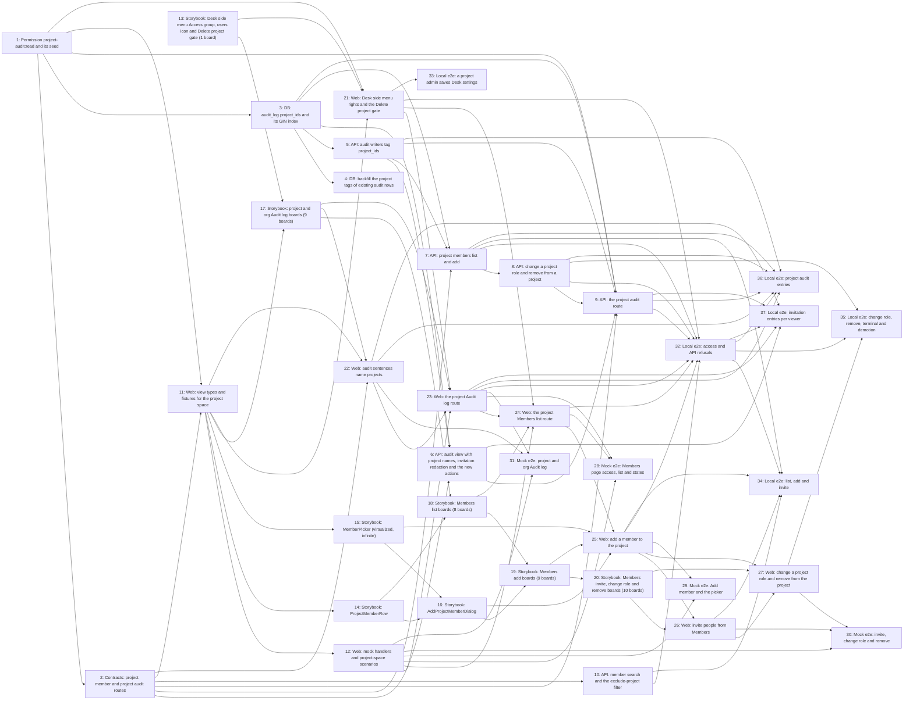

<!-- dev-plan: kind=plan id=rbac-project-admin-space rev=1 hash=1b780150be75 spec=docs/superpowers/specs/2026-11-23-rbac-project-admin-space-design.md spec-hash=6733433e0b42 -->
# Project admin space Implementation Plan

> **For agentic workers:** REQUIRED SUB-SKILL: Use superpowers:subagent-driven-development (recommended) or superpowers:executing-plans to implement this plan task-by-task. Steps use checkbox (`- [ ]`) syntax for tracking.

**Goal:** Inside a project's Settings tab, an org owner, an org admin or an admin of that project gets a Members page (list, add an org member, change role, remove, invite people) and an Audit log page under ADR-0036 RBAC, Delete project is hidden from project admins, and invitation entries in both audit logs name the listed projects the reader can see.

**Architecture:** The permission `project-audit:read` and its seed land first, then the contracts (five new routes, the `members.list` query, `AuditEntryDto.projects`), then `audit_log.project_ids` with its GIN index and a backfill. The API adds `ProjectMembersService` over existing project-scope `role_assignments` (no new table), teaches every audit writer to tag `project_ids`, and reads a project's audit with per-viewer redaction shared with the org route. The web adds the "Access" group to the Desk side menu, the `MemberPicker` (virtualized, infinite), `ProjectMemberRow`, `AddProjectMemberDialog`, the `DeskMembers` and `DeskAudit` screens (stories first), then wires two new routes and the Delete project gate.

**Tech Stack:** Zod (contracts), Drizzle and Postgres RLS (db), NestJS on Fastify (api), React, TanStack Router, Query and Form, `@tanstack/react-virtual` (approved), MSW, Storybook (web), Vitest and Testcontainers, Playwright (mock and local e2e).

**Spec:** `docs/superpowers/specs/2026-11-23-rbac-project-admin-space-design.md` (read it with this plan: BR ids, TC ids, the Copy section and the board list are defined there).

## Global Constraints

- Permission `project-audit:read`: project-level (never in `ORG_LEVEL`), seeded into the built-in `owner` and `admin` roles only (templates and every existing org), idempotent, per-org `app.org_id` DO loop as `0035_seed_audit_read.sql`.
- Migrations: four new ones (permission seed; `audit_log.project_ids` column; its GIN index as a plain `CREATE INDEX` migration like `0034`; the backfill), numbered with the next free numbers at build time (0035 is taken; the workspace-env-secrets plan also wants one). The paths below (0036 seed, 0037 column, 0038 index, 0039 backfill) assume nothing else merged first; renumber to the next free number, and the matching snapshot and journal index, when a migration landed meanwhile. Never edit an applied migration.
- `audit_log.project_ids uuid[] NOT NULL DEFAULT '{}'`, GIN index `audit_log_project_ids_idx`, no foreign key, RLS unchanged (org-only, forced). Every project audit query also filters `project_ids @> ARRAY[P]`.
- Routes (contracts first, each with a `routeAccess` entry through `checkTenantAccess`): `projectMembers.list` GET `/api/projects/:projectId/members` `project('assignment:read')`; `projectMembers.add` POST same path `project('assignment:create')` (201); `projectMembers.setRole` PUT `/api/projects/:projectId/members/:userId/role` `project('assignment:create')`; `projectMembers.remove` DELETE `/api/projects/:projectId/members/:userId` `project('assignment:delete')` (204); `projects.audit` GET `/api/projects/:projectId/audit` `project('project-audit:read')`.
- `members.list` query: `q` optional, 1 to 100 characters after trimming (else 400), matched case-insensitively on `user.name` and `user.handle` with `ILIKE ... ESCAPE '\'`, `\`, `%`, `_` escaped and bound; `excludeProject` checked in this order: P in the session org under `withOrg` (404), `inScope` (404), `can(access, 'assignment:read', {projectId: P})` (403); the exclusion is a `NOT EXISTS` in the WHERE of both `count(*)` and the page query. Sort stays handle, then id. No email.
- Add: 422 `/roleId` (not in org or not project-assignable), 422 `/userId` (not an org member), 403 `checkTenantAssign('assignment:create')`, then the person's P rows locked: none → insert, 201; any role, including the same one → 409 "already has a role on this project", nothing written, no audit. Audit `assignment.granted` with project scope.
- Change role: lock; no project-scope row on P → 404; 422 `/roleId`; `checkTenantAssign` create on the new role and delete on each replaced role (403); replace in one transaction; same role → 200, no audit; audit `project_member.role_changed`; last write wins.
- Remove: own userId → 403 before any lookup; deletes the person's project-scope rows on P only; none → 404; `checkTenantAssign('assignment:delete')` per row (403); audit `project_member.removed`; 204.
- Audit payloads (shared by writers and the view): `project_member.role_changed` = `{ projectId, from: string[] /* role keys */, to: string /* role key */ }`; `project_member.removed` = `{ projectId, from: string[] }`; project-scope `assignment.granted` keeps `{ to: { roleId, roleKey, scope: { type: 'project', projectId } } }`. Target `user`, id = the person.
- Project audit: rows of the session org with `project_ids @> ARRAY[P]`, `ORDER BY at desc, id desc`, `count(*)`, offset paging (ADR-0028), payload never returned.
- Invitation redaction on both audit routes: the email is `target.label` only when the caller holds `member:read` at org scope or `assignment:read` on every id of the row's `project_ids`; else `target.label` is null. `projects` is filled for `invitation.*` rows only: listed ids that still exist and are in `visibleProjects(access, 'project:read')`, sorted by name, then id; hidden or deleted ones are left out, never counted. Every other row has `projects: []`.
- Logs at `info`: `{requestId, orgId, projectId, actorUserId, targetUserId, action}`; never an email, never `q`.
- Web: query keys `['org', slug, 'projects', projectId, 'members', 'list', page, pageSize]`, `['org', slug, 'projects', projectId, 'audit', 'list', page, pageSize]`, picker `['org', slug, 'members', 'list', 'infinite', {excludeProject, q}]`; after Add, Change role or Remove (and after a 409 or 422 on Add) invalidate the project members list, `['org', slug, 'members']` and the project audit list; no optimistic updates.
- Picker: page size 20, `q` debounced 250 ms and trimmed, empty `q` left out, input `maxLength=100`, next page when the last rendered option is within 5 rows of the end, listbox 8 rows high, overscan 5, "Load more people" as the keyboard fallback.
- Copy strings are the spec's "UI and Storybook › Copy" and "User flows", character for character.
- Tokens only, every shared component has a story, loading, empty and error states required, strict TS (no `any`, no unexplained `!` or cast), no network in tests, never weaken, skip or delete an access test.
- **Storybook first (blocker from the spec, not an ordering preference):** no task that implements or wires this UI in `apps/web/src/{app,features}` starts before the Storybook tasks it lists under **Depends on** (Tasks 13 to 20) are merged; each new board is registered in `canvas.json`, `screens/storyIds.ts` and `scripts/parity.mjs` together.
- **Sensitive change:** Tasks 1 to 10 (permission, migrations, RLS/`withOrg`, `routeAccess`, audit writers and redaction, grant writes, terminal re-check test) get the `review:sensitive` label and a high-effort security review. One concern per PR, about 800 lines or fewer.

## Review Focus

Inputs the spec implies but no TC names; each has a test in the named task.

1. A project deleted while its Members or Audit log page is open: the next members request is 404 (no 500), its audit rows stay in the org Audit log: Task 7 (members 404 after `DELETE /api/projects/:id`), Task 9 (rows still in `audit.list`, project route 404).
2. Out-of-order picker responses: typing "al" then "ali" quickly never shows the slower "al" results under "ali": Task 25 (MSW delays the first response, assert the final options).
3. Removing the only row of the last Members page lands on the new last page, not an empty page: Task 27 (route test with 21 rows, page 2).
4. A person with a null handle shows by name only in the Members row ("Name", no empty mono handle) and in the picker field ("Name", not "Name ()"): Task 15 and Task 24.
5. An invitation whose listed projects were all deleted maps to `projects: []` (never a raw id) and renders the sentence without " to …": Task 6 and Task 22.

## Access and tenant data (per route, query, workflow, screen)

| Surface | Permission | Level | Tenant data touched |
| ------- | ---------- | ----- | ------------------- |
| GET `projectMembers.list` | `assignment:read` | project | P's project-scope `role_assignments`, `roles`, `user` names and handles |
| POST `projectMembers.add` | `assignment:create` on P, subset rule | project | `member` (read), `role_assignments` insert, `audit_log` |
| PUT `projectMembers.setRole` | `assignment:create` on P plus `assignment:delete` per replaced role | project | P's project-scope rows of one person, `audit_log` |
| DELETE `projectMembers.remove` | `assignment:delete` on P; never yourself | project | P's project-scope rows of one person, `audit_log` |
| GET `projects.audit` | `project-audit:read` | project | `audit_log` rows tagged P, `user`, `invitations.email` (redacted), `projects.name` (visible only) |
| GET `audit.list` (changed DTO) | `audit:read` (unchanged) | org | adds `projects.name` on invitation rows |
| GET `members.list` (changed query) | `orgAdmin('member:read', 'assignment:create')` unchanged; `excludeProject` adds 404 scope and 403 `assignment:read` on P | org route, project check | `member`, `user`, `role_assignments` |
| POST `invitations.create` | unchanged | org route | unchanged |
| Audit writers (interceptor, assignments, invitations, accept, decline, project members) | none (internal; org from the session context) | — | `audit_log.project_ids` under `withOrg` |
| Migrations (seed, backfill) | none; per-org DO loop setting `app.org_id` | — | `role_template_permissions`, `role_permissions`, `audit_log` |
| Web `/o/$org/p/$project/desk/members` | `assignment:read` on P in `beforeLoad`; controls shown by `assignment:create` / `assignment:delete` (UI only) | project | the two lists above |
| Web `/o/$org/p/$project/desk/audit` | `project-audit:read` on P in `beforeLoad` | project | P's audit page |
| Web Agent & settings Danger zone | `project:delete` (UI only) | org | none new |
| Web `/o/$org/settings/audit` | `audit:read` (unchanged) | org | invitation sentences gain project names |

Guard order everywhere: org membership, permission (403 before any id lookup), project scope (404), `own` not applicable. Every task that adds or changes a route tests allowed, 403, 404 out of scope, cross-org, and project scope through the real guard and `withOrg`.

## Needs approval

None. `@tanstack/react-virtual` (apps/web only, exact pinned version, `package.json` and lockfile) is already approved by the human for this spec and is added in Task 15. Every other library is existing.

## Agent calls

- Agent call: the permission and its seed migration are one early task (Task 1) and the contracts follow it, because `role-templates.int.test.ts` requires every routed permission to be seeded, so a `routeAccess` entry for `project-audit:read` cannot merge before the seed.
- Agent call: migration numbers follow merge order (the seed may get a lower number than the column), because the four migrations are independent except that the backfill needs the column, which Task 4 depends on.
- Agent call: Add, Change role and Remove first lock the person's `member` row `FOR UPDATE`, then their project-scope rows on P, so two writes for one person serialize even when they hold no row on P yet (the spec's "serialized, last write wins").
- Agent call: `toAuditEntry` maps every `assignment.granted` row to one `role` change (from null to the role name), on both routes, because the project Audit log sentence needs the role; the org Audit log keeps rendering `assignment.granted` as its raw key (web mapper, Task 22).
- Agent call: `ProjectMemberDto.handle` is `string | null`, like `MemberDto.handle`, because `user.handle` is nullable.
- Agent call: the API test helpers for the new routes are all added in Task 2, because `apps/api/test/helpers/auth.ts` is one shared file.
- Agent call: the audit writer tests go in a new `apps/api/test/audit-tagging.int.test.ts`, and BR-14's API check goes in `project-members.int.test.ts`, so Tasks 5, 6, 9 and 10 never share a test file.
- Agent call: the project audit read (Task 9) waits for Task 8, because every controller task removes its key from the one `NOT_REGISTERED_YET` list in `authz.int.test.ts`.
- Agent call: `toAuditRow` gains a fourth parameter `scope: 'org' | 'project' = 'org'`, because the "added … to this project" and "removed … from this project" sentences show on the project log only.
- Agent call: the pure "load next" helper `shouldLoadMore` lives in `components/MemberPicker.tsx` and is tested in `MemberPicker.test.tsx` (the spec names `features/projectMembers/picker.test.ts`), because a component cannot import from `features/`; `picker.test.ts` keeps the query builder.
- Agent call: the exact `@tanstack/react-virtual` version is the latest stable 3.x at build time, written without a range, because the approval names the package and "exact pinned", not a number.
- Agent call: `ProjectMemberRow` adds its own barrel line and Task 16 adds the `MemberPicker` and `AddProjectMemberDialog` lines, so Tasks 14 and 15 run in parallel without sharing `components/index.ts`.
- Agent call: the board stories run in one chain (Desk chrome → Audit → Members list → Members add → Members invite, change role and remove), because every board edits the same four registry files and `screens/desk.stories.tsx`.
- Agent call: the mock project-space data is a new `projectSpaceScenarios.ts` with the spec's scenario names and a separate `role` option (`seedProjectSpace(page, { role, scenario })`), following `tenantAdminScenarios.ts`.
- Agent call: `useInviteForm` gains an optional `fixedProjectId`, the smallest change that opens the existing dialog with P preselected.
- Agent call: the mock e2e cases go in `project-members.spec.ts` and `project-audit.spec.ts` (spec-named) plus `project-members-add.spec.ts` and `project-members-edit.spec.ts`; TC-21.1 to TC-21.3 go in the existing `desk-access.spec.ts`; TC-27.6 and TC-27.7 in the existing mock `org-audit.spec.ts`; TC-27.8 in `project-audit.spec.ts` (it opens both logs). Reason: no two parallel tasks share a spec file.
- Agent call: the local cases go in `rbac-project-admin.spec.ts` (spec-named; access and API refusals) plus five new files (`rbac-project-admin-desk`, `-members`, `-edit`, `-audit`, `-invitations`) and the existing `org-audit.spec.ts` (TC-27.12 and the re-pointed TC-23.x), with shared helpers in a new `e2e/local/project-admin.ts` from Task 32, for the same reason.
- Agent call: if the workspace-env-secrets stories (`DeskSetupEnvironment*`) are on main when Task 13 runs, they get the Access group through the shared story frame, and the two read-only ones (`DeskSetupEnvironmentReadOnly`, `DeskSetupEnvironmentSecretsReadOnly`) drop it; if they are not, nothing is done for them here.

Spec note: all test cases of the spec's E2E requirements are planned (Tasks 21, 28 to 37); the Not-e2e parts are proved where the spec's Testing table says (Task 4 backfill, Task 8 concurrency, Task 9 expired invitation).

---

<!-- dev-plan:graph:begin -->
## Task graph

Generated by `dev-plan.mjs graph --write` from each task's **Depends on:** line. Do not edit it by hand.
Tasks in the same wave touch no common file and can be built in parallel; a task starts when everything it depends on is merged.

| Wave | Task | Depends on |
| ---- | ---- | ---------- |
| 1 | Task 1: Permission project-audit:read and its seed | none |
| 1 | Task 13: Storybook: Desk side menu Access group, users icon and Delete project gate (1 board) | none |
| 2 | Task 2: Contracts: project member and project audit routes | Task 1 |
| 2 | Task 3: DB: audit_log.project_ids and its GIN index | Task 1 |
| 3 | Task 4: DB: backfill the project tags of existing audit rows | Task 3 |
| 3 | Task 5: API: audit writers tag project_ids | Task 3 |
| 3 | Task 10: API: member search and the exclude-project filter | Task 2 |
| 3 | Task 11: Web: view types and fixtures for the project space | Task 1, Task 2 |
| 4 | Task 6: API: audit view with project names, invitation redaction and the new actions | Task 2, Task 3, Task 5 |
| 4 | Task 7: API: project members list and add | Task 2, Task 3, Task 5 |
| 4 | Task 12: Web: mock handlers and project-space scenarios | Task 11 |
| 4 | Task 14: Storybook: ProjectMemberRow | Task 11 |
| 4 | Task 15: Storybook: MemberPicker (virtualized, infinite) | Task 11 |
| 4 | Task 17: Storybook: project and org Audit log boards (9 boards) | Task 11, Task 13 |
| 4 | Task 21: Web: Desk side menu rights and the Delete project gate | Task 1, Task 11, Task 13 |
| 5 | Task 8: API: change a project role and remove from a project | Task 7 |
| 5 | Task 16: Storybook: AddProjectMemberDialog | Task 14, Task 15 |
| 5 | Task 18: Storybook: Members list boards (8 boards) | Task 14, Task 17 |
| 5 | Task 22: Web: audit sentences name projects | Task 2, Task 11, Task 17 |
| 5 | Task 33: Local e2e: a project admin saves Desk settings | Task 21 |
| 6 | Task 9: API: the project audit route | Task 1, Task 2, Task 3, Task 5, Task 6, Task 8 |
| 6 | Task 19: Storybook: Members add boards (9 boards) | Task 16, Task 18 |
| 6 | Task 23: Web: the project Audit log route | Task 12, Task 17, Task 21, Task 22 |
| 7 | Task 20: Storybook: Members invite, change role and remove boards (10 boards) | Task 19 |
| 7 | Task 24: Web: the project Members list route | Task 12, Task 18, Task 21, Task 23 |
| 7 | Task 31: Mock e2e: project and org Audit log | Task 12, Task 22, Task 23 |
| 8 | Task 25: Web: add a member to the project | Task 15, Task 16, Task 19, Task 24 |
| 8 | Task 28: Mock e2e: Members page access, list and states | Task 12, Task 23, Task 24 |
| 9 | Task 26: Web: invite people from Members | Task 20, Task 25 |
| 9 | Task 29: Mock e2e: Add member and the picker | Task 12, Task 25 |
| 9 | Task 32: Local e2e: access and API refusals | Task 7, Task 8, Task 9, Task 10, Task 21, Task 23, Task 24, Task 25 |
| 10 | Task 27: Web: change a project role and remove from the project | Task 20, Task 25, Task 26 |
| 10 | Task 34: Local e2e: list, add and invite | Task 7, Task 10, Task 25, Task 26, Task 32 |
| 10 | Task 36: Local e2e: project audit entries | Task 5, Task 7, Task 8, Task 9, Task 22, Task 23, Task 32 |
| 10 | Task 37: Local e2e: invitation entries per viewer | Task 6, Task 9, Task 22, Task 23, Task 32 |
| 11 | Task 30: Mock e2e: invite, change role and remove | Task 12, Task 26, Task 27 |
| 11 | Task 35: Local e2e: change role, remove, terminal and demotion | Task 8, Task 27, Task 32 |


<!-- dev-plan:graph:end -->

### Task 1: Permission `project-audit:read` and its seed

**Depends on:** none

**Files:**

- Modify: `packages/contracts/src/access.ts`
- Test: `packages/contracts/src/access.test.ts`
- Create: `packages/db/migrations/0036_seed_project_audit_read.sql`, `packages/db/migrations/meta/0036_snapshot.json`
- Modify: `packages/db/migrations/meta/_journal.json`
- Test: `packages/db/test/migrate.int.test.ts`
- Test: `packages/core/test/access/role-templates.int.test.ts`
- Modify: `apps/web/e2e/local/rbac-grants.spec.ts`
- Modify: `docs/adr/0036-rbac-permissions-roles-scope.md`, `docs/superpowers/specs/2026-11-22-desk-access-matrix.md`

**Interfaces:**

- Produces: `Permission` includes `'project-audit:read'` (in `TENANT_PERMISSIONS` right after `'audit:read'`), `PERMISSION_LEVEL['project-audit:read'] === 'project'`. Every org's built-in `owner` and `admin` roles and the `owner`/`admin` templates hold `('project-audit:read', 'any')`; new orgs get it through `copyRoleTemplates`.

- [x] **Step 1: Write the failing tests**
  - `access.test.ts`: `PERMISSION_LEVEL['project-audit:read']` is `'project'`; tenant count 35, all permissions 50; `can()` with a project grant on P1 listing it → true for P1, false for P2; BR-26: an access with an org-scope viewer grant and a P1 admin grant → `can(…, 'project-audit:read', {projectId: P1})`, `can(…, 'assignment:create', {projectId: P1})` true, `can(…, 'rule:create', {projectId: P2})` false, `can(…, 'project:read', {projectId: P2})` true.
  - `migrate.int.test.ts` (N-PERM), new describe "project-audit:read seed on an upgraded database": `startPgAt('0035_seed_audit_read')` with two orgs, apply → exactly one `project-audit:read` line on each org's `owner` and `admin`, none on `member` or `viewer`; a second apply changes no row count; an org created afterwards holds it. Update the "four built-in roles" counts to owner 35, admin 34, member 6, viewer 2 (the rule change).
  - `role-templates.int.test.ts`: `ADMIN_PERMISSIONS` gains `project-audit:read`; lengths `[35, 34, 6, 2]`.
  - `rbac-grants.spec.ts`: the owner permission list gains `'project-audit:read'` (sorted as today).
- [x] **Step 2: Run** `pnpm --filter @agentdesk/contracts exec vitest run src/access.test.ts`, `pnpm --filter @agentdesk/db exec vitest run test/migrate.int.test.ts`, `pnpm --filter @agentdesk/core exec vitest run test/access/role-templates.int.test.ts`. Expected: FAIL.
- [x] **Step 3: Implement** the enum line; the hand-written SQL migration copying `0035_seed_audit_read.sql` with `project-audit:read` (template insert, then the per-org DO loop setting `app.org_id`, `ON CONFLICT DO NOTHING`), its journal entry and a snapshot copied from the previous one (no schema change). ADR-0036 §Decision "Each permission has a level": add `project-audit:read` to the project-level examples and say it is held by owner and admin. Desk access matrix spec: rows for the five new API routes and the two new UI routes (owner, admin any; member, viewer no; project admin on own project any) and the Delete project control (owner, org admin only).
- [x] **Step 4: Run** the Step 2 commands, `pnpm --filter @agentdesk/contracts test`, `pnpm --filter @agentdesk/db typecheck`, and `pnpm --filter @agentdesk/web exec vitest run src/mocks` (role fixtures unaffected). Expected: PASS. With the stack up: `pnpm --filter @agentdesk/web exec playwright test e2e/local/rbac-grants.spec.ts`. Expected: PASS.
- [x] **Step 5: Commit** (`devbox run fix` first): `feat(contracts): add the project-audit:read permission and seed it for owner and admin`. Label `review:sensitive`.

---

### Task 2: Contracts: project member and project audit routes

**Depends on:** Task 1

**Files:**

- Modify: `packages/contracts/src/schemas/access.ts`, `packages/contracts/src/schemas/audit.ts`, `packages/contracts/src/routes.ts`, `packages/contracts/src/route-access.ts`
- Test: `packages/contracts/src/schemas/access.test.ts`, `packages/contracts/src/schemas/audit.test.ts`, `packages/contracts/src/routes.test.ts`, `packages/contracts/src/route-access.test.ts`, `packages/contracts/src/role-matrix.test.ts`
- Modify: `apps/api/src/audit/audit-view.ts`
- Test: `apps/api/src/audit/audit-view.test.ts`
- Modify: `apps/api/test/authz.int.test.ts`, `apps/api/test/scope.int.test.ts`, `apps/api/test/helpers/auth.ts`
- Modify: `apps/web/src/mocks/msw/handlers.ts`, `apps/web/src/mocks/dto/audit.ts`
- Test: `apps/web/src/features/audit/map.test.ts`

**Interfaces:**

- Consumes: `project` and `orgAdmin` helpers, `projectParams`, `MemberUserId`, `RoleRef`, `PageQuery`, `pageOf`, `empty`, `Permission` `'project-audit:read'` (Task 1).
- Produces (exported from `@agentdesk/contracts`):

```ts
export const MEMBER_SEARCH_MAX = 100;
export const MembersListQuery = PageQuery.extend({
  q: z.string().trim().min(1).max(MEMBER_SEARCH_MAX).optional(),
  excludeProject: Id.optional(),
});
export const ProjectRoleDto = z.object({ assignmentId: Id, role: RoleRef });
export const ProjectMemberDto = z.object({ userId: z.string(), name: z.string(), handle: z.string().nullable(), projectRoles: z.array(ProjectRoleDto) });
export const AddProjectMemberRequest = z.object({ userId: MemberUserId, roleId: Id });
export const SetProjectRoleRequest = z.object({ roleId: Id });
// schemas/audit.ts
AuditAction: + 'project_member.role_changed', 'project_member.removed'
export const AuditProjectRef = z.object({ id: Id, name: z.string() });
AuditEntryDto: + projects: z.array(AuditProjectRef)
// routes.ts: const projectMemberParams = z.object({ projectId: z.uuid(), userId: MemberUserId })
// routes.projects.audit, routes.projectMembers.{list, add, setRole, remove} as in Global Constraints;
// list/audit query PageQuery, list response pageOf(ProjectMemberDto), audit response pageOf(AuditEntryDto),
// add body AddProjectMemberRequest → ProjectMemberDto, setRole body SetProjectRoleRequest → ProjectMemberDto, remove → empty
// routes.members.list.query = MembersListQuery
// apps/api/test/helpers/auth.ts (cookie + x-org-id like grant):
export function projectMembersList(t: TestApp, cookie: string, orgId: string, projectId: string, query?: { page?: number; pageSize?: number }): ReturnType<TestApp['app']['inject']>;
export function addProjectMember(t: TestApp, cookie: string, orgId: string, projectId: string, body: Record<string, unknown>): ReturnType<TestApp['app']['inject']>;
export function setProjectRole(t: TestApp, cookie: string, orgId: string, projectId: string, userId: string, roleId: string): ReturnType<TestApp['app']['inject']>;
export function removeProjectMember(t: TestApp, cookie: string, orgId: string, projectId: string, userId: string): ReturnType<TestApp['app']['inject']>;
export function projectAudit(t: TestApp, cookie: string, orgId: string, projectId: string, query?: { page?: number; pageSize?: number }): ReturnType<TestApp['app']['inject']>;
export function memberSearch(t: TestApp, cookie: string, orgId: string, query: { q?: string; excludeProject?: string; page?: number; pageSize?: number }): ReturnType<TestApp['app']['inject']>;
```

- [x] **Step 1: Write the failing tests**
  - `schemas/access.test.ts` (BR-7 contract): `MembersListQuery` accepts `{}`, `{q: 'a'}`, `{q: 'a'.repeat(100)}`, `{q: '  al  '}` (parsed `al`), `{pageSize: '20'}`; rejects `{q: ''}`, `{q: '   '}`, `{q: 'a'.repeat(101)}`, `{excludeProject: 'nope'}`; `ProjectMemberDto` accepts `handle: null`; `AddProjectMemberRequest` rejects a missing `roleId` and an empty `userId`; `SetProjectRoleRequest` rejects a non-uuid.
  - `schemas/audit.test.ts`: `AuditEntryDto` requires `projects` (array of `{id, name}`), rejects `projects: [{id: 'x'}]`; `AuditAction.options` holds the two new names.
  - `routes.test.ts`: the five keys with the methods and paths of Global Constraints; route count 84 → 89. `route-access.test.ts`: count 89 and the five expected entries. `role-matrix.test.ts`: the five rows are `ADMINS`.
  - `audit-view.test.ts`: the "exactly the DTO keys" test now expects `projects: []`.
- [x] **Step 2: Run** `pnpm --filter @agentdesk/contracts exec vitest run`. Expected: FAIL.
- [x] **Step 3: Implement** the contracts above. Compile fixes outside contracts: `toAuditEntry` returns `projects: []` (Task 6 fills it); `apps/web/src/mocks/dto/audit.ts` entries and the `map.test.ts` DTO factory gain `projects: []`; `handlers.ts` gets fixture-backed `impl` entries (`projectMembers.list` and `projects.audit` an empty page, `add` and `setRole` a fixed `ProjectMemberDto`, `remove` 204; Task 12 replaces them). In `authz.int.test.ts`: `DENIAL_TABLE` rows `tenant(403)` for the five keys and the five keys in `NOT_REGISTERED_YET`. In `scope.int.test.ts` `cases()`: the five routes on P2 (body `{userId: <B's id>, roleId: <member role id>}` for add, `{roleId}` for setRole), each 404 for the P1 admin. Add the six helpers.
- [x] **Step 4: Run** Step 2's command, `pnpm --filter @agentdesk/api typecheck`, `pnpm --filter @agentdesk/web typecheck`, `pnpm --filter @agentdesk/api exec vitest run test/authz.int.test.ts test/scope.int.test.ts test/org-check.int.test.ts src/audit`, `pnpm --filter @agentdesk/web exec vitest run src/mocks/msw/contract.test.ts src/features/audit`. Expected: PASS.
- [x] **Step 5: Commit**: `feat(contracts): add project member and project audit routes, member search and audit projects`. Label `review:sensitive` (routeAccess).

---

### Task 3: DB: `audit_log.project_ids` and its GIN index

**Depends on:** Task 1

**Files:**

- Modify: `packages/db/src/schema/app.ts`
- Create: `packages/db/migrations/0037_audit_log_project_ids.sql`, `packages/db/migrations/0038_audit_log_project_ids_idx.sql`, `packages/db/migrations/meta/0037_snapshot.json`, `packages/db/migrations/meta/0038_snapshot.json`
- Modify: `packages/db/migrations/meta/_journal.json`
- Test: `packages/db/test/migrate.int.test.ts`, `packages/db/test/rls.int.test.ts`

**Interfaces:**

- Produces: Drizzle `auditLog.projectIds` (`uuid('project_ids').array().notNull().default(sql\`'{}'::uuid[]\`)`), index `audit_log_project_ids_idx` using `gin` on `project_ids`.

- [x] **Step 1: Write the failing tests** (N-AUDITCOL)
  - `migrate.int.test.ts`: on a database stopped before the column with existing `audit_log` rows in two orgs, applying gives every old row `project_ids = '{}'`; the column is `uuid[] not null`; `audit_log_project_ids_idx` exists with access method `gin`; `relforcerowsecurity` still true on `audit_log`; a query `project_ids @> ARRAY[$1]::uuid[]` returns only tagged rows.
  - `rls.int.test.ts`: the `inserts` map entry for `audit_log` sets `project_ids` so the two-org leak test covers it; an insert without `project_ids` gets `{}`.
- [x] **Step 2: Run** `pnpm --filter @agentdesk/db exec vitest run test/migrate.int.test.ts test/rls.int.test.ts`. Expected: FAIL.
- [x] **Step 3: Implement** the column in `schema/app.ts`; generate the column migration with drizzle-kit, then move the index into its own plain `CREATE INDEX "audit_log_project_ids_idx" ON "audit_log" USING gin ("project_ids");` migration (as `0034`); keep journal and snapshots in step.
- [x] **Step 4: Run** Step 2's command and `pnpm --filter @agentdesk/db typecheck`, `pnpm --filter @agentdesk/api typecheck`. Expected: PASS.
- [x] **Step 5: Commit**: `feat(db): tag audit rows with their projects`. Label `review:sensitive` (migration).

---

### Task 4: DB: backfill the project tags of existing audit rows

**Depends on:** Task 3

**Files:**

- Create: `packages/db/migrations/0039_backfill_audit_project_ids.sql`, `packages/db/migrations/meta/0039_snapshot.json`
- Modify: `packages/db/migrations/meta/_journal.json`
- Test: `packages/db/test/migrate.int.test.ts`

**Interfaces:**

- Consumes: `audit_log.project_ids` (Task 3).
- Produces: after this migration, existing rows with `project_ids = '{}'` are tagged by the Data model rules (`target_type = 'projects'` → `[target_id]` when a uuid; `runs`, `rules`, `agents`, `setup-tests` → the joined row's `project_id`; `assignment.granted` / `assignment.revoked` → payload `to.scope.projectId` / `from.scope.projectId`; `invitation.*` including `expired` → the joined project-scope invitation's `project_ids`). Untied rows stay `{}`.

- [x] **Step 1: Write the failing tests** (N-BACKFILL, BR-16 and BR-27 Not-e2e parts) in a new describe of `migrate.int.test.ts` using a `startPgAt('0038_audit_log_project_ids_idx')` fixture seeded with: rows per target kind (project, run, rule, agent, setup test), a deleted run's row, a project-scope `assignment.granted` and `assignment.revoked` payload, an org-scope grant, invitation rows (created, resent, revoked, accepted, declined, expired) for an invitation listing two projects, an org-scope invitation row, a generic org route row, and the same kinds in a second org. Assert after `migrateRest`: each tied row holds exactly the expected project ids; the deleted run's row, the org-scope grant, the org-scope invitation and the org route row stay `{}`; org B rows only carry org B projects; row count unchanged; running the migration SQL a second time changes nothing.
- [x] **Step 2: Run** `pnpm --filter @agentdesk/db exec vitest run test/migrate.int.test.ts`. Expected: FAIL.
- [x] **Step 3: Implement** a hand-written migration: a DO loop over uuid-shaped `organization.id` that sets `app.org_id` per org (`audit_log` forces RLS) and runs one `UPDATE … WHERE org_id = org AND project_ids = '{}'` per rule (uuid checks with the `0035` regex before any `::uuid` cast), then resets `app.org_id`. Snapshot copied (no schema change).
- [x] **Step 4: Run** Step 2's command and `pnpm --filter @agentdesk/db test`. Expected: PASS.
- [x] **Step 5: Commit**: `feat(db): backfill audit project tags from row targets`. Label `review:sensitive` (migration, RLS).

---

### Task 5: API: audit writers tag `project_ids`

**Depends on:** Task 3

**Files:**

- Modify: `apps/api/src/audit/audit-entry.ts`, `apps/api/src/audit/audit.interceptor.ts`
- Test: `apps/api/src/audit/audit-entry.test.ts`, `apps/api/src/audit/audit.interceptor.test.ts`
- Modify: `apps/api/src/assignments/assignments.service.ts`, `apps/api/src/auth/accept-invitations.ts`, `apps/api/src/invitations/invitations.service.ts`, `apps/api/src/invitations/my-invitations.service.ts`
- Create: `apps/api/test/audit-tagging.int.test.ts`

**Interfaces:**

- Consumes: `auditLog.projectIds` (Task 3), `req.authz` (`routeKey`, `projectId`), `routeAccess`.
- Produces:

```ts
// audit-entry.ts
export interface AuditEntry { /* existing fields */ projectIds?: readonly string[] } // absent = []
// buildAuditRow sets projectIds: [...(entry.projectIds ?? [])]
// audit.interceptor.ts
/** [authz.projectId] when the matched route is project-kind and the guard resolved a project, else []. */
export function auditProjectIds(authz: Pick<RequestAuthz, 'routeKey' | 'projectId'> | undefined): string[];
```

  Writers: `AssignmentsService.grant` and `revoke` pass `[projectId]` for a project scope; `acceptInvitationInTx` passes the invitation's `projectIds` on `invitation.accepted` and `[projectId]` on each project grant row it writes; `invitations.service.ts` passes the invitation's `projectIds` on `invitation.created`, `resent`, `revoked` and on `invitation.expired` in `expireStalePending` (project scope only); `my-invitations.service.ts` passes them on `invitation.declined`. Org-level events stay `[]`.

- [x] **Step 1: Write the failing tests**
  - `audit-entry.test.ts`: `buildAuditRow` without `projectIds` → `[]`; with two ids → both, in order.
  - `audit.interceptor.test.ts`: `auditProjectIds` → `[P]` for `{routeKey: 'rules.update', projectId: P}`, `[]` for `{routeKey: 'orgs.update'}`, `[]` for `undefined`, `[]` for a project route without `projectId`.
  - `audit-tagging.int.test.ts` (N-AUDITCOL, BR-18; real guard and `withOrg`; rows read back as `agentdesk_app` under `withOrg`): one call per route family as the P1 admin — `projects.update`, `agents.put`, `agents.putCredential` (payload holds no credential value, key `value` absent), `rules.create`, `skills.put`, `setupScript.put`, `setupTests.create`, `runs.cancel` — each writes one row with `project_ids = [P1]`; `orgs.update` by the owner → `{}`; a project-scope grant and revoke through `assignments.*` → `[P1]`, an org-scope grant → `{}`; invitation created, resent, revoked, accepted (plus its grant rows `[P1]` and `[P2]`), declined for an invitation listing P1 and P2 → `[P1, P2]`; an expired one (set `expires_at` in the past as the owner, re-invite as `invitations.int.test.ts` does) → `invitation.expired` with `[P1, P2]`; an org-scope invitation → `{}`; `member.role_changed` and `member.removed` → `{}`.
- [x] **Step 2: Run** `pnpm --filter @agentdesk/api exec vitest run src/audit test/audit-tagging.int.test.ts`. Expected: FAIL.
- [x] **Step 3: Implement** the optional field, the helper and its use in the interceptor insert, and the writer changes above (no other behaviour change).
- [x] **Step 4: Run** Step 2's command, `pnpm --filter @agentdesk/api exec vitest run test/assignments.int.test.ts test/invitations.int.test.ts test/my-invitations.int.test.ts test/invitation-resend.int.test.ts`, `pnpm --filter @agentdesk/api typecheck`. Expected: PASS. E2E: Task 36 and Task 37.
- [x] **Step 5: Commit**: `feat(api): tag audit rows with the projects they belong to`. Label `review:sensitive` (audit, grant writes).

---

### Task 6: API: audit view with project names, invitation redaction and the new actions

**Depends on:** Task 2, Task 3, Task 5

**Files:**

- Modify: `apps/api/src/audit/audit-view.ts`, `apps/api/src/audit/audit.service.ts`, `apps/api/src/audit/audit.controller.ts`
- Test: `apps/api/src/audit/audit-view.test.ts`, `apps/api/test/audit.int.test.ts`

**Interfaces:**

- Consumes: `AuditEntryDto.projects`, `AuditAction` (Task 2); `auditLog.projectIds` (Task 3); writers tagging rows (Task 5); `can`, `visibleProjects`.
- Produces:

```ts
// audit-view.ts
export interface AuditRowIn { /* existing */ projectIds: string[] }
export interface AuditLookups { /* existing */ projectNames: Map<string, string> } // id → name, existing projects of the org
export interface AuditViewer { emailFor(projectIds: readonly string[]): boolean; seesProject(projectId: string): boolean }
export function auditViewerOf(access: Access): AuditViewer; // rules of Global Constraints
export function toAuditEntry(row: AuditRowIn, lookups: AuditLookups, viewer: AuditViewer): AuditEntryDto;
// audit.service.ts
list(access: Access, orgId: string, q: PageQuery): Promise<Page<AuditEntryDto>>;
/** Shared by Task 9: one page of rows matching `where`, mapped for `access`. */
private page(access: Access, orgId: string, q: PageQuery, where: SQL): Promise<Page<AuditEntryDto>>;
```

  `changesOf`: `assignment.granted` → `[{field: 'role', from: null, to: roleName(to.roleKey)}]`; `project_member.role_changed` → `[{field: 'role', from: names(from), to: roleName(to)}]`; `project_member.removed` → `[{field: 'role', from: names(from), to: null}]`; malformed payloads → `[]`.

- [x] **Step 1: Write the failing tests**
  - `audit-view.test.ts` (BR-27 unit, BR-19): `it.each` over the six invitation actions × viewers: owner / org admin (email, every project name sorted by name then id); P1 admin with an invitation listing P1 only (email, P1); P1 admin with P1 + P2 (no email, `target.label` null, only P1, neither P2's id nor name anywhere in `JSON.stringify(entry)`); a deleted listed project left out (Review Focus 5: all listed deleted → `projects: []`); non-invitation rows → `projects: []`; the three new `changesOf` mappings and a malformed payload of each → `[]`; an org-scope invitation row for an owner keeps the email.
  - `audit.int.test.ts` (org route, human spec gap 6): owner and org admin reading `audit.list` after a real invitation listing P1 + P2 get `projects` with both names; org B's project names never appear; non-invitation rows carry `projects: []`; `expectContract('audit.list', …)` passes with the new DTO; the existing org BR-18 tests (project admin, member, viewer → 403) are kept unchanged.
- [x] **Step 2: Run** `pnpm --filter @agentdesk/api exec vitest run src/audit/audit-view.test.ts test/audit.int.test.ts`. Expected: FAIL.
- [x] **Step 3: Implement** the view changes; in `AuditService` select `project_ids`, load the org's project names (`projects` under `withOrg`, ids of the page only), build the viewer with `auditViewerOf(access)`, and move the page query into `page(…)`; the controller passes `@CurrentAccess()` access.
- [x] **Step 4: Run** Step 2's command, `pnpm --filter @agentdesk/api exec vitest run test/authz.int.test.ts`, `pnpm --filter @agentdesk/api typecheck`. Expected: PASS. E2E: Task 31 and Task 37.
- [x] **Step 5: Commit**: `feat(api): name visible projects and redact invitee emails per viewer in the audit view`. Label `review:sensitive`.

---

### Task 7: API: project members list and add

**Depends on:** Task 2, Task 3, Task 5

**Files:**

- Create: `apps/api/src/assignments/project-members.service.ts`, `apps/api/src/assignments/project-members.controller.ts`
- Modify: `apps/api/src/assignments/assignments.module.ts`
- Create: `apps/api/test/project-members.int.test.ts`
- Modify: `apps/api/test/authz.int.test.ts`

**Interfaces:**

- Consumes: `routes.projectMembers.list|add`, `ProjectMemberDto`, `AddProjectMemberRequest` (Task 2); helpers `projectMembersList`, `addProjectMember` (Task 2); `AuditEntry.projectIds` (Task 5); `checkTenantAssign`, `loadRole`, `toAssignmentDto`, `writeAuditEntry`, `FORBIDDEN_DETAIL`.
- Produces:

```ts
export const ALREADY_ON_PROJECT = 'Already has a role on this project'; // 409 title
export const NOT_ON_PROJECT = 'Member is no longer on this project'; // 404 title (Task 8)
@Injectable() export class ProjectMembersService {
  list(orgId: string, projectId: string, q: PageQuery): Promise<Page<ProjectMemberDto>>;
  add(access: Access, orgId: string, projectId: string, req: AddProjectMemberRequest): Promise<ProjectMemberDto>;
  /** Locks the member row, then the person's project-scope rows on P (both FOR UPDATE); null member = not in the org. */
  private lockPerson(tx: Tx, orgId: string, projectId: string, userId: string): Promise<{ inOrg: boolean; rows: AssignmentRow[] }>;
}
@Controller() export class ProjectMembersController { list(...); add(...) /* @HttpCode(201) */ }
```

  The org comes from `@CurrentOrg()`, access from `@CurrentAccess()`; the guard has already decided 403 and 404.

- [x] **Step 1: Write the failing tests** in `project-members.int.test.ts` (fresh org per describe: owner O, org admin, A admin P1, B member P1 + P2, C member P1, V org viewer, D org member with a P2-only role, N no assignment; a second org; `expectContract` on every 2xx):
  - BR-4: O, the org admin and A list P1 → B, C, A only, never O or V (org-only roles), sorted by name then id; 25 extra project members page as 20 + 6 with the right `total`; each item has `projectRoles` with role names; no `email` key anywhere.
  - BR-5: A adds D as member → 201 `ProjectMemberDto`; D's next `/api/me/access` lists P1 with member; one `assignment.granted` row tagged `[P1]`.
  - BR-6, N-ADD: Owner role id → 422 `/roleId`; a role id of org B → 422 `/roleId`; a non-member and an org B user → 422 `/userId` (same body); C (already member on P1) added as viewer, and as member again → 409 `ALREADY_ON_PROJECT`, no new row, no new audit row; A adding someone as admin → 201 (subset rule allows admin on own project).
  - BR-13: an invitation listing P1 accepted by a new user → that user is in P1's list.
  - BR-23/24/26 (Security tests for list and add): B, V, N → 403 before any lookup (random, malformed and real project id give the same 403); A on P2 → 404; org B owner on P1 → 404 naming nothing of org A; an org viewer who is admin on P1 lists and adds on P1 and gets 403 on P2's list (viewer lacks `assignment:read`); tenant from the session, a body `orgId` ignored.
  - Review Focus 1: after O deletes P1, A's list of P1 → 404.
  - Logs: `{requestId, orgId, projectId, actorUserId, targetUserId, action}` at info, no email.
- [x] **Step 2: Run** `pnpm --filter @agentdesk/api exec vitest run test/project-members.int.test.ts`. Expected: FAIL.
- [x] **Step 3: Implement** `list` (one `withOrg` transaction: `count(distinct user_id)` and the page of users holding a project-scope row on P, `ORDER BY user.name, user.id`, then their P rows joined with roles), `add` in the order of Global Constraints with `lockPerson`, the controller and module wiring; delete `'projectMembers.list'` and `'projectMembers.add'` from `NOT_REGISTERED_YET`.
- [x] **Step 4: Run** Step 2's command, `pnpm --filter @agentdesk/api exec vitest run test/authz.int.test.ts test/scope.int.test.ts test/org-check.int.test.ts`, `pnpm --filter @agentdesk/api typecheck`. Expected: PASS. E2E: Tasks 32 and 34.
- [x] **Step 5: Commit**: `feat(api): list project members and add an org member to a project`. Label `review:sensitive`.

---

### Task 8: API: change a project role and remove from a project

**Depends on:** Task 7

**Files:**

- Modify: `apps/api/src/assignments/project-members.service.ts`, `apps/api/src/assignments/project-members.controller.ts`
- Test: `apps/api/test/project-members.int.test.ts`, `apps/api/test/terminal.int.test.ts`
- Modify: `apps/api/test/authz.int.test.ts`

**Interfaces:**

- Consumes: `lockPerson`, `NOT_ON_PROJECT` (Task 7); helpers `setProjectRole`, `removeProjectMember`, `memberSearch` (Task 2).
- Produces: `ProjectMembersService.setRole(access: Access, orgId: string, projectId: string, userId: string, roleId: string): Promise<ProjectMemberDto>`; `remove(access: Access, orgId: string, projectId: string, userId: string): Promise<void>`; controller `@Put(routePath(routes.projectMembers.setRole))`, `@Delete(routePath(routes.projectMembers.remove))` `@HttpCode(204)`.

- [x] **Step 1: Write the failing tests**
  - BR-8, N-REPLACE: A sets C member → viewer → 200, C holds exactly one P1 row (viewer), one `project_member.role_changed` row `{projectId: P1, from: ['member'], to: 'viewer'}` tagged `[P1]`; C's next `runs.cancel` of RC → 403; a person with member and viewer on P1 set to admin → one admin row, audit `from` lists both; same role again → 200, no audit row; no project row on P1 → 404 `NOT_ON_PROJECT`; Owner role → 422 `/roleId`.
  - BR-9: A removes B → 204; B's P1 rows gone, B's P2 row and any org row kept; one `project_member.removed` row tagged `[P1]`; removing again → 404.
  - N-SELF, BR-11: A's DELETE of A → 403, nothing written, A still admin.
  - BR-12: `Promise.all` of two set-role calls on C (viewer, admin) → both 200, C ends with exactly one row, two audit rows; set-role and remove of C at once → C ends with no P1 row or one row, never two, and no 500.
  - BR-14: after A changes C to viewer, O's `members.list` shows C's P1 assignment as viewer.
  - BR-25: O revokes A's admin and grants member on P1 → A's next add and set-role → 403; O removes all of A's P1 rows → A's next set-role → 404.
  - BR-23/24/26 for setRole and remove: B, V, N → 403; A on P2 with B's id → 404 and B's P2 row unchanged; org B owner → 404; org viewer + P1 admin manages P1; set-role and remove never touch org-scope rows.
  - BR-10 (`terminal.int.test.ts`, TC-35.1 pattern): C attached to RC's terminal; A removes C from P1; the socket closes 4403 on the next re-check; RC keeps status and `owner_user_id`.
- [x] **Step 2: Run** `pnpm --filter @agentdesk/api exec vitest run test/project-members.int.test.ts test/terminal.int.test.ts`. Expected: FAIL.
- [x] **Step 3: Implement** `setRole` and `remove` per Global Constraints (self check first in `remove`, `lockPerson`, `checkTenantAssign` per row, delete and insert in one `withOrg` transaction, audit, log); delete the two keys from `NOT_REGISTERED_YET`.
- [x] **Step 4: Run** Step 2's command, `pnpm --filter @agentdesk/api exec vitest run test/authz.int.test.ts test/scope.int.test.ts`, `pnpm --filter @agentdesk/api typecheck`. Expected: PASS. E2E: Task 35.
- [x] **Step 5: Commit**: `feat(api): change a person's project role and remove them from a project`. Label `review:sensitive`.

---

### Task 9: API: the project audit route

**Depends on:** Task 1, Task 2, Task 3, Task 5, Task 6, Task 8

**Files:**

- Modify: `apps/api/src/audit/audit.service.ts`, `apps/api/src/audit/audit.controller.ts`
- Test: `apps/api/test/audit.int.test.ts`
- Modify: `apps/api/test/authz.int.test.ts`

**Interfaces:**

- Consumes: `page(…)`, `auditViewerOf` (Task 6); `routes.projects.audit`, `projectAudit` helper (Task 2); the seeded permission (Task 1); project member endpoints and helpers (Tasks 7, 8).
- Produces: `AuditService.listProject(access: Access, orgId: string, projectId: string, q: PageQuery): Promise<Page<AuditEntryDto>>`; controller `@Get(routePath(routes.projects.audit))` with `@CurrentOrg()` and `@CurrentAccess()`.

- [x] **Step 1: Write the failing tests** in `audit.int.test.ts` (new describes for `projects.audit`):
  - BR-16: rows seeded at fixed times tagged P1 list `at desc, id desc`, paged with `total`; a deleted actor → `actor: null`.
  - BR-17: add, set-role and remove through the real routes show in P1's audit with `changes` role from/to, and in `audit.list` for O.
  - BR-19: P1's audit holds no P2-only row, no org-only row (`orgs.update`), no org B row.
  - BR-27: through the real invitation routes as O: invitation to X listing P1 only → A sees X's email and `projects: [P1]`; to Y listing P1 + P2 → A sees `target.label` null and only P1; O sees Y's email and both; an invitation listing only P2 never shows in P1's audit; an expired one listing P1 + P2 (expiry forced in SQL as `invitations.int.test.ts` does) shows redacted alike.
  - Security: B, V, N → 403 (random, malformed, real id alike); A on P2 → 404; org B owner on P1 → 404; org viewer + P1 admin → 200 on P1; secrets: an `agents.putCredential` value and an env value never appear in the response.
  - Review Focus 1: after O deletes P1, its rows still list in `audit.list` and `projects.audit` for P1 → 404.
- [x] **Step 2: Run** `pnpm --filter @agentdesk/api exec vitest run test/audit.int.test.ts`. Expected: FAIL.
- [x] **Step 3: Implement** `listProject` as `page(access, orgId, q, and(eq(auditLog.orgId, orgId), sql\`${auditLog.projectIds} @> ARRAY[${projectId}]::uuid[]\`))` and the controller method; delete `'projects.audit'` from `NOT_REGISTERED_YET` (the list is empty again).
- [x] **Step 4: Run** Step 2's command, `pnpm --filter @agentdesk/api exec vitest run test/authz.int.test.ts test/scope.int.test.ts test/org-check.int.test.ts`, `pnpm --filter @agentdesk/api typecheck`. Expected: PASS. E2E: Tasks 36 and 37.
- [x] **Step 5: Commit**: `feat(api): owners and admins read a project's audit log`. Label `review:sensitive`.

---

### Task 10: API: member search and the exclude-project filter

**Depends on:** Task 2

**Files:**

- Modify: `apps/api/src/members/members.service.ts`, `apps/api/src/members/members.controller.ts`
- Test: `apps/api/test/members.int.test.ts`

**Interfaces:**

- Consumes: `MembersListQuery` (Task 2), `memberSearch` helper (Task 2), `inScope`, `can`.
- Produces: `MembersService.list(access: Access, orgId: string, q: MembersListQuery): Promise<Page<MemberDto>>`; private `load(orgId, q: PageQuery, visible, only?, filter?: { q?: string; excludeProject?: string })`; exported `escapeLike(text: string): string` (escapes `\`, `%`, `_`).

- [x] **Step 1: Write the failing tests** in `members.int.test.ts` (N-FILTER, BR-7, BR-24):
  - A with `excludeProject=P1` → C and B absent, D and an org member with no role present; `total` counts only eligible people; with 25+ eligible, page 2 has the rest and the same `total` (exclusion before paging).
  - `q`: absent lists everyone; `q=''`, `q='   '`, 101 characters → 400 with pointer `/q`; 1 and 100 characters accepted; `ali` matches `Alice` by name and `ALI` matches handle `ali-x` (case-insensitive); members named with `%`, `_`, `\` match only literally; `q` combined with `excludeProject`.
  - Access: P out of A's scope, unknown, malformed and another org's id → one identical 404 body; a P2-only member (no `assignment:read`) with `excludeProject=P2` → 403; a member or viewer → 403 as today; the filter never adds assignments the caller could not see without it (compare with and without); no `email` key.
- [x] **Step 2: Run** `pnpm --filter @agentdesk/api exec vitest run test/members.int.test.ts`. Expected: FAIL.
- [x] **Step 3: Implement** the checks in the order of Global Constraints (project lookup under `withOrg` with a uuid check first), the `NOT EXISTS` and `ILIKE … ESCAPE '\'` conditions in the shared `inOrg` WHERE of both queries, the controller's query type; logs never carry `q`.
- [x] **Step 4: Run** Step 2's command and `pnpm --filter @agentdesk/api typecheck`. Expected: PASS. E2E: Tasks 32 and 34.
- [x] **Step 5: Commit**: `feat(api): search org members and leave out a project's members`. Label `review:sensitive` (access check).

---

### Task 11: Web: view types and fixtures for the project space

**Depends on:** Task 1, Task 2

**Files:**

- Modify: `apps/web/src/mocks/types.ts`, `apps/web/src/mocks/index.ts`, `apps/web/src/mocks/audit.ts`, `apps/web/src/mocks/dto/audit.ts`, `apps/web/src/mocks/dto/access.ts`
- Create: `apps/web/src/mocks/projectMembers.ts`, `apps/web/src/mocks/dto/projectMembers.ts`
- Test: `apps/web/src/mocks/msw/contract.test.ts`

**Interfaces:**

- Produces:

```ts
// mocks/types.ts
export type ProjectRoleKey = 'admin' | 'member' | 'viewer';
export interface ProjectMemberRowView { userId: string; name: string; handle: string | null; you: boolean; roles: string /* "Member" or "Member, Viewer" */ }
export interface MemberPickerOption { userId: string; name: string; handle: string | null }
export type MemberPickerState =
  | { kind: 'idle' } | { kind: 'loading' } | { kind: 'searching' } | { kind: 'error'; onRetry: () => void }
  | { kind: 'loadingMore' } | { kind: 'loadMoreError'; onRetry: () => void };
// mocks/projectMembers.ts
export const projectMemberRows: ProjectMemberRowView[];      // Lee Park (You, Admin), a Member, a Viewer, several roles, a long name
export const pagedProjectMemberRows: ProjectMemberRowView[]; // 25
export const memberPickerOptions: MemberPickerOption[];      // a handful, one with null handle
export const manyPickerOptions: MemberPickerOption[];        // 200
export const projectRoleCards: RoleCardOption[];             // Admin, Member, Viewer with the spec's project texts
export const projectAuditRows: AuditRowView[];               // invoicer-api entries: member changes, invitation (email + projects, >3 projects), raw keys, Deleted user
export const projectAuditRowsNoEmail: AuditRowView[]; export const projectAuditRowsExpired: AuditRowView[];
// mocks/dto/projectMembers.ts
export const projectMemberFixtures: ProjectMemberDto[];      // invoicer-api (P) and another project
export const pickerCandidateFixtures: MemberDto[];           // 45 eligible people, names with % and _
// mocks/dto/audit.ts
export const projectAuditFixtures: AuditEntryDto[];          // P entries; invitation rows full, redacted, expired; other-project rows separate
export const pagedProjectAuditFixtures: AuditEntryDto[];
```

  `mocks/audit.ts` org audit rows: project-scoped invitation sentences gain " to <projects>" (one with 2 projects, one with more than 3 and the full `title`, one org-scope without suffix, one expired with and without email). `dto/access.ts` owner and admin role fixtures gain `project-audit:read`.

- [x] **Step 1: Write the failing test** in `contract.test.ts`: every new DTO fixture parses (`ProjectMemberDto`, `MemberDto`, `AuditEntryDto` with `projects`); no fixture of P's audit carries another project's id outside `projects` of a full-visibility row; fixed seed times.
- [x] **Step 2: Run** `pnpm --filter @agentdesk/web exec vitest run src/mocks`. Expected: FAIL (missing exports).
- [x] **Step 3: Implement** the types and fixtures with the board people (Lee Park project admin of invoicer-api, Kim Hale org owner, Mira Chen member) and the spec copy.
- [x] **Step 4: Run** Step 2's command and `pnpm --filter @agentdesk/web typecheck`. Expected: PASS.
- [x] **Step 5: Commit**: `feat(web): project space view types and fixtures`.

---

### Task 12: Web: mock handlers and project-space scenarios

**Depends on:** Task 11

**Files:**

- Modify: `apps/web/src/mocks/msw/handlers.ts`, `apps/web/src/mocks/msw/db.ts`, `apps/web/src/mocks/msw/browser.ts`
- Create: `apps/web/src/mocks/msw/projectSpaceScenarios.ts`, `apps/web/src/mocks/msw/projectSpaceScenarios.test.ts`
- Modify: `apps/web/e2e/mock/mock.ts`

**Interfaces:**

- Produces:

```ts
export const PROJECT_SPACE_KEY = 'agentdesk.mock.projectSpace';
export const PROJECT_SPACE_ROLES = ['owner', 'admin', 'projectAdmin', 'member', 'viewer'] as const;
export const PROJECT_SPACE_SCENARIOS = ['membersEmpty', 'membersError', 'membersSlow', 'membersPaged', 'goneFromOrg',
  'roleRemovedMeanwhile', 'roleAddedMeanwhile', 'demotedMeanwhile', 'pickerMany', 'pickerError',
  'auditEmpty', 'auditError', 'auditSlow', 'auditPaged'] as const;
export function parseProjectSpace(raw: string | null): { role: ProjectSpaceRole; scenario?: ProjectSpaceScenario } | undefined;
// e2e/mock/mock.ts
export async function seedProjectSpace(page: Page, opts: { role: ProjectSpaceRole; scenario?: ProjectSpaceScenario }): Promise<void>;
export const OTHER_PROJECT: string; // a second project the projectAdmin does not administer
```

  Handlers answer in guard order (403 by role before any lookup, 404 for a project out of the role's scope, then the store rules: 422 `/userId` for goneFromOrg, 409 for roleAddedMeanwhile, 404 for roleRemovedMeanwhile, 403 for demotedMeanwhile, own DELETE 403); `members.list` honours `excludeProject`, `q` (400 for empty or over 100 characters), `page`/`pageSize`; `projects.audit` returns P's fixtures only; error scenarios fail `MAX_RETRIES + 1` times; slow ones wait 1500 ms.

- [x] **Step 1: Write the failing tests** in `projectSpaceScenarios.test.ts` (through the node MSW server): member and viewer → 403 on all five routes; projectAdmin on `OTHER_PROJECT` → 404; `members.list?excludeProject=P` leaves out P's members; `q=%` matches only the literal name; `q=` → 400; pickerMany pages 20/20/5 with `total` 45; each scenario's status; the store adds, changes and removes rows and the list reflects it.
- [x] **Step 2: Run** `pnpm --filter @agentdesk/web exec vitest run src/mocks/msw`. Expected: FAIL.
- [x] **Step 3: Implement** the store, handlers, scenario module, the `browser.ts` read of `PROJECT_SPACE_KEY`, and `seedProjectSpace`.
- [x] **Step 4: Run** Step 2's command and `pnpm --filter @agentdesk/web typecheck`. Expected: PASS.
- [x] **Step 5: Commit**: `feat(web): mock handlers and scenarios for project members and audit`.

---

### Task 13: Storybook: Desk side menu Access group, users icon and Delete project gate (1 board)

**Depends on:** none

**Files:**

- Modify: `apps/web/src/ds/icons.tsx`, `apps/web/src/ds/Icon.stories.tsx`
- Modify: `apps/web/src/components/DeskLayout.tsx`, `apps/web/src/components/DeskLayout.stories.tsx`
- Create: `apps/web/src/components/DeskLayout.test.tsx`
- Modify: `apps/web/src/screens/DeskFrame.tsx`, `apps/web/src/screens/DeskAgent.tsx`, `apps/web/src/screens/desk.stories.tsx`
- Test: `apps/web/src/screens/desk.test.tsx`
- Modify: `apps/web/src/screens/storyIds.ts`, `apps/web/scripts/parity.mjs`, `design/prototype/project/canvas.json`, `apps/web/src/test/coverage.test.ts`, `design/parity-notes.md`

**Interfaces:**

- Produces: icon name `'users'`; `DeskLayoutProps.active: 'skills' | 'rules' | 'agent' | 'setup' | 'members' | 'audit'`; `links?: { skills; rules; agent; setup?; members?; audit? }` (an absent link hides its item; both absent hides the "Access" group); `DeskLinks` gains `members?: string`, `audit?: string`; `DeskFrame` `active` gains the two keys; `DeskAgent` renders the Danger zone only when `onDeleteProject` is given. Story `deskFrame` in `desk.stories.tsx` carries `members` and `audit` links.

- [x] **Step 1: Write the failing tests**
  - `DeskLayout.test.tsx` (BR-1): with both links, nav "Desk" shows group "Access" after "Agent & settings" and before "Repository", items "Members" (icon `users`) and "Audit log" (icon `clock`); `active: 'members'` sets `aria-current="page"` on Members; without them no "Access" heading; with only `members`, only Members shows.
  - `desk.test.tsx` (BR-21): `DeskAgent` without `onDeleteProject` renders no "Danger zone" and no "Delete project"; with it, both show.
- [x] **Step 2: Run** `pnpm --filter @agentdesk/web exec vitest run src/components/DeskLayout.test.tsx src/screens/desk.test.tsx`. Expected: FAIL.
- [x] **Step 3: Implement** the icon (same stroke style), the group, the frame types, the optional Danger zone; stories DeskLayout Default (updated), WithAccess, MembersActive, AuditActive; Icon story lists `users`; the shared `deskFrame` gains the two links so the 40 redrawn Desk boards show the Access group (see the Agent call on `DeskSetupEnvironment*`); new story `DeskAgentProjectAdmin` (Lee Park, no Danger zone) registered in `canvas.json`, `storyIds.ts`, `parity.mjs` and the coverage count (+1); parity note for the redrawn side menus.
- [ ] **Step 4: Run** Step 2's command, `pnpm --filter @agentdesk/web exec vitest run src/test/coverage.test.ts src/test/stories.smoke.test.tsx`, `pnpm --filter @agentdesk/web typecheck`, `pnpm --filter @agentdesk/web build-storybook && pnpm --filter @agentdesk/web parity`, then compare `parity-out/<board>.{story,proto}.png` for DeskAgentProjectAdmin, DeskAgent, DeskRules (never commit `parity-out/`). Expected: PASS.
- [x] **Step 5: Commit**: `feat(web): Access group in the Desk side menu and the project admin Agent board in Storybook`.

---

### Task 14: Storybook: ProjectMemberRow

**Depends on:** Task 11

**Files:**

- Create: `apps/web/src/components/ProjectMemberRow.tsx`, `apps/web/src/components/ProjectMemberRow.module.css`, `apps/web/src/components/ProjectMemberRow.stories.tsx`, `apps/web/src/components/ProjectMemberRow.test.tsx`
- Modify: `apps/web/src/components/index.ts`

**Interfaces:**

- Consumes: `ProjectMemberRowView`, `projectMemberRows` (Task 11), `useRowMenu`.
- Produces: `export const projectMemberColumns: DataTableColumn[]` ("Name", "Role", "Actions" sr-only); `export function ProjectMemberRow(props: { row: ProjectMemberRowView; busy?: boolean; onChangeRole: (row) => void; onRemove: (row) => void }): JSX.Element`, exported from `@/components`.

- [x] **Step 1: Write the failing tests**: name plus muted mono handle; null handle → name only, no empty handle element (Review Focus 4); "You" tag and no "Actions for <name>" button on the own row (BR-11); other rows: menu "Change role", "Remove from project" (danger); busy disables the menu button; several roles render "Member, Viewer"; a name with markup renders as text; long name has `title` and ellipsis class.
- [x] **Step 2: Run** `pnpm --filter @agentdesk/web exec vitest run src/components/ProjectMemberRow.test.tsx`. Expected: FAIL.
- [x] **Step 3: Implement** the row and stories Admin, Member, Viewer, SeveralRoles, You, LongName, Busy; add the barrel line.
- [x] **Step 4: Run** Step 2's command and `pnpm --filter @agentdesk/web exec vitest run src/test/stories.smoke.test.tsx`. Expected: PASS.
- [x] **Step 5: Commit**: `feat(web): project member row in Storybook`.

---

### Task 15: Storybook: MemberPicker (virtualized, infinite)

**Depends on:** Task 11

**Files:**

- Create: `apps/web/src/components/MemberPicker.tsx`, `apps/web/src/components/MemberPicker.module.css`, `apps/web/src/components/MemberPicker.stories.tsx`, `apps/web/src/components/MemberPicker.test.tsx`
- Modify: `apps/web/package.json`, `pnpm-lock.yaml`

**Interfaces:**

- Consumes: `MemberPickerOption`, `MemberPickerState`, `memberPickerOptions`, `manyPickerOptions` (Task 11).
- Produces:

```ts
export interface MemberPickerProps {
  id?: string; query: string; onQueryChange: (q: string) => void;
  options: MemberPickerOption[]; total: number; hasMore: boolean; state: MemberPickerState;
  picked: MemberPickerOption | null; onPick: (o: MemberPickerOption) => void; onLoadMore: () => void;
  orgName: string; invalid?: boolean; describedBy?: string;
}
export function MemberPicker(props: MemberPickerProps): JSX.Element;
/** True when more people should load: hasMore, not already loading, and the last rendered index within `threshold` rows of the end. */
export function shouldLoadMore(a: { lastRenderedIndex: number; loadedCount: number; hasMore: boolean; loading: boolean; threshold?: number }): boolean; // threshold 5
export const PICKER_ROWS = 8; export const PICKER_OVERSCAN = 5;
```

- [x] **Step 1: Write the failing tests** (N-PICKER; fake timers restored; container size stubbed with `getBoundingClientRect` / `offsetHeight` and restored in `afterEach`)
  - `shouldLoadMore` table: `(14, 20, true, false)` true, `(13, 20, …)` false, `hasMore: false` false, `loading: true` false, `loadedCount: 0` false.
  - `role="combobox"` with `aria-expanded`, `aria-controls`, `aria-activedescendant` naming a rendered option; options carry `aria-setsize` = `total` and `aria-posinset` 1-based; with 60 loaded people fewer than 60 `option` elements are in the DOM.
  - Keyboard: ArrowDown/ArrowUp move, Home/End go to first/last loaded, ArrowDown on the last loaded option reaches "Load more people", Enter on it calls `onLoadMore` once and keeps focus in the list; Enter on a person calls `onPick`; Escape closes the list first.
  - States: "Loading people…", "Searching…" with previous options kept, "Could not load people." + "Try again", `No member matches "zz".`, "Everyone in Acme already has a role here." (empty, no query), "Loading…" and "Could not load more people." + "Try again" end rows with loaded people kept; status line "<n> people" and "<n> more people loaded".
  - Input `maxLength` 100; a picked person shows "Name (handle)", and "Name" when the handle is null (Review Focus 4).
- [x] **Step 2: Run** `pnpm --filter @agentdesk/web exec vitest run src/components/MemberPicker.test.tsx`. Expected: FAIL.
- [x] **Step 3: Implement** after adding `@tanstack/react-virtual` with an exact version (`pnpm --filter @agentdesk/web add -E @tanstack/react-virtual@<latest 3.x>`): `useVirtualizer` with `PICKER_OVERSCAN`, `scrollToIndex` before setting the active descendant, `shouldLoadMore` on the visible range; no filtering in the component. Stories EmptyInput, Results, Selected, Loading, Searching, Error, NoMatch, AllAdded, MorePages, LoadingMore, LoadMoreError, LongList (200), LongName.
- [x] **Step 4: Run** Step 2's command, `pnpm --filter @agentdesk/web exec vitest run src/test/stories.smoke.test.tsx`, `pnpm --filter @agentdesk/web typecheck`, `pnpm install --frozen-lockfile`. Expected: PASS.
- [x] **Step 5: Commit**: `feat(web): virtualized member picker in Storybook`.

---

### Task 16: Storybook: AddProjectMemberDialog

**Depends on:** Task 14, Task 15

**Files:**

- Create: `apps/web/src/components/AddProjectMemberDialog.tsx`, `apps/web/src/components/AddProjectMemberDialog.module.css`, `apps/web/src/components/AddProjectMemberDialog.stories.tsx`, `apps/web/src/components/AddProjectMemberDialog.test.tsx`
- Modify: `apps/web/src/components/index.ts`

**Interfaces:**

- Consumes: `MemberPicker`, `MemberPickerProps` (Task 15); `projectRoleCards` (Task 11); `Dialog`, `Field`, `RadioCard`, `Banner`, `useFocusTrap`.
- Produces:

```ts
export interface AddProjectMemberDialogProps {
  projectName: string; orgName: string;
  picker: Omit<MemberPickerProps, 'invalid' | 'describedBy' | 'orgName'>;
  roles: RoleCardOption[]; roleId: string | null; onRoleChange: (roleId: string) => void;
  errors: Partial<Record<'userId' | 'roleId', string>>;
  formError?: { title: string; detail?: string; requestId?: string };
  saving: boolean; onSubmit: () => void; onCancel: () => void;
}
export function AddProjectMemberDialog(props: AddProjectMemberDialogProps): JSX.Element;
```

  Barrel lines for `MemberPicker` and `AddProjectMemberDialog`.

- [x] **Step 1: Write the failing tests**: title "Add member to <project>"; Person focused on open; help "Only members of <Org> are listed. To add someone new, use Invite people."; radio group legend "Role" with exactly the given cards and none checked; field errors via `aria-invalid` and `aria-describedby`; form Banner `role="alert"` with "Request ID: <id>"; saving → "Adding…", button disabled, Escape ignored, one `onSubmit` for a double click.
- [x] **Step 2: Run** `pnpm --filter @agentdesk/web exec vitest run src/components/AddProjectMemberDialog.test.tsx`. Expected: FAIL.
- [x] **Step 3: Implement** the dialog and stories Default, Picked, FieldErrors, Saving, FormError, GoneFromOrg ("This person is no longer in the organization."), AlreadyOnProject (409 Banner, Person cleared).
- [x] **Step 4: Run** Step 2's command and `pnpm --filter @agentdesk/web exec vitest run src/test/stories.smoke.test.tsx`. Expected: PASS.
- [x] **Step 5: Commit**: `feat(web): add project member dialog in Storybook`.

---

### Task 17: Storybook: project and org Audit log boards (9 boards)

**Depends on:** Task 11, Task 13

**Files:**

- Create: `apps/web/src/screens/DeskAudit.tsx`, `apps/web/src/screens/deskAudit.test.tsx`
- Modify: `apps/web/src/screens/index.ts`, `apps/web/src/screens/desk.stories.tsx`, `apps/web/src/screens/orgSettings.stories.tsx`, `apps/web/src/components/AuditRow.stories.tsx`
- Modify: `apps/web/src/screens/storyIds.ts`, `apps/web/scripts/parity.mjs`, `design/prototype/project/canvas.json`, `apps/web/src/test/coverage.test.ts`, `design/parity-notes.md`

**Interfaces:**

- Consumes: `DeskFrame` with `active: 'audit'` (Task 13); `projectAuditRows`, org audit rows with projects (Task 11).
- Produces: `export interface DeskAuditProps { frame: DeskFrameData; state: { kind: 'loading' } | { kind: 'error'; requestId?: string; onRetry: () => void } | { kind: 'ready'; rows: AuditRowView[]; pagination?: PaginationProps } }`; `export function DeskAudit(props: DeskAuditProps): JSX.Element` (empty = ready with no rows).

- [x] **Step 1: Write the failing test** `deskAudit.test.tsx` (BR-16, BR-20): h1 "Audit log", intro "Changes to this project, newest first.", columns "When", "Who", "What"; loading skeleton with status "Loading"; error Banner "Internal server error", "Request ID: <id>", "Retry"; empty "No activity yet"; the side menu's Audit log item is current.
- [x] **Step 2: Run** `pnpm --filter @agentdesk/web exec vitest run src/screens/deskAudit.test.tsx`. Expected: FAIL.
- [x] **Step 3: Implement** the screen and stories DeskAudit (with an invitation entry with email and projects and one with more than 3 projects), DeskAuditLoading, DeskAuditEmpty, DeskAuditError, DeskAuditPaged, DeskAuditInvitationNoEmail, DeskAuditInvitationExpired; `Screens/OrgSettings` OrgAuditInvitationProjects and OrgAuditInvitationNoEmail (existing OrgAudit stories now read the updated rows); `AuditRow` stories InvitationWithProjects, InvitationManyProjects, InvitationOrgScope, InvitationExpired, InvitationExpiredNoEmail. Register the 9 boards in the four registry files (+9 in the coverage count) and add the parity note "OrgAudit*: intentional: invitation sentences name projects".
- [ ] **Step 4: Run** Step 2's command, `pnpm --filter @agentdesk/web exec vitest run src/test/coverage.test.ts src/test/stories.smoke.test.tsx`, `pnpm --filter @agentdesk/web build-storybook && pnpm --filter @agentdesk/web parity`, then compare `parity-out/<board>.{story,proto}.png` for DeskAudit, OrgAuditInvitationProjects (never commit `parity-out/`). Expected: PASS.
- [x] **Step 5: Commit**: `feat(web): project and org audit log boards in Storybook`.

---

### Task 18: Storybook: Members list boards (8 boards)

**Depends on:** Task 14, Task 17

**Files:**

- Create: `apps/web/src/screens/DeskMembers.tsx`, `apps/web/src/screens/deskMembers.test.tsx`
- Modify: `apps/web/src/screens/index.ts`, `apps/web/src/screens/desk.stories.tsx`
- Modify: `apps/web/src/screens/storyIds.ts`, `apps/web/scripts/parity.mjs`, `design/prototype/project/canvas.json`, `apps/web/src/test/coverage.test.ts`

**Interfaces:**

- Consumes: `ProjectMemberRow`, `projectMemberColumns` (Task 14); `projectMemberRows`, `pagedProjectMemberRows` (Task 11).
- Produces:

```ts
export interface DeskMembersProps {
  frame: DeskFrameData; orgName: string; projectName: string;
  state: { kind: 'loading' } | { kind: 'error'; requestId?: string; onRetry: () => void }
    | { kind: 'ready'; rows: ProjectMemberRowView[]; busyUserId: string | null; pagination?: PaginationProps };
  onAdd: () => void; onInvite: () => void;
  onChangeRole: (row: ProjectMemberRowView) => void; onRemove: (row: ProjectMemberRowView) => void;
  headingRef?: Ref<HTMLHeadingElement>; openMenuUserId?: string /* stories only */;
  notice?: { tone: 'ok' | 'error'; title: string; onDismiss: () => void };
  children?: ReactNode; // dialogs (Tasks 19, 20)
}
```

- [x] **Step 1: Write the failing test** `deskMembers.test.tsx` (BR-4, BR-15): h1 "Members", intro "People with a role on this project. A role in <Org> also applies here.", buttons "Invite people" then "Add member"; loading skeleton rows; error Banner with Retry; empty "No project roles yet" / "Add a member of <Org> to give them a role on this project." with "Add member"; busy row's menu disabled.
- [x] **Step 2: Run** `pnpm --filter @agentdesk/web exec vitest run src/screens/deskMembers.test.tsx`. Expected: FAIL.
- [x] **Step 3: Implement** the screen and stories DeskMembers, DeskMembersLoading, DeskMembersEmpty (Kim Hale), DeskMembersError, DeskMembersPaged, DeskMembersForbidden (Mira Chen: route `Forbidden` under the project bar with no Settings tab and no side menu), DeskMembersRowMenu, DeskMembersBusy; register the 8 boards (+8).
- [ ] **Step 4: Run** Step 2's command, `pnpm --filter @agentdesk/web exec vitest run src/test/coverage.test.ts src/test/stories.smoke.test.tsx`, `pnpm --filter @agentdesk/web build-storybook && pnpm --filter @agentdesk/web parity`, then compare `parity-out/<board>.{story,proto}.png` for DeskMembers, DeskMembersEmpty (never commit `parity-out/`). Expected: PASS.
- [x] **Step 5: Commit**: `feat(web): project Members list boards in Storybook`.

---

### Task 19: Storybook: Members add boards (9 boards)

**Depends on:** Task 16, Task 18

**Files:**

- Modify: `apps/web/src/screens/DeskMembers.tsx`, `apps/web/src/screens/deskMembers.test.tsx`, `apps/web/src/screens/desk.stories.tsx`
- Modify: `apps/web/src/screens/storyIds.ts`, `apps/web/scripts/parity.mjs`, `design/prototype/project/canvas.json`, `apps/web/src/test/coverage.test.ts`

**Interfaces:**

- Consumes: `AddProjectMemberDialog` (Task 16), `DeskMembers` `children` and `notice` (Task 18).
- Produces: stories only; `DeskMembers` is unchanged unless a board needs a slot (then `children` is used).

- [x] **Step 1: Write the failing test** in `deskMembers.test.tsx`: with an `AddProjectMemberDialog` child the dialog is labelled "Add member to <project>" and focus is on Person; the "added" notice reads "<name> added as <Role>" with `role="status"`.
- [x] **Step 2: Run** `pnpm --filter @agentdesk/web exec vitest run src/screens/deskMembers.test.tsx`. Expected: FAIL.
- [x] **Step 3: Implement** stories DeskMembersAdd, DeskMembersAddSearch, DeskMembersAddNoMatch, DeskMembersAddAllAdded, DeskMembersAddFieldErrors, DeskMembersAddSaving, DeskMembersAddFormError, DeskMembersAddAlreadyOnProject, DeskMembersAdded; register the 9 boards (+9).
- [ ] **Step 4: Run** Step 2's command, `pnpm --filter @agentdesk/web exec vitest run src/test/coverage.test.ts src/test/stories.smoke.test.tsx`, `pnpm --filter @agentdesk/web build-storybook && pnpm --filter @agentdesk/web parity`, then compare `parity-out/<board>.{story,proto}.png` for DeskMembersAdd, DeskMembersAddAlreadyOnProject (never commit `parity-out/`). Expected: PASS.
- [x] **Step 5: Commit**: `feat(web): add member boards in Storybook`.

---

### Task 20: Storybook: Members invite, change role and remove boards (10 boards)

**Depends on:** Task 19

**Files:**

- Modify: `apps/web/src/screens/DeskMembers.tsx`, `apps/web/src/screens/deskMembers.test.tsx`, `apps/web/src/screens/desk.stories.tsx`
- Modify: `apps/web/src/screens/storyIds.ts`, `apps/web/scripts/parity.mjs`, `design/prototype/project/canvas.json`, `apps/web/src/test/coverage.test.ts`

**Interfaces:**

- Consumes: `InviteDialog`, `InviteLink`, `ChangeRoleDialog` (unchanged; options `projectRoleCards`, `self=false`, `currentIsOwner=false`), `projectRoleCards` (Task 11).
- Produces: `DeskMembersProps.removeConfirm?: { memberName: string; projectName: string; orgName: string; busy?: boolean; onConfirm: () => void; onCancel: () => void }`.

- [x] **Step 1: Write the failing test** in `deskMembers.test.tsx`: remove confirm title "Remove <name> from <project>?", body "They lose their role on this project. A role they hold in <Org> stays.", buttons "Cancel" and "Remove" (`solid-danger`), busy → "Removing…" and cannot close; gone notice "Member is no longer on this project".
- [x] **Step 2: Run** `pnpm --filter @agentdesk/web exec vitest run src/screens/deskMembers.test.tsx`. Expected: FAIL.
- [x] **Step 3: Implement** `removeConfirm` and stories DeskMembersInvite, DeskMembersInviteCreated, DeskMembersChangeRole, DeskMembersChangeRoleSaving, DeskMembersChangeRoleError, DeskMembersRoleChanged, DeskMembersRemoveConfirm, DeskMembersRemoving, DeskMembersRemoved, DeskMembersGone; register the 10 boards (+10).
- [ ] **Step 4: Run** Step 2's command, `pnpm --filter @agentdesk/web exec vitest run src/test/coverage.test.ts src/test/stories.smoke.test.tsx`, `pnpm --filter @agentdesk/web build-storybook && pnpm --filter @agentdesk/web parity`, then compare `parity-out/<board>.{story,proto}.png` for DeskMembersInvite, DeskMembersRemoveConfirm (never commit `parity-out/`). Expected: PASS.
- [x] **Step 5: Commit**: `feat(web): invite, change role and remove boards for project members in Storybook`.

---

### Task 21: Web: Desk side menu rights and the Delete project gate

**Depends on:** Task 1, Task 11, Task 13

**Files:**

- Modify: `apps/web/src/features/desk/frame.ts`
- Create: `apps/web/src/features/desk/frame.test.ts`
- Modify: `apps/web/src/app/routes/o.$org.p.$project.desk.agent.tsx`
- Test: `apps/web/src/features/desk/agent.route.test.tsx`, `apps/web/src/features/access/deskAccess.route.test.tsx`
- Modify: `apps/web/e2e/mock/desk-access.spec.ts`

**Interfaces:**

- Consumes: `DeskLinks.members|audit` (Task 13), `'project-audit:read'` (Task 1), role fixtures (Task 11).
- Produces: `projectPaths(org, projectId)` gains `members: \`${projectPath}/desk/members\``, `audit: \`${projectPath}/desk/audit\``; `DeskRights` gains `members: boolean` (`assignment:read`), `audit: boolean` (`project-audit:read`); `export function deskRightsOf(access: Access | undefined, projectId: string): DeskRights`; `useDeskFrame` sets `links.members` / `links.audit` only when the right holds.

- [x] **Step 1: Write the failing tests**
  - `agent.route.test.tsx` (BR-21 bug fix, failing first): `it('shows no Delete project control to an admin of this project only')`; owner and org admin still see "Delete project".
  - `frame.test.ts` (BR-1, BR-26): `deskRightsOf` for owner, org admin, P admin → `members` and `audit` true; member, viewer, undefined → false; P1 admin on P2 → false; org viewer + P1 admin → true on P1.
  - `deskAccess.route.test.tsx`: owner, admin and projectAdmin see "Members" and "Audit log" in nav "Desk"; member and viewer see no Settings tab.
  - `desk-access.spec.ts` (mock): TC-21.1, TC-21.2, TC-21.3.
- [x] **Step 2: Run** `pnpm --filter @agentdesk/web exec vitest run src/features/desk src/features/access`. Expected: FAIL (TC-21.1 fails today: the route passes `onDeleteProject` unconditionally).
- [x] **Step 3: Implement** the paths, rights and links; the agent route passes `onDeleteProject` only with `can(access, 'project:delete')`.
- [ ] **Step 4: Run** Step 2's command, `pnpm --filter @agentdesk/web typecheck`, `pnpm --filter @agentdesk/web exec vite build --mode mock` then `pnpm --filter @agentdesk/web exec playwright test e2e/mock/desk-access.spec.ts`. Expected: PASS.
- [x] **Step 5: Commit**: `fix(web): hide Delete project from project admins and show the Access menu by rights`.

---

### Task 22: Web: audit sentences name projects

**Depends on:** Task 2, Task 11, Task 17

**Files:**

- Modify: `apps/web/src/features/audit/map.ts`
- Test: `apps/web/src/features/audit/map.test.ts`, `apps/web/src/features/audit/audit.route.test.tsx`
- Modify: `docs/superpowers/specs/2026-11-22-org-tenant-admin-design.md`

**Interfaces:**

- Consumes: `AuditEntryDto.projects` (Task 2); the story rows the sentences must match (Task 17).
- Produces: `toAuditRow(dto: AuditEntryDto, now: Date, timeZone?: string, scope: 'org' | 'project' = 'org'): AuditRowView`; `export function projectsPhrase(projects: { name: string }[]): { text: string; title: string } | null` (null for none; "p1, p2, p3 and N more" above 3, `title` the full list).

- [x] **Step 1: Write the failing tests**
  - `map.test.ts` (BR-27, human spec gaps 1, 2, 6): created, resent, revoked, accepted, declined, expired with one, two and five projects, with and without email, in the spec's exact sentences; org-scope invitation (no projects) keeps today's sentence; Review Focus 5: a project-scope entry with `projects: []` renders without " to …"; expired without projects "The invitation for <email> expired" / "An invitation expired"; the "and N more" `title` lists every visible name; names with markup stay text parts; scope `project`: `assignment.granted` with a role change → "<actor> added <member> to this project as <Role>", without → raw key; `project_member.role_changed` → "<actor> changed <member>'s project role from <A> to <B>"; `project_member.removed` → "<actor> removed <member> from this project (was <Role>)"; scope `org`: `assignment.granted` stays the raw key.
  - `audit.route.test.tsx`: the org Audit log renders an invitation sentence with project names from the MSW fixture.
- [x] **Step 2: Run** `pnpm --filter @agentdesk/web exec vitest run src/features/audit`. Expected: FAIL.
- [x] **Step 3: Implement** the sentences (text parts only); fix the stale org-tenant-admin spec lines named in the spec's "Other decisions" (the `AuditRow` example, the five Copy sentences and the TC-23.1 expected text) to this spec's sentences.
- [x] **Step 4: Run** Step 2's command and `pnpm --filter @agentdesk/web typecheck`. Expected: PASS. E2E: Task 31 and Task 37.
- [x] **Step 5: Commit**: `feat(web): audit invitation sentences name their projects`.

---

### Task 23: Web: the project Audit log route

**Depends on:** Task 12, Task 17, Task 21, Task 22

**Files:**

- Create: `apps/web/src/app/routes/o.$org.p.$project.desk.audit.tsx`
- Modify: `apps/web/src/app/routeTree.gen.ts`
- Create: `apps/web/src/features/projectAudit/queries.ts`, `apps/web/src/features/projectAudit/queries.test.ts`, `apps/web/src/features/projectAudit/audit.route.test.tsx`

**Interfaces:**

- Consumes: `DeskAudit` (Task 17), `toAuditRow(…, 'project')` (Task 22), `useDeskFrame` links (Task 21), MSW `projects.audit` (Task 12).
- Produces: `projectAuditListKey(org: string, projectId: string)` = `['org', org, 'projects', projectId, 'audit', 'list']`; `projectAuditQuery(org, projectId, q: { page; pageSize })`; route `/o/$org/p/$project/desk/audit` with `?page`, `beforeLoad: requirePermission(qc, org, 'project-audit:read', { projectId })`.

- [x] **Step 1: Write the failing tests** in `audit.route.test.tsx`: BR-16 rows newest first with "Deleted user"; BR-20 loading, error + Retry, empty; BR-2 member and viewer → Forbidden and no `projects.audit` request; BR-3 projectAdmin on `OTHER_PROJECT` → "Page not found" and no request; paging keeps old rows while loading (`?page=2`). `queries.test.ts`: key shape.
- [x] **Step 2: Run** `pnpm --filter @agentdesk/web exec vitest run src/features/projectAudit`. Expected: FAIL.
- [x] **Step 3: Implement** the route (pattern of `o.$org.settings.audit.tsx`, inside `DeskFrame` `active: 'audit'`) and regenerate `routeTree.gen.ts`.
- [x] **Step 4: Run** Step 2's command and `pnpm --filter @agentdesk/web typecheck`. Expected: PASS. E2E: Task 31.
- [x] **Step 5: Commit**: `feat(web): project Audit log page`.

---

### Task 24: Web: the project Members list route

**Depends on:** Task 12, Task 18, Task 21, Task 23

**Files:**

- Create: `apps/web/src/app/routes/o.$org.p.$project.desk.members.tsx`
- Modify: `apps/web/src/app/routeTree.gen.ts`
- Create: `apps/web/src/features/projectMembers/queries.ts`, `apps/web/src/features/projectMembers/map.ts`, `apps/web/src/features/projectMembers/map.test.ts`, `apps/web/src/features/projectMembers/members.route.test.tsx`

**Interfaces:**

- Consumes: `DeskMembers` (Task 18), `useDeskFrame` (Task 21), MSW (Task 12).
- Produces: `projectMembersListKey(org, projectId)` = `['org', org, 'projects', projectId, 'members', 'list']`; `projectMembersQuery(org, projectId, q)`; `toProjectMemberRow(dto: ProjectMemberDto, selfUserId: string): ProjectMemberRowView`; route `/o/$org/p/$project/desk/members` (`?page`), `beforeLoad: requirePermission(qc, org, 'assignment:read', { projectId })`, exporting the page component's state hook for Tasks 25 to 27 to extend.

- [x] **Step 1: Write the failing tests**
  - `map.test.ts` (BR-4): roles joined with ", "; `you` from the session user; null handle kept null (Review Focus 4).
  - `members.route.test.tsx`: BR-4 rows and intro note; BR-15 loading, error + Retry, empty; BR-11 own row without menu; BR-2 member and viewer → Forbidden with no `projectMembers.list` request; BR-3 projectAdmin on `OTHER_PROJECT` → "Page not found"; paging.
- [x] **Step 2: Run** `pnpm --filter @agentdesk/web exec vitest run src/features/projectMembers`. Expected: FAIL.
- [x] **Step 3: Implement** queries (`keepPreviousData` within the same project), mapper, the route (Add, Invite and row actions as no-ops until Tasks 25 to 27) and regenerate `routeTree.gen.ts`.
- [x] **Step 4: Run** Step 2's command and `pnpm --filter @agentdesk/web typecheck`. Expected: PASS. E2E: Task 28.
- [x] **Step 5: Commit**: `feat(web): project Members page`.

---

### Task 25: Web: add a member to the project

**Depends on:** Task 15, Task 16, Task 19, Task 24

**Files:**

- Modify: `apps/web/src/app/routes/o.$org.p.$project.desk.members.tsx`
- Create: `apps/web/src/features/projectMembers/picker.ts`, `apps/web/src/features/projectMembers/picker.test.ts`, `apps/web/src/features/projectMembers/addForm.ts`, `apps/web/src/features/projectMembers/addForm.test.ts`, `apps/web/src/features/projectMembers/mutations.ts`, `apps/web/src/features/projectMembers/roleCards.ts`, `apps/web/src/features/projectMembers/roleCards.test.ts`, `apps/web/src/features/projectMembers/add.route.test.tsx`

**Interfaces:**

- Consumes: `AddProjectMemberDialog` (Task 16), `MemberPicker` (Task 15), the members route (Task 24), `fieldErrorsFromProblem`.
- Produces:

```ts
// picker.ts
export const PICKER_PAGE_SIZE = 20; export const PICKER_DEBOUNCE_MS = 250;
export function memberSearchQuery(q: string, excludeProject: string, page: number): MembersListQuery; // q left out when trim() is empty
export function pickerQuery(org: string, orgId: string, projectId: string, q: string); // infiniteQueryOptions, key ['org', org, 'members', 'list', 'infinite', { excludeProject: projectId, q }]
// roleCards.ts
export function projectRoleCards(roles: RoleDto[]): RoleCardOption[]; // admin, member, viewer with assignableScopes ∋ 'project', spec texts
// mutations.ts
export function invalidateProjectSpace(qc: QueryClient, org: string, projectId: string): Promise<void>; // members list, ['org', org, 'members'], project audit
export function useAddProjectMember(org: string, projectId: string): UseMutationResult<ProjectMemberDto, ApiError, AddProjectMemberRequest>;
// addForm.ts
export function useAddMemberForm(org: string, projectId: string, onAdded: (dto: ProjectMemberDto, roleName: string) => void); // TanStack Form validated by AddProjectMemberRequest
```

- [x] **Step 1: Write the failing tests**
  - `picker.test.ts` (BR-7): `memberSearchQuery('', P, 1)` and `('   ', P, 1)` have no `q`; `(' al ', P, 2)` → `{ q: 'al', excludeProject: P, page: 2, pageSize: 20 }`.
  - `roleCards.test.ts` (BR-6): only Admin, Member, Viewer; Owner and roles without `project` scope left out; texts from the spec.
  - `addForm.test.ts`: empty submit → "Choose a person." and "Choose a role."; `/userId` and `/roleId` problems map to the fields.
  - `add.route.test.tsx`: first picker request has no `q`; typing debounces 250 ms (fake timers); Review Focus 2: a slow "al" response arriving after "ali" never replaces the "ali" options; Add success → toast "<name> added as Member", list refetched, focus back on "Add member"; 409 → Banner "This person already has a role on this project." / "Use Change role to change it.", Person cleared, role kept, list and picker refetched; 422 `/userId` → "This person is no longer in the organization." and picker refetched; 403 (demotedMeanwhile, BR-25) → Banner with request id, input kept; the dialog cannot close while saving.
- [x] **Step 2: Run** `pnpm --filter @agentdesk/web exec vitest run src/features/projectMembers`. Expected: FAIL.
- [x] **Step 3: Implement** the modules and wire the dialog into the route (picker query enabled only while the dialog is open; `useInfiniteQuery` with `getNextPageParam` from `total`; previous results kept with state `searching`).
- [x] **Step 4: Run** Step 2's command and `pnpm --filter @agentdesk/web typecheck`. Expected: PASS. E2E: Task 29.
- [x] **Step 5: Commit**: `feat(web): add an org member to a project from Members`.

---

### Task 26: Web: invite people from Members

**Depends on:** Task 20, Task 25

**Files:**

- Modify: `apps/web/src/app/routes/o.$org.p.$project.desk.members.tsx`
- Modify: `apps/web/src/features/orgInvitations/inviteForm.ts`
- Test: `apps/web/src/features/orgInvitations/inviteForm.test.ts`
- Create: `apps/web/src/features/projectMembers/invite.route.test.tsx`

**Interfaces:**

- Consumes: `InviteDialog` (existing), `useInviteForm`, `useCreateInvitation`, `inviteRolesQuery`, the members route (Task 25).
- Produces: `InviteFormOptions.fixedProjectId?: string` (defaults: scope `projects`, `projectIds: [fixedProjectId]`); `export function projectRoleOptions(roles: RoleDto[]): InviteOption[]` (Admin, Member, Viewer) in `inviteForm.ts`.

- [x] **Step 1: Write the failing tests**
  - `inviteForm.test.ts`: with `fixedProjectId` the default values are scope `projects` and that one project; without it, unchanged; `projectRoleOptions` gives exactly Admin, Member, Viewer.
  - `invite.route.test.tsx` (BR-13): "Invite people" opens "Invite people" with Email empty, Role "Choose a role" with Admin, Member, Viewer only, Access "Some projects" with P only, preselected; create → created step with the copy link → Done back on Members; the org invitations list key is invalidated.
- [x] **Step 2: Run** `pnpm --filter @agentdesk/web exec vitest run src/features/orgInvitations src/features/projectMembers/invite.route.test.tsx`. Expected: FAIL.
- [x] **Step 3: Implement** the option and wire `InviteDialog` (`projectsOnly`, `projects` = P only, `roles` = `projectRoleOptions`) into the route.
- [x] **Step 4: Run** Step 2's command and `pnpm --filter @agentdesk/web exec vitest run src/features/orgInvitations/invite.route.test.tsx` (existing, unchanged), `pnpm --filter @agentdesk/web typecheck`. Expected: PASS. E2E: Task 30.
- [x] **Step 5: Commit**: `feat(web): invite people to a project from Members`.

---

### Task 27: Web: change a project role and remove from the project

**Depends on:** Task 20, Task 25, Task 26

**Files:**

- Modify: `apps/web/src/app/routes/o.$org.p.$project.desk.members.tsx`, `apps/web/src/features/projectMembers/mutations.ts`
- Create: `apps/web/src/features/projectMembers/edit.route.test.tsx`

**Interfaces:**

- Consumes: `invalidateProjectSpace`, `projectRoleCards` (Task 25); `ChangeRoleDialog`; `DeskMembersProps.removeConfirm` (Task 20).
- Produces: `useSetProjectRole(org, projectId): UseMutationResult<ProjectMemberDto, ApiError, { userId: string; roleId: string }>`; `useRemoveProjectMember(org, projectId): UseMutationResult<null, ApiError, string>`.

- [x] **Step 1: Write the failing tests** in `edit.route.test.tsx`: BR-6 Change role offers Admin, Member, Viewer with the current preselected and no "No role" card, "Save role" disabled until it differs; success → toast "Role changed", list refetched; 404 (roleRemovedMeanwhile) → dialog closes, error toast "Member is no longer on this project", list refetched; 403 → dialog Banner "You don't have access" with request id; Remove → confirm → toast "<name> removed from <project>", focus on the "Members" heading; Remove 404 → error toast and refetch; Review Focus 3: removing the only row of page 2 (21 rows) lands on page 1.
- [x] **Step 2: Run** `pnpm --filter @agentdesk/web exec vitest run src/features/projectMembers/edit.route.test.tsx`. Expected: FAIL.
- [x] **Step 3: Implement** the two mutations (invalidate on success and on 404) and wire the dialogs and row menu into the route (`useClampToLastPage`).
- [x] **Step 4: Run** `pnpm --filter @agentdesk/web exec vitest run src/features/projectMembers` and `pnpm --filter @agentdesk/web typecheck`. Expected: PASS. E2E: Task 30.
- [x] **Step 5: Commit**: `feat(web): change a project role and remove from a project`.

---

### Task 28: Mock e2e: Members page access, list and states

**Depends on:** Task 12, Task 23, Task 24

**Files:**

- Create: `apps/web/e2e/mock/project-members.spec.ts`

**Interfaces:** Consumes `seedProjectSpace`, `OTHER_PROJECT`, `ORG`, `INVOICER_API` (Task 12). Titles carry the BR id.

Covers: BR-1 (TC-1.1 to TC-1.6), BR-2 (TC-2.1, TC-2.3), BR-3 (TC-3.1), BR-4 (TC-4.1, TC-4.2, TC-4.3), BR-11 (TC-11.1), BR-15 (TC-15.1 to TC-15.4).

- [ ] **Step 1: Write the spec**, one test per case, with the spec's strings; TC-2.1 and TC-2.3 assert no `projectMembers.list` request in the page's request log; navigation by click after the first `goto`.
- [ ] **Step 2: Run** `pnpm --filter @agentdesk/web exec vite build --mode mock` then `pnpm --filter @agentdesk/web exec playwright test e2e/mock/project-members.spec.ts`. Expected: PASS.
- [ ] **Step 3: Commit**: `test(web): mock e2e for the project Members page`.

---

### Task 29: Mock e2e: Add member and the picker

**Depends on:** Task 12, Task 25

**Files:**

- Create: `apps/web/e2e/mock/project-members-add.spec.ts`

**Interfaces:** Consumes `seedProjectSpace` with scenarios `pickerMany`, `goneFromOrg`, `roleAddedMeanwhile` (Task 12).

Covers: BR-6 (TC-6.1), BR-7 (TC-7.1 to TC-7.11), BR-12 visible Add parts (TC-12.1, TC-12.2). BR-12's concurrent "last write wins" is Not e2e (Task 8).

- [ ] **Step 1: Write the spec**: TC-7.5 waits for the page-2 and page-3 responses with `expect.poll` on the request log, then asserts the option count stays below the loaded count while `aria-setsize` is 45; TC-7.6 reaches "Load more people" by keyboard and expects the status "20 more people loaded"; TC-7.8 pastes 101 characters and expects 100; never a sleep.
- [ ] **Step 2: Run** the mock build, then `pnpm --filter @agentdesk/web exec playwright test e2e/mock/project-members-add.spec.ts`. Expected: PASS.
- [ ] **Step 3: Commit**: `test(web): mock e2e for adding a project member`.

---

### Task 30: Mock e2e: invite, change role and remove

**Depends on:** Task 12, Task 26, Task 27

**Files:**

- Create: `apps/web/e2e/mock/project-members-edit.spec.ts`

**Interfaces:** Consumes `seedProjectSpace` with `roleRemovedMeanwhile` (Task 12).

Covers: BR-6 (TC-6.2), BR-12 (TC-12.3, TC-12.4, TC-12.5), BR-13 (TC-13.1, TC-13.2, TC-13.3).

- [ ] **Step 1: Write the spec** with the spec's strings.
- [ ] **Step 2: Run** the mock build, then `pnpm --filter @agentdesk/web exec playwright test e2e/mock/project-members-edit.spec.ts`. Expected: PASS.
- [ ] **Step 3: Commit**: `test(web): mock e2e for project invites, role changes and removals`.

---

### Task 31: Mock e2e: project and org Audit log

**Depends on:** Task 12, Task 22, Task 23

**Files:**

- Create: `apps/web/e2e/mock/project-audit.spec.ts`
- Modify: `apps/web/e2e/mock/org-audit.spec.ts`

**Interfaces:** Consumes `seedProjectSpace` with `auditEmpty`, `auditError`, `auditSlow`, `auditPaged` (Task 12) and the existing tenant-admin seed for the org log.

Covers: BR-2 (TC-2.2, TC-2.4), BR-16 (TC-16.1, TC-16.2, TC-16.3), BR-19 (TC-19.1), BR-20 (TC-20.1, TC-20.2, TC-20.3), BR-27 (TC-27.1 to TC-27.5 and TC-27.8 in `project-audit.spec.ts`; TC-27.6 and TC-27.7 in `org-audit.spec.ts`, which keeps TC-20.6). BR-16's backfill and BR-27's expired-on-local are Not e2e (Tasks 4 and 9).

- [ ] **Step 1: Write the specs** with the spec's sentences; TC-27.6 reads the cell `title`.
- [ ] **Step 2: Run** the mock build, then `pnpm --filter @agentdesk/web exec playwright test e2e/mock/project-audit.spec.ts e2e/mock/org-audit.spec.ts`. Expected: PASS.
- [ ] **Step 3: Commit**: `test(web): mock e2e for the project audit log and invitation project names`.

---

### Task 32: Local e2e: access and API refusals

**Depends on:** Task 7, Task 8, Task 9, Task 10, Task 21, Task 23, Task 24, Task 25

**Files:**

- Create: `apps/web/e2e/local/project-admin.ts`
- Modify: `apps/web/e2e/local/rbac-project-admin.spec.ts`

**Interfaces:**

- Consumes: `buildCast`, `secondOrg`, `roleIdsOf`, `grant`, `revoke`, `inviteViaApi`, `acceptViaApi`.
- Produces (`project-admin.ts`, used by Tasks 34 to 37):

```ts
export function projectMembersApi(who: Pick<Actor, 'api'>, projectId: string): {
  list(): Promise<APIResponse>; add(userId: string, roleId: string): Promise<APIResponse>;
  setRole(userId: string, roleId: string): Promise<APIResponse>; remove(userId: string): Promise<APIResponse>; };
export function projectAuditApi(who: Pick<Actor, 'api'>, projectId: string): Promise<APIResponse>;
export async function freshOrgMember(cast: Cast, roleKey: RoleKey, scope: GrantScope): Promise<Actor>; // e2e-<rand> handle, cleaned up by the caller
export function membersUrl(cast: Cast, projectId: string): string; export function auditUrl(cast: Cast, projectId: string): string;
```

Covers: BR-2 (TC-2.5, TC-2.6), BR-3 (TC-3.2, TC-3.3, TC-3.4), BR-11 (TC-11.2), BR-23 (TC-23.1 to TC-23.8), BR-24 (TC-24.1, TC-24.2, TC-24.3), BR-26 (TC-26.1, TC-26.2). Role-based cases (lower role cannot do or see it): TC-2.5, TC-2.6, TC-23.1 to TC-23.4.

- [ ] **Step 1: Write the helpers and a new describe** per BR with the spec's steps; every extra person is cleaned up in `finally`.
- [ ] **Step 2: Run** with the stack up (`devbox run dev`): `pnpm --filter @agentdesk/web exec playwright test e2e/local/rbac-project-admin.spec.ts`. Expected: PASS (existing TC-29.x included). If the stack cannot start, list the specs in the PR as written and not run.
- [ ] **Step 3: Commit**: `test(web): local e2e for project admin access and refusals`.

---

### Task 33: Local e2e: a project admin saves Desk settings

**Depends on:** Task 21

**Files:**

- Create: `apps/web/e2e/local/rbac-project-admin-desk.spec.ts`

**Interfaces:** Consumes `buildCast`, `disposeCast`.

Covers: BR-21 (TC-21.4), BR-22 (TC-22.1 to TC-22.7).

- [ ] **Step 1: Write the spec**: as A on P1, each change is saved through the UI and shows after a reload; TC-21.4 finds no "Delete project".
- [ ] **Step 2: Run** with the stack up: `pnpm --filter @agentdesk/web exec playwright test e2e/local/rbac-project-admin-desk.spec.ts`. Expected: PASS.
- [ ] **Step 3: Commit**: `test(web): local e2e for project admin Desk settings`.

---

### Task 34: Local e2e: list, add and invite

**Depends on:** Task 7, Task 10, Task 25, Task 26, Task 32

**Files:**

- Create: `apps/web/e2e/local/rbac-project-admin-members.spec.ts`

**Interfaces:** Consumes `project-admin.ts` (Task 32).

Covers: BR-4 (TC-4.4, TC-4.5, TC-4.6), BR-5 (TC-5.1 to TC-5.4), BR-7 (TC-7.12), BR-13 (TC-13.4, TC-13.5).

- [ ] **Step 1: Write the spec**; D, E and the invitee are built inside each case.
- [ ] **Step 2: Run** with the stack up: `pnpm --filter @agentdesk/web exec playwright test e2e/local/rbac-project-admin-members.spec.ts`. Expected: PASS.
- [ ] **Step 3: Commit**: `test(web): local e2e for listing, adding and inviting project members`.

---

### Task 35: Local e2e: change role, remove, terminal and demotion

**Depends on:** Task 8, Task 27, Task 32

**Files:**

- Create: `apps/web/e2e/local/rbac-project-admin-edit.spec.ts`

**Interfaces:** Consumes `project-admin.ts` (Task 32), `watchTerminal`, `E2E_TERMINAL_REAUTH_MS` (stack started with `TERMINAL_REAUTH_MS=1000`, as `org-members.spec.ts` documents).

Covers: BR-8 (TC-8.1 to TC-8.4), BR-9 (TC-9.1 to TC-9.5), BR-10 (TC-10.1, TC-10.2), BR-14 (TC-14.1), BR-25 (TC-25.1, TC-25.2).

- [ ] **Step 1: Write the spec**: BR-25 revokes over the API, then acts in the open page; BR-10 waits one `E2E_TERMINAL_REAUTH_MS` plus margin.
- [ ] **Step 2: Run** with the stack up: `E2E_TERMINAL_REAUTH_MS=1000 pnpm --filter @agentdesk/web exec playwright test e2e/local/rbac-project-admin-edit.spec.ts`. Expected: PASS.
- [ ] **Step 3: Commit**: `test(web): local e2e for project role changes and removals`.

---

### Task 36: Local e2e: project audit entries

**Depends on:** Task 5, Task 7, Task 8, Task 9, Task 22, Task 23, Task 32

**Files:**

- Create: `apps/web/e2e/local/rbac-project-admin-audit.spec.ts`

**Interfaces:** Consumes `project-admin.ts` (Task 32), `secondOrg`.

Covers: BR-16 (TC-16.4, TC-16.5), BR-17 (TC-17.1, TC-17.2, TC-17.3), BR-18 (TC-18.1 to TC-18.8), BR-19 (TC-19.2, TC-19.3, TC-19.4), BR-25 (TC-25.3).

- [ ] **Step 1: Write the spec**: TC-18.3 and TC-18.7 assert the test value appears nowhere on the page.
- [ ] **Step 2: Run** with the stack up: `pnpm --filter @agentdesk/web exec playwright test e2e/local/rbac-project-admin-audit.spec.ts`. Expected: PASS.
- [ ] **Step 3: Commit**: `test(web): local e2e for project audit entries`.

---

### Task 37: Local e2e: invitation entries per viewer

**Depends on:** Task 6, Task 9, Task 22, Task 23, Task 32

**Files:**

- Create: `apps/web/e2e/local/rbac-project-admin-invitations.spec.ts`
- Modify: `apps/web/e2e/local/org-audit.spec.ts`

**Interfaces:** Consumes `project-admin.ts` (Task 32), `inviteViaApi`.

Covers: BR-27 (TC-27.9, TC-27.10, TC-27.11 in the new file; TC-27.12 in `org-audit.spec.ts`, where the existing TC-23.x invitation expectations are re-pointed to the new sentences with the email and both project names). The expired case is Not e2e (Task 9).

- [ ] **Step 1: Write the spec and the re-pointed cases.**
- [ ] **Step 2: Run** with the stack up: `pnpm --filter @agentdesk/web exec playwright test e2e/local/rbac-project-admin-invitations.spec.ts e2e/local/org-audit.spec.ts`. Expected: PASS.
- [ ] **Step 3: Commit**: `test(web): local e2e for invitation entries in project and org audit logs`.
