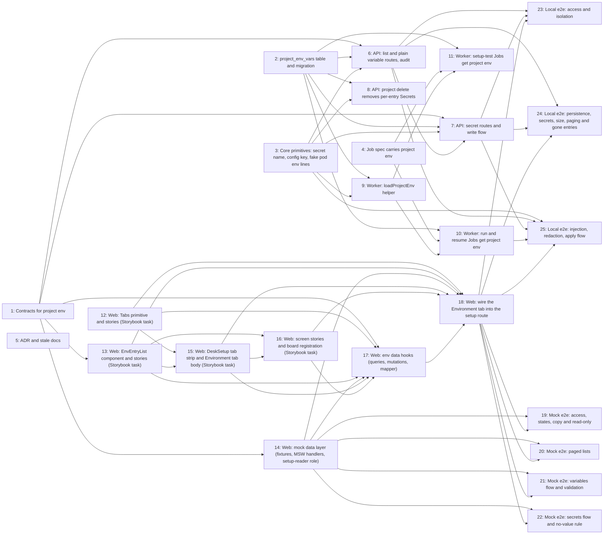

<!-- dev-plan: kind=plan id=workspace-env-secrets rev=1 hash=7fa6c7e476ec spec=docs/superpowers/specs/2026-11-23-workspace-env-secrets-design.md spec-hash=eb3c8d2268b0 -->
# Workspace environment variables and secrets Implementation Plan

> **For agentic workers:** REQUIRED SUB-SKILL: Use superpowers:subagent-driven-development (recommended) or superpowers:executing-plans to implement this plan task-by-task. Steps use checkbox (`- [ ]`) syntax for tracking.

**Goal:** An owner or admin adds, edits and removes plain variables and secrets on the Environment tab of `desk/setup`; Pods created afterwards get them as environment variables, secret values stay write-only and are redacted from stored output.

**Architecture:** Contracts first (schemas, 7 `projectEnv` routes, `routeAccess`), then a new `project_env_vars` table (names, kinds, plain values, metadata) with one Kubernetes Secret per secret entry written through `SecretStore`. The API serializes cap and size accounting with short transactions and never holds a lock across a store call. The worker reads rows and secrets in the activities that create the Job (fresh run, resume, setup test) and passes them to `buildRunJob` / `buildSetupTestJob`: plain values as literal env, secret values as keys of the per-run Secret referenced by `secretKeyRef`. The web adds a `Tabs` primitive, an `EnvEntryList` component and the `DeskSetupEnvironment` tab body, stories first.

**Tech Stack:** Zod (contracts), Drizzle and Postgres RLS (db), NestJS on Fastify (api), Temporal activities (worker), React, TanStack Router and Query, MSW, Storybook (web), Playwright (mock and local e2e). No new dependency.

**Spec:** `docs/superpowers/specs/2026-11-23-workspace-env-secrets-design.md` (executors read it with this plan; BR ids, TC ids and the Copy section are defined there).

## Global Constraints

- Name: `^[A-Za-z_][A-Za-z0-9_]*$`, 1 to 128 chars, not trimmed, case-sensitive, unique per project across both kinds.
- Plain value: may be empty, at most 8192 UTF-8 bytes, no `\n`, `\r` or NUL. Secret value: required, 6 to 8192 chars (UTF-8 bytes at most 8192), same line rules. 5 characters is a 400, 6 is accepted.
- Entry cap: 500 per project, plain and secret together, from config `PROJECT_ENV_MAX_ENTRIES` (`blankDefault(z.coerce.number().int().min(1).default(500))`). Total size: `ENV_MAX_TOTAL_BYTES = 262144` (sum of UTF-8 bytes of every name and value, both kinds), a contract constant, not config. Cap and size refusals are 409, never 500.
- List: `GET /api/projects/:projectId/env?kind=plain|secret&page=&pageSize` (ADR 0028, `pageSize` ceiling 100), `ORDER BY name COLLATE "C"`, `count(*)` in the same `withOrg` transaction.
- Secret entry: Kubernetes Secret `org-{orgId}-env-{entryId}`, data `{ value }`, built by `projectEnvSecretName(orgId, entryId)`. Postgres holds a secret row with `value` null. A secret value is never in Postgres, logs, events, errors, audit, problem+json, DTOs, Temporal inputs or results, labels or the Job literal env.
- Write order: add and edit are Secret first then row; remove is row first then Secret (best effort). No transaction or lock is held across a store call.
- Migration `0036_project_env_vars.sql` (never edit an applied migration). Permissions reuse `setup:read`, `setup:update`, `secret:update` (no `access.ts` change, no role migration).
- Pod env: project vars first, platform env after; a duplicate name is rejected; no `envFrom`; the loader reads secrets with concurrency 10.
- Web: tokens only, every shared component has a story with loading, empty and error states; secret values live only in the entry form's state and are never cached; `?tab=environment` (default `script`), `varsPage`, `secretsPage` in the URL.
- Copy strings are the ones in the spec's "UI and Storybook > Copy" and "User flows", character for character. Contract messages equal those strings (see Agent calls).
- Strict TS (no `any`, no unexplained `!`), no network in tests, never weaken an access test, `routes.test.ts` and `route-access.test.ts` edits are additions only (80 to 87 routes).

## Review Focus

Inputs and conditions the spec implies but does not table; each has a test in the named task.

1. A value with leading or trailing spaces, or an empty plain value, reaches the Pod exactly as typed (never trimmed, empty stays an empty env var): Task 6 (round trip), Task 10 (Job env).
2. Names differing only by case coexist, and lowercase `path` is not reserved (the list is case-sensitive); a name with a non-ASCII letter (`NAMÉ`) is refused: Task 1.
3. A project with no entries produces exactly the Job and run Secret it produced before this change: Task 4, Task 10.
4. Removing the last entry of a later page leaves the list on its new last page, not on an empty page: Task 18.
5. Pressing the add or save button twice sends one request (button disabled while pending): Task 13.

## Access and tenant data (per route, query, workflow, screen)

| Surface | Permission | Level | Tenant data touched |
| ------- | ---------- | ----- | ------------------- |
| `GET projectEnv.list` | `setup:read` | project | the project's `project_env_vars` rows (secret rows without value) |
| `POST/PUT/DELETE projectEnv.createVar/updateVar/removeVar` | `setup:update` | project | plain rows of the project |
| `POST/PUT/DELETE projectEnv.createSecret/updateSecret/removeSecret` | `secret:update` | project | secret rows and their per-entry Secrets |
| `ProjectsService.remove` | existing `project:delete` guard, unchanged | project | deletes the rows (cascade) and per-entry Secrets |
| Worker `loadProjectEnv` | none (internal activity, tenant from `RunContext`) | project | reads rows under `withOrg` plus org and project filter, then the project's Secrets |
| Web `desk/setup?tab=environment` | `setup:read` guard unchanged; controls use `setup:update` / `secret:update` for show/hide only | project | the two paged lists |

Guard order, `own` (not applicable) and 403/404 rules are as in the spec "Tenancy and permission". Every task that adds or changes a route tests allowed, 403, 404 (out of scope), cross-org and project scope through the real guard and `withOrg`.

## Needs approval

None. No new package, library, service, image, CI action or CLI binary. Existing zod, drizzle-orm, `@kubernetes/client-node` and nestjs-zod pipes are reused.

## Agent calls

- Agent call: contract error messages are the exact UI strings from the spec Copy ("Enter a name.", "Use letters, digits and _, and do not start with a digit.", "Use 128 characters or fewer.", "Use 8 KiB or less.", "A value cannot contain a line break.", "Too short to hide in logs.", "Enter a value.", `<NAME> is reserved: Agent Desk sets it for every run.`), because the web shows contract messages verbatim and the Copy section is the approved text (the architecture section quotes the line-break message in lowercase).
- Agent call: `projectEnv` on `RunJobInput` and `SetupTestJobInput` is optional (empty when absent), so Task 4 merges without breaking the worker until Tasks 10 and 11 pass it.
- Agent call: the `loadProjectEnv` tests go in a new `apps/worker/test/project-env.int.test.ts`, not `run.activities.int.test.ts` as the spec says, so Tasks 9 and 10 do not edit one file in parallel.
- Agent call: the project-delete test goes in `apps/api/test/projects.int.test.ts`, not `project-env.int.test.ts`, so Task 8 runs in parallel with Tasks 6 and 7.
- Agent call: the mock e2e cases go in four spec files (`desk-setup-environment.spec.ts`, `-paging`, `-vars`, `-secrets`) and the local ones in three (`project-env.spec.ts`, `project-env-runs.spec.ts`, plus the two RBAC files and `pagination.spec.ts` the spec names), so independent tasks never share a file; the spec names one file for each side.
- Agent call: the paged story fixtures and the paged e2e rows are generated: story data in `mocks/setup.ts`, mock e2e data through a new `env` key of `MockLists` in `e2eLists.ts` (`seedLists`), so `invoicer-api` keeps exactly 3 variables and 2 secrets by default (TC-3.1, TC-5.2).
- Agent call: one screen story per new board (20 boards are drawn, the spec lists 8 story names), because `coverage.test.ts` requires every canvas board to map to a story.
- Agent call: the scenario that signs in as the read-only role is named `setupReader` (the role key is `setup-reader`), following `orgAdmin` and `projectAdmin`.

Spec note: all 105 test cases of the spec's E2E requirements are planned, including TC-21.1, TC-21.2 and TC-21.3 (BR-21).

---

<!-- dev-plan:graph:begin -->
## Task graph

Generated by `dev-plan.mjs graph --write` from each task's **Depends on:** line. Do not edit it by hand.
Tasks in the same wave touch no common file and can be built in parallel; a task starts when everything it depends on is merged.

| Wave | Task | Depends on |
| ---- | ---- | ---------- |
| 1 | Task 1: Contracts for project env | none |
| 1 | Task 2: project_env_vars table and migration | none |
| 1 | Task 3: Core primitives: secret name, config key, fake pod env lines | none |
| 1 | Task 4: Job spec carries project env | none |
| 1 | Task 5: ADR and stale docs | none |
| 1 | Task 12: Web: Tabs primitive and stories (Storybook task) | none |
| 2 | Task 6: API: list and plain variable routes, audit | Task 1, Task 2, Task 3 |
| 2 | Task 8: API: project delete removes per-entry Secrets | Task 2, Task 3 |
| 2 | Task 9: Worker: loadProjectEnv helper | Task 2, Task 3 |
| 2 | Task 13: Web: EnvEntryList component and stories (Storybook task) | Task 1 |
| 2 | Task 14: Web: mock data layer (fixtures, MSW handlers, setup-reader role) | Task 1 |
| 3 | Task 7: API: secret routes and write flow | Task 1, Task 2, Task 3, Task 6 |
| 3 | Task 10: Worker: run and resume Jobs get project env | Task 2, Task 4, Task 9 |
| 3 | Task 11: Worker: setup-test Jobs get project env | Task 2, Task 4, Task 9 |
| 3 | Task 15: Web: DeskSetup tab strip and Environment tab body (Storybook task) | Task 12, Task 13 |
| 4 | Task 16: Web: screen stories and board registration (Storybook task) | Task 13, Task 15 |
| 5 | Task 17: Web: env data hooks (queries, mutations, mapper) | Task 1, Task 12, Task 13, Task 14, Task 15, Task 16 |
| 6 | Task 18: Web: wire the Environment tab into the setup route | Task 12, Task 13, Task 14, Task 15, Task 16, Task 17 |
| 7 | Task 19: Mock e2e: access, states, copy and read-only | Task 14, Task 18 |
| 7 | Task 20: Mock e2e: paged lists | Task 14, Task 18 |
| 7 | Task 21: Mock e2e: variables flow and validation | Task 14, Task 18 |
| 7 | Task 22: Mock e2e: secrets flow and no-value rule | Task 14, Task 18 |
| 7 | Task 23: Local e2e: access and isolation | Task 6, Task 7, Task 18 |
| 7 | Task 24: Local e2e: persistence, secrets, size, paging and gone entries | Task 6, Task 7, Task 18 |
| 7 | Task 25: Local e2e: injection, redaction, apply flow | Task 3, Task 6, Task 7, Task 10, Task 18 |

<!-- dev-plan:graph:end -->

### Task 1: Contracts for project env

**Depends on:** none

**Files:**

- Create: `packages/contracts/src/schemas/env.ts`
- Create: `packages/contracts/src/schemas/env.test.ts`
- Modify: `packages/contracts/src/routes.ts`
- Modify: `packages/contracts/src/route-access.ts`
- Modify: `packages/contracts/src/index.ts`
- Test: `packages/contracts/src/routes.test.ts`
- Test: `packages/contracts/src/route-access.test.ts`

**Interfaces:**

- Produces (all exported from `@agentdesk/contracts`):
  - `ENV_NAME_MAX = 128`, `ENV_VALUE_MAX_BYTES = 8192`, `ENV_MAX_TOTAL_BYTES = 262144`, `SECRET_VALUE_MIN_LENGTH = 6`
  - `RESERVED_ENV_NAMES: readonly string[]`, `RESERVED_ENV_PREFIXES: readonly string[]` (static lists from the spec Architecture > Contracts), `isReservedEnvName(name: string): boolean`
  - `EnvName` (regex, 1..128, not reserved), `EnvVarValue`, `EnvSecretValue`, `EnvKind = z.enum(['plain','secret'])`
  - `EnvEntryDto = { name: string; kind: 'plain'|'secret'; value: string | null; updatedAt: string; updatedBy: string }`
  - `EnvListQuery = PageQuery.extend({ kind: EnvKind })`
  - `CreateEnvVarRequest { name; value }`, `CreateEnvSecretRequest { name; value }`, `UpdateEnvVarRequest { value }`, `UpdateEnvSecretRequest { value }` (and the inferred types)
  - `routes.projectEnv.{list, createVar, updateVar, removeVar, createSecret, updateSecret, removeSecret}` with the methods and paths of the spec API table; `PUT`/`DELETE` params are `{ projectId: z.uuid(), name: EnvName }`
  - `routeAccess` keys `'projectEnv.list'` = `project('setup:read')`; `createVar`, `updateVar`, `removeVar` = `project('setup:update')`; `createSecret`, `updateSecret`, `removeSecret` = `project('secret:update')`

- [x] **Step 1: Write the failing tests** in `env.test.ts` as `it.each` tables: name 128 ok / 129 bad, `1A`, empty, space, `MY-VAR`, ` DB`, `NAMÉ` bad, `_A1` ok, `db_host` and `DB_HOST` both ok, `path` ok; each reserved name and prefix refused with a near-miss accepted (`PATHS`, `MY_RUN_ID`, `AGENTDESK_X` refused, `GITHUB_TOKEN` refused with message `GITHUB_TOKEN is reserved: Agent Desk sets it for every run.`); plain value 8192 and 8193 UTF-8 bytes (multibyte case), empty accepted, `\n`, `\r`, `\r\n`, NUL refused; secret value `''` and 5 chars refused, 6 accepted, 8193 refused; `EnvListQuery` needs `kind` (missing and `other` refused), `pageSize` 100 ok and 101 refused; create body `{name,value}` and update body `{value}` shapes; `EnvEntryDto` accepts `value: null`. In `routes.test.ts` change the route count 80 to 87 and pin `ENV_MAX_TOTAL_BYTES` at 262144. In `route-access.test.ts` change the count to 87 and add the 7 expected entries.
- [x] **Step 2: Run** `pnpm --filter @agentdesk/contracts exec vitest run src/schemas/env.test.ts src/routes.test.ts src/route-access.test.ts`. Expected: FAIL (module and routes missing).
- [x] **Step 3: Implement** `env.ts` (validators above; the UTF-8 byte refine is the one `SetupScriptBody` uses), the `projectEnv` group in `routes.ts` (list returns `pageOf(EnvEntryDto)`, creates return `EnvEntryDto` with status 201, removes return `empty`), the 7 `routeAccess` entries (default `projectId` param), and the barrel export in `index.ts`. The reserved check is case-sensitive.
- [x] **Step 4: Run** the command of Step 2, then `pnpm --filter @agentdesk/contracts typecheck` and `pnpm --filter @agentdesk/contracts test`. Expected: PASS. Run `role-matrix.test.ts` unchanged and green.
- [x] **Step 5: Commit** (`devbox run fix` first): `feat(contracts): add project env schemas, routes and access`.

---

### Task 2: project_env_vars table and migration

**Depends on:** none

**Files:**

- Modify: `packages/db/src/schema/app.ts`
- Create: `packages/db/migrations/0036_project_env_vars.sql`
- Modify: `packages/db/migrations/meta/_journal.json`
- Create: `packages/db/migrations/meta/0036_snapshot.json`
- Test: `packages/db/test/rls.int.test.ts`
- Test: `packages/db/test/migrate.int.test.ts`

**Interfaces:**

- Produces: Drizzle export `projectEnvVars` from `@agentdesk/db` with columns `id` (uuid pk, `defaultRandom()`), `orgId`, `projectId` (fk `projects` on delete cascade), `name`, `kind`, `value` (nullable text), `sizeBytes` (integer), `updatedBy` (text), `createdAt`, `updatedAt` (timestamptz not null default now()); `orgPolicy()` RLS; unique `project_env_vars_project_name_key (project_id, name)`; index `project_env_vars_org_idx`; list index `project_env_vars_project_kind_name_idx` on `(project_id, kind, (name COLLATE "C"))`. Checks: name regex, `kind in ('plain','secret')`, `project_env_vars_value_check` (plain implies value not null, `octet_length(value) <= 8192`, no CR, LF, NUL; secret implies value null), `project_env_vars_size_check` (1 to 8320). `GRANT SELECT, INSERT, UPDATE, DELETE ... TO agentdesk_app` in the SQL.

- [x] **Step 1: Write the failing tests.** In `rls.int.test.ts` add the `inserts` entry for `project_env_vars` (cross-org read and write denied as `agentdesk_app`) and tests: an insert with none of `id`, `created_at`, `updated_at` gets a uuid and `now()` timestamps, an explicit NULL for each is refused; duplicate `(project_id, name)` refused; `kind` `other` refused; secret row with a non-null `value` refused; plain value of 8193 bytes refused; plain value with LF, CR or NUL refused; `size_bytes` 0 and 8321 refused; name `1BAD` refused; deleting a project cascades its rows; the list index exists. In `migrate.int.test.ts` add: the migration applies on a database that already has projects and leaves them with no rows.
- [x] **Step 2: Run** `pnpm --filter @agentdesk/db exec vitest run test/rls.int.test.ts test/migrate.int.test.ts`. Expected: FAIL (table missing).
- [x] **Step 3: Implement** the table in `schema/app.ts` (provider-agnostic name, local `ts` helper) and generate the migration with drizzle-kit; hand-write the expression index and the GRANT if drizzle-kit cannot emit them, and keep the journal and snapshot in step.
- [ ] **Step 4: Run** the Step 2 command plus `pnpm --filter @agentdesk/db typecheck`. Expected: PASS.
- [ ] **Step 5: Commit**: `feat(db): add project_env_vars table with RLS`. Label `review:sensitive` (RLS, migration).

---

### Task 3: Core primitives: secret name, config key, fake pod env lines

**Depends on:** none

**Files:**

- Modify: `packages/core/src/secrets/secret-store.ts`
- Modify: `packages/core/src/config.ts`
- Modify: `.env.example`
- Modify: `packages/core/src/kube/fake-pod.mjs`
- Test: `packages/core/test/secrets.test.ts`
- Test: `packages/core/test/config.test.ts`
- Test: `packages/core/test/kube/fake-pod.test.ts`
- Test: `packages/core/test/kube/fake-gateway.test.ts`

**Interfaces:**

- Produces:
  - `projectEnvSecretName(orgId: string, entryId: string): string` returning `org-${orgId}-env-${entryId}` (exported from `@agentdesk/core`, next to `credentialSecretName`)
  - `Config.PROJECT_ENV_MAX_ENTRIES: number` (default 500)
  - Fake pod behaviour: for every env name starting `E2E_` it logs `agentdesk: env <NAME> <first 12 hex of sha256(value)>` (value empty string allowed); when PROMPT contains `--fake-echo-env=<NAME>` it also prints that variable's raw value to the pane and log stream.

- [x] **Step 1: Write the failing tests.** `secrets.test.ts`: `projectEnvSecretName` equals `org-<org>-env-<id>`, passes `assertSecretName`, differs from `credentialSecretName`'s `org-...-agent-...`; put, replace, get, delete of a `{ value }` Secret through `MemorySecretStore`, `FileSecretStore` and `KubeSecretStore` with a fake `CoreV1Api`. `config.test.ts` (copy the `RUN_LEASE_TTL_SECONDS` cases): default 500, a set value used, blank gives 500, `0`, `-1`, `1.5`, `abc` refused. `fake-pod.test.ts`: env `E2E_A=hello` logs the expected hash line, `E2E_EMPTY=` logs the hash of the empty string, an env name without the prefix logs nothing, `--fake-echo-env=E2E_A` prints `hello`, without the flag the raw value is absent from log and pane. `fake-gateway.test.ts`: a Job whose env has a literal `E2E_P` and a `secretKeyRef` `E2E_S` makes the pod log both hash lines.
- [x] **Step 2: Run** `pnpm --filter @agentdesk/core exec vitest run test/secrets.test.ts test/config.test.ts test/kube/fake-pod.test.ts test/kube/fake-gateway.test.ts`. Expected: FAIL.
- [x] **Step 3: Implement** the helper, the config key (same style as `RUN_SETUP_TIMEOUT_SECONDS`) plus a `.env.example` line `PROJECT_ENV_MAX_ENTRIES=500`, and the fake-pod lines (value only hashed or echoed under the flag; the pod never executes env or prompt text). Update the fake-pod header comment.
- [x] **Step 4: Run** the Step 2 command and `pnpm --filter @agentdesk/core typecheck`. Expected: PASS.
- [x] **Step 5: Commit**: `feat(core): add project env secret name, entry cap config and fake pod env lines`. Label `review:sensitive` (secrets).

---

### Task 4: Job spec carries project env

**Depends on:** none

**Files:**

- Modify: `packages/core/src/kube/job-spec.ts`
- Test: `packages/core/test/kube/job-spec.test.ts`

**Interfaces:**

- Produces (exported through `@agentdesk/core`):
  - `interface ProjectEnvInput { plain: ReadonlyArray<{ name: string; value: string }>; secretNames: readonly string[] }`
  - `RunJobInput.projectEnv?: ProjectEnvInput` and `SetupTestJobInput.projectEnv?: ProjectEnvInput` (absent means empty)
  - `class ProjectEnvClashError extends Error { readonly envName: string }`, thrown by `buildRunJob` and `buildSetupTestJob` when a project name equals any platform env name (static, or dynamic: the credential keys, `cliTokenEnvName`, adapter `agentEnv`) or two project names collide; message names the variable only.
  - Contract with the worker (Tasks 10 and 11): each name in `secretNames` becomes an explicit `secretKeyRef` into the Job's Secret (`run-{runId}` or the setup-test Secret) with the same key; plain entries are literal `env`. Project entries come first in the container env, platform env after.

- [x] **Step 1: Write the failing tests** in `job-spec.test.ts` (`it.each` over run, resume and setup-test Jobs): plain entries are literal env, secret names are `secretKeyRef` env into the Job's Secret, no `envFrom`; no secret value anywhere in `JSON.stringify(job)` (values are not an input, assert the names only appear as refs); project entries sit before platform env; clash with `PATH`-style platform names, with a credential key and with `cliTokenEnvName` throws `ProjectEnvClashError` carrying only the name; no label or annotation carries a name or value; an empty or absent `projectEnv` yields a Job deep-equal to the one built before this change; worst cases at the 256 KiB total: all-plain Job JSON under 1 MiB, and all-secret per-run Secret data (base64, with token and credential) under 1 MiB (build the Secret data in the test from the same names).
- [x] **Step 2: Run** `pnpm --filter @agentdesk/core exec vitest run test/kube/job-spec.test.ts`. Expected: FAIL.
- [x] **Step 3: Implement** the optional input in `buildRunJob`, `buildSetupTestJob` and `podJob`: collect all env names of the pod, reject a duplicate with `ProjectEnvClashError`, emit project entries first. Values are only ever `value:` fields, never interpolated.
- [x] **Step 4: Run** the Step 2 command and `pnpm --filter @agentdesk/core typecheck`. Expected: PASS.
- [x] **Step 5: Commit**: `feat(core): inject project env into run and setup-test Jobs`. Label `review:sensitive` (run Job).

---

### Task 5: ADR and stale docs

**Depends on:** none

**Files:**

- Create: `docs/adr/0038-project-env-vars-and-secrets.md`
- Modify: `docs/adr/README.md`
- Modify: `docs/superpowers/specs/2026-11-13-workspace-setup-and-plugins-design.md`

**Interfaces:** none (documents only).

- [x] **Step 1: Write the ADR** "Project environment variables and secrets are injected into workspace pods": decision (per-entry Secrets, rows authoritative, apply to new Pods only), consequences (setup and agent can read all values, accepted risk in the spec Edge cases, F2 closed), status accepted, extends ADR 0012 and 0019 decision 8; add the index line in `docs/adr/README.md`.
- [x] **Step 2: Fix the stale lines** in the setup-and-plugins spec named in the spec "Lifecycle, compatibility and side effects": §2 non-goal "Secrets/env vars for setup", §3 decision 6 "Secrets: none in v1", §7 F2, §5.4 editor hint "secrets are F2". Change only those lines, each pointing to the new spec and ADR.
- [x] **Step 3: Verify** with `rg -n "secrets are F2|Secrets: none in v1" docs/superpowers/specs/2026-11-13-workspace-setup-and-plugins-design.md` printing nothing stale. Do not edit `AGENTS.md`, `.agent/` or `docs/conventions/security.md`; flag the `security.md` §1 wording in the PR instead.
- [x] **Step 4: Commit**: `docs(adr): record project env vars and secrets in workspace pods`.

---

### Task 6: API: list and plain variable routes, audit

**Depends on:** Task 1, Task 2, Task 3

**Files:**

- Create: `apps/api/src/setup/project-env.controller.ts`
- Create: `apps/api/src/setup/project-env.service.ts`
- Modify: `apps/api/src/setup/setup.module.ts`
- Modify: `apps/api/src/audit/audit.interceptor.ts`
- Modify: `apps/api/src/audit/redact-body.ts`
- Create: `apps/api/test/helpers/project-env.ts`
- Create: `apps/api/test/project-env.int.test.ts`
- Test: `apps/api/src/audit/audit.interceptor.test.ts`
- Test: `apps/api/src/audit/redact-body.test.ts`

**Interfaces:**

- Consumes: Task 1 routes, schemas and `routeAccess`; Task 2 `projectEnvVars`; Task 3 `Config.PROJECT_ENV_MAX_ENTRIES`.
- Produces:
  - `ProjectEnvController` with `list`, `createVar`, `updateVar`, `removeVar` (Task 7 adds the three secret handlers to the same file, using the same `ZodPipe` style as `SetupScriptController`).
  - `ProjectEnvService` methods `list(org, projectId, q: EnvListQuery): Promise<Page<EnvEntryDto>>`, `createVar(org, projectId, actor, body)`, `updateVar(org, projectId, actor, name, body)`, `removeVar(org, projectId, name)` and the internal accounting helper `lockProjectAndCheck(tx, projectId, { addEntry: boolean; deltaBytes: number })` that takes `SELECT ... FROM projects ... FOR UPDATE`, enforces the cap and the total (409 with a clear detail) and is reused by Task 7.
  - `AUDIT_ENV_BY_ACTION: Record<string, 'plain' | 'secret'>` in `audit.interceptor.ts` for all six write actions; after `redactBody` the interceptor merges `{ kind, name }` (name from the path param for PUT and DELETE, from the body for POST); key `value` stays dropped; `targetId` stays the project id.
  - Test helpers in `apps/api/test/helpers/project-env.ts`: `customRole(t, permissions: string[])` (inserted through `withOrg`), `slowStore(t)` (a `put` that waits on a promise the test releases), `seedEnvRows(t, projectId, n, kind)` (SQL `generate_series`).

- [x] **Step 1: Write the failing tests.** `project-env.int.test.ts` (real Postgres, real guard, `MemorySecretStore`, `expectContract` on every response): BR-2 and BR-4 on the four routes (member and viewer 403 with the generic body, also for a made-up and a malformed id; admin on P1 reads and writes P1 and gets 404 on P2; org B owner gets 404; no foreign name in any body); POST new gives 201 and the row; POST of an existing plain name gives 409 and the first value is unchanged; PUT edits; PUT of a missing name is 404 and creates nothing; DELETE missing is 404; invalid name 400 with pointer `/name`, reserved name 400, value over 8192 bytes, line break and NUL 400 at `/value`; a value with leading and trailing spaces and an empty value round trip verbatim (Review Focus 1); list: `kind=plain` returns only plain rows, 23 rows give 20 on page 1 with `total` 23 and 3 on page 2, a page past the end is empty with the total, `pageSize` 100 ok and 101 refused, missing or bad `kind` 400, byte order (`A1, B, Z, _X, a, b` created scrambled), `updatedAt` as `expect.any(String)`; cap: lowered through `createTestApp({ env })` the add is 409 with nothing written while edit and remove still work above the cap, plus one test at the 500 default with rows seeded by SQL; size: exactly 262144 bytes of names and values accepted, one byte more is 409 on create and on edit with the old value untouched, a smaller edit at the limit works; BR-22: two PUTs on different entries both persist, same entry last wins, two POSTs of one name give one 2xx and one 409, two POSTs for the last free slot (cap set to count + 1) give one 2xx and one 409 and the count equals the cap; permission split: a custom role with `setup:update` only writes plain vars and gets 403 on nothing here, `setup:read` only lists and gets 403 on writes; audit: each of the 3 var routes writes one `audit_log` row with action, actor, project, name and kind `plain` and no value, other rows unchanged. Audit unit tests: `AUDIT_ENV_BY_ACTION` merge for POST (name from body) and PUT/DELETE (name from path), `redactBody` drops `value` and keeps `name`.
- [x] **Step 2: Run** `pnpm --filter @agentdesk/api exec vitest run test/project-env.int.test.ts src/audit`. Expected: FAIL (routes not found).
- [x] **Step 3: Implement** controller, service (one short `withOrg` transaction per write with the project row lock, project visibility through `assertProjectVisible`, `size_bytes = octet_length(name) + octet_length(value)`, `updated_at = now()` set by the API on PUT, tenant from the session), module wiring, and the audit extension.
- [x] **Step 4: Run** the Step 2 command and `pnpm --filter @agentdesk/api typecheck`. Expected: PASS.
- [x] **Step 5: Commit**: `feat(api): add project env list and variable routes with audit`. Label `review:sensitive`.

---

### Task 7: API: secret routes and write flow

**Depends on:** Task 1, Task 2, Task 3, Task 6

**Files:**

- Modify: `apps/api/src/setup/project-env.controller.ts`
- Modify: `apps/api/src/setup/project-env.service.ts`
- Modify: `apps/api/test/project-env.int.test.ts`
- Modify: `apps/api/test/desk-access.int.test.ts`
- Modify: `apps/api/test/authz.int.test.ts`

**Interfaces:**

- Consumes: Task 6 `lockProjectAndCheck`, controller and test helpers; Task 3 `projectEnvSecretName`.
- Produces: handlers and service methods `createSecret`, `updateSecret`, `removeSecret` for the three secret routes, using `SECRET_STORE`; secret DTOs carry `value: null`.

- [x] **Step 1: Write the failing tests** in `project-env.int.test.ts`: BR-9, 10, 11 data side (the row has `value` null, the Secret `org-{orgId}-env-{id}` holds `{ value }`, the entry id is read back from the row); BR-14 other-kind cases (POST variable named like an existing secret and the reverse give 409 with the existing entry untouched and no Secret written); wrong-kind PUT or DELETE (`/env-vars/:name` on a secret and the reverse) is 404 with the other entry untouched; BR-15 (5 chars 400, 6 accepted, no value in the body); BR-17 (no secret value in any 400, 404, 409 or 500 body, DTO, `audit_log`, stdout or stderr spies, or the Secret name); BR-23 (`vi.spyOn(t.secrets, 'put')` rejecting gives a generic 500, no row, list unchanged, no value in body or log); a row insert failing after the Secret put leaves an inert Secret and no "set" row; remove with a rejecting `delete` still shows the entry removed and logs only the error class; BR-28 API side (update-secret racing a remove is 404 and leaves no Secret for that entry); the size check counts both kinds (31 secrets plus one more entry is 409, no Secret written) and a racing add that loses the re-check deletes its new Secret; BR-4, BR-2 and the permission split on the 3 secret routes (a custom role with `secret:update` only writes secrets and gets 403 on variable writes, `setup:update` only the reverse, with nothing stored); lock: with `slowStore` holding `put`, a setup-script PUT, a plain-var POST and a list on the same project complete and a second connection's `SELECT ... FROM projects WHERE id = $1 FOR UPDATE NOWAIT` succeeds; audit rows for the 3 secret routes carry kind `secret`, name and no value. Extend the route lists in `desk-access.int.test.ts` and `authz.int.test.ts` with all 7 `projectEnv` routes (403 before any id lookup, also for a made-up id).
- [x] **Step 2: Run** `pnpm --filter @agentdesk/api exec vitest run test/project-env.int.test.ts test/desk-access.int.test.ts test/authz.int.test.ts`. Expected: FAIL (secret routes missing).
- [x] **Step 3: Implement** per the spec Write flow: create is tx1 pre-check (name free in both kinds, cap, total), generate id, `secrets.put` outside any transaction, tx2 re-check under the project lock and insert, delete the new Secret best effort when tx2 loses; update is tx1 load and delta check, put at the row's id, tx2 re-load (gone: 404 and delete that Secret), re-check, update `size_bytes`, `updated_at`, `updated_by`; remove deletes the row then `secrets.delete` best effort. A store failure is a fixed-message 5xx with only the error class logged (copy `storeCredential` in `agents.service.ts`).
- [x] **Step 4: Run** the Step 2 command and `pnpm --filter @agentdesk/api typecheck`. Expected: PASS.
- [x] **Step 5: Commit**: `feat(api): add project env secret routes`. Label `review:sensitive`.

---

### Task 8: API: project delete removes per-entry Secrets

**Depends on:** Task 2, Task 3

**Files:**

- Modify: `apps/api/src/projects/projects.service.ts`
- Test: `apps/api/test/projects.int.test.ts`

**Interfaces:**

- Consumes: Task 2 `projectEnvVars`; Task 3 `projectEnvSecretName`.
- Produces: `ProjectsService.remove` reads the ids of the project's secret entries in the transaction that deletes the project and, after commit, calls `secrets.delete(projectEnvSecretName(orgId, id))` best effort next to the credential delete.

- [x] **Step 1: Write the failing test** in `projects.int.test.ts`: a project with one plain row, two secret rows and their Secrets in `MemorySecretStore` (rows inserted through `withOrg`, Secrets through `put`); after delete the rows are gone and both Secrets are gone; a second test where `secrets.delete` rejects for one id still deletes the project (200) and the other Secret.
- [x] **Step 2: Run** `pnpm --filter @agentdesk/api exec vitest run test/projects.int.test.ts -t "env"`. Expected: FAIL.
- [x] **Step 3: Implement** the collect-then-delete in `remove`.
- [x] **Step 4: Run** the Step 2 command, then the whole file, and `pnpm --filter @agentdesk/api typecheck`. Expected: PASS.
- [x] **Step 5: Commit**: `feat(api): delete env secrets with the project`. Label `review:sensitive`.

---

### Task 9: Worker: loadProjectEnv helper

**Depends on:** Task 2, Task 3

**Files:**

- Create: `apps/worker/src/activities/project-env.ts`
- Create: `apps/worker/test/project-env.int.test.ts`

**Interfaces:**

- Consumes: Task 2 `projectEnvVars`; Task 3 `projectEnvSecretName`.
- Produces:
  - `interface LoadedProjectEnv { plain: { name: string; value: string }[]; secrets: Record<string, string> }`
  - `const PROJECT_ENV_READ_CONCURRENCY = 10`
  - `loadProjectEnv(db: Db, secrets: SecretStore, ctx: { orgId: string; projectId: string }): Promise<LoadedProjectEnv>`: reads rows under `withOrg` with org and project filter, then `secrets.get(projectEnvSecretName(orgId, id))` per secret row with at most 10 reads in flight. A secret row whose Secret (or its `value` key) is missing throws `ApplicationFailure.nonRetryable` with a message naming only the variable; any other store read error throws a retryable error whose message carries no value; a Secret with no row is never read.

- [x] **Step 1: Write the failing tests** (real Postgres, `MemorySecretStore` wrapped in a counting spy): returns plain values verbatim (leading and trailing spaces, empty) and secret values by name; 25 secret entries are read with at most 10 reads in flight (spy counts concurrency, the test releases a promise, no timers); an orphan Secret with no row is never read; another project's and another org's rows are never read; a missing Secret for a secret row fails non-retryably and the message holds the name and no value; a store read error is retryable and the message has no value; empty project gives `{ plain: [], secrets: {} }`.
- [x] **Step 2: Run** `pnpm --filter @agentdesk/worker exec vitest run test/project-env.int.test.ts`. Expected: FAIL.
- [x] **Step 3: Implement** `loadProjectEnv` with a small bounded-concurrency loop (no new dependency).
- [x] **Step 4: Run** the Step 2 command and `pnpm --filter @agentdesk/worker typecheck`. Expected: PASS.
- [x] **Step 5: Commit**: `feat(worker): add loadProjectEnv`. Label `review:sensitive`.

---

### Task 10: Worker: run and resume Jobs get project env

**Depends on:** Task 2, Task 4, Task 9

**Files:**

- Modify: `apps/worker/src/activities/run.activities.impl.ts`
- Test: `apps/worker/test/run.activities.int.test.ts`

**Interfaces:**

- Consumes: `loadProjectEnv`, `LoadedProjectEnv` (Task 9); `ProjectEnvInput`, `ProjectEnvClashError` (Task 4).
- Produces: `createRunSecretAndJob` (fresh run and resume) calls `loadProjectEnv`, copies each secret into the `run-{runId}` Secret data under its env name, passes `projectEnv: { plain, secretNames }` to `buildRunJob`, maps `ProjectEnvClashError` to `ApplicationFailure.nonRetryable` naming the variable only. `redactionList` is unchanged and picks the new values up from the run Secret. Workflow inputs and results still hold ids only.

- [x] **Step 1: Write the failing tests** in a new `describe('createRunSecretAndJob project env')`: plain entry is a literal env of the Job and a secret entry is a key of `run-{id}` referenced by `secretKeyRef`, with the expected values; empty project gives a Job and Secret equal to the pre-change ones (Review Focus 3); values with leading or trailing spaces stay verbatim; a retry after a later save re-reads current values with one Secret and one Job (pinned as accepted); a save after Job creation leaves the existing Job and Secret untouched; a resume builds the Job from fresh rows and Secrets; a Job-create failure deletes the run Secret again and leaks no value; a dynamic-name clash (project secret named like the credential env) fails non-retryably with the name only; `redactionList` contains each project secret value and a printed value is `***` in the prompt, failure reason, finish comment, scrollback and transcript; no secret value in activity errors, workflow inputs or results or the Job JSON.
- [x] **Step 2: Run** `pnpm --filter @agentdesk/worker exec vitest run test/run.activities.int.test.ts -t "project env"`. Expected: FAIL.
- [x] **Step 3: Implement** the wiring in `createRunSecretAndJob` (`ensureSecret` and `ensureJob` 409-is-success path unchanged).
- [x] **Step 4: Run** the Step 2 command, the whole `run.activities.int.test.ts`, the existing replay and activity wiring tests unchanged (`pnpm --filter @agentdesk/worker test`), and `pnpm --filter @agentdesk/worker typecheck`. Expected: PASS.
- [x] **Step 5: Commit**: `feat(worker): inject project env into run Jobs`. Label `review:sensitive`.

---

### Task 11: Worker: setup-test Jobs get project env

**Depends on:** Task 2, Task 4, Task 9

**Files:**

- Modify: `apps/worker/src/activities/setup-test.activities.impl.ts`
- Test: `apps/worker/test/setup-test.activities.int.test.ts`

**Interfaces:**

- Consumes: Tasks 4 and 9 as in Task 10.
- Produces: `createSetupTestJob` builds the setup-test Secret and Job with the project env like Task 10; the setup-test redaction list includes the project secret values.

- [x] **Step 1: Write the failing tests:** plain literal env and secrets in the setup-test Secret referenced by `secretKeyRef`; empty project unchanged; the env secret in the redaction list is stored as `***` in the setup log and transcript; a clash fails non-retryably with the name only; no value in errors.
- [x] **Step 2: Run** `pnpm --filter @agentdesk/worker exec vitest run test/setup-test.activities.int.test.ts -t "project env"`. Expected: FAIL.
- [x] **Step 3: Implement** the wiring in `createSetupTestJob` and the redaction list.
- [x] **Step 4: Run** the Step 2 command, the whole file, and typecheck. Expected: PASS.
- [x] **Step 5: Commit**: `feat(worker): inject project env into setup-test Jobs`. Label `review:sensitive`.

---

### Task 12: Web: Tabs primitive and stories (Storybook task)

**Depends on:** none

**Files:**

- Create: `apps/web/src/ds/Tabs.tsx`
- Create: `apps/web/src/ds/Tabs.stories.tsx`
- Create: `apps/web/src/ds/Tabs.test.tsx`
- Modify: `apps/web/src/ds/index.ts`

**Interfaces:**

- Produces: `Tabs<T extends string>` with props `{ tabs: { value: T; label: string }[]; value: T; onChange(value: T): void; label: string; idPrefix?: string }` rendering `role=tablist` / `tab` (`aria-selected`, `aria-controls`) with arrow-key roving; and `TabPanel` props `{ value: string; active: string; children }` with `role=tabpanel`. Exported from `@/ds`. Domain-free; `TerminalBar` is untouched.

- [x] **Step 1: Write the failing test** `Tabs.test.tsx`: renders both tabs, `aria-selected` follows `value`, click calls `onChange`, ArrowRight and ArrowLeft move focus and select, `aria-controls` points at the panel id, the inactive panel is not rendered.
- [x] **Step 2: Run** `pnpm --filter @agentdesk/web exec vitest run src/ds/Tabs.test.tsx`. Expected: FAIL.
- [x] **Step 3: Implement** `Tabs` with design tokens only, and the stories Default, Narrow and a keyboard note; export from `ds/index.ts`.
- [x] **Step 4: Run** the test, the story smoke and axe test (`pnpm --filter @agentdesk/web exec vitest run src/test/stories.smoke.test.tsx`) and `pnpm --filter @agentdesk/web typecheck`. Expected: PASS.
- [x] **Step 5: Commit**: `feat(web): add Tabs primitive`.

---

### Task 13: Web: EnvEntryList component and stories (Storybook task)

**Depends on:** Task 1

**Files:**

- Create: `apps/web/src/components/EnvEntryList.tsx`
- Create: `apps/web/src/components/EnvEntryList.module.css`
- Create: `apps/web/src/components/EnvEntryList.stories.tsx`
- Create: `apps/web/src/components/EnvEntryList.test.tsx`
- Modify: `apps/web/src/components/index.ts`
- Modify: `apps/web/src/mocks/setup.ts`
- Modify: `apps/web/src/mocks/index.ts`

**Interfaces:**

- Consumes: Task 1 `CreateEnvVarRequest`, `CreateEnvSecretRequest`, `UpdateEnvSecretRequest` (validation on submit with `safeParse`, issue paths mapped to `name` and `value`; messages shown as given).
- Produces (exported from `@/components`):
  - `EnvEntryRow { name: string; value?: string; meta?: string }` (plain rows carry `value`, secret rows carry `meta` such as `Set 2 days ago by kim-hale`; a secret row never carries a value)
  - `EnvSaveError { field?: { name?: string; value?: string }; banner?: { title: string; detail?: string; requestId?: string }; gone?: boolean }`
  - `EnvEntryListProps { kind: 'variable' | 'secret'; entries: EnvEntryRow[]; total?: number; loading?: boolean; loadError?: { message: string; requestId?: string }; onRetry?(): void; canWrite: boolean; pagination?: PaginationProps; onCreate?(input: { name: string; value: string }): Promise<EnvSaveError | null>; onUpdate?(name: string, value: string): Promise<EnvSaveError | null>; onRemove?(name: string): Promise<EnvSaveError | null>; initial?: { adding?: boolean; editing?: string; saving?: boolean; removing?: string } }` (`initial` only seeds story states). A resolved `null` closes the form and returns focus per the spec Accessibility rules.
  - Fixtures in `mocks/setup.ts`, exported from `mocks/index.ts`: `envVariableRows`, `envSecretRows` (3 variables including `DB_HOST`, 2 secrets including `NPM_TOKEN`), `envPagedVariableRows(n)`, `envPagedSecretRows(n)` generated and sorted by name in byte order.

- [x] **Step 1: Write the failing tests** in `EnvEntryList.test.tsx`: rows show name and value (variables) or name, mask and `meta` with visually hidden "Value hidden" (secrets), never a value for secrets; empty state text per kind; loading shows `Loading variables` / `Loading secrets` with `aria-busy`; load error shows Banner with Request ID and Retry; add form submit sends `{name,value}` and on `null` closes the form and focuses the Add button; invalid name shows the contract message on Name and keeps typed input; a server `EnvSaveError.field.name` shows on Name; banner error shows title and detail with input kept; secret input is `type=password` with `autocomplete=new-password`, starts empty on Replace, help "At least 6 characters.", "Show value" toggles to "Hide value"; edit shows the name read-only and Cancel closes it; blank replace keeps Save disabled; `gone` shows "This entry no longer exists. Reload the list."; remove opens a Dialog "Remove NAME?" with Keep and the kind's confirm button; `canWrite: false` hides Add, Edit, Replace and Remove; pagination control only when rows exist and not loading or failing, total in the header ("12 variables"); pressing the submit button twice sends one request (disabled while pending, Review Focus 5); empty plain value shows "Empty"; button names carry the entry name ("Edit DB_HOST").
- [x] **Step 2: Run** `pnpm --filter @agentdesk/web exec vitest run src/components/EnvEntryList.test.tsx`. Expected: FAIL.
- [x] **Step 3: Implement** the component (reusing `Banner`, `Button`, `Field`, `TextInput`, `PasswordInput`, `Dialog`, `Skeleton`, `Icon`; patterns from `SecretField.tsx` and `VersionHistory.tsx`), CSS module with tokens only, the barrel entries, the fixtures, and the stories: Variables, Secrets, Empty, Loading, Error, Adding, Editing, Saving, Row error, Read-only, Paged (with `Pagination`), Long name and value with ellipsis.
- [x] **Step 4: Run** the unit test, the stories smoke and axe test, and `pnpm --filter @agentdesk/web typecheck`. Expected: PASS.
- [x] **Step 5: Commit**: `feat(web): add EnvEntryList component and stories`.

---

### Task 14: Web: mock data layer (fixtures, MSW handlers, setup-reader role)

**Depends on:** Task 1

**Files:**

- Modify: `apps/web/src/mocks/dto/setup.ts`
- Modify: `apps/web/src/mocks/dto/access.ts`
- Modify: `apps/web/src/mocks/msw/db.ts`
- Modify: `apps/web/src/mocks/msw/handlers.ts`
- Modify: `apps/web/src/mocks/msw/e2eLists.ts`
- Modify: `apps/web/src/mocks/msw/onboardingScenarios.ts`
- Test: `apps/web/src/mocks/msw/contract.test.ts`
- Test: `apps/web/src/mocks/msw/deskAccess.test.ts`
- Test: `apps/web/src/mocks/msw/e2eLists.test.ts`
- Test: `apps/web/src/mocks/msw/onboardingScenarios.test.ts`

**Interfaces:**

- Consumes: Task 1 schemas and routes (handlers parse bodies with the real `CreateEnv*` and `UpdateEnv*` schemas).
- Produces:
  - `environmentFixtures: Record<string, EnvEntryDto[]>` in `mocks/dto/setup.ts`: invoicer-api has variables `DB_HOST` and two others and secrets `NPM_TOKEN` and one other (secret entries `value: null`), every other project empty.
  - MSW handlers for the 7 `projectEnv` routes on the mock store: list per kind with paging and `COLLATE "C"`-style byte order, POST 409 when the name exists in either kind with detail `<NAME> already exists. A name can be used once, as a variable or a secret.`, PUT 404 when the name is missing or of the other kind, DELETE 404 when missing, the secret branch stores name, who and when only and never echoes or keeps a value; 403 by the same permission as the real guard (`setup:read` list, `setup:update` variables, `secret:update` secrets).
  - `MockLists.env?: { variables: number; secrets: number }` seeding generated rows (names `VAR_001`..., `SEC_001`..., sorted) for `invoicer-api` through `seedLists`.
  - Role fixture `setup-reader` (`project:read`, `setup:read`) in `roleFixtures` and scenario `setupReader` (`inAcme('setup-reader')`) in `onboardingScenarios.ts`.

- [x] **Step 1: Write the failing tests:** `contract.test.ts` (environment fixtures and the new role fixture parse with the contracts schemas; handler responses pass `expectContract`-style parsing); `deskAccess.test.ts` (the `setup-reader` role gets 403 on the 6 write routes and 200 on the list; member and viewer 403 on all 7; owner and admin allowed); `e2eLists.test.ts` (`env` key seeds 23 variables and 22 secrets deterministically and the order is by name); `onboardingScenarios.test.ts` (`setupReader` signs in as that role); handler behaviour tests for 409 either kind, 404 missing, a secret create stores no value anywhere in the store.
- [x] **Step 2: Run** `pnpm --filter @agentdesk/web exec vitest run src/mocks`. Expected: FAIL.
- [x] **Step 3: Implement** fixtures, store, handlers, `env` list seeding, role fixture and scenario (register `setupReader` in `ONBOARDING_SCENARIOS` and `seeders`).
- [x] **Step 4: Run** the Step 2 command and `pnpm --filter @agentdesk/web typecheck`. Expected: PASS.
- [x] **Step 5: Commit**: `feat(web): mock project env data layer and setup-reader role`.

---

### Task 15: Web: DeskSetup tab strip and Environment tab body (Storybook task)

**Depends on:** Task 12, Task 13

**Files:**

- Create: `apps/web/src/screens/DeskSetupEnvironment.tsx`
- Modify: `apps/web/src/screens/DeskSetup.tsx`
- Modify: `apps/web/src/screens/index.ts`
- Test: `apps/web/src/screens/deskSetup.test.tsx`

**Interfaces:**

- Consumes: `Tabs`, `TabPanel` (Task 12); `EnvEntryList`, `EnvEntryRow`, `EnvSaveError` and its fixtures (Task 13).
- Produces (exported from `@/screens`):
  - `DeskSetupEnvironmentProps { variables: EnvListGroup; secrets: EnvListGroup; testRunning?: boolean }` where `EnvListGroup = Omit<EnvEntryListProps, 'kind'>`; the component draws the intro (Copy, "Tab intro"), the two groups with their help texts and the Secrets visibility note, the read-only note ("You can see these but not change them.", under the intro when neither group is writable, under the Secrets help when only the secrets are), and the test-running line.
  - `DeskSetupProps` gains optional `tab?: 'script' | 'environment'`, `onTabChange?(tab): void`, `environment?: DeskSetupEnvironmentProps`; default tab `script`. The script draft stays state in `DeskSetup` (kept across tab switches); the side panel is unchanged; the page does not scroll, the tab panel scrolls inside the main column.
  - The three reworded sentences from the spec Copy ("Existing sentences made false by this change").

- [x] **Step 1: Write the failing tests** in `deskSetup.test.tsx`: tab strip with "Setup script" and "Environment"; the three reworded sentences replace the old assertions (note in the PR: not a weakening); Environment tab shows both groups with their help text and BR-24 copy; per-group read-only (variable controls without `secret:update`, and the reverse) and the all-read-only note; test-running line only when `testRunning`; a typed script draft survives switching to Environment and back; `onTabChange` called with the tab value.
- [x] **Step 2: Run** `pnpm --filter @agentdesk/web exec vitest run src/screens/deskSetup.test.tsx`. Expected: FAIL.
- [x] **Step 3: Implement** the screen body, the tab strip in `DeskSetup.tsx` (existing props stay compatible so current stories compile), the three reworded sentences and the barrel export.
- [x] **Step 4: Run** the test, `pnpm --filter @agentdesk/web exec vitest run src/screens` and `pnpm --filter @agentdesk/web typecheck`. Expected: PASS.
- [x] **Step 5: Commit**: `feat(web): add Environment tab to the workspace setup screen`.

---

### Task 16: Web: screen stories and board registration (Storybook task)

**Depends on:** Task 13, Task 15

**Files:**

- Modify: `apps/web/src/screens/desk.stories.tsx`
- Modify: `apps/web/src/screens/storyIds.ts`
- Modify: `apps/web/scripts/parity.mjs`
- Modify: `design/prototype/project/canvas.json`
- Modify: `apps/web/src/mocks/setup.ts`
- Modify: `apps/web/src/mocks/index.ts`
- Test: `apps/web/src/test/coverage.test.ts`

**Interfaces:**

- Consumes: `DeskSetupEnvironment` and the `DeskSetup` tab props (Task 15); `EnvEntryList` fixtures (Task 13).
- Produces: one story in `Screens/Desk` per board `DeskSetupEnvironment`, `...Empty`, `...Loading`, `...Error`, `...Adding`, `...AddSecret`, `...Editing`, `...Saving`, `...SecretReplace`, `...Remove`, `...FieldErrors`, `...NameTaken`, `...Limit`, `...SaveError`, `...Gone`, `...Paged`, `...Added`, `...ReadOnly`, `...SecretsReadOnly`, `...Testing` (20 new boards, 167 total); the existing `DeskSetup*` stories updated for the tab strip and reworded sentences; each new board registered together in `canvas.json` (file entry and `order`), `boardStories` in `storyIds.ts` and `stories` in `parity.mjs` with the same title and export name; screen-level view fixtures in `mocks/setup.ts` (additions only).

- [x] **Step 1: Write the failing test change** in `coverage.test.ts`: the board count 147 becomes 167; the `it.each(order)` and orphan checks stay as they are.
- [x] **Step 2: Run** `pnpm --filter @agentdesk/web exec vitest run src/test/coverage.test.ts`. Expected: FAIL (boards unregistered).
- [x] **Step 3: Implement** the 20 stories matching each prototype board in `design/prototype/project/DeskSetupEnvironment*.dc.html` (copy spacing from the board, fixtures only from `@/mocks`), then register all three files together; the 20 `.dc.html` files already exist, do not edit them.
- [x] **Step 4: Run** the Step 2 command, `pnpm --filter @agentdesk/web exec vitest run src/test/stories.smoke.test.tsx` (every story, axe) and typecheck. Expected: PASS. Run the visual parity script only if Storybook is built (`pnpm --filter @agentdesk/web build-storybook` then `node scripts/parity.mjs`) and report if skipped.
- [x] **Step 5: Commit**: `feat(web): add Environment tab stories and register boards`.

---

### Task 17: Web: env data hooks (queries, mutations, mapper)

**Depends on:** Task 1, Task 12, Task 13, Task 14, Task 15, Task 16

**Files:**

- Modify: `apps/web/src/features/setup-script/queries.ts`
- Modify: `apps/web/src/features/setup-script/mutations.ts`
- Modify: `apps/web/src/features/setup-script/map.ts`
- Test: `apps/web/src/features/setup-script/map.test.ts`
- Create: `apps/web/src/features/setup-script/env.mutations.test.tsx`

Blocker from the spec, not an ordering preference: "Storybook first" (spec UI and Storybook): no task that wires this UI to data starts before Tasks 12, 13, 15 and 16 (the stories) are merged.

**Interfaces:**

- Consumes: Task 1 `api.projectEnv.*`, `EnvEntryDto`; Task 13 `EnvEntryRow`, `EnvSaveError`; Task 14 handlers (tests run against MSW).
- Produces:
  - `setupQueries.env(org: string, projectId: string, q: { kind: 'plain' | 'secret'; page: number; pageSize: number })` with key `['org', org, 'projects', projectId, 'setup', 'env', kind, { page, pageSize }]`; callers add `placeholderData: keepPreviousData`.
  - `toEnvRows(entries: EnvEntryDto[], now: Date): EnvEntryRow[]` in `map.ts` (secret rows get `meta` `Set <ago> by <user>`, never read `value`; plain rows carry `value`).
  - `envSaveError(e: unknown): EnvSaveError` mapping `ApiError` problems by pointer (`/name`, `/value`) with `fieldErrorsFromProblem`, 404 to `{ gone: true }`, 409 on create to a Name field error, cap and size 409 to banners "Too many entries" (server detail) and "Too large" (detail "Names and values of this project would pass 256 KiB together. Shorten or remove entries to make room."), 5xx to a banner with the problem title and request id, anything else `GENERIC`.
  - Hooks `useCreateEnvEntry(org, projectId, kind)`, `useUpdateEnvEntry(...)`, `useRemoveEnvEntry(...)` (variable and secret choose their route by `kind`), each invalidating only its own kind's keys on success; no optimistic update; secret mutation variables are cleared after settle and the response is not stored.

- [x] **Step 1: Write the failing tests:** `map.test.ts` (`now` passed in: "Set 2 days ago by kim-hale", "Set just now by ..."; a secret DTO with a stray `value` still maps to no value; empty plain value maps to `''`); `env.mutations.test.tsx`: create is `POST {name,value}`, edit is `PUT :name {value}`, remove is `DELETE`; success invalidates only the same kind; 409 name exists maps to the Name field error with the text above; 404 maps to `gone`; cap and size banners; 5xx banner keeps the request id; secret not in the query cache (repeat the check of `features/desk/agent.form.test.ts`): after a secret create and replace no cache entry and no mutation state holds the typed value.
- [x] **Step 2: Run** `pnpm --filter @agentdesk/web exec vitest run src/features/setup-script/map.test.ts src/features/setup-script/env.mutations.test.tsx`. Expected: FAIL.
- [x] **Step 3: Implement** the query, the mapper and the mutations (no UI here).
- [x] **Step 4: Run** the Step 2 command and `pnpm --filter @agentdesk/web typecheck`. Expected: PASS.
- [x] **Step 5: Commit**: `feat(web): add project env queries, mutations and mapper`.

---

### Task 18: Web: wire the Environment tab into the setup route

**Depends on:** Task 12, Task 13, Task 14, Task 15, Task 16, Task 17

**Files:**

- Modify: `apps/web/src/app/routes/o.$org.p.$project.desk.setup.tsx`
- Test: `apps/web/src/features/setup-script/setup.route.test.tsx`

Blocker from the spec, not an ordering preference: Tasks 12, 13, 15 and 16 (Storybook) must be merged first.

**Interfaces:**

- Consumes: `DeskSetup` tab and `environment` props (Task 15), `setupQueries.env`, `toEnvRows`, mutation hooks and `envSaveError` (Task 17), MSW handlers and role fixtures (Task 14).
- Produces: the route's `validateSearch` extends the existing `PageSearch` with `tab: 'script' | 'environment'` (default `script`, bad input falls back), `varsPage` and `secretsPage` (page 1 left out of the URL, bad input falls back to 1); two `useQuery` calls (kind `plain` and `secret`, `keepPreviousData`, `usePageSize()`), per-list loading and error with retry, `useClampToLastPage` per list, permissions through `useCan(org, 'setup:update' | 'secret:update', { projectId })` for show/hide only, a Toast "Added NAME" after an add, `testRunning` while a setup test runs. The guard stays `requirePermission(..., 'setup:read', { projectId })`.

- [x] **Step 1: Write the failing tests** in `setup.route.test.tsx` (extend, real route, MSW): member and viewer see Forbidden for `?tab=environment` and no names; `?tab=bogus` falls back to the script tab; both lists render from the API with totals; BR-5 loading and error state with Retry (`scenarios.serverError('projectEnv.list')`); `varsPage` and `secretsPage` fallbacks, a page of one list leaves the other list and an open form as they are; a page past the end is clamped; removing the last entry of page 2 lands on the new last page (Review Focus 4); PUT answered 404 shows the row Banner and refetches (BR-28); save error keeps the typed input (BR-23 UI side); request shapes (create `{name,value}`, edit `{value}`); `setup-reader` fixture shows read-only state with no write control and the write routes answer 403 from the MSW guard (BR-29); per-group read-only with custom grants; a secret value never appears in the DOM after save (BR-17).
- [x] **Step 2: Run** `pnpm --filter @agentdesk/web exec vitest run src/features/setup-script/setup.route.test.tsx`. Expected: FAIL.
- [x] **Step 3: Implement** the route wiring.
- [x] **Step 4: Run** the Step 2 command, `pnpm --filter @agentdesk/web test` for the touched folders, `pnpm --filter @agentdesk/web typecheck`, and the existing `e2e/mock/desk-setup-layout.spec.ts` unchanged (`pnpm --filter @agentdesk/web exec vite build --mode mock` then `pnpm --filter @agentdesk/web exec playwright test e2e/mock/desk-setup-layout.spec.ts`). Expected: PASS.
- [x] **Step 5: Commit**: `feat(web): wire the Environment tab to the project env API`.

---

### Task 19: Mock e2e: access, states, copy and read-only

**Depends on:** Task 14, Task 18

**Files:**

- Create: `apps/web/e2e/mock/desk-setup-environment.spec.ts`

**Interfaces:** Consumes the mock scenarios `owner`, `orgAdmin`, `member`, `viewer`, `setupReader` (`seedOnboarding` before the first `goto`, like `desk-access.spec.ts`) and `INVOICER_API`, `ORG` from `./mock`. Titles carry the BR id (`BR-1: ...`).

Covers: BR-1 (TC-1.1, TC-1.2, TC-1.3), BR-3 (TC-3.1, TC-3.2, TC-3.3), BR-5 empty states (TC-5.1, TC-5.2, TC-5.3), BR-20 mock side (TC-20.1, TC-20.2), BR-24 (TC-24.1, TC-24.2), BR-29 (TC-29.1, TC-29.2, TC-29.3). BR-5 loading and error are Not e2e (route test and stories, Task 18).

- [x] **Step 1: Write the spec** with one test per case above, using the labels and strings of the spec TC rows (mock cases never reload; they leave the tab and return by click). TC-5.3 adds `DB_HOST` and asserts the secrets empty text stays.
- [x] **Step 2: Run** `pnpm --filter @agentdesk/web exec vite build --mode mock` then `pnpm --filter @agentdesk/web exec playwright test e2e/mock/desk-setup-environment.spec.ts`. Expected: PASS (the specs are the first red when Task 18 is absent).
- [x] **Step 3: Run** `e2e/mock/desk-setup-layout.spec.ts` again unchanged. Expected: PASS.
- [x] **Step 4: Commit**: `test(web): mock e2e for Environment tab access and states`.

---

### Task 20: Mock e2e: paged lists

**Depends on:** Task 14, Task 18

**Files:**

- Create: `apps/web/e2e/mock/desk-setup-environment-paging.spec.ts`
- Modify: `apps/web/e2e/mock/lists-paging.spec.ts`
- Modify: `apps/web/e2e/mock/pagination-control.spec.ts`

**Interfaces:** Consumes `seedLists(page, { env: { variables: 23, secrets: 22 } })` (Task 14) and the owner scenario.

Covers: BR-27 (TC-27.1 to TC-27.6). The extensions to `lists-paging.spec.ts` and `pagination-control.spec.ts` add one Environment-lists case each (both lists page independently, and the control and `Rows per page` behave as on the other lists), titled `BR-27: ...`. TC-27.7 is local (Task 24).

- [x] **Step 1: Write the specs:** TC-27.1 (control and totals "23 variables" and "22 secrets"), TC-27.2 (ascending name order), TC-27.3 (`varsPage=2` and no `secretsPage`), TC-27.4 (open Add form with `KEEP_ME` survives Next under the secrets list), TC-27.5 (`?varsPage=2` direct), TC-27.6 (`varsPage=99` clamps); then the two extension cases.
- [x] **Step 2: Run** the build as in Task 19, then `pnpm --filter @agentdesk/web exec playwright test e2e/mock/desk-setup-environment-paging.spec.ts e2e/mock/lists-paging.spec.ts e2e/mock/pagination-control.spec.ts -g "BR-27"`. Expected: PASS.
- [x] **Step 3: Commit**: `test(web): mock e2e for paged Environment lists`.

---

### Task 21: Mock e2e: variables flow and validation

**Depends on:** Task 14, Task 18

**Files:**

- Create: `apps/web/e2e/mock/desk-setup-environment-vars.spec.ts`

**Interfaces:** Owner scenario, `invoicer-api` fixture (`DB_HOST` present, `NPM_TOKEN` a secret).

Covers: BR-6 (TC-6.1, TC-6.3), BR-7 (TC-7.1, TC-7.3), BR-8 (TC-8.1, TC-8.3), BR-12 variables (TC-12.1 to TC-12.9), BR-13 variables (TC-13.1, TC-13.3, TC-13.4, TC-13.5), BR-14 (TC-14.1, TC-14.2, TC-14.5), BR-25 variables (TC-25.1, TC-25.3). Persistence is proved by leaving the tab and returning by click, never by reload.

- [x] **Step 1: Write the spec** with `it.each`-style generated tests where cases differ only by input (TC-12.2 to TC-12.4 share the Name error; TC-12.7 to TC-12.9 add valid names), titles `BR-<n>: ...`.
- [x] **Step 2: Run** the build as in Task 19, then `pnpm --filter @agentdesk/web exec playwright test e2e/mock/desk-setup-environment-vars.spec.ts`. Expected: PASS.
- [x] **Step 3: Commit**: `test(web): mock e2e for Environment variables flow`.

---

### Task 22: Mock e2e: secrets flow and no-value rule

**Depends on:** Task 14, Task 18

**Files:**

- Create: `apps/web/e2e/mock/desk-setup-environment-secrets.spec.ts`

**Interfaces:** Owner scenario, `invoicer-api` fixture (`NPM_TOKEN` a secret, `DB_HOST` a variable).

Covers: BR-9 (TC-9.1), BR-10 (TC-10.1, TC-10.2, TC-10.3), BR-11 (TC-11.1, TC-11.3), BR-12 secret (TC-12.10), BR-13 secret (TC-13.2), BR-14 secret (TC-14.3, TC-14.4), BR-15 (TC-15.1 to TC-15.5), BR-17 (TC-17.1 to TC-17.4), BR-25 secrets (TC-25.2, TC-25.4). Each case that types a value also asserts the page text never contains it after save or failed submit.

- [x] **Step 1: Write the spec** following the TC rows (TC-10.3: Save disabled while "New value" is empty, Cancel leaves the "Set ... by ..." line unchanged).
- [x] **Step 2: Run** the build as in Task 19, then `pnpm --filter @agentdesk/web exec playwright test e2e/mock/desk-setup-environment-secrets.spec.ts`. Expected: PASS.
- [x] **Step 3: Commit**: `test(web): mock e2e for Environment secrets flow`.

---

### Task 23: Local e2e: access and isolation

**Depends on:** Task 6, Task 7, Task 18

**Files:**

- Modify: `apps/web/e2e/local/rbac-desk-access.spec.ts`
- Modify: `apps/web/e2e/local/rbac-project-admin.spec.ts`

**Interfaces:** Consumes `buildCast`, `disposeCast`, `secondOrg` from `rbac-cast.ts` and `API` from `helpers.ts`; adds no shared helper (calls inline through `Actor.api`).

Covers: BR-2 (TC-2.1, TC-2.2, TC-2.3) in `rbac-desk-access.spec.ts` (GET in `deskReads`, the writes in a mutation list, owner re-reads afterwards); BR-4 (TC-4.1 to TC-4.4) in `rbac-project-admin.spec.ts` (TC-4.2 and TC-4.4 expect the app's existing not-found page, not Forbidden).

- [x] **Step 1: Write the cases** as `BR-2: ...` and `BR-4: ...` titles with unique `E2E_*_<rand>` names.
- [x] **Step 2: Run** with the stack up (runbook `tests-and-e2e.md` §3a): `pnpm --filter @agentdesk/web exec playwright test e2e/local/rbac-desk-access.spec.ts e2e/local/rbac-project-admin.spec.ts -g "BR-2|BR-4"`. Expected: PASS. If the stack cannot start, say so in the PR and list the specs as written but not run.
- [x] **Step 3: Commit**: `test(web): local e2e for project env access and isolation`.

---

### Task 24: Local e2e: persistence, secrets, size, paging and gone entries

**Depends on:** Task 6, Task 7, Task 18

**Files:**

- Create: `apps/web/e2e/local/project-env.spec.ts`
- Modify: `apps/web/e2e/local/pagination.spec.ts`

**Interfaces:** Fresh project per test (`signInAndStartProject`), unique `E2E_PLAIN_<rand>` and `E2E_SECRET_<rand>` names, secret values of 6 or more characters; fills and removals over the API through the owner's `page.request`.

Covers: BR-6 (TC-6.2), BR-7 (TC-7.2), BR-8 (TC-8.2), BR-9 (TC-9.2), BR-11 (TC-11.2), BR-14 (TC-14.6, TC-14.7, TC-14.8), BR-17 (TC-17.5, TC-17.6, TC-17.7), BR-26 (TC-26.1 to TC-26.4: about 31 plain or secret entries of 8192 characters filled over the API, one more added in the UI, "Too large" Banner, entry absent after reload), BR-28 (TC-28.1, TC-28.2: a second admin removes the entry over the API while the owner's form is open), and in `pagination.spec.ts` BR-27 local (TC-27.7: 21 variables and 21 secrets, page size 20, each name once, totals 21, secrets without values). Not e2e (proved elsewhere): BR-16 (Task 6 and Task 3 tests), BR-22 and BR-23 (Tasks 6 and 7 integration), BR-25 line break (Task 1 and Task 6).

- [x] **Step 1: Write the specs** with `expect.poll` and `toBeVisible`, no sleeps; titles `BR-<n>: ...`.
- [x] **Step 2: Run** with the stack up: `pnpm --filter @agentdesk/web exec playwright test e2e/local/project-env.spec.ts e2e/local/pagination.spec.ts -g "BR-"`. Expected: PASS. Report honestly if the stack cannot start.
- [ ] **Step 3: Commit**: `test(web): local e2e for project env persistence and limits`.

---

### Task 25: Local e2e: injection, redaction, apply flow

**Depends on:** Task 3, Task 6, Task 7, Task 10, Task 18

**Files:**

- Create: `apps/web/e2e/local/project-env-runs.spec.ts`

**Interfaces:** Consumes `signInAndStartProject`, `commentOnNewTicket`, `postedComments`, `podLogLines`, `setAutoResumeMax`, `runOf`, `waitForStatus` from `helpers.ts`; the fake pod's `agentdesk: env <NAME> <12 hex>` lines and `--fake-echo-env=<NAME>` (Task 3); hash helper computed in the spec with `node:crypto` sha256.

Covers: BR-10 local (TC-10.4, TC-10.5), BR-18 (TC-18.1, TC-18.2, TC-18.3), BR-19 (TC-19.1, TC-19.2), BR-20 local (TC-20.3, TC-20.4, TC-20.5: `POST /api/runs/:id/stop` then `POST /api/runs/:id/resume`), BR-21 (TC-21.1 with `--fake-fail` and `setAutoResumeMax(0)`, TC-21.2 admin stop, change, resume, TC-21.3 stop a run and resume it with no value change since: the resumed Pod's hash line equals the one before). Setup-test side of BR-18, setup log and transcript of BR-19 are Not e2e (Task 11 and Task 4).

- [ ] **Step 1: Write the specs** (titles `BR-<n>: ...`), reading `podLogLines(runId)` through `expect.poll`; assert raw secret values never appear in `GET /api/runs/:id/log` or `postedComments`.
- [ ] **Step 2: Run** with the stack up: `pnpm --filter @agentdesk/web exec playwright test e2e/local/project-env-runs.spec.ts`. Expected: PASS. Report honestly if the stack cannot start.
- [ ] **Step 3: Run** `pnpm typecheck` and `pnpm test` for touched packages once (or `devbox run check`) and report real results.
- [ ] **Step 4: Commit**: `test(web): local e2e for project env injection and redaction`.
