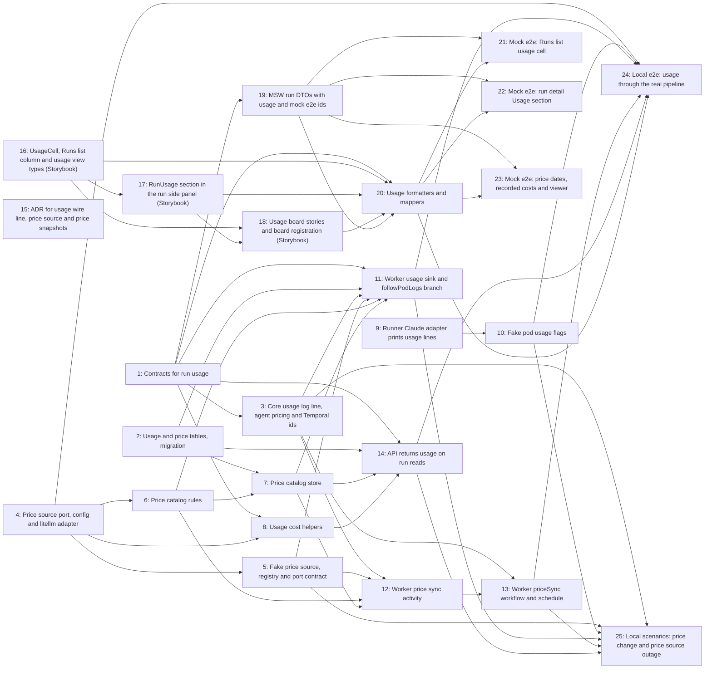

<!-- dev-plan: kind=plan id=run-token-usage-cost rev=1 hash=90d7dec11efc spec=docs/superpowers/specs/2026-11-24-run-token-usage-cost-design.md spec-hash=3394b2febab7 -->
# Run token usage, models and estimated cost Implementation Plan

> **For agentic workers:** REQUIRED SUB-SKILL: Use superpowers:subagent-driven-development (recommended) or superpowers:executing-plans to implement this plan task-by-task. Steps use checkbox (`- [ ]`) syntax for tracking.

**Goal:** Every reader of a run sees its total tokens and estimated cost on the Runs list, and on run detail a collapsible Usage section with the split, each model and the price date; costs are fixed per model call when it is recorded.

**Architecture:** The runner's Claude `transcript.mjs` prints an agent-neutral `agentdesk: usage <base64>` line per model call; `followPodLogs` routes it to a worker sink that upserts `run_usage_entries` (RLS) with the rates of the current price version snapshotted on first insert. A Temporal Schedule (`price-sync`, every 6 h) runs `syncModelPrices`, which fetches prices through a replaceable `PriceSource` adapter (`litellm`, `fake`), validates them with source-agnostic catalog rules and writes an immutable version into two global tables. The API aggregates stored rows and stored rates into `RunDto.usage` / `RunListItem.usage` (no new route, never reads the price tables); the web shows a `UsageCell` per list row and a `RunUsage` section on run detail, stories first.

**Tech Stack:** Zod (contracts), Drizzle and Postgres RLS (db), `guardedGetJson` (core), Temporal SDK (worker), NestJS on Fastify (api), React, TanStack Query, MSW, Storybook (web), Vitest, Playwright (mock and local). No new library.

**Spec:** `docs/superpowers/specs/2026-11-24-run-token-usage-cost-design.md`. Executors read it with this plan; BR ids, TC ids, the Copy section and the prototype boards are defined there and are not repeated here.

## Global Constraints

- Wire line: `agentdesk: usage <base64 JSON>`, base64 body at most `USAGE_WIRE_MAX_BASE64 = 1000`; per-run cap `USAGE_ENTRY_CAP = 20000` distinct ids.
- `UsageWireEntry.id`: 1..128 of `[A-Za-z0-9._:-]`; `model`: 1..128 of `[A-Za-z0-9._:/@-]`; every count a non-negative integer at most 100,000,000; `cacheReadTokens`, `cacheWriteTokens`, `cacheWriteLongTokens` optional default 0; `reasoningTokens` optional, at most `outputTokens`; unknown keys rejected.
- Buckets are disjoint. `totalTokens = inputTokens + cacheReadTokens + cacheWriteTokens(+long) + outputTokens`; reasoning is never added and never priced.
- `estimateUsageCost = (input*in + cacheRead*cr + cacheWrite*cw + cacheWriteLong*cwl + output*out) / 1e6`, rates in USD per million tokens; no credential parameter.
- Rates are snapshotted on each usage row at first insert and never rewritten (`ON CONFLICT (run_id, source_id) DO UPDATE` only `GREATEST` on counters). An unpriced row stays unpriced.
- `price_as_of` is the price version's `checked_at`. API sends ISO instants with offset; the web shows `D Mon YYYY` in the viewer's local zone.
- Price tables `model_price_versions`, `model_prices` are global (no `org_id`, no RLS, documented exception); only the worker touches them; `model_prices` is SELECT, INSERT only for `agentdesk_app`.
- Rates numeric(12,6), bounded 0..1000. Change guards: reject when more than 5 % of shared entries moved more than 5x in any rate, the record count drops more than 20 %, or zero records; skipped for the first version and once after a source change (zero-match and bounds still apply).
- Config: `MODEL_PRICES_SOURCE` `litellm` | `fake` | `off`, default `litellm`, `fake` refused when `NODE_ENV=production`; `MODEL_PRICES_URL` optional, `https:` only, no credentials, no fragment, at most 2048 chars, ignored by `fake` and `off`. `litellm` default URL `https://raw.githubusercontent.com/BerriAI/litellm/main/model_prices_and_context_window.json`, `maxBytes` 15,000,000, `timeoutMs` 30,000, request host must equal the configured URL's host.
- Schedule `price-sync`: every 6 h, overlap SKIP, `triggerImmediately`. Workflow input `{ maxAttempts?: number }` 1..5, default 5; activity start-to-close 120 s.
- Migration `0046_*` (next free number), drizzle-kit generated, hand-written RLS and grant lines as in 0019. Never edit an applied migration.
- No new route, permission or role; `routes.test.ts`, `route-access.test.ts`, `access.ts` unchanged. `RunDto.costUsd` and `runs.cost_usd` stay as they are.
- Agent-neutral names everywhere except `images/runner/agents/claude/*`, `packages/core/src/adapters/agents/claude.ts`, the `litellm` adapter, the fake pod and its tests. Neutral test ids: `vendor-a/model-1@2`, `model-a`, `model-b`, provider `vendor-a`.
- Copy strings are the spec's "UI and Storybook > Copy", character for character. Web: tokens only; `components/` and `screens/` import no contracts types.
- No network in tests; fixed instants (`2026-01-01T12:00:00Z`, `2026-06-01T12:00:00Z`, `2026-11-21T03:30:00Z`, `2026-11-18T12:00:00Z`, `2026-11-21T12:00:00Z`); costs asserted with `toBeCloseTo(expected, 9)` where expected is written as bucket x rate; DB rates compared as strings.
- The run workflow is unchanged: existing `run.workflow.*` and `workflows-in-process.test.ts` stay green with no new run replay test.

## Review Focus

1. A long run's token sums exceed int4 (Postgres `sum(integer)` is `bigint`, which node-pg returns as a string): the API must still return numbers. Test in Task 14.
2. `min`/`max(price_as_of)` read through a raw `sql` aggregate comes back as a string, not a `Date`: the DTO must still carry ISO instants with offset. Test in Task 14 (`expectContract` plus an explicit `new Date(x).toISOString()` round trip).
3. `Intl` `en-GB` writes September as `Sept`: the price date must read `1 Sep 2026`. Test in Task 20.
4. Big numbers: 1,234,567 tokens (`1.2M` compact, `1,234,567` exact), 999,950 tokens (`1.0M`, never `1000.0k`) and a cost of 1234.5 (`~$1,234.50`). Test in Task 20.
5. Two follower attempts storing the same new id at the same time make one row, counted once. Test in Task 11.

## Access and tenant data (per route, query, workflow, screen)

| Surface | Permission | Level | Tenant data touched |
| ------- | ---------- | ----- | ------------------- |
| `GET runs.list`, `runs.stats` (`RunListItem.usage`, `idleRun.usage`) | `run:read`, `any` (unchanged entries) | project | `runs`, `run_usage_entries` of the page's runs under `withOrg` and the project filter |
| `GET runs.byNumber`, `runs.get` (`RunDto.usage`) | `run:read`, `any` (unchanged entries) | project | the run's `run_usage_entries` |
| Worker `followPodLogs` usage branch, `createUsageSink` | none (internal; tenant from `RunContext`, never a request) | org (run) | upserts `run_usage_entries` under `withOrg`; reads `runs.agent_id -> agents.provider`; reads the global price tables (no tenant data) |
| Worker `priceSync` workflow, `syncModelPrices` activity | none (internal, scheduled) | global | `model_price_versions`, `model_prices` only (pool, documented exception) |
| Web Runs list Usage column, run detail Usage section | `run:read` route guards unchanged; no UI gate | project | display only |

Guard order (membership, permission 403, scope 404, no `own`) is unchanged because no route is added. Task 14 adds usage-bearing runs to the allowed / 403 / 404 / cross-org / project-scope tests; Task 24 has the role-based e2e.

## Needs approval

None. `raw.githubusercontent.com` (the `litellm` default host) is already approved in writing. No new package, library, image, CI action or CLI.

## Agent calls

- Agent call: Task 1 sets `usage: null` in the API service and the web mock DTO builders, so every package typechecks after Task 1 merges and later tasks only fill real values.
- Agent call: `writePriceVersion` and `loadCurrentPriceVersion` live in core `price-catalog/store.ts` (not in the worker), so the sink, the sync activity and the API tests share one write path without an app importing another app (rule 2); their transaction tests are `packages/core/test/price-catalog/store.int.test.ts`, while `apps/worker/test/price-sync.int.test.ts` keeps the activity-level cases.
- Agent call: the scripted price source and `seedPriceVersion` live in `apps/worker/test/helpers/prices.ts` and the stub agent in `apps/worker/test/helpers/stub-agent.ts` (spec: `packages/core/test/helpers/`), because core exports only `.` and their only users are worker tests; a `./testing` export would need a coverage exclude.
- Agent call: API tests insert usage rows with a factory (`apps/api/test/helpers/usage.ts`) and change prices with core `writePriceVersion`, not through the worker sink and activity (rule 2); the snapshot rules themselves are proved in Task 11.
- Agent call: Task 4 creates the barrels `usage/index.ts` and `price-catalog/index.ts` (empty) and adds all three core `index.ts` lines, so no two parallel core tasks edit `packages/core/src/index.ts`.
- Agent call: `createUsageSink` reads the run's agent kind itself once per attempt and takes an optional `adapterFor` seam for tests (the spec lists `agentKind` as an input and also says the sink reads it through `withOrg`).
- Agent call: the registry is a `PRICE_SOURCES` provider in the existing `WorkerModule`, not a separate `PriceSourceModule`, matching how `ADAPTERS` is provided.
- Agent call: Temporal names `WORKFLOW.priceSync = 'PriceSyncWorkflow'`, `PRICE_SYNC_SCHEDULE_ID = 'price-sync'`, schedule action workflow id `price-sync-run`, matching the existing names.
- Agent call: a failed sync throws `ApplicationFailure.retryable('price sync: <kind>', 'PriceSyncFailed', kind)` with `kind` a `PriceSourceErrorKind` or `guard_rejected`, so the local scenario can assert the kind from the failure details.
- Agent call: the mock date cases (BR-10 viewer, BR-18, BR-19, BR-20) go in a new `apps/web/e2e/mock/run-usage-prices.spec.ts` with `test.use({ timezoneId: 'America/Los_Angeles' })` at file level, instead of new cases in `run.spec.ts` and a global Playwright zone pin, so existing specs' times do not shift and it runs in parallel with Task 22. Fixture instants are noon UTC except the near-midnight one, so they read the same day in any zone.
- Agent call: the "default zone" unit test compares the no-argument output with the output for `Intl.DateTimeFormat().resolvedOptions().timeZone`, instead of pinning `TZ` in the web test script (no script change).
- Agent call: the spec's `formatTokens` examples become two formatters: `formatTokensExact` (detail, `48,213`) and `formatTokensCompact` (list: below 1,000 as is, below 999,950 one decimal `k`, else one decimal `M`).
- Agent call: the fake pod's usage numbers are fixed in Task 10 (answers E2E Q1 for the fixtures); the local e2e still asserts the dedupe relation plus those totals.
- Agent call: fake model ids `fake-model-a`, `fake-model-b`, `fake-model-unpriced`; the `fake` source prices the first two under provider `anthropic`, because the local stack runs the real Claude adapter whose pricing provider is `anthropic`.
- Agent call: the repo has no Helm chart, so the two env vars go only into `ConfigSchema`, `.env.example` and `turbo.json`; the deployment env is a PR note.
- Agent call: E2E Q2 to Q4 use the spec's stated defaults: only succeeded and cancelled endings are asserted locally (failed and timed-out keep usage by Task 11 and Task 14 tests), "not found" is asserted equal to a non-existent run, and controls are driven through the existing local helpers.
- Agent call: `devbox run e2e-local` already runs `scripts/e2e-local.ts` before the Playwright suite, serially; the new scenarios keep that order (never parallel, restore in `finally`) rather than reordering `devbox.json`.

---

<!-- dev-plan:graph:begin -->
## Task graph

Generated by `dev-plan.mjs graph --write` from each task's **Depends on:** line. Do not edit it by hand.
Tasks in the same wave touch no common file and can be built in parallel; a task starts when everything it depends on is merged.

| Wave | Task | Depends on |
| ---- | ---- | ---------- |
| 1 | Task 1: Contracts for run usage | none |
| 1 | Task 2: Usage and price tables, migration | none |
| 1 | Task 4: Price source port, config and litellm adapter | none |
| 1 | Task 9: Runner Claude adapter prints usage lines | none |
| 1 | Task 15: ADR for usage wire line, price source and price snapshots | none |
| 1 | Task 16: UsageCell, Runs list column and usage view types (Storybook) | none |
| 2 | Task 3: Core usage log line, agent pricing and Temporal ids | Task 1 |
| 2 | Task 5: Fake price source, registry and port contract | Task 4 |
| 2 | Task 6: Price catalog rules | Task 4 |
| 2 | Task 8: Usage cost helpers | Task 1, Task 4 |
| 2 | Task 10: Fake pod usage flags | Task 9 |
| 2 | Task 17: RunUsage section in the run side panel (Storybook) | Task 16 |
| 2 | Task 19: MSW run DTOs with usage and mock e2e ids | Task 1 |
| 3 | Task 7: Price catalog store | Task 2, Task 6 |
| 3 | Task 18: Usage board stories and board registration (Storybook) | Task 16, Task 17 |
| 4 | Task 11: Worker usage sink and followPodLogs branch | Task 1, Task 2, Task 3, Task 5, Task 6, Task 7 |
| 4 | Task 12: Worker price sync activity | Task 3, Task 5, Task 6, Task 7 |
| 4 | Task 14: API returns usage on run reads | Task 1, Task 2, Task 7, Task 8 |
| 4 | Task 20: Usage formatters and mappers | Task 1, Task 16, Task 17, Task 18, Task 19 |
| 5 | Task 13: Worker priceSync workflow and schedule | Task 3, Task 12 |
| 5 | Task 21: Mock e2e: Runs list usage cell | Task 19, Task 20 |
| 5 | Task 22: Mock e2e: run detail Usage section | Task 19, Task 20 |
| 5 | Task 23: Mock e2e: price dates, recorded costs and viewer | Task 19, Task 20 |
| 6 | Task 24: Local e2e: usage through the real pipeline | Task 4, Task 10, Task 11, Task 13, Task 14, Task 20 |
| 6 | Task 25: Local scenarios: price change and price source outage | Task 3, Task 5, Task 10, Task 11, Task 13, Task 14 |

<!-- dev-plan:graph:end -->

### Task 1: Contracts for run usage

**Depends on:** none

**Files:**

- Create: `packages/contracts/src/schemas/usage.ts`
- Create: `packages/contracts/src/schemas/usage.test.ts`
- Modify: `packages/contracts/src/schemas/runs.ts`
- Modify: `packages/contracts/src/index.ts`
- Test: `packages/contracts/src/schemas/runs.test.ts`
- Modify: `apps/api/src/runs/runs.service.ts`
- Modify: `apps/web/src/mocks/dto/runs.ts`
- Modify: `apps/web/src/mocks/dto/sessionRuns.ts`
- Modify: `apps/web/src/mocks/msw/e2eLists.ts`

**Interfaces:**

- Produces (exported from `@agentdesk/contracts`):
  - `USAGE_WIRE_MAX_BASE64 = 1000`, `USAGE_ENTRY_CAP = 20000`, `USAGE_TOKENS_MAX = 100_000_000`
  - `UsageWireEntry` (strict object) `{ id; model; inputTokens; outputTokens; cacheReadTokens (default 0); cacheWriteTokens (default 0); cacheWriteLongTokens (default 0); reasoningTokens? }` with the Global Constraints limits and a refine `reasoningTokens <= outputTokens`
  - `ModelUsageDto { model: string; inputTokens; cacheReadTokens; cacheWriteTokens; outputTokens: number; reasoningTokens: number | null; totalTokens: number; estimatedCostUsd: number | null; costPartial: boolean }`
  - `RunUsageSummary { inputTokens; cacheReadTokens; cacheWriteTokens; outputTokens: number; reasoningTokens: number | null; totalInputTokens; totalTokens; modelCount: number; estimatedCostUsd: number | null; partial: boolean }`
  - `RunUsageDetail = RunUsageSummary & { models: ModelUsageDto[]; priceAsOfEarliest: Timestamp | null; priceAsOfLatest: Timestamp | null; priceSource: string | null }` (timestamps parse as `z.string().datetime({ offset: true })` via the existing `Timestamp`)
  - `RunDto.usage: RunUsageDetail | null`; `RunListItem` = `RunDto.omit({ prompt, finalPrompt, usage })` extended with `usage: RunUsageSummary | null` (so `RunStatsDto.idleRun` follows)

- [x] **Step 1: Write the failing tests.** `usage.test.ts` (`it.each`): a full valid entry parses; defaults fill the three cache fields with 0; id `msg_01:req_01` and `vendor-a.x-1` ok, `a b`, `x;rm`, `x'`, 129 chars refused; model `vendor-a/model-1@2` ok, a shell string, a SQL quote, a 10 KB string, `model é` refused; counts `-1`, `1.5`, `100000001`, `"5"` refused, `0` and `100000000` ok; `reasoningTokens` 300 with output 500 ok, 501 refused; unknown key `priceInput` and `costUsd` refused; `USAGE_WIRE_MAX_BASE64` is 1000 and `USAGE_ENTRY_CAP` is 20000. `runs.test.ts`: `RunDto` accepts `usage: null` and a detail with `models: []` and both dates; refuses a detail missing `models`; refuses a date `2026-11-21` (no time); `RunListItem.usage` accepts a summary, strips/refuses `models`, `priceAsOfEarliest`, `priceSource` (assert parsed output has none of them); `RunStatsDto.idleRun.usage` is the summary.
- [x] **Step 2: Run** `pnpm --filter @agentdesk/contracts exec vitest run src/schemas/usage.test.ts src/schemas/runs.test.ts`. Expected: FAIL (module missing).
- [x] **Step 3: Implement** `usage.ts`, the `RunDto` / `RunListItem` change and the barrel line. Then set `usage: null` in `RunsService.toDto` and `toListItem` (`apps/api/src/runs/runs.service.ts`) and in every `RunDto` / `RunListItem` literal in the three web mock files.
- [x] **Step 4: Run** Step 2 again, then `pnpm --filter @agentdesk/contracts test`, `pnpm --filter @agentdesk/api typecheck`, `pnpm --filter @agentdesk/web typecheck` and `pnpm --filter @agentdesk/web exec vitest run src/mocks/msw/contract.test.ts`. Expected: PASS; `routes.test.ts` and `route-access.test.ts` unchanged and green.
- [x] **Step 5: Commit** (`devbox run fix` first): `feat(contracts): add run usage wire entry and usage DTOs`.

---

### Task 2: Usage and price tables, migration

**Depends on:** none

**Files:**

- Modify: `packages/db/src/schema/app.ts`
- Create: `packages/db/src/schema/prices.ts`
- Modify: `packages/db/src/schema/index.ts`
- Create: `packages/db/migrations/0046_run_usage_and_model_prices.sql`
- Modify: `packages/db/migrations/meta/_journal.json`
- Create: `packages/db/migrations/meta/0046_snapshot.json`
- Test: `packages/db/test/migrate.int.test.ts`
- Test: `packages/db/test/rls.int.test.ts`
- Modify: `docs/conventions/database.md`

**Interfaces:**

- Produces (from `@agentdesk/db`):
  - `runUsageEntries` with the spec's columns as camelCase (`orgId, runId, sourceId, model, inputTokens, outputTokens, cacheReadTokens, cacheWriteTokens, cacheWriteLongTokens, reasoningTokens, priceInput, priceOutput, priceCacheRead, priceCacheWrite, priceCacheWriteLong, priceAsOf, priceSource, priceVersionId`); PK `run_usage_entries_pkey (run_id, source_id)`; index `run_usage_entries_org_idx`; FK `runs.id` cascade, FK `model_price_versions.id` set null; `orgPolicy()`; checks `run_usage_entries_tokens_check` (counters >= 0, `reasoning_tokens <= output_tokens`), `run_usage_entries_rates_check` (rates >= 0), `run_usage_entries_price_all_or_none_check` (five rates, `price_as_of`, `price_source` all null or all set). Numerics `numeric(12,6)` (`mode: 'string'`).
  - `modelPriceVersions` (`id` defaultRandom, `source`, `fetchedAt`, `checkedAt`, `entryCount`, `isCurrent` default false) with unique partial index `model_price_versions_current_key on (is_current) where is_current`.
  - `modelPrices` (`versionId` FK cascade, `provider`, `modelKey`, five rates not null with `CHECK 0..1000`), PK `(version_id, provider, model_key)`, `model_key` check `~ '^[a-z0-9._:/@-]{1,128}$'`.
  - SQL grants: `run_usage_entries` SELECT, INSERT, UPDATE, DELETE (plus `FORCE ROW LEVEL SECURITY`); `model_price_versions` SELECT, INSERT, UPDATE; `model_prices` SELECT, INSERT.

- [x] **Step 1: Write the failing tests.** `migrate.int.test.ts`: add `run_usage_entries` to `APP_TABLES`; a `describe('migration 0046 …')` that applies over a database with runs (no usage row appears, no run row changes); forced RLS on `run_usage_entries`; grants per table exactly as above (query `information_schema.role_table_grants`, `UPDATE` and `DELETE` on `model_prices` refused with `42501`); neither global table has an `org_id` column; a second `is_current = true` row refused (`23505`); rate 1000.000001 and -0.000001 refused, `3.123456` read back as the string `3.123456`; deleting a version cascades `model_prices` and sets `run_usage_entries.price_version_id` null; deleting a run cascades its usage rows; `run_usage_entries` checks: negative counter, reasoning above output, a negative rate, rates set but `price_as_of` null each refused with `23514`. `rls.int.test.ts`: add a `run_usage_entries` entry to `inserts` (priced columns filled, so the leak map covers them); org A cannot read or write org B's rows as `agentdesk_app`; add `model_price_versions` and `model_prices` to the list of intentionally org-less tables next to `role_templates` (or add a test that the app role can read and insert them), never weakening the "every org table is isolated" check.
- [x] **Step 2: Run** `pnpm --filter @agentdesk/db exec vitest run test/migrate.int.test.ts test/rls.int.test.ts`. Expected: FAIL (tables missing).
- [x] **Step 3: Implement** the tables, `pnpm --filter @agentdesk/db db:generate`, rename the file to `0046_run_usage_and_model_prices.sql` with the journal entry, and hand-write the `FORCE ROW LEVEL SECURITY` and `GRANT` lines (and the partial unique index if drizzle-kit cannot emit it) under a `-- Hand-written` comment as in 0019. Add the two tables to the org-less exception list in `docs/conventions/database.md` §2 with one line of reason (public price data, worker only).
- [x] **Step 4: Run** Step 2 again and `pnpm --filter @agentdesk/db typecheck`. Expected: PASS.
- [x] **Step 5: Commit**: `feat(db): add run_usage_entries and global model price tables`. Label `review:sensitive` (RLS, migration).

---

### Task 3: Core usage log line, agent pricing and Temporal ids

**Depends on:** Task 1

**Files:**

- Modify: `packages/core/src/kube/log-parser.ts`
- Test: `packages/core/test/kube/log-parser.test.ts`
- Modify: `packages/core/src/adapters/agents/types.ts`
- Modify: `packages/core/src/adapters/agents/claude.ts`
- Modify: `packages/core/src/adapters/agents/registry.ts`
- Test: `packages/core/test/adapters/agents.test.ts`
- Modify: `packages/core/src/temporal-names.ts`

**Interfaces:**

- Consumes: `UsageWireEntry`, `USAGE_WIRE_MAX_BASE64` (Task 1).
- Produces (from `@agentdesk/core`, through the existing barrels):
  - `LogLineKind` gains `'usage'`; `ParsedLogLine.usage?: UsageWireEntry` (with `text: ''`, like `transcript`)
  - `interface AgentPricing { provider: string; modelKey?(model: string): string }`; `AgentAdapter.pricing?: AgentPricing`; Claude adapter `pricing: { provider: 'anthropic' }`
  - `pricingProviders(): string[]` in `adapters/agents/registry.ts`: the distinct `pricing.provider` of `agentAdapterFor(k)` over `AgentKind.options`
  - `WORKFLOW.priceSync = 'PriceSyncWorkflow'`, `PRICE_SYNC_SCHEDULE_ID = 'price-sync'`, `PRICE_SYNC_WORKFLOW_ID = 'price-sync-run'`

- [x] **Step 1: Write the failing tests.** `log-parser.test.ts`: a valid `agentdesk: usage <b64>` line gives kind `usage`, the parsed entry and `text: ''`; surrounding spaces ignored; a body of 1001 chars, a body with length not a multiple of 4, invalid base64, JSON that is an array, an entry with an extra `priceInput` key, `reasoningTokens` above output, and `agentdesk: usage` followed by two tokens each stay kind `text` with the original line. `agents.test.ts`: `agentAdapterFor('claude').pricing` equals `{ provider: 'anthropic' }` (no `modelKey`, so the core default applies), the adapter object has no rate-shaped field (`JSON.stringify` has no `price`, `cost`, `PerMTok`); `pricingProviders()` equals `['anthropic']`.
- [x] **Step 2: Run** `pnpm --filter @agentdesk/core exec vitest run test/kube/log-parser.test.ts test/adapters/agents.test.ts`. Expected: FAIL.
- [x] **Step 3: Implement** the parser branch (regex `^agentdesk: usage ([A-Za-z0-9+/]+={0,2})$`, same length and decode rules as `parseTranscript`), the pricing type and Claude value, `pricingProviders`, and the three Temporal constants.
- [x] **Step 4: Run** Step 2 again and `pnpm --filter @agentdesk/core typecheck`. Expected: PASS.
- [x] **Step 5: Commit**: `feat(core): parse usage log lines and name agent price providers`. Label `review:sensitive` (pod-log parsing).

---

### Task 4: Price source port, config and litellm adapter

**Depends on:** none

**Files:**

- Create: `packages/core/src/adapters/price-source/types.ts`
- Create: `packages/core/src/adapters/price-source/litellm.ts`
- Create: `packages/core/src/adapters/price-source/index.ts`
- Create: `packages/core/src/price-catalog/index.ts`
- Create: `packages/core/src/usage/index.ts`
- Modify: `packages/core/src/index.ts`
- Modify: `packages/core/src/config.ts`
- Test: `packages/core/test/config.test.ts`
- Modify: `.env.example`
- Modify: `turbo.json`
- Test: `packages/core/test/adapters/price-source/litellm.test.ts`
- Create: `packages/core/test/fixtures/price-source/litellm-small.json`
- Create: `packages/core/test/fixtures/price-source/litellm-odd.json`

**Interfaces:**

- Produces:
  - `type GuardedGet = (url: URL, opts: GuardedGetOptions) => Promise<{ status: number; json: unknown }>` (default `guardedGetJson`)
  - `interface SourceRateRecord { provider: string; modelId: string; inputPerMTokUsd: number; outputPerMTokUsd: number; cacheReadPerMTokUsd: number; cacheWritePerMTokUsd: number; cacheWriteLongPerMTokUsd: number }`
  - `interface PriceSourceResult { records: SourceRateRecord[]; seen: number; skipped: number }`
  - `interface PriceSource { readonly kind: string; fetchPrices(input: { providers: readonly string[] }): Promise<PriceSourceResult> }`
  - `type PriceSourceErrorKind = 'unreachable' | 'too_large' | 'bad_shape' | 'rejected'`; `class PriceSourceError extends Error { readonly kind }` with message `price source: <kind>` only
  - `LITELLM_DEFAULT_URL`, `LITELLM_MAX_BYTES = 15_000_000`, `LITELLM_TIMEOUT_MS = 30_000`, `perTokenToPerMTokUsd(x: number): number` (`round(x * 1e6, 6)`), `createLitellmPriceSource(opts: { url?: string; http?: GuardedGet }): PriceSource` with `kind: 'litellm'`
  - `Config.MODEL_PRICES_SOURCE: 'litellm' | 'fake' | 'off'`, `Config.MODEL_PRICES_URL: string | undefined`
  - Barrels: `price-source/index.ts` exports types and litellm; `price-catalog/index.ts` and `usage/index.ts` are `export {};` placeholders filled by Tasks 6 and 8; `packages/core/src/index.ts` gains `export * from './adapters/price-source'`, `export * from './price-catalog'`, `export * from './usage'`.

- [x] **Step 1: Write the failing tests.** `config.test.ts`: default `litellm`; `fake` and `off` accepted; `other` refused; `fake` with `NODE_ENV=production` refused; blank means default; `MODEL_PRICES_URL` unset is `undefined`; `https://prices.example/x.json` ok; `http:`, `file:`, `ftp:`, `https://u:p@h/x`, `https://h/x#f`, 2049 chars, `not a url` refused; `.env.example` contains `MODEL_PRICES_SOURCE=fake` and a `MODEL_PRICES_URL=` line (read the file). `litellm.test.ts` with an injected `GuardedGet` serving the fixtures: a good `anthropic` entry gives `{ provider: 'anthropic', modelId, inputPerMTokUsd: 3, outputPerMTokUsd: 15, cacheReadPerMTokUsd: 0.3, cacheWritePerMTokUsd: 3.75, cacheWriteLongPerMTokUsd: 6 }`; `perTokenToPerMTokUsd(3e-06) === 3` and `(1.5000000000000002e-05) === 15`; missing cache read or cache write skips (counted in `skipped`); missing 1 h rate falls back to the cache write rate; negative, `NaN` string, `Infinity`, `1e9`, non-numeric string skipped, `"3e-06"` string coerced; `sample_spec` entry ignored; an entry of another provider label and one of a non-requested provider ignored; hostile key `x'; drop table` skipped; tiered (`*_above_200k_tokens`) and batch fields ignored; non-object body throws `bad_shape`; status 500 throws `unreachable`, 403 throws `rejected`; transport `GuardedHttpError('too_large')` throws `too_large`, `redirect`, `timeout`, `network`, `blocked_address` throw `unreachable`; the error message never contains fixture text; the call receives `maxBytes: 15000000` and `timeoutMs: 30000`; a configured URL's host is the one requested, and a `GuardedGet` asked for any other host is never called (the adapter throws `rejected` before calling when the URL it builds differs); `LITELLM_DEFAULT_URL` equals the spec string; `kind === 'litellm'`.
- [x] **Step 2: Run** `pnpm --filter @agentdesk/core exec vitest run test/config.test.ts test/adapters/price-source/litellm.test.ts`. Expected: FAIL.
- [x] **Step 3: Implement** the port, error, adapter (source label map `{ anthropic: 'anthropic' }`; keep entries whose mapped slug is in `providers`; Zod parse of the five fields only), config keys (refine as `ENABLE_FAKE_PROVIDER`), `.env.example` lines with a comment (local stack and e2e use `fake`), `MODEL_PRICES_SOURCE` and `MODEL_PRICES_URL` in every `turbo.json` `passThroughEnv` list that has `AGENT_MODELS_SOURCE`, and the barrels.
- [x] **Step 4: Run** Step 2 again and `pnpm --filter @agentdesk/core typecheck`. Expected: PASS.
- [x] **Step 5: Commit**: `feat(core): add the price source port, litellm adapter and price config`. Label `review:sensitive` (outbound fetch of untrusted data).

---

### Task 5: Fake price source, registry and port contract

**Depends on:** Task 4

**Files:**

- Create: `packages/core/src/adapters/price-source/fake.ts`
- Create: `packages/core/src/adapters/price-source/registry.ts`
- Modify: `packages/core/src/adapters/price-source/index.ts`
- Test: `packages/core/test/adapters/price-source/fake.test.ts`
- Test: `packages/core/test/adapters/price-source/registry.test.ts`
- Test: `packages/core/test/adapters/price-source/contract.test.ts`

**Interfaces:**

- Consumes: Task 4 port and config.
- Produces:
  - `FAKE_PRICE_RECORDS: readonly SourceRateRecord[]`: `anthropic` / `fake-model-a` (3, 15, 0.3, 3.75, 6) and `anthropic` / `fake-model-b` (1, 5, 0.1, 1.25, 2); nothing for `fake-model-unpriced`
  - `FAKE_PRICE_STATE_FILE = 'price-source.json'`; `createFakePriceSource(opts: { stateDir: string }): PriceSource` with `kind: 'fake'`, reading `<stateDir>/price-source.json` on every fetch: absent or `{ "mode": "ok" }` gives the fixed set, `{ "mode": "outage" }` throws `unreachable`, `{ "mode": "bad_shape" }` throws `bad_shape`, `{ "records": [...] }` returns those (parsed as `SourceRateRecord[]`, an invalid file throws `bad_shape`); records filtered to the requested providers
  - `interface PriceSourceRegistry { source(): PriceSource | undefined }`; `createPriceSourceRegistry(config: Pick<Config, 'MODEL_PRICES_SOURCE' | 'MODEL_PRICES_URL' | 'FAKE_STATE_DIR'>, opts?: { http?: GuardedGet }): PriceSourceRegistry`

- [x] **Step 1: Write the failing tests.** `fake.test.ts` (temp dir): no file gives the fixed set; `ok` same; `outage` and `bad_shape` throw those kinds; `records` replaces the set; a garbage file throws `bad_shape`; changing the file between two fetches changes the result (no restart); providers `['vendor-a']` gives no records. `registry.test.ts`: `litellm` gives `kind: 'litellm'` and uses `MODEL_PRICES_URL` when set (the injected `http` sees that URL) else the default; `fake` gives `kind: 'fake'`; `off` gives `undefined`. `contract.test.ts`: `describe.each` over `fake` (temp dir) and `litellm` (injected `GuardedGet` serving `litellm-small.json`): every record has a provider from the request, `modelId` non-empty, rates finite in 0..1000, `kind` equals the configured value; a transport that throws makes `fetchPrices` reject with a `PriceSourceError` whose `kind` is one of the four and whose message is `price source: <kind>`.
- [x] **Step 2: Run** `pnpm --filter @agentdesk/core exec vitest run test/adapters/price-source`. Expected: FAIL.
- [x] **Step 3: Implement** `fake.ts`, `registry.ts` (switch on `MODEL_PRICES_SOURCE` with an exhaustive `never`), and the barrel exports.
- [x] **Step 4: Run** Step 2 again and `pnpm --filter @agentdesk/core typecheck`. Expected: PASS.
- [x] **Step 5: Commit**: `feat(core): add the fake price source and the price source registry`.

---

### Task 6: Price catalog rules

**Depends on:** Task 4

**Files:**

- Create: `packages/core/src/price-catalog/normalize.ts`
- Create: `packages/core/src/price-catalog/validate.ts`
- Create: `packages/core/src/price-catalog/guards.ts`
- Modify: `packages/core/src/price-catalog/index.ts`
- Test: `packages/core/test/price-catalog/normalize.test.ts`
- Test: `packages/core/test/price-catalog/validate.test.ts`
- Test: `packages/core/test/price-catalog/guards.test.ts`

**Interfaces:**

- Consumes: `SourceRateRecord` (Task 4).
- Produces:
  - `normalizeModelKey(model: string): string`: lowercase, strip one leading `<vendor>/` prefix, strip a trailing `:<suffix>`, replace `.` with `-`
  - `type RateField = 'input' | 'output' | 'cacheRead' | 'cacheWrite' | 'cacheWriteLong'`; `type RateValues = Record<RateField, number | string>` (numbers, or six-decimal strings as Postgres returns them; compared with `Number`)
  - `type NormalizedRate = { provider: string; modelKey: string } & Record<RateField, number>`
  - `validateSourceRecords(records: readonly SourceRateRecord[]): { records: NormalizedRate[]; dropped: number; duplicates: number }` (Zod: provider `^[a-z0-9-]{1,64}$`, key after normalisation `^[a-z0-9._:/@-]{1,128}$`, rates finite 0..1000; duplicates by `(provider, modelKey)` last wins)
  - `rateKey(provider: string, modelKey: string): string` (`${provider}\u0000${modelKey}`)
  - `GUARD_MOVED_SHARE = 0.05`, `GUARD_MOVE_FACTOR = 5`, `GUARD_COUNT_DROP = 0.2`
  - `checkChangeGuards(previous: { source: string; rates: ReadonlyMap<string, RateValues> } | null, next: { source: string; records: readonly NormalizedRate[] }): { ok: true; skipped: 'first' | 'source_change' | null } | { ok: false; reason: 'moved' | 'count_drop' | 'zero_match' }`. A rate "moved" when `max/min > 5`; `0 -> 0` is unchanged, `0 -> >0` or `>0 -> 0` is moved.

- [x] **Step 1: Write the failing tests.** `normalize.test.ts` (`it.each`): `Vendor-A/Model.1:Beta` to `model-1`, `model-a` unchanged, `anthropic/x.y` to `x-y`, a hostile string keeps no `/` prefix trick (`a/b/c` strips only `a/`). `validate.test.ts`: rates -1 and 1000.01 and `NaN` dropped, 0 and 1000 kept; key `x'; drop table` dropped; two records normalising to one key keep the last and count 1 duplicate. `guards.test.ts`: first version `skipped: 'first'`; different source `skipped: 'source_change'` even with big moves, but zero records still `zero_match`; 100 shared entries with 5 moved 6x passes, 6 moved fails `moved`; exactly 5x is not moved; count 100 to 80 passes, 79 fails `count_drop`; zero records fails `zero_match`; `0 -> 1` counts as moved.
- [x] **Step 2: Run** `pnpm --filter @agentdesk/core exec vitest run test/price-catalog`. Expected: FAIL.
- [x] **Step 3: Implement** the three modules and their barrel lines.
- [x] **Step 4: Run** Step 2 again and `pnpm --filter @agentdesk/core typecheck`. Expected: PASS.
- [x] **Step 5: Commit**: `feat(core): add price catalog normalisation, validation and change guards`.

---

### Task 7: Price catalog store

**Depends on:** Task 2, Task 6

**Files:**

- Create: `packages/core/src/price-catalog/store.ts`
- Modify: `packages/core/src/price-catalog/index.ts`
- Test: `packages/core/test/price-catalog/store.int.test.ts`

**Interfaces:**

- Consumes: `modelPriceVersions`, `modelPrices` (Task 2); `NormalizedRate`, `rateKey` (Task 6).
- Produces:
  - `type StoredRates = Record<RateField, string>` (six-decimal strings as Postgres returns them; assignable to `RateValues`, so a `PriceVersion` passes straight into `checkChangeGuards`)
  - `interface PriceVersion { id: string; source: string; checkedAt: Date; rates: ReadonlyMap<string, StoredRates> }` (keyed by `rateKey`)
  - `loadCurrentPriceVersion(db: Db): Promise<PriceVersion | null>`
  - `writePriceVersion(db: Db, input: { source: string; records: readonly NormalizedRate[]; now: Date }): Promise<{ outcome: 'created' | 'confirmed'; versionId: string }>`: one transaction on the pool (no `withOrg`, documented exception); locks the current version row; same source and identical rate set (compared at 6 decimals) only sets `checked_at = now`; otherwise inserts a version (`fetched_at = checked_at = now`, `entry_count`), its entries, and moves `is_current`. Never deletes.

- [x] **Step 1: Write the failing tests** (real Postgres via `@agentdesk/db/testing`, global tables truncated in `beforeEach`): empty DB gives `null`; first write `created`, current, `entry_count` right, rates read back as `'3.000000'`; same rates later `confirmed`, same id, `checked_at` moved, `fetched_at` unchanged, no new entries; one rate changed makes a new current version and the old one keeps its entries; a different source with the same rates makes a new version; a forced failure after the version insert (inject a record that violates the 0..1000 check) leaves the old version current and nothing new; two concurrent writes of the same input end with one current version; `model_prices` rows of an old version are unchanged after later writes; a quote-and-semicolon key cannot reach SQL (it is rejected by validation upstream; here assert a valid key containing `@` and `/` round-trips).
- [x] **Step 2: Run** `pnpm --filter @agentdesk/core exec vitest run test/price-catalog/store.int.test.ts`. Expected: FAIL.
- [x] **Step 3: Implement** `store.ts` with Drizzle (parameters only) and the barrel line.
- [x] **Step 4: Run** Step 2 again and `pnpm --filter @agentdesk/core typecheck`. Expected: PASS.
- [x] **Step 5: Commit**: `feat(core): store immutable price versions`. Label `review:sensitive` (global table exception to `withOrg`).

---

### Task 8: Usage cost helpers

**Depends on:** Task 1, Task 4

**Files:**

- Create: `packages/core/src/usage/estimate.ts`
- Modify: `packages/core/src/usage/index.ts`
- Test: `packages/core/test/usage/estimate.test.ts`

**Interfaces:**

- Consumes: `RunUsageDetail`, `RunUsageSummary`, `ModelUsageDto`, `USAGE_ENTRY_CAP` (Task 1).
- Produces:
  - `interface UsageTokens { inputTokens: number; cacheReadTokens: number; cacheWriteTokens: number; cacheWriteLongTokens: number; outputTokens: number }`
  - `interface UsageRates { input: number; output: number; cacheRead: number; cacheWrite: number; cacheWriteLong: number }` (USD per million)
  - `estimateUsageCost(tokens: UsageTokens, rates: UsageRates): number`
  - `interface UsageGroup extends UsageTokens { model: string; reasoningTokens: number | null; rates: UsageRates | null; priceAsOfEarliest: Date | null; priceAsOfLatest: Date | null; priceSource: string | null; entries: number }`
  - `summarizeUsage(groups: readonly UsageGroup[], opts?: { entryCap?: number }): RunUsageDetail | null` (null for no groups; models sorted by `totalTokens` desc then `model`; per-model `cacheWriteTokens` = standard + long; `estimatedCostUsd` null when no priced group; `partial` when any unpriced group or total entries >= cap (default `USAGE_ENTRY_CAP`); `costPartial` per model; dates = min / max over priced groups as ISO; `priceSource` of the priced group with the latest date; `reasoningTokens` null when every group is null)
  - `toUsageSummary(detail: RunUsageDetail): RunUsageSummary`

- [x] **Step 1: Write the failing tests.** Rates `{ input: 3, output: 15, cacheRead: 0.3, cacheWrite: 3.75, cacheWriteLong: 6 }` (each distinct, so a swap fails). `it.each` edge cases for `estimateUsageCost`: all zero gives 0; 1 input token gives `3 / 1e6`; 100,000,000 output gives `100000000 * 15 / 1e6`; cache only `(1000*0.3 + 200*3.75 + 50*6) / 1e6`. `summarizeUsage`: two groups of one model at two rate sets sum each at its own rates; a priced plus an unpriced model gives `partial`, the unpriced model `estimatedCostUsd: null, costPartial: true`; none priced gives `estimatedCostUsd: null` and null dates; a tie in tokens sorts by model name; `totalTokens` is 4596 for input 2048, cache read 1800, cache write 248, output 500, reasoning 300 (reasoning not added, not priced); entries summing to 20000 give `partial`; `toUsageSummary` drops `models`, dates and source; the function signatures take no credential argument (`expect(estimateUsageCost.length).toBe(2)`), and no table or module state is read (calling twice with different rates gives different results).
- [x] **Step 2: Run** `pnpm --filter @agentdesk/core exec vitest run test/usage/estimate.test.ts`. Expected: FAIL.
- [x] **Step 3: Implement** `estimate.ts` and the barrel line.
- [x] **Step 4: Run** Step 2 again and `pnpm --filter @agentdesk/core typecheck`. Expected: PASS.
- [x] **Step 5: Commit**: `feat(core): estimate usage cost from stored rates`.

---

### Task 9: Runner Claude adapter prints usage lines

**Depends on:** none

**Files:**

- Modify: `images/runner/agents/claude/transcript.mjs`
- Create: `images/runner/test/claude-usage.test.ts`
- Create: `images/runner/test/fixtures/claude-usage/streaming-rows.jsonl`
- Create: `images/runner/test/fixtures/claude-usage/retry-two-models.jsonl`
- Create: `images/runner/test/fixtures/claude-usage/sidechain-and-edge.jsonl`
- Create: `images/runner/test/usage-conformance.test.ts`
- Create: `images/runner/test/stubs/subset-usage-agent.mjs`
- Create: `images/runner/test/usage-conformance.ts`
- Test: `images/runner/test/claude-transcript.test.ts`

**Interfaces:**

- Produces:
  - `mapUsage(entry: unknown): UsageWire | undefined` exported from `transcript.mjs`: for `type: 'assistant'`, string `message.id`, `message.model` not `<synthetic>`, numeric `message.usage`: `{ id: requestId ? `${message.id}:${requestId}` : message.id, model, inputTokens: input_tokens, outputTokens: output_tokens, cacheReadTokens: cache_read_input_tokens ?? 0, cacheWriteTokens: cache_creation.ephemeral_5m_input_tokens ?? (split missing ? cache_creation_input_tokens : 0), cacheWriteLongTokens: cache_creation.ephemeral_1h_input_tokens ?? 0 }`; sidechain entries included
  - `usageLine(u: UsageWire): string` (`agentdesk: usage <base64>`; a body over 1000 chars is not printed)
  - `sendNew` prints usage lines in the same pass, one per id per pass (last row in file order wins); the state file becomes `{ version: 2, files }`, and a state file without `version: 2` restarts every tracked file at offset 0 once
  - `expectConformingUsageMapper(map: (raw: unknown) => UsageWire | undefined, sample: { claudeStyle: unknown } | { subsetStyle: unknown }): void` in `images/runner/test/usage-conformance.ts`

- [x] **Step 1: Record the fixtures.** Run the pinned Claude Code CLI (2.1.323) for a short session with a subagent, scrub ids, paths and text, and keep only the shapes listed in the spec ("Verify at build"). Record where sidechain calls are written (same file with `isSidechain`, or a separate file under the session directory); if separate, extend the hook's tracked paths in this task. If the pinned CLI cannot be run here, stop and ask the human (Talking to humans template) before hand-writing fixtures.
- [x] **Step 2: Write the failing tests.** `claude-usage.test.ts`: repeated rows of one `(message.id, requestId)` with placeholder output 1 then final 500 print one line with 500, both within one pass and when a later `sendNew` sees the final row; the reverse order also prints the larger count once per pass; a retry has a new id; two models give two models; a sidechain entry counts; `<synthetic>` and an entry without `usage` print nothing; id `msg_01:req_01` and `msg_01` alone; `ephemeral_5m` to `cacheWriteTokens`, `ephemeral_1h` to `cacheWriteLongTokens`, and `cache_creation_input_tokens` as standard when the split is missing; an old state file (no `version`) re-reads from 0 once and the next call does not; the decoded line has exactly the wire keys (no price, cost or text). `usage-conformance.test.ts`: Claude `mapUsage` on input 2048, cache read 1800, cache creation 248, output 500 and the stub on input 4096 (cached 1800 and cache write 248 inside) with output 500 (reasoning 300 inside) both give input 2048, cache read 1800, cache write 248, output 500, total 4596 (never 4896), the stub carries `reasoningTokens: 300`; equal cost at equal rates for both (cost formula inlined in the helper). `claude-transcript.test.ts`: existing transcript assertions still hold with the new state-file shape.
- [x] **Step 3: Run** `pnpm --filter @agentdesk/runner exec vitest run test/claude-usage.test.ts test/usage-conformance.test.ts test/claude-transcript.test.ts`. Expected: FAIL.
- [x] **Step 4: Implement** `mapUsage`, `usageLine`, the per-pass map and the state version marker; the stub mapper and the conformance helper.
- [x] **Step 5: Run** Step 3 again and `pnpm --filter @agentdesk/runner test`. Expected: PASS.
- [x] **Step 6: Commit**: `feat(runner): print agent-neutral usage lines from the Claude session log`. Label `review:sensitive` (run Job/runner).

---

### Task 10: Fake pod usage flags

**Depends on:** Task 9

**Files:**

- Modify: `packages/core/src/kube/fake-claude-log.mjs`
- Modify: `packages/core/src/kube/fake-pod.mjs`
- Test: `packages/core/test/kube/fake-pod.test.ts`

**Interfaces:**

- Consumes: the real `transcript.mjs` usage lines (Task 9).
- Produces:
  - `usageEntry({ messageId, requestId, model, input, output, cacheRead = 0, cacheCreation5m = 0, cacheCreation1h = 0 })`: a Claude-shaped assistant entry with one text block `Fake usage call`, `requestId`, `message.id`, `message.model`, `message.usage` (with `cache_creation` split and `cache_creation_input_tokens`)
  - `--fake-usage`, first turn: `msg_fake_1`/`req_fake_1` `fake-model-a` placeholder row (input 1000, output 1, cache read 500, 5m 100) then final row (output 200); `msg_fake_2`/`req_fake_2` `fake-model-a` (input 300, output 50); retry `msg_fake_2r`/`req_fake_2r` `fake-model-a` (input 300, output 50); `msg_fake_3`/`req_fake_3` `fake-model-b` (input 400, output 100, 1h 50). Totals: model-a 2500, model-b 550, run 3050. Every later turn (typed line, reply after resume or reopen): one `fake-model-a` call with fresh random ids (input 200, output 40, total 240).
  - `--fake-usage-unpriced`: the same, with `fake-model-unpriced` in place of `fake-model-b`.

- [x] **Step 1: Write the failing tests** in `fake-pod.test.ts` under "transcript through the real adapter": `--fake-usage` first turn prints usage lines whose decoded entries, deduplicated by id keeping the largest counts, sum to 3050 with models `fake-model-a` and `fake-model-b`; the placeholder and final rows share one id; a typed line adds one 240-token call with a new id; a resumed pod's start flush prints no id that was not already printed; `--fake-usage-unpriced` shows `fake-model-unpriced`; without the flag no usage line is printed.
- [x] **Step 2: Run** `pnpm --filter @agentdesk/core exec vitest run test/kube/fake-pod.test.ts`. Expected: FAIL.
- [x] **Step 3: Implement** the builder and the flags; update the flag list in the fake-pod header comment.
- [x] **Step 4: Run** Step 2 again. Expected: PASS.
- [x] **Step 5: Commit**: `feat(core): fake pod writes Claude-shaped usage for local e2e`.

---

### Task 11: Worker usage sink and followPodLogs branch

**Depends on:** Task 1, Task 2, Task 3, Task 5, Task 6, Task 7

**Files:**

- Create: `apps/worker/src/activities/usage-store.ts`
- Modify: `apps/worker/src/activities/run.activities.impl.ts`
- Create: `apps/worker/test/usage-store.int.test.ts`
- Create: `apps/worker/test/helpers/stub-agent.ts`
- Test: `apps/worker/test/run.activities.int.test.ts`

**Interfaces:**

- Consumes: `UsageWireEntry`, `USAGE_ENTRY_CAP` (Task 1); `runUsageEntries` (Task 2); `ParsedLogLine.usage`, `AgentPricing` (Task 3); `createPriceSourceRegistry` (Task 5, P8 test only); `normalizeModelKey`, `rateKey` (Task 6); `loadCurrentPriceVersion`, `writePriceVersion`, `PriceVersion` (Task 7).
- Produces:
  - `USAGE_PRICE_CACHE_MS = 300_000`
  - `interface UsageRow { sourceId; model: string; inputTokens; outputTokens; cacheReadTokens; cacheWriteTokens; cacheWriteLongTokens: number; reasoningTokens: number | null; price: { rates: StoredRates; asOf: Date; source: string; versionId: string } | null }`
  - `upsertUsageEntry(tx: Tx, orgId: string, runId: string, row: UsageRow): Promise<void>` (insert; on conflict `GREATEST` per counter, `reasoning_tokens` greatest with null handling; `model` and price columns never updated)
  - `createUsageSink(deps: { db: Db; orgId: string; runId: string; clock: Clock; warn(msg: string, fields: Record<string, unknown>): void; adapterFor?: (kind: AgentKind) => AgentAdapter }): { store(entry: UsageWireEntry): Promise<void> }`: reads `agents.provider` for the run once per attempt (none when the agent is gone), caches `loadCurrentPriceVersion` for 5 minutes on `clock`, prices by `rateKey(pricing.provider, (pricing.modelKey ?? normalizeModelKey)(entry.model))`, counts rows once per attempt, at the cap drops unknown ids and still upserts known ids, retries 3 times, logs counts only (`usage entry not stored` with `{ failed }`, `usage cap reached` with `{ dropped }` once)
  - `followPodLogs`: `parsed.kind === 'usage' && parsed.usage` calls `usageSink.store(parsed.usage)`; nothing goes to `run_events`

- [ ] **Step 1: Write the failing tests** in `usage-store.int.test.ts` (fresh org per test, global price tables truncated in `beforeEach`, `stub-agent.ts` exports adapters with `pricing: { provider: 'vendor-a' }`, one with a custom `modelKey`, one without `pricing`; versions seeded with `writePriceVersion`; fixed `Clock`):
  - snapshot: the first insert writes the five rates (strings), `price_as_of` equal to the version's `checked_at`, `price_source`, `price_version_id`, all from one version;
  - GREATEST: the same entry twice changes nothing; placeholder (output 1) then final (500) gives 500 at the first rates; final then placeholder stays 500; a replayed lower row never lowers;
  - P3: placeholder at v1, `writePriceVersion` v2 with changed rates, final row of the same id: counters final, rates v1 (same for the reverse order);
  - P2: id 1 at v1, v2, id 2: rows carry v1 and v2 rates, version ids and dates;
  - P4: a model unpriced at record time stays null after a v2 that lists it; a model priced at v1 keeps v1 after a v2 that drops it;
  - cache: a version flip within 5 minutes still prices new ids with the cached version and never rewrites stored rows; after 5 minutes on the clock new ids use the new version;
  - BR-21 / P9: no current version, a `vendor-a` agent with no entry, an adapter without `pricing`, and a deleted agent each write all price columns null; after a failed sync (no write) entries still price from the last version;
  - cap: with 20,000 rows (bulk insert), a new id is dropped with one `warn`, a stored id still raises counters and never changes rates;
  - resume: a second sink (new attempt) re-sending stored entries adds nothing; a reopened session's new ids add to the same run;
  - failure: a `db` whose transaction throws 3 times logs `usage entry not stored` with counts only (no model or id in the fields); a later store of the same entry heals;
  - Review Focus 5: two sinks storing the same new id with `Promise.all` give one row;
  - P8: a registry built with an `http` that counts calls and throws is created in the test; storing 50 entries leaves the count 0 (the sink takes no registry or transport).
  - `run.activities.int.test.ts`: a fake pod run whose log carries usage lines stores rows in `run_usage_entries` and none in `run_events`.
- [ ] **Step 2: Run** `pnpm --filter @agentdesk/worker exec vitest run test/usage-store.int.test.ts test/run.activities.int.test.ts`. Expected: FAIL.
- [ ] **Step 3: Implement** `usage-store.ts` (mirroring `createTranscriptSink`) and the branch plus `createUsageSink` construction next to `createTranscriptSink` in `followPodLogs`.
- [ ] **Step 4: Run** Step 2 again, `pnpm --filter @agentdesk/worker typecheck`, and `pnpm --filter @agentdesk/worker exec vitest run test/workflows-in-process.test.ts test/run.workflow.test.ts`. Expected: PASS (run workflow untouched).
- [ ] **Step 5: Commit**: `feat(worker): store run usage with rates fixed at first record`. Label `review:sensitive` (RLS/`withOrg`, pod-log parsing).

---

### Task 12: Worker price sync activity

**Depends on:** Task 3, Task 5, Task 6, Task 7

**Files:**

- Create: `apps/worker/src/activities/price-sync.activity.ts`
- Modify: `apps/worker/src/activities/index.ts`
- Modify: `apps/worker/src/activities/types.ts`
- Modify: `apps/worker/src/worker.module.ts`
- Modify: `apps/worker/src/main.ts`
- Create: `apps/worker/test/price-sync.int.test.ts`
- Create: `apps/worker/test/helpers/prices.ts`
- Test: `apps/worker/test/activities-wiring.test.ts`

**Interfaces:**

- Consumes: `pricingProviders` (Task 3); `PriceSourceRegistry`, `PriceSourceError` (Task 5); `validateSourceRecords`, `checkChangeGuards` (Task 6); `loadCurrentPriceVersion`, `writePriceVersion` (Task 7).
- Produces:
  - `type SyncModelPricesResult = { outcome: 'off' } | { outcome: 'created' | 'confirmed'; entries: number }`
  - `syncModelPrices(deps: { db: Db; registry: PriceSourceRegistry; clock: Clock; log: { warn(msg: string, meta?: Record<string, unknown>): void; error(msg: string, meta?: Record<string, unknown>): void } }): Promise<SyncModelPricesResult>`; `Activities.syncModelPrices(): Promise<SyncModelPricesResult>`
  - Failures: `ApplicationFailure.retryable('price sync: <kind>', 'PriceSyncFailed', kind)`; fetch failures log `warn`, guard rejections log `error`, both with kind and counts only; a source change logs `warn`
  - `ActivityDeps.priceSources: PriceSourceRegistry`; `PRICE_SOURCES` token in `WorkerModule` (`createPriceSourceRegistry(config)`); `ReconcileLogger`-style `log` gains `error`
  - Test helpers: `scriptedPriceSource(steps: Array<SourceRateRecord[] | PriceSourceErrorKind>, kind?: string): PriceSource & { calls: number }`; `seedPriceVersion(db: Db, input: { source: string; checkedAt: Date; rates: SourceRateRecord[] }): Promise<string>` (through `validateSourceRecords` and `writePriceVersion`)

- [ ] **Step 1: Write the failing tests** in `price-sync.int.test.ts` (real Postgres, global tables truncated in `beforeEach`, fixed clock): `off` returns `{ outcome: 'off' }` and writes nothing; first sync `created`; same rates `confirmed` and only `checked_at` moves; changed rates within guards `created`; each `PriceSourceError` kind and a guard rejection (6 of 100 moved 6x) throw `PriceSyncFailed` with that kind, write nothing, keep the current version and its `checked_at`; a source change creates a new current version despite big moves and logs one `warn`; a retry of the same input is idempotent; nothing is ever deleted; the source receives `providers: ['anthropic']`; log meta never contains a model id or record text. `activities-wiring.test.ts`: `syncModelPrices` is registered.
- [ ] **Step 2: Run** `pnpm --filter @agentdesk/worker exec vitest run test/price-sync.int.test.ts test/activities-wiring.test.ts`. Expected: FAIL.
- [ ] **Step 3: Implement** the activity, the wiring in `createActivities`, the `Activities` type, the `PRICE_SOURCES` provider and `main.ts` (pass the registry and an activity logger with `error`).
- [ ] **Step 4: Run** Step 2 again and `pnpm --filter @agentdesk/worker typecheck`. Expected: PASS.
- [ ] **Step 5: Commit**: `feat(worker): sync model prices from the configured price source`. Label `review:sensitive` (outbound fetch, global tables).

---

### Task 13: Worker priceSync workflow and schedule

**Depends on:** Task 3, Task 12

**Files:**

- Create: `apps/worker/src/workflows/price-sync.workflow.ts`
- Modify: `apps/worker/src/workflows/index.ts`
- Modify: `apps/worker/src/schedules.ts`
- Test: `apps/worker/test/schedules.test.ts`
- Create: `apps/worker/test/price-sync.workflow.test.ts`
- Create: `apps/worker/test/fixtures/price-sync-history.json`

**Interfaces:**

- Consumes: `WORKFLOW.priceSync`, `PRICE_SYNC_SCHEDULE_ID`, `PRICE_SYNC_WORKFLOW_ID` (Task 3); `Activities.syncModelPrices` (Task 12).
- Produces:
  - `interface PriceSyncInput { maxAttempts?: number }`; `PriceSyncWorkflow(input?: PriceSyncInput): Promise<SyncModelPricesResult>`: rejects `maxAttempts` outside 1..5 with a non-retryable failure; one activity call with `startToCloseTimeout: '120 seconds'` and `retry: { maximumAttempts: input?.maxAttempts ?? 5 }`
  - `scheduleDefinitions()` gains `{ id: 'price-sync', every '6h', overlap SKIP, startWorkflow PriceSyncWorkflow, workflowId 'price-sync-run' }`; `ensureSchedules` passes `triggerImmediately: true` on create for it

- [ ] **Step 1: Write the failing tests.** `schedules.test.ts`: the `price-sync` definition (6 h, SKIP, workflow type and id) and `triggerImmediately` on create; `ensureSchedules` twice is idempotent for it. `price-sync.workflow.test.ts` (time-skipping environment, stub activities): no input calls the activity until it succeeds on the 5th attempt and fails after 5; `{ maxAttempts: 1 }` calls exactly once and the result rejects with `PriceSyncFailed` details `['unreachable']`; `{ maxAttempts: 0 }` and `{ maxAttempts: 6 }` reject without calling; a replay of `fixtures/price-sync-history.json` (recorded with input `{ maxAttempts: 1 }` and a success) passes `Worker.runReplayHistory`.
- [ ] **Step 2: Run** `pnpm --filter @agentdesk/worker exec vitest run test/schedules.test.ts test/price-sync.workflow.test.ts`. Expected: FAIL.
- [ ] **Step 3: Implement** the workflow, the export, the schedule entry; record the history fixture from a passing run (as the other `*-history.json` fixtures were).
- [ ] **Step 4: Run** Step 2 again, `pnpm --filter @agentdesk/worker typecheck` and `pnpm --filter @agentdesk/worker exec vitest run test/workflows-in-process.test.ts`. Expected: PASS.
- [ ] **Step 5: Commit**: `feat(worker): schedule the price sync workflow every 6 hours`.

---

### Task 14: API returns usage on run reads

**Depends on:** Task 1, Task 2, Task 7, Task 8

**Files:**

- Create: `apps/api/src/runs/run-usage.ts`
- Modify: `apps/api/src/runs/runs.service.ts`
- Create: `apps/api/test/helpers/usage.ts`
- Test: `apps/api/test/runs.int.test.ts`
- Test: `apps/api/test/scope.int.test.ts`
- Test: `apps/api/test/authz.int.test.ts`

**Interfaces:**

- Consumes: `runUsageEntries` (Task 2); `writePriceVersion` (Task 7, tests); `summarizeUsage`, `toUsageSummary`, `UsageGroup` (Task 8).
- Produces:
  - `usageFor(tx: Tx, runIds: readonly string[]): Promise<Map<string, RunUsageDetail>>`: one query `group by run_id, model, price_input, price_output, price_cache_read, price_cache_write, price_cache_write_long` summing counters (cast to `float8` or parsed with `Number`), `sum(reasoning_tokens)`, `count(*)`, `min`/`max(price_as_of)`, newest `price_source`; maps rows to `UsageGroup` (rates parsed with `Number`, dates normalised to `Date`) and calls `summarizeUsage` per run. Never touches the price tables.
  - `RunsService.dto` sets `usage` from `usageFor(tx, [row.id])`; `listItems` calls it once for the page and sets `usage: toUsageSummary(detail)` or `null`.
  - Test helpers: `makeUsageEntry(over?: Partial<UsageInsert>): UsageInsert` (neutral defaults: `model-a`, priced at `{3, 15, 0.3, 3.75, 6}`, `price_as_of` `2026-01-01T12:00:00Z`, source `fake`), `insertUsage(db: Db, orgId: string, runId: string, rows: UsageInsert[]): Promise<void>` (through `withOrg`), `insertManyUsage(db, orgId, runId, n: number)` (one `insert ... select generate_series` statement).

- [ ] **Step 1: Write the failing tests** in `runs.int.test.ts` (all through `expectContract`):
  - BR-5: a run with no rows has `usage: null` on `runs.get`, `runs.byNumber` and in `runs.list`; zero counters on a priced row give totals 0 and `estimatedCostUsd: 0`;
  - BR-1 / BR-12: list items and `runs.stats` `idleRun` carry the summary only (no `models`, dates or source);
  - BR-2: the split sums to `totalTokens` on both single-run reads; cache write long folds into `cacheWriteTokens`;
  - BR-3: `models` sorted by tokens desc, a tie by name; per-model `costPartial`;
  - BR-6 / BR-21: an unpriced row sets `partial` and the model's `costPartial`; all unpriced gives `estimatedCostUsd: null` and null dates and source;
  - BR-11 / P2: a run with rows under two rate sets costs `id1 at v1 + id2 at v2` written as bucket x rate; earliest and latest are the two instants;
  - P1 / BR-18: rows inserted at v1 rates, then `writePriceVersion` makes v2 current: `runs.get`, `runs.byNumber`, `runs.list` give the v1 cost and dates exactly;
  - P5: after `TRUNCATE model_prices, model_price_versions` (owner connection) and deleting the agent, the same cost and dates;
  - BR-14: the same rows on an `oauth_token` agent and an `api_key` agent give the same estimate;
  - BR-15: `insertManyUsage(…, 20000)` gives `partial: true`;
  - Review Focus 1: 30 rows of 100,000,000 output each give `outputTokens: 3000000000` as a number;
  - Review Focus 2: `priceAsOfEarliest` round-trips through `new Date(x).toISOString()` and ends with `Z` or an offset;
  - grouped read: inside `withOrg`, `vi.spyOn(tx, 'select')` sees one call from `usageFor` for 1 run id and for 20 run ids;
  - BR-10 and security: org B gets 404 on org A's usage-bearing run and none of its usage in B's list.
  - `scope.int.test.ts` and `authz.int.test.ts`: the existing run-read cases use a run with usage rows: admin of P1 gets 404 on the P2 run and no P2 usage in the P1 list; a viewer reads usage; a role without `run:read` gets 403 before any lookup.
- [ ] **Step 2: Run** `pnpm --filter @agentdesk/api exec vitest run test/runs.int.test.ts test/scope.int.test.ts test/authz.int.test.ts`. Expected: FAIL.
- [ ] **Step 3: Implement** `run-usage.ts` and the service changes (replace the Task 1 `usage: null` placeholders).
- [ ] **Step 4: Run** Step 2 again and `pnpm --filter @agentdesk/api typecheck`. Expected: PASS.
- [ ] **Step 5: Commit**: `feat(api): return run usage and estimated cost on run reads`. Label `review:sensitive` (tenant reads).

---

### Task 15: ADR for usage wire line, price source and price snapshots

**Depends on:** none

**Files:**

- Create: `docs/adr/0039-usage-wire-line-price-source-and-price-snapshots.md`
- Modify: `docs/adr/README.md`

**Interfaces:** none (documents only).

- [ ] **Step 1: Write the ADR** "Agent-neutral usage wire line, a pluggable price-source adapter and a price snapshot per usage entry" with every item the spec's "ADR" paragraph lists (bucket meanings and total; snapshot at first record, never re-applied; `PriceSource` port, registry, `litellm` first, alternatives OpenRouter, models.dev, static list; catalog validation and change guards with their thresholds; `price-sync` and `PriceSyncWorkflow` ids; the org-less price tables; `MODEL_PRICES_SOURCE`, `MODEL_PRICES_URL` and their validation; accepted forged-line risk). Status accepted; amends ADR 0027, extends ADR 0026. Add the index row to `docs/adr/README.md`.
- [ ] **Step 2: Verify** `rg -n "0039" docs/adr/README.md` prints the new row. Do not edit ADR 0026 or 0027.
- [ ] **Step 3: Commit**: `docs(adr): record the usage wire line, price source adapter and price snapshots`.

---

### Task 16: UsageCell, Runs list column and usage view types (Storybook)

**Depends on:** none

**Files:**

- Modify: `apps/web/src/mocks/types.ts`
- Create: `apps/web/src/mocks/usage.ts`
- Create: `apps/web/src/components/UsageCell.tsx`
- Create: `apps/web/src/components/UsageCell.module.css`
- Create: `apps/web/src/components/UsageCell.stories.tsx`
- Create: `apps/web/src/components/UsageCell.test.tsx`
- Modify: `apps/web/src/components/RunRow.tsx`
- Modify: `apps/web/src/components/RunRow.stories.tsx`
- Modify: `apps/web/src/screens/Runs.tsx`

This task and Tasks 17 and 18 are the spec's "Blocker: Storybook first": Task 20, which wires the UI to data, lists all three under **Depends on:** because the spec forbids wiring before the stories are done, not as an ordering preference. The e2e tasks reach them through Task 20.

**Interfaces:**

- Produces (view types in `mocks/types.ts`, display-ready strings):
  - `type UsageCellView = { text: string; title: string; srSuffix: string }` and `RunSummary.usage?: UsageCellView` (absent renders as none)
  - `type RunUsageModelView = { name: string; tokens: string; cost: string; unpriced: boolean }`
  - `type RunUsageView = { state: 'none' } | { state: 'data'; total: string; input: string; cacheRead: string; cacheWrite: string; output: string; reasoning?: string; cost: string; atLeast: boolean; priceDate?: string; partial: boolean; models: RunUsageModelView[] }` (`priceDate` is `21 Nov 2026` or `18 Nov 2026 to 21 Nov 2026`)
  - `RunDetailData.usage?: RunUsageView`, `RunDetailData.usageCollapsed?: true`, `RunDetailData.usageModelsCollapsed?: true`
  - `UsageCell({ usage }: { usage?: UsageCellView })`: a tabular nowrap cell with `title` and an `.sr-only` suffix; absent shows `—` with title and sr text "No usage data"
  - `mocks/usage.ts`: `usageCellValue`, `usageCellPartial`, `usageCellNoCost`, `usageCellSubCent`, `usageCellNone` with the spec Copy strings
  - Runs columns: `{ key: 'usage', header: 'Usage' }` after Duration (`th scope="col"`)

- [ ] **Step 1: Write the failing tests** in `UsageCell.test.tsx` (one case per story, `it.each`): Value shows `48.2k · ~$0.42`, title "48,213 tokens in total, estimated cost $0.42, 1 model", sr suffix " tokens, estimated cost"; Partial `61.2k · ~$0.42+` with " tokens, estimated cost, at least"; NoCost `12.8k · —` with " tokens, no estimated cost"; None `—` and "No usage data"; no text contains "provider bill" or a date; the cell is not focusable.
- [ ] **Step 2: Run** `pnpm --filter @agentdesk/web exec vitest run src/components/UsageCell.test.tsx`. Expected: FAIL.
- [ ] **Step 3: Implement** the types, fixtures, component (tokens `--muted`, `--mono`, `--fs-12_5`; the tabular class used by Duration), stories `Components/UsageCell` Value, Partial, NoCost, None, the RunRow cell and its usage story variants, and the Runs column (group rows already span `columns.length`).
- [ ] **Step 4: Run** Step 2 again, `pnpm --filter @agentdesk/web exec vitest run src/components/RunList.test.tsx src/test/stories.smoke.test.tsx` and `pnpm --filter @agentdesk/web typecheck`. Expected: PASS.
- [ ] **Step 5: Commit**: `feat(web): add the UsageCell component and the Runs Usage column`.

---

### Task 17: RunUsage section in the run side panel (Storybook)

**Depends on:** Task 16

**Files:**

- Create: `apps/web/src/components/RunUsage.tsx`
- Create: `apps/web/src/components/RunUsage.module.css`
- Create: `apps/web/src/components/RunUsage.stories.tsx`
- Create: `apps/web/src/components/RunUsage.test.tsx`
- Create: `apps/web/src/mocks/runUsage.ts`
- Modify: `apps/web/src/screens/RunSidePanel.tsx`

**Interfaces:**

- Consumes: `RunUsageView`, `RunDetailData.usage*` (Task 16).
- Produces:
  - `RunUsage({ usage, initialOpen = true, initialModelsOpen = true }: { usage: RunUsageView; initialOpen?: boolean; initialModelsOpen?: boolean })`: `Section` "Usage" with a ghost small Hide/Show button (chevron, `aria-expanded`, `aria-controls` to the body `role="region"` labelled "Usage"); body: "Total tokens" with faint hint "all tokens processed", `KeyValue` rows "Input (uncached)", "Cache read", "Cache write", "Output", optional faint "of which reasoning" `dd`, "Est. cost" (`atLeast` prefixes a muted "at least"), the note (estimate sentence, cost-fixed sentence, `Prices as of {priceDate}.` only when `priceDate`, then "Your provider bill may differ."), the partial note when `partial`, then sub-heading "Models" with its own Hide/Show controlling a `<table>` (sr-only caption "Usage by model", `th scope="col"` Model, Tokens, Est. cost; model name `th scope="row"` truncated with `title`; unpriced cost `—` with title "No price when this was recorded"). `state: 'none'`: header without toggle and "No usage data for this run.".
  - `RunSidePanel` renders `<RunUsage>` directly before "Chain on this ticket" when `data.usage` is set, passing `initialOpen={!data.usageCollapsed}` and `initialModelsOpen={!data.usageModelsCollapsed}`.
  - `mocks/runUsage.ts`: view fixtures for the thirteen stories (neutral names `model-a`, `model-b`; long name of 128 chars with `. : / @ -`; hostile name `'; rm -rf /`).

- [ ] **Step 1: Write the failing tests** in `RunUsage.test.tsx`, one case per story name (SingleModel, MultiModel, Partial, UnpricedModel, WithReasoning, NoUsage, Zero, LongModelName, HostileModelName, Collapsed, ModelsCollapsed, SinglePriceDate, PriceDateRange): split rows and "Total tokens" text per fixture; the note appears once with the exact Copy order and "Your provider bill may differ." last; `SinglePriceDate` has "Prices as of 21 Nov 2026.", `PriceDateRange` "Prices as of 18 Nov 2026 to 21 Nov 2026."; a fixture with no `priceDate` has no "Prices as of"; Zero shows `0` rows and `~$0.00` with the dated note; NoUsage has no button and "No usage data for this run."; Hide on Usage leaves only the header, button "Show", `aria-expanded="false"`, `aria-controls` equal to the region id; Show reopens; a remount starts open; Hide on Models hides only the table (total, cost and notes stay) and its `aria-controls` names the table; the hostile name renders as text (no `img` element) with `title`; table caption, headers and row header roles.
- [ ] **Step 2: Run** `pnpm --filter @agentdesk/web exec vitest run src/components/RunUsage.test.tsx`. Expected: FAIL.
- [ ] **Step 3: Implement** the component (reuse `Section`, `KeyValue`, `Note` and the `RunPromptSection` toggle pattern; tokens only; Tokens and Est. cost columns fixed width), the stories `Components/RunUsage` with the thirteen names, the fixtures and the side panel placement.
- [ ] **Step 4: Run** Step 2 again, `pnpm --filter @agentdesk/web exec vitest run src/test/stories.smoke.test.tsx` and `pnpm --filter @agentdesk/web typecheck`. Expected: PASS.
- [ ] **Step 5: Commit**: `feat(web): add the collapsible RunUsage section to run detail`.

---

### Task 18: Usage board stories and board registration (Storybook)

**Depends on:** Task 16, Task 17

**Files:**

- Modify: `apps/web/src/mocks/runs.ts`
- Modify: `apps/web/src/mocks/runDetail.tsx`
- Modify: `apps/web/src/screens/runs.stories.tsx`
- Modify: `apps/web/src/screens/runDetail.stories.tsx`
- Test: `apps/web/src/screens/runs.test.tsx`
- Test: `apps/web/src/screens/runDetail.test.tsx`
- Modify: `apps/web/src/screens/storyIds.ts`
- Modify: `apps/web/scripts/parity.mjs`
- Modify: `design/prototype/project/canvas.json`
- Modify: `apps/web/src/test/coverage.test.ts`
- Modify: `design/parity-notes.md`

**Interfaces:**

- Consumes: `UsageCell`, `RunUsage`, view fixtures (Tasks 16, 17).
- Produces: board stories `Screens/Runs` `RunsUsage`, `RunsPageLoadingUsage` and `Screens/RunDetail` `RunSucceededUsage`, `RunSucceededUsageCollapsed`, `RunSucceededUsageModelsCollapsed`, `RunSucceededUsageMultiModel`, `RunSucceededUsageUnpriced`, `RunSucceededUsagePartial`, `RunSucceededUsageNonePriced`, `RunSucceededUsageReasoning`, `RunSucceededUsageZero`, `RunSucceededUsageNone`, `RunSucceededUsagePriceRange`, `RunRunningUsage`, `RunRunningUsageReconnecting`, each matching its `design/prototype/project/*.dc.html` board. The base fixtures behind `Runs`, `RunsPageLoading`, `RunRunning` and `RunSucceeded` gain usage.

- [ ] **Step 1: Write the failing tests.** `coverage.test.ts`: 322 to 337 in the title and `toHaveLength`. `runs.test.tsx`: the Runs screen has a "Usage" column header after Duration and the row cell text from the fixture, and no row shows a model name, a split or a date. `runDetail.test.tsx`: the RunSucceededUsage data shows the Usage section before "Chain on this ticket", the note once, and a long model name truncated with `title`.
- [ ] **Step 2: Run** `pnpm --filter @agentdesk/web exec vitest run src/test/coverage.test.ts src/screens/runs.test.tsx src/screens/runDetail.test.tsx`. Expected: FAIL.
- [ ] **Step 3: Implement** the fixtures and the fifteen board stories; register the fifteen boards together in `canvas.json` (`boards` and `order`, each after its base board), `boardStories` in `storyIds.ts` and `parity.mjs`; add a `design/parity-notes.md` entry: `Runs`, `RunsPageLoading`, `RunRunning` and `RunSucceeded` stories now show the Usage column or section, the boards are left as drawn because the usage design lives on the new boards. No old board is redrawn.
- [ ] **Step 4: Run** Step 2 again, `pnpm --filter @agentdesk/web exec vitest run src/test/stories.smoke.test.tsx` and `pnpm --filter @agentdesk/web typecheck`. Expected: PASS. Build Storybook and run `node scripts/parity.mjs` for the fifteen boards if Chromium is available; otherwise say so in the PR.
- [ ] **Step 5: Commit**: `feat(web): add usage board stories and register the 15 usage boards`.

---

### Task 19: MSW run DTOs with usage and mock e2e ids

**Depends on:** Task 1

**Files:**

- Modify: `apps/web/src/mocks/dto/runs.ts`
- Modify: `apps/web/src/mocks/msw/e2eLists.ts`
- Test: `apps/web/src/mocks/msw/contract.test.ts`
- Modify: `apps/web/e2e/mock/mock.ts`

**Interfaces:**

- Consumes: `RunUsageDetail`, `RunUsageSummary` (Task 1).
- Produces: in the alice org's `INVOICER_API` project, runs with usage (neutral models), and `USAGE_RUNS` in `e2e/mock/mock.ts` mapping each id to its run number (free numbers):
  - `oneModel`: 48,213 tokens (input 12,000, cache read 30,000, cache write 1,213, output 5,000), `model-a`, `~$0.42`, dates `2026-11-21T12:00:00Z`
  - `twoModel`: two priced models, the bigger first, single date `2026-11-21T12:00:00Z`
  - `subCent`: 2,104 tokens, cost 0.004
  - `unpriced`: 61,173 tokens, cost 0.42, partial, `model-b` unpriced (also the list's 2-model partial row)
  - `nonePriced`: 12,840 tokens, `estimatedCostUsd: null`, partial, null dates
  - `noUsage`: `usage: null`; `zeroUsage`: priced, all 0, cost 0, date 21 Nov
  - `capPartial`: priced, partial true (no unpriced model)
  - `longModelName`: one model of 128 chars of `[A-Za-z0-9._:/@-]`
  - `reasoning`: `reasoningTokens: 300` of output 500; `noCache`: priced, cache read and write 0
  - `mixedPriceDates`: 58,087 tokens, `model-a` and `model-b`, `~$0.45`, earliest `2026-11-18T12:00:00Z`, latest `2026-11-21T12:00:00Z`
  - `sameDay`: two instants `2026-11-21T09:00:00Z` and `2026-11-21T15:00:00Z`; `nearMidnight`: both `2026-11-21T03:30:00Z`
  - `olderPrice` (dates `2026-06-01T12:00:00Z`, own cost) and `newerPrice` (dates `2026-11-21T12:00:00Z`, another cost)
  - list items carry `toUsageSummary`-shaped summaries (no models, dates or source)

- [ ] **Step 1: Write the failing test** in `contract.test.ts`: every run DTO and list item served by the handlers parses with `RunDto` / `RunListResponse`; at least one detail has `models.length === 2`, one has `usage: null`, one has `estimatedCostUsd: null`, and every list item's `usage` has no `models` key.
- [ ] **Step 2: Run** `pnpm --filter @agentdesk/web exec vitest run src/mocks/msw/contract.test.ts`. Expected: FAIL.
- [ ] **Step 3: Implement** the DTOs (split rows summing to each total) and `USAGE_RUNS`.
- [ ] **Step 4: Run** Step 2 again, `pnpm --filter @agentdesk/web exec vitest run src/mocks` and `pnpm --filter @agentdesk/web typecheck`. Expected: PASS.
- [ ] **Step 5: Commit**: `test(web): serve run usage in the mock API`.

---

### Task 20: Usage formatters and mappers

**Depends on:** Task 1, Task 16, Task 17, Task 18, Task 19

**Files:**

- Create: `apps/web/src/features/runs/usageFormat.ts`
- Create: `apps/web/src/features/runs/usageFormat.test.ts`
- Create: `apps/web/src/features/runs/usage.map.ts`
- Create: `apps/web/src/features/runs/usage.map.test.ts`
- Modify: `apps/web/src/features/runs/map.ts`
- Test: `apps/web/src/features/runs/map.test.ts`
- Modify: `apps/web/src/features/runs/detail.map.ts`
- Test: `apps/web/src/features/runs/detail.map.test.ts`
- Test: `apps/web/src/features/runs/detail.route.test.tsx`
- Test: `apps/web/src/features/runs/runs.route.test.tsx`

**Interfaces:**

- Consumes: contracts usage types (Task 1); view types (Task 16); MSW fixtures (Task 19).
- Produces:
  - `formatTokensExact(n: number): string` (`48,213`); `formatTokensCompact(n: number): string` (`999`, `2.1k`, `48.2k`, `1.0M` from 999,950, `1.2M`)
  - `formatUsd(cost: number | null): string` (`—`, `~$0.00`, `~<$0.01` for `0 < c < 0.01`, `~$0.42`, `~$12.30`, `~$1,234.50`)
  - `formatPriceDate(iso: string, timeZone?: string): string` (`D Mon YYYY` from `Intl.DateTimeFormat` parts with numeric month and a fixed `Jan..Dec` table)
  - `priceDateRange(earliest: string | null, latest: string | null, timeZone?: string): string | undefined` (undefined when either is null; one date when both format to the same local day)
  - `toUsageCell(usage: RunUsageSummary | null): UsageCellView` (titles and sr suffixes from the spec Copy; `+` when partial and priced)
  - `toRunUsage(usage: RunUsageDetail | null, timeZone?: string): RunUsageView` (passes the contract's `totalTokens` and split through, never recomputes; `cacheWrite` from the contract value; `reasoning` only when not null; `priceSource` never used)
  - `toRunSummary` sets `usage: toUsageCell(dto.usage)`; `toRunDetail` sets `usage: toRunUsage(run.usage)`

- [ ] **Step 1: Write the failing tests.** `usageFormat.test.ts`: the formatter values above plus Review Focus 3 (`2026-09-01T12:00:00Z` gives `1 Sep 2026`) and 4 (1,234,567, 999,950, 1234.5); `it.each` over `UTC`, `America/Los_Angeles`, `Asia/Ho_Chi_Minh` for `2026-11-21T03:30:00Z` (20, 21, 21 Nov); the no-argument call equals the call with `Intl.DateTimeFormat().resolvedOptions().timeZone`. `usage.map.test.ts`: `toUsageCell` for value, partial, no cost, sub-cent (title "2,104 tokens in total, estimated cost under $0.01, 1 model"), 2 models ("… 2 models"), null ("—" / "No usage data"), zero (`0 · ~$0.00`); `toRunUsage` for null (`state: 'none'`), zero (counts `0`, `~$0.00`, date set), partial (`atLeast`), none priced (`cost: '—'`, no `priceDate`), unpriced model (`unpriced: true`, `—`), reasoning present and absent, split equal to the input numbers, a range whose instants are one local day in `UTC` and two in `Asia/Ho_Chi_Minh`, and no output field contains the `priceSource` value. `map.test.ts` and `detail.map.test.ts`: the summary and detail carry the mapped usage. `detail.route.test.tsx`: with fake timers, a refetch of an active run brings a larger total (timers restored in `afterEach`); a failed run load shows the run's own error and no usage-specific error or Retry. `runs.route.test.tsx`: the list shows the usage cell from the list payload.
- [ ] **Step 2: Run** `pnpm --filter @agentdesk/web exec vitest run src/features/runs`. Expected: FAIL.
- [ ] **Step 3: Implement** the formatters, mappers and the two mapper calls.
- [ ] **Step 4: Run** Step 2 again and `pnpm --filter @agentdesk/web typecheck`. Expected: PASS.
- [ ] **Step 5: Commit**: `feat(web): show run usage from the run payload`.

---

### Task 21: Mock e2e: Runs list usage cell

**Depends on:** Task 19, Task 20

**Files:**

- Test: `apps/web/e2e/mock/runs-board.spec.ts`

**Interfaces:**

- Consumes: `USAGE_RUNS` (Task 19); the wired list (Task 20).

Covers BR-1 (TC-1.1 to TC-1.5), BR-4 (TC-4.1, TC-4.3), BR-5 (TC-5.1), BR-12 (TC-12.1, TC-12.2), BR-15 (TC-15.2).

- [ ] **Step 1: Write the tests**, one `test('TC-<n.m> …')` per case, exactly as the spec's table: the Usage header is the last column after Duration; cell texts `48.2k · ~$0.42`, `2.1k · ~<$0.01`, `61.2k · ~$0.42+`, `12.8k · —`, `—`; titles read through `getAttribute('title')`; no row shows a model name, split, "provider bill" or "Prices as of"; TC-12.2 at a 390 px viewport: the cell's `scrollWidth <= clientWidth` (one line) and `document.documentElement.scrollWidth <= window.innerWidth`.
- [ ] **Step 2: Run** `pnpm --filter @agentdesk/web exec vite build --mode mock` then `pnpm --filter @agentdesk/web exec playwright test e2e/mock/runs-board.spec.ts -g "TC-1\.|TC-4\.[13]|TC-5\.1|TC-12\.|TC-15\.2"`. Expected: PASS (fix the code, not the test, on failure).
- [ ] **Step 3: Commit**: `test(web): mock e2e for the Runs list usage cell`.

---

### Task 22: Mock e2e: run detail Usage section

**Depends on:** Task 19, Task 20

**Files:**

- Test: `apps/web/e2e/mock/run.spec.ts`

**Interfaces:**

- Consumes: `USAGE_RUNS` (Task 19); the wired detail (Task 20).

Covers BR-2 (TC-2.1 to TC-2.4), BR-3 (TC-3.1 to TC-3.3), BR-4 (TC-4.2), BR-5 (TC-5.2, TC-5.3), BR-6 (TC-6.1, TC-6.2), BR-11 (TC-11.1, TC-11.2), BR-15 (TC-15.1), BR-17 (TC-17.1, TC-17.2).

- [ ] **Step 1: Write the tests**, one per case, as the spec's table: TC-2.1 and TC-11.2 parse the four exact numbers (strip `,`) and assert their sum equals "Total tokens"; TC-2.3 and TC-3.3 check `aria-expanded`, the button label and that a reload starts open; TC-4.2 asserts the full note text once with "Your provider bill may differ." last; TC-5.3 checks the list cell then the detail; TC-6.1 hovers the unpriced cost title; TC-17.2 asserts the side panel's `scrollWidth <= clientWidth`.
- [ ] **Step 2: Run** `pnpm --filter @agentdesk/web exec vite build --mode mock` then `pnpm --filter @agentdesk/web exec playwright test e2e/mock/run.spec.ts -g "TC-2\.|TC-3\.|TC-4\.2|TC-5\.[23]|TC-6\.|TC-11\.|TC-15\.1|TC-17\."`. Expected: PASS.
- [ ] **Step 3: Commit**: `test(web): mock e2e for the run detail Usage section`.

---

### Task 23: Mock e2e: price dates, recorded costs and viewer

**Depends on:** Task 19, Task 20

**Files:**

- Create: `apps/web/e2e/mock/run-usage-prices.spec.ts`

**Interfaces:**

- Consumes: `USAGE_RUNS` (Task 19), the existing viewer scenario of `mock.ts`.

Covers BR-10 (TC-10.1), BR-18 (TC-18.1), BR-19 (TC-19.1), BR-20 (TC-20.1 to TC-20.7). File-level `test.use({ timezoneId: 'America/Los_Angeles' })`.

- [ ] **Step 1: Write the tests**, one per case: TC-10.1 as viewer sees the same cell and section numbers as a member; TC-18.1 notes the older run's cost, per-model costs and "Prices as of 1 Jun 2026." text, opens the newer run (its own cost and "Prices as of 21 Nov 2026."), reopens the older run and compares the text; TC-19.1 `~$0.45` and "Prices as of 18 Nov 2026 to 21 Nov 2026."; TC-20.2 `sameDay` shows one date; TC-20.4 `noUsage` and `nonePriced` show no "Prices as of"; TC-20.5 `zeroUsage`; TC-20.6 `nearMidnight` shows "Prices as of 20 Nov 2026."; TC-20.7 list cell and title have no date and the detail sentence order is right.
- [ ] **Step 2: Run** `pnpm --filter @agentdesk/web exec vite build --mode mock` then `pnpm --filter @agentdesk/web exec playwright test e2e/mock/run-usage-prices.spec.ts`. Expected: PASS.
- [ ] **Step 3: Commit**: `test(web): mock e2e for price dates and recorded costs`.

---

### Task 24: Local e2e: usage through the real pipeline

**Depends on:** Task 4, Task 10, Task 11, Task 13, Task 14, Task 20

**Files:**

- Create: `apps/web/e2e/local/run-usage.spec.ts`

**Interfaces:**

- Consumes: `--fake-usage` totals (Task 10: first turn 3050, model-a 2500, model-b 550; each later turn +240); the stack started with `MODEL_PRICES_SOURCE=fake` from `.env.example` (Task 4) so the `price-sync` schedule's immediate run creates a priced version (Task 13); existing helpers in `e2e/local/helpers.ts` and `rbac-cast.ts` (`buildCast`).

Covers BR-7 (TC-7.1, TC-7.2), BR-8 (TC-8.1 to TC-8.3), BR-9 (TC-9.1 to TC-9.3), BR-10 (TC-10.2 to TC-10.5), BR-13 (TC-13.1, TC-13.2). A fresh org and project per case; runs cancelled in `afterEach`.

- [ ] **Step 1: Write the tests**, one per case: TC-7.1 and TC-7.2 read `GET /api/runs/:runId` with `expect.poll` until `usage.totalTokens` is 3050, models `fake-model-a` 2500 and `fake-model-b` 550, cost not null, then check the detail; TC-8.1 Stop, Resume (no reply), poll until the pod runs, total still 3050; TC-8.2 `--fake-done`, Finish, reply to reopen, wait until it ends: status succeeded, total 3290; TC-8.3 reload equals; TC-9.1 type a line through the terminal and `expect.poll` until the total grows by 240, then reload; TC-9.2 Finish keeps the total; TC-9.3 Cancel keeps it in detail and list; TC-10.2 org viewer sees cell and section; TC-10.3 owner, admin and member see the same numbers; TC-10.4 P1-only admin gets the same not-found page as a non-existent run number on the P2 run and no P2 rows in P1's list; TC-10.5 org B user gets not-found and no org A usage; TC-13.1 reloads; TC-13.2 a new browser context for the same user sees equal numbers. No sleeps.
- [ ] **Step 2: Run** with the stack up (`devbox run dev`): `pnpm --filter @agentdesk/web exec playwright test e2e/local/run-usage.spec.ts`. Expected: PASS. If the stack cannot start, say so in the PR and list the spec as written, not run.
- [ ] **Step 3: Commit**: `test(web): local e2e for run usage across resume, reopen and roles`.

---

### Task 25: Local scenarios: price change and price source outage

**Depends on:** Task 3, Task 5, Task 10, Task 11, Task 13, Task 14

**Files:**

- Modify: `scripts/e2e-local.ts`

**Interfaces:**

- Consumes: `FAKE_PRICE_RECORDS`, `FAKE_PRICE_STATE_FILE` (Task 5); `WORKFLOW.priceSync`, `TASK_QUEUE` (Task 3, through `@agentdesk/core`); `PriceSyncInput` shape `{ maxAttempts }` (Task 13); the API's `usage` fields (Task 14).

Covers BR-18 (TC-18.2, TC-18.3), BR-19 (TC-19.2), BR-21 (TC-21.1 to TC-21.3). Both scenarios are appended last to the scenario list and run serially.

- [ ] **Step 1: Write the scenarios.** A helper `runPriceSync(client, input?)` starts `PriceSyncWorkflow` on `TASK_QUEUE` with id `price-sync-e2e-${randomUUID()}` and awaits `handle.result()` with a 90 s timeout; `writeFakePrices(body | null)` writes or deletes `<FAKE_STATE_DIR>/price-source.json`. Price-change scenario: run A with `--fake-usage` until `usage.totalTokens === 3050`, note `estimatedCostUsd`, per-model costs and both dates from `GET /api/runs/:id` and the list; write `{ records }` = `FAKE_PRICE_RECORDS` with every rate x2; `runPriceSync`; A unchanged in both reads (TC-18.2); run B with `--fake-usage`: cost is exactly twice A's (TC-18.3); resume A, echo a line, wait until it is idle: cost = old A cost + 240-token call at the doubled rates (`200*6 + 40*30` per million), `priceAsOfEarliest !== priceAsOfLatest` (TC-19.2); `finally` deletes the file and runs `runPriceSync`. Outage scenario: run A at working rates; write `{ "mode": "outage" }`; `runPriceSync(client, { maxAttempts: 1 })` rejects and the failure details carry `unreachable`; A's reads unchanged; run B priced with the last good rates and `priceAsOfLatest` not newer than before (TC-21.1); `{ "mode": "bad_shape" }`, the sync rejects with `bad_shape`, A and B unchanged (TC-21.2); `{ "mode": "ok" }`, `runPriceSync` succeeds, run C's `priceAsOfLatest` is later than B's and A unchanged (TC-21.3); `finally` deletes the file and syncs. Every check goes through the API.
- [ ] **Step 2: Run** with the stack up: `pnpm test:e2e:local` (the script has no filter; it is the targeted check for these scenarios). Expected: `e2e-local: all scenarios passed`. If the stack cannot start, say so in the PR.
- [ ] **Step 3: Commit**: `test(e2e): local scenarios for a price change and a price source outage`.
