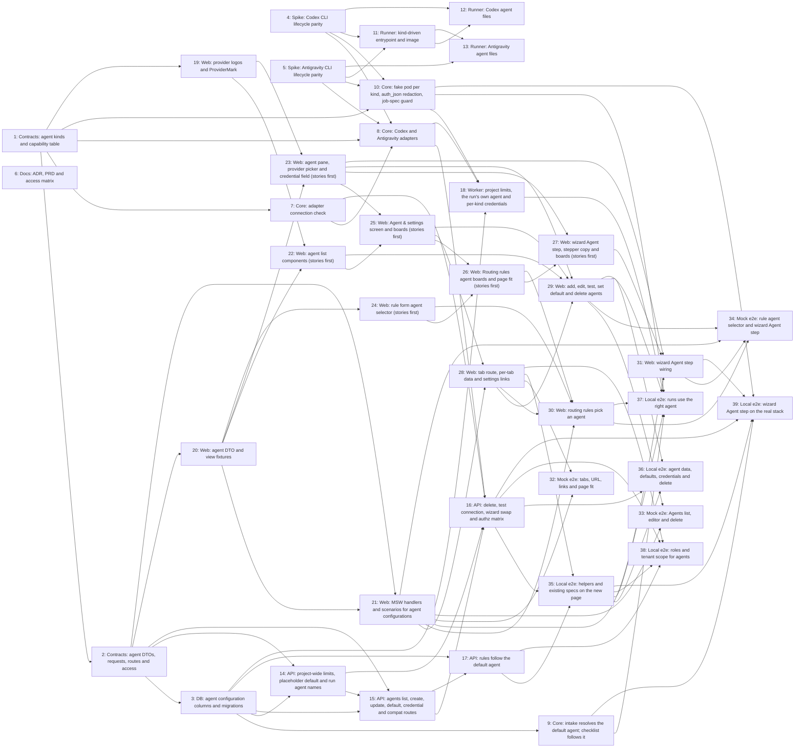

<!-- dev-plan: kind=plan id=multi-agent-configs rev=1 hash=78c1366735ba spec=docs/superpowers/specs/2026-11-24-multi-agent-configs-design.md spec-hash=1472c118460c -->
# Multiple agent configurations per project Implementation Plan

> **For agentic workers:** REQUIRED SUB-SKILL: Use superpowers:subagent-driven-development (recommended) or superpowers:executing-plans to implement this plan task-by-task. Steps use checkbox (`- [ ]`) syntax for tracking.

**Goal:** An admin keeps several named agent configurations per project (Claude Code, OpenAI Codex, Google Antigravity run; ten more are "Coming soon"), picks one default, points a rule at any of them, and every run keeps the configuration it was queued with.

**Architecture:** `packages/contracts` gets the kind and capability tables, agent DTOs and routes; `packages/db` adds `agents.is_default`, label and last-test columns, project-wide run limits and `runs.agent_name` (three expand-only migrations). `packages/core` adds `codex` and `antigravity` adapters beside `claude` with `checkConnection`, and intake resolves `rule.agentId ?? default` and freezes agent, name and model. The API gets list, create, update, delete, default and test routes (the old `GET/PUT /agent` become aliases of the default agent). The runner image installs both CLIs behind a kind-driven entrypoint. The web splits Agent & settings into four tabs that fit the window, adds the Agents list and add/edit pane, the rule agent selector and a provider picker in the new-project wizard; stories come first.

**Tech Stack:** Zod (contracts), Drizzle and Postgres RLS (db), NestJS on Fastify (api), Temporal (worker), bash and Node ESM (runner), React, TanStack Router/Query/Form, MSW, Storybook (web), Vitest, Playwright (mock and local). No new library; the two CLIs are approved.

**Spec:** `docs/superpowers/specs/2026-11-24-multi-agent-configs-design.md`. Executors read it with this plan. BR ids, TC ids, the Copy section, the board names and the prototype boards are defined there and are not repeated here.

## Global Constraints

- Kinds: `AgentKind = claude | codex | antigravity`; `CredentialType = oauth_token | api_key | auth_json`. Capabilities: claude = `oauth_token` or `api_key` with an API address; codex = `auth_json` or `api_key`, no address; antigravity = `api_key` only, no address. Provider text (for example `ANTHROPIC_BASE_URL`) comes from the keyed capability table, never from shared form code.
- Coming soon (not `AgentKind` values, refused with 422 on `/provider`): Gemini CLI, GitHub Copilot CLI, Cursor, Amp, OpenCode, Aider, Cline, Goose, Qwen Code, Kiro.
- Name: required, trimmed, 1 to 256 characters, unique per project ignoring case (409 on `/name`). Account label: optional, trimmed, 1 to 256. Provider is immutable after create. Model: `AgentModelId`. Address: `AgentBaseUrl`, only for a kind that supports one.
- Exactly one default per project: at most one by the partial unique index `agents_project_default_key`, at least one agent and exactly one default by the service. A project is created with a placeholder default (`claude`, name `Claude`, model `sonnet`, `max_turns` 50, no credential, `is_default` true). `POST agents` into a project with no default marks the new agent default in the same transaction (project row `FOR UPDATE`).
- Delete 409 texts, verbatim and in this check order: only agent "A project needs at least one agent. Add another agent first."; default with another agent "Set another agent as default first"; a rule names it (up to 5 rule commands in the message); a run that is not final, or paused, or has a kept session. The delete takes `SELECT ... FOR UPDATE` on the agent row; a racing rule insert (`23503`) maps to 409; a failing Secret delete after the commit never fails the request.
- List order `is_default desc, lower(name), id`. Compat `GET /api/projects/:projectId/agent` returns the default agent explicitly; `PUT` also writes the five limits to the project. The five old limit columns on `agents` stay, unread and unwritten (follow-up https://github.com/haicanhdieu/agent-desk/issues/287); no contract migration here.
- Run limits (run time limit, keep paused, keep finished, end idle, automatic resumes) are project-wide with the existing `AGENT_*` bounds; `maxTurns` stays on the agent.
- Statuses: `ok | rejected | unreachable | invalid | unsupported` stored (`last_test_status`, `last_test_at`); `no_credential` returned, never stored. Messages come from the constant map `AGENT_TEST_MESSAGES`, never from upstream text. Reset the stored result when the credential, auth method or address changes. Saves never call the provider; a failed test never blocks a save.
- Tenant: every agent query goes through `withOrg` plus the project filter; the tenant comes from the session. Another org's or project's agent id answers 404, never 403. Credential Secret name stays `org-{orgId}-agent-{agentId}` (ADR 0012), write-only; `auth_json` is a pasted value. In-app sign-in is out of scope: no sign-in button, route or callback.
- No new permission or role: `access.ts` is unchanged. A run keeps `runs.agent_id`, `runs.agent_name` (snapshot at intake, never rewritten) and its frozen model; resume uses the run's own agent.
- Migrations: next free numbers on main at planning time are `0047_agent_configs.sql`, `0048_agent_configs_backfill.sql`, `0049_agent_name_lower_key.sql` (the spec's 0045 to 0047 are taken). If main moves, take the next free numbers and keep the order. Never edit an applied migration; CHECKs are added NOT VALID then VALIDATE.
- First pod log line: `agentdesk: agent <kind> model <m> endpoint <origin>`. `entrypoint.sh` `AGENT` stays a fixed `case` list; the value is never used as a path. `launchEnv` passes the model as an env value only; name, label and ticket text never reach a shell, spec or SQL.
- Web: tokens only; `components/` and `screens/` import no router, Query or contracts at runtime beyond what exists; provider logos are inline path data in `apps/web/src/ds/providerLogos.ts` (no package, no `dangerouslySetInnerHTML`, no `?raw`), decorative (`aria-hidden`); copy is the spec's Copy section character for character; boards go from 322 to 361 in `canvas.json`.
- No network in tests; secrets in fixtures are obvious fakes. Do not weaken any access or isolation test.

## Review Focus

1. A pasted Codex `auth.json` of about 10 KB with unicode and escaped `\n` sequences must save, survive the Secret store and the entrypoint write byte for byte, and be redacted field by field in output. Tests in Task 10 and Task 12.
2. Name uniqueness ignoring case uses Postgres `lower()` while the web may fold differently (`Straße`, `İ`, trailing spaces): a duplicate answers 409 on `/name`, never 500. Test in Task 15.
3. Delete versus set-default and delete versus create, run together, must not deadlock (lock order project row then agent row): the answer is 409 or success, never 500. Test in Task 16.
4. Pressing Continue twice, or retrying after a failure, in the wizard must reuse the agent already created for the chosen provider (a second `POST agents` would be a 409 on the name). Test in Task 31.
5. A 256-character name, and a name or label like `<b>x</b>`, show truncated with a `title` and as text, never markup, in the row, picker and pane. Test in Task 22.

## Access and tenant data (per route, query, workflow, screen)

| Surface | Permission | Level | Tenant data touched |
| ------- | ---------- | ----- | ------------------- |
| `GET /api/projects/:projectId/agents` (`agents.list`) | `agent:read` | project | `agents` of the project plus two grouped counts over the page (rules, blocking runs) |
| `POST /api/projects/:projectId/agents` (`agents.create`) | `agent:update` | project | `agents`; locks the `projects` row |
| `PATCH`, `DELETE /api/agents/:agentId`, `POST .../default`, `POST .../test` | `agent:update` (param `agentId`) | project | `agents`, `rules`, `runs` (delete check), Secret delete after commit; test writes `last_test_*` |
| `GET`, `PUT /api/projects/:projectId/agent` (compat) | `agent:read`, `agent:update` (unchanged) | project | default `agents` row, `projects` limits |
| `PUT /api/agents/:agentId/credential`, `GET .../models` | `secret:update`, `agent:read` (unchanged) | project | `agents`, the agent's own Secret |
| `rules.create`, `rules.update` (agent id) | `rule:create`, `rule:update` (unchanged) | project | `rules`, `agents` (422 on `/agentId` for another project) |
| `projects.update` (five limits), `projects.create` (placeholder seed) | `project:update`, `project:create` (unchanged) | project, org | `projects`, `agents` |
| Intake (webhook comment to run) | none new; signature path untouched | project of the event | `rules`, `agents`, `runs` in one transaction |
| Worker `details()`, `session.activity` | internal; tenant from the run | org (run) | `runs`, `agents`, `projects` |
| Web Agent & settings (four tabs), rule form, wizard Agent step | page guard `agent:read`; Danger zone tab needs `project:delete` (org level); UI hints only | project | display of the data above |

Guard order (membership, permission 403 before any id lookup, scope 404) is unchanged. Task 15 and Task 16 hold the allowed / 403 / 404 / cross-org / project-scope matrix through the real guard and `withOrg`; Task 38 holds the role-based e2e.

## Needs approval

None. OpenAI Codex CLI (`@openai/codex`, pinned, runner image) and Google Antigravity CLI (`agy`, pinned version and checksum, runner image) are already approved. Provider logos are copied path data, not a package; if the human wants an icon package it stays undecided and is not added.

## Agent calls

- Agent call: migrations are numbered `0047` to `0049` and the ADR is `0041-multiple-agent-configurations-per-project.md`, because main already holds migrations `0045`, `0046` and ADRs up to `0040` (the spec names 0045 to 0047 and ADR 0039).
- Agent call: Tasks 1, 2 and 3 each include the smallest stand-ins (a registry case, DTO mappers, a null guard in intake) so every package typechecks after each merge; the later task named in the stand-in replaces it.
- Agent call: the two spike tasks record what they learn in `spike.json` beside their fixtures, so the adapter, fake-pod and runner tasks read data, not prose.
- Agent call: each `credentialTypes` row of the capability table also carries `valueLabel` (the secret input's label, for example "auth.json contents"), because the spec's Copy names a token label per provider and the row shape lists only `label` and `help`.
- Agent call: Coming-soon ids and logo keys are kebab-case (`gemini-cli`, `github-copilot-cli`, `cursor`, `amp`, `opencode`, `aider`, `cline`, `goose`, `qwen-code`, `kiro`).
- Agent call: the barrel `apps/web/src/components/index.ts` is edited only in Task 25, which exports every new component, so the parallel component tasks never touch it.
- Agent call: agent mutations (create, update, remove, set default, test) live in `features/desk/agent.form.ts` next to the existing agent hooks, so `features/desk/mutations.ts` stays untouched.
- Agent call: the local agent specs are split in two files for size, `agents-multi.spec.ts` (data and permissions) and `agents-runs.spec.ts` (run behaviour); the spec names only `agents-multi.spec.ts`.
- Agent call: `AGENT_TEST_MESSAGES` are fixed sentences; the API appends only the host to the `unreachable` message (the agent's address host or the provider's default host), never upstream text.
- Agent call: the new kinds get no `pricing` entry and their runner `transcript.mjs` prints no `agentdesk: usage` line (cost and token usage for them is not in the spec).
- Agent call: the board-name cleanup in `docs/superpowers/` edits only the unstamped historical documents; the five stamped ones keep their old names (editing them would reopen their approved hash) and are reported as OPEN.

## Task order and blockers

- **Storybook first (blocker from the spec, not an ordering preference).** Tasks 28, 29, 30 and 31 implement or wire the UI in `apps/web/src/{app,features}`; each lists the Storybook tasks it needs (22 to 27) under `**Depends on:**`.
- **Spike gate.** Tasks 4 and 5 decide whether Codex and Antigravity can meet full lifecycle parity (start, live watch, terminal attach, pause and resume, finish, per-agent model; ADR 0020 and 0027). If either cannot, the spike stops and asks the human with the "Talking to humans" template before any task that depends on it starts; nothing degraded ships silently.
- Every task ends the same way: `devbox run fix` until it prints `fix: clean.`, the package `typecheck` and the named tests green, then one Conventional Commit scoped to the package. Run only the named e2e specs, never the full suite.

---

<!-- dev-plan:graph:begin -->
## Task graph

Generated by `dev-plan.mjs graph --write` from each task's **Depends on:** line. Do not edit it by hand.
Tasks in the same wave touch no common file and can be built in parallel; a task starts when everything it depends on is merged.

| Wave | Task | Depends on |
| ---- | ---- | ---------- |
| 1 | Task 1: Contracts: agent kinds and capability table | none |
| 1 | Task 4: Spike: Codex CLI lifecycle parity | none |
| 1 | Task 5: Spike: Antigravity CLI lifecycle parity | none |
| 1 | Task 6: Docs: ADR, PRD and access matrix | none |
| 2 | Task 2: Contracts: agent DTOs, requests, routes and access | Task 1 |
| 2 | Task 7: Core: adapter connection check | Task 1 |
| 2 | Task 10: Core: fake pod per kind, auth_json redaction, job-spec guard | Task 1, Task 4, Task 5 |
| 2 | Task 11: Runner: kind-driven entrypoint and image | Task 4, Task 5 |
| 2 | Task 19: Web: provider logos and ProviderMark | Task 1 |
| 3 | Task 3: DB: agent configuration columns and migrations | Task 2 |
| 3 | Task 8: Core: Codex and Antigravity adapters | Task 1, Task 4, Task 5, Task 7 |
| 3 | Task 12: Runner: Codex agent files | Task 4, Task 11 |
| 3 | Task 13: Runner: Antigravity agent files | Task 5, Task 11 |
| 3 | Task 20: Web: agent DTO and view fixtures | Task 2 |
| 4 | Task 9: Core: intake resolves the default agent; checklist follows it | Task 3 |
| 4 | Task 14: API: project-wide limits, placeholder default and run agent names | Task 2, Task 3 |
| 4 | Task 18: Worker: project limits, the run's own agent and per-kind credentials | Task 3, Task 8, Task 10 |
| 4 | Task 21: Web: MSW handlers and scenarios for agent configurations | Task 2, Task 20 |
| 4 | Task 22: Web: agent list components (stories first) | Task 19, Task 20 |
| 4 | Task 23: Web: agent pane, provider picker and credential field (stories first) | Task 19, Task 20 |
| 4 | Task 24: Web: rule form agent selector (stories first) | Task 20 |
| 5 | Task 15: API: agents list, create, update, default, credential and compat routes | Task 2, Task 3, Task 14 |
| 5 | Task 25: Web: Agent & settings screen and boards (stories first) | Task 22, Task 23 |
| 6 | Task 16: API: delete, test connection, wizard swap and authz matrix | Task 7, Task 8, Task 14, Task 15 |
| 6 | Task 17: API: rules follow the default agent | Task 3, Task 15 |
| 6 | Task 26: Web: Routing rules agent boards and page fit (stories first) | Task 24, Task 25 |
| 6 | Task 28: Web: tab route, per-tab data and settings links | Task 21, Task 25 |
| 7 | Task 27: Web: wizard Agent step, stepper copy and boards (stories first) | Task 23, Task 26 |
| 7 | Task 29: Web: add, edit, test, set default and delete agents | Task 22, Task 23, Task 25, Task 28 |
| 7 | Task 30: Web: routing rules pick an agent | Task 21, Task 24, Task 26, Task 28 |
| 7 | Task 32: Mock e2e: tabs, URL, links and page fit | Task 21, Task 28 |
| 7 | Task 35: Local e2e: helpers and existing specs on the new page | Task 16, Task 17, Task 28 |
| 8 | Task 31: Web: wizard Agent step wiring | Task 21, Task 23, Task 27 |
| 8 | Task 33: Mock e2e: Agents list, editor and delete | Task 21, Task 29 |
| 8 | Task 36: Local e2e: agent data, defaults, credentials and delete | Task 16, Task 29, Task 35 |
| 8 | Task 37: Local e2e: runs use the right agent | Task 9, Task 10, Task 18, Task 29, Task 30, Task 35 |
| 8 | Task 38: Local e2e: roles and tenant scope for agents | Task 16, Task 17, Task 28, Task 35 |
| 9 | Task 34: Mock e2e: rule agent selector and wizard Agent step | Task 21, Task 29, Task 30, Task 31 |
| 9 | Task 39: Local e2e: wizard Agent step on the real stack | Task 9, Task 10, Task 16, Task 31, Task 35 |

<!-- dev-plan:graph:end -->

### Task 1: Contracts: agent kinds and capability table

**Depends on:** none

**Files:**

- Modify: `packages/contracts/src/enums.ts`
- Create: `packages/contracts/src/agent-kinds.ts`
- Test: `packages/contracts/src/agent-kinds.test.ts`
- Modify: `packages/contracts/src/index.ts`
- Modify: `packages/core/src/adapters/agents/registry.ts` (stand-in: `codex` and `antigravity` cases throw `adapter not available yet`; Task 8 replaces them)

**Interfaces:**

- Produces (`@agentdesk/contracts`):
  - `AgentKind = z.enum(['claude','codex','antigravity'])`; `CredentialType = z.enum(['oauth_token','api_key','auth_json'])`.
  - `interface AgentKindCapability { label: string; logo: string; credentialTypes: { type: CredentialType; label: string; valueLabel: string; help: string }[]; baseUrl: { help: string } | null; modelHelp: string; supportsMaxTurns: boolean }`.
  - `AGENT_KIND_CAPABILITIES: Record<AgentKind, AgentKindCapability>` with labels "Claude Code", "OpenAI Codex", "Google Antigravity", logo keys `claude`, `codex`, `antigravity`, and the help text of the spec's Copy section (Claude subscription token, API key, API address; Codex "Sign-in file (auth.json)" with value label "auth.json contents"; Antigravity "API key"). `supportsMaxTurns` is true for claude only.
  - `AGENT_KINDS_COMING_SOON: readonly { id: string; label: string; logo: string }[]` (the ten above, kebab-case ids).
  - `AGENT_NAME_MAX = 256`, `AGENT_ACCOUNT_LABEL_MAX = 256`.

- [ ] **Step 1: Write the failing tests** in `agent-kinds.test.ts`: `every runnable kind has a capability row`; `it.each(ten coming-soon labels)` "is not an AgentKind value, has no capability row, and has a non-empty logo key"; `logo keys are plain asset keys (no slash, dot or markup)`; `claude offers oauth_token and api_key and an address; codex offers auth_json and api_key and no address; antigravity offers api_key only and no address` (BR-5, BR-14, BR-15); `no text of the codex or antigravity row contains ANTHROPIC_BASE_URL or "Claude"`; `only claude supportsMaxTurns`; `AgentKind.safeParse` refuses each coming-soon id and an unknown value.
- [ ] **Step 2: Run** `pnpm --filter @agentdesk/contracts exec vitest run src/agent-kinds.test.ts`. Expected: FAIL (module missing).
- [ ] **Step 3: Implement** the enums, the table and the list in `agent-kinds.ts`; export from `index.ts`; add the stand-in cases to `registry.ts`.
- [ ] **Step 4: Verify and commit.** `pnpm --filter @agentdesk/contracts test`, then `pnpm --filter @agentdesk/contracts --filter @agentdesk/core typecheck`. Commit `feat(contracts): add codex and antigravity kinds and the capability table`.

---

### Task 2: Contracts: agent DTOs, requests, routes and access

**Depends on:** Task 1

**Files:**

- Modify: `packages/contracts/src/schemas/agents.ts`
- Test: `packages/contracts/src/schemas/agents.test.ts`
- Modify: `packages/contracts/src/schemas/rules.ts`
- Test: `packages/contracts/src/schemas/rules.test.ts`
- Modify: `packages/contracts/src/schemas/projects.ts`
- Modify: `packages/contracts/src/routes.ts`
- Test: `packages/contracts/src/routes.test.ts`
- Modify: `packages/contracts/src/route-access.ts`
- Test: `packages/contracts/src/route-access.test.ts`
- Modify: `apps/api/src/agents/agents.service.ts` (stand-in: `toDto` fills `accountLabel: null`, `isDefault: true`, `lastTest: null`, `usage: {rules: 0, blockingRuns: 0}`; Task 14 replaces)
- Modify: `apps/api/src/projects/projects.service.ts` (stand-in: the five limits from the `AGENT_*_DEFAULT` constants; Task 14 replaces)
- Modify: `apps/web/src/mocks/dto/agents.ts`, `apps/web/src/mocks/dto/projects.ts`, `apps/web/src/mocks/dto/rules.ts` (stand-in values so web typechecks; Task 20 replaces)

**Interfaces:**

- Produces (`@agentdesk/contracts`):
  - `AgentTestStatus = z.enum(['ok','rejected','unreachable','invalid','unsupported'])`.
  - `AgentDto` adds `accountLabel: string | null`, `isDefault: boolean`, `lastTest: { status: AgentTestStatus; at: Timestamp } | null`, `usage: { rules: number; blockingRuns: number }`; the five limit fields and `credential: { set, type, updatedAt, setBy }` stay.
  - `CreateAgentRequest { provider: AgentKind; name: string (trimmed 1..AGENT_NAME_MAX); accountLabel?: string (trimmed 1..AGENT_ACCOUNT_LABEL_MAX); model?: AgentModelId; maxTurns?: number }`; `UpdateAgentRequest { name?; accountLabel?: string | null; model?; maxTurns?: number | null }`. `provider`, `baseUrl` and credential type are in neither body.
  - `AgentConnectionDto { status: AgentTestStatus | 'no_credential'; message: string; testedAt: Timestamp | null }`; `AGENT_TEST_MESSAGES: Record<AgentConnectionDto['status'], string>` (fixed text; "Connected" for `ok`).
  - `RuleDto.agentId: string | null`; `CreateRuleRequest.agentId?: string`; `UpdateRuleRequest.agentId?: string | null`.
  - `ProjectDto` and `UpdateProjectRequest` gain `timeoutSeconds`, `pausedKeepSeconds`, `doneKeepSeconds`, `idleEndSeconds`, `autoResumeMax` with the existing bounds.
  - `routes.agents.{list,create,update,remove,setDefault,test}`: `GET /api/projects/:projectId/agents` (`pageOf(AgentDto)`), `POST /api/projects/:projectId/agents` (`CreateAgentRequest` to `AgentDto`), `PATCH /api/agents/:agentId`, `DELETE /api/agents/:agentId` (empty), `POST /api/agents/:agentId/default` (`AgentDto`), `POST /api/agents/:agentId/test` (`AgentConnectionDto`).
  - `routeAccess`: `agents.list` `project('agent:read')`; `agents.create` `project('agent:update')`; `agents.update`, `agents.remove`, `agents.setDefault`, `agents.test` `project('agent:update', 'agentId')`.

- [ ] **Step 1: Write the failing tests.** `agents.test.ts`: name and label boundaries (256 accepted, 257 and empty and spaces-only refused, trimmed) and hostile strings (shell metacharacters, newline, control characters, 61/81/10k characters) for name, label and model (BR-8, BR-11); `CreateAgentRequest` refuses each coming-soon id and an unknown provider with the issue on `/provider` (BR-51); neither request accepts `provider`, `baseUrl` or a credential on update; `AgentDto` and `AgentConnectionDto` parse a fixture and carry no `value` key; each `AGENT_TEST_MESSAGES` value is non-empty. `rules.test.ts`: `agentId` absent, `null` and a uuid are valid on update; absent on create. `routes.test.ts` and `route-access.test.ts`: every new route has a table entry and a `routeAccess` entry with the permissions above.
- [ ] **Step 2: Run** `pnpm --filter @agentdesk/contracts test`. Expected: FAIL.
- [ ] **Step 3: Implement** the schemas, routes and access entries; add the stand-ins so `pnpm --filter @agentdesk/api --filter @agentdesk/web typecheck` passes (minimal edits only).
- [ ] **Step 4: Verify and commit.** `pnpm --filter @agentdesk/contracts test`; typecheck contracts, api, web, core, worker. Commit `feat(contracts): add agent configuration DTOs, routes and project limits`.

---

### Task 3: DB: agent configuration columns and migrations

**Depends on:** Task 2

**Files:**

- Modify: `packages/db/src/schema/app.ts`
- Create: `packages/db/migrations/0047_agent_configs.sql`
- Create: `packages/db/migrations/0048_agent_configs_backfill.sql`
- Create: `packages/db/migrations/0049_agent_name_lower_key.sql`
- Modify: `packages/db/migrations/meta/_journal.json`
- Create: `packages/db/migrations/meta/0047_snapshot.json`, `packages/db/migrations/meta/0048_snapshot.json`, `packages/db/migrations/meta/0049_snapshot.json`
- Create: `packages/db/test/helpers/migrations.ts`
- Test: `packages/db/test/migrate.int.test.ts`
- Test: `packages/db/test/rls.int.test.ts`
- Modify: `packages/core/src/intake/process-ticket-event.ts` (stand-in: throw when `decision.rule.agentId` is null; Task 9 replaces)

**Interfaces:**

- Produces (Drizzle `schema/app.ts`): `agents.accountLabel text null` (check null or length 1..256), `agents.isDefault boolean not null default false` (partial unique index `agents_project_default_key` on `(project_id) where is_default`), `agents.lastTestStatus text null` (check `ok|rejected|unreachable|invalid|unsupported`), `agents.lastTestAt timestamptz null`, `agents_name_length_check` (1..256), unique `agents_project_name_lower_key` on `(project_id, lower(name))` (the old `agents_project_name_key` stays), `agents_credential_type_check` widened to `oauth_token|api_key|auth_json`; `projects.timeoutSeconds` (86400, 60..604800), `pausedKeepSeconds` (604800, 3600..2592000), `doneKeepSeconds` (86400, 0..604800), `idleEndSeconds` (1800, 300..604800), `autoResumeMax` (5, 0..10), all `not null`; `rules.agentId` nullable; `runs.agentName text null`.
- Produces (test helper): `runMigrationsUpTo(ownerUrl: string, tag: string): Promise<void>` copies the migrations folder with the journal cut after `tag` into a temp dir and runs the existing drizzle migrator (no dependency).

- [ ] **Step 1: Write the failing tests** in `migrate.int.test.ts` (helper first): seed legacy data at `0046` (two orgs and projects; agents with credential metadata, address and non-default limits; one project with two agents; one project with agents differing only by case; rules; runs including a paused one), then assert after each of 0047, 0048, 0049 (BR-48, BR-49): new columns, defaults and checks exist and legacy rows are untouched after 0047; after 0048 exactly one default per project (the oldest agent), none for a project with no agent, the project's five limits equal that agent's with the two orgs not mixed, the case-only duplicate renamed with the ` (2)` suffix, model, `base_url`, `credential_secret_name`, `credential_type`, `max_turns`, rule and run `agent_id` and row counts unchanged, `agent_name` null on legacy runs, `rules.agent_id` accepts null; 0048 applied twice gives the same result; after 0049 `Claude` next to `claude` is a `23505`; widened credential check accepts `auth_json` and refuses an unknown type; `last_test_status` accepts only the five values; `account_label` check 1..256; the partial default index refuses a second default; the five project CHECKs refuse out-of-range values; the five old `agents` limit columns still exist; text assertions that 0047 has no data statement on `runs` or `rules` and that 0048 has no `delete from agents`; no applied migration file changed. Extend `rls.int.test.ts` with two-org cases for the new columns and the default-agent select.
- [ ] **Step 2: Run** `pnpm --filter @agentdesk/db exec vitest run test/migrate.int.test.ts`. Expected: FAIL.
- [ ] **Step 3: Implement** `schema/app.ts`, then `pnpm --filter @agentdesk/db exec drizzle-kit generate` for 0047 and 0049 and `--custom` for 0048 (idempotent, batched by project id: rename case-only duplicates, set the oldest agent default where a project has none, copy that agent's five limits to the project). CHECKs NOT VALID then VALIDATE; the old app must keep working with the new schema.
- [ ] **Step 4: Verify and commit.** `pnpm --filter @agentdesk/db test`; typecheck db, core, api, worker. Commit `feat(db): add agent configuration columns and project-wide limits`.

---

### Task 4: Spike: Codex CLI lifecycle parity

**Depends on:** none

**Files:**

- Create: `packages/core/test/fixtures/agents/codex/spike.json`
- Create: `packages/core/test/fixtures/agents/codex/models-ok.json`, `packages/core/test/fixtures/agents/codex/models-401.json`, `packages/core/test/fixtures/agents/codex/models-bad.json`
- Create: `images/runner/test/fixtures/codex-hooks/events.jsonl`
- Create: `images/runner/test/fixtures/codex-transcript/session.jsonl`

**Interfaces:**

- Produces: `spike.json` with `{ version, credentialEnv: { api_key, auth_json }, home: { env, authFile }, endpointEnv: string | null, modelFlag, builtinModels: [{id, label}], modelList: { url, auth } | null, check: { url, auth } | "unsupported", status: { mechanism, configFile, events }, transcript: { path, format }, resume: { command }, parity: { start, watch, attach, pauseResume, finish, perAgentModel } }` (each parity value `true` or a note). Scrubbed fixtures: no real token, id or email.

- [ ] **Step 1: Read** developers.openai.com/codex/auth and the pinned `@openai/codex` release notes; install the pinned version in a scratch directory (outside the repo, a fresh empty folder); record the pinned version.
- [ ] **Step 2: Answer in `spike.json`**, by running the CLI with a throwaway key where possible: the env var for an API key and for a pasted `auth.json`, the home directory variable and where `auth.json` goes, whether an address override exists (the spec says none), the flag or env that selects a model, the built-in model names, whether `GET /v1/models` lists models for an API key and what a subscription `auth.json` can call (else `unsupported`), how a status event reaches the pod for ADR 0020 (hook or notify setting, config file path, event names), where the session log lives and its line format for ADR 0027, and the command that resumes a session.
- [ ] **Step 3: Record scrubbed fixtures** for each file listed above (a models list, a 401 body, an odd body, hook events, a short session).
- [ ] **Step 4: Gate.** If any `parity` value is not `true`, stop and ask the human with the "Talking to humans" template (Problem, Sample, Solutions, Suggestion) before Tasks 8, 10, 11 or 12 start; do not ship Codex degraded. Commit the fixtures as `test(core): record codex spike fixtures`.

---

### Task 5: Spike: Antigravity CLI lifecycle parity

**Depends on:** none

**Files:**

- Create: `packages/core/test/fixtures/agents/antigravity/spike.json`
- Create: `packages/core/test/fixtures/agents/antigravity/models-ok.json`, `packages/core/test/fixtures/agents/antigravity/models-401.json`, `packages/core/test/fixtures/agents/antigravity/models-bad.json`
- Create: `images/runner/test/fixtures/antigravity-hooks/events.jsonl`
- Create: `images/runner/test/fixtures/antigravity-transcript/session.jsonl`

**Interfaces:**

- Produces: `spike.json` with the same shape as Task 4 plus `{ install: { url, version, sha256 } }` for the official installer and `settingsFile: { path, modelProvider: "gemini" }`; `credentialEnv.api_key` is `GEMINI_API_KEY` unless the spike finds otherwise.

- [ ] **Step 1: Read** antigravity.google/docs/install; download the installer into its own new empty folder, record the pinned version and its SHA-256 (security.md: pinned version and checksum); run it only in a scratch directory.
- [ ] **Step 2: Answer in `spike.json`** the same questions as Task 4 for `agy` with an API key only (no ADC, no subscription login): credential env, settings file and the `modelProvider: gemini` entry, no address override, model flag, built-in model names, whether a Gemini model list call works for a key (else `unsupported`), the status-event mechanism, session log path and format, resume command, and whether the 5-minute `needs_input startup` check would mislabel it.
- [ ] **Step 3: Record scrubbed fixtures** as in Task 4.
- [ ] **Step 4: Gate.** Same rule as Task 4: a `parity` value that is not `true` stops here and goes to the human before Tasks 8, 10, 11 or 13 start. Commit `test(core): record antigravity spike fixtures`.

---

### Task 6: Docs: ADR, PRD and access matrix

**Depends on:** none

**Files:**

- Create: `docs/adr/0041-multiple-agent-configurations-per-project.md`
- Modify: `docs/Agent Desk — PRD (PoC).md`
- Modify: `docs/adr/0021-run-time-limit-7-days-with-token-refresh.md`
- Modify: `docs/adr/0022-pause-and-resume-runs-on-a-per-run-volume.md`
- Modify: `docs/superpowers/specs/2026-11-22-desk-access-matrix.md`
- Modify: `docs/superpowers/plans/2026-11-11-design-system-and-storybook.md`, `docs/superpowers/plans/2026-11-12-backend-local.md`, `docs/superpowers/plans/2026-11-12-frontend-local.md`, `docs/superpowers/plans/2026-11-15-rule-custom-prompt.md`, `docs/superpowers/specs/2026-11-12-frontend-design.md`

**Interfaces:** none (text only).

- [ ] **Step 1: Write ADR 0041** from `docs/adr/0000-template.md`: named configurations, the `is_default` partial unique index, null rule agent follows the default, project-wide run limits, delete safeguards (never the only agent), the project-creation seed and the wizard swap, the `agent_name` snapshot, runnable kinds and the Coming-soon list; it leaves ADR 0026's address-change rule as is and ADR 0036 unchanged.
- [ ] **Step 2: Update** PRD FR-3 ("one agent credential per project") and "Out of scope" (Codex and Cursor), ADR 0021 and 0022 (a note that the limits move from the agent to the project, no change of meaning), and add the rows for `agents.list`, `create`, `update`, `remove`, `setDefault`, `test` to the access matrix (`agent:read` or `agent:update`, project level).
- [ ] **Step 3: Rename** retired board names (`DeskAgent`, `DeskAgentProjectAdmin`, `DeskAgentCustomModel`, `DeskAgentAddressChanged`, `DeskAgentAutoResume*`, `DeskRules`, `DeskRulesPrompt*`, `DeskRulesPaged`, `DeskRulesEmpty`, `Setup2`) to their replacements in the five unstamped documents listed; leave the stamped ones (see Agent calls).
- [ ] **Step 4: Verify and commit.** `pnpm exec prettier --check` on the changed files. Commit `docs: add ADR 0041 and update PRD and access matrix for agent configurations`.

---

### Task 7: Core: adapter connection check

**Depends on:** Task 1

**Files:**

- Modify: `packages/core/src/adapters/agents/types.ts`
- Modify: `packages/core/src/adapters/agents/claude.ts`
- Test: `packages/core/test/adapters/agents.test.ts`
- Modify: `packages/core/src/index.ts`

**Interfaces:**

- Produces (`@agentdesk/core`): `type AgentConnectionStatus = AgentTestStatus` (contracts); `AgentAdapter.checkConnection(input: { credential: { type: CredentialType; value: string }; baseUrl: string | null }): Promise<AgentConnectionStatus>`. Claude maps `listModels` outcomes: a list (even empty) is `ok`, `AgentModelsError` `rejected` / `unreachable` / `invalid` map to the same words; any other error is `unreachable`.
- Produces: a shared suite `describe.each(registeredKinds)` in `agents.test.ts` (the constant list starts as `['claude']`; Task 8 switches it to `AgentKind.options`) asserting for each kind: a capability row exists, `agentAdapterFor(kind)` returns it, `credentialEnv(type)` is a non-empty distinct name for every listed type, `launchEnv` starts with `{ name: 'AGENT', value: kind }`, `builtinModels` is non-empty with valid `AgentModelId`s, `listModels` errors carry only the kind, and `checkConnection` maps each error kind without echoing the credential.

- [ ] **Step 1: Write the failing tests:** the shared suite for `claude`, plus `claude checkConnection returns ok / rejected / unreachable / invalid` using an injected `AgentHttpGet`, and `checkConnection never puts the credential in a thrown message`.
- [ ] **Step 2: Run** `pnpm --filter @agentdesk/core exec vitest run test/adapters/agents.test.ts`. Expected: FAIL.
- [ ] **Step 3: Implement** the interface member and the Claude mapping (reuse `listModels`; no new call).
- [ ] **Step 4: Verify and commit.** `pnpm --filter @agentdesk/core typecheck` and the file's tests. Commit `feat(core): add checkConnection to agent adapters`.

---

### Task 8: Core: Codex and Antigravity adapters

**Depends on:** Task 1, Task 4, Task 5, Task 7

**Files:**

- Create: `packages/core/src/adapters/agents/codex.ts`
- Create: `packages/core/src/adapters/agents/antigravity.ts`
- Modify: `packages/core/src/adapters/agents/registry.ts`
- Test: `packages/core/test/adapters/codex.test.ts`
- Test: `packages/core/test/adapters/antigravity.test.ts`
- Modify: `packages/core/test/adapters/agents.test.ts`

**Interfaces:**

- Consumes: Task 7's `AgentAdapter` and the two `spike.json` files (model names, env names, list and check requests, `unsupported` where the spike says so).
- Produces: `createCodexAdapter(http?: AgentHttpGet): AgentAdapter` and `createAntigravityAdapter(http?: AgentHttpGet): AgentAdapter`; `agentAdapterFor('codex' | 'antigravity', { http })` returns them. `launchEnv({ model, baseUrl })` yields `{ name: 'AGENT', value: <kind> }` plus `AGENT_MODEL` when a model is set and never an address variable. `credentialEnv(type)` follows the spike (an `auth_json` value reaches the pod as one env var the entrypoint turns into a file).

- [ ] **Step 1: Write the failing tests** per adapter from the recorded fixtures (BR-18, BR-20 core part): built-in names from the spike; `listModels` maps a 401 to `rejected`, a transport error to `unreachable`, an odd body to `invalid` and keeps only valid `AgentModelId`s; `checkConnection` returns `unsupported` for a credential type the spike marks not checkable; a hostile model name from the provider is dropped. In `agents.test.ts` switch `registeredKinds` to `AgentKind.options`; a case asserts `pricingProviders()` is unchanged.
- [ ] **Step 2: Run** `pnpm --filter @agentdesk/core exec vitest run test/adapters`. Expected: FAIL.
- [ ] **Step 3: Implement** both adapters and replace the registry stand-ins; calls go through the injected `AgentHttpGet` (default `guardedGetJson`), one time budget for a list as in Claude.
- [ ] **Step 4: Verify and commit.** `pnpm --filter @agentdesk/core test` (adapters) and typecheck core, api, worker. Commit `feat(core): add codex and antigravity agent adapters`.

---

### Task 9: Core: intake resolves the default agent; checklist follows it

**Depends on:** Task 3

**Files:**

- Modify: `packages/core/src/intake/process-ticket-event.ts`
- Test: `packages/core/test/intake.int.test.ts`
- Modify: `packages/core/src/access/checklist.ts`
- Test: `packages/core/test/access/checklist.int.test.ts`

**Interfaces:**

- Produces: in the intake transaction `agentId = rule.agentId ?? (select id from agents where project_id = $p and is_default)`; the same transaction freezes `runs.agent_id`, `runs.agent_name = agents.name` and `runs.model = rule.model ?? agent.model`. A missing default (or an agent id outside the project) throws so the delivery is retried; it never falls back to another agent. The checklist item `add_agent` is done when the project's default agent has a credential (`agents.is_default and credential_secret_name is not null`), whichever kind.

- [ ] **Step 1: Write the failing tests** in `intake.int.test.ts` (BR-26, BR-34, BR-36, BR-37, BR-42): a rule with null agent uses the default at that moment and stores `agent_name`; a rule naming agent B runs on B; changing the default or the rule afterwards leaves the queued run on A; a rule's own model still wins; a missing default throws and writes no run; a rule whose agent belongs to another project is never run; the rename after queue leaves `runs.agent_name` unchanged. In `checklist.int.test.ts`: not done for the credential-less placeholder, not done when only a non-default agent has a credential, done when the default has one, for each kind via direct inserts; other items unchanged.
- [ ] **Step 2: Run** both files with `pnpm --filter @agentdesk/core exec vitest run <file>`. Expected: FAIL.
- [ ] **Step 3: Implement** the resolution inside the existing transaction and replace the Task 3 stand-in; change the checklist's `hasAgent` predicate.
- [ ] **Step 4: Verify and commit.** `pnpm --filter @agentdesk/core test` and typecheck core and api. Commit `feat(core): resolve the default agent at intake and snapshot its name`.

---

### Task 10: Core: fake pod per kind, auth_json redaction, job-spec guard

**Depends on:** Task 1, Task 4, Task 5

**Files:**

- Modify: `packages/core/src/kube/fake-pod.mjs`
- Test: `packages/core/test/kube/fake-pod.test.ts`
- Modify: `packages/core/src/redact.ts`
- Test: `packages/core/test/redact.test.ts`
- Test: `packages/core/test/kube/job-spec.test.ts`

**Interfaces:**

- Produces: the fake pod prints `agentdesk: agent <kind> model <m> endpoint <origin>` from the job's `AGENT` env and reads that kind's endpoint variable (a small table in the file, from the two `spike.json` files; `claude` keeps `ANTHROPIC_BASE_URL`, kinds without an address print the provider's default origin) instead of hard-coding `claude`. `redact` masks a whole multi-line pasted value and each string field inside a JSON credential (the `auth_json` tokens), not only the raw value.

- [ ] **Step 1: Write the failing tests:** `fake-pod prints the launch line for claude, codex and antigravity` (BR-52); `an unknown AGENT value is refused`; `redact masks an auth_json value, each token field inside it, and a copy with the whitespace removed` (Review Focus 1: about 10 KB with unicode and escaped `\n`); `redact still masks a plain api key`; in `job-spec.test.ts`: `AGENT and the credential env name come from the adapter per kind` and `a name, label or model with shell metacharacters reaches the spec only as a quoted env value`.
- [ ] **Step 2: Run** `pnpm --filter @agentdesk/core exec vitest run test/kube/fake-pod.test.ts test/redact.test.ts test/kube/job-spec.test.ts`. Expected: FAIL.
- [ ] **Step 3: Implement** the fake-pod table and the redaction of structured values; do not change `job-spec.ts` unless a test shows a gap.
- [ ] **Step 4: Verify and commit.** `pnpm --filter @agentdesk/core test` (these files; existing Claude local assertions stay valid). Commit `feat(core): fake pod launch line per agent kind and auth_json redaction`.

---

### Task 11: Runner: kind-driven entrypoint and image

**Depends on:** Task 4, Task 5

**Files:**

- Modify: `images/runner/entrypoint.sh`
- Modify: `images/runner/Dockerfile`
- Test: `images/runner/test/entrypoint.test.ts`
- Test: `images/runner/test/dockerfile.test.ts`
- Modify: `images/runner/test/harness.ts`

**Interfaces:**

- Produces (the contract Tasks 12 and 13 fill): `entrypoint.sh` `case` accepts `claude`, `codex`, `antigravity` (unknown still exits 2 with `unsupported agent`); for a kind it sources the optional `agents/<kind>/prepare.sh` (writes credential files from env, never echoes them) and calls `agent_endpoint` from `commands.sh` for the launch line `agentdesk: agent <kind> model <m> endpoint <origin>` (the first log line); the Dockerfile copies the whole `agents/` directory (replacing the per-file `COPY` lines), runs one `chmod`/`chown` loop over it, and installs the pinned `@openai/codex` and the pinned, checksum-verified `agy` (values from the spike files; the build fails on a checksum mismatch).

- [ ] **Step 1: Write the failing tests:** `entrypoint accepts codex and antigravity and still refuses an unknown AGENT with exit 2` (BR-52); `the first log line is agentdesk: agent <kind> model <m> endpoint <origin> for a stub kind directory`; `prepare.sh runs before the launch and its output is never in the log`; `dockerfile pins the codex version and verifies the agy checksum and copies agents/`.
- [ ] **Step 2: Run** `pnpm --filter @agentdesk/runner exec vitest run test/entrypoint.test.ts test/dockerfile.test.ts`. Expected: FAIL.
- [ ] **Step 3: Implement** the entrypoint and Dockerfile changes; Claude's behaviour and its existing tests stay unchanged.
- [ ] **Step 4: Verify and commit.** `pnpm --filter @agentdesk/runner test`. Commit `feat(runner): kind-driven entrypoint and image with codex and agy installed`.

---

### Task 12: Runner: Codex agent files

**Depends on:** Task 4, Task 11

**Files:**

- Create: `images/runner/agents/codex/commands.sh`
- Create: `images/runner/agents/codex/prepare.sh`
- Create: `images/runner/agents/codex/hook.mjs`
- Create: `images/runner/agents/codex/transcript.mjs`
- Create: `images/runner/agents/codex/managed-config.toml`
- Create: `images/runner/test/stubs/codex`
- Test: `images/runner/test/codex-hook.test.ts`
- Test: `images/runner/test/codex-transcript.test.ts`
- Test: `images/runner/test/codex-entrypoint.test.ts`

**Interfaces:**

- Consumes: Task 11's `prepare.sh`, `agent_endpoint` and first-line contract; `spike.json` and the fixtures from Task 4.
- Produces: `commands.sh` launches `codex` from the fixed command file with the model as an env value only (start, resume, attach through tmux); `prepare.sh` writes the pasted `auth_json` to `$CODEX_HOME/auth.json` mode 0600 on the per-run volume and writes nothing for an API key; `hook.mjs` speaks the ADR 0020 status protocol (`working`, `needs_input`, `done` as in the Claude hook, so the 5-minute `needs_input startup` check does not mislabel it); `transcript.mjs` speaks the ADR 0027 agent-neutral transcript protocol from the session log.

- [ ] **Step 1: Write the failing tests:** hook events map to the same statuses as the Claude hook for the recorded `codex-hooks` fixture; `transcript.mjs` turns `codex-transcript/session.jsonl` into the neutral rows (user, assistant, tool); entrypoint with `AGENT=codex` and the stub CLI: writes `auth.json` byte for byte with mode 0600 (about 10 KB, unicode, escaped `\n`, Review Focus 1) and never echoes it, passes the model only as an env value, resumes with the spike's resume command, and prints the launch line; an unusual model string (shell metacharacters) never reaches a shell.
- [ ] **Step 2: Run** `pnpm --filter @agentdesk/runner exec vitest run test/codex-hook.test.ts test/codex-transcript.test.ts test/codex-entrypoint.test.ts`. Expected: FAIL.
- [ ] **Step 3: Implement** the files above.
- [ ] **Step 4: Verify and commit.** `pnpm --filter @agentdesk/runner test`. Commit `feat(runner): run Codex in the run pod`.

---

### Task 13: Runner: Antigravity agent files

**Depends on:** Task 5, Task 11

**Files:**

- Create: `images/runner/agents/antigravity/commands.sh`
- Create: `images/runner/agents/antigravity/prepare.sh`
- Create: `images/runner/agents/antigravity/hook.mjs`
- Create: `images/runner/agents/antigravity/transcript.mjs`
- Create: `images/runner/agents/antigravity/managed-settings.json`
- Create: `images/runner/test/stubs/agy`
- Test: `images/runner/test/antigravity-hook.test.ts`
- Test: `images/runner/test/antigravity-transcript.test.ts`
- Test: `images/runner/test/antigravity-entrypoint.test.ts`

**Interfaces:**

- Consumes: Task 11's contract; `spike.json` and fixtures from Task 5.
- Produces: the same four pieces as Task 12 for `agy`: `prepare.sh` writes the CLI settings file with `modelProvider: gemini` (no key in the file; the key arrives as `GEMINI_API_KEY` through the per-run Secret) and never echoes it.

- [ ] **Step 1: Write the failing tests** as in Task 12 for `agy` (statuses from `antigravity-hooks`, neutral rows from `antigravity-transcript`, settings file content, model only as an env value, resume command, launch line, no key in any log line or file).
- [ ] **Step 2: Run** `pnpm --filter @agentdesk/runner exec vitest run test/antigravity-hook.test.ts test/antigravity-transcript.test.ts test/antigravity-entrypoint.test.ts`. Expected: FAIL.
- [ ] **Step 3: Implement** the files above.
- [ ] **Step 4: Verify and commit.** `pnpm --filter @agentdesk/runner test`. Commit `feat(runner): run Antigravity in the run pod`.

---

### Task 14: API: project-wide limits, placeholder default and run agent names

**Depends on:** Task 2, Task 3

**Files:**

- Modify: `apps/api/src/projects/projects.service.ts`
- Modify: `apps/api/src/runs/runs.service.ts`
- Test: `apps/api/test/projects.int.test.ts`
- Test: `apps/api/test/runs.int.test.ts`
- Test: `apps/api/test/checklist.int.test.ts`

**Interfaces:**

- Produces: `ProjectsService.create` inserts the placeholder (`claude`, `Claude`, `sonnet`, `max_turns` 50, no credential, `is_default` true) in the same transaction as the project and poll cursor; `ProjectDto` and `projects.update` read and write the five limits on `projects`; `RunsService` reads timeout, idle end and paused keep from the project and shows `agent: { name: coalesce(agents.name, runs.agent_name, '(deleted agent)'), model }`; project delete still removes every agent and its Secret.

- [ ] **Step 1: Write the failing tests:** `POST projects writes exactly one placeholder default agent`, a failed create leaves no agent, a second project in the org gets its own placeholder, `setupStep` is `agent` and `GET /agent` returns it (BR-50 seed); `PUT projects` with the five limits stores them and refuses out-of-range values; checklist cases through the API (placeholder not done, default with credential done); runs: the DTO shows the live name after a rename, the queue-time name after the agent row is removed, `(deleted agent)` only for a legacy run with neither (BR-31, BR-54), and limits come from the project (BR-45).
- [ ] **Step 2: Run** `pnpm --filter @agentdesk/api exec vitest run test/projects.int.test.ts test/runs.int.test.ts test/checklist.int.test.ts`. Expected: FAIL.
- [ ] **Step 3: Implement** the three service changes and replace the Task 2 stand-in.
- [ ] **Step 4: Verify and commit.** `pnpm --filter @agentdesk/api typecheck` and the three files. Commit `feat(api): project-wide run limits, placeholder default agent, run agent name`.

---

### Task 15: API: agents list, create, update, default, credential and compat routes

**Depends on:** Task 2, Task 3, Task 14

**Files:**

- Modify: `apps/api/src/agents/agents.service.ts`
- Modify: `apps/api/src/agents/agents.controller.ts`
- Create: `apps/api/test/helpers/agents.ts`
- Test: `apps/api/test/agents-multi.int.test.ts`
- Test: `apps/api/test/agents.int.test.ts`

**Interfaces:**

- Produces (service): `list(org, projectId, paging): Promise<Page<AgentDto>>` (order `is_default desc, lower(name), id`, `usage` from two grouped counts over the page's ids, no per-row query); `create(org, projectId, body: CreateAgentRequest): Promise<AgentDto>` (422 `/provider` for a Coming-soon or unknown kind, 409 `/name`, the model stored as sent or the adapter's first built-in, default marking under the project row lock with the `23505` fallback to a non-default insert); `update(org, agentId, body: UpdateAgentRequest)` (409 on a duplicate; `{}` is a no-op; `null` clears label and max turns; `provider` refused or ignored); `setDefault(org, agentId)` (project row `FOR UPDATE`, clears the old default); compat `get` returns the default, `put` writes the agent and the project limits; `putCredential` refuses a type the kind does not list (422 `/type`) and an address for a kind without one, resets `last_test_*` on credential, type or address change; `models` unchanged.
- Produces (test helpers `apps/api/test/helpers/agents.ts`): `makeAgent(app, session, projectId, overrides?: Partial<CreateAgentRequest>): Promise<AgentDto>` through the real create route; `swapAgent(app, session, projectId, provider: AgentKind): Promise<AgentDto>` runs the wizard's create, default, delete-placeholder, credential, test sequence through the real routes.

- [ ] **Step 1: Write the failing tests first.** In `agents.int.test.ts`, before any code: `GET /agent returns the default agent when the project has two agents, whatever their creation order` (BR-50; second row made through the new create route plus a manual `is_default` update). In `agents-multi.int.test.ts` (`expectContract` on every response, a fresh org per case): BR-62 cases of the spec (first create default, second not, no-default project gets one, concurrent creates give one default with `Promise.all`, create with the default option, rejected first create writes nothing); create stores the model sent, else the first built-in (BR-6); two agents of one kind keep their own fields and credential status (BR-7); name boundaries 256 and 257 for name and label (BR-8); duplicate name ignoring case is 409 `/name`, including `Straße`, `İ` and a trailing space (BR-9, Review Focus 2); `PATCH` persists name, label, model, an empty body is 200, `provider` is refused or ignored (BR-16, BR-17); invalid model 400 `/model` (BR-11); each of the ten Coming-soon names is 422 `/provider` on create, on `PATCH provider` and on compat `PUT` (BR-51); set default moves the flag in one transaction and two concurrent calls leave one default (BR-2, BR-23, BR-24); credential isolation: replacing A's credential leaves B's metadata and Secret (BR-13); credential type and address rules (BR-14, BR-15); the value is in no response, audit row or log and DTOs carry only `{set,type,updatedAt,setBy}` (BR-12); per-agent models use that agent's own credential and address (BR-18, BR-19 fallback); compat `PUT` writes the project limits (BR-45); permissions matrix (see Step 2).
- [ ] **Step 2: Add the access cases** for every route above through the real guard: owner and project admin allowed; member and viewer 403 before any id lookup; another project's and another org's agent id 404 (never 403); an admin on P1 gets nothing on P2 and the list never shows P2 agents; no mocked access check.
- [ ] **Step 3: Run** `pnpm --filter @agentdesk/api exec vitest run test/agents-multi.int.test.ts test/agents.int.test.ts`. Expected: FAIL.
- [ ] **Step 4: Implement** the service and controller routes; all `withOrg`, project filter and `assertProjectVisible`; Secret calls outside any transaction as today; replace the Task 2 stand-in.
- [ ] **Step 5: Verify and commit.** `pnpm --filter @agentdesk/api typecheck` and both files. Commit `feat(api): multiple agent configurations: list, create, update, default, credential rules`.

---

### Task 16: API: delete, test connection, wizard swap and authz matrix

**Depends on:** Task 7, Task 8, Task 14, Task 15

**Files:**

- Modify: `apps/api/src/agents/agents.service.ts`
- Modify: `apps/api/src/agents/agents.controller.ts`
- Test: `apps/api/test/agents-multi.int.test.ts`
- Test: `apps/api/test/authz.int.test.ts`
- Test: `apps/api/test/audit-tagging.int.test.ts`

**Interfaces:**

- Consumes: Task 15's `makeAgent`, `swapAgent`; Task 7 and 8's `AgentAdapter.checkConnection`.
- Produces (service): `remove(org, agentId): Promise<void>` (one `withOrg` transaction, `FOR UPDATE` on the agent row, the four 409s of Global Constraints in that order, hard delete, Secret deleted after the commit, error class only logged); `test(org, agentId): Promise<AgentConnectionDto>` (adapter call outside any transaction, a short transaction stores `last_test_status` and `last_test_at`, `no_credential` returned and not stored, `unsupported` when the adapter cannot probe that credential type, message from `AGENT_TEST_MESSAGES`, host only appended for `unreachable`).

- [ ] **Step 1: Write the failing tests** in `agents-multi.int.test.ts`: delete an unused agent removes the row and the Secret and a failing Secret delete still succeeds and logs the error class only (BR-27); the only agent is refused with the BR-66 text for an unused placeholder, for one with a credential (Secret untouched) and for one a rule names; the default with another agent is refused with "Set another agent as default first" (BR-28); a rule naming it is refused with up to 5 commands and nothing is reassigned (BR-29); a queued, running, paused and reopenable run each refuse (BR-30); a rule that follows the default does not block deleting a non-default agent; after set-default the former default is deletable; delete versus rule create and delete versus run insert never 500 (`23503` mapped); two deletes of a two-agent project at once leave at least one agent; delete versus set-default and delete versus create at once give 409 or success, never 500 (Review Focus 3); history runs keep `agent_name` (BR-31). Test route: ok, `no_credential` (not stored), rejected, unreachable, invalid, unsupported per kind with an injected `AGENT_HTTP` (BR-20, BR-21, BR-22 with a fixed `Clock`), no leak of provider text or the credential, no transaction held across a hanging `AGENT_HTTP`, `AGENT_HTTP` never called for a refused caller. Swap tests: `describe.each` over Codex and Antigravity via `swapAgent` with the invariant (at least one agent, exactly one default) asserted after every call, ending with one agent of that kind, default, credential set, no `Claude`, and `checklist add_agent` done; configure-in-place for Claude Code; partial failures keep one default and a retry reuses the created agent; compat `GET` and `PUT` act on the new default and the placeholder id answers 404 on every route; `checkTenantAccess` matrix extended in `authz.int.test.ts` for `remove`, `setDefault`, `test`; `audit-tagging.int.test.ts` shows create, default, delete, test and credential audit rows with no `value` or `credential` key.
- [ ] **Step 2: Run** `pnpm --filter @agentdesk/api exec vitest run test/agents-multi.int.test.ts test/authz.int.test.ts test/audit-tagging.int.test.ts`. Expected: FAIL.
- [ ] **Step 3: Implement** `remove` and `test` and the two controller routes; lock order is always project row then agent row (take the project lock first in `remove` too, so no inversion with `setDefault`).
- [ ] **Step 4: Verify and commit.** `pnpm --filter @agentdesk/api typecheck` and the three files. Commit `feat(api): delete and test agent configurations with safeguards`.

---

### Task 17: API: rules follow the default agent

**Depends on:** Task 3, Task 15

**Files:**

- Modify: `apps/api/src/rules/rules.service.ts`
- Test: `apps/api/test/rules.int.test.ts`

**Interfaces:**

- Produces: `resolveAgent` no longer picks "any agent of the project" when `agentId` is absent: a create without `agentId` stores null; an explicit `agentId` must belong to the project (422 on `/agentId` otherwise); an update accepts `uuid | null`; `RuleDto.agentId` is `string | null`.

- [ ] **Step 1: Write the failing tests:** create with no agent stores `agentId: null` and the DTO shows null (BR-34); create and update with an agent of the project persist it and a reload shows it (BR-33); a rule naming another project's agent is 422 `/agentId` and nothing is stored (BR-42); update to null follows the default; the allowed / 403 / 404 / cross-org / project-scope cases for `rules.create` and `rules.update` with an agent id.
- [ ] **Step 2: Run** `pnpm --filter @agentdesk/api exec vitest run test/rules.int.test.ts`. Expected: FAIL.
- [ ] **Step 3: Implement** the service change.
- [ ] **Step 4: Verify and commit.** `pnpm --filter @agentdesk/api typecheck` and the file. Commit `feat(api): rules without an agent follow the project default`.

---

### Task 18: Worker: project limits, the run's own agent and per-kind credentials

**Depends on:** Task 3, Task 8, Task 10

**Files:**

- Modify: `apps/worker/src/activities/run.activities.impl.ts`
- Modify: `apps/worker/src/activities/session.activity.ts`
- Test: `apps/worker/test/run.activities.int.test.ts`
- Test: `apps/worker/test/session.activity.int.test.ts`
- Test: `apps/worker/test/session.activity.test.ts`
- Test: `apps/worker/test/gate.workflow.test.ts`

**Interfaces:**

- Produces: `details()` reads `timeoutSeconds`, `idleEndSeconds`, `autoResumeMax` from `projects` and `provider`, `model`, `baseUrl`, `maxTurns` from the agent joined by `runs.agent_id`; `session.activity` reads the paused and done keep seconds from `projects`; resume uses the run's own agent and re-reads its current credential (a rotated key applies, the model stays frozen on the run); a missing agent or credential keeps the non-retryable `NoAgentCredential` path; only the pinned agent's credential reaches the per-run Secret, using `adapter.credentialEnv(type)` for every kind; the redaction list is that run's own credential. No workflow, signal or activity shape change, so no replay test.

- [ ] **Step 1: Write the failing tests** (move existing fixtures that seed limits on `agents` to `projects`, keep every assertion): limits come from the project for runs of two different agents (BR-45); a default change leaves a paused run on its agent when it resumes (BR-26, BR-37, BR-38); replacing the agent's credential before resume gives the new credential, the same agent and the frozen model (BR-39); an agent without a credential fails at start with the existing reason (BR-41); per-kind credential env names for `oauth_token`, `api_key` and `auth_json` and that the pod Secret holds only that agent's value; output redaction of an `auth_json` run; `gate.workflow.test.ts` one added case: two agents of one project run concurrently, each pod gets only its own credential, both share the project's concurrency gate; a stale-credential resume reports `no credential` and never reuses another agent's value.
- [ ] **Step 2: Run** `pnpm --filter @agentdesk/worker exec vitest run test/run.activities.int.test.ts test/session.activity.int.test.ts test/session.activity.test.ts test/gate.workflow.test.ts`. Expected: FAIL.
- [ ] **Step 3: Implement** the two readers.
- [ ] **Step 4: Verify and commit.** `pnpm --filter @agentdesk/worker typecheck` and the four files. Commit `feat(worker): read run limits from the project and use the run's own agent`.

---

### Task 19: Web: provider logos and ProviderMark

**Depends on:** Task 1

**Files:**

- Create: `apps/web/src/ds/providerLogos.ts`
- Test: `apps/web/src/ds/providerLogos.test.ts`
- Create: `apps/web/src/components/ProviderMark.tsx`
- Create: `apps/web/src/components/ProviderMark.module.css`
- Create: `apps/web/src/components/ProviderMark.stories.tsx`
- Test: `apps/web/src/components/ProviderMark.test.tsx`

**Interfaces:**

- Produces: `providerLogos: Record<string, { viewBox: string; paths: string[]; source: string }>` keyed by the logo keys of `AGENT_KIND_CAPABILITIES` and `AGENT_KINDS_COMING_SOON` (13 today, derived, never hard-coded in tests); `ProviderMark({ kind: string; label: string; size: 'sm' | 'md' | 'lg'; tint?: 'text' | 'muted' }): JSX.Element` (tiles 24/14, 32/18, 40/24; `currentColor`; `--text` for runnable kinds, `--muted` for Coming soon; the logo is `aria-hidden="true" focusable="false"` with no `<title>` and never an ``; an unknown kind shows the uppercase first letter of `label` in the same tile).

- [ ] **Step 1: Write the failing tests** as in the spec's "Logo tests": every key has an entry or is on a documented monogram-only allow-list (fails for a kind in neither and for a stale allow-list entry); each entry has an https `source`, a `viewBox` `0 0 w h`, non-empty `paths` matching `/^[MmLlHhVvCcSsQqTtAaZz0-9eE.,\s-]+$/` and the module holds no fill, stroke or hex; `ProviderMark` renders the logo for each kind at three sizes, no ``, no `<title>`, no accessible name of its own, the monogram fallback, the tint classes; the module and component hold no `dangerouslySetInnerHTML`, no `?raw` or `.svg` import and no provider name in a component, type or module name. Stories: all logos per size, the muted tint, the fallback (smoke and axe).
- [ ] **Step 2: Run** `pnpm --filter @agentdesk/web exec vitest run src/ds/providerLogos.test.ts src/components/ProviderMark.test.tsx`. Expected: FAIL.
- [ ] **Step 3: Implement.** For each of the 13 marks open the spec's source page, copy the one-colour path data once (scale and tint only, never altered), fill `source`; a mark whose terms are unclear goes on the allow-list with its reason. Fill the PR-body table (exact page, terms, date, "confirmed by") for the human's pre-merge confirmation; a mark the human does not confirm is removed and shows the monogram.
- [ ] **Step 4: Verify and commit.** `pnpm --filter @agentdesk/web typecheck` and the two tests; `cssModules.test.ts` stays green. Commit `feat(web): provider logos and ProviderMark`.

---

### Task 20: Web: agent DTO and view fixtures

**Depends on:** Task 2

**Files:**

- Modify: `apps/web/src/mocks/dto/agents.ts`
- Modify: `apps/web/src/mocks/dto/projects.ts`
- Modify: `apps/web/src/mocks/dto/rules.ts`
- Modify: `apps/web/src/mocks/types.ts`
- Modify: `apps/web/src/mocks/agent.ts`
- Modify: `apps/web/src/mocks/index.ts`
- Test: `apps/web/src/mocks/mocks.test.ts`

**Interfaces:**

- Produces (`@/mocks`): `agentsFixture: AgentDto[]` with two Claude Code agents ("Claude - Personal" default, "Claude - Work"), one Codex, one Antigravity, one with no credential, one with a failed test (`lastTest.status = 'rejected'`); `manyAgents(n: number): AgentDto[]`; `projectDto` fixtures carry the five limits; rule DTO fixtures include a null `agentId`; view fixtures in `mocks/types.ts` for the components (`AgentRowView`, `AgentStatusView`, provider picker options built from `AGENT_KIND_CAPABILITIES`). Every fixture is parsed with its contracts schema in `mocks.test.ts`. Replace the Task 2 stand-ins.

- [ ] **Step 1: Write the failing tests** in `mocks.test.ts`: each agent fixture parses with `AgentDto`; exactly one default; the failed-test and no-credential agents exist; `manyAgents(30)` has one default and unique names; project fixtures parse with the five limits; a rule fixture with `agentId: null` parses.
- [ ] **Step 2: Run** `pnpm --filter @agentdesk/web exec vitest run src/mocks/mocks.test.ts`. Expected: FAIL.
- [ ] **Step 3: Implement** the fixtures and view types.
- [ ] **Step 4: Verify and commit.** `pnpm --filter @agentdesk/web typecheck` and the file. Commit `feat(web): agent configuration fixtures`.

---

### Task 21: Web: MSW handlers and scenarios for agent configurations

**Depends on:** Task 2, Task 20

**Files:**

- Modify: `apps/web/src/mocks/msw/handlers.ts`
- Modify: `apps/web/src/mocks/msw/db.ts`
- Modify: `apps/web/src/mocks/msw/scenarios.ts`
- Test: `apps/web/src/mocks/msw/contract.test.ts`
- Create: `apps/web/src/mocks/msw/agentsHandlers.test.ts`

**Interfaces:**

- Produces: handlers for `agents.list` (paged, default first), `create` (marks the new agent default when the project has none, never otherwise; 409 on a duplicate name ignoring case; 422 on a Coming-soon provider), `update`, `remove` (refuses the default, the only agent, a rule-named agent and a blocked run with the spec's 409 titles), `setDefault`, `test`, and the credential and models routes per agent; `projects.create` still pushes the placeholder default agent; project update stores the five limits. Scenarios: `agentsEmpty`, `manyAgents`, `agents.list` 500, `deleteBlocked`, `testRejected`, `testUnreachable`, `testInvalid`, `testUnsupported`, `swapDeleteFails` (the placeholder delete answers 500), a per-agent model list that differs between two agents. `contract.test.ts` checks each handler's response with its contracts schema.

- [ ] **Step 1: Write the failing tests** in `agentsHandlers.test.ts` (BR-62 handler pin: first create default, second not; both create cases) and `contract.test.ts` (every new handler response parses); plus handler tests for the delete refusals, set-default exactly one default, the placeholder seed on `projects.create`.
- [ ] **Step 2: Run** `pnpm --filter @agentdesk/web exec vitest run src/mocks/msw/contract.test.ts src/mocks/msw/agentsHandlers.test.ts`. Expected: FAIL.
- [ ] **Step 3: Implement** handlers, db helpers and scenarios.
- [ ] **Step 4: Verify and commit.** `pnpm --filter @agentdesk/web typecheck` and the two files. Commit `feat(web): MSW handlers and scenarios for agent configurations`.

---

### Task 22: Web: agent list components (stories first)

**Depends on:** Task 19, Task 20

**Files:**

- Create: `apps/web/src/components/AgentRow.tsx`, `AgentRow.module.css`, `AgentRow.stories.tsx`, `AgentRow.test.tsx`
- Create: `apps/web/src/components/AgentList.tsx`, `AgentList.module.css`, `AgentList.stories.tsx`, `AgentList.test.tsx`
- Create: `apps/web/src/components/AgentStatus.tsx`, `AgentStatus.test.tsx`
- Create: `apps/web/src/components/DeleteAgentDialog.tsx`, `DeleteAgentDialog.stories.tsx`, `DeleteAgentDialog.test.tsx`

**Interfaces:**

- Produces (props over view types from Task 20, no contracts runtime import): `AgentRow({ agent: AgentRowView; onEdit; onTest; onSetDefault; onDelete; busy?; readOnly?; testing? })` (provider mark, name truncated with `title`, Default chip, "<provider label> . <account label> . <auth type>", model in mono, status, Edit button named `Edit <name>` or "View", row menu `aria-label="Actions for <name>"` with Test connection, Set as default, Delete; Delete disabled with the reasons "Delete (set another default first)" and "Delete (a project needs at least one agent)"); `AgentList({ rows; state: 'loading' | 'ready' | 'empty' | 'error'; onRetry; pagination; ... })` (skeleton rows, the empty text of BR-62 and its Add agent button, the error with Retry and request id, the default-explanation text of BR-25, `Pagination` pinned under the rows); `AgentStatus({ status })` maps the seven words (Ready, Needs credential, Not tested, Credential rejected, Can't reach address, Can't verify, Not checkable) plus Testing to `InlineStatus` tone, glyph and text, an unknown status shows "Can't verify"; `DeleteAgentDialog({ state: 'confirm' | 'deleting' | 'blockedRules' | 'blockedRuns' | 'error' ... })` with the Copy texts.

- [ ] **Step 1: Write the failing tests** (BR-1, BR-2, BR-3, BR-25, BR-62, BR-66 UI): name stays next to the logo and the accessible names are unchanged; exactly one Default and no Set as default on it; skeleton, empty, error-with-Retry and populated states; Default never conveyed by colour alone; read-only rows show "View" and no menu; Delete disabled texts; a 256-character name and `<b>x</b>` render truncated with a `title` and as text (Review Focus 5); unknown status falls back; dialog states and focus return.
- [ ] **Step 2: Write the stories** for every state named in the spec's Agents list, Row status and Delete dialog states, fed from `@/mocks` fixtures (default, loading, empty, error, populated, paged, testing, row menu open, default changed, read-only, busy, stale).
- [ ] **Step 3: Run** `pnpm --filter @agentdesk/web exec vitest run src/components/AgentRow.test.tsx src/components/AgentList.test.tsx src/components/AgentStatus.test.tsx src/components/DeleteAgentDialog.test.tsx`. Expected: FAIL, then implement the components (tokens only, CSS modules).
- [ ] **Step 4: Verify and commit.** `pnpm --filter @agentdesk/web typecheck`, the four tests, and the story smoke test for these stories. Commit `feat(web): agent list components with stories`.

---

### Task 23: Web: agent pane, provider picker and credential field (stories first)

**Depends on:** Task 19, Task 20

**Files:**

- Create: `apps/web/src/components/AgentPane.tsx`, `AgentPane.module.css`, `AgentPane.stories.tsx`, `AgentPane.test.tsx`
- Create: `apps/web/src/components/ProviderPicker.tsx`, `ProviderPicker.module.css`, `ProviderPicker.stories.tsx`, `ProviderPicker.test.tsx`
- Modify: `apps/web/src/components/SecretField.tsx`
- Modify: `apps/web/src/components/SecretField.stories.tsx`
- Test: `apps/web/src/components/SecretField.test.tsx`

**Interfaces:**

- Produces: `ProviderPicker({ options: { kind: string; label: string; logo: string; available: boolean }[]; value: string | null; onChange; readOnly?; error? })` (radio cards with a visible legend for the runnable kinds, a "Coming soon" group of non-radio, non-tabbable chips named "<name>, coming soon"; web code names no provider); `AgentPane({ mode: 'add' | 'edit' | 'view'; ... })` (`SidePane` with title and footer pinned and the body scrolling: Provider (read-only text on edit, "Fixed after creation"), Name, Account label, auth segmented control only when the kind lists more than one type, address only when supported, credential panel states from the spec, `ModelPicker`, Max turns only when supported, "Use as the project default", Connection block, progress line `role="status"`, partial-failure banner, gone state; no run-limit fields; no Sign in button or link); `SecretField` takes credential type names, the value label and help as props, submit label "Save and test" and the new replace help.

- [ ] **Step 1: Write the failing tests:** BR-4 (3 radio cards each logo plus name, radio name is the provider name only, 10 chips not radios and not tabbable); BR-5 (only the picked kind's methods and address, no Claude-only text for another kind, Antigravity shows no segmented control); BR-14 (address change shows "Credential needed again" and blocks Save); BR-15 (auth switch disables "Save and test" until a key is typed); BR-16 (provider read-only on edit); BR-44 (no limit fields); BR-8 to BR-11 field errors; read-only "View agent" (no Add, Test disabled, Close only); no credential value is kept in props after submit; the pane has no element named Sign in.
- [ ] **Step 2: Write the stories** for every pane state of the spec (add without provider, add per kind, edit per kind, saving, testing, field errors, partial, address changed, replace, no credential, test failed, model loading, fallback, error, read-only, gone) and the picker and `SecretField` states.
- [ ] **Step 3: Run** `pnpm --filter @agentdesk/web exec vitest run src/components/AgentPane.test.tsx src/components/ProviderPicker.test.tsx src/components/SecretField.test.tsx`. Expected: FAIL, then implement.
- [ ] **Step 4: Verify and commit.** `pnpm --filter @agentdesk/web typecheck`, the three tests and the story smoke test. Commit `feat(web): agent pane, provider picker and credential field with stories`.

---

### Task 24: Web: rule form agent selector (stories first)

**Depends on:** Task 20

**Files:**

- Modify: `apps/web/src/components/RuleForm.tsx`, `RuleForm.stories.tsx`
- Modify: `apps/web/src/components/RuleRow.tsx`, `RuleRow.stories.tsx`
- Modify: `apps/web/src/components/RuleSentence.tsx`, `RuleSentence.stories.tsx`
- Modify: `apps/web/src/components/RulePrompt.test.tsx`
- Modify: `apps/web/src/mocks/types.ts`
- Modify: `apps/web/src/mocks/rules.ts`
- Create: `apps/web/src/components/RuleForm.test.tsx`

**Interfaces:**

- Produces: `RuleDraft.agentId: string | null` plus a display label (replaces the `agent` name); `RuleForm` agent options `{ id: string; label: string; provider: string }[]` with "Project default (<name>)" first, loading ("Loading agents…", disabled), locked without `agent:read` ("You can’t see the agent list. This rule keeps its agent."), gone (`<name> (unavailable)` with the spec text) and the model help of the spec; picking another agent resets Model to "Default model"; `RuleRow` shows "with <agent name>" or "with the project default agent" and the `warning` slot "<name> has no working credential. Runs from this rule will fail." only for no credential or rejected; `RuleSentence` the same wording.

- [ ] **Step 1: Write the failing tests** (BR-32, BR-40, BR-41): option order; saving "Project default" yields `agentId: null`; picking agent B resets the model, then a model from B's list is kept; a rule's own model still works; warning only for `no_credential` and `rejected`; loading, locked and gone states.
- [ ] **Step 2: Update the stories** (agent select states, warning, gone, locked) from `@/mocks` fixtures.
- [ ] **Step 3: Run** `pnpm --filter @agentdesk/web exec vitest run src/components/RuleForm.test.tsx src/components/RulePrompt.test.tsx src/components/Composites.test.tsx`. Expected: FAIL, then implement; the stale help "One agent per project in the PoC." goes.
- [ ] **Step 4: Verify and commit.** `pnpm --filter @agentdesk/web typecheck`, the tests above and the story smoke test. Commit `feat(web): rule form agent selector with stories`.

---

### Task 25: Web: Agent & settings screen and boards (stories first)

**Depends on:** Task 22, Task 23

**Files:**

- Modify: `apps/web/src/screens/DeskAgent.tsx`
- Create: `apps/web/src/screens/DeskAgentPanels.tsx`
- Modify: `apps/web/src/screens/Screens.module.css`
- Modify: `apps/web/src/screens/desk.stories.tsx`
- Test: `apps/web/src/screens/desk.test.tsx`
- Modify: `apps/web/src/screens/storyIds.ts`
- Modify: `apps/web/src/screens/index.ts`
- Modify: `apps/web/src/components/index.ts`
- Modify: `design/prototype/project/canvas.json`
- Modify: `apps/web/scripts/parity.mjs`
- Test: `apps/web/src/test/coverage.test.ts`
- Modify: `design/parity-notes.md`
- Modify: `docs/conventions/frontend.md`
- Delete: `design/prototype/project/DeskAgent.dc.html`, `DeskAgentProjectAdmin.dc.html`, `DeskAgentCustomModel.dc.html`, `DeskAgentAddressChanged.dc.html`, `DeskAgentAutoResume.dc.html`, `DeskAgentAutoResumeChanged.dc.html`, `DeskAgentAutoResumeError.dc.html` (all under `design/prototype/project/`)

**Interfaces:**

- Produces: `DeskAgent` props gain `tab`, `onTabChange` (as `DeskSetup`) and `height?: 'viewport'`; the screen is a tab strip `Tabs label="Agent and project settings" idPrefix="agent-settings"` with Agents, GitHub connection, Limits, Danger zone (Danger zone only when the screen is told it may delete); panels in `DeskAgentPanels.tsx`; the active panel wrapper is the only scroll area (`tabIndex={0}`, the panel's accessible name, 120px minimum height, Agents `Pagination` and Limits "Save limits" bar outside the scroll, the add/edit pane in a right column spanning the full height); limits copy "Applies to every agent in this project." with a "Project-wide" chip. `components/index.ts` exports `ProviderMark`, `AgentRow`, `AgentList`, `AgentStatus`, `DeleteAgentDialog`, `AgentPane`, `ProviderPicker`.
- Produces: the 45 boards of the Agents tab list, Add pane, Edit pane, Delete, GitHub connection and Limits groups named in the spec (`DeskAgentList` ... `DeskAgentLimitsReadOnly`), each a story in `desk.stories.tsx` with its `boardStories` entry in `storyIds.ts`, a `canvas.json` entry and order slot, and a `parity.mjs` entry; the retired boards `DeskAgent`, `DeskAgentProjectAdmin`, `DeskAgentCustomModel`, `DeskAgentAddressChanged`, `DeskAgentAutoResume*` lose their files, entries and stories, and the six replaced state stories are removed as the spec lists; state stories `DeskAgentListFitsViewport` (`board: 'DeskAgentList'`, a short canvas with a long list, not drawn in `canvas.json`); every Agent & settings board uses one 1440x900 artboard (heights shrink to 900). `canvas.json` goes from 322 to 322 - 7 + 45 = 360 boards.

- [ ] **Step 1: Write the failing tests:** `coverage.test.ts` count 360 and "every board has a story, every state story names a real board, no orphan export, module count stays 10"; `desk.test.tsx`: `DeskAgent` renders the four tabs in order, the Danger zone tab only when allowed, `onTabChange` on click and arrow keys, Home and End, the `height="viewport"` prop reaches the shell, the panel wrapper has `tabIndex={0}` and the panel's accessible name, the Agents `Pagination` and the Limits save bar render outside the scrolling wrapper (BR-43, BR-44, BR-55, BR-61 component part).
- [ ] **Step 2: Run** `pnpm --filter @agentdesk/web exec vitest run src/test/coverage.test.ts src/screens/desk.test.tsx`. Expected: FAIL.
- [ ] **Step 3: Implement** the screen split and CSS (copy `.setupTabs` into `.agentTabs`), the 45 stories and registrations matching the prototype boards in `design/prototype/project/`, and the retire; add the one line to `docs/conventions/frontend.md` §5 or §9: "A Desk page fits the window: the top bar, page header, tab strip and action footer stay put; only the body scrolls, and every scroll box is keyboard-reachable." (the human reviews the wording in this PR). Do not edit `apps/web/e2e/**` here.
- [ ] **Step 4: Verify and commit.** `pnpm --filter @agentdesk/web typecheck`, the two tests, the story smoke and axe tests for `Screens/`; a repo-wide search for each retired name finds none outside `apps/web/e2e/**` and the stamped docs. Commit `feat(web): Agent & settings tab screen and boards`.

---

### Task 26: Web: Routing rules agent boards and page fit (stories first)

**Depends on:** Task 24, Task 25

**Files:**

- Modify: `apps/web/src/screens/DeskRules.tsx`
- Modify: `apps/web/src/screens/Screens.module.css`
- Modify: `apps/web/src/screens/desk.stories.tsx`
- Test: `apps/web/src/screens/desk.test.tsx`
- Modify: `apps/web/src/screens/storyIds.ts`
- Modify: `design/prototype/project/canvas.json`
- Modify: `apps/web/scripts/parity.mjs`
- Test: `apps/web/src/test/coverage.test.ts`
- Modify: `design/parity-notes.md`
- Delete: `design/prototype/project/DeskRules.dc.html`, `DeskRulesPrompt.dc.html`, `DeskRulesPromptNew.dc.html`, `DeskRulesPromptError.dc.html`, `DeskRulesPaged.dc.html`, `DeskRulesEmpty.dc.html`

**Interfaces:**

- Produces: `DeskRules` takes `height?: 'viewport'` and splits its single scrolling column into three bands (pinned header with h1, help line and "New rule"; the rule list with the guards card at its end as the scroll area; `Pagination` pinned); rule pane unchanged; boards `DeskRulesAgent`, `DeskRulesAgentGone`, `DeskRulesAgentLoading`, `DeskRulesAgentLocked`, `DeskRulesAgentWarning` registered in `desk.stories.tsx`, `storyIds.ts`, `canvas.json`, `parity.mjs`; state stories renamed `DeskRulesAgentPrompt`, `DeskRulesAgentPromptNew`, `DeskRulesAgentPromptError`, `DeskRulesAgentPaged`, `DeskRulesAgentEmpty`, `DeskRulesAgentNewRuleError` (`board: 'DeskRulesAgent'`) plus `DeskRulesAgentFitsViewport`; the six retired boards removed. `canvas.json` goes 360 to 360 - 6 + 5 = 359.

- [ ] **Step 1: Write the failing tests:** `coverage.test.ts` count 359 and its other checks; `desk.test.tsx`: `DeskRules` passes `height="viewport"` to the shell, the header and `Pagination` render outside the scrolling wrapper, the scroll wrapper is keyboard-reachable.
- [ ] **Step 2: Run** `pnpm --filter @agentdesk/web exec vitest run src/test/coverage.test.ts src/screens/desk.test.tsx`. Expected: FAIL.
- [ ] **Step 3: Implement** the bands, the stories and registrations, and the retire; `e2e/mock/rules-layout.spec.ts` must stay green unchanged (do not edit `apps/web/e2e/**`).
- [ ] **Step 4: Verify and commit.** `pnpm --filter @agentdesk/web typecheck`, the tests, story smoke and axe including `scrollable-region-focusable`. Commit `feat(web): Routing rules agent boards and page fit`.

---

### Task 27: Web: wizard Agent step, stepper copy and boards (stories first)

**Depends on:** Task 23, Task 26

**Files:**

- Modify: `apps/web/src/screens/Setup2.tsx`
- Modify: `apps/web/src/screens/Setup4.tsx`
- Modify: `apps/web/src/screens/ProjectsEmpty.tsx`
- Modify: `apps/web/src/screens/Overview.tsx`
- Modify: `apps/web/src/screens/setupSteps.ts`
- Modify: `apps/web/src/screens/setup.stories.tsx`
- Test: `apps/web/src/screens/setup.test.tsx`
- Modify: `apps/web/src/screens/runs.stories.tsx`
- Test: `apps/web/src/screens/runs.test.tsx`
- Modify: `apps/web/src/components/SetupLayout.stories.tsx`, `apps/web/src/components/Stepper.stories.tsx`, `apps/web/src/components/StepCardGrid.stories.tsx`
- Test: `apps/web/src/components/Composites.test.tsx`
- Modify: `apps/web/src/mocks/setup.ts`
- Modify: `apps/web/src/screens/storyIds.ts`
- Modify: `design/prototype/project/canvas.json`
- Modify: `apps/web/scripts/parity.mjs`
- Test: `apps/web/src/test/coverage.test.ts`
- Modify: `design/parity-notes.md`
- Modify: `design/prototype/interactive/data/boards.js`
- Delete: `design/prototype/project/Setup2.dc.html`

**Interfaces:**

- Produces: `Setup2` shows h1 "Add your agent", stepper label "Add agent", the intro and legend of the spec, a `ProviderPicker` with nothing preselected and "Pick an agent to continue." under it, the chosen kind's fields from the capability table (credential type radio cards only when the kind lists more than one, `SecretField`, address only when supported, `ModelPicker`, Concurrent runs), the progress line, "Continue anyway" after a rejected or unreachable test, "Not ready yet? You can leave setup and come back; the project keeps your progress.", a read-only provider on a return visit; switching provider drops the typed secret and resets type, address and model; `credentialDetail` reads "<provider label>, <model>" and `DEFAULT_CREDENTIAL_DETAIL` is "Claude Code, opus"; `Setup4` shows "Project default (<name>)"; `ProjectsEmpty` and the prototype index use "Add an agent" / "2. Agent". Boards `Setup2DefaultAgent` (changed), `Setup2AgentCodex`, `Setup2AgentRejected` (new); state stories `Setup2DefaultAgentFallback`, `Setup2AgentClaude`, `Setup2AgentAntigravity`, `Setup2AgentSaving`, `Setup2AgentFieldErrors`, `Setup2AgentNoneChosen`; the seven setup boards redrawn for the stepper label keep their names; `Setup2` removed. `canvas.json` goes 359 to 359 - 1 + 3 = 361.

- [ ] **Step 1: Write the failing tests:** `coverage.test.ts` count 361; `setup.test.tsx` and `Composites.test.tsx` per the spec's R28 web list (BR-53: nothing preselected, 3 runnable and 10 Coming soon not pickable, per-kind fields with no `ANTHROPIC_BASE_URL` or "Claude" text for Codex and Antigravity, switching drops the secret, return visit read-only, rejected test shows the Banner and "Continue anyway", new copy and stepper label); `runs.test.tsx` and the stories that cite the old step text read the new text.
- [ ] **Step 2: Run** `pnpm --filter @agentdesk/web exec vitest run src/test/coverage.test.ts src/screens/setup.test.tsx src/screens/runs.test.tsx src/components/Composites.test.tsx`. Expected: FAIL.
- [ ] **Step 3: Implement** the screen, copy, stories, registrations and the retire; regenerate `design/prototype/interactive/` with `_tools/build-boards.mjs` and `_checks/nav-check.mjs` when they report a change; record drift in `design/parity-notes.md`. Do not edit `apps/web/e2e/**` or `mocks/runDetail.tsx` here.
- [ ] **Step 4: Verify and commit.** `pnpm --filter @agentdesk/web typecheck`, the tests, story smoke and axe. Commit `feat(web): wizard Agent step with provider picker and boards`.

---

### Task 28: Web: tab route, per-tab data and settings links

**Depends on:** Task 21, Task 25

**Files:**

- Modify: `apps/web/src/app/routes/o.$org.p.$project.desk.agent.tsx`
- Modify: `apps/web/src/features/desk/queries.ts`
- Create: `apps/web/src/features/desk/agents.map.ts`
- Test: `apps/web/src/features/desk/agents.map.test.ts`
- Modify: `apps/web/src/features/desk/agent.form.ts`
- Test: `apps/web/src/features/desk/agent.form.test.ts`
- Create: `apps/web/src/features/desk/agent.tabs.route.test.tsx`
- Modify: `apps/web/src/features/desk/agent.route.test.tsx`
- Modify: `apps/web/src/features/runs/map.ts`, `apps/web/src/features/runs/map.test.ts`
- Modify: `apps/web/src/features/runs/detail.map.ts`, `apps/web/src/features/runs/detail.map.test.ts`
- Modify: `apps/web/src/app/routes/o.$org.projects.index.tsx`
- Modify: `apps/web/src/mocks/connection.ts`
- Modify: `apps/web/src/mocks/runDetail.tsx`

**Interfaces:**

- Consumes: Task 25's `DeskAgent` props; Task 21's MSW handlers; Task 20's fixtures.
- Produces: `validateSearch` `{ tab?: 'github' | 'limits' | 'danger' (catch undefined); agent?: 'new' | uuid; page?: number }` (changing tab clears `agent` and `page`; `?tab=danger` without `project:delete` and any bad value fall back to Agents); `deskQueries.agents(org, projectId, q)` (enabled only while the Agents tab is open), `deskQueries.allAgents(org, projectId)` (pages through the list like `allSkills`), `deskQueries.agentModels(org, agentId)`; each tab loads its own data so one tab's failure shows its own error with Retry; `useSaveLimits` and `limitsOf` read and write the project's limits; `agents.map.ts`: `toAgentRowView(agent: AgentDto): AgentRowView`; links: run "Connection details" and "Switch to polling" and the projects-list `switchToPollingHref` carry `?tab=github`, run "Change time limit" carries `?tab=limits`, run "Replace credential" carries `?agent=<id>` on the Agents tab; the nav link, project Settings link and checklist stay on the default tab. The Routing rules "Change" link is Task 30's.

- [ ] **Step 1: Write the failing tests** in `agent.tabs.route.test.tsx` (BR-55 to BR-60, BR-62 route part, real session permissions, no mocked check): default tab and each `?tab=` value renders its tabpanel; clicking sets the param and omits it for Agents; Back restores; keyboard; unknown tab and `?tab=danger` for a project admin fall back to Agents with three tabs; tab change closes the pane and drops typed values including a token (not in the DOM or the MSW log); tab change clears `agent` and `page`; a 500 on the agent list leaves GitHub connection and Limits rendered and the request log shows a tab's queries only while it is open. Mapper tests assert exact hrefs and search objects; `agent.route.test.tsx` and `agent.form.test.ts` keep every existing assertion moved onto the right tab.
- [ ] **Step 2: Run** `pnpm --filter @agentdesk/web exec vitest run src/features/desk src/features/runs/map.test.ts src/features/runs/detail.map.test.ts`. Expected: FAIL.
- [ ] **Step 3: Implement** the route, queries, mapper and link changes; the route loader no longer waits for the agent.
- [ ] **Step 4: Verify and commit.** `pnpm --filter @agentdesk/web typecheck`, the named tests and `src/screens/entry.test.tsx`. Commit `feat(web): Agent & settings tab route, per-tab data and links`.

---

### Task 29: Web: add, edit, test, set default and delete agents

**Depends on:** Task 22, Task 23, Task 25, Task 28

**Files:**

- Modify: `apps/web/src/features/desk/agent.form.ts`
- Test: `apps/web/src/features/desk/agent.form.test.ts`
- Modify: `apps/web/src/app/routes/o.$org.p.$project.desk.agent.tsx`
- Modify: `apps/web/src/features/desk/agent.route.test.tsx`

**Interfaces:**

- Consumes: Task 28's search params and queries; Task 23's `AgentPane`.
- Produces (in `agent.form.ts`): `useSaveAgent` add mode as one orchestrated function (create with the chosen model if any, credential if typed, test, set-default if ticked) returning per-step results so the pane can resume (create worked and credential failed: the pane switches to "Edit agent" with the partial banner and `?agent=<id>`; a retry skips create); edit mode `PATCH` of name, label, model, max turns only; `useDeleteAgent`, `useSetDefaultAgent`, `useTestAgent`; the credential stays `useReplaceCredential` (no secret kept in any cache); TanStack Form validated with `CreateAgentRequest` and `UpdateAgentRequest`; errors on submit first then on change; problem pointers mapped with `fieldErrorsFromProblem`; not optimistic; on success invalidate the agent lists, rules lists, the checklist, the agent's models key (a delete removes it).

- [ ] **Step 1: Write the failing tests** in `agent.route.test.tsx` and `agent.form.test.ts` (BR-6, BR-12, BR-17, BR-20 to BR-24, BR-27 to BR-30, BR-66 UI): the add flow sends create (carrying the model), credential and test, and no `PATCH` (MSW request log); a later edit that picks a discovered model sends one `PATCH`; set default moves the chip and shows the Toast "Default agent changed. New runs only."; test shows each status word and the fixed message; delete confirms, refuses with the rule commands and the run reason, and shows the BR-66 text on a 409; partial failure resumption does not create twice; no query or mutation cache entry holds the secret; the 256-character name is accepted and 257 shows the field error; duplicate name maps to `/name`; reader without `agent:update` sees the read-only pane.
- [ ] **Step 2: Run** `pnpm --filter @agentdesk/web exec vitest run src/features/desk/agent.route.test.tsx src/features/desk/agent.form.test.ts`. Expected: FAIL.
- [ ] **Step 3: Implement** the hooks and the pane wiring; focus returns to the opener; Escape closes unless a save runs.
- [ ] **Step 4: Verify and commit.** `pnpm --filter @agentdesk/web typecheck` and the two files. Commit `feat(web): add, edit, test, set default and delete agent configurations`.

---

### Task 30: Web: routing rules pick an agent

**Depends on:** Task 21, Task 24, Task 26, Task 28

**Files:**

- Modify: `apps/web/src/app/routes/o.$org.p.$project.desk.rules.tsx`
- Modify: `apps/web/src/features/desk/rules.form.ts`
- Test: `apps/web/src/features/desk/rules.form.test.ts`
- Test: `apps/web/src/features/desk/rules.route.test.tsx`
- Modify: `apps/web/src/features/desk/map.ts`
- Test: `apps/web/src/features/desk/map.test.ts`

**Interfaces:**

- Consumes: Task 28's `deskQueries.allAgents`; Task 24's `RuleForm` and `RuleDraft`.
- Produces: the route loads `allAgents` (loading and locked states, "gone" keeps the saved id selectable); `RuleValues.agentId: string | null`; saving "Project default" sends `agentId: null`; changing agent resets the model; rule rows show the agent name or "with the project default agent" and the warning for `no_credential` or `rejected`; the runs-per-ticket "Change" link in the guards card carries `?tab=limits`; the route passes `height="viewport"`.

- [ ] **Step 1: Write the failing tests** (BR-32 to BR-34, BR-40 to BR-42, BR-60 rules link): options only from this project's agents; null agent request; reload shows the agent; model reset; warning only for the two statuses; the guards "Change" href.
- [ ] **Step 2: Run** `pnpm --filter @agentdesk/web exec vitest run src/features/desk/rules.form.test.ts src/features/desk/rules.route.test.tsx src/features/desk/map.test.ts`. Expected: FAIL.
- [ ] **Step 3: Implement** the route, form and mapper changes.
- [ ] **Step 4: Verify and commit.** `pnpm --filter @agentdesk/web typecheck` and the three files. Commit `feat(web): routing rules pick an agent or the project default`.

---

### Task 31: Web: wizard Agent step wiring

**Depends on:** Task 21, Task 23, Task 27

**Files:**

- Modify: `apps/web/src/app/routes/o.$org.projects.new.$step.tsx`
- Modify: `apps/web/src/features/setup/mutations.ts`
- Modify: `apps/web/src/features/setup/map.ts`
- Create: `apps/web/src/features/setup/map.test.ts`
- Modify: `apps/web/src/features/setup/queries.ts`
- Test: `apps/web/src/features/setup/setup.route.test.tsx`

**Interfaces:**

- Consumes: Task 27's `Setup2`; Task 21's handlers and scenarios; the routes of Task 2 (no wizard-only route).
- Produces: `useSaveAgentStep` runs: `GET agents`; if the chosen kind already has an agent in the project use it (the placeholder for Claude Code: `PATCH` model if changed, `PUT credential`, `POST test`, step save; no create, no delete); otherwise `POST agents { provider, name: <capability label>, model? }`, `POST agents/:id/default`, `DELETE` the placeholder (never while it is still default, has a credential, or when the step is past the Agent step; best effort), `PUT credential` with a type the kind lists and `baseUrl` only when supported and changed, `POST test`, then the concurrent-runs and step save; `ok`, `unsupported` and `invalid` advance, `rejected` and `unreachable` keep the step with a Banner and "Continue anyway"; a failure keeps every agent and one default and a retry or a second Continue reuses the created agent (Review Focus 4); the wizard sends no `GET` or `PUT /projects/:id/agent`; `credentialDetail(agent, model)` returns "<provider label>, <model>" for every kind through the capability table.

- [ ] **Step 1: Write the failing tests** (BR-53, BR-63 to BR-65): `it.each` over Claude Code, Codex and Antigravity with an MSW request-log replay asserting at least one agent and exactly one default after every call and the exact call order of each path; double Continue and a retry after a failure create one agent; `swapDeleteFails` advances and leaves a deletable `Claude` row with "Needs credential"; the placeholder delete is never sent in the forbidden cases; the secret is in no query or mutation cache entry; a saved agent shows its provider read-only; a legacy project with the seeded row follows the same path; `map.test.ts` `credentialDetail` through `it.each` over the capability table.
- [ ] **Step 2: Run** `pnpm --filter @agentdesk/web exec vitest run src/features/setup`. Expected: FAIL.
- [ ] **Step 3: Implement** the orchestration and route wiring.
- [ ] **Step 4: Verify and commit.** `pnpm --filter @agentdesk/web typecheck` and `src/features/setup`. Commit `feat(web): wizard Agent step picks and sets up any runnable agent`.

---

### Task 32: Mock e2e: tabs, URL, links and page fit

**Depends on:** Task 21, Task 28

**Files:**

- Create: `apps/web/e2e/mock/agent-tabs.spec.ts`
- Create: `apps/web/e2e/mock/agent-layout.spec.ts`
- Modify: `apps/web/e2e/mock/agent-limits.spec.ts`
- Modify: `apps/web/e2e/mock/auto-resume.spec.ts`
- Modify: `apps/web/e2e/mock/trigger.spec.ts`
- Modify: `apps/web/e2e/mock/desk-access.spec.ts`

**Interfaces:** none produced. Covers BR-43, BR-46 (mock), BR-55 to BR-61 and the navigation-only edits.

- [ ] **Step 1: Write the specs.** `agent-tabs.spec.ts`: TC-43.1, TC-55.1, TC-56.1 to TC-56.4, TC-57.1, TC-57.2, TC-57.4, TC-58.1 (the token is absent from the page and the request log), TC-58.2, TC-59.1, TC-59.2, TC-60.1 to TC-60.4 (tab changes by click because the mock reseeds on reload; state in the URL asserted with `toHaveURL`, role queries, no sleeps). `agent-layout.spec.ts` at 1280x420 with scenario `manyAgents` (model `rules-layout.spec.ts`): TC-61.1 to TC-61.5 from boxes and scroll positions only. `desk-access.spec.ts` adds TC-46.1 (member and viewer have no entry and see the no-access page).
- [ ] **Step 2: Update** `agent-limits`, `auto-resume` and `trigger` to open the right tab first (navigation only; no assertion weakened or dropped); fix any other mock spec that fails only because `/desk/agent` now opens on Agents.
- [ ] **Step 3: Build and run only these specs.** `pnpm --filter @agentdesk/web exec vite build --mode mock`, then `pnpm --filter @agentdesk/web exec playwright test e2e/mock/agent-tabs.spec.ts e2e/mock/agent-layout.spec.ts e2e/mock/agent-limits.spec.ts e2e/mock/auto-resume.spec.ts e2e/mock/trigger.spec.ts e2e/mock/desk-access.spec.ts e2e/mock/rules-layout.spec.ts`. Expected: PASS (rules-layout unchanged).
- [ ] **Step 4: Commit** `test(web): mock e2e for Agent & settings tabs and page fit`. If the stack cannot start, say so in the PR and list the specs written but not run.

---

### Task 33: Mock e2e: Agents list, editor and delete

**Depends on:** Task 21, Task 29

**Files:**

- Create: `apps/web/e2e/mock/agents-list.spec.ts`
- Create: `apps/web/e2e/mock/agents-editor.spec.ts`
- Create: `apps/web/e2e/mock/agents-delete.spec.ts`

**Interfaces:** none produced. Covers BR-1 to BR-25, BR-27 to BR-30, BR-44, BR-62, BR-66 (mock) and the out-of-scope guard (the Add and Edit panes offer no Sign in button or link).

- [ ] **Step 1: Write the specs.** `agents-list.spec.ts`: TC-1.1, TC-1.2 (each row's `svg[aria-hidden="true"]` inside its provider mark and the provider name as text), TC-2.1, TC-3.1 to TC-3.3 (deferred promise for the held request), TC-22.1, TC-22.2, TC-23.1, TC-25.1, TC-62.1 to TC-62.3 (scenario `agentsEmpty`, one `POST agents` per add, no set-default request for the first). `agents-editor.spec.ts`: TC-4.1, TC-4.2, TC-5.1 to TC-5.4, TC-6.1 (create, credential, test and no `PATCH` in the request log), TC-8.1 to TC-8.5, TC-9.1, TC-9.2, TC-10.1, TC-10.2, TC-11.1 to TC-11.4, TC-12.1, TC-14.1 to TC-14.4, TC-15.1 to TC-15.4, TC-16.1, TC-17.1, TC-18.1, TC-19.1, TC-19.2, TC-20.1 to TC-20.6 (words by `getByText` on the row, never colour), TC-21.1, TC-22.3, TC-24.1, TC-25.2, TC-44.1; request origins collected with `page.on('request')` show only the app origin. `agents-delete.spec.ts`: TC-27.1, TC-27.2, TC-28.1, TC-29.1, TC-30.1, TC-66.1, TC-66.2.
- [ ] **Step 2: Build and run only these specs** as in Task 32 with the three file names. Expected: PASS.
- [ ] **Step 3: Commit** `test(web): mock e2e for agent list, editor and delete`.

---

### Task 34: Mock e2e: rule agent selector and wizard Agent step

**Depends on:** Task 21, Task 29, Task 30, Task 31

**Files:**

- Create: `apps/web/e2e/mock/rule-agent.spec.ts`
- Modify: `apps/web/e2e/mock/setup-agent.spec.ts`
- Modify: `apps/web/e2e/mock/setup.spec.ts`
- Modify: `apps/web/e2e/mock/agent-model.spec.ts`
- Modify: `apps/web/e2e/mock/checklist.spec.ts`

**Interfaces:** none produced. Covers BR-32 to BR-34, BR-40 to BR-42, BR-53, BR-63 to BR-65 (mock).

- [ ] **Step 1: Write the specs.** `rule-agent.spec.ts`: TC-32.1, TC-33.1, TC-40.1, TC-40.2, TC-41.1, TC-42.1. `setup-agent.spec.ts` rewritten with `it.each` over Claude Code, Codex and Antigravity: TC-53.1 to TC-53.4, TC-63.1, TC-63.2, TC-63.4, TC-63.5 (`swapDeleteFails`), TC-64.1 (walk steps 3, 4 and ready, no Claude credential prompt, the step 4 rule reads "Project default (<name>)"), TC-65.1, plus no-request on "Pick an agent to continue." and a rejected or unreachable test with "Continue anyway". `checklist.spec.ts` shows "Add an agent" not done before the credential and done after a Codex wizard.
- [ ] **Step 2: Update** the heading and stepper text in `setup.spec.ts` and `agent-model.spec.ts` ("Add your agent", "Add agent") and open the right tab there; no assertion weakened.
- [ ] **Step 3: Build and run only these specs.** `pnpm --filter @agentdesk/web exec playwright test e2e/mock/rule-agent.spec.ts e2e/mock/setup-agent.spec.ts e2e/mock/setup.spec.ts e2e/mock/agent-model.spec.ts e2e/mock/checklist.spec.ts`. Expected: PASS.
- [ ] **Step 4: Check retired names.** A repo-wide search for each retired board name and the old step text finds none outside the stamped docs. Commit `test(web): mock e2e for rule agent selector and wizard Agent step`.

---

### Task 35: Local e2e: helpers and existing specs on the new page

**Depends on:** Task 16, Task 17, Task 28

**Files:**

- Modify: `apps/web/e2e/local/helpers.ts`
- Modify: `apps/web/e2e/local/rule-model.spec.ts`
- Modify: `apps/web/e2e/local/agent-settings.spec.ts`
- Modify: `apps/web/e2e/local/auto-resume.spec.ts`
- Modify: `apps/web/e2e/local/checklist.spec.ts`

**Interfaces:**

- Produces (`helpers.ts`, existing signatures unchanged): `openAgent(page, handle, projectId, tab?: 'agents' | 'github' | 'limits' | 'danger')`; `createAgent(request, handle, projectId, body: CreateAgentRequest): Promise<AgentDto>`; `setDefaultAgent(request, handle, agentId)`; `deleteAgent(request, handle, agentId): Promise<number>` (the status); `ruleWithAgent(request, handle, projectId, body)`; `signInAndStartProject` and `signInAndCreateProject` gain an optional `provider?: AgentKind` that runs the wizard swap through the API (create, default, delete the placeholder, credential).

- [ ] **Step 1: Write the helpers and update the existing specs** (`rule-model` "Add Claude credential" text, `agent-settings` TC-10.3 style cases reopened on the Agents tab pane, `auto-resume` on the Limits tab, `checklist` gains the placeholder-not-done and done-after-credential states for any provider); navigation only, no assertion weakened.
- [ ] **Step 2: Run only these specs with the stack up** (`devbox run dev-bg`; for `auto-resume` the short-idle stack of `tests-and-e2e.md` §4): `pnpm --filter @agentdesk/web exec playwright test e2e/local/agent-settings.spec.ts e2e/local/rule-model.spec.ts e2e/local/checklist.spec.ts` and `-g` for `auto-resume`. Expected: PASS. If the stack cannot start, say so in the PR and list the specs not run.
- [ ] **Step 3: Commit** `test(web): local e2e helpers for agent configurations`.

---

### Task 36: Local e2e: agent data, defaults, credentials and delete

**Depends on:** Task 16, Task 29, Task 35

**Files:**

- Create: `apps/web/e2e/local/agents-multi.spec.ts`

**Interfaces:** none produced. Covers BR-2, BR-6, BR-10, BR-11, BR-12, BR-13, BR-14, BR-15, BR-17, BR-22, BR-23, BR-27 to BR-30, BR-33, BR-50, BR-66 (local). BR-48 and BR-49 are "Not e2e": no pre-migration rows exist on a live stack; they are proved by Task 3's `runMigrationsUpTo` tests.

- [ ] **Step 1: Write the spec** (each test creates its own `e2e-<rand>` org, project and agents through the API; agent names carry a random suffix; concurrency with `Promise.all` asserting the final invariant): TC-2.2, TC-6.2, TC-10.3, TC-11.5, TC-12.2 (no response in the network log contains the token), TC-13.1, TC-14.5, TC-15.5, TC-17.2, TC-22.4, TC-23.2, TC-27.3, TC-28.2, TC-29.2, TC-30.2 (a paused run exists), TC-33.2, TC-50.1 (a fresh project returns the seeded `Claude`), TC-66.3, TC-66.4.
- [ ] **Step 2: Run only this spec with the stack up:** `pnpm --filter @agentdesk/web exec playwright test e2e/local/agents-multi.spec.ts`. Expected: PASS. If the stack cannot start, say so and list it as not run.
- [ ] **Step 3: Commit** `test(web): local e2e for agent configuration data and permissions`.

---

### Task 37: Local e2e: runs use the right agent

**Depends on:** Task 9, Task 10, Task 18, Task 29, Task 30, Task 35

**Files:**

- Create: `apps/web/e2e/local/agents-runs.spec.ts`

**Interfaces:** none produced. Covers BR-7, BR-26, BR-31, BR-34 to BR-41, BR-45, BR-52, BR-54 (local).

- [ ] **Step 1: Write the spec** (reuse `signInAndStartProject`, `commentOnNewTicket`, `podLogLines`, `FAKE_STATE_DIR`, `cancelRun`; runs cancelled in `finally`): TC-7.1 (two Claude configs, each pod's first line shows its model and endpoint, both pods run in one project), TC-26.1, TC-26.2, TC-31.1, TC-34.1, TC-35.1, TC-35.2 (Codex and Antigravity finish on the fake pod), TC-36.1, TC-37.1, TC-38.1 (short-idle stack, pattern TC-34.1 of `run-model.spec.ts`), TC-39.1, TC-40.3, TC-41.2 (the run fails at start with "the agent has no credential set", visible on the run and the ticket), TC-45.1 (short-idle stack, `E2E_IDLE_END_SECONDS`), TC-52.1 (`agentdesk: agent <kind> model <m> endpoint <origin>` per kind, terminal and finish still work), TC-54.1, TC-54.2.
- [ ] **Step 2: Run only this spec with the stack up** (short-idle stack for TC-38.1 and TC-45.1, with `-g`): `pnpm --filter @agentdesk/web exec playwright test e2e/local/agents-runs.spec.ts`. Expected: PASS. If the stack cannot start, say so and list it as not run.
- [ ] **Step 3: Commit** `test(web): local e2e for runs on multiple agent configurations`.

---

### Task 38: Local e2e: roles and tenant scope for agents

**Depends on:** Task 16, Task 17, Task 28, Task 35

**Files:**

- Create: `apps/web/e2e/local/rbac-agents.spec.ts`
- Modify: `apps/web/e2e/local/rbac-project-admin-desk.spec.ts`

**Interfaces:** none produced. Covers BR-42, BR-46, BR-47, BR-51, BR-57 (local). This is the role-based e2e AGENTS.md requires.

- [ ] **Step 1: Write the spec** with `rbac-cast.ts`: TC-42.2 (422 on `/agentId`, no rule created), TC-46.2 (member and viewer get 403 on list, create, edit, set default, delete, test, models and credential, and an admin's list is unchanged), TC-47.1 (admin on P1 only: P2's list and get answer not found, P1's list shows no P2 agent), TC-47.2 (another org's agent id is 404 with no org or secret text), TC-51.1 (each of the ten Coming-soon names is 422 on `/provider` and no agent is added).
- [ ] **Step 2: Update** `rbac-project-admin-desk.spec.ts` TC-21.4 so it asserts the Danger zone tab is absent and `?tab=danger` falls back to Agents (the same denial at the same strength), add TC-57.3 (the project admin's `DELETE` of the project answers 403) and an owner case; no assertion weakened.
- [ ] **Step 3: Run only these specs with the stack up:** `pnpm --filter @agentdesk/web exec playwright test e2e/local/rbac-agents.spec.ts e2e/local/rbac-project-admin-desk.spec.ts`. Expected: PASS. If the stack cannot start, say so and list them as not run.
- [ ] **Step 4: Commit** `test(web): local e2e for agent roles and tenant scope`.

---

### Task 39: Local e2e: wizard Agent step on the real stack

**Depends on:** Task 9, Task 10, Task 16, Task 31, Task 35

**Files:**

- Create: `apps/web/e2e/local/setup-agent-wizard.spec.ts`

**Interfaces:** none produced. Covers BR-50 (swap part), BR-53, BR-63 to BR-65 (local).

- [ ] **Step 1: Write the spec** with `it.each` over Claude Code, Codex and Antigravity (`AGENT_MODELS_SOURCE=builtin`): TC-53.5, TC-63.3 (the Agents tab lists exactly one agent of the picked kind, Default, no `Claude` row for Codex or Antigravity; the fake secret store holds one file for that agent only; the step 4 rule stores `agentId: null`; a comment starts a run whose first pod line names that kind), TC-64.2 (`GET checklist` has `add_agent` not done before the credential and done after), TC-65.2 (leave after step 2, resume from the projects list: provider read-only, credential set, no second agent), TC-50.2 (after a Codex swap compat `GET /agent` returns the Codex agent and the placeholder's old id answers 404).
- [ ] **Step 2: Run only this spec with the stack up:** `pnpm --filter @agentdesk/web exec playwright test e2e/local/setup-agent-wizard.spec.ts`. Expected: PASS. Partial swap failures cannot be forced on the real stack; they are proved in Tasks 16 and 31. If the stack cannot start, say so and list it as not run.
- [ ] **Step 3: Commit** `test(web): local e2e for the wizard Agent step`.
