<!-- dev-plan: kind=plan id=sidebar-navigation-shell rev=2 hash=b90a39ee8c8f spec=docs/superpowers/specs/2026-11-25-sidebar-navigation-shell-design.md spec-hash=2adc266b2df5 -->
# Sidebar Navigation Shell Implementation Plan

> **For agentic workers:** REQUIRED SUB-SKILL: Use superpowers:subagent-driven-development (recommended) or superpowers:executing-plans to implement this plan task-by-task. Steps use checkbox (`- [ ]`) syntax for tracking.
>
> **Before you pick a task:** most tasks wait for another plan, which the task graph cannot show. Their titles end "(after the multi-agent gate)". Read "Multi-agent gate" first.

**Goal:** Replace the top-bar tabs and per-section side menus with one app shell (top bar, scope side menu, page header) that also works on a 390px phone, run terminal included.

**Architecture:** The root route renders the only shell. A pure nav builder and a non-suspending data hook in `features/chrome` feed presentational parts in `components/` and `ds/`; routes declare their chrome in TanStack Router `staticData`. While scopes are moved one at a time on the integration branch, a temporary `ShellContext` flag keeps unmoved pages drawing today's chrome.

**Tech Stack:** React, TanStack Router and Query, CSS modules with design tokens, xterm.js, Storybook, Vitest with Testing Library and MSW, Playwright (Chromium). All existing.

**Spec:** `docs/superpowers/specs/2026-11-25-sidebar-navigation-shell-design.md`. Read it with this plan. "Spec BR-n" and "TC-n.m" refer to its business rules and E2E cases; a TC's preconditions, steps and expected result are written there and are the assertions to code.

**Multi-agent work:** this change is designed on top of `docs/superpowers/specs/2026-11-24-multi-agent-configs-design.md` and its plan `docs/superpowers/plans/2026-11-25-multi-agent-configs.md` (the "MA plan"). "MA Task n", "MA BR-n" and "MA TC-n.m" are that plan's tasks and that spec's ids. A bare "Task n", "BR-n" or "TC-n.m" is this change's, except a case id written beside the name of an existing spec file to name one of that file's older cases. None of the MA work was built when this plan was written, so names taken from the MA plan (files, props, scenarios, helpers) are its intent: where the merged code differs, use the merged name, say so in the PR, and change no multi-agent behaviour.

## Global Constraints

Every task includes these.

- All code is in `apps/web` (boards in `design/prototype/`). No change to `packages/contracts` (`access.ts` and `routes.ts` included), `packages/db`, `packages/core`, `apps/api`, `apps/worker` or the runner. No migration, ADR, env var, setting or feature flag.
- No new dependency. Use `useFocusTrap`, `Popover`, `useMenuNav`, `react-dom` `createPortal`, xterm `terminal.input()` and `terminal.modes.applicationCursorKeysMode`, CSS media queries, `window.matchMedia`, `window.visualViewport`; `axe-core` for the landmark check.
- This plan wraps the multi-agent UI and never rebuilds it. Reuse its components (`AgentList`, `AgentRow`, `AgentPane`, `ProviderPicker`, `DeleteAgentDialog`, `SecretField`, `RuleForm`, `RuleRow`, `Setup2`, `DeskAgent`), fixtures, mock scenarios and local agent helpers; there is no second set, and a fake is added only when the one needed is missing. The only changes to its UI are narrow-width layouts (with 390px stories for those whose layout changes), removing the two dead controls from the GitHub connection panel, and removing the `DeskFrame` chrome from `DeskAgent` and `DeskRules`. Its provider logos are not touched. The stamped MA spec and plan are not edited.
- Shared spec and e2e files: an edit starts from the merged multi-agent version. A conflict is never resolved by keeping an older copy of a spec, and every multi-agent assertion stays. In multi-agent access tests (MA TC-46.x, MA TC-47.x, MA TC-57.2, MA TC-57.4, `rbac-agents`, `rbac-project-admin-desk`) only locators and navigation steps change; every allowed, 403, 404 and absent result stays. A failing multi-agent access test after the shell change means the shell is wrong: stop and ask.
- Old-name checks use exact names scoped to the menu, the breadcrumb or a row menu: a page-wide, case-blind "Project settings" also matches the multi-agent tab strip name "Agent and project settings". Menu locators are scoped to the menu landmark: `/^Runs/` also matches the "Runs, Ignored" link.
- Fill pages are run detail, Routing rules, Skills, Workspace setup and Agent & settings (all four tabs), at every width. A route's `fill` in `staticData` replaces the multi-agent `height="viewport"` prop, and in the new shell no screen renders `AppShell`. In fill mode the page does not scroll (`scrollHeight === innerHeight`), the top bar takes its own height (two rows below 640px; no screen hard-codes 52px), the content area is flex 1 with `min-height: 0`, and the multi-agent 120px minimum holds in short windows.
- `ds/`, `components/` and `screens/` stay presentational (no router, Query or contracts). Features render no markup. `app/` holds the only shell container.
- The web only shows or hides; the API is the authority. No `beforeLoad` guard changes. Tenant queries go through the existing hooks and query keys.
- The shell uses `useQuery` only. It never suspends or throws. A 401 uses the existing sign-out path.
- Widths: below 1024px the menu is a drawer (at 1024px the side menu shows); below 640px phone layout; 390px is the smallest. Tests use 390, 639, 640, 1023, 1024 and 1440.
- Sizes: top bar 52px; menu 220px; collapsed strip 48px; drawer 280px (`--scrim`, `--panel`, `--shadow-dialog`); `PageHeader` h1 22px. Tokens only, dark only.
- Names: nav "Organization menu", "Project menu", "Platform menu" (wizard keeps "Setup progress"); buttons "Open menu", "Close menu", "Collapse menu", "Expand menu"; headings "Settings", "Configure", "Access", "Repository"; back links "All projects", "Organizations"; "Manage in Platform" last in the org menu; menu error "Could not load the menu." with "Retry"; loading names "Loading menu", "Loading project", "Loading organization", "Loading projects", "Loading organizations"; bell "Notifications (coming soon)"; "Open repository"; "Exit setup"; "My invitations".
- Title: `<page> · <scope> · Agent Desk`; scope is "Platform", the organization name, or the project name. Run pages use "Run N". Ticket text is never in `document.title`.
- Never show the name of an org or project the person cannot access (menu, bar, breadcrumb, title). Ticket, comment, repo and name text renders as text, never HTML.
- New names are provider-neutral (`repoUrl`). `repoUrlOf` (`features/runs/map.ts`) hard-codes `github.com`: use it, flag it in the PR, do not fix it.
- `routeTree.gen.ts` is regenerated by the router plugin (run a `vite build`), never hand edited.
- Never weaken, skip or delete an access or isolation test, or widen a role. A failing access test means the code is wrong: stop and ask. A "link is absent" check on a removed name is rewritten per the table below, with a positive check that the new menu is there; the PR lists the rewrites.
- Each task is one PR into the integration branch, about 800 changed lines or fewer, with its own tests, the rewrites of old specs it breaks, stories and parity results. Exception: Task 1 targets `main` (early fix); the integration branch then merges `main`. Redraw tasks may exceed the cap and say why in the PR.
- Never lower coverage thresholds or the baseline, add ignore comments or widen excludes.
- Commit with Conventional Commits, scope = `web` (or `design` for boards). Before every commit run `devbox run fix` until it prints `fix: clean.`; never run `pnpm format`. Never commit `storybook-static/`, `parity-out/`, `.devbox/` or `.env`.
- Before saying done: `pnpm --filter @agentdesk/web typecheck` and `pnpm --filter @agentdesk/web test`, plus the new or changed e2e specs only (never the full e2e suite before Task 55). Report real results. If the local stack cannot start, list the specs as written but not run.

Commands used by the tasks:

| Short name | Command |
| ---------- | ------- |
| VITEST `<files>` | `pnpm --filter @agentdesk/web exec vitest run <files>` |
| MOCK `<specs>` | `pnpm --filter @agentdesk/web exec vite build --mode mock && E2E_TARGET=mock pnpm --filter @agentdesk/web exec playwright test <e2e/mock/specs>` |
| LOCAL `<specs>` | `devbox run dev-bg`, then `E2E_TARGET=local pnpm --filter @agentdesk/web exec playwright test <e2e/local/specs>` |
| PARITY | `pnpm --filter @agentdesk/web build-storybook` then `devbox run parity` |

**Board registry files ("REG" in the tasks).** A board is registered by changing all of these together: `apps/web/src/screens/storyIds.ts` (`boardStories`, same order as the canvas), `design/prototype/project/canvas.json` (`boards` entry with `x`, `y`, `w`, `h` from the board file, `title`, `expand`; and `order`), `apps/web/scripts/parity.mjs` (`stories`), `apps/web/src/test/coverage.test.ts` (the pinned count only). Any task that touches a board or its screen runs PARITY, compares the touched pairs, and fixes each difference or records it with its board and reason in `design/parity-notes.md`. If parity cannot run, say so and list the boards as unchecked. Screenshots are never committed.

**Board counts.** The counts in the tasks are the expected values when the multi-agent work lands first (347 today, plus its net 40 is 387; then plus this change's 117, minus the 3 Needs-you boards, is 501). The task that edits the lists recounts from the real `canvas.json` `order`. After a merge conflict take neither side's number, and never remove a check in `coverage.test.ts`. This change's screen stories go into the existing screen story files, and no board or story keeps a name the multi-agent work retires. A conflict in `components/index.ts`, `storyIds.ts`, `design/parity-notes.md` or `e2e/local/helpers.ts` keeps both sides' additions.

**E2E determinism (spec "Determinism").** Set the viewport before `goto`; phone cases use `setViewportSize` with `hasTouch`; wait for the landmark and `document.fonts.ready`; geometry uses inequalities with 1px slack; no sleeps; hold responses with the mock hold switch, not timed delays; layout specs use `IDLE_RUN`, `PAUSED_RUN` and `SESSION_MOCK_NOW`; wait for the mock terminal banner before pressing keys; a title is awaited only on loaded pages; wait for the loaded org name before asserting org switcher entries; an Agent & settings case waits for the selected tab's own content before an absent check; in the browser mock a tab is changed by clicking (a reload reseeds the store). Every e2e test title starts with its TC id. In a spec file that also holds multi-agent cases, a case from this plan is titled "sidebar TC-n.m ..." instead, and a `-g` run names the file.

**Fit** (phone cases) is the spec's definition: no sideways page scroll, nothing outside the viewport, overlapped or zero width; the Agent & settings tab strip scrolling inside itself is allowed. A fill page cannot show a sideways overflow on the document, so on fill pages (Skills and Workspace setup where they fill included) the check also reads `scrollWidth <= clientWidth` on the scroll area and on the open pane's body.

## Multi-agent gate

The spec fixes the build order: the multi-agent web work merges to `main` before this change's shell cut-over. A "Depends on" line can only name tasks of this plan, so **the task graph does not show this wait**.

| May start now | Blocked until the gate passes |
| ------------- | ----------------------------- |
| Tasks 1 to 5, 11 to 15, 25 to 27 | Tasks 6 to 10, 16 to 24, 28 to 57 |

The first group is the early invitations fix, the two other step 0 fixes, the terminal tab keys, and standalone pieces. They move no page onto the shell and redraw no board. The only files they share with the MA plan take additions: export lines in `components/index.ts`, a helper in `e2e/local/helpers.ts`, and for Task 1 a story list line and a parity note. A blocked task must not start even when every task under its "Depends on" is merged. Its title ends "(after the multi-agent gate)", it carries a BLOCKED note, and its Step 0 is this check.

**What must be true:** MA Tasks 25 to 31 and their changed e2e, MA Tasks 32, 34 and 35, are merged to `main`, and that `main` is merged into the task's base branch (the integration branch). If the integration branch does not hold it yet, merge `main` into it in a PR of its own before the first blocked task.

**How it is checked.** Both checks, in the task's worktree, before any code is written.

1. Markers, one or more for each of those MA tasks. Run `git fetch origin`, then this script. It must print nothing. (Written before any of the work existed, when it printed every line.)

```bash
for ref in origin/main HEAD; do
  for f in apps/web/src/screens/DeskAgentPanels.tsx apps/web/src/features/desk/agents.map.ts \
    apps/web/src/features/setup/map.test.ts apps/web/e2e/mock/agent-tabs.spec.ts \
    apps/web/e2e/mock/agent-layout.spec.ts apps/web/e2e/mock/rule-agent.spec.ts; do
    git cat-file -e "$ref:$f" 2>/dev/null || echo "$ref: missing $f"
  done
  while IFS='|' read -r text file; do
    git grep -qF -e "$text" "$ref" -- "$file" || echo "$ref: '$text' not found in $file"
  done <<'MARKERS'
DeskRulesAgent|design/prototype/project/canvas.json
Setup2DefaultAgent|design/prototype/project/canvas.json
Enter the API key for this endpoint.|apps/web/src/features/desk/agent.form.ts
allAgents|apps/web/src/app/routes/o.$org.p.$project.desk.rules.tsx
setDefaultAgent|apps/web/e2e/local/helpers.ts
MARKERS
done
```

| Markers | Landed with |
| ------- | ----------- |
| `DeskAgentPanels.tsx`; `DeskRulesAgent` in `canvas.json`; `Setup2DefaultAgent` in `canvas.json` | MA Task 25; MA Task 26; MA Task 27 |
| `agents.map.ts`; the endpoint error text; `allAgents` in the rules route; `features/setup/map.test.ts` | MA Task 28; MA Task 29; MA Task 30; MA Task 31 |
| `agent-tabs` and `agent-layout` specs; `rule-agent` spec; `setDefaultAgent` helper | MA Task 32; MA Task 34; MA Task 35 |

2. Records. A marker shows that part of a task landed, not all of it. So also find the merged pull requests into `main` that deliver MA Tasks 25 to 32, 34 and 35 (the MA plan's issue and `gh pr list --state merged --base main`), see that all ten tasks are covered, and write their numbers in this task's PR under "Multi-agent gate".

**If either check fails:** do not start. Do not write, copy or stub any multi-agent file, screen, board, fixture or spec here. If a marker fails but the pull requests show the work merged under another name, do not guess: ask. Report which check failed and take a task from the "May start now" column, if one is ready.

**After the gate.** MA Tasks 33 and 36 to 40 are not part of it and may land later. A file of theirs listed under a task here (`agents-list`, `agents-delete`, `agents-editor`, `agents-multi`, `agents-runs`, `rbac-agents`, `rbac-project-admin-desk` as they rewrite it, `setup-agent-wizard`) is edited by that task if it is on the base branch. Otherwise the PR that merges `main` into the integration branch brings it to the new navigation. Every such merge PR searches the incoming specs for the old navigation names and for status reads in `banner`, fixes them, and runs the changed specs.

## Needs approval

None. No new dependency.

## Access (per route, query and screen)

No permission, role or `routeAccess` entry changes. All permissions are `any` unless said. The full mapping is the spec's "Tenancy and permission" tables; the summary every task follows:

| Screen or control | Permission (level) | Tenant data touched |
| ----------------- | ------------------ | ------------------- |
| Org menu: Projects | members of the org; list limited by `project:read` (project) | visible projects |
| Org menu: Members / Invitations / Audit log / General | `member:read` (org) / invite right, `assignment:create` anywhere / `audit:read` (org) / `org:update` (org) | org members / invitations / audit events / name, slug |
| "Manage in Platform", "Platform", "Create organization" | platform admin flag | none; targets keep `platform-org:read` |
| Project menu: Runs, repository block | `project:read`, `run:read` (project) | runs, counts, repository, branch, connection status |
| Agent & settings, all four tabs and its panes | `agent:read` (project) for the page and the menu item; what each control inside needs stays as the multi-agent spec has it | agents, limits, trigger mode |
| Agent & settings: the Danger zone tab and "Delete project" | `project:delete` (org), unchanged; a project admin sees three tabs | the project |
| Routing rules / Skills / Workspace setup / Agent & settings / Members / Audit log | `rule:read` / `skill:read` / `setup:read` / `agent:read` / `assignment:read` / `project-audit:read` (project) | the page's records |
| Platform menu and platform org menu | platform admin flag; APIs keep `platform-org:read`, `platform-admin:read`, `platform-audit:read`, `platform-project:read`, `platform-member:read`, `platform-invitation:read` (platform) | platform data |
| Project switcher; "New project" | visible projects only; `project:create` (org) | names, "needs you" counts |
| Org switcher | the person's own session org list | org names |
| Run header actions | `run:update`, `run:cancel` (project; `any` or `own`) | the run |
| Run terminal and extra keys | `terminal:attach` (project; `any`, or `own` for a member), checked by the API on attach | the run's terminal |
| "Resume setup" | `project:create` (org), the wizard guard | the visible project's setup step |
| Wizard "Change" (to `?tab=limits`) / "Runs, Ignored" / "Preview" | `agent:read` (project) / run read as Runs / wizard guard only | none new / none new / bundled text |
| Run page links into Agent & settings (`?tab=github`, `?tab=limits`, `?agent=<id>`) | the destination keeps `agent:read` (project); the links themselves are unchanged | none new |
| Bare project URL and bare `/desk` redirects | none of their own; Runs keeps `project:read`, `run:read` | none |
| Terminal view tab keys | none (the page's guards) | none |

Review labels: Tasks 2, 26, 32, 33 and 49 are `review:sensitive` with a high-effort security review (Desk menu filtering, shell data wiring, project switcher, run page, phone run page with keys). Task 27 mounts the shell data wiring, so it is `review:sensitive` too. So is Task 30, which puts the filtered project menu on the project pages and edits the multi-agent access tests' locators.

## Old-to-new table for "absent" checks

| Old check (absent) | New check: positive first, then absent |
| ------------------ | -------------------------------------- |
| tab or link "Org settings" | "Organization menu" shows "Projects"; no "Members", "Invitations", "Audit log", "General" link in it (or only the ones the role lacks) |
| link "Project settings", nav "Desk" | "Project menu" shows "Runs"; no "Routing rules", "Skills", "Workspace setup", "Agent & settings" link |
| nav "Organization settings" / "Organization sections" | the same checks against nav "Organization menu" |
| nav "Project sections" | the same checks against nav "Project menu" |
| nav "Platform sections" / "Platform admin" | "Organization menu" or "Project menu" visible; no nav "Platform menu" (on a forbidden `/platform`: no side nav at all, "Go to projects" visible) |
| scope entry "Platform admin" | the open switcher shows the person's org; no entry "Platform" |
| "Manage this org in Platform" | the open switcher shows the org; no "Manage this org in Platform"; the org menu has or lacks "Manage in Platform" by role |
| row action "Settings" | the row menu shows "Runs"; no "Agent & settings" |
| account menu with no "Settings" or "invitations" | the menu shows "My invitations" and "Logout"; no "Settings" item and no count |
| "Send test ping" or "Manage installation" present on the GitHub connection tab | open `?tab=github`, wait for "Trigger mode", then both absent and no empty action row (the default tab never holds them, so a check there proves nothing) |
| multi-agent `navigation` link or row action "Settings" to the agent page | the side menu item "Agent & settings", or the row action of that name; the expected result is unchanged |
| top bar has no tabs (`mainNav` count 0) | `banner` shows the breadcrumb; no link named for a section inside it |
| "Repo on GitHub" button | the project menu has "Open repository"; `banner` has no repository link |
| heading "Invitations" | heading "My invitations" visible; no heading named exactly "Invitations" |
| text "Desk" in the sidebar | "Project menu" visible; no exact text "Desk" in it |
| `main` has no link "Org settings" or "Invitations" | `main` shows the Projects heading; no link or button "Invitations" |

## Review Focus

Failure modes the spec implies that its listed tests do not exercise, most likely first. Each is pinned by a test in the named task.

1. Another browser tab changes the session's active org while this tab's URL stays on org A: the menu falls back to its skeleton and no org A query runs until the org matches again (Task 26).
2. The drawer is open and the person presses browser Back: the page changes and the drawer and scrim are gone, so nothing blocks the new page (Task 27).
3. Org, project, repository and branch names of 100 characters with no spaces in the 220px menu: they truncate or wrap, with no horizontal scroll in the menu or page (Task 30).
4. Two quick project switches (P1 to P2 to P3) before P2 has loaded: only P3 shows, with none of P1's or P2's drafts or names (Task 32).
5. The window crosses 1024px both ways with the "Cancel run" confirm open on a live run: one terminal socket stays, and the confirm is still visible and closable (Task 33).

## Agent calls (made by this plan)

- Agent call: a temporary `ShellContext` (`owned`) decides who draws chrome; a screen renders today's markup unchanged when it is not owned; a wiring task flips a route by adding `staticData.chrome`, and Task 39 deletes the old branches. Reason: every integration-branch PR stays green and stories come before wiring.
- Agent call: until Task 39, a route with no `staticData.chrome` gets no shell chrome. Reason: scopes can move one PR at a time.
- Agent call: Task 1 targets `main`; every other task, the other step 0 fixes included, targets the integration branch. Reason: the spec orders only the invitations fix to ship early.
- Agent call: the `TerminalKeys` component and story are built in Task 15; the key bytes, send path, wiring and phone run layout stay together in Task 49's `review:sensitive` PR. Reason: Storybook comes first by the spec, and the component writes nothing.
- Agent call: phone card tables put each column header in `data-label` on the cell, show it with CSS `::before`, and hide `thead` visually, not with `display: none`. Reason: one pattern, labels stay text and headers stay readable.
- Agent call: e2e cases that need every scope moved live in Tasks 40 to 44. Reason: no single wiring PR can make them pass.
- Agent call: besides the spec's new spec files, cases are split into `side-nav-states`, `terminal-tabs`, `smaller-items`, `resume-and-links`, `org-switcher` (mock), and `resume-setup`, `side-nav-project-access` (local). Reason: tasks that run in parallel must not share a file.
- Agent call: Tasks 6 to 10 form a chain (each regenerates `interactive/`), and Tasks 1, 16, 18 to 21, 56, 22 to 24, 38, 39, 45 to 50, 57 and 51 to 54 form a chain in that order (board registry and `design/parity-notes.md`). Reason: shared files.
- Agent call: Tasks 6 to 10, 39 and 49 exceed 400 changed lines. Reason: board redraws are mechanical, Task 39 is deletion, and the spec requires Task 49 to be one PR.
- Agent call: Tasks 3, 5, 13, 14, 26 and 27 may start before the multi-agent gate, beside the fixes and pieces the spec names. Reason: they move no page and redraw no board, share at most added lines with the MA plan's files, and Task 4, which the spec lets start, needs Task 3.
- Agent call: all five board redraw tasks wait for the gate, the organization and platform ones too. Reason: each regenerates `interactive/`, which the multi-agent work also edits, and the spec lets only fixes and new standalone pieces start.
- Agent call: the gate is checked by file and text markers plus the merged multi-agent PRs, and blocked task titles end "(after the multi-agent gate)". Reason: the task graph cannot name another plan's tasks, and titles show in the graph.
- Agent call: Task 56 (Agent & settings and Routing rules screens) is split out of Task 21, and Task 57 (the spec's phone group 7a) out of Task 51, which is now group 7b. Reason: one task for either would be far over the size limit; numbers of existing tasks do not change.
- Agent call: TC-62.5 is written in Task 57, in `drawer.spec.ts`, not with the other drawer cases in Task 42. Reason: the add pane must work at 390px first.
- Agent call: a screen scrolls its own selected tab into view in `DeskAgent`, not in `ds/Tabs`. Reason: only this strip needs it, so no other tab strip changes.
- Agent call: Task 30 is also `review:sensitive`. Reason: it edits access test locators and shows the filtered menu on the project pages.
- Agent call: Tasks 56 and 57 may exceed 400 lines. Reason: they carry many multi-agent stories or seven phone boards; one past about 800 lines is split by page.
- Agent call: wiring Tasks 28 to 33 may also exceed 400 lines. Reason: each carries the rewrites of the old specs it breaks so its PR is green; one that passes about 800 lines says why or splits by page.
- Agent call: browser-mock e2e produces the crash page with a 422 read, which `RouteError` already shows as "Something went wrong". Reason: no test hook in product code.
- Agent call: the landmark check in TC-14.1 runs the existing `axe-core` dev dependency inside the page. Reason: no new dependency.

---

<!-- dev-plan:graph:begin -->
## Task graph

Generated by `dev-plan.mjs graph --write` from each task's **Depends on:** line. Do not edit it by hand.
Tasks in the same wave touch no common file and can be built in parallel; a task starts when everything it depends on is merged.

| Wave | Task | Depends on |
| ---- | ---- | ---------- |
| 1 | Task 1: Early fix, a member with no pending invitations (BR-57) | none |
| 1 | Task 2: Step 0, filter every Desk menu link by permission | none |
| 1 | Task 3: Browser-mock switches, fixtures and the side-menu e2e helper | none |
| 1 | Task 5: Arrow, Home and End keys on the terminal view tabs (BR-81) | none |
| 1 | Task 6: Redraw the entry, personal and wizard boards (after the multi-agent gate) | none |
| 1 | Task 11: Drawer, menu icon, fixed Dialog overlay and the breakpoint hook | none |
| 1 | Task 12: SubNav with groups, badge, states and the repository block | none |
| 2 | Task 4: Project switcher keyboard works while loading (BR-53) | Task 3 |
| 2 | Task 7: Redraw the organization boards (after the multi-agent gate) | Task 6 |
| 2 | Task 13: AppShell, the slim TopBar, the shell context and the stories frame | Task 11, Task 12 |
| 2 | Task 25: Nav builder, route chrome type and error-menu scope | Task 2, Task 12 |
| 3 | Task 8: Redraw the platform boards (after the multi-agent gate) | Task 7 |
| 3 | Task 14: Scope-only switcher states and My invitations in the account menu | Task 4 |
| 3 | Task 15: PageHeader, the platform org header layout and TerminalKeys | Task 13 |
| 4 | Task 9: Redraw the Runs and run boards (after the multi-agent gate) | Task 8 |
| 4 | Task 16: Smaller items in components and screens (BR-28, BR-70, BR-71, BR-74 to BR-76) (after the multi-agent gate) | Task 1, Task 8, Task 15 |
| 4 | Task 26: Non-suspending shell data hook and org list states | Task 14, Task 25 |
| 5 | Task 10: Redraw the project configuration boards (after the multi-agent gate) | Task 9 |
| 5 | Task 17: Wire the wizard rule links, the Ignored filter and Resume setup (BR-72, BR-73, BR-77, BR-78) (after the multi-agent gate) | Task 3, Task 16 |
| 5 | Task 18: Organization screens in the shell (after the multi-agent gate) | Task 7, Task 14, Task 16 |
| 5 | Task 27: The shell host in the root route | Task 13, Task 26 |
| 6 | Task 19: Platform screens in the shell (after the multi-agent gate) | Task 18 |
| 7 | Task 20: Runs screens in the shell (after the multi-agent gate) | Task 9, Task 19 |
| 7 | Task 28: Move the platform pages onto the shell (after the multi-agent gate) | Task 3, Task 19, Task 27 |
| 8 | Task 21: Project frame, Skills, Workspace setup, Members and Audit log screens in the shell (after the multi-agent gate) | Task 2, Task 10, Task 20 |
| 8 | Task 29: Move the organization pages onto the shell (after the multi-agent gate) | Task 17, Task 18, Task 28 |
| 9 | Task 56: Agent & settings and Routing rules screens in the shell (BR-44, BR-65) (after the multi-agent gate) | Task 10, Task 21 |
| 10 | Task 22: Run page header (after the multi-agent gate) | Task 56 |
| 10 | Task 30: Move Runs and project configuration pages onto the shell (after the multi-agent gate) | Task 21, Task 29, Task 56 |
| 11 | Task 23: Wizard frame with the stepper in the menu slot (after the multi-agent gate) | Task 22 |
| 11 | Task 31: Redirect the bare project and bare /desk URLs (BR-29, BR-82) (after the multi-agent gate) | Task 30 |
| 12 | Task 24: Invitation, error, loading and suspended screens (after the multi-agent gate) | Task 23 |
| 12 | Task 32: Switching project keeps the page and drops drafts (BR-48 to BR-52, BR-54, BR-68) (after the multi-agent gate) | Task 31 |
| 13 | Task 33: Move the run page onto the shell (BR-38 to BR-42, BR-44, BR-52) (after the multi-agent gate) | Task 22, Task 32 |
| 14 | Task 34: Move the new-project wizard onto the shell (BR-36, BR-37) (after the multi-agent gate) | Task 23, Task 33 |
| 15 | Task 35: Error, forbidden and suspended pages in the shell (BR-12, BR-13, BR-16, BR-58, BR-79) (after the multi-agent gate) | Task 24, Task 34 |
| 16 | Task 36: Invitation, create-organization and personal pages (BR-55, BR-56) (after the multi-agent gate) | Task 35 |
| 17 | Task 37: Org switcher states and destinations, end to end (BR-45 to BR-47, BR-53, BR-80) (after the multi-agent gate) | Task 36 |
| 18 | Task 38: Remove the needs-you page (BR-30) (after the multi-agent gate) | Task 37 |
| 19 | Task 39: Remove the old navigation and make the shell the only chrome (after the multi-agent gate) | Task 38 |
| 20 | Task 40: E2E, one chrome and one header on every page (after the multi-agent gate) | Task 39 |
| 20 | Task 41: E2E, loading and menu failure states (after the multi-agent gate) | Task 39 |
| 20 | Task 42: E2E, the drawer below 1024px (after the multi-agent gate) | Task 39 |
| 20 | Task 43: Local e2e, organization and platform access by role (after the multi-agent gate) | Task 39 |
| 20 | Task 44: Local e2e, project and run access by role (after the multi-agent gate) | Task 39 |
| 20 | Task 45: Phone, shared card tables and narrow popovers (BR-63, BR-64, BR-65 tables) (after the multi-agent gate) | Task 39 |
| 21 | Task 46: Phone, sign-in, invitations, create organization, errors and suspended (after the multi-agent gate) | Task 45 |
| 22 | Task 47: Phone, Projects and the wizard (after the multi-agent gate) | Task 46 |
| 23 | Task 48: Phone, the Runs list (after the multi-agent gate) | Task 47 |
| 24 | Task 49: Phone run page with extra terminal keys (BR-60, BR-66, BR-67, BR-69) (after the multi-agent gate) | Task 5, Task 48 |
| 25 | Task 50: Phone, Routing rules and Skills (BR-65, BR-83) (after the multi-agent gate) | Task 49, Task 56 |
| 26 | Task 57: Phone, Agent & settings with its tabs, panes and delete dialog (BR-65) (after the multi-agent gate) | Task 42, Task 50, Task 56 |
| 27 | Task 51: Phone, Workspace setup and General (after the multi-agent gate) | Task 57 |
| 28 | Task 52: Phone, organization and project member, invitation and audit lists (after the multi-agent gate) | Task 51 |
| 29 | Task 53: Phone, platform pages (after the multi-agent gate) | Task 52 |
| 30 | Task 54: Final parity check over every board (after the multi-agent gate) | Task 40, Task 41, Task 42, Task 43, Task 44, Task 53 |
| 31 | Task 55: Full e2e run on the integration branch before merging to main (after the multi-agent gate) | Task 54 |

```mermaid
graph LR
  T1["1: Early fix, a member with no pending invitations (BR-57)"]
  T2["2: Step 0, filter every Desk menu link by permission"]
  T3["3: Browser-mock switches, fixtures and the side-menu e2e helper"]
  T4["4: Project switcher keyboard works while loading (BR-53)"]
  T5["5: Arrow, Home and End keys on the terminal view tabs (BR-81)"]
  T6["6: Redraw the entry, personal and wizard boards (after the multi-agent gate)"]
  T7["7: Redraw the organization boards (after the multi-agent gate)"]
  T8["8: Redraw the platform boards (after the multi-agent gate)"]
  T9["9: Redraw the Runs and run boards (after the multi-agent gate)"]
  T10["10: Redraw the project configuration boards (after the multi-agent gate)"]
  T11["11: Drawer, menu icon, fixed Dialog overlay and the breakpoint hook"]
  T12["12: SubNav with groups, badge, states and the repository block"]
  T13["13: AppShell, the slim TopBar, the shell context and the stories frame"]
  T14["14: Scope-only switcher states and My invitations in the account menu"]
  T15["15: PageHeader, the platform org header layout and TerminalKeys"]
  T16["16: Smaller items in components and screens (BR-28, BR-70, BR-71, BR-74 to BR-76) (after the multi-agent gate)"]
  T17["17: Wire the wizard rule links, the Ignored filter and Resume setup (BR-72, BR-73, BR-77, BR-78) (after the multi-agent gate)"]
  T18["18: Organization screens in the shell (after the multi-agent gate)"]
  T19["19: Platform screens in the shell (after the multi-agent gate)"]
  T20["20: Runs screens in the shell (after the multi-agent gate)"]
  T21["21: Project frame, Skills, Workspace setup, Members and Audit log screens in the shell (after the multi-agent gate)"]
  T56["56: Agent & settings and Routing rules screens in the shell (BR-44, BR-65) (after the multi-agent gate)"]
  T22["22: Run page header (after the multi-agent gate)"]
  T23["23: Wizard frame with the stepper in the menu slot (after the multi-agent gate)"]
  T24["24: Invitation, error, loading and suspended screens (after the multi-agent gate)"]
  T25["25: Nav builder, route chrome type and error-menu scope"]
  T26["26: Non-suspending shell data hook and org list states"]
  T27["27: The shell host in the root route"]
  T28["28: Move the platform pages onto the shell (after the multi-agent gate)"]
  T29["29: Move the organization pages onto the shell (after the multi-agent gate)"]
  T30["30: Move Runs and project configuration pages onto the shell (after the multi-agent gate)"]
  T31["31: Redirect the bare project and bare /desk URLs (BR-29, BR-82) (after the multi-agent gate)"]
  T32["32: Switching project keeps the page and drops drafts (BR-48 to BR-52, BR-54, BR-68) (after the multi-agent gate)"]
  T33["33: Move the run page onto the shell (BR-38 to BR-42, BR-44, BR-52) (after the multi-agent gate)"]
  T34["34: Move the new-project wizard onto the shell (BR-36, BR-37) (after the multi-agent gate)"]
  T35["35: Error, forbidden and suspended pages in the shell (BR-12, BR-13, BR-16, BR-58, BR-79) (after the multi-agent gate)"]
  T36["36: Invitation, create-organization and personal pages (BR-55, BR-56) (after the multi-agent gate)"]
  T37["37: Org switcher states and destinations, end to end (BR-45 to BR-47, BR-53, BR-80) (after the multi-agent gate)"]
  T38["38: Remove the needs-you page (BR-30) (after the multi-agent gate)"]
  T39["39: Remove the old navigation and make the shell the only chrome (after the multi-agent gate)"]
  T40["40: E2E, one chrome and one header on every page (after the multi-agent gate)"]
  T41["41: E2E, loading and menu failure states (after the multi-agent gate)"]
  T42["42: E2E, the drawer below 1024px (after the multi-agent gate)"]
  T43["43: Local e2e, organization and platform access by role (after the multi-agent gate)"]
  T44["44: Local e2e, project and run access by role (after the multi-agent gate)"]
  T45["45: Phone, shared card tables and narrow popovers (BR-63, BR-64, BR-65 tables) (after the multi-agent gate)"]
  T46["46: Phone, sign-in, invitations, create organization, errors and suspended (after the multi-agent gate)"]
  T47["47: Phone, Projects and the wizard (after the multi-agent gate)"]
  T48["48: Phone, the Runs list (after the multi-agent gate)"]
  T49["49: Phone run page with extra terminal keys (BR-60, BR-66, BR-67, BR-69) (after the multi-agent gate)"]
  T50["50: Phone, Routing rules and Skills (BR-65, BR-83) (after the multi-agent gate)"]
  T57["57: Phone, Agent & settings with its tabs, panes and delete dialog (BR-65) (after the multi-agent gate)"]
  T51["51: Phone, Workspace setup and General (after the multi-agent gate)"]
  T52["52: Phone, organization and project member, invitation and audit lists (after the multi-agent gate)"]
  T53["53: Phone, platform pages (after the multi-agent gate)"]
  T54["54: Final parity check over every board (after the multi-agent gate)"]
  T55["55: Full e2e run on the integration branch before merging to main (after the multi-agent gate)"]
  T3 --> T4
  T6 --> T7
  T7 --> T8
  T8 --> T9
  T9 --> T10
  T11 --> T13
  T12 --> T13
  T4 --> T14
  T13 --> T15
  T1 --> T16
  T8 --> T16
  T15 --> T16
  T3 --> T17
  T16 --> T17
  T7 --> T18
  T14 --> T18
  T16 --> T18
  T18 --> T19
  T9 --> T20
  T19 --> T20
  T2 --> T21
  T10 --> T21
  T20 --> T21
  T10 --> T56
  T21 --> T56
  T56 --> T22
  T22 --> T23
  T23 --> T24
  T2 --> T25
  T12 --> T25
  T14 --> T26
  T25 --> T26
  T13 --> T27
  T26 --> T27
  T3 --> T28
  T19 --> T28
  T27 --> T28
  T17 --> T29
  T18 --> T29
  T28 --> T29
  T21 --> T30
  T29 --> T30
  T56 --> T30
  T30 --> T31
  T31 --> T32
  T22 --> T33
  T32 --> T33
  T23 --> T34
  T33 --> T34
  T24 --> T35
  T34 --> T35
  T35 --> T36
  T36 --> T37
  T37 --> T38
  T38 --> T39
  T39 --> T40
  T39 --> T41
  T39 --> T42
  T39 --> T43
  T39 --> T44
  T39 --> T45
  T45 --> T46
  T46 --> T47
  T47 --> T48
  T5 --> T49
  T48 --> T49
  T49 --> T50
  T56 --> T50
  T42 --> T57
  T50 --> T57
  T56 --> T57
  T57 --> T51
  T51 --> T52
  T52 --> T53
  T40 --> T54
  T41 --> T54
  T42 --> T54
  T43 --> T54
  T44 --> T54
  T53 --> T54
  T54 --> T55
```


<!-- dev-plan:graph:end -->

### Task 1: Early fix, a member with no pending invitations (BR-57)

**Depends on:** none

**Files:**

- Modify: `apps/web/src/screens/MyInvitations.tsx`, `apps/web/src/app/routes/invitations.index.tsx`, `apps/web/src/screens/invitations.stories.tsx`, `apps/web/src/screens/storyIds.ts`
- Modify: `apps/web/src/mocks/msw/onboardingScenarios.ts`, `design/parity-notes.md`
- Test: `apps/web/src/features/invitations/welcome.route.test.tsx`, `apps/web/src/mocks/msw/onboardingScenarios.test.ts`, `apps/web/e2e/mock/invitations.spec.ts`

**Interfaces:**

- Consumes: `orgsQuery` (`features/auth/session.ts`).
- Produces: `MyInvitationsState` empty variant becomes `{ kind: 'empty'; member: boolean; email: string; platformAdmin: boolean; createHref: string }`; `member` is `orgs.length > 0`. Onboarding scenario `memberNoInvites` (an org member, `invitations = []`). Story `MyInvitationsEmptyMemberText`.

- [x] **Step 1: Write the failing route test.** In `welcome.route.test.tsx`, "BR-57: a member with no pending invitation is not told they are no member": org member with `mockDb.state.invitations = []`; expect heading level 1 "No pending invitations", text `No invitations for <session email>.`, no text "You're not a member of any organization", no button "Sign out" or "Create organization" in `main`. Keep the no-org case as it is (BR-37 text).
- [x] **Step 2: Run** VITEST `src/features/invitations/welcome.route.test.tsx`. Expected: FAIL on the "not a member" text.
- [x] **Step 3: Implement.** When `member`, the screen renders only the h1 "No pending invitations" and the paragraph, in today's frame (top bar unchanged), for platform admins too. The no-org branch is unchanged. Add the story and list it in `stateStories` with `board: 'MyInvitationsEmpty'`; do not change the coverage check. Add the scenario and its scenario test.
- [x] **Step 4: Add the mock e2e** "TC-57.1" (asserts only the two sentences and the absent claim: no top bar, menu or heading level), "TC-57.2" (no-org welcome text, only those sentences) and "TC-57.3" (one pending invitation shows its card, no "No pending invitations").
- [x] **Step 5: Run** VITEST on both test files, then MOCK `e2e/mock/invitations.spec.ts`. Expected: PASS. Run PARITY for `MyInvitationsEmpty` and record the member variant in `design/parity-notes.md`.
- [x] **Step 6: Commit** `fix(web): do not tell a member with no invitations they have no organization` (the listed files).

### Task 2: Step 0, filter every Desk menu link by permission

**Depends on:** none

**Files:**

- Modify: `apps/web/src/features/desk/frame.ts`, `apps/web/src/components/DeskLayout.tsx`, `apps/web/src/screens/DeskFrame.tsx`
- Test: `apps/web/src/features/desk/frame.test.ts`, `apps/web/src/components/DeskLayout.test.tsx`

**Interfaces:**

- Consumes: `deskRightsOf(access, projectId): DeskRights`.
- Produces: `deskLinksFor(paths: ReturnType<typeof projectPaths>, rights: DeskRights): Pick<DeskLinks, 'skills' | 'rules' | 'agent' | 'setup' | 'members' | 'audit' | 'desk'>` in `frame.ts`, used by `useDeskFrame`. `DeskLinks.skills`, `.rules`, `.agent` and `DeskLayoutProps.links.*` become optional.

- [x] **Step 1: Write the failing test** in `frame.test.ts`:

```ts
it('gives a caller without rule, skill, setup or agent read no Configure link', () => {
  const links = deskLinksFor(projectPaths('acme', P1), deskRightsOf(toAccess(tenantAccessFixtures.member), P1));
  expect(links).toEqual({});
});
```

Add an `it.each` over `tenantAccessFixtures` (owner, admin, projectAdmin, member, viewer, noRole, and `undefined` access) with the exact link keys per fixture. In `DeskLayout.test.tsx`: with only `members` set there is no Routing rules, Skills, Workspace setup or Agent & settings link and no empty group heading; the Repository block stays; with no link at all, neither group heading shows.

- [x] **Step 2: Run** VITEST on both files. Expected: FAIL (`deskLinksFor` missing; links drawn).
- [x] **Step 3: Implement.** Each link is set only when its right is true. `DeskLayout` draws an item only when its href is set and drops a group with no items. When `links` is omitted (stories) keep the relative defaults. No look or copy change.
- [x] **Step 4: Run** the same tests, `src/features/access/deskAccess.route.test.tsx` and `pnpm --filter @agentdesk/web typecheck`. Expected: PASS. With built-in roles nothing visible changes on today's Desk pages, so this PR's proof is the unit test (say so in the PR); the visible e2e is TC-23 in Task 30.
- [ ] **Step 5: Commit** `fix(web): filter every desk menu link by permission`. Label `review:sensitive`.

### Task 3: Browser-mock switches, fixtures and the side-menu e2e helper

**Depends on:** none

**Files:**

- Create: `apps/web/src/mocks/msw/holdScenarios.ts`, `apps/web/src/mocks/msw/holdScenarios.test.ts`, `apps/web/src/mocks/msw/shellScenarios.ts`, `apps/web/src/mocks/msw/shellScenarios.test.ts`
- Modify: `apps/web/src/mocks/msw/browser.ts`, `apps/web/src/mocks/dto/access.ts`, `apps/web/e2e/mock/mock.ts`, `apps/web/e2e/local/helpers.ts`

**Interfaces:**

- Produces (`holdScenarios.ts`): `type HeldRead = 'orgList' | 'projectList' | 'projectDetail' | 'orgAccess' | 'sessionAccess' | 'platformAdmin' | 'platformOrg' | 'members' | 'projectRuns' | 'rules' | 'invitation' | 'myInvitations'`; `type ReadMode = 'hold' | 'fail' | 'failOnce' | 'pending' | 'notFound' | 'crash'` (`fail` is 500, `notFound` 404, `crash` 422 problem+json with a `requestId`, which `RouteError` shows as the "Something went wrong" page); `HOLD_KEY = 'agentdesk.mock.hold'`; `holdHandlers(config: Partial<Record<HeldRead, ReadMode>>): { handlers: HttpHandler[]; release(read: HeldRead, outcome?: 'ok' | 'fail'): void }`. `browser.ts` reads `HOLD_KEY` and exposes `window.__mockRelease(read, outcome)` and `window.__mockRead(read, mode | undefined)` (changes a read while the app runs, for "access removed" cases) in mock mode only. `orgList` is `/auth/organization/list`. Every body is parsed with its contracts schema.
- Produces (`shellScenarios.ts`): `SHELL_SCENARIOS = ['adminP1ViewerP2', 'adminAMemberB', 'suspendedOnly', 'oneOrgNoPlatform', 'unfinishedProjects', 'connectionWarn', 'connectionError', 'noDefaultBranch', 'longNames', 'creatorNoAgentRead', 'auditOnly', 'orgUpdateOnly', 'distinctProjects', 'markerTicket', 'foreignOrg', 'foreignInvite'] as const`; `applyShellScenario(s)`; `SHELL_KEY = 'agentdesk.mock.shell'`. `unfinishedProjects` has two projects stopped at different `setupStep`s. `creatorNoAgentRead` has `project:create` without `agent:read`; `auditOnly` and `orgUpdateOnly` grant only that one org settings right; `distinctProjects` gives two projects different saved setup scripts and a same-named skill with different text (Task 32 adds their agents, limits and trigger modes); `markerTicket` puts a unique marker and HTML-like text in run 62's ticket title and comment; `foreignOrg` holds a non-member org and project with distinctive names; `foreignInvite` adds a pending invitation from such an org. Reuse an onboarding, project-space or tenant-admin scenario or fixture inside `applyShellScenario` where one already gives the state. A later task that finds a state still missing adds it in its own PR. This task adds no agent fixture or scenario and does not wait for the multi-agent work: later tasks reuse its fixtures, mock scenarios (`manyAgents`, `agentsEmpty`, a 500 on the agent list, a rejected test, a blocked delete) and local agent helpers. The change to `e2e/local/helpers.ts` only adds a helper and changes no signature.
- Produces (`e2e/mock/mock.ts`): `holdReads(page, config)`, `release(page, read, outcome?)`, `setRead(page, read, mode?)`, `seedShell(page, s)`, `openSideMenu(page): Promise<Locator>` (presses "Open menu" below 1024, or "Expand menu" when collapsed; returns the visible side `navigation`). `e2e/local/helpers.ts` gets the same `openSideMenu`.

- [x] **Step 1: Write failing tests.** `holdScenarios.test.ts` (MSW node server): `hold` does not resolve until `release`; `release('orgList', 'fail')` answers 500 problem+json; `failOnce` fails once then passes through; `pending` never resolves; `notFound` answers 404 and `crash` 422; setting a read at runtime changes the next answer. `shellScenarios.test.ts`: `it.each(SHELL_SCENARIOS)` parses the resulting reads with contracts schemas and asserts its defining fact (for example `suspendedOnly`: one membership, status `suspended`, `platformAdmin` false; `adminP1ViewerP2`: project-scope admin on `ids.project.invoicerApi`, viewer on `ids.project.invoicerWeb`).
- [x] **Step 2: Run** VITEST on both. Expected: FAIL, modules missing.
- [x] **Step 3: Implement** both modules, the `browser.ts` loading (unparsable keys ignored, as the other switches) and the e2e helpers.
- [x] **Step 4: Run** the tests and typecheck. Expected: PASS.
- [x] **Step 5: Commit** `test(web): add browser-mock hold switches and shell scenarios`.

### Task 4: Project switcher keyboard works while loading (BR-53)

**Depends on:** Task 3

**Files:**

- Modify: `apps/web/src/components/ProjectSwitch.tsx`, `apps/web/src/components/useMenuNav.ts`
- Create: `apps/web/e2e/mock/org-switcher.spec.ts`
- Test: `apps/web/src/components/ProjectSwitch.test.tsx`

**Interfaces:**

- Consumes: `useMenuNav(open, setOpen, wrapRef)` returning `{ onTriggerKeyDown, onMenuKeyDown }`; `holdReads` (Task 3).
- Produces: `useMenuNav` gains an optional fourth argument `ready?: boolean`: when it turns true while open and focus is still inside the popover, the first item is focused. Task 14 uses it for `OrgSwitch`.

- [x] **Step 1: Write the failing test** "BR-53: arrows work when the list arrives after opening": render `status: 'loading'`, open by keyboard, rerender `ready` with two items; expect the first link focused; `{ArrowDown}` focuses the second; `{Escape}` closes and focuses the trigger. Second case: focus moved outside before ready is not pulled back.
- [x] **Step 2: Run** VITEST `src/components/ProjectSwitch.test.tsx`. Expected: FAIL (focus stays on the popover root, arrows do nothing).
- [x] **Step 3: Implement:** drop the component's own arrow handler, use `useMenuNav` so the key handler covers the whole popover.
- [x] **Step 4: Add mock e2e** in `org-switcher.spec.ts`: "TC-53.1", "TC-53.3" with `holdReads(page, { projectList: 'hold' })`.
- [x] **Step 5: Run** the test and MOCK `e2e/mock/org-switcher.spec.ts`. Expected: PASS.
- [x] **Step 6: Commit** `fix(web): keyboard in the project switcher while it loads`.

### Task 5: Arrow, Home and End keys on the terminal view tabs (BR-81)

**Depends on:** none

**Files:**

- Modify: `apps/web/src/components/TerminalBar.tsx`, `apps/web/src/components/TerminalBar.stories.tsx`
- Create: `apps/web/e2e/mock/terminal-tabs.spec.ts`
- Create: `apps/web/src/components/TerminalBar.test.tsx`

**Interfaces:**

- Produces: no prop change. Behaviour of `ds/Tabs.tsx`: roving `tabIndex`, `ArrowRight`/`ArrowLeft` wrap, `Home`/`End`, selection follows focus through `onViewChange(id)`, `soon` views skipped, `preventDefault`, handler on the `tablist` element only.

- [x] **Step 1: Write the failing component test** with three usable views plus one `soon`: ArrowRight focuses and reports the next and wraps from last to first; ArrowLeft the reverse; Home and End go to first and last usable; `defaultPrevented` is true; only the selected tab has `tabIndex 0`; the `soon` tab is skipped; with one view focus stays and `onViewChange` is not called with another id; a keydown on an element outside the tablist calls nothing. Apply to `DeskSetup`'s log bar by construction (same component).
- [x] **Step 2: Run** VITEST `src/components/TerminalBar.test.tsx`. Expected: FAIL (no key handling).
- [x] **Step 3: Implement** in `TerminalBar`, keeping its markup and look. Add the story `TwoUsableTabs` with controlled state.
- [x] **Step 4: Add mock e2e** "TC-81.1", "TC-81.2" (focus and selection stay on the one tab) and "TC-81.3" (Left and Right inside the terminal do not move to the tabs).
- [x] **Step 5: Run** the test and MOCK `e2e/mock/terminal-tabs.spec.ts`. Expected: PASS.
- [x] **Step 6: Commit** `feat(web): keyboard support on the terminal view tabs`.

### Task 6: Redraw the entry, personal and wizard boards (after the multi-agent gate)

**Depends on:** none

**Files:**

- Modify: `design/prototype/project/SignIn*.dc.html`, `design/prototype/project/Projects*.dc.html`, `design/prototype/project/CreateOrg*.dc.html`, `design/prototype/project/Invitation*.dc.html`, `design/prototype/project/MyInvitations*.dc.html`, `design/prototype/project/Setup*.dc.html`, `design/prototype/project/RouteError.dc.html`, `design/prototype/project/RouteLoading.dc.html`, `design/prototype/project/Pagination.dc.html`, `design/prototype/project/Main.dc.html`
- Modify: `design/prototype/interactive/data/boards.js`, `design/prototype/interactive/board-styles.css`

> **BLOCKED UNTIL THE MULTI-AGENT GATE PASSES.** Do not start this task, even when every task under "Depends on" is merged, until MA Tasks 25 to 32, 34 and 35 are merged to `main` and that `main` is in this task's base branch. Run both checks in "Multi-agent gate" first. Here: MA Tasks 25 to 27 draw the boards this task redraws (`Setup2*`, `ProjectsEmpty` and the other setup boards), retire `Setup2` and change `interactive/`; the redraw starts from their versions.

**Interfaces:**

- Consumes: the approved boards of this change (spec "Stories and boards", "The 117 boards"), which are not edited. Only files already in `canvas.json` `order` with these prefixes, and `Main`, are redrawn (about 63).
- Multi-agent boards in this task, each redrawn starting from the multi-agent version: new `Setup2DefaultAgent`, `Setup2AgentCodex`, `Setup2AgentRejected`; changed `Main`, `ProjectsEmpty`, `Setup1`, `Setup1Polling`, `Setup1PollingOk`, `Setup3`, `Setup4`, `SetupReady`, `SetupWorkspace`. Their texts stay: "Add an agent" on `ProjectsEmpty`, "2. Agent" on `Main`, stepper "Add agent" with "Claude Code, opus", "Project default (Claude)" and "Runs use the project default agent." on `Setup4`. The retired `Setup2` is not recreated.
- Produces: redrawn boards that Tasks 16, 18, 23 and 24 match.

- [x] **Step 0: Multi-agent gate.** Run both checks in "Multi-agent gate". If either fails, stop: write no code and report which check failed.
- [x] **Step 1: Redraw.** Replace each board's top bar, side menu and page header with the markup of the nearest approved board: `ProjectsSideMenu` (org pages), `Setup3ExitSetup`, `Setup4ExitSetup`, `SetupReadyExitSetup` (wizard stepper column and "Exit setup"), `MyInvitationsSideMenu`, `InvitationAcceptSideMenu`, `InvitationAcceptNotAvailableNoMenu`, `CreateOrgSideMenu`, `RouteErrorSideMenu`, `RouteLoadingSideMenu`, `SignInProofOfConcept`; for the Agent step, `Setup2Phone` for content and `Setup3ExitSetup` for the desktop frame. `Main` is the prototype's index and may draw no app chrome: change only what is old on it, and if nothing is, record that in the PR. No "Org settings" or "Project settings" crumb; bell disabled. A one-off transform script may do this; keep it in the scratchpad, not the repo. Page bodies do not change.
- [x] **Step 2: Apply the smaller-item edits:** `SignIn` footer "Proof of concept."; `Projects*` intro "After sign-in you land on this list. It is one click away on the logo.", row action "Agent & settings", "Resume setup" beside "More" on unfinished rows (as `ProjectsResumeSetup`); `Setup3` Preview as a button; `Setup4` guard links; `InvitationAccept*` card padding 16px.
- [x] **Step 3: Regenerate** `node design/prototype/interactive/_tools/build-boards.mjs`. Expected: exits 0 and rewrites `data/boards.js` and `board-styles.css`.
- [x] **Step 4: Check** `grep -lE "Org settings|Project settings|Notifications on" design/prototype/project/{SignIn,Projects,CreateOrg,Invitation,MyInvitations,Setup}*.dc.html` prints nothing; open five boards of different kinds in a browser next to their approved board, one a multi-agent board; check that its content and copy match the multi-agent version (only the chrome and the smaller items differ); VITEST `src/test/coverage.test.ts` passes.
- [x] **Step 5: Commit** `docs(design): redraw entry, invitation and wizard boards in the new shell`. The PR says it is board-only and why it is over the size cap.

### Task 7: Redraw the organization boards (after the multi-agent gate)

**Depends on:** Task 6

**Files:**

- Modify: `design/prototype/project/Org*.dc.html`, `design/prototype/interactive/data/boards.js`, `design/prototype/interactive/board-styles.css`

> **BLOCKED UNTIL THE MULTI-AGENT GATE PASSES.** Do not start this task, even when every task under "Depends on" is merged, until MA Tasks 25 to 32, 34 and 35 are merged to `main` and that `main` is in this task's base branch. Run both checks in "Multi-agent gate" first. Here: It regenerates `interactive/`, which MA Task 27 also changes; it is part of the redraw chain.

**Interfaces:**

- Consumes: approved boards `OrgMembersSideMenu`, `OrgMembersSideMenuCollapsed`, `OrgMembersSideMenuLoading`, `OrgMembersSideMenuError`, `OrgInvitationsSettingsSideMenuProjectAdmin`, `OrgAuditForbiddenSideMenu`, `OrgSuspendedNoMenu`, `OrgSuspendedPlainName`.
- Produces: the about 77 `Org*` canvas boards Tasks 18 and 24 match.

- [x] **Step 0: Multi-agent gate.** Run both checks in "Multi-agent gate". If either fails, stop: write no code and report which check failed.
- [x] **Step 1: Redraw** the `Org*` boards listed in `canvas.json` (files starting `Org`): shell as in the approved boards, "Organization menu" with Projects and "Settings" in the order Members, Invitations, Audit log, General, one 22px page header.
- [x] **Step 2: Regenerate** with `build-boards.mjs`, run the Task 6 grep over `Org*.dc.html` (prints nothing) and VITEST `src/test/coverage.test.ts`.
- [x] **Step 3: Commit** `docs(design): redraw organization boards in the new shell` (board-only note in the PR).

### Task 8: Redraw the platform boards (after the multi-agent gate)

**Depends on:** Task 7

**Files:**

- Modify: `design/prototype/project/Platform*.dc.html`, `design/prototype/interactive/data/boards.js`, `design/prototype/interactive/board-styles.css`

> **BLOCKED UNTIL THE MULTI-AGENT GATE PASSES.** Do not start this task, even when every task under "Depends on" is merged, until MA Tasks 25 to 32, 34 and 35 are merged to `main` and that `main` is in this task's base branch. Run both checks in "Multi-agent gate" first. Here: It regenerates `interactive/`, which MA Task 27 also changes; it is part of the redraw chain.

**Interfaces:**

- Consumes: approved boards `PlatformOrgsSideMenu`, `PlatformOrgProjectsSideMenu`, `PlatformOrgOverviewSideMenuSuspended`, `PlatformOrgOverviewSideMenuNotFound`, `PlatformOrgMembersSideMenuLoading`, `PlatformOrgMembersSideMenuError`, `PlatformAdminsForbiddenNoMenu`.
- Produces: the about 74 `Platform*` canvas boards Tasks 16 and 19 match.

- [x] **Step 0: Multi-agent gate.** Run both checks in "Multi-agent gate". If either fails, stop: write no code and report which check failed.
- [x] **Step 1: Redraw:** platform menu or platform one-org menu (never both), org header with slug, status, "Edit organization", "More actions", tab name as h2. `PlatformOrgProjects*` columns become Name, then Id.
- [x] **Step 2: Regenerate**, run the Task 6 grep over `Platform*.dc.html` (nothing) and VITEST `src/test/coverage.test.ts`.
- [x] **Step 3: Commit** `docs(design): redraw platform boards in the new shell` (board-only note).

### Task 9: Redraw the Runs and run boards (after the multi-agent gate)

**Depends on:** Task 8

**Files:**

- Modify: `design/prototype/project/Run*.dc.html`, `design/prototype/interactive/data/boards.js`, `design/prototype/interactive/board-styles.css`

> **BLOCKED UNTIL THE MULTI-AGENT GATE PASSES.** Do not start this task, even when every task under "Depends on" is merged, until MA Tasks 25 to 32, 34 and 35 are merged to `main` and that `main` is in this task's base branch. Run both checks in "Multi-agent gate" first. Here: It regenerates `interactive/`, which MA Task 27 also changes; it is part of the redraw chain.

**Interfaces:**

- Consumes: approved boards `RunsSideMenu`, `RunsSideMenuMember`, `RunRunningSideMenu`, `RunRunningStopSideMenu`, `RunIdleSideCollapsed`, `RunIdleSideExpanded`.
- Produces: the about 54 `Runs*` and `Run*` canvas boards (`RunIdleShell` included) Tasks 20 and 22 match.

- [x] **Step 0: Multi-agent gate.** Run both checks in "Multi-agent gate". If either fails, stop: write no code and report which check failed.
- [x] **Step 1: Redraw:** Runs boards get the project menu and page header (slots and today's counts, search, "Grouped by ticket", chips below). Run boards get the collapsed strip and the run page header; "Full screen" is removed; the repository button leaves the top bar.
- [x] **Step 2: Regenerate**, run the grep over `Run*.dc.html` plus `Repo on GitHub|Full screen` (nothing) and VITEST `src/test/coverage.test.ts`.
- [x] **Step 3: Commit** `docs(design): redraw runs and run boards in the new shell` (board-only note).

### Task 10: Redraw the project configuration boards (after the multi-agent gate)

**Depends on:** Task 9

**Files:**

- Modify: `design/prototype/project/Desk*.dc.html`, `design/prototype/interactive/data/boards.js`, `design/prototype/interactive/board-styles.css`

> **BLOCKED UNTIL THE MULTI-AGENT GATE PASSES.** Do not start this task, even when every task under "Depends on" is merged, until MA Tasks 25 to 32, 34 and 35 are merged to `main` and that `main` is in this task's base branch. Run both checks in "Multi-agent gate" first. Here: MA Tasks 25 and 26 add 51 of the boards this task redraws and retire 13; none of them exists before the gate.

**Interfaces:**

- Consumes: approved boards `DeskRulesSideMenu`, `DeskRulesSideMenuSetupWarning`, `DeskRulesForbiddenSideMenu`, `DeskSkillsSideMenu`, `DeskSetupSideMenu`, `DeskAgentSideMenu`.
- Produces: the about 115 `Desk*` canvas boards Tasks 21 and 56 match. 51 of them are the multi-agent work's new boards (46 `DeskAgent*`, 5 `DeskRulesAgent*`), each redrawn from its version, at 1440x900. The boards it retired (7 `DeskAgent*`, 6 `DeskRules*`) are not recreated.

- [x] **Step 0: Multi-agent gate.** Run both checks in "Multi-agent gate". If either fails, stop: write no code and report which check failed.
- [x] **Step 1: Redraw:** project menu with "Configure" and "Access", one page header (h1 "Skills" and "Workspace setup" included), setup warning under the header; remove "Send test ping", skill "History", "Manage installation" and any action row they leave empty. On the Agent & settings and Routing rules boards (all start from the multi-agent version and keep every state and copy): h1 "Agent & settings" with the tab strip under it, "Add agent" as a section action, the side pane beside the whole main column, and any setup warning as the first item of the scroll area. `DeskAgentGitHub*` lose "Send test ping" and "Manage installation on GitHub"; "Check now" stays where a board has it (polling).
- [x] **Step 2: Regenerate**, run the grep over `Desk*.dc.html` plus `Send test ping|Manage installation|Project settings` (nothing; the tab strip name "Agent and project settings" is not a match for this case-sensitive search) and VITEST `src/test/coverage.test.ts`.
- [x] **Step 3: Commit** `docs(design): redraw project configuration boards in the new shell` (board-only note; the PR may be split into the agent and rules boards, then the rest).

**Storybook first (a blocker from the spec, not an ordering preference).** Tasks 11 to 16, 18 to 24 and 56 build and story every changed or new `ds/`, `components/` and `screens/` piece against the approved boards. No task that implements or wires that UI in `app/` or `features/` starts before the Storybook tasks it lists are merged and reviewed.

### Task 11: Drawer, menu icon, fixed Dialog overlay and the breakpoint hook

**Depends on:** none

**Files:**

- Create: `apps/web/src/ds/Drawer.tsx`, `apps/web/src/ds/Drawer.module.css`, `apps/web/src/ds/Drawer.stories.tsx`, `apps/web/src/ds/useMediaQuery.ts`, `apps/web/src/test/fakeMatchMedia.ts`
- Modify: `apps/web/src/ds/icons.tsx`, `apps/web/src/ds/Icon.stories.tsx`, `apps/web/src/ds/Overlay.module.css`, `apps/web/src/ds/index.ts`, `apps/web/src/test/setup.ts`, `apps/web/src/screens/viewports.ts`
- Create: `apps/web/src/ds/Drawer.test.tsx`
- Test: `apps/web/src/ds/Dialog.test.tsx`, `apps/web/src/ds/Icon.test.tsx`

**Interfaces:**

- Produces: `Drawer(props: { open: boolean; label: string; onClose(): void; children: ReactNode }): JSX.Element | null`; `useMediaQuery(query: string): boolean`; `BELOW_DESKTOP = '(max-width: 1023px)'`, `PHONE = '(max-width: 639px)'`; `IconName` adds `'menu'`; `setViewportWidth(px: number): void` from `fakeMatchMedia.ts` (installed by `setup.ts`, default 1440, fires `change`); viewport `390x844` in `artboards`.

- [x] **Step 1: Write failing tests.** Drawer: closed renders nothing; open is `role="dialog"` with `aria-modal="true"` and the name `label`; focus is trapped (Tab from the last wraps to the first); Escape and a press on the scrim call `onClose` once; on close, focus returns to the element focused before opening. `useMediaQuery` follows `setViewportWidth(1023)` and `(1024)`. Dialog: the overlay has the class whose CSS is `position: fixed`. Icon: `menu` renders.
- [x] **Step 2: Run** VITEST on the three files. Expected: FAIL.
- [x] **Step 3: Implement** on `useFocusTrap(ref, { active, restoreFocus: true, trap: true, onEscape })`; width 280px, `--scrim`, `--panel`, `--shadow-dialog`. Change `.overlay` to `position: fixed`; below 640px `.dialog` is full width and `.pop` spans the viewport minus 16px gutters and scrolls inside. Add the `Drawer` stories (open, closed) and the icon.
- [x] **Step 4: Run** the tests and VITEST `src/test/stories.smoke.test.tsx src/test/cssModules.test.ts`. Expected: PASS.
- [x] **Step 5: Commit** `feat(web): add drawer, menu icon and breakpoint hook`.

### Task 12: SubNav with groups, badge, states and the repository block

**Depends on:** none

**Files:**

- Create: `apps/web/src/components/RepoBlock.tsx`, `apps/web/src/components/RepoBlock.stories.tsx`, `apps/web/src/components/RepoBlock.test.tsx`, `apps/web/src/components/SubNav.test.tsx`
- Modify: `apps/web/src/components/SubNav.tsx`, `apps/web/src/components/SubNav.stories.tsx`, `apps/web/src/components/Chrome.module.css`, `apps/web/src/components/index.ts`

**Interfaces:**

- Produces:

```ts
export interface SubNavItem { label: string; href: string; icon?: IconName; active?: boolean | 'parent'; badge?: number }
export interface SubNavGroup { heading?: string; items?: SubNavItem[]; content?: ReactNode }
export interface SubNavProps {
  'aria-label': string;
  groups: SubNavGroup[];
  state?: 'ready' | 'loading' | 'error';
  onRetry?(): void;
  back?: { label: string; href: string };
  header?: ReactNode;
  footer?: ReactNode;
  collapsed?: boolean;
  onToggleCollapsed?(): void; // absent: no collapse button (wizard)
  onClose?(): void;           // drawer: "Close menu" in place of "Collapse menu"
}
export interface RepoBlockProps { owner: string; name: string; branch: string | null; status?: { tone: 'ok' | 'warn' | 'err'; text: string }; repoUrl: string }
```

- [x] **Step 1: Write failing tests.** SubNav: one `navigation` with the given name; each group with items is a `list` labelled by its heading; a group with no items has no heading; `active: true` gives `aria-current="page"`, `'parent'` gives `aria-current="true"`; `badge: 3` shows 3 with the text "needs you" and `badge: 0` shows nothing; `badge: 150` shows 150; `loading` shows a `status` "Loading menu" and no item links, keeping back link and collapse button; `error` shows the passed items, "Could not load the menu." and "Retry" calling `onRetry`; `collapsed` shows only "Expand menu" (`aria-expanded="false"`) inside the same-named nav with no link in the tab order; "Collapse menu" has `aria-expanded="true"` and sits in the back link's row; the toggle keeps focus. RepoBlock: heading "Repository"; owner and name; branch line absent when `branch` is null; status line per tone; link "Open repository" with `href={repoUrl}`, `target="_blank"`, `rel` containing `noreferrer`.
- [x] **Step 2: Run** VITEST on both. Expected: FAIL.
- [x] **Step 3: Implement.** Badge uses `ds/CountBadge`; skeleton rows have fixed height; names truncate with ellipsis (`min-width: 0`); 220px expanded, 48px strip; markup of the status line as `DeskLayout` draws it. Existing callers (`aria-label`, `groups`) keep working. Stories: groups, badge, back link, header, footer, loading, error, collapsed; RepoBlock OK, warning, error, no branch.
- [x] **Step 4: Run** the tests, `src/components/Chrome.test.tsx`, `src/components/DeskLayout.test.tsx` and the smoke test. Expected: PASS.
- [x] **Step 5: Commit** `feat(web): extend SubNav and add the repository block`.

### Task 13: AppShell, the slim TopBar, the shell context and the stories frame

**Depends on:** Task 11, Task 12

**Files:**

- Create: `apps/web/src/components/shellContext.ts`, `apps/web/src/screens/shellFrame.tsx`, `apps/web/src/components/AppShell.test.tsx`, `apps/web/src/components/AppShell.stories.tsx`
- Modify: `apps/web/src/components/AppShell.tsx`, `apps/web/src/components/TopBar.tsx`, `apps/web/src/components/TopBar.stories.tsx`, `apps/web/src/components/Chrome.module.css`, `apps/web/src/components/index.ts`
- Test: `apps/web/src/components/Chrome.test.tsx`

**Interfaces:**

- Consumes: `Drawer`, `useMediaQuery`, `BELOW_DESKTOP`; `SubNavProps`.
- Produces:

```ts
export type MenuMode = 'full' | 'collapsed' | 'drawer' | 'wizard' | 'none';
export interface AppShellProps {
  height?: number | 'viewport';      // absent: the window scrolls; 'viewport': fill mode, the window does not
  topBar: ReactNode;
  menu?: ReactNode;                  // one copy: inline, or inside the drawer when menuMode is 'drawer'
  menuMode?: MenuMode;               // default 'none'
  drawerOpen?: boolean;
  onDrawerClose?(): void;
  wizardSlotRef?(el: HTMLElement | null): void;
  children: ReactNode;
}
// TopBar: new props
//   onOpenMenu?(): void;  menuOpen?: boolean;  ownsTitle?: boolean (default true)
export type ShellPageState = PageState | 'error' | 'loading';
export interface ShellContextValue {
  owned: boolean;
  wizardSlot: HTMLElement | null;
  reportPageState(state: ShellPageState): () => void; // returns the undo
}
export const ShellContext: React.Context<ShellContextValue | null>;
export function useShellOwnsChrome(): boolean;
export function useReportPageState(state: ShellPageState | undefined): void;
export function ShellFrame(props: Omit<AppShellProps, 'topBar'> & { topBar: TopBarProps; wizard?: boolean; fill?: boolean }): JSX.Element; // stories only; provides owned: true; fill means height 'viewport' unless a height is given
```

Fill mode (spec "Page fit inside the shell"): the root is the given height and does not scroll; the top bar keeps its own height (`flex: none`, one row or two); below it the body, and in it the content slot, are `flex: 1` with `min-height: 0`, so the page inside decides what scrolls; the side menu scrolls on its own. No rule here or in a screen subtracts a fixed bar height. A column shorter than the page's own minimum scrolls instead of clipping.

- [x] **Step 1: Write failing tests.** AppShell: one `banner`; no `main` of its own; menu `none` renders no `navigation`; the node holding `children` is the same DOM node after rerendering through every `menuMode`, with `drawerOpen` true and false (assert with a ref captured once, and a child that counts mounts: stays 1); the drawer never wraps the content; `wizard` mode gives `wizardSlotRef` an element, inline at 1440 and inside the open drawer at 390. Fill: with `height="viewport"`, and with `ShellFrame fill`, the root and the content slot carry the fill classes, the CSS gives the slot `flex: 1` and `min-height: 0` and the menu its own `overflow-y: auto`, and no `calc()` subtracts 52px; without it the root has no fixed height. TopBar: "Open menu" shows only with `onOpenMenu` and has `aria-expanded`; the bell is a disabled button named "Notifications (coming soon)" with that tooltip and is not focusable; no "Notifications on"; `ownsTitle={false}` leaves `document.title`.
- [x] **Step 2: Run** VITEST `src/components/AppShell.test.tsx src/components/Chrome.test.tsx`. Expected: FAIL.
- [x] **Step 3: Implement** with a fixed element tree (header slot, body with menu slot and content, drawer as a sibling). Menu 220px sticky under the 52px bar with its own scroll. CSS below 640px: the top bar has two rows (menu button, logo mark, bell, account; then both switchers sharing the width with ellipsis, never empty), page crumbs hidden, one fixed bar height. Old `TopBar` props and the current `AppShell` usage keep working until Task 39. Stories: AppShell in each menu mode (390 included) and in fill mode with a long menu and a short canvas, TopBar states.
- [x] **Step 4: Run** the tests, the smoke test, typecheck and MOCK `e2e/mock/rules-layout.spec.ts` unchanged (a page that already uses `height="viewport"` must still fit). Expected: PASS.
- [x] **Step 5: Commit** `feat(web): add the app shell layout and shell context`.

### Task 14: Scope-only switcher states and "My invitations" in the account menu

**Depends on:** Task 4

**Files:**

- Modify: `apps/web/src/components/OrgSwitch.tsx`, `apps/web/src/components/OrgSwitch.module.css`, `apps/web/src/components/OrgSwitch.stories.tsx`, `apps/web/src/components/ProjectSwitch.tsx`, `apps/web/src/components/ProjectSwitch.stories.tsx`, `apps/web/src/components/AccountMenu.tsx`, `apps/web/src/components/AccountMenu.module.css`, `apps/web/src/components/AccountMenu.stories.tsx`
- Test: `apps/web/src/components/OrgSwitch.test.tsx`, `apps/web/src/components/ProjectSwitch.test.tsx`, `apps/web/src/features/auth/accountMenu.route.test.tsx`, `apps/web/e2e/mock/account-menu.spec.ts`

**Interfaces:**

- Consumes: `useMenuNav(..., ready)` (Task 4).
- Produces: `OrgSwitchData.list?: { status: 'loading' } | { status: 'error'; onRetry(): void }` (absent means ready with `orgs`). `ProjectSwitchMenu` adds `allProjectsHref?: string; newProjectHref?: string`. `AccountMenu` gets a menuitem link "My invitations" to `/invitations` above "Logout", with no count.

- [x] **Step 1: Write failing OrgSwitch tests.** Loading: button "Switch scope" reading "Organization" ("Platform" when `scope: 'platform'`), skeleton, `status` "Loading organizations"; no org name, never "No organization". Error: "Could not load your organizations." and "Retry" calling `onRetry`, reachable by keyboard. In every list state "Platform" and "Create organization" show when `platformAdmin`, never otherwise. Ready order: Platform, separator, orgs (current checked, suspended labelled "Suspended"), separator, Create organization. Plain text (no button) when ready, `orgs.length <= 1`, not platform admin and no legacy href prop (`projectsHref`, `settingsHref`, `manageHref`). Hold, driven by changing props: open when the list arrives, it stays a button listing the one org checked (empty list: a non-pickable line "No organization"); focus moving into the entries is not leaving; Escape closes, focus returns, still a button; Tab away gives plain text; focused but closed holds until focus leaves; an outside press that moves focus gives plain text; focus ends on the control moved to. BR-53 case: arrows after loading to ready.
- [x] **Step 2: Write failing ProjectSwitch and account tests.** Title "Switch project"; counts "{n} needs you" only when above 0; footer "All projects" (with `allProjectsHref`) and "New project" (only with `newProjectHref`) in loading ("Loading projects"), error ("Could not load your projects." with Retry), empty ("No projects yet.") and ready. Account menu: name, email, separator, "My invitations" (href `/invitations`), "Logout". In `account-menu.spec.ts` rewrite the line that expects no "invitations" item per the old-to-new table.
- [x] **Step 3: Run** VITEST on the three test files. Expected: FAIL.
- [x] **Step 4: Implement.** Both switchers share the popover layout and styles and stay on screen at narrow widths (long names ellipsis). Legacy entries still render when their hrefs are passed (removed in Task 39). Stories: OrgSwitch loading, error, plain text; ProjectSwitch loading, error, empty, ready, with and without New project; AccountMenu open.
- [x] **Step 5: Run** the tests, smoke test and MOCK `e2e/mock/account-menu.spec.ts`. Expected: PASS.
- [x] **Step 6: Commit** `feat(web): add scope switcher states and My invitations`.

### Task 15: PageHeader, the platform org header layout and TerminalKeys

**Depends on:** Task 13

**Files:**

- Create: `apps/web/src/components/PageHeader.tsx`, `apps/web/src/components/PageHeader.module.css`, `apps/web/src/components/PageHeader.stories.tsx`, `apps/web/src/components/PageHeader.test.tsx`, `apps/web/src/components/TerminalKeys.tsx`, `apps/web/src/components/TerminalKeys.module.css`, `apps/web/src/components/TerminalKeys.stories.tsx`, `apps/web/src/components/TerminalKeys.test.tsx`
- Modify: `apps/web/src/components/PlatformOrgHeader.tsx`, `apps/web/src/components/PlatformOrgHeader.module.css`, `apps/web/src/components/PlatformOrgHeader.stories.tsx`, `apps/web/src/components/index.ts`
- Test: `apps/web/src/components/PlatformOrgHeader.test.tsx`

**Interfaces:**

- Produces: `PageHeader(props: { title: ReactNode; meta?: ReactNode; actions?: ReactNode; banner?: ReactNode; loading?: boolean })`, one h1 with `tabIndex={-1}`, banner rendered after the title row. `export type TerminalKey = 'esc' | 'tab' | 'left' | 'up' | 'down' | 'right' | 'ctrl-c' | 'enter'`; `TerminalKeys(props: { onKey(key: TerminalKey): void })`.

- [x] **Step 1: Write failing tests.** PageHeader: exactly one h1; no empty actions container when `actions` is absent; banner follows the h1 in DOM order; `loading` shows a skeleton and no h1 text. TerminalKeys: `group` "Terminal keys" with buttons in exactly this order: "Esc", "Tab", "Left arrow", "Up arrow", "Down arrow", "Right arrow", "Ctrl-C", "Enter" (arrows are chevron icons); each click and keyboard activation calls `onKey` once with its key; `pointerdown` and `mousedown` are `preventDefault`ed so focus does not move. PlatformOrgHeader keeps its existing assertions.
- [x] **Step 2: Run** VITEST on the three test files. Expected: FAIL.
- [x] **Step 3: Implement.** The header never shrinks in a flex column (`flex: none`), so a fill page can pin it at the top of its own main column. h1 22px at one offset with padding from the boards; `PlatformOrgHeader` uses the same classes (org name h1, slug and status, "Edit organization", "More actions"). TerminalKeys uses `ds/Button`, `--term-bar`, `--term-bar-line`, wraps instead of shrinking or scrolling. Stories: PageHeader default, actions, banner, loading; TerminalKeys default and wrapped narrow.
- [x] **Step 4: Run** the tests and smoke test. Expected: PASS.
- [x] **Step 5: Commit** `feat(web): add PageHeader and TerminalKeys components`.

### Task 16: Smaller items in components and screens (BR-28, BR-70, BR-71, BR-74 to BR-76) (after the multi-agent gate)

**Depends on:** Task 1, Task 8, Task 15

**Files:**

- Create: `apps/web/src/components/SkillTemplatePreview.tsx`, `apps/web/src/components/SkillTemplatePreview.stories.tsx`, `apps/web/e2e/mock/smaller-items.spec.ts`
- Modify: `apps/web/src/components/ProjectRow.tsx`, `apps/web/src/components/ProjectRow.stories.tsx`, `apps/web/src/components/PlatformProjectRow.tsx`, `apps/web/src/components/PlatformProjectRow.stories.tsx`, `apps/web/src/components/SkillTemplateCard.tsx`, `apps/web/src/components/SkillTemplateCard.stories.tsx`, `apps/web/src/components/GuardsCard.stories.tsx`, `apps/web/src/components/index.ts`
- Modify: `apps/web/src/screens/Setup3.tsx`, `apps/web/src/screens/Setup4.tsx`, `apps/web/src/screens/Projects.tsx`, `apps/web/src/screens/SignIn.tsx`, `apps/web/src/screens/InvitationAccept.tsx`, `apps/web/src/screens/Screens.module.css`, `apps/web/src/screens/entry.stories.tsx`, `apps/web/src/screens/setup.stories.tsx`, `apps/web/src/app/routes/o.$org.projects.new.$step.tsx`, `apps/web/src/mocks/skills.ts`
- Modify: `apps/web/src/screens/storyIds.ts`, `design/prototype/project/canvas.json`, `apps/web/scripts/parity.mjs`, `apps/web/src/test/coverage.test.ts`, `design/parity-notes.md`
- Test: `apps/web/src/components/PlatformProjectRow.test.tsx`, `apps/web/src/components/SetupParts.test.tsx`, `apps/web/src/screens/entry.test.tsx`, `apps/web/src/screens/setup.test.tsx`, `apps/web/src/features/projects/projects.route.test.tsx`, `apps/web/src/features/auth/auth.test.tsx`, `apps/web/src/features/setup/setup.route.test.tsx`, `apps/web/src/features/access/deskAccess.route.test.tsx`
- Test: `apps/web/e2e/mock/invitations.spec.ts`, `apps/web/e2e/mock/project-menu.spec.ts`, `apps/web/e2e/mock/desk-access.spec.ts`, `apps/web/e2e/mock/platform-org-detail.spec.ts`, `apps/web/e2e/local/platform-org-detail.spec.ts`, `apps/web/e2e/mock/agent-tabs.spec.ts`

> **BLOCKED UNTIL THE MULTI-AGENT GATE PASSES.** Do not start this task, even when every task under "Depends on" is merged, until MA Tasks 25 to 32, 34 and 35 are merged to `main` and that `main` is in this task's base branch. Run both checks in "Multi-agent gate" first. Here: It edits `Setup4`, the wizard route, the projects row, the board registry and `agent-tabs.spec.ts` (MA Tasks 25, 27, 31 and 32).

**Interfaces:**

- Consumes: `ds/Dialog`, `SkillPreviewPane`.
- Produces: `ProjectRow` prop `resumeHref?: string` (a button "Resume setup", accessible name `Resume setup for {project}`, before "More"); row action label "Agent & settings", whose href is the agent page with no search, so it opens the "Agents" tab; `platformProjectColumns` = `[{key:'name',header:'Name'},{key:'id',header:'Id'}]`; `SkillTemplateCard` prop `onPreview(): void` replaces `previewHref`; `SkillTemplatePreview(props: { name: string; body: string; onClose(): void; load?: SkillPreviewPaneProps['load'] })` titled `{name} SKILL.md` with button "Close"; `Setup3Props.templates: (SkillTemplate & { body: string })[]` (the route and the `skillTemplates` mock stop stripping `body` from `SKILL_TEMPLATES`; no other route edit); `Setup4` `agentSettingsHref?` and `ignoredHref?` have no `'#'` default; `ProjectsProps` gains `resumeHref?(project): string | undefined`.

- [x] **Step 0: Multi-agent gate.** Run both checks in "Multi-agent gate". If either fails, stop: write no code and report which check failed.
- [x] **Step 1: Write the failing tests first** (spec "Bug fixes"): `PlatformProjectRow.test.tsx` columns are `['Name','Id']` and cells follow; `setup.route.test.tsx` "Preview" on `code-review` opens a dialog "code-review SKILL.md" with that template's text (not `code-build`'s), the card's tick is unchanged, no request is made, "Close" returns focus to Preview; `projects.route.test.tsx` intro reads "After sign-in you land on this list. It is one click away on the logo." and no "last used"; `auth.test.tsx` shows "Proof of concept." and no "Single user per project"; `invitations.spec.ts` "TC-70.1" and "TC-70.2": on `/invitations/:id` the card's text and buttons are at least 16px (1px slack) inside the card edge at 1440 and 390.
- [x] **Step 2: Run** the Vitest files and MOCK `e2e/mock/invitations.spec.ts`. Expected: FAIL on each new assertion.
- [x] **Step 3: Implement.** Card padding 16px (as `InvitationCard` `.card`). The dialog renders bundled text through the lazy sanitising pane. Update `projects.route.test.tsx`, `deskAccess.route.test.tsx`, `entry.test.tsx`, `project-menu.spec.ts` and `desk-access.spec.ts` from "Settings" row action to "Agent & settings" (absent checks per the table). Reorder `platform-org-detail` headers (mock BR-25 case and local TC-25.2) to `['Name','Id']`, keeping the exact list.
- [x] **Step 4: Stories and board:** `ProjectRow` with and without resume, `PlatformProjectRow` long id and name, `SkillTemplateCard` `onPreview`, the preview dialog, `GuardsCard` with and without hrefs, repository-independent. Register `SignInProofOfConcept` (REG; expected pinned count 388).
- [x] **Step 5: Add mock e2e** in `smaller-items.spec.ts` (TC-28.1 also asserts the "Agents" tab is selected and the address has no `tab`; TC-28.4, the phone card, is in Task 47). Where `agent-tabs.spec.ts` (MA TC-60.7) opens the agent page by the row action "Settings", press "Agent & settings"; its expected result is unchanged. The cases: "TC-28.1", "TC-28.2", "TC-28.3", "TC-71.1", "TC-74.1", "TC-74.2", "TC-74.3", "TC-75.1", "TC-75.2", "TC-76.1", "TC-76.2".
- [x] **Step 6: Run** Vitest, MOCK `smaller-items invitations project-menu desk-access platform-org-detail agent-tabs`, LOCAL `e2e/local/platform-org-detail.spec.ts` (covers TC-71.1 local), PARITY for the touched boards. Expected: PASS.
- [x] **Step 7: Commit** `feat(web): invitation padding, platform name first, skill preview and copy fixes`.

### Task 17: Wire the wizard rule links, the Ignored filter and "Resume setup" (BR-72, BR-73, BR-77, BR-78) (after the multi-agent gate)

**Depends on:** Task 3, Task 16

**Files:**

- Create: `apps/web/e2e/mock/resume-and-links.spec.ts`, `apps/web/e2e/local/resume-setup.spec.ts`
- Modify: `apps/web/src/app/routes/o.$org.projects.new.$step.tsx`, `apps/web/src/app/routes/o.$org.p.$project.desk.rules.tsx`, `apps/web/src/app/routes/o.$org.projects.index.tsx`, `apps/web/e2e/local/rule-model.spec.ts`, `apps/web/e2e/mock/setup-agent.spec.ts`, `apps/web/e2e/local/setup-agent-wizard.spec.ts`
- Modify: `apps/web/src/mocks/msw/shellScenarios.ts`, `apps/web/src/mocks/msw/shellScenarios.test.ts`
- Test: `apps/web/src/features/setup/setup.route.test.tsx`, `apps/web/src/features/desk/rules.route.test.tsx`, `apps/web/src/features/projects/projects.route.test.tsx`

> **BLOCKED UNTIL THE MULTI-AGENT GATE PASSES.** Do not start this task, even when every task under "Depends on" is merged, until MA Tasks 25 to 32, 34 and 35 are merged to `main` and that `main` is in this task's base branch. Run both checks in "Multi-agent gate" first. Here: It edits the wizard, Routing rules and projects list routes and the `rule-model`, `setup-agent` and `setup-agent-wizard` specs (MA Tasks 28, 30, 31, 34 and 35). Its tests cannot be red or green before them.

**Interfaces:**

- Consumes: `ProjectsProps.resumeHref`, `Setup4` optional hrefs (Task 16); `deskRightsOf`, `projectPaths`, `useCan`.
- Access: "Resume setup" needs org `project:create` (the wizard `beforeLoad` stays the gate with the API); "Change" needs `agent:read` (project).
- Links: the wizard's "Change" goes to `/o/<org>/p/<id>/desk/agent?tab=limits`. On Routing rules `guardLinks` carries both `change` with `?tab=limits` (the multi-agent link, kept) and `ignored` with `?filter=ignored` (this change).
- "Resume setup" opens the project's saved step, which is the first unfinished one; the existing Back button then reaches the saved Agent step (MA BR-65). The wizard's own steps do not change.
- Fakes: a project saved on the Agent step and one saved later. Use the multi-agent fixtures or scenarios where they give them; otherwise extend `unfinishedProjects`.

- [x] **Step 0: Multi-agent gate.** Run both checks in "Multi-agent gate". If either fails, stop: write no code and report which check failed.
- [x] **Step 1: Write failing tests.** Run on the merged multi-agent base. Setup route: the rules step "Change" has href `/o/<org>/p/<id>/desk/agent?tab=limits`, "Runs, Ignored" ends `/runs?filter=ignored` (if the "Change" assertion is already green there, keep it as a regression test and say so in the PR); without `agent:read` there is no "Change" link. Rules route, on one guards card: "Runs, Ignored" ends `runs?filter=ignored` and "Change" still ends `desk/agent?tab=limits`. A project saved on the Agent step opens there from the list. Projects route: an unfinished row has link "Resume setup for {project}" to `/o/<org>/projects/new/<setupStep>?project=<id>`; none when `setupStep` is `ready`; none for member, viewer, and a project admin of that unfinished project; another org's project never gets a link (list is the current org's only).
- [x] **Step 2: Run** VITEST on the three files. Expected: FAIL (but see Step 1 on the wizard "Change").
- [x] **Step 3: Implement** each route computing its hrefs as it computes `settingsHref`.
- [x] **Step 4: E2E.** Mock: "TC-72.1", "TC-72.2", "TC-72.3", "TC-73.1", "TC-73.2", "TC-77.1", "TC-77.2", "TC-77.3", "TC-77.4", "TC-78.1", "TC-78.2", "TC-78.3", "TC-78.4" (TC-72.1 asserts the "Limits" tab is selected and the address ends `desk/agent?tab=limits`). In `setup-agent.spec.ts` (MA TC-65.1) and `setup-agent-wizard.spec.ts` (MA TC-65.2) reach the project by "Resume setup", then press Back when the saved step is later than Agent; their expected results stay (provider read-only, name, model, credential shown as set, still one agent). Local `resume-setup.spec.ts`: "TC-78.3" (the Codex agent saved through the local agent helpers), "TC-77.1", "TC-77.3" (member, then viewer: none), "TC-78.1" (leave inside the app with no reload, resume from the list on the real API, land on the first unfinished step; leave through the top-bar Projects link until Task 34 adds "Exit setup", which then replaces it). In `rule-model.spec.ts`, take `continueLeaveAndResume` as the multi-agent change leaves it: it resumes through the new link, then goes Back to the Agent step, instead of opening the URL. Drop "stand-in: resumed through the setup URL" and the old ruling comment about resuming and what the step shows. Every credential and model check in the file stays, and none is weakened.
- [x] **Step 5: Run** Vitest, MOCK `resume-and-links setup-agent`, LOCAL `resume-setup rule-model` and `setup-agent-wizard` if present (see "After the gate"). Expected: PASS.
- [x] **Step 6: Commit** `feat(web): wire wizard rule links, ignored filter and resume setup`.

**Pattern for screen tasks (Tasks 18 to 24 and 56).** A screen calls `useShellOwnsChrome()`. When false it renders today's markup, unchanged. When true it renders no `TopBar`, side menu or old layout: only its own `main` with a `PageHeader` (its title, facts, actions and banner slot) and its body. Its stories wrap it in `ShellFrame` with a `SubNav` model from `@/mocks`, matching the redrawn and new boards; loading and error states keep one `main` and, where the board has none, no h1. Each task's screen tests render inside `ShellFrame` and assert: no second `banner` or `navigation` from the screen, one `main`, the expected h1 (or none), and actions present in the header. Existing legacy assertions stay as they are. For a multi-agent screen "today's markup" means the merged multi-agent markup: its stories, the `*FitsViewport` ones included, move onto `ShellFrame` with `fill` (a short-canvas story keeps its height), and each of its assertions is kept, moved to a shell-aware render where needed.

### Task 18: Organization screens in the shell (after the multi-agent gate)

**Depends on:** Task 7, Task 14, Task 16

**Files:**

- Create: `apps/web/src/mocks/shellMenus.ts`
- Modify: `apps/web/src/screens/Projects.tsx`, `apps/web/src/screens/ProjectsEmpty.tsx`, `apps/web/src/screens/OrgMembers.tsx`, `apps/web/src/screens/OrgInvitations.tsx`, `apps/web/src/screens/OrgAudit.tsx`, `apps/web/src/screens/OrgGeneral.tsx`, `apps/web/src/screens/Screens.module.css`, `apps/web/src/screens/orgSettings.stories.tsx`, `apps/web/src/screens/entry.stories.tsx`, `apps/web/src/screens/invitations.stories.tsx`, `apps/web/src/mocks/index.ts`
- Modify: `apps/web/src/screens/storyIds.ts`, `design/prototype/project/canvas.json`, `apps/web/scripts/parity.mjs`, `apps/web/src/test/coverage.test.ts`, `design/parity-notes.md`
- Test: `apps/web/src/screens/entry.test.tsx`, `apps/web/src/screens/orgMembers.test.tsx`, `apps/web/src/screens/orgAudit.test.tsx`, `apps/web/src/screens/orgGeneral.test.tsx`, `apps/web/src/screens/invitations.test.tsx`

> **BLOCKED UNTIL THE MULTI-AGENT GATE PASSES.** Do not start this task, even when every task under "Depends on" is merged, until MA Tasks 25 to 32, 34 and 35 are merged to `main` and that `main` is in this task's base branch. Run both checks in "Multi-agent gate" first. Here: It moves `ProjectsEmpty`, which MA Task 27 changes, and it edits the board registry and parity notes, which MA Tasks 25 to 27 change first.

**Interfaces:**

- Consumes: `ShellFrame`, `PageHeader`, `SubNavProps`, `RepoBlock`, switcher states.
- Produces: `shellMenus.ts` fixtures `orgMenuFixtures` (owner, member, projectAdmin, platformAdmin, loading, error), reused by Tasks 19 to 24 which add their own scopes in their story files' `@/mocks` modules.

- [x] **Step 0: Multi-agent gate.** Run both checks in "Multi-agent gate". If either fails, stop: write no code and report which check failed.
- [x] **Step 1: Write failing screen tests** per the pattern for the six screens.
- [x] **Step 2: Run** VITEST on the five test files. Expected: FAIL.
- [x] **Step 3: Implement** the owned branch of each screen (Projects keeps its intro as header meta; `ProjectsEmpty` starts from the multi-agent version, "Add an agent").
- [x] **Step 4: Move** the org boards' stories onto `ShellFrame` and register `ProjectsSideMenu`, `ProjectsMemberSideMenu`, `ProjectsSideMenuPlatformAdmin`, `ProjectsSideOneOrg`, `ProjectsSideSwitcherOpen`, `ProjectsSideSwitcherLoading`, `ProjectsSideSwitcherError`, `ProjectsSideSwitcherOneOrgHeld`, `ProjectsSideAccountMenu`, `ProjectsResumeSetup`, `OrgMembersSideMenu`, `OrgMembersSideMenuCollapsed`, `OrgMembersSideMenuError`, `OrgMembersSideMenuLoading`, `OrgInvitationsSettingsSideMenuProjectAdmin`, `OrgAuditForbiddenSideMenu` (REG; expected count 404).
- [x] **Step 5: Run** the tests, `src/test/coverage.test.ts`, the smoke test and PARITY for the touched boards. Expected: PASS.
- [x] **Step 6: Commit** `feat(web): organization screens and stories in the new shell`.

### Task 19: Platform screens in the shell (after the multi-agent gate)

**Depends on:** Task 18

**Files:**

- Modify: `apps/web/src/screens/PlatformOrgs.tsx`, `apps/web/src/screens/PlatformAdmins.tsx`, `apps/web/src/screens/PlatformAudit.tsx`, `apps/web/src/screens/PlatformOrgDetail.tsx`, `apps/web/src/screens/PlatformOrgProjects.tsx`, `apps/web/src/screens/PlatformOrgMembers.tsx`, `apps/web/src/screens/PlatformOrgInvitations.tsx`, `apps/web/src/screens/CreateOrg.tsx`, `apps/web/src/screens/platform.stories.tsx`, `apps/web/src/screens/shell.stories.tsx`, `apps/web/src/screens/entry.stories.tsx`, `apps/web/src/screens/Screens.module.css`
- Modify: `apps/web/src/screens/storyIds.ts`, `design/prototype/project/canvas.json`, `apps/web/scripts/parity.mjs`, `apps/web/src/test/coverage.test.ts`, `design/parity-notes.md`
- Test: `apps/web/src/screens/platform.test.tsx`

> **BLOCKED UNTIL THE MULTI-AGENT GATE PASSES.** Do not start this task, even when every task under "Depends on" is merged, until MA Tasks 25 to 32, 34 and 35 are merged to `main` and that `main` is in this task's base branch. Run both checks in "Multi-agent gate" first. Here: It edits the board registry and parity notes, which MA Tasks 25 to 27 change first.

**Interfaces:**

- Consumes: Task 18's pattern. A platform org page has the org name as h1 and the tab name as h2.
- Produces: platform and platform-org `SubNav` fixtures in `platform.stories.tsx`.

- [x] **Step 0: Multi-agent gate.** Run both checks in "Multi-agent gate". If either fails, stop: write no code and report which check failed.
- [x] **Step 1: Write failing tests** in `platform.test.tsx` per the pattern, plus: `PlatformOrgDetail` loading and error views have one `main`.
- [x] **Step 2: Run** VITEST `src/screens/platform.test.tsx`. Expected: FAIL.
- [x] **Step 3: Implement** the owned branches (`CreateOrg` platform variant included).
- [x] **Step 4: Stories** on `ShellFrame`; register `PlatformOrgsSideMenu`, `PlatformAdminsForbiddenNoMenu`, `PlatformOrgMembersSideMenuError`, `PlatformOrgMembersSideMenuLoading`, `PlatformOrgOverviewSideMenuNotFound`, `PlatformOrgOverviewSideMenuSuspended`, `PlatformOrgProjectsSideMenu`, `CreateOrgSideMenu` (REG; expected count 412).
- [x] **Step 5: Run** tests, coverage and smoke tests, PARITY for the touched boards. Expected: PASS.
- [x] **Step 6: Commit** `feat(web): platform screens and stories in the new shell`.

### Task 20: Runs screens in the shell (after the multi-agent gate)

**Depends on:** Task 9, Task 19

**Files:**

- Modify: `apps/web/src/screens/RunsPage.tsx`, `apps/web/src/screens/Runs.tsx`, `apps/web/src/screens/RunsProblems.tsx`, `apps/web/src/screens/runs.stories.tsx`, `apps/web/src/screens/Screens.module.css`, `apps/web/src/mocks/shellMenus.ts`
- Modify: `apps/web/src/screens/storyIds.ts`, `design/prototype/project/canvas.json`, `apps/web/scripts/parity.mjs`, `apps/web/src/test/coverage.test.ts`, `design/parity-notes.md`
- Test: `apps/web/src/screens/runs.test.tsx`

> **BLOCKED UNTIL THE MULTI-AGENT GATE PASSES.** Do not start this task, even when every task under "Depends on" is merged, until MA Tasks 25 to 32, 34 and 35 are merged to `main` and that `main` is in this task's base branch. Run both checks in "Multi-agent gate" first. Here: It edits the board registry and parity notes, which MA Tasks 25 to 27 change first, and `runs.stories.tsx` (MA Task 27).

**Interfaces:**

- Produces: `projectMenuFixtures` in `shellMenus.ts` (full, member, loading, error, repoWarning, repoError, repoNoBranch).

- [x] **Step 0: Multi-agent gate.** Run both checks in "Multi-agent gate". If either fails, stop: write no code and report which check failed.
- [x] **Step 1: Write failing tests:** owned Runs has h1 "Runs", header meta with slots and today's counts, search "Search runs" and "Grouped by ticket" in the header actions, the filter chips below the header, no repository button.
- [x] **Step 2: Run** VITEST `src/screens/runs.test.tsx`. Expected: FAIL.
- [x] **Step 3: Implement** the owned branch of `RunsPage`.
- [x] **Step 4: Stories;** register `RunsSideMenu`, `RunsSideMenuError`, `RunsSideMenuLoading`, `RunsSideMenuMember`, `RunsSideMenuRepoError`, `RunsSideMenuRepoNoBranch`, `RunsSideMenuRepoWarning`, `RunsSideProjectSwitcher`, `RunsSideProjectSwitcherEmpty`, `RunsSideProjectSwitcherError`, `RunsSideProjectSwitcherLoading`, `RunsSideProjectSwitcherNoCreate`, `RunsNotFoundSideMenu` (REG; expected count 425).
- [x] **Step 5: Run** tests, coverage and smoke, PARITY. Expected: PASS.
- [x] **Step 6: Commit** `feat(web): runs screens and stories in the new shell`.

### Task 21: Project frame, Skills, Workspace setup, Members and Audit log screens in the shell (after the multi-agent gate)

**Depends on:** Task 2, Task 10, Task 20

**Files:**

- Modify: `apps/web/src/screens/DeskFrame.tsx`, `apps/web/src/screens/DeskSkills.tsx`, `apps/web/src/screens/DeskSetup.tsx`, `apps/web/src/screens/DeskMembers.tsx`, `apps/web/src/screens/DeskAudit.tsx`, `apps/web/src/screens/desk.stories.tsx`, `apps/web/src/screens/Screens.module.css`
- Modify: `apps/web/src/screens/storyIds.ts`, `design/prototype/project/canvas.json`, `apps/web/scripts/parity.mjs`, `apps/web/src/test/coverage.test.ts`, `design/parity-notes.md`
- Test: `apps/web/src/screens/desk.test.tsx`, `apps/web/src/screens/deskMembers.test.tsx`, `apps/web/src/screens/deskAudit.test.tsx`, `apps/web/src/screens/deskSetup.test.tsx`

> **BLOCKED UNTIL THE MULTI-AGENT GATE PASSES.** Do not start this task, even when every task under "Depends on" is merged, until MA Tasks 25 to 32, 34 and 35 are merged to `main` and that `main` is in this task's base branch. Run both checks in "Multi-agent gate" first. Here: It edits `desk.stories.tsx`, `desk.test.tsx` and `Screens.module.css` as MA Tasks 25 and 26 leave them.

**Interfaces:**

- Produces: `DeskFrame` gains `title?: string; meta?: ReactNode; actions?: ReactNode`. Owned, with a `title`, it renders only the page: `PageHeader` with the setup warning in `banner` ("Open workspace setup" kept; not on the setup page), then the body. Used by the four screens here. `DeskRules` and `DeskAgent` leave this frame in Task 56. Also `SetupWarningBanner(props: { warning: FrameWarning }): JSX.Element`, exported from `DeskFrame.tsx`: the warning drawn today, which Task 56 places itself.

- [ ] **Step 0: Multi-agent gate.** Run both checks in "Multi-agent gate". If either fails, stop: write no code and report which check failed.
- [ ] **Step 1: Write failing tests:** per the pattern; the warning follows the h1; Skills h1 "Skills" with ".claude/skills/ on main" and "New skill"; Workspace setup h1 "Workspace setup" with its version line and "Test setup"; in both branches there is no skill "History" and no empty action row ("Send test ping" and "Manage installation" are Task 56).
- [ ] **Step 2: Run** VITEST on the four files. Expected: FAIL.
- [ ] **Step 3: Implement.** Hide skill "History" in both branches. Skills and Workspace setup are fill pages with inner scroll; the Skills list and Setup panels stay in-page columns.
- [ ] **Step 4: Stories** of these screens and of the forbidden page onto `ShellFrame`; register `DeskRulesForbiddenSideMenu`, `DeskSkillsSideMenu`, `DeskSetupSideMenu` (REG; expected count 428). A diff over about 800 lines is split into two PRs (skills and setup; then members and audit).
- [ ] **Step 5: Run** tests, coverage and smoke, PARITY. Expected: PASS.
- [ ] **Step 6: Commit** `feat(web): project frame, skills, setup, members and audit screens in the new shell`.

### Task 56: Agent & settings and Routing rules screens in the shell (BR-44, BR-65) (after the multi-agent gate)

**Depends on:** Task 10, Task 21

**Files:**

- Modify: `apps/web/src/screens/DeskAgent.tsx`, `apps/web/src/screens/DeskAgentPanels.tsx`, `apps/web/src/screens/DeskRules.tsx`, `apps/web/src/screens/desk.stories.tsx`, `apps/web/src/screens/Screens.module.css`
- Modify: `apps/web/src/screens/storyIds.ts`, `design/prototype/project/canvas.json`, `apps/web/scripts/parity.mjs`, `apps/web/src/test/coverage.test.ts`, `design/parity-notes.md`
- Test: `apps/web/src/screens/desk.test.tsx`

> **BLOCKED UNTIL THE MULTI-AGENT GATE PASSES.** Do not start this task, even when every task under "Depends on" is merged, until MA Tasks 25 to 32, 34 and 35 are merged to `main` and that `main` is in this task's base branch. Run both checks in "Multi-agent gate" first. Here: It wraps the `DeskAgent` and `DeskRules` screens, components, stories and boards that MA Tasks 25 and 26 create.

**Interfaces:**

- Consumes: `PageHeader` (Task 15), `ShellFrame` with `fill` (Task 13), `SetupWarningBanner` (Task 21), the redrawn multi-agent boards (Task 10) and the approved `DeskAgentSideMenu`, `DeskRulesSideMenu`, `DeskRulesSideMenuSetupWarning`. From the multi-agent work: `DeskAgent` (`tab`, `onTabChange`, `height?: 'viewport'`), its panels, the tab strip "Agent and project settings", `AgentList`, `AgentRow`, `AgentPane`, `ProviderPicker`, `DeleteAgentDialog`, `DeskRules` (`height?: 'viewport'`), `RuleForm`, `RuleRow`.
- Produces: owned `DeskAgent` and `DeskRules` use no `DeskFrame` chrome. Each renders one `main` holding a main column and, beside it, the multi-agent side pane, which spans the full height. The column is `PageHeader` (h1 "Agent & settings" on every tab with the tab strip directly under it, or h1 "Routing rules" with the help line and "New rule"), then one scroll area. Props do not change; `height` is read only by the not-owned branch, which Task 39 removes.

| Page or tab | Pinned |
| ----------- | ------ |
| Agents | h1, tab strip; pager at the bottom |
| Limits | h1, tab strip; the "Save limits" bar and its error banner |
| GitHub connection, Danger zone | h1, tab strip |
| Routing rules | h1, help line, "New rule"; pager |

The setup warning is the first item of the scroll area, below the pinned header, on all four tabs and on Routing rules; no pinned band is added. From 1024px the list and the pane stay two columns (the list is about 244px at 1024 with the menu open): rows truncate and wrap (`min-width: 0`). The multi-agent 120px minimum stays. The narrow layouts below 1024px are Tasks 50 and 57.

- [ ] **Step 0: Multi-agent gate.** Run both checks in "Multi-agent gate". If either fails, stop: write no code and report which check failed.
- [ ] **Step 1: Write failing tests** per the pattern: on each of the four tabs, and with the add and the edit pane open, exactly one h1 "Agent & settings"; the header and tab strip are outside the scroll area; the pane is not inside the main column; with a warning it is the first child of the scroll area (four tabs and Routing rules) and nothing above the header, and the setup warning appears once; a project admin's screen has three tabs as before. BR-44: on the GitHub connection tab, after "Trigger mode" shows, no "Send test ping", no "Manage installation" and no empty action row; polling has "Check now", webhooks have no button and no action row; the same in the not-owned branch. The assertion that expects "Send test ping" (in `desk.test.tsx` today, or wherever the multi-agent work moved it) flips to absent. Every multi-agent assertion stays, moved to a `ShellFrame` render where it tested chrome.
- [ ] **Step 2: Run** VITEST `src/screens/desk.test.tsx`. Expected: FAIL.
- [ ] **Step 3: Implement** the owned branches and hide the two controls in both branches. "Check now" stays where the tab offers it.
- [ ] **Step 4: Stories:** move every multi-agent Agent & settings and Routing rules story, state and `*FitsViewport` stories included, onto `ShellFrame` with `fill`; register `DeskRulesSideMenu`, `DeskRulesSideMenuSetupWarning`, `DeskAgentSideMenu` (REG; expected count 431). A diff over about 800 lines is split into two PRs (Routing rules; then Agent & settings).
- [ ] **Step 5: Run** the test, coverage, story smoke and story axe tests, PARITY for every agent and rules board. Expected: PASS.
- [ ] **Step 6: Commit** `feat(web): agent settings and routing rules screens in the new shell`.

### Task 22: Run page header (after the multi-agent gate)

**Depends on:** Task 56

**Files:**

- Modify: `apps/web/src/screens/RunDetail.tsx`, `apps/web/src/screens/runDetail.stories.tsx`, `apps/web/src/screens/shell.stories.tsx`, `apps/web/src/screens/Screens.module.css`
- Modify: `apps/web/src/screens/storyIds.ts`, `design/prototype/project/canvas.json`, `apps/web/scripts/parity.mjs`, `apps/web/src/test/coverage.test.ts`, `design/parity-notes.md`
- Test: `apps/web/src/screens/runDetail.test.tsx`

> **BLOCKED UNTIL THE MULTI-AGENT GATE PASSES.** Do not start this task, even when every task under "Depends on" is merged, until MA Tasks 25 to 32, 34 and 35 are merged to `main` and that `main` is in this task's base branch. Run both checks in "Multi-agent gate" first. Here: It edits `Screens.module.css` and the board registry (MA Tasks 25 to 27), and keeps the run links of MA Task 28.

**Interfaces:**

- Produces: `RunDetail` props are unchanged. Owned: `PageHeader` with title "Run {n}", meta (status badge or "Succeeded · Session open" / "Setup failed", `CommandChip` and `TicketRef`, elapsed, pending note `status`), actions gated by the same callback presence as today ("Close session", "View PR"/"View issue", "Finish run" or disabled "Finish", "Stop session", "Cancel run") plus "Collapse context panel (])"; no "Full screen" in either branch; cancel and stop popovers anchored to their header buttons (not fixed `right`/`top` offsets).

- [ ] **Step 0: Multi-agent gate.** Run both checks in "Multi-agent gate". If either fails, stop: write no code and report which check failed.
- [ ] **Step 1: Write failing tests:** every action above appears in the header exactly when its callback is passed; none of Finish, Stop, Cancel, Close without callbacks and no empty action row; the confirms keep "Cancel run {n}?" and "Stop the session?" with "Keep running" and render inside the element wrapping their button; no control named /Full screen/; the run's agent name (MA BR-54) still shows, and the notice links "Connection details", "Switch to polling", "Change time limit" and "Replace credential" render with exactly the hrefs they are given.
- [ ] **Step 2: Run** VITEST `src/screens/runDetail.test.tsx`. Expected: FAIL.
- [ ] **Step 3: Implement.** Update the legacy test that expected "Full screen" to expect none.
- [ ] **Step 4: Stories;** register `RunIdle1024`, `RunIdleSideCollapsed`, `RunIdleSideExpanded`, `RunRunningSideMenu`, `RunRunningStopSideMenu` (REG; expected count 436).
- [ ] **Step 5: Run** tests, coverage and smoke, PARITY. Expected: PASS.
- [ ] **Step 6: Commit** `feat(web): run page header`.

### Task 23: Wizard frame with the stepper in the menu slot (after the multi-agent gate)

**Depends on:** Task 22

**Files:**

- Modify: `apps/web/src/components/SetupLayout.tsx`, `apps/web/src/components/SetupLayout.stories.tsx`, `apps/web/src/components/Composites.module.css`, `apps/web/src/screens/Setup1.tsx`, `apps/web/src/screens/Setup2.tsx`, `apps/web/src/screens/SetupWorkspace.tsx`, `apps/web/src/screens/Setup3.tsx`, `apps/web/src/screens/Setup4.tsx`, `apps/web/src/screens/SetupReady.tsx`, `apps/web/src/screens/setup.stories.tsx`
- Modify: `apps/web/src/screens/storyIds.ts`, `design/prototype/project/canvas.json`, `apps/web/scripts/parity.mjs`, `apps/web/src/test/coverage.test.ts`, `design/parity-notes.md`
- Test: `apps/web/src/components/SetupLayout.test.tsx`, `apps/web/src/screens/setup.test.tsx`

> **BLOCKED UNTIL THE MULTI-AGENT GATE PASSES.** Do not start this task, even when every task under "Depends on" is merged, until MA Tasks 25 to 32, 34 and 35 are merged to `main` and that `main` is in this task's base branch. Run both checks in "Multi-agent gate" first. Here: It frames the `Setup2` and `Setup4` that MA Task 27 rewrites.

**Interfaces:**

- Consumes: `ShellContext.wizardSlot`, `useMediaQuery(BELOW_DESKTOP)`; the multi-agent `Setup2` (provider picker, h1 "Add your agent"), the stepper label "Add agent" with the detail "<provider label>, <model>" (default "Claude Code, opus") and `Setup4`'s "Project default (<name>)". Its content, copy and states are not changed; only the frame around them is.
- Produces: `SetupLayoutProps` and the six screens gain `exitHref?: string`. Owned: no `TopBar`; `aside` "Setup progress" (project name, `Stepper`, "Progress is saved. You can leave and resume from the project list.") is portalled with `createPortal` into `wizardSlot`; at 1024px and up "Exit setup" follows the note; below 1024px it is not in the aside and a header row at the top of `main` holds the step label and "Exit setup". The Ready step's row holds only "Exit setup".

- [ ] **Step 0: Multi-agent gate.** Run both checks in "Multi-agent gate". If either fails, stop: write no code and report which check failed.
- [ ] **Step 1: Write failing tests:** with a slot element the stepper renders inside it; with `owned` and `wizardSlot: null` no stepper renders; with no provider it renders in place; at 1440 "Step N of M" (", optional" kept) is above the title once and "Exit setup" is in the aside once; at 390 and 1023 the header row has both, each exactly once, and neither is repeated in the aside or above the title; Ready at 390 has only "Exit setup"; no collapse button; one h1.
- [ ] **Step 2: Run** VITEST on both files. Expected: FAIL.
- [ ] **Step 3: Implement.**
- [ ] **Step 4: Stories** (including the header row below 1024px); register `Setup3ExitSetup`, `Setup4ExitSetup`, `SetupReadyExitSetup`, `Setup3PreviewDialog` (REG; expected count 440).
- [ ] **Step 5: Run** tests, coverage and smoke, PARITY. Expected: PASS.
- [ ] **Step 6: Commit** `feat(web): wizard frame with exit setup`.

### Task 24: Invitation, error, loading and suspended screens (after the multi-agent gate)

**Depends on:** Task 23

**Files:**

- Modify: `apps/web/src/screens/MyInvitations.tsx`, `apps/web/src/screens/InvitationAccept.tsx`, `apps/web/src/screens/OrgSuspended.tsx`, `apps/web/src/components/RouteStates.tsx`, `apps/web/src/components/RouteStates.module.css`, `apps/web/src/screens/invitations.stories.tsx`, `apps/web/src/screens/entry.stories.tsx`, `apps/web/src/screens/Screens.module.css`
- Create: `apps/web/src/components/RouteStates.stories.tsx`
- Modify: `apps/web/src/screens/storyIds.ts`, `design/prototype/project/canvas.json`, `apps/web/scripts/parity.mjs`, `apps/web/src/test/coverage.test.ts`, `design/parity-notes.md`
- Test: `apps/web/src/screens/invitations.test.tsx`, `apps/web/src/screens/entry.test.tsx`

> **BLOCKED UNTIL THE MULTI-AGENT GATE PASSES.** Do not start this task, even when every task under "Depends on" is merged, until MA Tasks 25 to 32, 34 and 35 are merged to `main` and that `main` is in this task's base branch. Run both checks in "Multi-agent gate" first. Here: It edits the board registry and parity notes, which MA Tasks 25 to 27 change first.

**Interfaces:**

- Produces: owned `MyInvitations`: with invitations h1 "My invitations"; member-empty h1 "My invitations", h2 "No pending invitations", "No invitations for {email}.", no buttons; no-org welcome unchanged (its sentence is the only h1; centred). Owned `InvitationAccept`: loaded h1 "Join {org}"; `error` is the banner with request id and Retry and no title; `notAvailable` centred. `RouteSkeleton` and `RouteLoadError` render no `main` themselves.

- [ ] **Step 0: Multi-agent gate.** Run both checks in "Multi-agent gate". If either fails, stop: write no code and report which check failed.
- [ ] **Step 1: Write failing tests** for each state above, each with exactly one `main`.
- [ ] **Step 2: Run** VITEST on both files. Expected: FAIL.
- [ ] **Step 3: Implement.**
- [ ] **Step 4: Stories** (`RouteStates` loading and error). Move `MyInvitationsEmptyMemberText` from `stateStories` to `boardStories` as `MyInvitationsEmptyMember`. Register it with `InvitationAcceptSideMenu`, `InvitationAcceptErrorSideMenu`, `InvitationAcceptNotAvailableNoMenu`, `MyInvitationsSideMenu`, `MyInvitationsEmptyNoOrg`, `MyInvitationsEmptySideSwitcherHeld`, `RouteErrorSideMenu`, `RouteErrorCrashSideMenu`, `RouteErrorNoMenu`, `RouteErrorNotFoundNoMenu`, `RouteLoadingSideMenu`, `OrgSuspendedNoMenu`, `OrgSuspendedPlainName` (REG; expected count 454). `RouteLoadingSideMenu`, `RouteErrorSideMenu` and `InvitationAcceptErrorSideMenu` have no h1.
- [ ] **Step 5: Run** tests, coverage and smoke, PARITY. Expected: PASS.
- [ ] **Step 6: Commit** `feat(web): invitation, error and suspended screens in the new shell`.

### Task 25: Nav builder, route chrome type and error-menu scope

**Depends on:** Task 2, Task 12

**Files:**

- Create: `apps/web/src/features/chrome/routeChrome.ts`, `apps/web/src/features/chrome/nav.ts`
- Create: `apps/web/src/features/chrome/nav.test.ts`

**Interfaces:**

- Consumes: `orgSettingsTabs(slug, access)` (`appBar.ts`), `deskRightsOf`, `projectPaths`, `SubNavGroup`, `RepoBlockProps`.
- Produces:

```ts
// routeChrome.ts (also declares StaticDataRouteOption.chrome)
export type MenuScope = 'org' | 'project' | 'platform' | 'platformOrg' | 'personal';
export type MenuItemKey =
  | 'projects' | 'members' | 'invitations' | 'audit' | 'general'
  | 'runs' | 'rules' | 'skills' | 'setup' | 'agent' | 'projectMembers' | 'projectAudit'
  | 'platformOrgs' | 'platformAdmins' | 'platformAudit'
  | 'orgOverview' | 'orgProjects' | 'orgMembers' | 'orgInvitations';
export interface RouteChrome {
  mode: 'standard' | 'wizard' | 'none';
  scope?: MenuScope; item?: MenuItemKey; parent?: boolean; // parent: item is the page's parent (run detail)
  crumb?: string; fill?: boolean; startCollapsed?: boolean;
}
// nav.ts
export type GrantState = 'loading' | 'error' | 'ready' | 'orgListLoading' | 'orgListError';
export interface MenuModel {
  label: 'Organization menu' | 'Project menu' | 'Platform menu';
  state: 'ready' | 'loading' | 'error';
  groups: SubNavGroup[];
  back?: { label: string; href: string };
  header?: { name: string; status?: 'active' | 'suspended' } | 'loading';
  footer?: { kind: 'managePlatform'; href: string } | { kind: 'repo'; repo: RepoBlockProps };
}
export const ORG_SETTINGS_ORDER: readonly ['members', 'invitations', 'audit', 'general'];
export function orgMenu(i: { slug: string; state: GrantState; access?: Access; manageHref?: string; item?: MenuItemKey }): MenuModel;
export function projectMenuModel(i: { slug: string; projectId: string; state: GrantState; access?: Access; needsYou?: number; repo?: RepoBlockProps; item?: MenuItemKey; parent?: boolean }): MenuModel;
export function platformMenu(i: { item?: MenuItemKey }): MenuModel;
export function platformOrgMenu(i: { orgId: string; org: { status: 'loading' } | { status: 'error' } | { status: 'ready'; name: string; orgStatus: 'active' | 'suspended' }; item?: MenuItemKey }): MenuModel;
export type ErrorScope = { scope: 'project'; slug: string; projectId: string } | { scope: 'org'; slug: string } | { scope: 'platform' } | { scope: 'none' };
export function errorMenuScope(i: { pathname: string; memberships?: { slug: string; status: string }[]; project: 'accessible' | 'inaccessible' | 'unknown'; platformAdmin: boolean }): ErrorScope;
export function goToProjectsHref(scope: ErrorScope): string; // the shown menu's org's /projects, else '/'
```

- [ ] **Step 1: Write failing tests** with `it.each` over `tenantAccessFixtures`. Org: owner and admin get Projects then "Settings" Members, Invitations, Audit log, General; member and viewer Projects only with no heading; project admin Projects and Invitations; audit-only and org-update-only grants get just that item; `manageHref` is the footer; `loading` has no gated item; `error` keeps Projects only; `orgListLoading` is state `ready` with Projects only and no footer; `orgListError` is state `error` with Projects only. Project: full roles get back "All projects", Runs, "Configure" (Routing rules, Skills, Workspace setup, Agent & settings), "Access" (Members, Audit log), repo footer; member and viewer Runs only; badge only above zero; `parent` gives `active: 'parent'`; `loading` keeps the back link and has no items; `orgList*` has no repo footer. Move every case of `frame.test.ts` `deskLinksFor` (Task 2) here against `projectMenuModel` (copy now; Task 39 deletes the old). P1 admin and P2 viewer: nothing gated on P2; org A admin, org B member: B's org menu is Projects only. Platform menus: three items; one-org menu back "Organizations", header, Overview, Projects, Members, Invitations; failed header name "Organization" with no status. `errorMenuScope`: non-member slug, unknown path, non-admin `/platform` and suspended org give `none`; member 403 on a page inside an accessible project gives `project`; project `inaccessible` in a member org gives `org`; `unknown` keeps `project`; admin on a missing platform org gives `platform`; never an org not named in the path. `goToProjectsHref` for a non-member slug is `/`. Agent & settings (BR-7, BR-10): with `item: 'agent'` it is the only current item and its href is `/o/<slug>/p/<id>/desk/agent` with no search. The current item comes only from the `item` input (a route's `staticData`), never from matching the address, so no `tab` or `agent` search param can change it.
- [ ] **Step 2: Run** VITEST `src/features/chrome/nav.test.ts`. Expected: FAIL.
- [ ] **Step 3: Implement** as pure functions: no hooks, no markup. The builder orders Settings with `ORG_SETTINGS_ORDER` and takes hrefs from `orgSettingsTabs`.
- [ ] **Step 4: Run** the test and typecheck. Expected: PASS.
- [ ] **Step 5: Commit** `feat(web): add the side menu builder`.

### Task 26: Non-suspending shell data hook and org list states

**Depends on:** Task 14, Task 25

**Files:**

- Create: `apps/web/src/features/chrome/useShellData.ts`
- Modify: `apps/web/src/features/orgs/orgSwitch.ts`
- Create: `apps/web/src/features/chrome/useShellData.test.tsx`
- Test: `apps/web/src/features/orgs/orgSwitch.test.ts`

**Interfaces:**

- Consumes: nav builder; `sessionQuery`, `orgsQuery`, `platformAdminQuery`, `orgAccessQuery`, `sessionAccessQuery`, `projectsQueries.detail/connection/all`, `platformOrgQuery`, `toConnectionStatus`, `repoUrlOf`, `urlOrgId`.
- Produces: `toOrgSwitchList(q: { data?: Organization[]; isError: boolean; refetch(): unknown }): { orgs: Organization[]; list?: OrgSwitchData['list'] }` and

```ts
export interface ShellInput {
  chrome: RouteChrome | undefined;
  pathname: string;
  params: { org?: string; project?: string; orgId?: string; run?: string };
  pageState?: ShellPageState;
}
export interface ShellData {
  user: Actor;
  orgSwitch: OrgSwitchProps;                 // scope-only: never projectsHref, settingsHref or manageHref
  projectSwitch?: ProjectSwitchMenu;         // lazy list, with allProjectsHref and, with project:create, newProjectHref
  projectPlaceholder?: boolean;              // "Loading project": no name, no switcher
  menu: MenuModel | null;
  onRetryMenu(): void;
  crumbs: PageCrumb[];
  titleScope?: string;
  goToProjectsHref: string;
}
export function useShellData(input: ShellInput): ShellData;
```

- [ ] **Step 1: Write failing tests** (hook under a test router and MSW, capturing request URLs and org headers). An org or project query is sent only when the org is in the loaded list, not suspended, the session's active org and the org of the latest URL; none while the list is loading or failed; none for a suspended org (from its page and from `/invitations`); no tenant query on platform pages; non-admin sends no `/api/platform` request. Personal pages use `sessionAccessQuery`. The project name, switcher and repo show only while `projectsQueries.detail` is successful: after a cached success, a 404 refetch removes them; network or 500 with no data gives the project menu with Runs only plus menu error and a project placeholder. `platformAdminQuery` failing alone hides platform links with `menu.state: 'ready'`. The repo block uses `defaultBranch` (null gives no branch). With `pageState` `notFound` or `forbidden` the menu follows `errorMenuScope` and marks no item; with `error` it marks the page's item; scope `none` gives `menu: null`; a missing platform org gives the platform menu with Organizations current; `goToProjectsHref` follows the shown menu. Platform org crumb and header: loading, error "Organization", 404. No per-project request is added and `projectsQueries.all` is not fetched before the switcher opens. On Agent & settings, inputs that differ only in the address's search give the same menu item, crumbs and `titleScope` (`ShellInput` takes no search). **Review Focus 1:** session `activeOrganizationId` changes to B while the URL stays on A: the menu becomes loading and no A-keyed query is sent. `orgSwitch.test.ts`: no data and error gives `list.status: 'error'`; failed refetch with data keeps the list.
- [ ] **Step 2: Run** VITEST on both files. Expected: FAIL.
- [ ] **Step 3: Implement** with `useQuery` only (`enabled` carries the four conditions; no `throwOnError`, no suspense). Crumbs follow spec "As drawn on the approved boards": org pages switcher and page; project pages both switchers and page; run adds a "Runs" link before "Run {n}"; platform "Platform" switcher then "Organizations", org name, page; wizard "New project"; invitations "My invitations"; create org "Platform", "Organizations", "Create organization"; forbidden keeps the page crumb; not-found for an out-of-scope project and suspended have none. Platform crumbs reuse `platformCrumbs`.
- [ ] **Step 4: Run** the tests and typecheck. Expected: PASS.
- [ ] **Step 5: Commit** `feat(web): add the shell data hook`. Label `review:sensitive`.

### Task 27: The shell host in the root route

**Depends on:** Task 13, Task 26

**Files:**

- Create: `apps/web/src/app/shell/ShellHost.tsx`, `apps/web/src/app/shell/ShellHost.test.tsx`
- Modify: `apps/web/src/app/root.tsx`

**Interfaces:**

- Consumes: `useShellData`, `AppShell`, `TopBar`, `SubNav`, `RepoBlock`, `ShellContext`, `useMediaQuery`, `pageTitle`, `useDocumentTitle`.
- Produces: `ShellHost({ children })`, rendered by `RootLayout` between `SkipLink` and nothing else. The deepest matched route's `staticData.chrome` decides: absent means `owned: false` and only the content. `chrome.fill` passes `height="viewport"` to `AppShell`; otherwise no height. The host never keys or remounts anything by the search params. When owned the host draws `TopBar` with `ownsTitle={false}`, sets `document.title` from the crumbs (`pageTitle`, with the reported `notFound` or `forbidden` state; a loading or load-error page may have no page title), and builds the menu: collapse state in React state (shared by non-run pages), a separate per-entry state for `startCollapsed` pages reset on each entry, no collapse in `wizard` mode (shared state neither read nor written), drawer below 1024px.

- [ ] **Step 1: Write failing tests** with a test route tree built on `rootRouteOptions`. A route without chrome renders no `banner` from the host. A route with chrome: one `banner`, one `navigation`, one `main` (the page's). A child that mounts once stays mounted through collapse, expand, drawer open and close, `setViewportWidth(390/1440)`, menu loading to ready, and a `notFound` report. Header race: navigate org A to org B with the host mounted; no A-keyed request carries B's `x-org` header and no A name is left on screen. Collapse: shared choice survives navigation; a `startCollapsed` page starts collapsed on every entry and its toggles do not change the shared one; wizard mode shows no toggle and leaves the shared value. Drawer: picking an item navigates, closes and focuses `main`; close button, Escape and scrim close without navigating; focus returns to "Open menu"; widening to 1024 closes it. **Review Focus 2:** with the drawer open, `router.history.back()` closes it and removes the scrim. A `fill` route gives `AppShell` the fill mode and another route does not. Changing only search params (a tab, a pane) keeps the child mounted, the same current item, crumbs and title. A page that calls `useReportPageState('forbidden')` gets the title "You don't have access · Agent Desk".
- [ ] **Step 2: Run** VITEST `src/app/shell/ShellHost.test.tsx`. Expected: FAIL.
- [ ] **Step 3: Implement.** Close the drawer on any location change. Do not key or conditionally wrap the content by shell state.
- [ ] **Step 4: Run** the test, `src/app/shell.test.tsx`, `src/app/orgRoute.test.tsx` and the whole web `test` script (no route has chrome yet, so nothing else changes). Expected: PASS.
- [ ] **Step 5: Commit** `feat(web): render the app shell from the root route`. Label `review:sensitive`.

**Rules for wiring tasks (28 to 37).** A wiring task adds `staticData: { chrome }` to its routes, removes what the shell now draws from those route files, and rewrites every Vitest and e2e spec it breaks (rename per the old-to-new table; never drop a role case). The spec file lists below are the specs known to name the old navigation; run the whole web `test` script and `grep` `e2e/` for the old names of the moved scope to catch the rest, and add any such file to the PR. Mock cases marked "mock,local" in the spec are written here for mock; their local half is in the task named in the step. Routes and shared specs are edited from their merged multi-agent versions, keeping the multi-agent links and search params; the "Shared spec and e2e files" rules, the exact-name locators and the "sidebar TC-n.m" titles apply. A multi-agent file listed here that is not on the base branch is handled as "After the gate" says. Search the incoming multi-agent specs for the old names and for `banner` too.

### Task 28: Move the platform pages onto the shell (after the multi-agent gate)

**Depends on:** Task 3, Task 19, Task 27

**Files:**

- Create: `apps/web/e2e/mock/side-nav.spec.ts`
- Modify: `apps/web/src/app/routes/platform.tsx`, `apps/web/src/app/routes/platform.admins.tsx`, `apps/web/src/app/routes/platform.audit.tsx`, `apps/web/src/app/routes/platform.orgs.index.tsx`, `apps/web/src/app/routes/platform.orgs.new.tsx`, `apps/web/src/app/routes/platform.orgs.$orgId.tsx`, `apps/web/src/app/routes/platform.orgs.$orgId.index.tsx`, `apps/web/src/app/routes/platform.orgs.$orgId.projects.tsx`, `apps/web/src/app/routes/platform.orgs.$orgId.members.tsx`, `apps/web/src/app/routes/platform.orgs.$orgId.invitations.tsx`, `apps/web/src/app/boundaries.tsx`
- Test: `apps/web/src/app/boundaries.test.tsx`
- Test: `apps/web/src/features/platform/shell.route.test.tsx`, `apps/web/src/features/platform/orgs.route.test.tsx`, `apps/web/src/features/platform/orgDetail.route.test.tsx`, `apps/web/src/features/platform/admins.route.test.tsx`, `apps/web/src/features/platform/members.route.test.tsx`, `apps/web/src/features/platform/projects.route.test.tsx`
- Test: `apps/web/e2e/mock/platform-shell.spec.ts`, `apps/web/e2e/mock/platform-orgs.spec.ts`, `apps/web/e2e/mock/platform-admins.spec.ts`, `apps/web/e2e/mock/platform-org-detail.spec.ts`, `apps/web/e2e/mock/platform-org-edit.spec.ts`, `apps/web/e2e/mock/platform-suspend.spec.ts`, `apps/web/e2e/mock/create-org.spec.ts`, `apps/web/e2e/mock/org-audit.spec.ts`, `apps/web/e2e/mock/top-bar.spec.ts`, `apps/web/e2e/mock/nav-shell.spec.ts`
- Test: `apps/web/e2e/local/platform-access.spec.ts`, `apps/web/e2e/local/platform-admins-ui.spec.ts`, `apps/web/e2e/local/platform-org-detail.spec.ts`, `apps/web/e2e/local/platform-org-edit.spec.ts`, `apps/web/e2e/local/platform-suspend.spec.ts`

> **BLOCKED UNTIL THE MULTI-AGENT GATE PASSES.** Do not start this task, even when every task under "Depends on" is merged, until MA Tasks 25 to 32, 34 and 35 are merged to `main` and that `main` is in this task's base branch. Run both checks in "Multi-agent gate" first. Here: It moves pages onto the shell: this is the cut-over the multi-agent web work must come before.

**Interfaces:**

- Consumes: shell host; `RouteChrome` (`scope: 'platform'` or `'platformOrg'`); platform screens' owned branch.
- Produces: `side-nav.spec.ts`, extended by Tasks 29, 30, 32, 33 and 40.

- [ ] **Step 0: Multi-agent gate.** Run both checks in "Multi-agent gate". If either fails, stop: write no code and report which check failed.
- [ ] **Step 1: Write failing route tests** in `shell.route.test.tsx`: one "Platform menu" with Organizations, Platform admins, Audit log and the matching one current (`orgs/new` marks Organizations); inside one org it is replaced by the one-org menu (never two navs); "Organizations" back link; loading placeholders "Loading organization" and "Loading menu"; failed read: "Organization", no status, links present; missing org: platform menu with Organizations current and "Page not found", "This organization does not exist.", "Back to organizations"; non-admin: forbidden, no side nav, no `/api/platform` request, "Go to projects".
- [ ] **Step 2: Run** VITEST `src/features/platform`. Expected: FAIL.
- [ ] **Step 3: Implement:** drop `TopBar`, `PlatformLayout`, `useOrgGroup` and `PlatformOrgCrumb` wiring from `platform.tsx` (the host owns them); `PlatformForbidden` (in `boundaries.tsx`) reports `forbidden` and draws no top bar when owned.
- [ ] **Step 4: Rewrite** the listed specs. `platform-shell` TC-3.1 now expects no menu and no section links on a forbidden `/platform`, keeping "no `/api/platform` request" and "Go to projects". Entry "Platform admin" is now "Platform".
- [ ] **Step 5: Add** to `side-nav.spec.ts`: "TC-5.1", "TC-5.2", "TC-31.1", "TC-31.2", "TC-32.1", "TC-32.2", "TC-33.1", "TC-33.2", "TC-33.3", "TC-34.1", "TC-34.2", "TC-35.1", "TC-35.2", "TC-35.3". (Local halves: Task 43.)
- [ ] **Step 6: Run** VITEST, MOCK the listed mock specs plus `side-nav`, LOCAL the listed local specs. Expected: PASS.
- [ ] **Step 7: Commit** `feat(web): platform pages use the app shell`.

### Task 29: Move the organization pages onto the shell (after the multi-agent gate)

**Depends on:** Task 17, Task 18, Task 28

**Files:**

- Modify: `apps/web/src/app/routes/o.$org.projects.index.tsx`, `apps/web/src/app/routes/o.$org.settings.tsx`, `apps/web/src/app/routes/o.$org.settings.members.tsx`, `apps/web/src/app/routes/o.$org.settings.invitations.tsx`, `apps/web/src/app/routes/o.$org.settings.audit.tsx`, `apps/web/src/app/routes/o.$org.settings.general.tsx`, `apps/web/src/features/chrome/appBar.ts`, `apps/web/e2e/mock/side-nav.spec.ts`
- Test: `apps/web/src/features/orgSettings/layout.route.test.tsx`, `apps/web/src/features/orgSettings/general.route.test.tsx`, `apps/web/src/features/chrome/appBar.test.tsx`, `apps/web/src/features/chrome/appBar.route.test.tsx`, `apps/web/src/features/projects/projects.route.test.tsx`, `apps/web/src/features/members/members.route.test.tsx`, `apps/web/src/features/audit/audit.route.test.tsx`, `apps/web/src/features/access/deskAccess.route.test.tsx`
- Test: `apps/web/e2e/mock/org-settings.spec.ts`, `apps/web/e2e/mock/org-switch.spec.ts`, `apps/web/e2e/mock/checklist.spec.ts`, `apps/web/e2e/mock/nav-shell.spec.ts`, `apps/web/e2e/mock/top-bar.spec.ts`, `apps/web/e2e/mock/org-audit.spec.ts`, `apps/web/e2e/local/org-settings.spec.ts`, `apps/web/e2e/local/org-members.spec.ts`, `apps/web/e2e/local/org-owners.spec.ts`, `apps/web/e2e/local/onboarding-link.spec.ts`, `apps/web/e2e/local/onboarding-platform.spec.ts`, `apps/web/e2e/local/onboarding-signin.spec.ts`

> **BLOCKED UNTIL THE MULTI-AGENT GATE PASSES.** Do not start this task, even when every task under "Depends on" is merged, until MA Tasks 25 to 32, 34 and 35 are merged to `main` and that `main` is in this task's base branch. Run both checks in "Multi-agent gate" first. Here: It moves pages onto the shell: this is the cut-over the multi-agent web work must come before. It edits the projects list route (MA Task 28) and `checklist.spec.ts` (MA Tasks 34 and 35).

**Interfaces:**

- Consumes: `ORG_SETTINGS_ORDER`; org screens' owned branch. `o.$org.projects.index.tsx` keeps the multi-agent card links ("Switch to polling" to `?tab=github`) and the "Resume setup" and "Agent & settings" wiring of Tasks 16 and 17.
- Produces: `TAB_ORDER` in `appBar.ts` equals `ORG_SETTINGS_ORDER` (members, invitations, audit, general). `ProjectsForbidden` and the settings no-access state report `forbidden` and render no bar.

- [ ] **Step 0: Multi-agent gate.** Run both checks in "Multi-agent gate". If either fails, stop: write no code and report which check failed.
- [ ] **Step 1: Write failing route tests:** `/o/<org>/settings` redirects to the first of members, invitations, audit, general (owner: members; project admin: invitations; audit-only: audit; org-update-only: general; member: no-access state with the org menu). Org menu per role as in Task 25 through the real guard; "Manage in Platform" only for a platform admin; no "Org settings" crumb; title "Members · <org name> · Agent Desk". Extend the `DESK_DATA` request tracking in `deskAccess.route.test.tsx` to org pages: no gated request.
- [ ] **Step 2: Run** VITEST on the listed files. Expected: FAIL.
- [ ] **Step 3: Implement;** the path regex in `o.$org.settings.tsx` goes away (`staticData.item` decides).
- [ ] **Step 4: Rewrite** the listed specs; add to `side-nav.spec.ts`: "TC-17.1", "TC-17.2", "TC-18.1", "TC-18.2", "TC-19.1", "TC-20.1", "TC-20.2", "TC-21.1", "TC-21.2", "TC-21.3", "TC-21.4", "TC-21.5". (Local halves: Task 43.)
- [ ] **Step 5: Run** VITEST, MOCK the listed mock specs plus `side-nav`, LOCAL the listed local specs. Expected: PASS.
- [ ] **Step 6: Commit** `feat(web): organization pages use the app shell`.

### Task 30: Move Runs and project configuration pages onto the shell (after the multi-agent gate)

**Depends on:** Task 21, Task 29, Task 56

**Files:**

- Modify: `apps/web/src/app/routes/o.$org.p.$project.runs.index.tsx`, `apps/web/src/app/routes/o.$org.p.$project.desk.rules.tsx`, `apps/web/src/app/routes/o.$org.p.$project.desk.skills.tsx`, `apps/web/src/app/routes/o.$org.p.$project.desk.setup.tsx`, `apps/web/src/app/routes/o.$org.p.$project.desk.agent.tsx`, `apps/web/src/app/routes/o.$org.p.$project.desk.members.tsx`, `apps/web/src/app/routes/o.$org.p.$project.desk.audit.tsx`, `apps/web/e2e/mock/side-nav.spec.ts`
- Test: `apps/web/src/features/runs/runs.route.test.tsx`, `apps/web/src/features/desk/rules.route.test.tsx`, `apps/web/src/features/desk/skills.route.test.tsx`, `apps/web/src/features/desk/agent.route.test.tsx`, `apps/web/src/features/setup-script/setup.route.test.tsx`, `apps/web/src/features/access/deskAccess.route.test.tsx`
- Test: `apps/web/e2e/mock/desk-access.spec.ts`, `apps/web/e2e/mock/desk-default.spec.ts`, `apps/web/e2e/mock/project-members.spec.ts`, `apps/web/e2e/mock/project-audit.spec.ts`, `apps/web/e2e/mock/agent-limits.spec.ts`, `apps/web/e2e/mock/agent-model.spec.ts`, `apps/web/e2e/mock/skills-layout.spec.ts`, `apps/web/e2e/mock/rules-layout.spec.ts`, `apps/web/e2e/mock/desk-setup-layout.spec.ts`, `apps/web/e2e/mock/external-links.spec.ts`, `apps/web/e2e/mock/nav-shell.spec.ts`, `apps/web/e2e/mock/top-bar.spec.ts`, `apps/web/e2e/mock/top-bar-sticky.spec.ts`, `apps/web/e2e/local/rbac-project-admin.spec.ts`, `apps/web/e2e/local/rbac-project-admin-edit.spec.ts`, `apps/web/e2e/local/rbac-project-admin-members.spec.ts`, `apps/web/e2e/local/org-members.spec.ts`
- Test: `apps/web/src/features/desk/agent.tabs.route.test.tsx`, `apps/web/e2e/mock/agent-tabs.spec.ts`, `apps/web/e2e/mock/agent-layout.spec.ts`, `apps/web/e2e/mock/agents-list.spec.ts`, `apps/web/e2e/mock/agents-editor.spec.ts`, `apps/web/e2e/mock/agents-delete.spec.ts`, `apps/web/e2e/mock/rule-agent.spec.ts`, `apps/web/e2e/mock/trigger.spec.ts`, `apps/web/e2e/mock/auto-resume.spec.ts`, `apps/web/e2e/mock/checklist.spec.ts`
- Test: `apps/web/e2e/local/agent-settings.spec.ts`, `apps/web/e2e/local/agents-multi.spec.ts`, `apps/web/e2e/local/rbac-agents.spec.ts`, `apps/web/e2e/local/rbac-project-admin-desk.spec.ts`, `apps/web/e2e/local/rule-model.spec.ts`
- Modify: `apps/web/e2e/local/helpers.ts`, `apps/web/src/mocks/msw/shellScenarios.ts`, `apps/web/src/mocks/msw/shellScenarios.test.ts`

> **BLOCKED UNTIL THE MULTI-AGENT GATE PASSES.** Do not start this task, even when every task under "Depends on" is merged, until MA Tasks 25 to 32, 34 and 35 are merged to `main` and that `main` is in this task's base branch. Run both checks in "Multi-agent gate" first. Here: It moves pages onto the shell: this is the cut-over the multi-agent web work must come before. It wraps the Agent & settings and Routing rules routes and specs of MA Tasks 28 to 30, 32, 34 and 35.

**Interfaces:**

- Consumes: project menu and repo block from `useShellData`; owned `DeskFrame` and `RunsPage`. `useDeskFrame` keeps its shape (screen types need it until Task 39 trims it); the owned screens ignore its bar and link props.
- Produces: routes with `scope: 'project'`; `fill: true` on rules, skills, setup and agent. The agent route's `item: 'agent'`, crumb and title come from its `staticData` and are the same on every tab and with a pane open. `desk.agent` and `desk.rules` stop passing `height="viewport"`; `fill` replaces it. The tabs' search params (`tab`, `agent`, `page`) are the multi-agent ones, unchanged.
- Access: no change. The Agent & settings item needs `agent:read`; a project admin still sees three tabs and no "Danger zone".
- Helpers: change the body of a local helper that uses an old navigation locator (`openAgent` included), never its signature. Add to `shellScenarios.ts` only a state no existing scenario gives (a project with the setup warning and one without).

- [ ] **Step 0: Multi-agent gate.** Run both checks in "Multi-agent gate". If either fails, stop: write no code and report which check failed.
- [ ] **Step 1: Write failing route tests:** on Runs and each configuration page there is one "Project menu"; per `tenantAccessFixtures` the items match Task 25; **member and viewer on Runs see Runs and the repository block only** and no Desk request is made (extend `DESK_DATA` tracking to Runs); `adminP1ViewerP2` sees nothing gated on P2; a forbidden configuration address keeps the project menu; "All projects" goes to the org's Projects; "needs you" badge follows `useProjectEvents` through `FakeEventSource` and hides at zero; the repo block shows OK, warning and error and omits the branch when null; "Runs, Ignored" and the setup warning (below the h1; on Routing rules and Agent & settings the first item of the scroll area) still work. Agent & settings, in `agent.route.test.tsx` and `agent.tabs.route.test.tsx`: with no `tab`, with `github`, `limits` and `danger`, and with `?agent=new` and `?agent=<id>`, exactly one menu item, "Agent & settings", is current and the title and crumb are the same (BR-7, BR-10); on `?tab=github`, after "Trigger mode" shows, there is no "Send test ping", no "Manage installation" and no empty action row, and polling has "Check now" (BR-44); an open add pane with a typed name and fake token keeps both through opening and closing the drawer and through `setViewportWidth` across 1024.
- [ ] **Step 2: Run** VITEST on the listed files. Expected: FAIL.
- [ ] **Step 3: Implement.** No `beforeLoad` change.
- [ ] **Step 4: Rewrite** the listed specs ("Repo on GitHub" in `external-links.spec.ts` becomes "Open repository"). In the multi-agent access tests (MA TC-46.x, MA TC-47.x, MA TC-57.2, MA TC-57.4) only locators and navigation steps change, and every allowed, 403, 404 and absent result stays: where MA TC-46.1 and MA TC-46.2 read the "Desk" navigation, wait for the side menu's "Runs" item and then assert no "Agent & settings"; MA TC-57.2 still asserts exactly three tabs. MA TC-60.7's navigation link step uses the side menu item, with the same result. If one of them fails after the rewrite, the shell is wrong: stop and ask. **Page fit:** add a side menu check to `agent-layout.spec.ts` and `rules-layout.spec.ts`, titled "sidebar ..." as these files hold multi-agent cases, at 1280x420 and at their 240px height: the page does not scroll, scrolling the menu moves no header, tab strip, pager or footer, and the 120px scroll area holds. Keep every assertion in both; if an old one fails, fix the shell. Add to `side-nav.spec.ts`: "TC-4.1", "TC-4.2", "TC-9.1", "TC-9.2", "TC-22.1", "TC-22.2", "TC-23.1", "TC-23.3", "TC-24.1", "TC-24.2", "TC-24.3", "TC-25.1", "TC-25.2", "TC-26.1", "TC-26.2", "TC-26.3", "TC-26.4", "TC-27.2", "TC-44.2" (`?tab=github`; wait for "Trigger mode" before the absent checks; webhook, so no "Check now"), "TC-44.3", "TC-44.4" (polling, "Check now" only), "TC-6.4" (Agent & settings with the multi-agent `manyAgents` scenario and Routing rules with more than one page, at 1280x420 and 240 high), "TC-7.5", "TC-7.6", "TC-8.6", "TC-9.3", "TC-10.5", and "TC-27.1" in `external-links.spec.ts`. Wait for the selected tab's own content before each absent check, and change tabs by clicking. TC-23.2 is in Task 33, TC-24.1's run-page step is completed there. **Review Focus 3:** with `seedShell(page, 'longNames')` at 1440, the menu and the document have `scrollWidth <= clientWidth + 1`. (Local halves and TC-25.3: Task 44.)
- [ ] **Step 5: Run** VITEST, MOCK the listed mock specs plus `side-nav`, LOCAL the listed local specs that are on the base branch. Expected: PASS. A PR past about 800 lines says why or splits by page.
- [ ] **Step 6: Commit** `feat(web): runs and project configuration pages use the app shell`. Label `review:sensitive`.

### Task 31: Redirect the bare project and bare /desk URLs (BR-29, BR-82) (after the multi-agent gate)

**Depends on:** Task 30

**Files:**

- Create: `apps/web/src/app/routes/o.$org.p.$project.index.tsx`, `apps/web/src/app/routes/o.$org.p.$project.desk.index.tsx`, `apps/web/src/features/desk/bareRedirect.route.test.tsx`
- Modify: `apps/web/src/app/routeTree.gen.ts`, `apps/web/e2e/mock/side-nav.spec.ts`

> **BLOCKED UNTIL THE MULTI-AGENT GATE PASSES.** Do not start this task, even when every task under "Depends on" is merged, until MA Tasks 25 to 32, 34 and 35 are merged to `main` and that `main` is in this task's base branch. Run both checks in "Multi-agent gate" first. Here: It moves pages onto the shell: this is the cut-over the multi-agent web work must come before; BR-82 keeps the `?tab=` of MA Task 28.

**Interfaces:**

- Produces: both routes `beforeLoad: throw redirect({ to: '/o/$org/p/$project/runs', params, replace: true })`; no permission guard, no loader, no screen.

- [ ] **Step 0: Multi-agent gate.** Run both checks in "Multi-agent gate". If either fails, stop: write no code and report which check failed.
- [ ] **Step 1: Write the failing test** (allowed lowest role, out of scope, other org, for both URLs, `/desk` with and without a trailing slash): owner, admin, project admin, member and viewer land on Runs; the redirect itself requests no Desk data; Back returns to the page before; an unknown, other-org or out-of-scope project is Not found without its name; each of the six `/desk/<page>` routes still opens its own page; `/desk/<x>` unknown and a top-level `/desk` stay Not found; `/desk/agent?tab=limits` keeps its search, opens "Limits" and does not redirect to Runs (BR-82).
- [ ] **Step 2: Run** VITEST `src/features/desk/bareRedirect.route.test.tsx`. Expected: FAIL (Not found).
- [ ] **Step 3: Add** the two route files and regenerate `routeTree.gen.ts` with `pnpm --filter @agentdesk/web exec vite build --mode mock`.
- [ ] **Step 4: Add** mock e2e "TC-29.1", "TC-29.2", "TC-29.3", "TC-82.1", "TC-82.2", "TC-82.3", "TC-82.4", "TC-82.5", "TC-82.6". (Local halves and TC-29.4: Task 44.)
- [ ] **Step 5: Run** the test and MOCK `side-nav`. Expected: PASS.
- [ ] **Step 6: Commit** `feat(web): redirect bare project and desk URLs to runs`.

### Task 32: Switching project keeps the page and drops drafts (BR-48 to BR-52, BR-54, BR-68) (after the multi-agent gate)

**Depends on:** Task 31

**Files:**

- Create: `apps/web/src/features/projects/switchTarget.ts`, `apps/web/src/features/projects/switchTarget.test.ts`
- Modify: `apps/web/src/app/routes/o.$org.p.$project.tsx`, `apps/web/src/features/chrome/useShellData.ts`, `apps/web/src/features/projects/map.ts`, `apps/web/e2e/mock/side-nav.spec.ts`, `apps/web/src/mocks/msw/shellScenarios.ts`, `apps/web/src/mocks/msw/shellScenarios.test.ts`
- Test: `apps/web/src/features/projects/switcher.route.test.tsx`, `apps/web/src/features/projects/map.test.ts`, `apps/web/e2e/mock/project-menu.spec.ts`

> **BLOCKED UNTIL THE MULTI-AGENT GATE PASSES.** Do not start this task, even when every task under "Depends on" is merged, until MA Tasks 25 to 32, 34 and 35 are merged to `main` and that `main` is in this task's base branch. Run both checks in "Multi-agent gate" first. Here: It moves pages onto the shell: this is the cut-over the multi-agent web work must come before; it switches between the tabs and panes of MA Tasks 28 to 30.

**Interfaces:**

- Produces: `switchTargetHref(org: string, targetId: string, item: MenuItemKey | undefined, parent: boolean, access: Access | undefined): string`; `toProjectMenuItems(dtos, currentId, hrefFor: (projectId: string) => string)`. The href never has a search: from any Agent & settings tab or pane it is the target's agent page, which opens "Agents" with no `tab`, `agent` or `page`.
- The `$project` outlet is keyed by the project id only, never by the search params. This is also what drops a typed credential: an `?agent` pane may hold one.
- Fakes: extend `distinctProjects` so the two projects also have different agents, limits and trigger modes, from the multi-agent fixtures. Fake tokens are obvious fakes ("sk-fake-canary-0068").

- [ ] **Step 0: Multi-agent gate.** Run both checks in "Multi-agent gate". If either fails, stop: write no code and report which check failed.
- [ ] **Step 1: Write the draft tests first, before the switcher keeps the page** (they must fail once Step 4 lands without the key): in `switcher.route.test.tsx`, an unsaved setup draft on P1, navigate to P2's setup: P2's saved script shows, the marker is gone, saving sends nothing of P1; the same for an open member dialog, a skills edit and the agent trigger pick. From Agent & settings on P1, each of: an add pane holding a typed fake token, an edit pane (`?agent=<P1 id>`), an unsaved Limits value and an unsaved trigger pick on GitHub connection. On P2 the "Agents" tab shows with no pane; opening the pane and the tabs again shows only P2's saved values (the trigger choice read on "GitHub connection"); the fake token is in no DOM node and no query or mutation cache entry; no later request carries it or P1's agent id. An unsaved agent pick in the rule pane is not carried either. A blocking pop-up (the delete agent dialog or a member dialog) is switched away from with browser Back and Forward.
- [ ] **Step 2: Write failing unit tests:** same section when `deskRightsOf(access, targetId)` allows, else Runs; run detail (`parent`), unknown item and `access` undefined give Runs; no search params (from `item: 'agent'` the result has no `tab`, `agent` or `page`, and without `agent:read` on the target it is Runs); `adminP1ViewerP2` from P1 rules to P2 gives P2 Runs. Route tests: switcher lists visible projects only, the current one checked, "All projects"; "New project" only with org `project:create`.
- [ ] **Step 3: Run** VITEST on the three files. Expected: FAIL.
- [ ] **Step 4: Implement** `switchTargetHref`, use it in the shell's switcher items, and render `<Outlet key={project} />` in the `$project` layout. Assert too that changing only the search on one project does not remount the page.
- [ ] **Step 5: E2E** (add to `side-nav.spec.ts`; adjust `project-menu.spec.ts`): "TC-48.1", "TC-48.2", "TC-48.3", "TC-49.1", "TC-49.2", "TC-50.1", "TC-50.2", "TC-51.1", "TC-51.2", "TC-51.3", "TC-51.4", "TC-54.1", "TC-54.2", "TC-54.3", "TC-51.5", "TC-51.6", "TC-51.7", "TC-68.1", "TC-68.2", "TC-68.3", "TC-68.4", "TC-68.5", "TC-68.6", "TC-68.7", "TC-68.8", "TC-68.9", "TC-68.10". **Review Focus 4:** hold `projectDetail`, switch P1 to P2, then to P3 before release: only P3's name and values show. TC-52.1 is in Task 33. (Local halves: Task 44.)
- [ ] **Step 6: Run** VITEST, MOCK `side-nav project-menu`. Expected: PASS.
- [ ] **Step 7: Commit** `feat(web): keep the page when switching project`. Label `review:sensitive`.

### Task 33: Move the run page onto the shell (BR-38 to BR-42, BR-44, BR-52) (after the multi-agent gate)

**Depends on:** Task 22, Task 32

**Files:**

- Modify: `apps/web/src/app/routes/o.$org.p.$project.runs.$run.tsx`, `apps/web/src/features/runs/page.ts`, `apps/web/e2e/mock/side-nav.spec.ts`
- Test: `apps/web/src/features/runs/detail.route.test.tsx`, `apps/web/src/features/runs/runActions.route.test.tsx`, `apps/web/e2e/mock/run.spec.ts`, `apps/web/e2e/mock/run-detail-layout.spec.ts`, `apps/web/e2e/mock/stop-session.spec.ts`, `apps/web/e2e/mock/transcript.spec.ts`, `apps/web/e2e/mock/finish-after-reopen.spec.ts`, `apps/web/e2e/mock/pr-state.spec.ts`, `apps/web/e2e/mock/nav-shell.spec.ts`, `apps/web/e2e/mock/top-bar.spec.ts`, `apps/web/e2e/mock/top-bar-sticky.spec.ts`
- Test: `apps/web/e2e/local/run.spec.ts`, `apps/web/e2e/local/stop-session.spec.ts`, `apps/web/e2e/local/transcript.spec.ts`, `apps/web/e2e/local/run-model.spec.ts`, `apps/web/e2e/local/run-usage.spec.ts`, `apps/web/e2e/local/reopen-close.spec.ts`, `apps/web/e2e/local/auto-resume.spec.ts`, `apps/web/e2e/local/pr-state.spec.ts`, `apps/web/e2e/local/agents-runs.spec.ts`, `apps/web/e2e/mock/agent-tabs.spec.ts`

> **BLOCKED UNTIL THE MULTI-AGENT GATE PASSES.** Do not start this task, even when every task under "Depends on" is merged, until MA Tasks 25 to 32, 34 and 35 are merged to `main` and that `main` is in this task's base branch. Run both checks in "Multi-agent gate" first. Here: It moves pages onto the shell: this is the cut-over the multi-agent web work must come before; the run header must keep the links of MA Task 28.

**Interfaces:**

- Consumes: owned `RunDetail` header.
- Produces: route chrome `{ mode: 'standard', scope: 'project', item: 'runs', parent: true, fill: true, startCollapsed: true }`; crumbs "Runs" link then "Run {n}".

- [ ] **Step 0: Multi-agent gate.** Run both checks in "Multi-agent gate". If either fails, stop: write no code and report which check failed.
- [ ] **Step 1: Write failing route tests:** the page starts collapsed; expanding and collapsing keeps one `FakeWebSocket` instance and the same terminal; Runs is `aria-current="true"` once expanded; title "Run {n} · <project> · Agent Desk" with a ticket-title marker absent from `document.title`; status, ticket and actions are in the page header, not the banner; the agent name (MA BR-54) shows, and the rendered hrefs of "Connection details" and "Switch to polling" end `desk/agent?tab=github`, "Change time limit" ends `desk/agent?tab=limits` and "Replace credential" ends `desk/agent?agent=<id>` (the multi-agent targets, unchanged). In `runActions.route.test.tsx` keep every role case and add header assertions: viewer none; member on another's run none; member on own run and admin on another's run have them.
- [ ] **Step 2: Run** VITEST on both files. Expected: FAIL.
- [ ] **Step 3: Implement;** the lazy `LiveTerminal` and `useTerminal` calls stay where they are.
- [ ] **Step 4: Rewrite** the listed specs: reads of status and actions move from `banner` to the page header (`main`), values unchanged. MA TC-60.1, MA TC-60.2, MA TC-60.4 and MA TC-60.6 (follow the run links) keep their results.
- [ ] **Step 5: Add** to `side-nav.spec.ts`: "TC-7.3", "TC-23.2", "TC-38.1", "TC-38.2", "TC-38.3", "TC-38.4", "TC-39.1", "TC-39.2", "TC-39.3", "TC-39.4", "TC-40.1", "TC-40.2", "TC-40.3", "TC-40.4", "TC-40.5", "TC-41.1", "TC-41.2", "TC-41.3", "TC-41.4", "TC-41.5", "TC-41.6", "TC-42.1", "TC-42.2", "TC-42.3", "TC-42.4", "TC-42.5", "TC-44.1", "TC-52.1", and add the run-page step (step 3) to "TC-24.1". **Review Focus 5:** open "Cancel run", set width 1023 then 1440: the confirm stays visible, "Keep running" closes it, and the terminal text is still there with no reconnect overlay. (Local halves: Task 44.)
- [ ] **Step 6: Run** VITEST, MOCK the listed mock specs plus `side-nav`, LOCAL the listed local specs (short-timer cases may skip; report them). Expected: PASS.
- [ ] **Step 7: Commit** `feat(web): run page uses the app shell`. Label `review:sensitive`.

### Task 34: Move the new-project wizard onto the shell (BR-36, BR-37) (after the multi-agent gate)

**Depends on:** Task 23, Task 33

**Files:**

- Modify: `apps/web/src/app/routes/o.$org.projects.new.$step.tsx`, `apps/web/e2e/local/resume-setup.spec.ts`
- Test: `apps/web/src/features/setup/setup.route.test.tsx`, `apps/web/e2e/mock/setup.spec.ts`, `apps/web/e2e/mock/top-bar.spec.ts`, `apps/web/e2e/mock/setup-agent.spec.ts`, `apps/web/e2e/mock/agent-model.spec.ts`, `apps/web/e2e/local/setup-agent-wizard.spec.ts`

> **BLOCKED UNTIL THE MULTI-AGENT GATE PASSES.** Do not start this task, even when every task under "Depends on" is merged, until MA Tasks 25 to 32, 34 and 35 are merged to `main` and that `main` is in this task's base branch. Run both checks in "Multi-agent gate" first. Here: It moves pages onto the shell: this is the cut-over the multi-agent web work must come before; it frames the wizard step wired by MA Task 31.

**Interfaces:**

- Consumes: `SetupLayout` `exitHref` and portal (Task 23). Route chrome `{ mode: 'wizard', scope: 'org', crumb: 'New project' }`; every step passes `exitHref = /o/<org>/projects`. The route and its steps are the merged multi-agent ones (step 2 "Add your agent", stepper "Add agent"); only the frame and `exitHref` change, not the step's saving or its states.

- [ ] **Step 0: Multi-agent gate.** Run both checks in "Multi-agent gate". If either fails, stop: write no code and report which check failed.
- [ ] **Step 1: Write failing route tests** with `setViewportWidth`: the stepper is in the shell's menu slot at 1024 and 1440, with no section menu, tabs or collapse button; at 390 and 1023 the header row shows the right "Step N of M" per step and the drawer holds the stepper without "Exit setup"; "Exit setup" goes to Projects with no confirm and saved steps stay; a menu collapsed on Projects is still collapsed after "Exit setup", and an expanded one stays expanded.
- [ ] **Step 2: Run** VITEST `src/features/setup/setup.route.test.tsx`. Expected: FAIL.
- [ ] **Step 3: Implement.**
- [ ] **Step 4: Add** to `setup.spec.ts` "TC-36.1", "TC-36.2", "TC-36.3", "TC-36.4", "TC-37.1", "TC-37.2", "TC-37.3", "TC-37.4", and rewrite any old top-bar assertion, in `setup-agent.spec.ts`, `agent-model.spec.ts` and `setup-agent-wizard.spec.ts` too. In `resume-setup.spec.ts` leave with "Exit setup".
- [ ] **Step 5: Run** VITEST, MOCK `setup top-bar setup-agent agent-model`, LOCAL `resume-setup` and `setup-agent-wizard` if present. Expected: PASS.
- [ ] **Step 6: Commit** `feat(web): wizard uses the app shell with exit setup`.

### Task 35: Error, forbidden and suspended pages in the shell (BR-12, BR-13, BR-16, BR-58, BR-79) (after the multi-agent gate)

**Depends on:** Task 24, Task 34

**Files:**

- Create: `apps/web/e2e/mock/side-nav-states.spec.ts`
- Modify: `apps/web/src/app/boundaries.tsx`, `apps/web/src/app/boundaries.module.css`, `apps/web/src/app/shell/ShellHost.tsx`, `apps/web/src/app/routes/o.$org.tsx`, `apps/web/src/app/routes/sign-in.tsx`
- Test: `apps/web/src/app/shell/ShellHost.test.tsx`, `apps/web/src/app/boundaries.test.tsx`, `apps/web/src/app/shell.test.tsx`, `apps/web/src/app/orgRoute.test.tsx`, `apps/web/e2e/mock/platform-suspend.spec.ts`, `apps/web/e2e/mock/platform-shell.spec.ts`, `apps/web/e2e/local/platform-suspend.spec.ts`

> **BLOCKED UNTIL THE MULTI-AGENT GATE PASSES.** Do not start this task, even when every task under "Depends on" is merged, until MA Tasks 25 to 32, 34 and 35 are merged to `main` and that `main` is in this task's base branch. Run both checks in "Multi-agent gate" first. Here: It moves pages onto the shell: this is the cut-over the multi-agent web work must come before.

**Interfaces:**

- Consumes: `errorMenuScope`, `goToProjectsHref`, `useReportPageState`.
- Produces: the host also owns the chrome (mode `standard`) when no route matched or when a boundary reports a `ShellPageState`, whatever the route declares, except under `mode: 'none'`, which `/sign-in` now declares. `NotFound`, `Forbidden`, `RouteError` (`notFound`, `forbidden` or `error`), `RoutePending` (`loading`) and the suspended page each render one `main` and report their state; `ProjectsLink` takes `goToProjectsHref`. A matched, loaded route without `staticData.chrome` stays unowned until Task 36 declares it.

- [ ] **Step 0: Multi-agent gate.** Run both checks in "Multi-agent gate". If either fails, stop: write no code and report which check failed.
- [ ] **Step 1: Write the failing tests first** (spec "Bug fixes"): in `shell.test.tsx` an unknown path has a `main` and the skip link focuses it (BR-12), and for a non-member slug "Go to projects" does not point back at that slug (BR-16). Add route cases: 403 and 404 mark no menu item, 5xx and crash mark the page's item; menu by `errorMenuScope`; the inaccessible name appears nowhere (bar, menu, crumbs, title), also with cached project data; suspended: no menu, switcher when there is a second org or platform role, else plain name and account "My invitations" and "Logout"; no query for the suspended org.
- [ ] **Step 2: Run** VITEST on the three test files. Expected: FAIL.
- [ ] **Step 3: Implement.** `RootErrorBoundary` is unchanged. Remove the `TopBar` renders from `boundaries.tsx` (owned always applies to these now).
- [ ] **Step 4: E2E.** Create `side-nav-states.spec.ts` with "TC-12.1", "TC-12.2", "TC-12.3", "TC-12.4", "TC-12.5", "TC-12.6", "TC-12.7", "TC-12.8", "TC-12.9", "TC-12.10", "TC-13.1", "TC-13.2", "TC-13.3", "TC-13.4", "TC-16.1", "TC-16.2", "TC-16.3", "TC-16.4". Add to mock `platform-suspend.spec.ts` "TC-58.1", "TC-58.2", "TC-58.3", "TC-79.1", "TC-79.2", "TC-79.3". In local `platform-suspend.spec.ts` rewrite old names (TC-37.3, TC-37.4, TC-48.1, TC-51.x of that older spec keep leaving by the switcher) and add "TC-58.2", "TC-58.3", "TC-79.1", "TC-79.2", "TC-79.3" with a one-org owner. (Other local halves: Task 43.)
- [ ] **Step 5: Run** VITEST (whole web `test`), MOCK `side-nav-states platform-suspend platform-shell`, LOCAL `platform-suspend`. Expected: PASS.
- [ ] **Step 6: Commit** `feat(web): error and suspended pages keep the app shell`.

### Task 36: Invitation, create-organization and personal pages (BR-55, BR-56) (after the multi-agent gate)

**Depends on:** Task 35

**Files:**

- Modify: `apps/web/src/app/routes/invitations.index.tsx`, `apps/web/src/app/routes/invitations.$invitation.tsx`, `apps/web/src/app/routes/orgs.new.tsx`, `apps/web/src/app/routes/o.$org.invitations.tsx`
- Test: `apps/web/src/features/invitations/welcome.route.test.tsx`, `apps/web/src/features/invitations/accept.route.test.tsx`, `apps/web/src/features/orgs/createOrg.route.test.tsx`, `apps/web/e2e/mock/invitations.spec.ts`, `apps/web/e2e/mock/account-menu.spec.ts`, `apps/web/e2e/mock/create-org.spec.ts`, `apps/web/e2e/mock/onboarding.spec.ts`, `apps/web/e2e/mock/nav-shell.spec.ts`, `apps/web/e2e/mock/top-bar.spec.ts`

> **BLOCKED UNTIL THE MULTI-AGENT GATE PASSES.** Do not start this task, even when every task under "Depends on" is merged, until MA Tasks 25 to 32, 34 and 35 are merged to `main` and that `main` is in this task's base branch. Run both checks in "Multi-agent gate" first. Here: It moves pages onto the shell: this is the cut-over the multi-agent web work must come before.

**Interfaces:**

- Consumes: `scope: 'personal'` (active org menu with no current item, from `sessionAccessQuery`); `crumb: 'My invitations'`. In-page `error` and `notAvailable` states do not call `useReportPageState`.

- [ ] **Step 0: Multi-agent gate.** Run both checks in "Multi-agent gate". If either fails, stop: write no code and report which check failed.
- [ ] **Step 1: Write failing route tests:** `/invitations` and the link page show the active org's menu with no current item, also when the page's own read fails or says not available; no menu with no active org or a suspended one; the invitation's org is named only if the user is a member; a loader or route crash is the app error page with no menu (one case keeps the two apart); menu grant read failing shows the menu error with Retry. Update headings to "My invitations".
- [ ] **Step 2: Run** VITEST on the three files. Expected: FAIL.
- [ ] **Step 3: Implement** `staticData` and drop `useAppBar(null)` use from the routes.
- [ ] **Step 4: E2E:** in `account-menu.spec.ts` "TC-55.1", "TC-55.2", "TC-55.3"; in `invitations.spec.ts` "TC-7.4", "TC-56.1", "TC-56.2", "TC-56.3", "TC-56.4", "TC-56.5", "TC-56.6" (use `holdReads(page, { invitation: 'fail' })`). Keep TC-57.x green.
- [ ] **Step 5: Run** VITEST, MOCK the listed specs. Expected: PASS.
- [ ] **Step 6: Commit** `feat(web): personal pages use the app shell`.

### Task 37: Org switcher states and destinations, end to end (BR-45 to BR-47, BR-53, BR-80) (after the multi-agent gate)

**Depends on:** Task 36

**Files:**

- Modify: `apps/web/e2e/mock/org-switcher.spec.ts`, `apps/web/e2e/mock/org-switch.spec.ts`, `apps/web/e2e/local/org-switch.spec.ts`
- Modify: `apps/web/src/features/chrome/useShellData.ts`, `apps/web/src/app/boundaries.tsx`
- Test: `apps/web/src/features/orgs/orgSwitch.route.test.tsx`

> **BLOCKED UNTIL THE MULTI-AGENT GATE PASSES.** Do not start this task, even when every task under "Depends on" is merged, until MA Tasks 25 to 32, 34 and 35 are merged to `main` and that `main` is in this task's base branch. Run both checks in "Multi-agent gate" first. Here: It moves pages onto the shell: this is the cut-over the multi-agent web work must come before.

**Interfaces:**

- Consumes: `holdReads(page, { orgList })`, `release`.

- [ ] **Step 0: Multi-agent gate.** Run both checks in "Multi-agent gate". If either fails, stop: write no code and report which check failed.
- [ ] **Step 1: Write failing route tests** (MSW delays then fails `/auth/organization/list`) on an org page and a project page: content shows loading, then an error with Retry, never the loaded page, each with a `main`; the menu has only "Projects" or "Runs" (plus the menu error after failure), no skeleton rows, no gated item, no "Manage in Platform" even for a platform admin, no org or project name anywhere; no org or project query while membership is unknown; the switcher's Retry refetches only the list; the menu's Retry brings the role's items; a failed background refetch keeps the last list.
- [ ] **Step 2: Run** VITEST `src/features/orgs/orgSwitch.route.test.tsx`. Expected: FAIL where behaviour is missing; fix only in the two listed source files (the shell data hook and the route error/pending states).
- [ ] **Step 3: E2E mock** (`org-switcher.spec.ts`): "TC-45.1", "TC-45.2", "TC-45.3", "TC-46.1", "TC-46.2", "TC-46.3", "TC-47.1", "TC-47.2", "TC-47.3", "TC-47.4", "TC-47.5", "TC-47.6", "TC-47.7", "TC-47.8", "TC-53.2", "TC-53.4", "TC-80.1", "TC-80.2", "TC-80.3", "TC-80.4", "TC-80.5", "TC-80.6", "TC-80.7", "TC-80.8", "TC-80.9", "TC-80.10", "TC-80.11". Rewrite `org-switch.spec.ts` (mock and local) for scope-only entries and add local "TC-46.1", "TC-46.2".
- [ ] **Step 4: Run** VITEST, MOCK `org-switcher org-switch`, LOCAL `org-switch`. Expected: PASS.
- [ ] **Step 5: Commit** `test(web): org switcher states and destinations`.

### Task 38: Remove the needs-you page (BR-30) (after the multi-agent gate)

**Depends on:** Task 37

**Files:**

- Delete: `apps/web/src/app/routes/o.$org.p.$project.needs-you.tsx`, `apps/web/src/screens/NeedsYou.tsx`, `apps/web/src/screens/NeedsYou.module.css`, `design/prototype/project/NeedsYou.dc.html`, `design/prototype/project/NeedsYouEmpty.dc.html`, `design/prototype/project/NeedsYouPaged.dc.html`
- Modify: `apps/web/src/components/ProjectNav.tsx`, `apps/web/src/components/ProjectNav.stories.tsx`, `apps/web/src/screens/Overview.tsx`
- Modify: `apps/web/src/app/routeTree.gen.ts`, `apps/web/src/features/desk/frame.ts`, `apps/web/src/screens/index.ts`, `apps/web/src/screens/runs.stories.tsx`, `apps/web/src/components/index.ts`, `apps/web/src/components/ProjectSwitch.stories.tsx`, `apps/web/src/test/topBarCallSites.test.ts`, `design/prototype/interactive/data/boards.js`, `design/prototype/interactive/board-styles.css`
- Modify: `apps/web/src/screens/storyIds.ts`, `design/prototype/project/canvas.json`, `apps/web/scripts/parity.mjs`, `apps/web/src/test/coverage.test.ts`, `design/parity-notes.md`
- Test: `apps/web/src/features/runs/runActions.route.test.tsx`, `apps/web/src/features/runs/runs.route.test.tsx`, `apps/web/src/screens/runs.test.tsx`, `apps/web/e2e/mock/top-bar.spec.ts`, `apps/web/e2e/mock/top-bar-sticky.spec.ts`, `apps/web/e2e/mock/lists-paging.spec.ts`, `apps/web/e2e/mock/runs-paging.spec.ts`, `apps/web/e2e/mock/side-nav.spec.ts`

> **BLOCKED UNTIL THE MULTI-AGENT GATE PASSES.** Do not start this task, even when every task under "Depends on" is merged, until MA Tasks 25 to 32, 34 and 35 are merged to `main` and that `main` is in this task's base branch. Run both checks in "Multi-agent gate" first. Here: It edits `Overview.tsx` (MA Task 27) and the board registry, as part of the cut-over.

**Interfaces:**

- Produces: `projectPaths` has no `needsYou`. `screens/Overview.tsx` stays, as the multi-agent work leaves it; only its link to the deleted `NeedsYou` board goes. `ProjectStrip` goes now; `ProjectNav` stays until Task 39 because the old top bar uses it. The needs-you counts, banner and Runs filter stay.

- [ ] **Step 0: Multi-agent gate.** Run both checks in "Multi-agent gate". If either fails, stop: write no code and report which check failed.
- [ ] **Step 1: Move the access tests first.** The four Resume gate cases of the `needs-you page` block in `runActions.route.test.tsx` become run-detail cases: viewer (no Resume), member on own run (Resume), member on another's run (none), admin on another's run (Resume). Run them before deleting anything. Expected: PASS against run detail; if one fails, stop and ask.
- [ ] **Step 2: Write the failing test:** `/o/<org>/p/<project>/needs-you` shows "Page not found" with the project menu, no redirect.
- [ ] **Step 3: Delete** and regenerate `routeTree.gen.ts`. Rewrite the other users: `top-bar` TC-43.7, the `top-bar-sticky` row, `lists-paging` TC-11.3, TC-27.x and TC-32.4 (move the paging cases to Runs `?filter=needs_you` when `runs-paging.spec.ts` does not already cover them), and any role assertion in `runs.route.test.tsx`. Remove or mark obsolete the NeedsYou notes in `design/parity-notes.md`.
- [ ] **Step 4: Boards:** remove `NeedsYou`, `NeedsYouEmpty`, `NeedsYouPaged` and the `NeedsYouPaused` state story from the lists with their stories; register `RunsNeedsYouNotFound` (REG; expected count 452); regenerate with `build-boards.mjs`.
- [ ] **Step 5: Add** "TC-30.1" and "TC-30.2" to `side-nav.spec.ts`. Run VITEST, MOCK `side-nav top-bar top-bar-sticky lists-paging runs-paging`, PARITY. Expected: PASS.
- [ ] **Step 6: Commit** `feat(web): remove the needs-you page`.

### Task 39: Remove the old navigation and make the shell the only chrome (after the multi-agent gate)

**Depends on:** Task 38

**Files:**

- Delete: `apps/web/src/components/ProjectNav.tsx`, `apps/web/src/components/ProjectNav.stories.tsx`
- Delete: `apps/web/src/components/OrgNav.tsx`, `apps/web/src/components/OrgNav.stories.tsx`, `apps/web/src/components/OrgNav.test.tsx`, `apps/web/src/components/PlatformNav.tsx`, `apps/web/src/components/PlatformNav.stories.tsx`, `apps/web/src/components/PlatformNav.test.tsx`, `apps/web/src/components/DeskLayout.tsx`, `apps/web/src/components/DeskLayout.stories.tsx`, `apps/web/src/components/DeskLayout.test.tsx`, `apps/web/src/components/OrgSettingsLayout.tsx`, `apps/web/src/components/OrgSettingsLayout.module.css`, `apps/web/src/components/OrgSettingsLayout.stories.tsx`, `apps/web/src/components/OrgSettingsLayout.test.tsx`, `apps/web/src/components/PlatformLayout.tsx`, `apps/web/src/components/PlatformLayout.module.css`, `apps/web/src/components/PlatformLayout.stories.tsx`, `apps/web/src/components/PlatformLayout.test.tsx`, `apps/web/src/screens/orgSettingsFrame.tsx`, `apps/web/src/screens/platformFrame.tsx`
- Modify: `apps/web/src/components/index.ts`, `apps/web/src/components/TopBar.tsx`, `apps/web/src/components/OrgSwitch.tsx`, `apps/web/src/components/SetupLayout.tsx`, `apps/web/src/components/shellContext.ts`, `apps/web/src/components/Chrome.module.css`, `apps/web/src/components/Chrome.test.tsx`, `apps/web/src/features/chrome/appBar.ts`, `apps/web/src/features/desk/frame.ts`, `apps/web/src/features/runs/page.ts`, `apps/web/src/features/projects/menu.ts`, `apps/web/src/features/platform/crumbs.ts`, `apps/web/src/app/shell/ShellHost.tsx`, `design/parity-notes.md`
- Modify: `apps/web/src/screens/CreateOrg.tsx`, `apps/web/src/screens/DeskAgent.tsx`, `apps/web/src/screens/DeskAgentPanels.tsx`, `apps/web/src/screens/DeskAudit.tsx`, `apps/web/src/screens/DeskFrame.tsx`, `apps/web/src/screens/DeskMembers.tsx`, `apps/web/src/screens/DeskRules.tsx`, `apps/web/src/screens/DeskSetup.tsx`, `apps/web/src/screens/DeskSkills.tsx`, `apps/web/src/screens/InvitationAccept.tsx`, `apps/web/src/screens/MyInvitations.tsx`, `apps/web/src/screens/OrgAudit.tsx`, `apps/web/src/screens/OrgGeneral.tsx`, `apps/web/src/screens/OrgInvitations.tsx`, `apps/web/src/screens/OrgMembers.tsx`, `apps/web/src/screens/OrgSuspended.tsx`, `apps/web/src/screens/PlatformAdmins.tsx`, `apps/web/src/screens/PlatformAudit.tsx`, `apps/web/src/screens/PlatformOrgDetail.tsx`, `apps/web/src/screens/PlatformOrgInvitations.tsx`, `apps/web/src/screens/PlatformOrgMembers.tsx`, `apps/web/src/screens/PlatformOrgProjects.tsx`, `apps/web/src/screens/PlatformOrgs.tsx`, `apps/web/src/screens/Projects.tsx`, `apps/web/src/screens/ProjectsEmpty.tsx`, `apps/web/src/screens/RunDetail.tsx`, `apps/web/src/screens/Runs.tsx`, `apps/web/src/screens/RunsPage.tsx`, `apps/web/src/screens/RunsProblems.tsx`, `apps/web/src/screens/Setup1.tsx`, `apps/web/src/screens/Setup2.tsx`, `apps/web/src/screens/Setup3.tsx`, `apps/web/src/screens/Setup4.tsx`, `apps/web/src/screens/SetupReady.tsx`, `apps/web/src/screens/SetupWorkspace.tsx`, `apps/web/src/screens/shellFrame.tsx` (the legacy branches and the bar's user and org props go)
- Modify: `apps/web/src/screens/desk.stories.tsx`, `apps/web/src/screens/entry.stories.tsx`, `apps/web/src/screens/invitations.stories.tsx`, `apps/web/src/screens/orgSettings.stories.tsx`, `apps/web/src/screens/platform.stories.tsx`, `apps/web/src/screens/runDetail.stories.tsx`, `apps/web/src/screens/runs.stories.tsx`, `apps/web/src/screens/setup.stories.tsx`, `apps/web/src/screens/shell.stories.tsx`, `apps/web/src/screens/RunTerminalArea.stories.tsx`
- Modify: `apps/web/src/app/boundaries.tsx`, `apps/web/src/app/routes/invitations.index.tsx`, `apps/web/src/app/routes/invitations.$invitation.tsx`, `apps/web/src/app/routes/o.$org.settings.tsx`, `apps/web/src/app/routes/o.$org.projects.index.tsx`, `apps/web/src/app/routes/o.$org.projects.new.$step.tsx`, `apps/web/src/app/routes/orgs.new.tsx`, `apps/web/src/app/routes/platform.tsx`, `apps/web/src/features/setup/WorkspaceStep.tsx`
- Test: `apps/web/src/screens/desk.test.tsx`, `apps/web/src/screens/deskAudit.test.tsx`, `apps/web/src/screens/deskMembers.test.tsx`, `apps/web/src/screens/deskSetup.test.tsx`, `apps/web/src/screens/entry.test.tsx`, `apps/web/src/screens/invitations.test.tsx`, `apps/web/src/screens/orgAudit.test.tsx`, `apps/web/src/screens/orgGeneral.test.tsx`, `apps/web/src/screens/orgMembers.test.tsx`, `apps/web/src/screens/platform.test.tsx`, `apps/web/src/screens/runDetail.test.tsx`, `apps/web/src/screens/runs.test.tsx`, `apps/web/src/screens/setup.test.tsx`
- Test: `apps/web/src/test/topBarCallSites.test.ts`, `apps/web/src/features/desk/frame.test.ts`, `apps/web/e2e/mock/nav-shell.spec.ts`, `apps/web/e2e/mock/top-bar.spec.ts`

> **BLOCKED UNTIL THE MULTI-AGENT GATE PASSES.** Do not start this task, even when every task under "Depends on" is merged, until MA Tasks 25 to 32, 34 and 35 are merged to `main` and that `main` is in this task's base branch. Run both checks in "Multi-agent gate" first. Here: It removes old chrome from the multi-agent screens too.

**Interfaces:**

- Produces: `useShellOwnsChrome` is removed; `SetupLayout` portals when a provider gives a slot, renders nothing when the slot is missing, in place with no provider. `TopBar` has no `variant`, `tabs`, `active`, `platformTabs`, `project`, `links`, `needsYou`, `children`, `actions` or title logic. `OrgSwitchProps` has no `projectsHref`, `settingsHref`, `manageHref`. `useAppBar` is deleted once the listed callers stop passing bar data. `DeskAgent` and `DeskRules` lose their `height` prop, and no screen renders `AppShell`. If a story, test or route not listed here still uses a removed prop, typecheck names it: fix it in this PR.

- [ ] **Step 0: Multi-agent gate.** Run both checks in "Multi-agent gate". If either fails, stop: write no code and report which check failed.
- [ ] **Step 1: Write the failing guard test:** `topBarCallSites.test.ts` becomes "only the shell renders chrome": the only files that render `<TopBar`, `<SubNav` or `<AppShell` (stories and tests aside) are `app/shell/ShellHost.tsx` and `screens/shellFrame.tsx` (plus `SetupLayout.tsx` for none of them); only `ShellHost.tsx` calls `useDocumentTitle`.
- [ ] **Step 2: Run** it. Expected: FAIL listing the legacy sites.
- [ ] **Step 3: Delete** the components, legacy branches and legacy props. `DeskLayout` and `frame.test.ts` Desk filtering cases are removed only after confirming each has its counterpart in `nav.test.ts` (list them side by side in the PR); no case is dropped.
- [ ] **Step 4: Rewrite** `Chrome.test.tsx`, `nav-shell.spec.ts` and `top-bar.spec.ts` down to what the shell still promises.
- [ ] **Step 5: Run** the whole web `test`, typecheck, `grep -rnE "OrgNav|ProjectNav|PlatformNav|DeskLayout|OrgSettingsLayout|PlatformLayout" apps/web/src` (nothing), MOCK `nav-shell top-bar side-nav`, PARITY. Expected: PASS.
- [ ] **Step 6: Commit** `refactor(web): remove the old tab and section navigation`.

**Cross-scope e2e (Tasks 40 to 44).** These write cases only. A failing case is a bug in an earlier task: fix it in source with a failing Vitest test first, in the same PR. A failing access assertion means stop and ask.

### Task 40: E2E, one chrome and one header on every page (after the multi-agent gate)

**Depends on:** Task 39

**Files:**

- Modify: `apps/web/e2e/mock/side-nav.spec.ts`

> **BLOCKED UNTIL THE MULTI-AGENT GATE PASSES.** Do not start this task, even when every task under "Depends on" is merged, until MA Tasks 25 to 32, 34 and 35 are merged to `main` and that `main` is in this task's base branch. Run both checks in "Multi-agent gate" first. Here: It needs every page on the shell, the multi-agent screens included.

**Interfaces:**

- Consumes: the wired shell; `openSideMenu`, `ORG`, `INVOICER_API`, `IDLE_RUN`, `SESSION_MOCK_NOW`.
- Covers: BR-1, BR-2, BR-3, BR-6, BR-7, BR-8, BR-10, BR-14, BR-43.

- [ ] **Step 0: Multi-agent gate.** Run both checks in "Multi-agent gate". If either fails, stop: write no code and report which check failed.
- [ ] **Step 1: Add** "TC-1.1", "TC-1.2", "TC-2.1", "TC-2.2", "TC-3.1", "TC-3.2", "TC-6.1", "TC-6.2", "TC-6.3", "TC-7.1", "TC-7.2", "TC-8.1" (h1 box position and font size equal within 1px across loaded side-menu pages), "TC-8.2", "TC-8.3" (wizard: one h1, same size, position not compared), "TC-8.4" (one h1 on forbidden, not-found and crash), "TC-10.1" (exact names; the tab strip name "Agent and project settings" and the "Agent Desk" brand are not counted), "TC-10.2", "TC-10.3", "TC-10.4", "TC-14.1", "TC-14.2", "TC-43.1", "TC-43.2". TC-14.1 queries landmarks by role (`banner`, `navigation` named per scope, `main`) and runs the existing `axe-core` dev dependency in the page (`page.addScriptTag` with its resolved `axe.min.js`, then `axe.run` limited to the landmark rules `landmark-*` and `region`): no violation. No new dependency.
- [ ] **Step 2: Run** MOCK `side-nav`. Expected: PASS, three times in a row.
- [ ] **Step 3: Commit** `test(web): shell chrome and page header e2e`.

### Task 41: E2E, loading and menu failure states (after the multi-agent gate)

**Depends on:** Task 39

**Files:**

- Modify: `apps/web/e2e/mock/side-nav-states.spec.ts`

> **BLOCKED UNTIL THE MULTI-AGENT GATE PASSES.** Do not start this task, even when every task under "Depends on" is merged, until MA Tasks 25 to 32, 34 and 35 are merged to `main` and that `main` is in this task's base branch. Run both checks in "Multi-agent gate" first. Here: It needs every page on the shell, the multi-agent screens included.

**Interfaces:**

- Consumes: `holdReads`, `release`.
- Covers: BR-8 (load error), BR-11, BR-14 (error and collapsed), BR-15.

- [ ] **Step 0: Multi-agent gate.** Run both checks in "Multi-agent gate". If either fails, stop: write no code and report which check failed.
- [ ] **Step 1: Add** "TC-8.5" (no title asserted while loading or failed; after Retry one title at the standard position), "TC-11.1", "TC-11.2", "TC-14.3", "TC-15.1", "TC-15.2", "TC-15.3", "TC-15.4", "TC-15.5" (no menu error or Retry when only the platform check fails).
- [ ] **Step 2: Run** MOCK `side-nav-states`. Expected: PASS, three times in a row.
- [ ] **Step 3: Commit** `test(web): shell loading and failure e2e`.

### Task 42: E2E, the drawer below 1024px (after the multi-agent gate)

**Depends on:** Task 39

**Files:**

- Create: `apps/web/e2e/mock/drawer.spec.ts`

> **BLOCKED UNTIL THE MULTI-AGENT GATE PASSES.** Do not start this task, even when every task under "Depends on" is merged, until MA Tasks 25 to 32, 34 and 35 are merged to `main` and that `main` is in this task's base branch. Run both checks in "Multi-agent gate" first. Here: It needs every page on the shell, the multi-agent screens included.

**Interfaces:**

- Covers: BR-59, BR-61, BR-62 (TC-62.5, which needs the phone add pane, is in Task 57).

- [ ] **Step 0: Multi-agent gate.** Run both checks in "Multi-agent gate". If either fails, stop: write no code and report which check failed.
- [ ] **Step 1: Write** "TC-59.1", "TC-59.2", "TC-59.3", "TC-59.4", "TC-61.1", "TC-61.2", "TC-61.3", "TC-61.4", "TC-62.1", "TC-62.2", "TC-62.3", "TC-62.4", with `hasTouch` at 390; expect the end state of drawer transitions, no sleeps.
- [ ] **Step 2: Run** MOCK `drawer`. Expected: PASS, three times in a row.
- [ ] **Step 3: Commit** `test(web): drawer e2e`.

### Task 43: Local e2e, organization and platform access by role (after the multi-agent gate)

**Depends on:** Task 39

**Files:**

- Create: `apps/web/e2e/local/side-nav-access.spec.ts`

> **BLOCKED UNTIL THE MULTI-AGENT GATE PASSES.** Do not start this task, even when every task under "Depends on" is merged, until MA Tasks 25 to 32, 34 and 35 are merged to `main` and that `main` is in this task's base branch. Run both checks in "Multi-agent gate" first. Here: It needs every page on the shell, the multi-agent screens included.

**Interfaces:**

- Consumes: `buildCast`, `disposeCast`, `secondOrg` (`rbac-cast.ts`: owner, admin D, project admin A of P1, members B and C, viewer V), `asPlatformAdmin`, `openSideMenu`.
- Covers on the real API: BR-12, BR-13, BR-16 to BR-21, BR-31, BR-32, BR-34.

- [ ] **Step 0: Multi-agent gate.** Run both checks in "Multi-agent gate". If either fails, stop: write no code and report which check failed.
- [ ] **Step 1: Write** "TC-12.1", "TC-12.2", "TC-12.3", "TC-12.5", "TC-13.1", "TC-13.2", "TC-13.3", "TC-16.1", "TC-17.1", "TC-17.2", "TC-18.1", "TC-19.1", "TC-20.1", "TC-20.2", "TC-21.1", "TC-21.2", "TC-21.5", "TC-31.1", "TC-31.3", "TC-32.1", "TC-32.2", "TC-34.1", "TC-34.2". Name-privacy cases assert the other org's distinctive name appears nowhere in the page text or title.
- [ ] **Step 2: Run** LOCAL `side-nav-access`. Expected: PASS.
- [ ] **Step 3: Commit** `test(web): organization and platform menu access e2e`.

### Task 44: Local e2e, project and run access by role (after the multi-agent gate)

**Depends on:** Task 39

**Files:**

- Create: `apps/web/e2e/local/side-nav-project-access.spec.ts`

> **BLOCKED UNTIL THE MULTI-AGENT GATE PASSES.** Do not start this task, even when every task under "Depends on" is merged, until MA Tasks 25 to 32, 34 and 35 are merged to `main` and that `main` is in this task's base branch. Run both checks in "Multi-agent gate" first. Here: It needs every page on the shell, the multi-agent screens included.

**Interfaces:**

- Consumes: as Task 43, plus `signInAndStartProject`, `waitForStatus`, `commentOnNewTicket`.
- Covers on the real API: BR-22 to BR-25, BR-29, BR-39, BR-41, BR-42, BR-48, BR-49, BR-51, BR-68, BR-82.

- [ ] **Step 0: Multi-agent gate.** Run both checks in "Multi-agent gate". If either fails, stop: write no code and report which check failed.
- [ ] **Step 1: Write** "TC-22.1", "TC-22.2", "TC-23.1", "TC-23.2", "TC-24.1", "TC-24.2", "TC-25.3" (`expect.poll`: badge appears and clears with no reload), "TC-29.1", "TC-29.2", "TC-29.4", "TC-39.4" (same terminal socket through expand and collapse: one WebSocket in `page.on('websocket')`), "TC-41.1", "TC-42.1", "TC-42.2", "TC-42.3", "TC-42.4", "TC-48.1", "TC-48.2", "TC-49.1", "TC-49.2", "TC-51.1", "TC-51.2", "TC-51.5", "TC-51.7" (agents created with the local agent helpers), "TC-68.1", "TC-82.1", "TC-82.3", "TC-82.4".
- [ ] **Step 2: Run** LOCAL `side-nav-project-access`. Expected: PASS.
- [ ] **Step 3: Commit** `test(web): project and run access e2e`.

**Phone tasks (45 to 53 and 57).** On multi-agent pages they add only narrow-width layouts to the existing components, with a 390px story for each component whose layout changes; fill pages use the extra check under "Fit". Each changes CSS and presentational code so its pages work at 390px (spec "Other phone layouts"): no horizontal page scroll, every desktop action available, one column with 16px gutters. Each page's case in `phone-pages.spec.ts` runs at 390 with `hasTouch`, asserts `scrollWidth <= clientWidth`, its controls and popovers inside the viewport, nothing overlapped or zero width, and uses the page's main action (geometry, never screenshots). Test first: write the case, run MOCK `phone-pages`, see it fail, implement, see it pass. Each adds its 390 stories from `@/mocks`, matching the listed boards, registers them (REG) and runs PARITY. A group over about 800 lines is split by page.

### Task 45: Phone, shared card tables and narrow popovers (BR-63, BR-64, BR-65 tables) (after the multi-agent gate)

**Depends on:** Task 39

**Files:**

- Create: `apps/web/e2e/mock/phone-pages.spec.ts`, `apps/web/src/components/DataTable.test.tsx`
- Modify: `apps/web/src/components/DataTable.tsx`, `apps/web/src/components/RunList.module.css`, `apps/web/src/components/Composites.module.css`, `apps/web/src/components/Chrome.module.css`, `apps/web/src/components/OrgSwitch.module.css`, `apps/web/src/components/AccountMenu.module.css`, `apps/web/src/components/MemberRow.tsx`, `design/parity-notes.md`

> **BLOCKED UNTIL THE MULTI-AGENT GATE PASSES.** Do not start this task, even when every task under "Depends on" is merged, until MA Tasks 25 to 32, 34 and 35 are merged to `main` and that `main` is in this task's base branch. Run both checks in "Multi-agent gate" first. Here: Phone layouts and boards wait for the cut-over.

**Interfaces:**

- Produces: `DataTable` gains `cards?: boolean` (default true): below 640px each row is a card, a cell shows `data-label` through `::before`, `thead` is visually hidden. Rows opt in with `data-label="<column header>"` on each `td`; Tasks 47, 48, 52 and 53 add it to their rows. `SidePane` is full width below 640px.

- [ ] **Step 0: Multi-agent gate.** Run both checks in "Multi-agent gate". If either fails, stop: write no code and report which check failed.
- [ ] **Step 1: Write failing tests:** `DataTable.test.tsx` checks `thead` is still in the accessibility tree and `MemberRow` cells carry their labels; e2e "TC-63.1", "TC-63.2", "TC-64.1", "TC-64.2", "TC-64.3", "TC-65.27" (table at 640, cards at 639).
- [ ] **Step 2: Run** VITEST and MOCK `phone-pages`. Expected: FAIL.
- [ ] **Step 3: Implement** the card pattern, `.pane` full width, popovers at viewport minus 16px gutters with inner scroll, and any top bar overlap TC-63 finds.
- [ ] **Step 4: Run** both and PARITY. Expected: PASS.
- [ ] **Step 5: Commit** `feat(web): phone card tables and narrow popovers`.

### Task 46: Phone, sign-in, invitations, create organization, errors and suspended (after the multi-agent gate)

**Depends on:** Task 45

**Files:**

- Modify: `apps/web/src/screens/SignIn.tsx`, `apps/web/src/screens/CreateOrg.tsx`, `apps/web/src/screens/Screens.module.css`, `apps/web/src/components/Entry.module.css`, `apps/web/src/components/Invitations.module.css`, `apps/web/src/components/RouteStates.module.css`, `apps/web/src/app/boundaries.module.css`, `apps/web/src/screens/entry.stories.tsx`, `apps/web/src/screens/invitations.stories.tsx`, `apps/web/e2e/mock/phone-pages.spec.ts`
- Modify: `apps/web/src/screens/storyIds.ts`, `design/prototype/project/canvas.json`, `apps/web/scripts/parity.mjs`, `apps/web/src/test/coverage.test.ts`, `design/parity-notes.md`

> **BLOCKED UNTIL THE MULTI-AGENT GATE PASSES.** Do not start this task, even when every task under "Depends on" is merged, until MA Tasks 25 to 32, 34 and 35 are merged to `main` and that `main` is in this task's base branch. Run both checks in "Multi-agent gate" first. Here: Phone layouts and boards wait for the cut-over.

**Interfaces:**

- Boards: `SignInPhone`, `CreateOrgPhone`, `InvitationAcceptPhone`, `MyInvitationsPhone`, `OrgSuspendedPhone`, `RouteErrorPhone` (no h1) (expected count 458).
- Covers: TC-65.1, TC-65.23 to TC-65.26.

- [ ] **Step 0: Multi-agent gate.** Run both checks in "Multi-agent gate". If either fails, stop: write no code and report which check failed.
- [ ] **Step 1: Write** "TC-65.1", "TC-65.23", "TC-65.24", "TC-65.25", "TC-65.26". Run MOCK `phone-pages`. Expected: FAIL.
- [ ] **Step 2: Implement** (sign-in one column with "One ticket, two runs" below).
- [ ] **Step 3: Stories and REG;** run MOCK `phone-pages`, coverage and smoke tests, PARITY. Expected: PASS.
- [ ] **Step 4: Commit** `feat(web): phone layouts for entry and error pages`.

### Task 47: Phone, Projects and the wizard (after the multi-agent gate)

**Depends on:** Task 46

**Files:**

- Modify: `apps/web/src/components/ProjectRow.tsx`, `apps/web/src/screens/Projects.tsx`, `apps/web/src/screens/ProjectsEmpty.tsx`, `apps/web/src/screens/Setup2.tsx`, `apps/web/src/components/ProviderPicker.module.css`, `apps/web/src/components/ProviderPicker.stories.tsx`, `apps/web/src/components/SecretField.module.css`, `apps/web/src/components/ModelPicker.module.css`, `apps/web/src/screens/Screens.module.css`, `apps/web/src/components/Composites.module.css`, `apps/web/src/components/Entry.module.css`, `apps/web/src/screens/entry.stories.tsx`, `apps/web/src/screens/setup.stories.tsx`, `apps/web/e2e/mock/phone-pages.spec.ts`
- Modify: `apps/web/src/screens/storyIds.ts`, `design/prototype/project/canvas.json`, `apps/web/scripts/parity.mjs`, `apps/web/src/test/coverage.test.ts`, `design/parity-notes.md`

> **BLOCKED UNTIL THE MULTI-AGENT GATE PASSES.** Do not start this task, even when every task under "Depends on" is merged, until MA Tasks 25 to 32, 34 and 35 are merged to `main` and that `main` is in this task's base branch. Run both checks in "Multi-agent gate" first. Here: It lays out the projects list and the wizard step that MA Tasks 27 and 31 build.

**Interfaces:**

- Boards: `ProjectsPhone`, `ProjectsPhoneDrawer`, `ProjectsPhoneSwitcher`, `Setup1Phone`, `Setup2Phone`, `Setup2AgentPickedPhone` (OpenCode with endpoint and key, the longest form), `Setup2AgentRejectedPhone` (the "Continue anyway" footer), `Setup3Phone`, `Setup3PhoneDrawer`, `Setup3PreviewDialogPhone`, `Setup4Phone`, `SetupReadyPhone` (expected count 470). `Setup2Phone` is the phone form of the multi-agent `Setup2DefaultAgent`.
- Covers: TC-28.4, TC-65.2 to TC-65.5, TC-65.33, TC-65.38.

- [ ] **Step 0: Multi-agent gate.** Run both checks in "Multi-agent gate". If either fails, stop: write no code and report which check failed.
- [ ] **Step 1: Write** "TC-28.4" (the card's "More", "Agent & settings": the "Agents" tab, no `tab` in the address), "TC-65.2", "TC-65.3" (step 2 "Add your agent"; three stacked cards; ten "Coming soon" chips; pick Claude Code, OpenAI Codex and OpenCode and fill each one's fields), "TC-65.4", "TC-65.5", "TC-65.33" (a rejected test with the multi-agent mock scenario, then "Continue anyway") and "TC-65.38" (the card's switch-to-polling link lands on "GitHub connection"; this is also MA TC-60.3 at 390). Where a case ends on Agent & settings, the fit check is on the page it starts from and the destination is checked for its selected tab only; its phone fit is Task 57's cases. Run. Expected: FAIL.
- [ ] **Step 2: Implement:** project cards show name, repository, connection, counts, last run, then "Resume setup" before "More"; radio cards stack, the footer ("Back", "Continue", "Continue anyway") wraps, the aside sits below the main column. On wizard step 2 the provider cards and the credential type cards stack, the "Coming soon" chips wrap and the authentication control fits or wraps. A group past about 800 lines is split into projects and wizard.
- [ ] **Step 3: Stories and REG;** run MOCK `phone-pages`, tests, PARITY. Expected: PASS.
- [ ] **Step 4: Commit** `feat(web): phone layouts for projects and the wizard`.

### Task 48: Phone, the Runs list (after the multi-agent gate)

**Depends on:** Task 47

**Files:**

- Modify: `apps/web/src/screens/RunsPage.tsx`, `apps/web/src/screens/Runs.tsx`, `apps/web/src/screens/RunsProblems.tsx`, `apps/web/src/components/RunRow.tsx`, `apps/web/src/components/IgnoredRow.tsx`, `apps/web/src/components/RunList.module.css`, `apps/web/src/screens/Screens.module.css`, `apps/web/src/screens/runs.stories.tsx`, `apps/web/e2e/mock/phone-pages.spec.ts`
- Modify: `apps/web/src/screens/storyIds.ts`, `design/prototype/project/canvas.json`, `apps/web/scripts/parity.mjs`, `apps/web/src/test/coverage.test.ts`, `design/parity-notes.md`

> **BLOCKED UNTIL THE MULTI-AGENT GATE PASSES.** Do not start this task, even when every task under "Depends on" is merged, until MA Tasks 25 to 32, 34 and 35 are merged to `main` and that `main` is in this task's base branch. Run both checks in "Multi-agent gate" first. Here: Phone layouts and boards wait for the cut-over.

**Interfaces:**

- Boards: `RunsPhone`, `RunsPhoneDrawer` (expected count 472). Covers: TC-65.6.

- [ ] **Step 0: Multi-agent gate.** Run both checks in "Multi-agent gate". If either fails, stop: write no code and report which check failed.
- [ ] **Step 1: Write** "TC-65.6". Run. Expected: FAIL.
- [ ] **Step 2: Implement:** header wraps, search full width, status chips scroll in one row, rows are cards.
- [ ] **Step 3: Stories and REG;** run, PARITY. Expected: PASS.
- [ ] **Step 4: Commit** `feat(web): phone layout for the runs list`.

### Task 49: Phone run page with extra terminal keys (BR-60, BR-66, BR-67, BR-69) (after the multi-agent gate)

**Depends on:** Task 5, Task 48

**Files:**

- Create: `apps/web/src/components/terminalKeyBytes.ts`, `apps/web/src/components/terminalKeyBytes.test.ts`, `apps/web/src/features/runs/useVisualViewportHeight.ts`, `apps/web/src/features/runs/phoneRun.route.test.tsx`, `apps/web/e2e/mock/phone-terminal.spec.ts`, `apps/web/e2e/local/phone-terminal.spec.ts`
- Modify: `apps/web/src/components/LiveTerminal.tsx`, `apps/web/src/components/LiveTerminal.module.css`, `apps/web/src/components/Terminal.module.css`, `apps/web/src/screens/RunDetail.tsx`, `apps/web/src/screens/RunTerminalArea.tsx`, `apps/web/src/screens/RunSidePanel.tsx`, `apps/web/src/screens/Screens.module.css`, `apps/web/src/screens/runDetail.stories.tsx`, `apps/web/src/app/routes/o.$org.p.$project.runs.$run.tsx`, `apps/web/src/test/fakeXterm.ts`, `apps/web/e2e/local/helpers.ts`, `apps/web/e2e/mock/phone-pages.spec.ts`
- Modify: `apps/web/src/screens/storyIds.ts`, `design/prototype/project/canvas.json`, `apps/web/scripts/parity.mjs`, `apps/web/src/test/coverage.test.ts`, `design/parity-notes.md`
- Test: `apps/web/src/components/LiveTerminal.test.tsx`, `apps/web/src/screens/runDetail.test.tsx`

> **BLOCKED UNTIL THE MULTI-AGENT GATE PASSES.** Do not start this task, even when every task under "Depends on" is merged, until MA Tasks 25 to 32, 34 and 35 are merged to `main` and that `main` is in this task's base branch. Run both checks in "Multi-agent gate" first. Here: Phone layouts wait for the cut-over; the phone run page keeps the links of MA Task 28.

**Interfaces:**

- Consumes: `TerminalKeys`, `TerminalKey` (Task 15); `useTerminal` states; `ds/SegmentedControl`.
- Produces: `terminalKeyBytes(key: TerminalKey, applicationCursor: boolean): string`; `LiveTerminalHandle` = `{ write(data): void; sendKey(key: TerminalKey): void }`, where `sendKey` calls `terminal.input(terminalKeyBytes(key, terminal.modes.applicationCursorKeysMode))` and nothing else; `RunDetail` prop `onKey?(key: TerminalKey): void` (passed only when the socket is `open` and writable); `useVisualViewportHeight(): number | undefined`; `podInput(runId: string): Promise<string>` reading `<FAKE_STATE_DIR>/kube/run-<id>/input`. Fakes: `FakeXterm.input()` (drops when `disableStdin`), `modes.applicationCursorKeysMode`, recording `focus()`; `FakeFitAddon` can report no size.
- Boards: `RunIdlePhone`, `RunIdlePhoneDetails`, `RunReconnectPhone`, `RunRunningPhoneCancelConfirm`, `RunStoppedPhone` (expected count 477).
- Multi-agent content (BR-41, BR-65): the phone run header or the "Details" view keeps the run's agent name (MA BR-54) and the links "Connection details", "Switch to polling", "Change time limit" and "Replace credential", with the same targets as at 1440.
- Access: no protocol, API or authz change; no second write path; the key table is fixed, with no user or ticket text, and nothing is logged.

- [ ] **Step 0: Multi-agent gate.** Run both checks in "Multi-agent gate". If either fails, stop: write no code and report which check failed.
- [ ] **Step 1: Stories first** (the spec blocker for this page): phone stories for the five boards, built from the owned `RunDetail` with `onKey` set or absent; add the `onKey` and "Run view switch" markup to the screen. Register them (REG).
- [ ] **Step 2: Write failing unit tests:**

```ts
it.each([
  ['esc', '\x1b'], ['tab', '\t'], ['enter', '\r'], ['ctrl-c', '\x03'],
  ['up', '\x1b[A'], ['down', '\x1b[B'], ['right', '\x1b[C'], ['left', '\x1b[D'],
] as const)('%s', (key, bytes) => expect(terminalKeyBytes(key, false)).toBe(bytes));
// application cursor mode: up, down, right, left are '\x1bOA', '\x1bOB', '\x1bOC', '\x1bOD'; the rest unchanged
```

`LiveTerminal.test.tsx`: one `sendKey` is one `onData`; read-only sends nothing; Ctrl-C sends `\x03` with text selected; `refit` does nothing while the host has no size.
- [ ] **Step 3: Write failing route tests** (`phoneRun.route.test.tsx`, `FakeWebSocket`, `setViewportWidth`): each press sends exactly one binary frame; keys show only below 1024 while the socket is open and writable: none before open, retrying, gave up, inactive, forbidden (viewer and a member on another's run: no frame at all), paused, ended or transcript; a tap keeps terminal focus when it had it and does not call `focus()` when it did not; a tap restarts the unused-socket timer, and after that close nothing is sent; "Terminal | Details" (group "Run view switch") keeps one socket, never remounts the terminal and sends no resize frame while hidden (fake timers over the 100ms debounce); a fake `visualViewport` of height 400 sizes the phone run view to 400.
- [ ] **Step 4: Run** VITEST on the new and changed test files. Expected: FAIL.
- [ ] **Step 5: Implement** the key table, `sendKey`, the refit guard (skip when the host's width or height is 0), the viewport hook, the wiring and the phone layout (header actions on their own wrapping row, terminal fills the rest, terminal bar wraps keeping connection, size, Find and Copy all, key row directly under it, confirms full width).
- [ ] **Step 6: E2E.** Mock `phone-terminal.spec.ts`: "TC-60.1", "TC-60.2", "TC-60.3", "TC-66.1" (also: order on screen, row wraps inside the viewport), "TC-66.2", "TC-66.3", "TC-67.1", "TC-69.1", "TC-69.2", "TC-69.3", "TC-69.4", "TC-69.5", "TC-69.6". `phone-pages.spec.ts`: "TC-65.7", "TC-65.8", "TC-65.9", "TC-65.37" (find the agent name and each link, follow it, and assert the selected tab or the open agent pane; the fit check is on the run page, the destination's fit is Task 57's cases). Local `phone-terminal.spec.ts`: "TC-60.1", "TC-60.2", "TC-67.2" (poll `podInput` until it ends with exactly `\x1b\t\x1b[D\x1b[A\x1b[B\x1b[C\x03\r` in normal mode; assert the bytes of the mode the page's xterm has), "TC-67.3", "TC-67.4", "TC-69.1", "TC-69.2" (the pod `input` file is unchanged). The 4403 assertions in the rbac specs stay as they are.
- [ ] **Step 7: Run** VITEST, MOCK `phone-terminal phone-pages`, LOCAL `phone-terminal`, PARITY. Expected: PASS.
- [ ] **Step 8: Manual real-phone check** of on-screen keyboard cover and typing (not provable by e2e). Record the result in the PR, or state that it was not done.
- [ ] **Step 9: Commit** `feat(web): phone run page with extra terminal keys`. Label `review:sensitive`; one PR, about 800 changed lines or fewer, with no other page in it.

### Task 50: Phone, Routing rules and Skills (BR-65, BR-83) (after the multi-agent gate)

**Depends on:** Task 49, Task 56

**Files:**

- Modify: `apps/web/src/screens/DeskRules.tsx`, `apps/web/src/screens/DeskSkills.tsx`, `apps/web/src/components/RuleRow.tsx`, `apps/web/src/components/RuleRow.stories.tsx`, `apps/web/src/components/RuleForm.tsx`, `apps/web/src/components/RuleForm.stories.tsx`, `apps/web/src/mocks/msw/shellScenarios.ts`, `apps/web/src/mocks/msw/shellScenarios.test.ts`, `apps/web/src/components/SkillList.tsx`, `apps/web/src/components/CommitBar.tsx`, `apps/web/src/components/SkillDiff.module.css`, `apps/web/src/components/SkillPreview.module.css`, `apps/web/src/components/CodeEditor.module.css`, `apps/web/src/screens/Screens.module.css`, `apps/web/src/screens/desk.stories.tsx`, `apps/web/e2e/mock/phone-pages.spec.ts`
- Modify: `apps/web/src/screens/storyIds.ts`, `design/prototype/project/canvas.json`, `apps/web/scripts/parity.mjs`, `apps/web/src/test/coverage.test.ts`, `design/parity-notes.md`

> **BLOCKED UNTIL THE MULTI-AGENT GATE PASSES.** Do not start this task, even when every task under "Depends on" is merged, until MA Tasks 25 to 32, 34 and 35 are merged to `main` and that `main` is in this task's base branch. Run both checks in "Multi-agent gate" first. Here: It lays out the rule rows and pane of MA Tasks 26 and 30.

**Interfaces:**

- Consumes: the owned `DeskRules` (Task 56); the existing `ruleStats` (`features/desk/map.ts`) and its unit test; no new copy or request. The multi-agent rule rows, "With agent" select, pane states and mock scenarios; `shellScenarios.ts` changes only if none of them gives several agents with a rule whose agent has no usable credential.
- Produces: in `Screens.module.css`, the "pane replaces the list" rule below 1024px, which Task 57 reuses: the open side pane takes the full content width in place of the list and pager under the pinned header; the pane title and footer are pinned, the body scrolls and the footer wraps; the list is hidden, not removed, so focus can return to its opener.
- Boards: `DeskRulesPhone`, `DeskRulesPromptPhone`, `DeskSkillsPhone` (expected count 480). The example run-line text on the rules boards does not set the wording.
- Covers: TC-65.10, TC-65.11, TC-65.36, TC-83.1, TC-83.2, TC-83.3.

- [ ] **Step 0: Multi-agent gate.** Run both checks in "Multi-agent gate". If either fails, stop: write no code and report which check failed.
- [ ] **Step 1: Write** "TC-65.10" (390x844, several agents: "New rule", pick in "With agent", close, open a rule; the pane replaces the list and the page does not scroll), "TC-65.36" (390, 1023 and 1024 with the side menu expanded: full-width pane, footer reachable, focus back to the opener; at 1024 the list column has a width above 0 and rows do not overlap), "TC-83.3" (rows "with <agent name>" and "with the project default agent", and the no-credential warning with its run line, readable and not overlapping), "TC-65.11", "TC-83.1" (each rule's run line at 390 equals the one at 1440, including one with runs and one "Never ran", fixed clock) and "TC-83.2" (line inside the viewport, not cut off, no overlap with rule text or controls). Run. Expected: FAIL.
- [ ] **Step 2: Implement:** rules one column, the rule pane in place of the list below 1024px, a setup warning as the first item of the scroll area, run line under the rule's other text and wrapping; skills list above the editor with a capped height and own scroll; editor, preview and diff full width with width above 0; commit bar wraps.
- [ ] **Step 3: Stories and REG;** run MOCK `phone-pages`, tests, PARITY. Expected: PASS.
- [ ] **Step 4: Commit** `feat(web): phone layouts for routing rules and skills`.

### Task 57: Phone, Agent & settings with its tabs, panes and delete dialog (BR-65) (after the multi-agent gate)

**Depends on:** Task 42, Task 50, Task 56

**Files:**

- Modify: `apps/web/src/screens/DeskAgent.tsx`, `apps/web/src/screens/DeskAgentPanels.tsx`, `apps/web/src/screens/Screens.module.css`, `apps/web/src/screens/desk.stories.tsx`
- Modify: `apps/web/src/components/AgentList.tsx`, `apps/web/src/components/AgentList.module.css`, `apps/web/src/components/AgentList.stories.tsx`, `apps/web/src/components/AgentRow.tsx`, `apps/web/src/components/AgentRow.module.css`, `apps/web/src/components/AgentRow.stories.tsx`, `apps/web/src/components/AgentPane.tsx`, `apps/web/src/components/AgentPane.module.css`, `apps/web/src/components/AgentPane.stories.tsx`, `apps/web/src/components/DeleteAgentDialog.tsx`, `apps/web/src/components/DeleteAgentDialog.stories.tsx`, `apps/web/src/components/ProviderPicker.module.css`, `apps/web/src/components/SecretField.module.css`, `apps/web/src/components/ModelPicker.module.css`
- Modify: `apps/web/src/mocks/msw/shellScenarios.ts`, `apps/web/src/mocks/msw/shellScenarios.test.ts`, `apps/web/e2e/mock/phone-pages.spec.ts`, `apps/web/e2e/mock/drawer.spec.ts`
- Modify: `apps/web/src/screens/storyIds.ts`, `design/prototype/project/canvas.json`, `apps/web/scripts/parity.mjs`, `apps/web/src/test/coverage.test.ts`, `design/parity-notes.md`
- Test: `apps/web/src/screens/desk.test.tsx`

> **BLOCKED UNTIL THE MULTI-AGENT GATE PASSES.** Do not start this task, even when every task under "Depends on" is merged, until MA Tasks 25 to 32, 34 and 35 are merged to `main` and that `main` is in this task's base branch. Run both checks in "Multi-agent gate" first. Here: It lays out the Agent & settings components and routes of MA Tasks 25, 28 and 29.

**Interfaces:**

- Consumes: the owned `DeskAgent` (Task 56); the "pane replaces the list" rule (Task 50); the multi-agent components, mock scenarios (`manyAgents`, `agentsEmpty`, a rejected test, a blocked delete) and fixtures. A missing fake (a 256-character agent name on more than one page of agents) goes into `shellScenarios.ts`; fake tokens are obvious fakes.
- Access: no change; a project admin sees three tabs and no "Danger zone"; "Delete project" keeps `project:delete` (org). No secret handling changes.
- Boards: `DeskAgentPhone`, `DeskAgentAddPhone`, `DeskAgentEditPhone`, `DeskAgentRowMenuPhone`, `DeskAgentDeletePhone`, `DeskAgentGitHubPhone` (no dead controls, the strip scrolled to the tab), `DeskAgentLimitsPhone` (pinned "Save limits") (expected count 487). There is no Danger zone board and no new desktop board.
- Covers: TC-62.5, TC-65.13, TC-65.28 to TC-65.32, TC-65.34, TC-65.35.

- [ ] **Step 0: Multi-agent gate.** Run both checks in "Multi-agent gate". If either fails, stop: write no code and report which check failed.
- [ ] **Step 1: Write failing tests.** In `desk.test.tsx`: when the screen opens on, or changes to, a tab, the selected tab is scrolled into view (a spy on `scrollIntoView` with `block: 'nearest', inline: 'nearest'`), and Arrow, Home and End still work as before. In `phone-pages.spec.ts`: "TC-65.13", "TC-65.28", "TC-65.29", "TC-65.30", "TC-65.31", "TC-65.32", "TC-65.34", "TC-65.35", each with the fill-page fit check. In `drawer.spec.ts` (Task 42): "TC-62.5" (the add pane with a typed name and fake token; after each step the pane is open, the values are kept and the address is unchanged).
- [ ] **Step 2: Run** VITEST `src/screens/desk.test.tsx` and MOCK `phone-pages drawer`. Expected: FAIL on the new cases (TC-62.5 may already pass; then keep it as a regression test and say so).
- [ ] **Step 3: Implement narrow layouts only:** the tab strip is one row that scrolls sideways inside itself and never wraps or widens the page; below 640px agent rows stack (logo, name, Default chip; subline; model; status; "Edit" and the row menu) with nothing hidden; the row menu popover and the toast stay on screen; below 1024px the add, edit and view pane replaces the list; the delete dialog is full width; provider cards and credential cards stack, "Coming soon" chips wrap, the authentication control fits or wraps; Limits is one column with wrapping unit controls; GitHub connection key and value rows stack; Danger zone is one column. No copy, state or behaviour of the multi-agent work changes.
- [ ] **Step 4: Stories** at 390 for each component whose layout changed and for the seven boards; register them (REG).
- [ ] **Step 5: Run** the test, coverage, story smoke and axe tests, MOCK `phone-pages drawer`, PARITY. Expected: PASS. A diff past about 800 lines is split by page (tabs and list; panes and dialog).
- [ ] **Step 6: Commit** `feat(web): phone layout for agent settings`.

### Task 51: Phone, Workspace setup and General (after the multi-agent gate)

**Depends on:** Task 57

**Files:**

- Modify: `apps/web/src/screens/DeskSetup.tsx`, `apps/web/src/screens/OrgGeneral.tsx`, `apps/web/src/components/WorkspaceSetup.module.css`, `apps/web/src/screens/Screens.module.css`, `apps/web/src/screens/desk.stories.tsx`, `apps/web/src/screens/orgSettings.stories.tsx`, `apps/web/e2e/mock/phone-pages.spec.ts`
- Modify: `apps/web/src/screens/storyIds.ts`, `design/prototype/project/canvas.json`, `apps/web/scripts/parity.mjs`, `apps/web/src/test/coverage.test.ts`, `design/parity-notes.md`

> **BLOCKED UNTIL THE MULTI-AGENT GATE PASSES.** Do not start this task, even when every task under "Depends on" is merged, until MA Tasks 25 to 32, 34 and 35 are merged to `main` and that `main` is in this task's base branch. Run both checks in "Multi-agent gate" first. Here: Phone layouts and boards wait for the cut-over.

**Interfaces:**

- Boards: `DeskSetupPhone`, `OrgGeneralPhone` (expected count 489). Covers: TC-65.12, TC-65.14.

- [ ] **Step 0: Multi-agent gate.** Run both checks in "Multi-agent gate". If either fails, stop: write no code and report which check failed.
- [ ] **Step 1: Write** "TC-65.12" (with the fill-page fit check on the scroll area) and "TC-65.14". Run. Expected: FAIL.
- [ ] **Step 2: Implement:** editor full width with a usable minimum height, versions and phases below, Environment keeps its 640 layout, General one column with the Danger zone reachable. Where Workspace setup is a fill page its content area scrolls, not the document.
- [ ] **Step 3: Stories and REG;** run, PARITY. Expected: PASS.
- [ ] **Step 4: Commit** `feat(web): phone layouts for workspace setup and general settings`.

### Task 52: Phone, organization and project member, invitation and audit lists (after the multi-agent gate)

**Depends on:** Task 51

**Files:**

- Modify: `apps/web/src/components/InvitationRow.tsx`, `apps/web/src/components/AuditRow.tsx`, `apps/web/src/components/ProjectMemberRow.tsx`, `apps/web/src/components/MemberRow.module.css`, `apps/web/src/components/ProjectMemberRow.module.css`, `apps/web/src/components/AuditRow.module.css`, `apps/web/src/components/Pagination.module.css`, `apps/web/src/screens/OrgMembers.tsx`, `apps/web/src/screens/OrgInvitations.tsx`, `apps/web/src/screens/OrgAudit.tsx`, `apps/web/src/screens/DeskMembers.tsx`, `apps/web/src/screens/DeskAudit.tsx`, `apps/web/src/screens/Screens.module.css`, `apps/web/src/screens/orgSettings.stories.tsx`, `apps/web/src/screens/desk.stories.tsx`, `apps/web/src/screens/invitations.stories.tsx`, `apps/web/e2e/mock/phone-pages.spec.ts`
- Modify: `apps/web/src/screens/storyIds.ts`, `design/prototype/project/canvas.json`, `apps/web/scripts/parity.mjs`, `apps/web/src/test/coverage.test.ts`, `design/parity-notes.md`

> **BLOCKED UNTIL THE MULTI-AGENT GATE PASSES.** Do not start this task, even when every task under "Depends on" is merged, until MA Tasks 25 to 32, 34 and 35 are merged to `main` and that `main` is in this task's base branch. Run both checks in "Multi-agent gate" first. Here: Phone layouts and boards wait for the cut-over.

**Interfaces:**

- Consumes: the card pattern (Task 45).
- Boards: `OrgMembersPhone`, `OrgInvitationsSettingsPhone`, `OrgAuditPhone`, `DeskMembersPhone`, `DeskAuditPhone` (expected count 494). Covers: TC-65.15 to TC-65.18.

- [ ] **Step 0: Multi-agent gate.** Run both checks in "Multi-agent gate". If either fails, stop: write no code and report which check failed.
- [ ] **Step 1: Write** "TC-65.15", "TC-65.16", "TC-65.17", "TC-65.18". Run. Expected: FAIL.
- [ ] **Step 2: Implement:** `data-label` on each cell; filters wrap, status chips scroll in their own row; row menu and pagination kept.
- [ ] **Step 3: Stories and REG;** run, PARITY. Expected: PASS.
- [ ] **Step 4: Commit** `feat(web): phone layouts for member, invitation and audit lists`.

### Task 53: Phone, platform pages (after the multi-agent gate)

**Depends on:** Task 52

**Files:**

- Modify: `apps/web/src/components/PlatformOrgRow.tsx`, `apps/web/src/components/PlatformAdminRow.tsx`, `apps/web/src/components/PlatformMemberRow.tsx`, `apps/web/src/components/PlatformProjectRow.tsx`, `apps/web/src/components/PlatformOrgRow.module.css`, `apps/web/src/components/PlatformAdminRow.module.css`, `apps/web/src/components/PlatformMemberRow.module.css`, `apps/web/src/components/PlatformProjectRow.module.css`, `apps/web/src/components/PlatformOrgHeader.module.css`, `apps/web/src/screens/PlatformOrgs.tsx`, `apps/web/src/screens/PlatformAdmins.tsx`, `apps/web/src/screens/PlatformAudit.tsx`, `apps/web/src/screens/PlatformOrgInvitations.tsx`, `apps/web/src/screens/Screens.module.css`, `apps/web/src/screens/platform.stories.tsx`, `apps/web/e2e/mock/phone-pages.spec.ts`
- Modify: `apps/web/src/screens/storyIds.ts`, `design/prototype/project/canvas.json`, `apps/web/scripts/parity.mjs`, `apps/web/src/test/coverage.test.ts`, `design/parity-notes.md`

> **BLOCKED UNTIL THE MULTI-AGENT GATE PASSES.** Do not start this task, even when every task under "Depends on" is merged, until MA Tasks 25 to 32, 34 and 35 are merged to `main` and that `main` is in this task's base branch. Run both checks in "Multi-agent gate" first. Here: Phone layouts and boards wait for the cut-over.

**Interfaces:**

- Boards: `PlatformOrgsPhone`, `PlatformAdminsPhone`, `PlatformAuditPhone`, `PlatformOrgOverviewPhone`, `PlatformOrgProjectsPhone`, `PlatformOrgMembersPhone`, `PlatformOrgInvitationsPhone` (expected count 501). Covers: TC-65.19 to TC-65.22.

- [ ] **Step 0: Multi-agent gate.** Run both checks in "Multi-agent gate". If either fails, stop: write no code and report which check failed.
- [ ] **Step 1: Write** "TC-65.19", "TC-65.20", "TC-65.21", "TC-65.22". Run. Expected: FAIL.
- [ ] **Step 2: Implement:** lists become cards; Overview keys and values stack; header actions wrap.
- [ ] **Step 3: Stories and REG;** run, PARITY. All 117 boards in the spec's list are now listed. Expected: PASS.
- [ ] **Step 4: Commit** `feat(web): phone layouts for platform pages`.

### Task 54: Final parity check over every board (after the multi-agent gate)

**Depends on:** Task 40, Task 41, Task 42, Task 43, Task 44, Task 53

**Files:**

- Modify: `design/parity-notes.md`

> **BLOCKED UNTIL THE MULTI-AGENT GATE PASSES.** Do not start this task, even when every task under "Depends on" is merged, until MA Tasks 25 to 32, 34 and 35 are merged to `main` and that `main` is in this task's base branch. Run both checks in "Multi-agent gate" first. Here: It compares every board, the multi-agent ones included.

- [ ] **Step 0: Multi-agent gate.** Run both checks in "Multi-agent gate". If either fails, stop: write no code and report which check failed.
- [ ] **Step 1: Confirm no new board is unlisted:** every one of the 117 names in the spec's board list is in `canvas.json` `order`, no board the multi-agent work retired is listed, and the pinned count equals the length of the real `order` (501 expected). Any other `*.dc.html` outside `order` predates this work.
- [ ] **Step 2: Run** PARITY on the integration branch (all boards, desktop and 390x844, the multi-agent boards included: each was redrawn here, or its difference is recorded with a reason). It needs Chromium and network access for fonts.
- [ ] **Step 3: Review every pair.** Fix each difference (a fix to source or board gets its own tests and, for boards, `build-boards.mjs`; add those files to the PR) or record it in `design/parity-notes.md` with board and reason. State how many pairs were reviewed. If parity cannot run, list the boards as unchecked and report the check as not done. Commit no screenshot.
- [ ] **Step 4: Run** VITEST `src/test/coverage.test.ts`. Expected: PASS.
- [ ] **Step 5: Commit** `docs(design): record the final parity check`.

### Task 55: Full e2e run on the integration branch before merging to main (after the multi-agent gate)

**Depends on:** Task 54

**Files:**

- Test: `apps/web/e2e/mock/side-nav.spec.ts`

> **BLOCKED UNTIL THE MULTI-AGENT GATE PASSES.** Do not start this task, even when every task under "Depends on" is merged, until MA Tasks 25 to 32, 34 and 35 are merged to `main` and that `main` is in this task's base branch. Run both checks in "Multi-agent gate" first. Here: It runs every spec, the multi-agent ones included.

- [ ] **Step 0: Multi-agent gate.** Run both checks in "Multi-agent gate". If either fails, stop: write no code and report which check failed.
- [ ] **Step 1: Merge** `main` into the integration branch, and bring any incoming multi-agent spec to the new navigation (see "After the gate"). If `setup-agent-wizard.spec.ts` is there, MA TC-65.2 reaches the project by "Resume setup", then Back. Commands: `docs/runbooks/tests-and-e2e.md` §3a and §4. "Full" means every spec case once.
- [ ] **Step 2: Pass 1** `pnpm --filter @agentdesk/web test:e2e:mock`.
- [ ] **Step 3: Pass 2**, default stack: `devbox run dev-bg`, then `devbox run e2e-local`. Passes 1 and 2 include every multi-agent spec on `main`.
- [ ] **Before passes 3 and 4,** take their lists from the merged runbook and from what pass 2 skipped or could not run without short timers. The lists in the next two steps are only the cases known when this plan was written; the MA plan adds `agents-runs` (MA TC-38.1, MA TC-45.1) and its `auto-resume` cases to the short-idle stack.
- [ ] **Step 4: Pass 3**, short-timer stack with `RUN_IDLE_END_SECONDS=5 RUN_LEASE_TTL_SECONDS=4 TERMINAL_LEASE_INTERVAL_MS=1000 RUN_ENDING_DEADLINE_SECONDS=10` and `E2E_IDLE_END_SECONDS=5 E2E_ENDING_DEADLINE_SECONDS=10`: the cases pass 2 skipped (`run.spec` pause cases, `stop-session` TC-12, TC-15.2 and TC-16.1, `transcript` TC-37.2).
- [ ] **Step 5: Pass 4**, a separate stack with `RUN_RECONNECT_WINDOW_SECONDS=20` and `E2E_RECONNECT_WINDOW_SECONDS=20`: `run.spec -g "cluster outage"`.
- [ ] **Step 6: Report** passed, failed and skipped per pass, with a reason for each remaining skip. Fix failures and rerun the failed specs. A failing access assertion means the code is wrong: stop and ask. A failure claimed as old must also fail on `main`. If the stack cannot start, say so and list what was not run.
- [ ] **Step 7: Open** the PR from the integration branch to `main`. It says it is over the size cap because users must not see half-new navigation, holds only reviewed PRs, lists the old-to-new rewrites and flags the `repoUrlOf` `github.com` debt. It carries `review:sensitive`.

