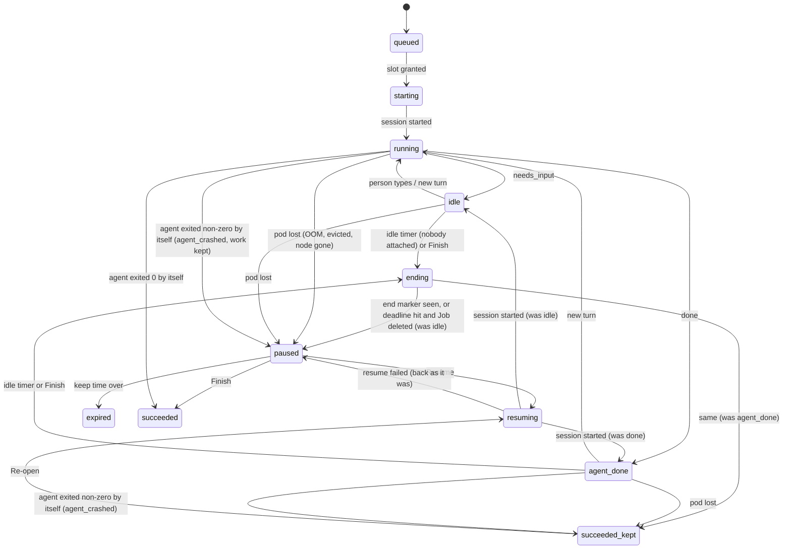

# Run terminal, idle timer and pause lifecycle (redesign)

Status: proposed. Date: 2026-11-16. Builds on the [pause and resume design](2026-11-15-run-pause-resume-design.md)
([ADR 0022](../../adr/0022-pause-and-resume-runs-on-a-per-run-volume.md)). Needs a new ADR (draft in the appendix) that
amends [ADR 0011](../../adr/0011-interactive-claude-code-in-tmux.md) (tmux session) and
[ADR 0014](../../adr/0014-terminal-over-websocket-exec-relay.md) (terminal relay).

## Problem

A run waiting for an answer (`idle`, "Needs you") got stuck forever instead of pausing:

1. After 10 minutes with nobody attached, the worker ran `tmux kill-session -t agent` and waited for the pod to exit.
2. The pod never exited. `entrypoint.sh` waits with
   `tmux display-message -p -t agent '#{pane_dead}' || echo 1`. With the session gone but the tmux server still up,
   that printed nothing and exited 0, so the loop never ended.
3. The tmux server stayed up because old `tmux attach` processes from earlier web attaches were still running. Closing
   the browser (and so the exec stream) does not kill the attach process inside the pod.
4. The workflow sat in `ending` with no deadline. The run row stayed `idle`. The web terminal tried
   `tmux attach` again and again ("no sessions", endless "Reconnecting…").

Three design flaws sit under this one bug:

- **"Session ended" is guessed from tmux quirks**, not reported.
- **`ending` has no deadline and no fallback.**
- **Attach clients are never cleaned up**, and the workflow's attach count leaks if the API dies (no detach is sent).

Plus one gap in the product rule. Today an unexpected pod death (OOM, eviction, node loss) ends the run as `failed`
and deletes the volume, even though the conversation is safe on disk.

## Product rule

An agent waiting for a person must never lose its state for good. The person can always resume later, also after the
pod is gone, until the kept session expires. Resume means a new pod on the same volume running `claude --continue`.

## Goals

- A run never stays in `ending`. It reaches `paused` (or `succeeded` with a kept session) within a fixed time.
- The pod reports clearly how its session ended. Nobody infers it from tmux output.
- No leaked `tmux attach` processes. Closing a terminal kills its attach client. Reattaching is always safe.
- The web shows what is really going on: "Session ended, pausing…", then "Paused, [Resume]". It never shows an
  endless "Reconnecting…".
- An unexpected pod death after the session started parks the run as `paused`. It does not fail it or delete its volume.

## Non-goals

- No change to keep times, statuses `paused`/`expired`, the per-run volume or the resume route (all from ADR 0022).
- No change to freezing processes: background work is still lost on pause (we tell the person; see §6).
- No multi-node storage.

## 1. Who owns what

| Owner | Owns | Never does |
| --- | --- | --- |
| **Run workflow** (worker) | Every run status write; the idle timer; starting `ending`; the `ending` deadline; deleting the Job; park, resume, expiry | Run commands in the pod other than the fixed ones below |
| **Entrypoint** (runner pod) | The pod's life: start the session, notice it ended, save the final scrollback, print one end marker, kill the tmux server, exit | Write to the DB; decide pause vs fail |
| **API** (terminal gateway) | Authz; attach/detach exec; one attach client per socket and killing it on close; attach leases sent to the workflow | Write run status; end a session |
| **Web** | Show state from `RunDto` and close codes | Guess state from socket retries |

## 2. State machine



`agent_done` is shown as Done; `succeeded_kept` is `succeeded` with `sessionExpiresAt` set. Cancel and the hard
timeout go from any live state to `cancelled`/`timed_out` as today. "Pod lost" means the pod ended without the end
marker (§3).

`ending` becomes visible: the workflow writes a new `RunDto` field `sessionEndingAt` (timestamp, null otherwise) when it
enters `ending`, and clears it on park. The status stays `idle`/`done` during `ending`, so filters and tokens do not
change.

## 3. A clear "session ended" signal

### Options

| Option | How | Good | Bad |
| --- | --- | --- | --- |
| A. Patch the tmux checks | Loop on `tmux has-session -t '=agent'` exit code instead of `display-message` output; worker deadline on `ending` | Smallest change | Still tmux-shaped; worker still kills the session from outside; no difference between "agent exited" and "pod lost" |
| **B. Entrypoint owns the end** | Agent runs in a wrapper that writes an exit marker file; worker asks to end through one fixed in-image command; entrypoint traps SIGTERM; one end marker line in the logs; deadline with Job delete as fallback | One owner of pod exit; Job delete is graceful too; pod lost is detectable | A few more runner lines and one image rollout |
| C. Always delete the Job | Worker never ends the session; it deletes the Job, a SIGTERM trap saves scrollback | Simplest worker | Final scrollback depends on the kill grace period; every end looks like a kill; no "agent exited" path |

**Recommended: B**, landed in steps: A's loop fix first (it stops stuck runs today), then the rest of B. C is B's
fallback path, not the main one.

### Design (option B)

- **Session command wrapper.** tmux runs `agentdesk-session` (a fixed script in the image) which runs the agent's start
  or resume command, then writes its exit code to `/run/agentdesk/agent-exit` (tmpfs, not the volume). `remain-on-exit`
  stays so the scrollback can be read.
- **Stop request.** The worker's end step becomes the fixed exec `agentdesk-end` (replaces `TMUX_KILL`). It creates
  `/run/agentdesk/stop` and returns at once. No untrusted text: a fixed argv.
- **Entrypoint loop** (every 1 s), in this order:
  1. `/run/agentdesk/stop` exists → reason `stop_request`.
  2. `/run/agentdesk/agent-exit` exists → reason `agent_exit`, code from the file.
  3. `tmux has-session -t '=agent'` exits non-zero → reason `session_gone` (someone killed it). Uses the exit code
     only, never printed output. `=` forces an exact name match.
  4. SIGTERM (trap) → reason `signal`.
- **Ending** (same path for all reasons): capture the scrollback (5 s cap), print it between the existing markers, run
  `tmux kill-server` (this also kills every leftover attach client), print
  `agentdesk: session ended reason=<reason> code=<n>`, exit. `stop_request` and `signal` exit 0; `agent_exit` exits with the
  agent's code.
- **Worker reading the result.** `followPodLogs` returns the `reason`. The workflow decides:
  - `stop_request` / `signal` / `session_gone` while `ending` → park (as today).
  - `agent_exit` → succeeded when the pod's exit code is 0; any other code parks the run (`pauseReason = 'agent_crashed'`,
    volume kept, Resume offered; decided 2026-11-16, open question 2). The pod's real exit code decides, never the end line
    alone: the agent shares the container and can print a forged line.
  - No end marker (OOMKilled, evicted, node lost, Job deleted from outside) after the session started → park as
    `paused` with `pauseReason = 'pod_lost'` (a done run becomes `succeeded` with a kept session). Before the session
    started → failed, as today.
- **Deadline on `ending`.** A durable timer `ENDING_DEADLINE_SECONDS` (default 90). If the pod has not exited by then the
  workflow deletes the Job (SIGTERM → trap → same ending path within the grace period), stops following logs and parks
  anyway, with "Final scrollback not saved" when none came. Nothing can keep a run in `ending` past
  deadline + grace (about 2 minutes).

`pauseReason` (`idle_timeout` | `pod_lost` | `agent_crashed`) is a new `RunDto` field so the page can say why the run paused.

## 4. Attach client lifecycle

Today each socket runs `tmux attach -t agent` through exec. Closing the exec stream does not kill that process in the
pod. The workflow's attach count only goes down when the API sends a detach signal, which never happens if the API crashes.

### Options

| Option | How | Good | Bad |
| --- | --- | --- | --- |
| A. Only reap on session end | `tmux kill-server` at the end (§3) kills leftovers | Free with §3 | Leaks pile up during a long live run |
| **B. One named client per socket** | API makes a connection id (UUID, server-side). Attach runs `agentdesk-attach <id>` (writes its pid, then `exec tmux attach -t '=agent'`). On socket close the API runs `agentdesk-detach <id>` (kills that pid). Plus A | Exact, cheap, testable | Two small scripts; old pods without them need a fallback |
| C. tmux `detach-client` by tty | API looks up the client tty and detaches it | No scripts | The API cannot reliably learn the tty through exec |

**Recommended: B (with A as the safety net).**

- The id is checked against a UUID regex in both the API and the script. It is never user text.
- `agentdesk-attach` exits with code 3 when the session does not exist, before calling tmux. The API maps exec exit 3
  to a new close code **4410 "session ended"**. The web never retries on 4410.
- The API refuses attach with 4410 while `sessionEndingAt` is set or the run is `paused`. Status `paused` is not in the
  attachable list today, so it already gets 4409; 4410 makes "ended, resume to continue" explicit.
- Fallback for pods started before the new image: exec exit 127 (command not found) → use the old `TMUX_ATTACH`.
  Can be removed after 7 days (the longest run).
- **Attach leases.** Attach and detach signals carry the connection id. While a socket is open the API sends a
  `terminalLease` signal with its live ids every 2 minutes. The workflow drops an id it has not heard about for 5
  minutes. So an API crash can block the idle timer for 5 minutes at most, not forever. That costs history
  events: see Consequences for the measured numbers (the first estimate here, 720 events a day, was wrong).
- Reattach is safe: every socket gets its own client and id; tmux allows many clients; the per-run cap (4) stays.

## 5. What the person sees

| Run state | Terminal area | Actions |
| --- | --- | --- |
| `running` | Live terminal | Cancel |
| `idle` (Needs you) | Live terminal + the agent's question; "Pauses after 30 min with nobody attached" | Finish |
| `idle` with `sessionEndingAt` | "Session ended. Pausing the run…" with a spinner; last scrollback greyed. No socket. | none (Resume queued if pressed, §7) |
| `paused` | Saved scrollback + "Paused: waiting for your answer. Can be resumed for 6 days." Reason line: "after 30 min with nobody attached" or "the pod stopped unexpectedly (out of memory / evicted)" | Resume, Finish |
| `queued`/`starting` after Resume | "Resuming… waiting for a slot / starting the pod" | Cancel resume |
| resumed `idle` | Live terminal + banner "Resumed. The agent asked: <agentNote>. Background tasks and sub-agents that were running when it paused were stopped." | Finish |
| `expired` | "Nobody resumed this run within 7 days. The saved session was deleted." | none |

Hook rules (`useTerminal`): 4410 and 4409 → refetch the run, show the state above, no retry. 1000 → refetch; retry
only if the run is still live and `sessionEndingAt` is null. Retrying with back-off is only for network errors (1006,
1011, 1013). While `sessionEndingAt` is set the page polls the run (or uses SSE) until it leaves `ending`.

### Should the idle timer apply to a run waiting for a person?

| Option | Good | Bad |
| --- | --- | --- |
| **A. Keep it, raised to 30 min (platform value)** | Frees the slot for queued runs; safe now that pause keeps everything | Person waits for a slot and a pod start on Resume |
| B. Longer for `needs_input` only (e.g. 60 min), `done` stays 10 | Fewer round trips for quick answers | One more setting; holds slots longer |
| C. Never pause `needs_input` | Instant answers | A forgotten question holds a slot for up to 7 days; breaks the queue |

**Recommended: A**, but only once phases 1 to 3 below have landed (pause must be reliable before it is common). Until
then it stays as it is. B can come later as an agent setting if people complain.

## 6. Resume correctness

- **What is kept.** Claude Code writes the conversation to `$HOME/.claude/projects/<repo path>/<session>.jsonl` after
  each message. `HOME` and the repo are on the run volume, so the conversation survives a pause and also an OOM kill
  (at most the turn in progress is cut short). `claude --continue` in the repo folder picks the latest session.
- **What is lost.** Running processes: background shell tasks, sub-agents, dev servers, open question menus. The run
  page says so after every resume (§5). When the agent status hook reports background work at pause time, the pause
  event records it and the paused page says "N background tasks will be stopped" (best effort).
- **The pending question.** `agentNote` is kept while paused (ADR 0022) and shown on the paused page and in the
  resumed banner until the next turn starts. `--continue` redraws the conversation, so the question is also on screen.
  The workflow writes `idle` after the session starts; no hook event is needed for that.
- **No automatic prompt on resume.** We do not send "you were paused" to the agent: it would start a turn the person
  did not ask for.

## 7. Failure cases

| Case | What happens | Covered by |
| --- | --- | --- |
| Session killed but tmux server kept alive by stale attach clients | Entrypoint sees `has-session` fail → ends; `kill-server` reaps clients | §3, entrypoint test |
| Entrypoint hangs anyway (bug, stuck capture) | `ending` deadline → Job deleted → parked | §3, workflow test |
| Pod OOMKilled / evicted / node lost while `idle` or `running` | No end marker → `paused`, `pauseReason=pod_lost`, volume kept | §3, workflow test |
| Node lost with its `local-path` volume | Resume finds no session (exit 79) → resume fails, run stays paused with "saved session is gone"; Finish or let expire | ADR 0022 resume rules |
| API restarts with sockets open | Browsers get 1006 and retry; in-pod clients from the old process are reaped at the next session end; leases expire in 5 min so the idle timer works again | §4 |
| Worker restarts during `ending` | Workflow replays; the deadline is a durable timer; `agentdesk-end` and Job delete are safe to repeat | workflow replay test |
| Idle timer and Finish at the same moment | `ending` is set once; the second request waits for the same end | existing guard, test |
| Two detaches for one attach / detach before attach | Lease set is keyed by id; unknown ids ignored; count never below 0 | §4, workflow test |
| Attach while `ending` | API closes with 4410; web shows "Pausing…" | §4, api test |
| Resume pressed while `ending` | Accepted and recorded; runs right after park (no "try again" error) | §2, workflow test |
| Resume while a previous resume is starting | Rejected as today ("already being resumed") | existing |
| Cancel while `ending` | Cancel wins: Job deleted, run `cancelled`, volume deleted | existing `cancelEffect`, test |
| Agent exits on its own (`/exit`) | `agent_exit` marker → succeeded on code 0; non-zero → `paused` with `agent_crashed`, volume kept | §3 |

## 8. Tests

- **Runner** (`images/runner/test/entrypoint.test.ts`, tmux stub): a stub where `display-message` prints nothing and
  exits 0 with no session (the incident) must still exit; stop file → `reason=stop_request`; agent exit file →
  `reason=agent_exit code=n`; SIGTERM → scrollback printed then `reason=signal`; `kill-server` is called;
  `agentdesk-attach` exits 3 with no session; `agentdesk-detach` rejects a non-UUID id and kills only its own pid.
- **Worker**: unit tests for the new decisions in `agent-phase`/`park` (reason → outcome); workflow tests for the
  deadline, pod lost → paused, resume during `ending`, lease expiry; a new replay fixture, and all old fixtures still
  replay (`patched()` ids `ending-deadline`, `pod-lost-parks`, `attach-leases`).
- **API** (`terminal.gateway` tests with the fake gateway): exit 3 → 4410; attach refused with 4410 while ending or
  paused; detach exec on close, error and shutdown; 127 fallback; lease signals sent and stopped.
- **Core**: fake gateway accepts the new fixed commands; nothing else.
- **Web** (`useTerminal` tests + stories): 4410 → no retry; 1000 with `sessionEndingAt` → no retry; pausing, paused
  (both reasons) and resumed-banner states with stories, loading and error states.
- **e2e** on the local stack: idle → pause with a stale attach client present → Resume → answer.
- Every fix starts with a failing test. No network in tests.

## 9. Rollout (small PRs, one concern each)

| # | PR | Size | `review:sensitive` |
| --- | --- | --- | --- |
| 1 | `fix(runner)`: loop on `has-session` exit code, `kill-server` at the end, SIGTERM trap, end marker line. The smallest fix for the incident | ~150 | yes (runner) |
| 2 | `fix(worker)`: `ending` deadline, then delete the Job and park | ~200 | yes (run Job) |
| 3 | `feat(runner)`: `agentdesk-attach` / `agentdesk-detach` scripts in the image | ~150 | yes (terminal) |
| 4 | `feat(api)`: one client per socket, detach exec, 4410, 127 fallback | ~250 | yes (terminal) |
| 5 | `feat(contracts)` + db: `sessionEndingAt`, `pauseReason` (migration) | ~150 | yes (migration) |
| 6 | `feat(worker)`: write `sessionEndingAt`; pod lost parks; resume while ending is queued | ~300 | yes (run Job) |
| 7 | `feat(web)`: pausing/paused/resumed states, close code handling, stories | ~350 | no |
| 8 | `feat(runner,worker)`: `agentdesk-session` exit file + `agentdesk-end` stop request replacing `TMUX_KILL` | ~250 | yes (runner, run Job) |
| 9 | `feat(api,worker)`: attach leases | ~300 | yes (terminal) |

PRs 1 and 2 alone stop runs from getting stuck. A runner image change (1, 3, 8) must be live before the API or worker
code that depends on it (4, 8).

## 10. Security

- Only fixed argv commands are run in the pod (`agentdesk-end`, `agentdesk-attach <uuid>`, `agentdesk-detach <uuid>`).
  The id is made by the server and checked with a regex in the API and in the script.
- Marker and pid files live on tmpfs (`/run/agentdesk`), not on the run volume, so a resumed pod never reads stale ones.
- The end marker line and scrollback go through the same redaction as today. No new secret paths.
- Authz is unchanged for attach; detach and lease signals are sent only for sockets that passed authz.

## Appendix: ADR draft (0023)

```markdown
# 0023. The runner entrypoint owns the end of a run pod

- Status: Proposed
- Date: 2026-11-16
- Source: [Run terminal lifecycle redesign](../superpowers/specs/2026-11-16-run-terminal-lifecycle-redesign.md) §3, §4
- Amends: [0011](0011-interactive-claude-code-in-tmux.md), [0014](0014-terminal-over-websocket-exec-relay.md),
  [0022](0022-pause-and-resume-runs-on-a-per-run-volume.md)

## Context

The worker ended a session by killing the tmux session from outside, and the entrypoint guessed that the session ended
from `tmux display-message` output. With stale `tmux attach` clients holding the tmux server up, the guess was wrong,
the pod never exited and the run stayed in `ending` forever. Closing an exec stream does not kill its process in the
pod. An unexpected pod death failed the run and deleted its volume although the conversation was on disk.

## Decision

The entrypoint is the only owner of the pod's exit.

- The worker asks for an end with one fixed in-image command (`agentdesk-end`); Job deletion (SIGTERM) takes the same
  path. The entrypoint saves the scrollback, runs `tmux kill-server` and prints one
  `agentdesk: session ended reason=… code=…` line, then exits.
- The workflow's `ending` phase has a deadline; after it the Job is deleted and the run is parked anyway.
- A pod that ends without that line after the session started is parked as `paused` (`pauseReason=pod_lost`), never
  failed with its volume deleted.
- An agent that exits non-zero (`agent_exit`) is parked the same way with `pauseReason=agent_crashed`, volume kept;
  exit code 0 still succeeds.
- Each terminal socket gets its own attach client (`agentdesk-attach <uuid>`), killed on close (`agentdesk-detach`).
  Attach state in the workflow is a set of leases that expire, not a counter.

## Alternatives considered

| Alternative | Why rejected |
| --- | --- |
| Keep killing tmux from outside, only fix the loop check | Still guesses from tmux; no way to tell pod loss from a clean end |
| Always delete the Job, no graceful end | Scrollback depends on the kill grace; every end looks like a kill |
| Detach tmux clients by tty | The API cannot reliably learn the client tty through exec |

## Consequences

### Positive

- A run cannot stay in `ending` for more than about two minutes.
- Pod loss no longer destroys a session someone can resume.
- No leaked attach processes; an API crash no longer blocks the idle timer forever.

### Negative

- More runner scripts and an image rollout before API/worker changes; a fallback for older pods for 7 days.
- Lease signals cost workflow history, measured with the real Temporal test server (`run.workflow.test.ts`, "history
  cost"): a lease signal adds **4 events** (the signal plus its workflow task: scheduled, started, completed), a lease
  renewal starts no timer, and a lease-expiry timer cycle (fired, 3 task events, started) is **5 events**. One API pod
  sends 720 signals per attached day per run = **about 2,900 events a day** while the agent works. The expiry timer only
  runs while the run waits for a person (it is the idle timer's other half): with renewals every 120 s and a 300 s lease
  it fires about every 240 s, so about **1,800 more a day** (about 4,700 a day in total) for a waiting run whose tab is in
  use. A tab nobody touches is closed by the browser after 4 hours (D2), which stops the renewals. Sockets on two API
  pods double the signal part. `RunWorkflow` has no `continueAsNew` and fails at the 45,000-event guard, so a 7-day run
  with a busy attached tab on two pods could reach it around day 5 to 6. The lease interval and time are unchanged
  (120 s, 300 s). Follow-up: `continueAsNew` for `RunWorkflow` (carrying the lease set), or a longer lease interval if
  the numbers matter in practice.

## Links

- [Run terminal lifecycle redesign](../superpowers/specs/2026-11-16-run-terminal-lifecycle-redesign.md)
- Related ADRs: [0010](0010-one-kubernetes-job-per-run.md), [0020](0020-agent-status-protocol.md)
```

## Open questions

1. Idle timer for `needs_input`: decided: keep it, raised from 10 to 30 minutes.
2. Should a run whose agent crashed (`agent_exit`, non-zero) also keep its volume and offer Resume, or stay `failed` as
   today? Decided 2026-11-16: keep the volume and offer Resume (pause reason `agent_crashed`); exit code 0 still succeeds.
3. A forgotten open browser tab counts as attached and keeps a run's pod for up to 7 days. Add an "attached but no
   input for N hours" rule now, or later? Decided 2026-11-16 (D2): a browser-side rule only. The web terminal closes
   itself after the page was unused (no keydown, pointerdown, wheel or touchstart) or hidden for 4 hours, so a forgotten
   tab stops renewing its lease and the run can park. No keystroke detection on the server, no workflow change.
