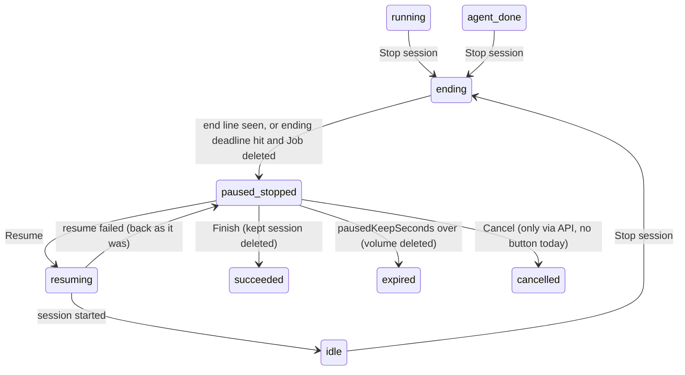

<!-- dev-plan: kind=spec id=stopped-session-resume rev=2 hash=c752f07a905b source=issue#126 -->
# Saved transcript for stopped runs and a resumable Stop session — design

Date: 2026-11-19 · Status: draft for approval · Sensitive: yes (runner image and entrypoint; run workflow and run Job
lifecycle; migration with a new RLS table and a changed check constraint; secret redaction of agent output)

Builds on the [pause and resume design](2026-11-15-run-pause-resume-design.md) ([ADR 0022](../../adr/0022-pause-and-resume-runs-on-a-per-run-volume.md)),
the [run terminal lifecycle redesign](2026-11-16-run-terminal-lifecycle-redesign.md) ([ADR 0023](../../adr/0023-runner-entrypoint-owns-the-end-of-a-run-pod.md))
and the [agent status protocol](../../adr/0020-agent-status-protocol.md). Needs a new ADR (outline in §10).

## Intent

When a run's pod has stopped (paused by the idle timer, lost, crashed, stopped by a person, or ended), the person
cannot see what was said between them and the agent. Today the run page shows only the terminal text the runner saves
when a session ends cleanly. tmux keeps only its default of about 2,000 lines of that text, and nothing is saved at all
when the pod is killed hard (out of memory, node lost). To read the conversation the person presses Resume, which
starts a pod and an agent only so they can look.

Second, a person who resumed a session has only **Finish run**, which ends it for good, and **Cancel run**, which
deletes the work. Nothing lets them stop a live session for now and come back to it later.

The human wants:

- a **read-only Transcript** of the agent conversation that is saved independently of the pod and shown on the run
  page whenever there is no live pod, without starting one;
- the transcript built **agent-neutral**: one common transcript format and one adapter per agent CLI, Claude Code
  first, with Codex, Gemini, Cursor and others able to fit later;
- a **Stop session** action that stops the pod and agent now and keeps the session so it can be resumed until the
  configured keep time runs out, while **Finish run** stays the permanent end.

## Goals

1. **Transcript saved outside the pod.** The user messages, the agent's replies and the agent's tool steps are copied
   out of the pod while the agent works, cleaned of known secrets, and stored in Postgres. A pod that is killed hard
   loses at most the entries written since the agent's last hook fired (§3.3).
2. **Read-only Transcript view.** On the run detail page, when there is no live pod (paused, stopped, session ending,
   succeeded, failed, timed out, cancelled, expired), the terminal area shows the Transcript. It has no input.
3. **Terminal only on a live session** (human, batch 2). The terminal is shown and attachable only while the session is
   live (`running`, `idle`, `done` with no session ending). There is no Transcript tab on a live session.
4. **Viewing never starts a pod or agent.** The Transcript is read from Postgres only.
5. **Clear session state.** The page says plainly whether the session is live, stopped (can be resumed, until when),
   or finished (cannot be resumed).
6. **Stop session** (human, batch 2, option 1). Offered on every live session once the agent has started, on a first
   run or a resumed one, at any time. A turn in progress is cut short; everything the agent wrote so far is kept. The run
   becomes `paused` with the new reason `stopped`, shows "Stopped by you", and can be resumed for the agent's paused
   keep time (`pausedKeepSeconds`, 7 days by default). This also applies when the agent had said it was done.
7. **Finish stays final.** Finish run ends the run as `succeeded`, deletes the kept session and is never resumable
   afterwards. That is today's behaviour; this change keeps it and covers it with tests.
   _Amended 2026-11-20 ([ADR 0030](../../adr/0030-finish-after-reopen-keeps-the-session.md)): a Finish on a session re-opened from a kept succeeded session re-parks the run and keeps its session until the original deadline. Every other Finish stays final._
  _Amended 2026-11-21 ([ADR 0032](../../adr/0032-reopened-session-keeps-the-result.md)): in a reopened session of a succeeded run there is no Finish, Stop or Cancel, only Close session, which keeps the run succeeded with a fresh keep time._
8. **Open to more agents.** Everything Claude-specific about the transcript sits in the Claude adapter in the runner
   image. Adding another agent's transcript later means adding that agent's adapter file, with no change to contracts,
   tables, worker or web.

## Non-goals

- Sending messages, answering menus or acting on the agent from the Transcript. Version 1 is read-only (human, batch
  2: "let go with readonly transcript first").
- A live Transcript tab while the session runs (human, batch 2: "the terminal only display and accessible on live
  session").
- Transcript adapters for Codex, Gemini, Cursor or any agent other than Claude Code. They are designed for, not built
  (human, batch 2: "we start with the claude first").

## Anti-goals (from the requirement)

- Starting a pod or an agent just so someone can read a stopped session.
- A temporary stop that ends the run for good, or a Finish that leaves the run resumable. (Amended 2026-11-20: a Finish after Re-open of a kept succeeded session may leave it resumable; see ADR 0030.)
- Stopped and finished looking the same, on the page or in the run lifecycle.

## Constraints

- AGENTS.md rules 1 to 11. Layering `apps → core → db → contracts`, `web → contracts` only.
- Rule 3: no provider names in tables, types, routes or modules. The new concepts are "transcript" and "stop session".
  Claude-specific code lives only in `images/runner/agents/claude/`.
- Rule 5: transcript text is agent output and may contain secrets. It is redacted with the run's secrets (the same
  `redact()` and secret list as scrollback and agent notes) before it is stored. The raw text never reaches logs or
  workflow history.
- Rule 6: transcript text is untrusted (it holds ticket text, repo content and model output). It is parsed with Zod,
  stored as data, and rendered as plain text. It is never put into a shell, a k8s spec or SQL text.
- Rule 7: the new routes use the same org/project authorization as `runs.log`, `runs.finish` and `runs.resume`.
- Workflow changes are guarded with `patched()` so runs already in flight replay unchanged.
- The runner image must be live before worker code that expects transcript lines. Older pods just send none, and the
  page falls back (§7.3).
- No new dependency (see Needs approval).

## Approaches

### Where the saved conversation comes from (human picked A, batch 2)

| Approach | How | Trade-off | Verdict |
| --- | --- | --- | --- |
| **A. Agent-neutral transcript stream** | A per-agent adapter in the runner reads the agent CLI's own session log and prints one protocol line per entry on the pod's stdout. The worker's log follower parses the lines, redacts them and stores them. The web shows a read-only Transcript | Full message history that survives a hard pod kill. Works for any agent with an adapter. Costs a new protocol line, a table, a route and a view | **Chosen** (human, batch 2: read-only transcript, agent-neutral, Claude first) |
| B. Save more terminal text | Raise tmux's line limit and save the terminal text at every turn end | Least work, but it is capped terminal text, not separate messages, and is still lost on a hard kill between saves | Not chosen |
| C. Read the run volume on demand | Start a small reader pod on the kept volume when someone opens a stopped run | Exact file, but it starts a pod just to look, which the requirement forbids, and the volume is gone after expiry, cancel or Finish | Rejected |

### How the adapter gets entries out of the pod

| Option | Trade-off | Verdict |
| --- | --- | --- |
| **Hooks plus a flush at session start and end.** The Claude hook (already run on every prompt, tool call and turn end) sends the new log entries each time it fires. The entrypoint runs the adapter's `flush` once when the session starts and once when it ends | No new long-running process. Near-live (every tool call). A hard kill loses only entries since the last hook, and a later Resume's start flush recovers them from the volume | **Agent call:** chosen: it reuses the hook path that ADR 0020 already depends on and adds no process to PID 1's supervision |
| A tail process started by the entrypoint | Continuous, but one more process to supervise and to keep from blocking the pod's end | Not chosen |

### How a stopped run is recorded

| Option | Trade-off | Verdict |
| --- | --- | --- |
| **Status `paused` with a new `pauseReason` value `stopped`** | Reuses every paused rule (keep time, Resume, Finish, expiry, cancel, run list filters). One check-constraint migration | **Agent call:** chosen: fewest moving parts; `paused` is already "not active, not final" |
| A new status `stopped` | Every place that knows statuses changes: filters, counts, Finish/Resume checks, the gate, the board | Not chosen |

## Design

### 1. Lifecycle: Stop session

#### 1.1 State changes



`paused_stopped` is `status = paused`, `pauseReason = stopped`. Everything else in the existing state machine is
unchanged.

#### 1.2 Workflow (`apps/worker/src/workflows`)

- A new workflow update `stopSession`, built like `finishRun`: the API waits for the workflow's answer.
  - **Validator** (pure function next to `finishRunRejection` in `agent-phase.ts`, unit-tested). It accepts when the
    phase is `running`, `idle` or `agent_done`, no session end is under way, no finish was requested, and the agent's
    session in the current pod has started. It rejects with `NotStoppable` and a plain message otherwise: "The agent
    has not started yet", "The session is already ending", "Only a live session can be stopped".
  - "Session started in the current pod": the `sessionStarted` signal handler records it for every pod, not only
    while resuming (it is reset when a pod is parked). Today's handler ignores the signal outside `resuming`.
  - **Handler**: sets `stopRequested`, then waits until `ending` is set or the run was finalized (the same settle rule
    as `finishRunSettled`), and returns `{ accepted: true }`.
- **Main loop**: when `stopRequested && !ending`, set `parkKind = 'needs_input'` and `parkReason = 'stopped'`, then
  `ending = true`, `phase = 'ending'`, `endSession(c)`. This is the same path the idle timer takes, and works in any
  live phase because the entrypoint's stop file (`agentdesk-end`) is checked every second whatever the agent is
  doing.
  - **Agent call:** a stopped run always parks as `needs_input` (paused), also when the agent had said it was done.
    Reason: the human chose "paused, resumable for the paused keep time" for done runs too (batch 2), and one park kind
    keeps every paused rule identical. After Resume such a run comes back as "Needs you", with the agent's last note
    still shown.
- **`endOutcome`** (`park.ts`) gains an optional `parkReason` input. While `ending` with a `parkKind` and no finish
  requested it returns `{ kind: 'park', parkKind, reason: parkReason ?? 'idle_timeout' }`. The fallback branch after
  `endOutcome` in `run.workflow.ts` passes the same reason.
- **`park()`** passes the reason to `parkRun` (it already does). With reason `stopped` it posts no ticket comment.
  - **Agent call:** no ticket comment on a person's stop. Reason: the person did it on the run page, and the existing
    `paused` comment says "waiting for an answer … after the idle time", which would be wrong.
- Resume, Finish, expiry, cancel, the ending deadline, pod loss during `ending`, and a Resume queued during `ending`
  all work as today for a parked run. A pod lost while a stop is ending still parks with reason `stopped`: we asked for
  the end, so `ending` decides first in `endOutcome`.
- Races, all decided by the workflow's single thread:
  - Stop and Finish at the same moment: whichever is applied first sets `ending`. The other's validator rejects
    ("The session is already ending").
  - Stop and the idle timer: the first one sets `ending`. If the idle timer won, the reason is `idle_timeout` and
    `stopSession` is rejected.
  - Stop and Cancel: Cancel wins, as Cancel does during any `ending` today.
- Patch id `stop-session`, read once after `followerReconnect`. Without it, `stopSession` is rejected ("This run
  started before Stop session was available; Finish or Cancel it"), and the `sessionStarted` handler keeps today's
  rule.
- New replay fixture for a run that is stopped, resumed and finished. All existing fixtures must still replay.

#### 1.3 Contracts, DB and API

- `PauseReason` (`packages/contracts/src/enums.ts`) gains `'stopped'`.
- Migration `0018_run_pause_reason_stopped.sql`: drop and re-add `runs_pause_reason_check` with `'stopped'` added.
  Add a new migration; never edit 0013 or 0014.
- Route `runs.stop`: `POST /api/runs/:runId/stop`, `params: runParams`, `response: empty`.
- `RunsService.stop` follows `finish`:
  - Cheap pre-check: the status is in a new contracts constant `STOPPABLE_RUN_STATUSES = ['running', 'idle', 'done']`
    and `sessionEndingAt` is null. Otherwise 409.
  - Then `executeUpdate(UPDATE.stopSession)`. It maps `NotStoppable`, `WorkflowNotFoundError` and
    `AcceptedUpdateCompletedWorkflow` to 409 with the workflow's message, exactly as `finish` maps them.
  - Same controller guard and org scoping as `finish`.

### 2. Transcript protocol (agent-neutral)

#### 2.1 Wire line

The adapter prints, on the pod's stdout (`/proc/1/fd/1`, as the status protocol does):

```text
agentdesk: transcript <base64 of one JSON object>
```

The JSON object is `TranscriptWireEntry` in `packages/contracts/src/schemas/transcript.ts`:

| Field | Type | Meaning |
| --- | --- | --- |
| `id` | string, 1 to 128 chars of `[A-Za-z0-9._:-]` | The adapter's stable id for the entry (Claude: the log entry's `uuid`, plus `:n` for the n-th block of one entry). It makes inserts idempotent |
| `at` | ISO timestamp, optional | When the agent wrote it. The worker uses the log line time when absent or not plausible |
| `kind` | `user` \| `agent` \| `tool` \| `notice` | A person's message, the agent's reply text, one tool step, or an agent-side notice (for example "conversation compacted") |
| `text` | string, at most 8,000 UTF-8 bytes | The message text, or a one-line summary for a tool step |
| `tool` | string, 1 to 64 chars, optional | The tool's name, only for `kind: tool` |
| `truncated` | boolean, optional | The adapter cut `text` |

- The log parser (`packages/core/src/kube/log-parser.ts`) adds kind `transcript`. It uses an anchored regex with a
  base64 body of at most 12,000 chars, decodes it, and parses with `TranscriptWireEntry`. A line that fails any step
  stays an ordinary `text` line and is not stored as transcript.
- The agent shares the container and can print a forged transcript line into its own run's transcript. That is
  accepted, as for status lines (ADR 0020): the impact is limited to that run, and the text is shown as untrusted plain
  text.

#### 2.2 Adapter contract (one per agent, in the runner image)

Each agent directory `images/runner/agents/<agent>/` may provide `transcript.mjs`. It must:

1. Read the agent CLI's own session log and turn new entries into `TranscriptWireEntry` lines. Text is cut to the
   byte cap, and entries the person did not see (hidden reasoning, internal meta entries) are skipped.
2. Remember how far it has read in a state file under `$HOME/.agentdesk/` (on the run volume), so a resumed pod
   continues where the last one stopped. A lock (an exclusive lock file with a stale timeout) keeps two hooks that fire
   together from sending an entry twice.
3. Offer `transcript.mjs flush`, which sends everything new and exits within 5 seconds.

The entrypoint runs `flush` (with `timeout 5`, errors ignored) right after `agentdesk: session started`, and at the
start of `end_session` before the scrollback is saved. When the agent's directory has no `transcript.mjs`, both calls
are skipped. That is how an agent without an adapter behaves.

Later agents (designed for, not built): Codex, Gemini CLI and Cursor each keep a local session log (Codex session
files under `~/.codex/sessions`, Gemini CLI's saved chats, Cursor's agent chats). Each needs its own `transcript.mjs`
that maps its format to the wire entry, with fixtures and a pinned CLI version, because these formats are not
documented as stable. Each can call the adapter from its own hooks (all four CLIs have hooks, see ADR 0020) or rely
only on the start and end `flush`. No other part of the system changes.

### 3. Claude Code adapter (first and only adapter in this change)

#### 3.1 Source

Claude Code writes the conversation to the JSONL file named by the hooks' `transcript_path` (under
`$HOME/.claude/projects/…`, on the run volume). Every hook event the adapter already handles (`UserPromptSubmit`,
`PreToolUse`, `PostToolUse` for `AskUserQuestion`, `Notification`, `Stop`, `StopFailure`) also calls the transcript
step with that path. `hook.mjs` imports `transcript.mjs` and calls it after it writes its status line. A failure in the
transcript step never changes the hook's exit code or its status output.

`flush` without hook input reads every path recorded in the state file, plus the newest `*.jsonl` under
`$HOME/.claude/projects/` for the repo directory. That covers a pod killed before any hook and a `--continue` that
starts a new session file.

#### 3.2 Mapping

| Claude log entry | Wire entry |
| --- | --- |
| `type: user` with string content, or text blocks, that a person or the run prompt sent | `user`, the text |
| `type: user` holding only `tool_result` blocks | skipped (tool output is not stored, see below) |
| `type: assistant` `text` block | `agent`, the text |
| `type: assistant` `tool_use` block | `tool`, `tool` = the tool name, `text` = a one-line summary of the input (Bash: the command; Edit/Write/Read: the file path; others: the first 200 chars of the input JSON) |
| `type: assistant` entry that is an API error message (for example a rejected credential) | `notice`, the error text (for example "API Error: 401 invalid credential") |
| `type: assistant` `thinking` block, `system`, `summary`, meta entries | skipped, except a compact boundary, which becomes `notice` "Conversation compacted" |

- **Agent call:** Claude's API error entries become notices. Reason: the prototype board for a failed run
  (`RunTranscriptStates`) shows the error as a centred notice under the prompt, and it is often the only clue why the
  agent stopped.

- **Agent call:** tool output (`tool_result`) is not stored, only the tool step line. Reason: outputs can be very
  large and are the most likely place for secrets the redaction list does not know, and the requirement asks for the
  interaction plus "relevant message/activity information".
- **Agent call:** hidden reasoning (`thinking`) is not stored. Reason: the person never sees it in the terminal either.
- The exact entry shapes are pinned by fixtures recorded from the Claude Code version in the image. A shape the
  adapter does not know is skipped, never sent half-parsed.

#### 3.3 What a hard kill loses

Entries written after the last hook fired and before the kill are not in Postgres until the next pod's start `flush`
(on Resume) reads them from the volume. If the run is never resumed (it expires, or is cancelled or finished), they are
lost. With a hook on every tool call this is at most the step in progress.

### 4. Worker: storing entries

- `followPodLogs` (`apps/worker/src/activities/run.activities.impl.ts`) handles parsed `transcript` lines. For each:
  `text` is redacted with the run's secrets, then inserted into `run_transcript_entries` through `withOrg`, with
  `ON CONFLICT (run_id, source_id) DO NOTHING`. Re-reading logs after a follower reconnect and a resume's start flush
  therefore never duplicate an entry.
- `seq` is assigned per run in insert order (`max(seq) + 1` inside the insert, as `run_events` does).
- Per-run cap: 20,000 entries. The follower counts the run's rows once when it starts following. At the cap it stores
  one `notice` "Transcript limit reached; later messages were not saved" and drops further entries for that run.
  - **Agent call:** cap of 20,000 entries of at most 8 KB each. Reason: it bounds a 7-day run to under about 160 MB of
    text in the worst case, and real runs are far below it.
- Transcript lines are not written to `run_events`, not sent on the run SSE stream and not put in workflow history.
  They cost no workflow events.
- Failures to insert are retried with the follower's existing retry. A line that still fails is logged by kind and
  count only, never its text.

### 5. Database

New table `run_transcript_entries` (Drizzle schema in `packages/db/src/schema/app.ts`, migration
`0019_run_transcript_entries.sql`):

| Column | Type | Notes |
| --- | --- | --- |
| `org_id` | uuid not null | RLS |
| `run_id` | uuid not null | FK `runs.id` on delete cascade |
| `seq` | integer not null | order within the run |
| `source_id` | text not null | the wire `id` |
| `at` | timestamptz not null | |
| `kind` | text not null | check in (`user`,`agent`,`tool`,`notice`) |
| `tool` | text null | |
| `text` | text not null | redacted |
| `truncated` | boolean not null default false | |

Primary key `(run_id, seq)`, unique `(run_id, source_id)`, index on `org_id`. `FORCE ROW LEVEL SECURITY`, the
`orgPolicy()` and the same grants as `run_events`. Rows live as long as the run row.

- **Agent call:** the transcript is kept for as long as the run, like the saved terminal text and run events today.
  It is not deleted when the kept session expires or the run is finished. Reason: the requirement asks to persist it
  independently of the pod and session, and the repo has no run retention rule to follow.

### 6. API and contracts

- `RunTranscriptEntryDto` = `{ seq, at, kind, tool: string | null, text, truncated }`.
- `RunTranscriptResponse` = `{ items: RunTranscriptEntryDto[] (oldest first), nextBefore: number | null }`.
- Route `runs.transcript`: `GET /api/runs/:runId/transcript`, query `{ before?: int ≥ 1, limit: int 1..500, default
  200 }`. It returns the newest `limit` entries with `seq < before` (or the newest overall), ordered oldest first.
  `nextBefore` is the smallest returned `seq` when older entries exist, else null.
- `RunsService.transcript` uses `withOrg` and `loadRun` exactly like `log` (same 404 for another org's run).
- `RunDto` gains `pausedKeepSeconds` (int), read from the run's agent with the default when none, exactly as
  `idleEndSeconds` is today. The Stop session confirm shows it (§7.4).
  - **Agent call:** add `pausedKeepSeconds` to `RunDto`. Reason: the approved confirm says how long the session is
    kept, and the run page has no other source for the agent's keep time.
  - **Agent call:** no `hasTranscript` field. Reason: the page already fetches the transcript when it shows it, and an
    empty first page is the "none saved" signal.

### 7. Web (`apps/web`)

The approved prototype boards (§UI and Storybook) are the reference for layout and copy. Where this section and a
board differ, the board wins.

#### 7.1 What the terminal area shows

| Area (`terminalArea`) | Notice above | View tab and connection label | Body |
| --- | --- | --- | --- |
| `live` | as today | "Terminal" and today's live label (for example "Live, attached as kim-hale"); Find and Copy all as today. The "Transcript, coming in MVP" tab is removed (`RunRunningStop`) | Live terminal, as today |
| `pausing` (session ending) | "Session ending…" with "The session is being saved. This page updates by itself when the session has ended.", as today | "Transcript", "Ending…" | Transcript, loading until fetched (`RunIdleEnding`) |
| `paused`, reason `stopped` | Stopped notice (§7.2) | "Transcript", "Paused, read-only" | Transcript (`RunStopped`) |
| `paused`, other reasons | today's paused notice, unchanged | "Transcript", "Paused, read-only" | Transcript (`RunTranscriptStates`) |
| `ended`: succeeded, failed, timed out | today's end notice, except the Finish line in §7.2 | "Transcript", "Ended, read-only" | Transcript (`RunSucceededFinished`, `RunTranscriptStates`) |
| `ended`: cancelled | today's cancelled notice (for example "Cancelled by kim-hale at 13:10:41.") | "Transcript", "Ended, read-only" | Transcript, replacing today's "No scrollback was saved" placeholder (`RunTranscriptStates`) |
| `expired` | today's expired notice | "Transcript", "Ended, read-only" | Transcript, still there after the session is deleted (`RunTranscriptStates`) |
| `starting` / `resuming` | none | as today | Unchanged placeholder ("Starting the agent" / "Resuming the run") |

- The Transcript bar has only the one view tab and the connection label: no Find and no Copy all buttons.
  - **Agent call:** no Find / Copy all on the Transcript bar. Reason: the prototype leaves them out, and both act on
    terminal text today.
- **Agent call:** connection labels "Ending…", "Paused, read-only", "Ended, read-only" and, with nothing saved,
  "Ended" (or "Paused"). Reason: they are today's labels without the line count, as the prototype draws them.
- **Agent call:** the view tab reads "Transcript" also while the transcript is loading, has failed to load, or is
  being checked for entries. It switches to the fallback label only once an empty first page has come back. Reason:
  the prototype draws "Transcript" in the loading and error states.
- **Agent call:** `pausing` shows the Transcript (it used to show the greyed last terminal text). Reason: the terminal
  is closed then, and the human wants the terminal only on a live session.
- **Agent call:** a cancelled run with transcript entries shows the Transcript in place of the "No scrollback was
  saved" placeholder, which also drops that placeholder's lifecycle list and branch button. Reason: the prototype draws
  it that way, and the side panel's Lifecycle section and the notice still give that information.
- **Agent call:** `starting` and `resuming` keep today's placeholder and were not drawn. Reason: the requirement does
  not change them.
- The side panel is unchanged. Its "Waiting for you" section still shows only while the run is idle, so it is not on
  stopped, paused or finished runs (as the boards show).

#### 7.2 Stopped and finished notices

- **Stopped** (new `pauseReason` `stopped`, board `RunStopped`):
  - Paused-tone notice with the paused status icon (title "Stopped").
  - Headline "Stopped: can be resumed for {time left}." (for example "6 days").
  - Detail line "Stopped by you {relative time}." (for example "2 min ago").
  - Buttons Resume (primary, play icon) and Finish (check icon), as for any paused run.
  - The status pill in the top bar reads "Paused", and the top bar shows "View PR" / "View issue" as for any paused
    run.
  - **Agent call:** the copy says "Stopped by you" as the human chose. No record is kept of which person stopped it,
    as Finish and Cancel record none today, so another viewer sees the same words.
- `pauseReasonText('stopped')` returns "stopped by you" for places that print the reason after "Paused …".
- The run list and board keep the status pill "Paused". Only the run page words it "Stopped".
  - **Agent call:** status pills unchanged. Reason: the status is still `paused`, and the pill set and filters are
    outside this change.
- **Finished** (board `RunSucceededFinished`): after a person's Finish of a run that had been paused, stopped or
  resumed, the succeeded notice keeps today's title (for example "Succeeded in 9m 03s.") and its body reads "Finished.
  The session was deleted and cannot be resumed." There is no Resume or Re-open session button. Other succeeded runs
  keep today's notice.
  - **Agent call:** "had been paused, stopped or resumed" is read from the run's status events (a `paused` status
    before the final `succeeded`), the same scan `parkedBefore` does today. Reason: no new field is needed.
- The Finish run, Cancel run and Stop session buttons in the top bar during `pausing` keep today's enabled rules,
  except that Stop session is disabled (§7.4).

#### 7.3 Transcript view

A new shared component `components/Transcript.tsx` (`role="log"`, label "Transcript of the agent conversation"), drawn
in `RunStopped`, `RunSucceededFinished` and `RunTranscriptStates`:

- **Person messages** sit in a raised, bordered box. The label is "You", and the first entry (the run's prompt) is
  labelled "Prompt".
- **Agent replies** are plain text with no box, labelled with the agent's name (`run.agent.name`, for example
  "Claude").
- Each message label has the entry's local time next to it (for example "14:13"), in the faint numeric style.
- **Tool steps** are one muted line: the terminal icon, the tool name in bold, then the summary in mono (for example
  **Bash** `dotnet test`).
- **Notices** are a centred muted line between rules (for example "Conversation compacted", "Transcript limit reached;
  later messages were not saved", "API Error: 401 invalid credential").
- Text is rendered as plain text with whitespace and line breaks kept (React text nodes, no HTML, no markdown). A
  `truncated` entry ends with a muted "… (cut)".
- It opens scrolled to the newest entry. When `nextBefore` is set, a ghost "Show earlier messages" button with a
  chevron-up icon sits at the top. It loads the next page above and keeps the scroll position.
- **Agent call:** the styling choices in the bullets above (raised box for person messages, plain agent text, time
  next to each label, terminal icon for tool steps, ghost chevron-up button, centred rule-line notices). Reason: they
  are the approved prototype's choices.
- **States:**
  - **Loading:** skeleton lines with `aria-busy`, label "Loading the transcript" (`RunIdleEnding`).
  - **Error:** an error banner "Couldn't load the transcript" with a faint "Request ID {id}" line (the API problem's
    request id, when present) and a Retry button that fetches again (`RunTranscriptStates`). Retry never starts a pod.
  - **Empty:** see the fallback below.
  - **Agent call:** the error banner shows the request id line when the API error carries one. Reason: the prototype
    draws it, and the web already receives it in problem responses.
- **Data:** `runsQueries.transcript(org, project, number)`, a TanStack infinite query over `runs.transcript`. It is
  fetched only when the area is not `live`, `starting` or `resuming`. It is refetched when the run leaves a live state
  (the existing final/park reload hook), so a just-stopped run shows the entries flushed at its end.
- **Fallback for runs with no transcript entries** (runs from before this change, pods on the old image, agents
  without an adapter, a pod that never started the agent):
  - With saved terminal text, the area shows it read-only as today, with today's tab and label (for example "Saved
    scrollback", "Paused, read-only, 412 lines"; `RunTranscriptStates`).
  - With neither entries nor saved text: an empty state with a centred heading "No conversation was saved for this
    run." with an icon and no body text, and the connection label "Ended" (or "Paused") (`RunTranscriptStates`).
  - **Agent call:** keep the saved terminal text as the fallback. Reason: without it, runs from before this change
    lose the only record they have. Terminal text saving itself is unchanged.
  - **Agent call:** the empty state is a centred heading with an icon and no body text. Reason: the prototype's
    choice.
- Viewing the Transcript never calls resume, attach or any other run action.

#### 7.4 Stop session control

- The top bar gets a **Stop session** button (default style, `pause` icon) between Finish and Cancel run
  (`RunRunningStop`, `RunIdleEnding`).
  - It is shown for `running`, `idle` and `done`, and hidden when paused or final.
  - It is enabled while `sessionEndingAt` is null and no action is pending.
  - While the session is ending it is disabled with the tooltip "The session is already ending".
  - A 409 (for example "The agent has not started yet") toasts the server's message, as Finish does.
  - **Agent call:** disabled tooltip "The session is already ending". Reason: the prototype's copy, and it matches the
    workflow's rejection message.
- While the agent is working (`running`), Stop session first opens a confirm **popover under the button**, the same
  pattern as the Cancel run confirm, with `role="dialog"` and label "Stop the session?" (`RunRunningStop`):
  - Title: "Stop the session?"
  - Body: "The agent is in the middle of a step. Stopping now cuts that step short. Everything up to now is kept, and
    you can resume for {paused keep time}." (for example "7 days", from `RunDto.pausedKeepSeconds`).
  - Buttons: "Keep running" (ghost) and "Stop session" (primary, white, `pause` icon). Escape and "Keep running"
    close it.
  - In `idle` and `done` the button stops at once, with no confirm.
  - **Agent call:** confirm only while the agent works. Reason: only then is anything lost.
  - **Agent call:** a popover under the button, with a white primary "Stop session" button and the pause icon.
    Reason: the prototype's choice, matching the existing cancel confirm pattern.
  - **Agent call:** the keep time in the body comes from the agent's `pausedKeepSeconds`, formatted like the paused
    notice's time left. Reason: that is the time a stopped run is kept.
- A `useStopRun` mutation in `features/runs/mutations.ts`, like `useFinishRun`.
- After a successful stop the page shows the "Session ending…" state (`RunIdleEnding`), then the Stopped notice with
  the Transcript (`RunStopped`).

### 8. Security

- New in-pod code (`transcript.mjs`) runs as the runner user like the hook does. It reads only files under `$HOME`,
  writes only its state file, and runs no shell. Its output is the fixed line format, validated by the parser.
- The worker redacts each entry's text with the run's secrets before insert. Text stays out of logs, errors and
  workflow history.
- The transcript route and the stop route are authorized like `runs.log` and `runs.finish`. RLS is forced on the new
  table.
- The stop path runs only the existing fixed `agentdesk-end`. No new exec command and no user text reach the pod.
- Rendering is plain text only. Bidi and control characters are stripped before rendering, using the same rule as the
  scrollback mapper.

### 9. Failure cases

| Case | What happens |
| --- | --- |
| Pod OOM-killed mid-turn | Run parks as `pod_lost` (today's rule). Transcript has everything up to the last hook. A later Resume's start flush adds the rest from the volume |
| Stop pressed, entrypoint hangs | Ending deadline deletes the Job and parks as `stopped` (today's deadline path) |
| Stop pressed before the agent's session started | 409 "The agent has not started yet" |
| Stop on a run that started before the deploy | 409 with the patch message. Finish and Cancel still work |
| Old runner image (no `transcript.mjs`) | No transcript lines. The page falls back to the saved terminal text |
| Claude Code changes its log format | Unknown entries are skipped. The fixture tests fail on the image bump, before release |
| Two hooks fire at once | The lock serialises them. A duplicate that slips through is dropped by the unique `(run_id, source_id)` |
| Follower reconnects and re-reads logs | Inserts are idempotent |
| Run hits 20,000 entries | One notice entry. Later entries are dropped; the run itself is unaffected |
| Resume of a stopped run fails | Back to Stopped with the existing "Resume failed: …" line |
| Finish on a stopped run | `succeeded`, volume deleted, no Resume afterwards (today's paused Finish) |

### 10. ADR

A new ADR, "Agent-neutral transcript protocol with per-agent adapters", amends ADR 0011 ("history is final scrollback
only") and extends ADR 0020's adapter model to transcripts. Content: §2 protocol, §2.2 adapter contract, the choice of
hooks plus flush, Postgres storage with redaction, read-only view, alternatives B and C above. Stop session needs no
ADR: it reuses ADR 0022's park.

### 11. Tests

Every behaviour starts with a failing test. No network.

- **Runner** (`images/runner/test`): `transcript.mjs` against recorded Claude JSONL fixtures. Cover the mapping table;
  the cut at 8,000 bytes with `truncated`; skipped thinking, tool results and unknown shapes; offsets kept across two
  runs (resume); the lock; `flush` exiting within the limit; a hook still printing its status line when the transcript
  step throws. Entrypoint: `flush` is called after session start and at the start of `end_session`, and skipped when
  the file is missing.
- **Core**: the log parser accepts a valid line and turns oversize base64, bad base64, bad JSON and schema
  violations into `text`. Fake pod (`packages/core/src/kube/fake-pod.mjs`) gains transcript lines for the local stack.
- **Contracts**: `TranscriptWireEntry`, the DTOs, the new routes, `PauseReason` including `stopped`.
- **DB**: migration applies; RLS hides another org's rows; the unique key rejects duplicates.
- **Worker**: unit tests for the `stopSession` validator and for `endOutcome` with `parkReason`. Workflow tests: stop
  from running, idle and done parks as `paused/stopped`; stop then Resume then Finish; stop racing Finish, the idle
  timer and Cancel; stop before session start is rejected; unpatched runs reject stop. New replay fixture. Follower
  tests: redaction before insert, idempotent re-insert, the cap notice.
- **API**: `runs.stop` 409 mapping and authz; `runs.transcript` paging, 404 across orgs.
- **Web**: `Transcript` component tests and stories (default, long with "Show earlier messages", loading, empty,
  error with Request ID, truncated entry, tool steps, notices); terminal-area selection and connection labels per
  state, including the fallback; Stop session button enabled, disabled-with-tooltip and hidden states; the running-only
  confirm popover; Stopped notice copy; the "Finished … cannot be resumed" line.
- **E2E**:
  - Mock Playwright: Transcript on a paused, a stopped, an ended and an expired run; the fallback; the Stop session
    flow with the confirm.
  - Local Playwright (stack up): start a run, exchange a message, Stop session, see "Stopped" and the Transcript with
    no pod running, Resume, see the live terminal, Finish, and see that Resume is gone.

### 12. Rollout (small PRs, one concern each)

| # | PR | `review:sensitive` |
| --- | --- | --- |
| 1 | `feat(contracts)`: `PauseReason` `stopped`, `STOPPABLE_RUN_STATUSES`, `runs.stop`, transcript wire and DTO schemas, `runs.transcript` | no |
| 2 | `feat(db)`: migrations 0018 (pause reason) and 0019 (`run_transcript_entries` with RLS) | yes (migration, RLS) |
| 3 | `feat(worker)`: `stopSession` update, park with reason `stopped`, patch `stop-session`, replay fixture | yes (run Job) |
| 4 | `feat(api)`: `POST /runs/:id/stop` | yes (run lifecycle authz) |
| 5 | `feat(runner)`: Claude `transcript.mjs`, hook call, entrypoint flushes, fixtures | yes (runner) |
| 6 | `feat(core,worker)`: parser kind `transcript`, follower redact and insert, fake pod lines | yes (secrets redaction) |
| 7 | `feat(api)`: `GET /runs/:id/transcript` | yes (RLS read path) |
| 8 | `feat(web)`: Storybook first (Transcript component, Stopped notice, Stop button and confirm, terminal-area states) | no |
| 9 | `feat(web)`: wire Transcript and Stop session to data; e2e mock and local specs | no |
| 10 | `docs(adr)`: the transcript protocol ADR | no |

The runner image (5) ships before 6 is relied on. PRs 1 to 4 (Stop session) can ship on their own first.

## UI and Storybook

Screens and components this changes:

- Run detail top bar (`screens/RunDetail.tsx`): new Stop session button (`pause` icon) between Finish and Cancel run.
  States:
  - shown and enabled on running, idle and done;
  - disabled with the tooltip "The session is already ending" while the session ends;
  - disabled while another action is pending;
  - hidden when paused or final.
  New confirm popover "Stop the session?" under the button, only while running, with "Keep running" and "Stop session"
  (board `RunRunningStop`).
- Run terminal area (`screens/RunTerminalArea.tsx`):
  - the terminal only on a live session, and the "Transcript, coming in MVP" tab removed (`RunRunningStop`);
  - session ending: today's notice above a loading Transcript, label "Ending…" (`RunIdleEnding`);
  - the Transcript, labels "Paused, read-only" / "Ended, read-only", on stopped (`RunStopped`), paused by the idle
    timer, failed, timed out, cancelled (replacing "No scrollback was saved") and expired (`RunTranscriptStates`), and
    on succeeded after Finish (`RunSucceededFinished`);
  - the saved-terminal-text fallback with today's tab and label (`RunTranscriptStates`);
  - the empty state "No conversation was saved for this run.", label "Ended" (`RunTranscriptStates`);
  - the transcript error state (`RunTranscriptStates`).
- Paused notice: new Stopped variant, "Stopped: can be resumed for {time left}." and "Stopped by you {relative time}.",
  with Resume and Finish (`RunStopped`).
- Succeeded notice after a person's Finish of a run that had been paused, stopped or resumed: today's title, plus the
  body "Finished. The session was deleted and cannot be resumed." (`RunSucceededFinished`).
- New shared component `components/Transcript.tsx`. States:
  - default, with person messages, agent replies, tool steps and notices;
  - long, with "Show earlier messages";
  - truncated entry ("… (cut)");
  - loading (skeleton);
  - error ("Couldn't load the transcript", Request ID line, Retry);
  - empty ("No conversation was saved for this run.").

Prototype: `design/prototype/project/RunRunningStop.dc.html`, `design/prototype/project/RunIdleEnding.dc.html`,
`design/prototype/project/RunStopped.dc.html`, `design/prototype/project/RunSucceededFinished.dc.html`,
`design/prototype/project/RunTranscriptStates.dc.html` (accepted by the human without a review round: "The UI change is
small, you update prototype then continue without my approval"). The starting and resuming states were not drawn
because they do not change.

**Blocker: Storybook first.** Before any task that implements this UI in `apps/web/src/{app,features}` or wires it to
data starts, the related Storybook stories are added or updated and reviewed. Every changed or new `ds/`,
`components/` and `screens/` piece has a story for each state above (default, loading, empty, error, and the others
the spec names), fed from `@/mocks` fixtures and matching the approved prototype boards. Each new board is registered
in `canvas.json`, `screens/storyIds.ts` and `scripts/parity.mjs` together. No UI implementation work begins until that
is done.

## Agent calls (summary)

- Agent call: entries leave the pod through the existing hooks plus a `flush` at session start and end, not a tail
  process. Reason: reuses the ADR 0020 hook path; no new supervised process.
- Agent call: a stopped run is `paused` with `pauseReason = stopped`, not a new status. Reason: reuses every paused
  rule with one check-constraint migration.
- Agent call: a stopped run always parks as `needs_input`, also when the agent had said done; after Resume it shows
  "Needs you". Reason: the human chose paused for done runs too, and one park kind keeps paused rules identical.
- Agent call: no ticket comment when a person stops a session. Reason: they did it on the page, and the existing
  paused comment's wording would be wrong.
- Agent call: tool output is not stored, only a one-line tool step. Reason: size, and the highest risk of unknown
  secrets.
- Agent call: hidden reasoning is not stored. Reason: the person never sees it.
- Agent call: Claude's API error entries become transcript notices. Reason: the failed-run board shows them, and they
  explain why the agent stopped.
- Agent call: at most 20,000 entries per run and 8 KB per entry. Reason: bounds storage for a 7-day run.
- Agent call: the transcript is kept as long as the run row. Reason: persisted independently of the session, matching
  run events today.
- Agent call: add `pausedKeepSeconds` to `RunDto`. Reason: the approved confirm shows the keep time, and the run page
  has no other source for it.
- Agent call: no `hasTranscript` field on `RunDto`. Reason: an empty first page already says it.
- Agent call: the session-ending state shows the Transcript; starting and resuming keep their placeholder. Reason: the
  terminal is only for a live session, and the placeholders are not part of the requirement.
- Agent call: a cancelled run with entries shows the Transcript in place of the "No scrollback was saved" placeholder
  and its lifecycle list. Reason: the board draws it so, and the side panel keeps the lifecycle.
- Agent call: no Find / Copy all on the Transcript bar. Reason: the prototype leaves them out; both act on terminal
  text.
- Agent call: connection labels "Ending…", "Paused, read-only", "Ended, read-only", and "Ended" or "Paused" with
  nothing saved. Reason: today's labels without the line count, as drawn.
- Agent call: the tab reads "Transcript" while loading and on error. Reason: as drawn.
- Agent call: Transcript styling: person messages in a raised bordered box, agent replies plain, time next to each
  label, terminal icon for tool steps, ghost chevron-up "Show earlier messages", centred rule-line notices. Reason: the
  approved prototype's choices.
- Agent call: the error banner shows a faint "Request ID …" line when the API error carries one. Reason: as drawn.
- Agent call: the empty state is a centred heading with an icon and no body text. Reason: as drawn.
- Agent call: "Stopped by you" copy with no record of who stopped it. Reason: the human's wording; Finish and Cancel
  record no person today.
- Agent call: run list and board pills stay "Paused". Reason: the status is unchanged and pills and filters are out of
  scope.
- Agent call: the "Finished … cannot be resumed" line is chosen from the status events (a `paused` before the final
  `succeeded`). Reason: no new field needed.
- Agent call: runs with no transcript fall back to the saved terminal text. Reason: older runs would otherwise lose
  their only record.
- Agent call: the confirm appears only when stopping a working agent. Reason: only then is a step cut short.
- Agent call: the confirm is a popover under the button with a white primary "Stop session" button and the pause
  icon. Reason: the prototype's choice, matching the cancel confirm.
- Agent call: disabled Stop session tooltip "The session is already ending". Reason: as drawn; matches the workflow's
  rejection.
- Agent call: the side panel is unchanged; its "Waiting for you" section shows only while idle, so it is absent on
  stopped and finished runs. Reason: the boards drop it there, and that is already today's rule.

## Left to the builder

- The exact Claude JSONL fields per block type, taken from fixtures recorded on the image's Claude Code version.
- The lock file mechanics and stale timeout in `transcript.mjs`.
- How `seq` is assigned under concurrent inserts (an advisory lock per run, or a retry on primary key conflict), as
  long as order within a run follows insert order.
- Transcript spacing and sizes within the design tokens, following the boards.
- Page size for "Show earlier messages" within the route's 1..500 bound.

## Needs approval

None. Everything uses what the repo already has: Node's built-in `fs` in the runner image (as `hook.mjs` does), Zod,
Drizzle, Temporal, NestJS, TanStack Query and the existing design system. Markdown rendering was left out on purpose
because it would need a new library.

## E2E requirements

These rules are requirements. Each is what a user can see at the run detail page (and the run list, board and ticket where named); the feature is done when every case below passes as an e2e spec. Derived from this spec and the pause-resume, run-terminal-lifecycle and frontend design specs, ADR 0011 and the prototype boards, not from the code.

Notes for all cases: "mock" cases use a mocked run in the stated state; "local" cases run on the local stack with the fake pod. Times shown as a local time (for example "14:13") are asserted with a fixed browser timezone.

### Rules

| Id    | Category            | Rule                                                                                                                                                                                                                                                                                  | Source                                                  |
| ----- | ------------------- | ------------------------------------------------------------------------------------------------------------------------------------------------------------------------------------------------------------------------------------------------------------------------------------- | ------------------------------------------------------- |
| BR-1  | conditional-display | When a person opens a run that is running, idle or done, they see a "Stop session" button (pause icon) in the top bar between "Finish run" and "Cancel run"; on a paused or finished run the button is not shown.                                                                     | spec §7.4, Goals 6, board RunRunningStop                 |
| BR-2  | state-transition    | When the session of a running, idle or done run is already ending, the person sees "Stop session" disabled, and hovering it shows the tooltip "The session is already ending"; when no session is ending and no action is pending it is enabled.                                       | spec §7.4, board RunIdleEnding                           |
| BR-3  | state-transition    | When another top-bar action (for example Finish or Cancel) is pending on a live run, the person sees "Stop session" disabled.                                                                                                                                                         | spec §7.4, UI and Storybook                              |
| BR-4  | conditional-display | When the agent is working (run is running) and a person presses "Stop session", they see a confirm popover under the button, labelled "Stop the session?", with the body "The agent is in the middle of a step. Stopping now cuts that step short. Everything up to now is kept, and you can resume for {keep time}." (7 days by default, the agent's paused keep time) and the buttons "Keep running" and "Stop session"; the run is not stopped yet. | spec §7.4, Goals 6, board RunRunningStop                 |
| BR-5  | navigation          | When the confirm popover is open and the person presses "Keep running" or Escape, the popover closes and the run keeps running with the terminal still live.                                                                                                                         | spec §7.4                                                |
| BR-6  | state-transition    | When a run is idle (Needs you) or done and a person presses "Stop session", the session stops at once with no confirm popover.                                                                                                                                                        | spec §7.4                                                |
| BR-7  | state-transition    | When a person confirms "Stop session" on a live run, they first see "Session ending…" above a loading Transcript with the label "Ending…", then, on the same page without reload, the Stopped notice (BR-17) with the Transcript, and the status pill reads "Paused".               | spec §7.4, §7.1, §1.1, boards RunIdleEnding, RunStopped  |
| BR-8  | persistence         | When a person stops a session in the middle of an agent step, the Transcript of the stopped run still shows every message and tool step the agent had written before the stop (the cut step is not completed).                                                                       | spec Goals 6, §7.4 confirm body                          |
| BR-9  | state-transition    | When the agent had said it was done (run is done) and the person stops the session, the run page shows the Stopped notice (paused, resumable), not a Succeeded notice; after Resume the run shows "Needs you" with the agent's last note still shown. _Amended 2026-11-21 (ADR 0032): this holds for a fresh live Done run only; in a reopened session of a succeeded run Stop session is not offered and the API answers 409._ | spec Goals 6, §1.2 Agent call, summary                   |
| BR-10 | feedback-state      | When a person presses "Stop session" before the agent's session has started in the pod, they see a toast with the server's message "The agent has not started yet" and the run stays as it was.                                                                                       | spec §1.2 validator, §7.4, §9                            |
| BR-11 | state-transition    | When a person presses "Stop session" while a Finish is under way or the session is otherwise already ending (a second Stop, or Stop and Finish at the same moment), they see a toast "The session is already ending" and the first request decides the outcome.                       | spec §1.2 races, §7.4                                    |
| BR-12 | state-transition    | When the idle timer ends the session before the person's Stop is applied, the person sees the usual paused notice for an idle timeout (not the Stopped notice) and a toast "The session is already ending".                                                                          | spec §1.2 races, §7.2                                    |
| BR-13 | state-transition    | When a person cancels the run while a stop is ending, the run ends as cancelled (Cancel wins) and the page shows the cancelled notice.                                                                                                                                                | spec §1.2 races, terminal-lifecycle failure cases        |
| BR-14 | feedback-state      | When a person presses "Stop session" on a run that started before Stop session was available, they see a toast "This run started before Stop session was available; Finish or Cancel it", and Finish and Cancel still work.                                                           | spec §1.2 patch, §9                                      |
| BR-15 | side-effect         | When a person stops a session, no ticket comment about the pause is posted on the ticket (the idle-timeout "paused" comment is not posted).                                                                                                                                           | spec §1.2 park Agent call                                |
| BR-16 | state-transition    | When a stop is ending and the pod hangs or is lost, the run page still leaves "Session ending…" within the ending deadline and shows the Stopped notice (not a pod-lost notice).                                                                                                      | spec §1.2, §9, terminal-lifecycle deadline               |
| BR-17 | conditional-display | When a run is stopped, the person sees a paused-tone notice titled "Stopped" with the headline "Stopped: can be resumed for {time left}.", the line "Stopped by you {relative time}." (any viewer sees "by you"), and the buttons "Resume" (primary) and "Finish"; the top bar pill reads "Paused" and shows "View PR" or "View issue". | spec §7.2, board RunStopped                              |
| BR-18 | calculation         | When a run was stopped some time ago, the person sees the time left in the headline counted down from the agent's paused keep time (for example "6 days" one day after a stop with the 7 day default), and the stop time as a relative time (for example "2 min ago") that updates while the page is open. | spec §7.2, pause-resume §7, frontend §relative times     |
| BR-19 | conditional-display | When a stopped run is shown in the run list, the board or any text that prints the pause reason after "Paused …", the person sees the pill "Paused" and the reason "stopped by you"; the stopped run appears under the "Needs you" filter and not under "Active".                    | spec §7.2, pause-resume §1                               |
| BR-20 | conditional-display | When a run is stopped, paused, or finished, the person does not see the side panel's "Waiting for you" section (it shows only while the run is idle).                                                                                                                                 | spec §7.1 last bullet                                    |
| BR-21 | state-transition    | When a person presses "Resume" on a stopped run, the page shows the "Resuming the run" placeholder, then the live terminal ("Terminal" tab, "Live, attached as {user}") with no Transcript tab, and the run shows "Needs you".                                                        | spec §1.1, §7.1, pause-resume §5                         |
| BR-22 | feedback-state      | When resuming a stopped run fails, the person sees the Stopped notice again with a "Resume failed: …" line, the same time left as before, and can press Resume again.                                                                                                                 | spec §9, pause-resume §5                                 |
| BR-23 | state-transition    | When a Resume is pressed while the stop is still ending, the request is accepted and the resume starts right after the run is stopped, with no "try again" error.                                                                                                                     | spec §1.2, terminal-lifecycle failure cases              |
| BR-24 | state-transition    | When a person presses "Finish" on a stopped run, the run ends as Succeeded with the title "Succeeded in {duration}." and the body "Finished. The session was deleted and cannot be resumed."; there is no Resume button, "Reopen session" is disabled with a tooltip (the disk is gone), and the Transcript is still shown ("Transcript (read-only)"; amended 2026-11-21, ADR 0032). | spec Goals 7, §7.2, §9, board RunSucceededFinished       |
| BR-25 | conditional-display | When a run succeeded without ever being paused, stopped or resumed, the person sees today's succeeded notice, without the "Finished. The session was deleted and cannot be resumed." line.                                                                                           | spec §7.2 Finished                                       |
| BR-26 | state-transition    | When a stopped run's keep time runs out before anyone resumes it, the person sees the expired notice ("Nobody resumed this run within 7 days. The saved session was deleted."), no Resume button, and the Transcript still shown.                                                      | spec §1.1, §7.1, pause-resume §7                         |
| BR-27 | state-transition    | When a stopped run is cancelled (through the API, as there is no button), the run page shows the cancelled notice (for example "Cancelled by kim-hale at 13:10:41.") and the Transcript.                                                                                              | spec §1.1, §7.1                                          |
| BR-28 | conditional-display | When a run has a live session (running, idle, or done with no session ending), the person sees the live terminal (tab "Terminal", "Live, attached as {user}", Find and Copy all) and no "Transcript" tab; the former "Transcript, coming in MVP" tab is gone.                         | spec Goals 3, §7.1, board RunRunningStop                 |
| BR-29 | conditional-display | When a run has no live pod (session ending, paused, stopped, succeeded, failed, timed out, cancelled, expired), the person cannot open or type into the live terminal and sees a read-only Transcript in the terminal area; there is no input.                                       | spec Goals 2, 3, §7.1                                    |
| BR-30 | conditional-display | When a run's session is ending, the person sees the "Session ending…" notice ("The session is being saved. This page updates by itself when the session has ended.") above a Transcript that shows loading, with the tab "Transcript" and the label "Ending…".                      | spec §7.1, board RunIdleEnding                           |
| BR-31 | conditional-display | When a run is paused (stopped or any other reason), the person sees the Transcript with the tab "Transcript" and the label "Paused, read-only"; for reasons other than stopped the paused notice is today's, unchanged.                                                              | spec §7.1                                                |
| BR-32 | conditional-display | When a run has ended as succeeded, failed, timed out or expired, the person sees the Transcript with the label "Ended, read-only", still there after the session was deleted, under today's end notice.                                                                              | spec §7.1, Goals 2, §5 Agent call                        |
| BR-33 | conditional-display | When a cancelled run has Transcript entries, the person sees the Transcript instead of the "No scrollback was saved" placeholder (and without that placeholder's lifecycle list and branch button), under the cancelled notice.                                                      | spec §7.1 cancelled row and Agent call                   |
| BR-34 | conditional-display | When a run is starting or resuming, the person sees today's placeholder ("Starting the agent" / "Resuming the run"), not a Transcript.                                                                                                                                                | spec §7.1                                                |
| BR-35 | conditional-display | When the Transcript is shown, the person sees a bar with only the "Transcript" tab and the connection label; there is no Find button and no Copy all button.                                                                                                                         | spec §7.1                                                |
| BR-36 | feedback-state      | When the Transcript is loading, failed to load, or being checked for entries, the person sees the tab "Transcript"; only after an empty first page does the tab change to the fallback label (BR-48, BR-49).                                                                         | spec §7.1 Agent call                                     |
| BR-37 | state-transition    | When a person opens a stopped, paused or ended run, or presses Retry on the Transcript error, no pod or agent starts: the run keeps its status (no Queued, Starting or Resuming appears) and the Transcript loads.                                                                    | spec Goals 4, Anti-goals, §7.3                           |
| BR-38 | conditional-display | When the Transcript has a message the person sent, the person sees it in a raised bordered box labelled "You" with its local time (for example "14:16"), and the first entry (the run's prompt) is labelled "Prompt".                                                                | spec §7.3, board RunSucceededFinished                    |
| BR-39 | conditional-display | When the Transcript has an agent reply, the person sees it as plain text without a box, labelled with the agent's name (for example "Claude") and its local time (for example "14:13").                                                                                              | spec §7.3, board RunStopped                              |
| BR-40 | conditional-display | When the Transcript has a tool step, the person sees one muted line with a terminal icon, the tool name in bold and a mono summary: the command for Bash, the file path for Edit, Write and Read, the first 200 characters of the input for other tools; the tool's output is not shown. | spec §3.2, §7.3, board RunStopped                        |
| BR-41 | conditional-display | When the Transcript has a notice (for example "Conversation compacted", "API Error: 401 invalid credential", or "Transcript limit reached; later messages were not saved"), the person sees it as a centred muted line between rules.                                                | spec §3.2, §4, §7.3, board RunTranscriptStates           |
| BR-42 | conditional-display | When the agent thought before replying, the person sees no hidden reasoning in the Transcript, only the messages, tool steps and notices.                                                                                                                                             | spec §3.2 Agent call                                     |
| BR-43 | validation          | When a message contains HTML, markdown, line breaks, runs of spaces, or bidi or control characters, the person sees it as plain text with whitespace and line breaks kept, the markup shown literally (not rendered) and the bidi and control characters removed.                    | spec §7.3, §8, Constraints rule 6                        |
| BR-44 | limit               | When an entry's text is longer than 8,000 bytes, the person sees it cut, ending with a muted "… (cut)".                                                                                                                                                                               | spec §2.1, §7.3                                          |
| BR-45 | navigation          | When the Transcript opens, the person sees it scrolled to the newest entry, oldest first; when older entries exist a ghost "Show earlier messages" button with a chevron-up icon sits at the top, pressing it loads older entries above and keeps the scroll position, and the button is gone once the oldest entry is loaded. | spec §6, §7.3                                            |
| BR-46 | feedback-state      | When the Transcript is loading, the person sees skeleton lines (busy, labelled "Loading the transcript") instead of messages.                                                                                                                                                         | spec §7.3 States, board RunIdleEnding                    |
| BR-47 | feedback-state      | When the Transcript fails to load, the person sees an error banner "Couldn't load the transcript" with a faint "Request ID {id}" line when the error carries one and a Retry button; pressing Retry fetches again and shows the Transcript on success.                              | spec §7.3 States, board RunTranscriptStates              |
| BR-48 | feedback-state      | When a run has no Transcript entries but has saved terminal text (an older run, an old runner image, an agent without a transcript adapter), the person sees that text read-only with today's tab and label (for example "Saved scrollback", "Paused, read-only, 412 lines").      | spec §7.3 fallback, board RunTranscriptStates            |
| BR-49 | feedback-state      | When a run has neither Transcript entries nor saved terminal text, the person sees a centred icon and heading "No conversation was saved for this run." with no body text, and the label "Ended" (or "Paused" for a paused run).                                                      | spec §7.3 fallback, board RunTranscriptStates            |

### Test cases

#### BR-1: Stop session button shown on live runs only

| Case | Type | Env | Given | Steps | Expected |
| ---- | ---- | --- | ----- | ----- | -------- |
| TC-1.1 | positive | mock | A mocked run that is running | 1. Open the run page | The top bar shows a "Stop session" button with a pause icon, placed between "Finish run" and "Cancel run" |
| TC-1.2 | positive | mock | A mocked run that is idle (Needs you) | 1. Open the run page | The top bar shows "Stop session" between "Finish run" and "Cancel run" |
| TC-1.3 | positive | mock | A mocked run that is done (agent said it is done, session still live) | 1. Open the run page | The top bar shows "Stop session" between "Finish run" and "Cancel run" |
| TC-1.4 | negative | mock | A mocked run that is paused (idle timeout) | 1. Open the run page | The top bar has no "Stop session" button |
| TC-1.5 | negative | mock | A mocked run that is paused with reason stopped | 1. Open the run page | The top bar has no "Stop session" button |
| TC-1.6 | negative | mock | A mocked run that succeeded | 1. Open the run page | The top bar has no "Stop session" button |
| TC-1.7 | negative | mock | A mocked run that failed | 1. Open the run page | The top bar has no "Stop session" button |

#### BR-2: Stop session disabled while the session is ending

| Case | Type | Env | Given | Steps | Expected |
| ---- | ---- | --- | ----- | ----- | -------- |
| TC-2.1 | state | mock | A mocked running run with no session ending and no action pending | 1. Open the run page | "Stop session" is enabled |
| TC-2.2 | state | mock | A mocked idle run whose session is ending | 1. Open the run page 2. Hover "Stop session" | "Stop session" is disabled; the tooltip reads "The session is already ending" |
| TC-2.3 | state | mock | A mocked running run whose session is ending | 1. Open the run page 2. Hover "Stop session" | "Stop session" is disabled; the tooltip reads "The session is already ending" |
| TC-2.4 | state | mock | A mocked done run whose session is ending | 1. Open the run page 2. Hover "Stop session" | "Stop session" is disabled; the tooltip reads "The session is already ending" |

#### BR-3: Stop session disabled while another action is pending

| Case | Type | Env | Given | Steps | Expected |
| ---- | ---- | --- | ----- | ----- | -------- |
| TC-3.1 | state | mock | A mocked idle run; the Finish request is held open (slow response) | 1. Open the run page 2. Press "Finish run" | While the request is pending, "Stop session" is disabled |
| TC-3.2 | state | mock | A mocked running run; the cancel request is held open | 1. Open the run page 2. Press "Cancel run" and confirm | While the request is pending, "Stop session" is disabled |
| TC-3.3 | state | mock | A mocked idle run, no action pending | 1. Open the run page | "Stop session" is enabled (the control is not always disabled) |

#### BR-4: Confirm popover when stopping a working agent

| Case | Type | Env | Given | Steps | Expected |
| ---- | ---- | --- | ----- | ----- | -------- |
| TC-4.1 | positive | mock | A mocked running run whose agent has the default paused keep time (7 days) | 1. Open the run page 2. Press "Stop session" | A popover opens under the button, labelled "Stop the session?", titled "Stop the session?"; the body reads "The agent is in the middle of a step. Stopping now cuts that step short. Everything up to now is kept, and you can resume for 7 days."; the buttons "Keep running" and "Stop session" are shown |
| TC-4.2 | negative | mock | Same as TC-4.1 | 1. Open the run page 2. Press "Stop session" 3. Look at the page without pressing anything in the popover | The status pill still reads running; the live terminal is still shown; no "Session ending…" notice and no Stopped notice appear |

#### BR-5: Keep running and Escape close the confirm

| Case | Type | Env | Given | Steps | Expected |
| ---- | ---- | --- | ----- | ----- | -------- |
| TC-5.1 | positive | mock | A mocked running run with the confirm open | 1. Press "Keep running" | The popover closes; the run still shows running; the live terminal (tab "Terminal") is still shown |
| TC-5.2 | positive | mock | A mocked running run with the confirm open | 1. Press Escape | The popover closes; the run still shows running; the live terminal is still shown |
| TC-5.3 | state | mock | The confirm was closed with "Keep running" | 1. Press "Stop session" again | The popover opens again with the same title and body |

#### BR-6: Idle or done run stops at once

| Case | Type | Env | Given | Steps | Expected |
| ---- | ---- | --- | ----- | ----- | -------- |
| TC-6.1 | positive | local | A run that is idle (Needs you) with a live session | 1. Open the run page 2. Press "Stop session" | No confirm popover appears; the page shows "Session ending…" and then the Stopped notice |
| TC-6.2 | positive | local | A run that is done (agent said it is done) with a live session | 1. Open the run page 2. Press "Stop session" | No confirm popover appears; the page shows "Session ending…" and then the Stopped notice |

#### BR-7: Confirmed stop goes to ending and then Stopped

| Case | Type | Env | Given | Steps | Expected |
| ---- | ---- | --- | ----- | ----- | -------- |
| TC-7.1 | positive | local | A run that is running with an exchange already done between the person and the agent | 1. Open the run page 2. Press "Stop session" 3. Press "Stop session" in the confirm 4. Watch the page without reloading | First the "Session ending…" notice is shown above a loading Transcript with the label "Ending…"; then, on the same page without reload, the Stopped notice (headline "Stopped: can be resumed for …") with the Transcript replaces it; the status pill reads "Paused" |

#### BR-8: Stop in the middle of a step keeps what was written

| Case | Type | Env | Given | Steps | Expected |
| ---- | ---- | --- | ----- | ----- | -------- |
| TC-8.1 | persistence | local | A running run whose agent has written a reply and a tool step and is in the middle of a further step | 1. Press "Stop session" 2. Confirm 3. Wait for the Stopped notice | The Transcript shows the earlier agent reply and the earlier tool step; the cut step is not shown as completed |

#### BR-9: Stopping a done run

| Case | Type | Env | Given | Steps | Expected |
| ---- | ---- | --- | ----- | ----- | -------- |
| TC-9.1 | state | local | A run that is done (the agent said it is done) with a live session | 1. Press "Stop session" 2. Wait for the end of the session | The page shows the Stopped notice with "Resume" and "Finish"; no Succeeded notice is shown; the pill reads "Paused" |
| TC-9.2 | state | local | The done run from TC-9.1, now stopped | 1. Press "Resume" 2. Wait for the live terminal | The run shows "Needs you" and the agent's last note is still shown on the run page |

#### BR-10: Stop before the agent session started

| Case | Type | Env | Given | Steps | Expected |
| ---- | ---- | --- | ----- | ----- | -------- |
| TC-10.1 | negative | local | A running run whose pod is up but the agent session has not started (fake pod held before "session started") | 1. Open the run page 2. Press "Stop session" 3. Confirm if a confirm appears | A toast shows "The agent has not started yet"; the run still shows running and the live view as before |
| TC-10.2 | positive | local | The same run after the agent session has started | 1. Press "Stop session" again and confirm | No error toast; the page goes to "Session ending…" (the rejection was only until the session started) |

#### BR-11: Stop while the session is already ending

| Case | Type | Env | Given | Steps | Expected |
| ---- | ---- | --- | ----- | ----- | -------- |
| TC-11.1 | negative | local | A run where a Finish is under way (the fake pod delays the end) | 1. Press "Finish run" 2. Send a stop for the same run (press "Stop session" if still enabled, otherwise open the run in a second tab opened before Finish and press it there) | A toast reads "The session is already ending"; the Finish decides the outcome and the run ends as Succeeded, not as Stopped |
| TC-11.2 | negative | local | A run where a stop is under way (session ending, fake pod delays the end), with the run page open in two tabs, both opened before the first stop | 1. In tab A press "Stop session" (and confirm) 2. In tab B press "Stop session" (and confirm) | Tab B shows a toast "The session is already ending"; the run ends once as Stopped |
| TC-11.3 | negative | local | A run where a stop is under way, the run page open in a second tab opened earlier with "Finish run" enabled | 1. In tab A press "Stop session" 2. In tab B press "Finish run" | The first request decides: the run ends as Stopped (paused) and tab B shows a toast "The session is already ending" |

#### BR-12: Idle timer wins over the person's stop

| Case | Type | Env | Given | Steps | Expected |
| ---- | ---- | --- | ----- | ----- | -------- |
| TC-12.1 | state | local | An idle run whose idle time is about to end; the page was opened before the timer ends and the idle timer ends the session first | 1. Press "Stop session" after the idle timer has already started ending the session | A toast reads "The session is already ending"; when the session has ended the page shows the usual paused notice for an idle timeout, not the Stopped notice |

#### BR-13: Cancel wins over a stop in progress

| Case | Type | Env | Given | Steps | Expected |
| ---- | ---- | --- | ----- | ----- | -------- |
| TC-13.1 | state | local | A run whose stop is ending (fake pod delays the end) | 1. Press "Stop session" and confirm 2. While "Session ending…" is shown, press "Cancel run" and confirm | The run ends as cancelled; the page shows the cancelled notice, not the Stopped notice |

#### BR-14: Run started before Stop session was available

| Case | Type | Env | Given | Steps | Expected |
| ---- | ---- | --- | ----- | ----- | -------- |
| TC-14.1 | negative | local | A live run that started before Stop session was available (see Q3) | 1. Press "Stop session" (and confirm if shown) | A toast reads "This run started before Stop session was available; Finish or Cancel it"; the run stays as it was |
| TC-14.2 | positive | local | The run from TC-14.1 | 1. Press "Finish run" | The run ends as Succeeded (Finish still works) |
| TC-14.3 | positive | local | A second run like TC-14.1 | 1. Press "Cancel run" and confirm | The run ends as cancelled (Cancel still works) |

#### BR-15: No ticket comment on a stop

| Case | Type | Env | Given | Steps | Expected |
| ---- | ---- | --- | ----- | ----- | -------- |
| TC-15.1 | side-effect | local | An idle run on a fake ticket source with its ticket comments listed | 1. Press "Stop session" 2. Wait for the Stopped notice 3. Open the ticket's comments | No comment about the run being paused or waiting for an answer was posted after the stop |
| TC-15.2 | side-effect | local | An idle run that is paused by the idle timer instead (control) | 1. Wait for the idle timeout 2. Open the ticket's comments | The usual "paused" comment is posted (so TC-15.1 proves the stop path skips it) |

#### BR-16: Stop with a hung pod still ends within the deadline

| Case | Type | Env | Given | Steps | Expected |
| ---- | ---- | --- | ----- | ----- | -------- |
| TC-16.1 | state | local | A running run whose fake pod hangs when asked to end the session | 1. Press "Stop session" and confirm 2. Wait until the ending deadline has passed | "Session ending…" goes away within the deadline; the Stopped notice is shown; no pod-lost notice is shown |
| TC-16.2 | state | local | A running run whose pod is lost while the stop is ending | 1. Press "Stop session" and confirm 2. Lose the pod | The page shows the Stopped notice, not a pod-lost notice |

#### BR-17: Stopped notice

| Case | Type | Env | Given | Steps | Expected |
| ---- | ---- | --- | ----- | ----- | -------- |
| TC-17.1 | positive | mock | A mocked run that was stopped 2 minutes ago, ticket linked as a PR | 1. Open the run page | A paused-tone notice titled "Stopped" shows the headline "Stopped: can be resumed for {time left}.", the line "Stopped by you 2 min ago.", and the buttons "Resume" (primary) and "Finish"; the top bar pill reads "Paused" and shows "View PR" |
| TC-17.2 | positive | mock | A mocked stopped run whose linked ticket is an issue | 1. Open the run page | The top bar shows "View issue" with the pill "Paused" |
| TC-17.3 | permission | mock | A mocked stopped run, opened by a viewer who is not the person who stopped it | 1. Open the run page | The notice still reads "Stopped by you {relative time}." |

#### BR-18: Time left and relative stop time

| Case | Type | Env | Given | Steps | Expected |
| ---- | ---- | --- | ----- | ----- | -------- |
| TC-18.1 | calculation | mock | A mocked stopped run, stopped 1 day ago, paused keep time 7 days | 1. Open the run page | The headline reads "Stopped: can be resumed for 6 days." |
| TC-18.2 | boundary | mock | A mocked run stopped just now, paused keep time 7 days | 1. Open the run page | The headline names the full keep time (7 days) as the time left |
| TC-18.3 | calculation | mock | A mocked stopped run, stopped 2 minutes ago | 1. Open the run page 2. Keep the page open and advance the clock by 3 minutes | The line reads "Stopped by you 2 min ago." first, then updates by itself to the later relative time (for example "5 min ago") without reload |
| TC-18.4 | boundary | mock | A mocked stopped run, stopped 6 days 23 hours ago, paused keep time 7 days | 1. Open the run page | The headline shows a time left of under one day; the wording is not stated by the sources (Q2), so assert it starts with "Stopped: can be resumed for " and is not "7 days" or "6 days" |

#### BR-19: Stopped run in the list, board and reason text

| Case | Type | Env | Given | Steps | Expected |
| ---- | ---- | --- | ----- | ----- | -------- |
| TC-19.1 | positive | mock | A mocked stopped run in the run list | 1. Open the run list | The run's pill reads "Paused" |
| TC-19.2 | positive | mock | A mocked stopped run | 1. Open any place that prints the pause reason after "Paused …" (for example the board card or the run list row detail) | The reason reads "stopped by you" |
| TC-19.3 | positive | mock | A mocked stopped run in the run list | 1. Choose the "Needs you" filter | The stopped run is listed |
| TC-19.4 | negative | mock | The same mocked stopped run | 1. Choose the "Active" filter | The stopped run is not listed |

#### BR-20: No "Waiting for you" section outside idle

| Case | Type | Env | Given | Steps | Expected |
| ---- | ---- | --- | ----- | ----- | -------- |
| TC-20.1 | negative | mock | A mocked stopped run | 1. Open the run page | The side panel has no "Waiting for you" section |
| TC-20.2 | negative | mock | A mocked run paused by idle timeout | 1. Open the run page | The side panel has no "Waiting for you" section |
| TC-20.3 | negative | mock | A mocked finished (succeeded) run | 1. Open the run page | The side panel has no "Waiting for you" section |
| TC-20.4 | positive | mock | A mocked idle run (control) | 1. Open the run page | The side panel shows "Waiting for you" |

#### BR-21: Resume a stopped run

| Case | Type | Env | Given | Steps | Expected |
| ---- | ---- | --- | ----- | ----- | -------- |
| TC-21.1 | positive | local | A stopped run | 1. Open the run page 2. Press "Resume" | The page shows the "Resuming the run" placeholder, then the live terminal with the tab "Terminal" and the label "Live, attached as {user}"; there is no "Transcript" tab; the run shows "Needs you" |

#### BR-22: Resume of a stopped run fails

| Case | Type | Env | Given | Steps | Expected |
| ---- | ---- | --- | ----- | ----- | -------- |
| TC-22.1 | negative | local | A stopped run, stopped 1 day ago, where the fake pod fails to start on resume | 1. Press "Resume" 2. Wait for the failure | The Stopped notice is shown again with a "Resume failed: …" line; the headline time left is the same as before the attempt (6 days); "Resume" is available |
| TC-22.2 | positive | local | The run from TC-22.1, with the fake pod now able to start | 1. Press "Resume" again | The page shows "Resuming the run" and then the live terminal |

#### BR-23: Resume pressed while the stop is ending

| Case | Type | Env | Given | Steps | Expected |
| ---- | ---- | --- | ----- | ----- | -------- |
| TC-23.1 | state | local | A run whose stop is ending (fake pod delays the end); the run page is open | 1. Press "Stop session" and confirm 2. While "Session ending…" is shown, send the run's resume request through the API as the same person (the page shows no Resume button yet) | The request is accepted with no "try again" error; the page reaches the Stopped state and then starts resuming by itself, ending in the live terminal |

#### BR-24: Finish a stopped run

| Case | Type | Env | Given | Steps | Expected |
| ---- | ---- | --- | ----- | ----- | -------- |
| TC-24.1 | positive | local | A stopped run that ran 9 minutes 3 seconds | 1. Press "Finish" in the Stopped notice | The run ends; the notice title reads "Succeeded in {duration}." and the body reads "Finished. The session was deleted and cannot be resumed."; there is no "Resume" button and "Reopen session" is disabled with a tooltip (amended 2026-11-21, ADR 0032) |
| TC-24.2 | persistence | local | The run finished in TC-24.1 | 1. Look at the terminal area | The Transcript is shown with the label "Ended, read-only" |

#### BR-25: Plain succeeded run has no Finished line

| Case | Type | Env | Given | Steps | Expected |
| ---- | ---- | --- | ----- | ----- | -------- |
| TC-25.1 | negative | mock | A mocked run that succeeded without a paused status before it | 1. Open the run page | Today's succeeded notice is shown; the text "Finished. The session was deleted and cannot be resumed." is not shown |
| TC-25.2 | positive | mock | A mocked run that was paused, resumed and then succeeded by Finish | 1. Open the run page | The body shows "Finished. The session was deleted and cannot be resumed." |

#### BR-26: Keep time runs out

| Case | Type | Env | Given | Steps | Expected |
| ---- | ---- | --- | ----- | ----- | -------- |
| TC-26.1 | state | mock | A mocked expired run that had been stopped, with transcript entries (the keep time is days long, so the real timer is not run in e2e; the lowest layer that proves the timer is the worker workflow test) | 1. Open the run page | The expired notice reads "Nobody resumed this run within 7 days. The saved session was deleted."; there is no "Resume" button; the Transcript is shown |

#### BR-27: Cancel a stopped run

| Case | Type | Env | Given | Steps | Expected |
| ---- | ---- | --- | ----- | ----- | -------- |
| TC-27.1 | state | local | A stopped run and signed-in user kim-hale | 1. Send the run's cancel request through the API as kim-hale (there is no button) 2. Open the run page | The cancelled notice reads "Cancelled by kim-hale at {time}." and the Transcript is shown; there is no "Resume" button |
| TC-27.2 | negative | mock | A mocked stopped run | 1. Open the run page 2. Look for a button to cancel the run | No "Cancel run" button is shown on a stopped run |

#### BR-28: Live session shows the live terminal only

| Case | Type | Env | Given | Steps | Expected |
| ---- | ---- | --- | ----- | ----- | -------- |
| TC-28.1 | positive | mock | A mocked running run | 1. Open the run page | The tab "Terminal" and the label "Live, attached as {user}" are shown with "Find" and "Copy all"; there is no "Transcript" tab and no "Transcript, coming in MVP" tab |
| TC-28.2 | positive | mock | A mocked idle run | 1. Open the run page | Same as TC-28.1 |
| TC-28.3 | positive | mock | A mocked done run with no session ending | 1. Open the run page | Same as TC-28.1 |

#### BR-29: No live pod means a read-only Transcript

| Case | Type | Env | Given | Steps | Expected |
| ---- | ---- | --- | ----- | ----- | -------- |
| TC-29.1 | negative | mock | A mocked run whose session is ending | 1. Open the run page 2. Click in the terminal area and type "hello" | No live terminal and no input are shown; the Transcript area is shown; typed text appears nowhere |
| TC-29.2 | negative | mock | A mocked stopped run | 1. Open the run page 2. Click in the terminal area and type "hello" | Same as TC-29.1 |
| TC-29.3 | negative | mock | A mocked run paused by idle timeout | 1. Open the run page 2. Click in the terminal area and type "hello" | Same as TC-29.1 |
| TC-29.4 | negative | mock | A mocked succeeded run | 1. Open the run page 2. Click in the terminal area and type "hello" | Same as TC-29.1 |
| TC-29.5 | negative | mock | A mocked failed run | 1. Open the run page 2. Click in the terminal area and type "hello" | Same as TC-29.1 |
| TC-29.6 | negative | mock | A mocked timed out run | 1. Open the run page 2. Click in the terminal area and type "hello" | Same as TC-29.1 |
| TC-29.7 | negative | mock | A mocked cancelled run with transcript entries | 1. Open the run page 2. Click in the terminal area and type "hello" | Same as TC-29.1 |
| TC-29.8 | negative | mock | A mocked expired run | 1. Open the run page 2. Click in the terminal area and type "hello" | Same as TC-29.1 |

#### BR-30: Session ending notice and loading Transcript

| Case | Type | Env | Given | Steps | Expected |
| ---- | ---- | --- | ----- | ----- | -------- |
| TC-30.1 | positive | mock | A mocked run whose session is ending; the transcript request is held open | 1. Open the run page | The "Session ending…" notice reads "The session is being saved. This page updates by itself when the session has ended." and sits above the terminal area; the tab reads "Transcript"; the label reads "Ending…"; the Transcript shows its loading state |

#### BR-31: Paused Transcript

| Case | Type | Env | Given | Steps | Expected |
| ---- | ---- | --- | ----- | ----- | -------- |
| TC-31.1 | positive | mock | A mocked stopped run with transcript entries | 1. Open the run page | The tab reads "Transcript" and the label reads "Paused, read-only" |
| TC-31.2 | positive | mock | A mocked run paused by idle timeout, with transcript entries | 1. Open the run page | Today's paused notice is shown, unchanged (no "Stopped" title); the tab reads "Transcript" and the label reads "Paused, read-only" |

#### BR-32: Ended Transcript

| Case | Type | Env | Given | Steps | Expected |
| ---- | ---- | --- | ----- | ----- | -------- |
| TC-32.1 | positive | mock | A mocked succeeded run with transcript entries | 1. Open the run page | Today's end notice is shown; the label reads "Ended, read-only"; the Transcript is shown |
| TC-32.2 | positive | mock | A mocked failed run with transcript entries | 1. Open the run page | Today's failed notice; label "Ended, read-only"; the Transcript is shown |
| TC-32.3 | positive | mock | A mocked timed out run with transcript entries | 1. Open the run page | Today's timed-out notice; label "Ended, read-only"; the Transcript is shown |
| TC-32.4 | positive | mock | A mocked expired run (session deleted) with transcript entries | 1. Open the run page | Today's expired notice; label "Ended, read-only"; the Transcript is still shown |

#### BR-33: Cancelled run shows the Transcript

| Case | Type | Env | Given | Steps | Expected |
| ---- | ---- | --- | ----- | ----- | -------- |
| TC-33.1 | positive | mock | A mocked cancelled run ("Cancelled by kim-hale at 13:10:41.") with transcript entries | 1. Open the run page | The cancelled notice is shown; the Transcript is shown; the text "No scrollback was saved", its lifecycle list and its branch button are not shown |

#### BR-34: Starting and resuming keep the placeholder

| Case | Type | Env | Given | Steps | Expected |
| ---- | ---- | --- | ----- | ----- | -------- |
| TC-34.1 | negative | mock | A mocked run that is starting | 1. Open the run page | The "Starting the agent" placeholder is shown; no Transcript is shown |
| TC-34.2 | negative | mock | A mocked run that is resuming | 1. Open the run page | The "Resuming the run" placeholder is shown; no Transcript is shown |

#### BR-35: Transcript bar

| Case | Type | Env | Given | Steps | Expected |
| ---- | ---- | --- | ----- | ----- | -------- |
| TC-35.1 | positive | mock | A mocked stopped run with transcript entries | 1. Open the run page | The bar shows only the "Transcript" tab and the connection label; there is no "Find" button and no "Copy all" button |
| TC-35.2 | positive | mock | A mocked live running run (control) | 1. Open the run page | The bar shows "Find" and "Copy all" |

#### BR-36: Tab label while loading, failed and checking

| Case | Type | Env | Given | Steps | Expected |
| ---- | ---- | --- | ----- | ----- | -------- |
| TC-36.1 | state | mock | A mocked stopped run; the transcript request is held open | 1. Open the run page | While loading, the tab reads "Transcript" |
| TC-36.2 | state | mock | A mocked stopped run; the transcript request fails | 1. Open the run page | In the error state, the tab reads "Transcript" |
| TC-36.3 | state | mock | A mocked paused run with an empty first transcript page and saved terminal text | 1. Open the run page 2. Wait for the transcript to load | Only after the empty page has come back does the tab change to the fallback label (for example "Saved scrollback") |

#### BR-37: Viewing never starts a pod

| Case | Type | Env | Given | Steps | Expected |
| ---- | ---- | --- | ----- | ----- | -------- |
| TC-37.1 | negative | local | A stopped run | 1. Open the run page 2. Wait 10 seconds | The pill stays "Paused"; no Queued, Starting or Resuming state appears; the Transcript loads; no pod is created for the run |
| TC-37.2 | negative | local | A succeeded run, and a run paused by idle timeout | 1. Open each run page | Each keeps its status; no Queued, Starting or Resuming appears; the Transcript loads |
| TC-37.3 | negative | mock | A mocked stopped run whose first transcript request fails once | 1. Open the run page 2. Press "Retry" | The pill stays "Paused" and no Queued, Starting or Resuming appears; the Transcript loads |

#### BR-38: Person messages

| Case | Type | Env | Given | Steps | Expected |
| ---- | ---- | --- | ----- | ----- | -------- |
| TC-38.1 | positive | mock | A mocked run with Transcript entries: the run's prompt, then a message from the person at 14:16 | 1. Open the run page | The first entry is labelled "Prompt"; the later person message is in a raised bordered box labelled "You" with "14:16" next to it |

#### BR-39: Agent replies

| Case | Type | Env | Given | Steps | Expected |
| ---- | ---- | --- | ----- | ----- | -------- |
| TC-39.1 | positive | mock | A mocked run whose agent is named "Claude" with an agent reply at 14:13 | 1. Open the run page | The reply is plain text with no box, labelled "Claude" with "14:13" next to it |

#### BR-40: Tool steps

| Case | Type | Env | Given | Steps | Expected |
| ---- | ---- | --- | ----- | ----- | -------- |
| TC-40.1 | positive | mock | A mocked run with a Bash step with command "dotnet test" | 1. Open the run page | One muted line shows a terminal icon, **Bash** in bold and `dotnet test` in mono |
| TC-40.2 | positive | mock | Mocked tool steps for Edit, Write and Read, each with a file path | 1. Open the run page | Each shows its tool name in bold and its file path in mono |
| TC-40.3 | boundary | local | A fake-pod run where an "other" tool step has an input of exactly 200 characters, and another has 201 characters | 1. Stop the session 2. Open the Transcript | The 200-character step shows all 200 characters; the 201-character step shows the first 200 characters |
| TC-40.4 | negative | local | A fake-pod run with a tool step that produced output text "OUTPUT-MARKER" | 1. Stop the session 2. Open the Transcript | The tool step line is shown; "OUTPUT-MARKER" is not shown |

#### BR-41: Notices

| Case | Type | Env | Given | Steps | Expected |
| ---- | ---- | --- | ----- | ----- | -------- |
| TC-41.1 | positive | mock | A mocked Transcript with notices "Conversation compacted", "API Error: 401 invalid credential" and "Transcript limit reached; later messages were not saved" | 1. Open the run page | Each notice is a centred muted line between rules, in entry order |

#### BR-42: No hidden reasoning

| Case | Type | Env | Given | Steps | Expected |
| ---- | ---- | --- | ----- | ----- | -------- |
| TC-42.1 | negative | local | A fake-pod run where the agent thought ("THINKING-MARKER") and then replied | 1. Stop the session 2. Open the Transcript | The reply is shown; "THINKING-MARKER" is not shown anywhere on the page |

#### BR-43: Messages are plain text

| Case | Type | Env | Given | Steps | Expected |
| ---- | ---- | --- | ----- | ----- | -------- |
| TC-43.1 | validation | mock | A mocked message containing `<b>bold</b> <script>alert(1)</script>` | 1. Open the run page | The markup is shown literally as text; no bold text is rendered; no script runs |
| TC-43.2 | validation | mock | A mocked message containing markdown `# Heading` and `**strong**` | 1. Open the run page | The characters are shown literally; no heading or strong text is rendered |
| TC-43.3 | validation | mock | A mocked message with three lines and a run of 5 spaces inside a line | 1. Open the run page | The three lines are kept as lines; the run of spaces is kept |
| TC-43.4 | validation | mock | A mocked message containing a right-to-left override character and a control character (for example U+202E and U+0007) around the word "visible" | 1. Open the run page | "visible" is shown in normal order; the bidi and control characters are not present in the page text |

#### BR-44: Long entries are cut

| Case | Type | Env | Given | Steps | Expected |
| ---- | ---- | --- | ----- | ----- | -------- |
| TC-44.1 | boundary | local | A fake-pod run where the agent replies with text of exactly 8,000 bytes | 1. Stop the session 2. Open the Transcript | The whole text is shown with no "… (cut)" |
| TC-44.2 | boundary | local | A fake-pod run where the agent replies with text of 8,001 bytes | 1. Stop the session 2. Open the Transcript | The text is cut and ends with a muted "… (cut)" |
| TC-44.3 | positive | mock | A mocked entry marked as cut | 1. Open the run page | The entry ends with a muted "… (cut)" |

#### BR-45: Scroll, order and earlier messages

| Case | Type | Env | Given | Steps | Expected |
| ---- | ---- | --- | ----- | ----- | -------- |
| TC-45.1 | navigation | mock | A mocked Transcript with more entries than one page (for example 1,000) | 1. Open the run page | The newest entry is in view at the bottom; entries run oldest first downward; a ghost "Show earlier messages" button with a chevron-up icon is at the top |
| TC-45.2 | navigation | mock | The Transcript from TC-45.1 scrolled to the top | 1. Note the first visible entry 2. Press "Show earlier messages" | Older entries appear above; the previously first entry stays at the same place on screen |
| TC-45.3 | navigation | mock | The Transcript from TC-45.1 | 1. Press "Show earlier messages" until the oldest entry is loaded | The oldest entry is the run's prompt, labelled "Prompt"; the button is gone |
| TC-45.4 | negative | mock | A mocked Transcript with a few entries (one page, no older entries) | 1. Open the run page | No "Show earlier messages" button is shown |

#### BR-46: Loading state

| Case | Type | Env | Given | Steps | Expected |
| ---- | ---- | --- | ----- | ----- | -------- |
| TC-46.1 | feedback | mock | A mocked stopped run; the transcript request is held open | 1. Open the run page | Skeleton lines are shown in an area marked busy and labelled "Loading the transcript"; no messages are shown |
| TC-46.2 | feedback | mock | The same run once the request completes | 1. Release the request | The skeleton is replaced by the messages |

#### BR-47: Error state and Retry

| Case | Type | Env | Given | Steps | Expected |
| ---- | ---- | --- | ----- | ----- | -------- |
| TC-47.1 | feedback | mock | A mocked stopped run; the transcript request fails with an error carrying Request ID "req-123" | 1. Open the run page | An error banner "Couldn't load the transcript" shows a faint "Request ID req-123" line and a "Retry" button |
| TC-47.2 | feedback | mock | The transcript request fails with an error carrying no request id | 1. Open the run page | The banner "Couldn't load the transcript" and "Retry" are shown; no "Request ID" line |
| TC-47.3 | feedback | mock | The banner from TC-47.1; the next request succeeds | 1. Press "Retry" | The Transcript is shown and the banner is gone |
| TC-47.4 | negative | mock | The banner from TC-47.1; the next request fails again | 1. Press "Retry" | The banner is still shown with "Retry" |

#### BR-48: Fallback to saved terminal text

| Case | Type | Env | Given | Steps | Expected |
| ---- | ---- | --- | ----- | ----- | -------- |
| TC-48.1 | feedback | mock | A mocked paused run with no Transcript entries and 412 lines of saved terminal text | 1. Open the run page | The saved text is shown read-only; the tab reads "Saved scrollback" and the label reads "Paused, read-only, 412 lines" |
| TC-48.2 | feedback | mock | A mocked ended run with no Transcript entries and saved terminal text | 1. Open the run page | The saved text is shown read-only with today's tab and label (an ended label with the line count) |
| TC-48.3 | feedback | local | A run whose fake pod sends no transcript lines but saves terminal text, then ends | 1. Open the run page after it ends | The saved terminal text is shown read-only with the tab "Saved scrollback" |

#### BR-49: Nothing saved

| Case | Type | Env | Given | Steps | Expected |
| ---- | ---- | --- | ----- | ----- | -------- |
| TC-49.1 | feedback | mock | A mocked ended run with no entries and no saved text | 1. Open the run page | A centred icon and heading "No conversation was saved for this run." are shown, with no body text; the label reads "Ended" |
| TC-49.2 | feedback | mock | A mocked paused run with no entries and no saved text | 1. Open the run page | The same heading and icon; the label reads "Paused" |

#### BR-50: Entries visible at the end of the session

| Case | Type | Env | Given | Steps | Expected |
| ---- | ---- | --- | ----- | ----- | -------- |
| TC-50.1 | persistence | local | A live run where the person and the agent exchanged a message, with the run page open | 1. Press "Stop session" and confirm 2. Wait for the Stopped notice without reloading | The Transcript shows the entries up to the end of the session, including the last exchange |
| TC-50.2 | persistence | local | A live idle run, the page open | 1. Press "Finish run" 2. Wait for the end without reloading | The Transcript shows the entries up to the end, including the last exchange |
| TC-50.3 | persistence | local | A live run that ends on its own (the agent finishes and the run succeeds), the page open | 1. Wait for the run to end without reloading | The Transcript shows the entries up to the end |

#### BR-51: Two sessions, each entry once

| Case | Type | Env | Given | Steps | Expected |
| ---- | ---- | --- | ----- | ----- | -------- |
| TC-51.1 | persistence | local | A run with a message "FIRST-MARKER" in the first session | 1. Stop session 2. Resume 3. After the live terminal returns, send a message "SECOND-MARKER" 4. Stop session again 5. Read the Transcript 6. Reload the page | "FIRST-MARKER" then "SECOND-MARKER" appear in order, each exactly once, before and after the reload |

#### BR-52: Pod killed hard

| Case | Type | Env | Given | Steps | Expected |
| ---- | ---- | --- | ----- | ----- | -------- |
| TC-52.1 | persistence | local | A running run whose fake pod is killed hard in the middle of a turn (after some entries were sent, with further entries written on the volume but not sent) | 1. Wait for the run to pause 2. Open the run page | The run shows paused; the Transcript has the entries up to the step in progress |
| TC-52.2 | persistence | local | The run from TC-52.1 | 1. Press "Resume" 2. Wait for the live terminal 3. Stop the session 4. Read the Transcript | The entries written after the last save now appear too |

#### BR-53: Secrets are masked

| Case | Type | Env | Given | Steps | Expected |
| ---- | ---- | --- | ----- | ----- | -------- |
| TC-53.1 | validation | local | A fake-pod run where the agent prints a message containing the run's workspace token value | 1. Stop the session 2. Open the Transcript | The token value is not present anywhere in the Transcript text (the mask form is not stated, Q1) |
| TC-53.2 | validation | local | A fake-pod run where the agent prints a message containing the agent credential value | 1. Stop the session 2. Open the Transcript | The credential value is not present anywhere in the Transcript text (Q1) |
| TC-53.3 | validation | local | A fake-pod run where the agent prints ordinary text that is not a secret | 1. Stop the session 2. Open the Transcript | The text is shown unchanged |

#### BR-54: 20,000-entry limit

| Case | Type | Env | Given | Steps | Expected |
| ---- | ---- | --- | ----- | ----- | -------- |
| TC-54.1 | boundary | local | A fake-pod run that sends 19,999 entries | 1. Stop the session 2. Open the Transcript and go to the newest entry | The newest entry is the last message sent; no "Transcript limit reached; later messages were not saved" notice |
| TC-54.2 | limit | local | A fake-pod run that sends 20,000 entries and then one more message "OVER-LIMIT" | 1. Stop the session 2. Open the Transcript and go to the newest entry | One notice "Transcript limit reached; later messages were not saved" is the newest entry; "OVER-LIMIT" is not shown |
| TC-54.3 | limit | local | The run from TC-54.2 before it is stopped | 1. Watch the run page | The run itself continues normally (status and live terminal keep working) |

#### BR-55: Malformed transcript marker lines

| Case | Type | Env | Given | Steps | Expected |
| ---- | ---- | --- | ----- | ----- | -------- |
| TC-55.1 | validation | local | A fake-pod run printing an oversize transcript marker line | 1. Open the live terminal 2. Stop the session 3. Open the Transcript | The line is shown as ordinary text in the live terminal; it is not an entry in the Transcript |
| TC-55.2 | validation | local | A fake-pod run printing a marker line with bad encoding | 1. Same as TC-55.1 | Same as TC-55.1 |
| TC-55.3 | validation | local | A fake-pod run printing a marker line with invalid fields | 1. Same as TC-55.1 | Same as TC-55.1 |

#### BR-56: Agent-side error notice

| Case | Type | Env | Given | Steps | Expected |
| ---- | ---- | --- | ----- | ----- | -------- |
| TC-56.1 | positive | mock | A mocked failed run whose Transcript is the prompt followed by the error "API Error: 401 invalid credential" | 1. Open the run page | The error is shown as a centred notice in the Transcript, below the prompt |
| TC-56.2 | positive | local | A fake-pod run that fails with a rejected credential | 1. Open the run page after it fails | The Transcript shows "API Error: 401 invalid credential" as a centred notice under the prompt |

### Open questions

- Q1 (BR-53, TC-53.1, TC-53.2): No source states what a masked secret looks like in the Transcript. Until answered, the cases assert only that the secret value is absent.
- Q2 (BR-17, BR-18, TC-18.4): No source states how "time left" is worded below one day or in other units (for example "5 hours" or "40 min"); only "6 days" is given. Until answered, TC-18.4 asserts only the headline prefix and that it is not a whole-day value.
- Q3 (BR-14, TC-14.1): No source says how a tester produces a run started before Stop session was available on the local stack. Until answered, TC-14.1 assumes the stack can start a run on the older workflow version; the lowest layer that proves it is the worker replay fixture.
- Q4 (BR-52): Entries lost when a hard-killed run is never resumed (spec §3.3) cannot be shown in e2e because it needs the keep time to pass or a cancel. Until answered, only the resume cases are specified; the lowest layer is the runner and worker tests.
