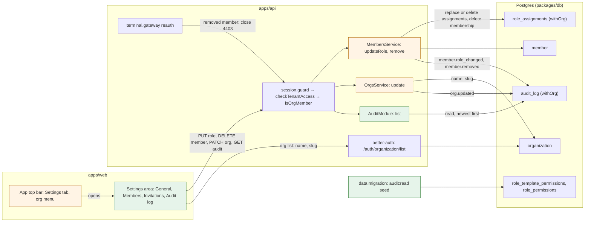
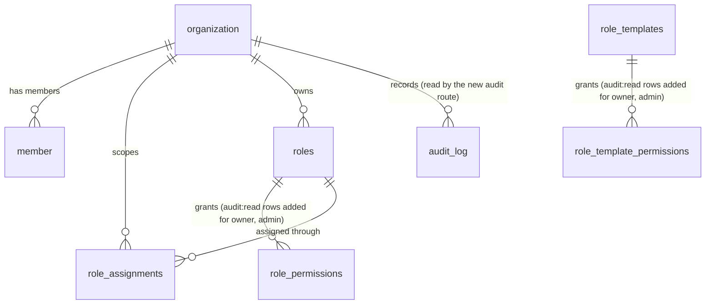

<!-- dev-plan: kind=spec id=org-tenant-admin rev=2 hash=518911023ffa source=issue#190 -->
# Org tenant admin design

Status: draft. Sensitive paths: auth (access control: four new `routeAccess` entries, member and role-assignment writes
under the grant and last-owner rules, the new org-level permission `audit:read`); RLS/`withOrg` (`role_assignments` and
`audit_log` under `withOrg`, a cross-project read of `audit_log`, `member` and `organization` filtered by the session
org); migrations (the `audit:read` data seed); terminal (no code change; a removed member's open terminal closes through
the existing reauth). Needs `review:sensitive` and a high-effort security review.
Source: issue #190 (slice 3 of epic #185; depends on #188 and the invitation backend of #189)

## Summary

Today org owners and admins cannot run their org without operator help: there is no members screen, no way to change
or remove a member, no way to rename the org or change its URL, and nothing reads the audit log. After this change, owners
and org admins get one Settings area (General, Members, Invitations, Audit log): they see who is in the org, change org
roles (owners can make other members owners, demote other owners and step down), remove members, manage pending
invitations, change the org name and slug, and see who did what. Settings is reached from a new Settings tab in one app
top bar on every page and from the org menu. Project admins reach only Invitations; members and viewers get no admin
page. The API refuses every action to every other role.

## Business rules

Confirmed by the human at planning time.

### Goal

Owners and admins run their org without operator help: see who is in it, change what each person can do (owners can
make other members owners), remove people, manage pending invitations, rename the org or change its URL, and see who did
what. Success: each action shows its result after a reload, and the API refuses it for every other role.

### Actors

| Actor | May do |
| ----- | ------ |
| Org owner (`owner` on org) | Members list; change any member's org role, including making other members owners and demoting other owners; remove any member including other owners; step down from owner while another owner exists; Invitations; General (name, slug); Audit. |
| Org admin (`admin` on org) | Same as owner for non-owners only: never gives `owner`, never changes or removes an owner. |
| Project admin (`admin` on a project only) | Settings opens the Invitations tab only, with slice 2 rights on own projects. No General, Members or Audit. |
| Member, viewer, member with no role | Nothing new. No Settings tab or org-menu item; settings URLs show no-access. Cannot leave (T6). |
| Platform admin | Nothing new here; org create stays as built; org delete and restore are slice 5 (T9). |
| Ticket source / SCM webhook sender | Not affected. |

- Owner and org admin hold `member:*` and `org:update`; project grants never give org-level permissions (rbac-foundation
  spec §Tenancy matrix; ADR-0036 §Decision "Each permission has a level"; `access.ts` `ORG_LEVEL`).
- An org owner may grant and revoke `owner`; an org admin never grants, changes or revokes `owner` (rbac-foundation BR-2,
  BR-45, §Tenancy).
- Several owners per org are allowed, with no limit on their number; assignments add up (ADR-0036; rbac-foundation
  §Tenancy).
- Invitation rights are unchanged; an owner can also invite as owner (rbac-foundation BR-60; org-onboarding BR-29).
- There is no self-leave; only an owner or admin removes members (T6).
- There is no tenant org delete; `org:delete` stays seeded but no route in this slice uses it (T9).
- There is no Transfer ownership feature; owners move only through Change role, Remove and invitations (round 4).
- The audit view is for owner and org admin through a new org-level permission `audit:read` (agent call).
- The General, Members and Audit tabs are for owner and org admin only; project admins see only Invitations; members and
  viewers get no Settings tab or org-menu Settings item and the no-access state on any settings URL (agent call).
- Navigation (Option A, applied by the human: "1, update the spec and boards"): one top bar on every page; Settings is a
  top-bar tab on org pages and an item in the org menu (the org crumb) on every page, both shown only to roles that may
  open Settings; the Settings button on the Projects page header is removed; Settings is not in the account (avatar)
  menu. This replaces T5's "Settings button on Projects" entry point; visibility per role is unchanged.

### Rules

Surface: UI (owners and admins act through the Settings area; BR-18 states the API refusals behind it).

Ids are stable. Dropped and never reused: BR-11, BR-12 (leave, T6); BR-19 (defaults, T4); BR-26, BR-27, BR-28 (transfer
ownership and its controls, round 4); BR-29 to BR-35, BR-37 to BR-39 (org delete, T9).

| Id | Category | Rule |
| ---- | ---------- | ------------------------------------------------------------- |
| BR-1 | happy-path | When an org owner or admin opens Settings → Members, they see every member of the org, paged, each with display name (or handle), handle, org role ("No role" when none) and project roles. |
| BR-2 | permission | When a project admin, member or viewer opens a General, Members or Audit settings URL, they see the no-access state; members and viewers see no Settings tab in the top bar and no Settings item in the org menu, and project admins see only the Invitations tab. |
| BR-3 | happy-path | When an owner or admin changes a member's org role, the row shows the new role after a reload, and that member's next page load follows it (for example a member made viewer no longer sees run controls). |
| BR-4 | permission | When an org admin opens the role menu, `owner` is not offered, and owners' rows offer them no Change role or Remove. |
| BR-5 | state-transition | When an owner tries to demote or remove the org's only owner (themselves included), they see that the org needs at least one owner, and nothing changes. |
| BR-6 | happy-path | When an owner or admin removes a member after confirming, the member leaves the list, the org is gone from that person's switcher, and a link to the org shows them not found. |
| BR-7 | side-effect | When a removed member had a run terminal open in the org, it closes; runs they own keep running and still show them as owner. |
| BR-8 | edge | When an owner or admin changes the role of, or removes, a member whom someone else removed meanwhile, they see an error that the member is no longer in the org, the list refreshes, and nothing else changes; when the member's role was changed meanwhile, the new change simply applies to the current state and the list refreshes. |
| BR-9 | conditional-display | When an owner or admin looks at their own row on Members, it offers no Remove. |
| BR-10 | persistence | When a removed person is invited again and accepts, they are a member with only the newly invited role. |
| BR-13 | navigation | When an owner, admin or project admin clicks the Settings tab in the top bar (org pages) or Settings in the org menu (any page), the settings area opens on the first tab they may open (project admin: Invitations) with its side menu; Invitations there behaves as slice 2 defines; the old `/o/<org>/invitations` link (with filter and page) lands on the Invitations tab with the same filter and page. |
| BR-14 | happy-path | When an owner or admin saves a new org name, the switcher and top bar show it after a reload, for every member. |
| BR-15 | validation | When the org name is empty or over 100 characters, the General form shows a field error and nothing changes. |
| BR-16 | navigation | When an owner or admin saves a new slug after the warning that old links will stop working, the page moves to the new URL, and a link with the old slug shows not found. |
| BR-17 | validation | When the slug is outside the slug format or taken by another org, the General form shows a field error and nothing changes. |
| BR-18 | permission | When a member, viewer or project admin sends an org name or slug change, a member role change or removal, or an audit read to the API, they get 403 and nothing changes; when an org admin sends a role change that gives `owner` or touches an owner, or removes an owner, they get 403 and nothing changes. |
| BR-20 | happy-path | When an owner or admin opens Settings → Audit, they see the org's entries newest first, paged, each with time, actor (name or handle; "Deleted user" when gone; marked when a platform admin), action and target. |
| BR-21 | side-effect | When a role is changed (owner grants and step-downs included) or a member is removed, the Audit page shows an entry with the actor, the member, and the role before and after. |
| BR-22 | side-effect | When the org name or slug changes, the Audit page shows an entry with the actor and the value before and after. |
| BR-23 | side-effect | When an invitation is created, resent, revoked, accepted or declined, or a role is granted or revoked through it, the Audit page shows the matching entry. |
| BR-24 | feedback-state | When the Members or Audit page is loading or fails, or the Audit page has no entries, the page shows its loading, error (with retry) or empty state. |
| BR-25 | permission | When an owner or admin of org A acts in org B, org A's Audit page never shows org B's entries, and a link to org B's settings pages shows not found unless they hold the role in B. |
| BR-36 | edge | When an admin is demoted while a settings page is open, their next change is refused and the page shows the no-access state after a refresh. |
| BR-40 | happy-path | When an owner changes another member's org role to Owner, that member shows as Owner after a reload, and on their next load they can give the owner role and change other owners' rows themselves. |
| BR-41 | happy-path | When an owner demotes or removes another owner while at least one other owner remains, the change applies and the list shows it after a reload. |
| BR-42 | state-transition | When an owner changes their own role while another owner exists, it applies, and on their next load they no longer see Owner in the role menu or Change role and Remove on owners' rows. |
| BR-43 | conditional-display | When a person opens an org page, the top bar shows the tabs Projects, plus Settings only when their role may open Settings; on a project page it shows Runs and Desk; on a run page it shows crumbs and no tabs; on the needs-you, My invitations and invitation pages it shows the org bar with no tab active; on Create organization it shows no tabs. |
| BR-44 | conditional-display | When a person opens the org menu (the org crumb, a menu also for people in one org), they see the org name, Projects, Settings only when their role may open it, "Switch organization" only with 2 or more orgs or as a platform admin, and "Create organization" only as a platform admin. |
| BR-45 | conditional-display | When a person opens the account menu (avatar), they see their name and handle, My invitations with an amber "N pending" count only when they have more than 0 pending invitations, and Logout; there is no Settings item. Removed by #230: the account menu has no My invitations link or pending count. |
| BR-46 | navigation | When a person is on a run page, the crumbs read Org / Project / Runs / Run N; clicking "Runs" opens that project's Runs list, and the project crumb opens the project switcher. |
| BR-47 | navigation | When an owner, admin or project admin on a project, Desk or run page opens the org menu and clicks Settings, the settings area opens on the first tab their role may open (two clicks). |
| BR-48 | navigation | When a person clicks the logo, the org's Projects page opens. |
| BR-49 | conditional-display | When a person of any role opens the Projects page, its header shows no Settings or Invitations button. |

The two designer toggles (a Settings button on the Projects header; an org-wide needs-you count on the Projects tab) are
undecided UI choices, off by default, and not rules (see Open questions).

### Not observable

- NO-1: race-safe last-owner check (two owners at once, a step-down racing a removal): internal; its effect is BR-5;
  proved by integration (`Promise.all`, final state asserted).
- NO-2: self-removal refused by the API: no UI path offers it (BR-9); proved by an integration test.
- NO-3: the org-mismatch header check on the new routes: internal (slice 2 T5); proved by `org-check.int.test.ts`.
- NO-4: the new `audit:read` permission backfilled into every existing org's owner and admin roles: no screen beyond
  BR-20; proved by the migration test.

### States

- Member: (not member) → member via an accepted invitation (slice 2); member → not member via Remove by an owner or
  admin (owner rows: owner only). Forbidden: removing the last owner (409); removing yourself (refused); leaving (does
  not exist, T6).
- Org role of a member: none | owner | admin | member | viewer. Any move between them by an owner; moves between none,
  admin, member and viewer by an admin, for non-owners only. Forbidden: an admin giving `owner` or changing an owner;
  anyone demoting the last owner (themselves included); anyone raising their own role.
- Change role edits the member's org-scope role only; project-scope roles show read-only on Members (project members
  are slice 4) (agent call).
- Change role replaces every org-scope assignment of the member with exactly one org role, or "No role" (removes the
  org-scope assignments, keeps project ones). It is one audited change with from and to (agent call).
- A user may change their own org role under the same rules: an owner may step down (to admin, member, viewer or "No
  role") while another owner exists; nobody can raise their own role (subset rule) (agent call).
- Remove deletes the membership plus every assignment in the org (org and project). An owner may remove another owner
  while another owner remains. The caller's own row offers no Remove, and the API refuses removing yourself (T6) (agent
  call).
- Through tenant actions an org never goes from at least one owner to zero (rbac-foundation BR-46, epic §7.3). This
  applies to change role (an owner demoting themselves included) and remove. Orgs created by a platform admin start
  ownerless until the first owner accepts (slice 1 BR-69); the rule only blocks a tenant action that would drop the
  count to zero.
- The grant subset and escalation rule applies to change role (rbac-foundation §Endpoint rules "Tenant grant service"):
  an owner can give any role, `owner` included; an admin can give admin, member, viewer or "No role" to non-owners only.
- Org: unchanged (no delete state, T9). Invitation: unchanged from slice 2.

### Limits and validation

- Org name: 1 to 100 characters. Slug: lowercase a-z, 0-9 and `-`, no leading or trailing `-`, 1 to 63 characters,
  unique (taken = field error). Same rules as org creation (rbac-foundation BR-73; org-onboarding BR-36).
- Members and Audit lists use the shared offset pagination and page size (ADR-0028).
- No search or filter on Members or Audit in v1 (agent call).
- No limit on the number of owners (slice 1 sets none).
- No rate or count limits on these admin actions (agent call).
- Org settings are name and slug only; there are no org defaults in v1 (T4).

### Edge cases

- Two owners demote or remove each other at once (both the only two owners): one succeeds, the other is told the org
  needs at least one owner; never zero owners.
- An owner steps down while another owner is being removed at the same moment: never zero owners; one of the two is
  refused.
- Change role or remove on a member removed meanwhile: an error (404, the member is no longer in the org), the list
  refreshes, nothing else changes. Change role or remove on a member whose role was changed meanwhile: it applies to the
  current state (last write wins, both audited), and the list refreshes (human answer to the BR-8 spec gap).
- An admin or owner demoted while a settings page is open: their next action outside their new rights is refused; the
  page follows the new role after a refresh (slice 1 BR-35).
- An owner demotes themselves: on the next load they lose owner-only abilities (Owner in the role menu, changing owner
  rows); if they became member or viewer, the settings area shows no-access.
- A removed member has the org open: their next request is refused; the org leaves their switcher; a link to it shows
  not found (slice 2 BR-12); if it was their active org they land in another org or on the welcome page.
- Rename while others have the org open: their next reload shows the new name.
- Slug change (T3): the changer's page moves to the new URL; old links show not found; the old slug is free at once and
  another org may take it; the form warns first.
- The only owner wants out: there is no Leave (T6) and no delete (T9); they make another member owner, then step down or
  are removed by the other owner.
- An audit actor whose user row is gone shows as "Deleted user" (agent call).

### Tenancy and permission

`member:read`, `member:update`, `member:delete`, `org:update` and `audit:read` are org-level (ADR-0036); `own` does not
apply to them. Org-level permissions never come from a project grant.

| Route, query or screen | Permission and level | Who holds it | Tenant data touched |
| ---------------------- | -------------------- | ------------ | ------------------- |
| Members list (`members.list`, existing) and the Members tab | `member:read`, org | owner, org admin | the URL org's `member` rows and `role_assignments` only |
| Change role (`members.updateRole`) | `member:update`, org | owner, org admin; giving `owner` or changing an owner's role is owner-only | the target's `role_assignments` in the session org; `audit_log` |
| Remove (`members.remove`) | `member:delete`, org | owner, org admin; owner rows owner-only; never self | the target's `member` row and every `role_assignments` row in the session org; `audit_log` |
| Org update (`orgs.update`) and the General tab | `org:update`, org | owner, org admin | the session org's `organization` row; `audit_log` |
| General tab read | none new: name and slug come from the caller's own org list (no settings read route) | every member of the org | the caller's own org list |
| Audit list (`audit.list`) and the Audit log tab | `audit:read` (new), org | owner, org admin | the session org's `audit_log` rows across all its projects |
| Invitations tab | unchanged slice 1 and 2 rights (`assignment:create` anywhere) | owner, org admin, project admin (own projects) | unchanged |
| Top-bar Settings tab and org-menu Settings item | none of its own: shown when the caller can open at least one settings tab (org-scope `org:update`, `member:read` or `audit:read`, or the invite right) | owner, org admin, project admin | the caller's own access, `['org', slug, 'access']` (personal pages: `['session','access']` for the session's active org) |
| Org menu org list | none new | every signed-in person | the caller's own org list, `['session','orgs']` |
| Account menu pending count | existing `me.listInvitations` (user scope) | every signed-in person | the caller's own invitations, `['session','invitations']` |

- Guard order per ADR-0036: 403 before any id lookup; 404 for a missing or other-org record (ADR-0036 §How a request is
  checked; AGENTS access rules). An owner of org A acting on org B's members, settings or audit gets not found; org A's
  audit view never shows org B's entries.
- The tenant comes from the session plus the URL org check, never the body (AGENTS; ADR-0035).
- The web hides controls using session permissions only; the API is the authority (AGENTS rule 7, epic §7.2).

### Lifecycle, compatibility and side effects

Lifecycle:

- Role change (owner grants and step-downs included), remove, rename and slug change each write an org audit entry with
  actor, target and before/after (agent call). No separate ownership action exists.
- Audit is append-only with no retention limit (unchanged).
- Remove deletes the membership and assignments; the history is the audit entry (slice 1 §Lifecycle).
- Removed or demoted users' runs keep running and keep them as owner; an open terminal they are no longer allowed closes
  on the re-check; an open event stream runs until it reconnects (rbac-foundation §Tenancy, BR-35, T7).
- Invitations sent by a member later removed or demoted stay pending; admins can revoke them (the page shows Invited by)
  (agent call).
- A removed person comes back only through a new invitation; nothing from before is restored (slice 1 BR-59).
- No org deletion or erase in this slice (T9).

Untrusted text and names:

- No ticket, comment or repo text is read. User input is the org name, the slug, and audit payload text (generic request
  rows can hold user-entered values). All of it is validated, stored and shown as plain text only (AGENTS rule 6).
- Invitation audit entries show the invitee email, as the approved boards do (human answer "1" on the audit email
  gap); only the owner/admin audit read returns it, and no email or secret goes into logs.
- The audit view shows time, actor, action, target, and from/to for role and settings events; it never renders raw
  request payloads (agent call).
- Names stay provider-agnostic: member, role, assignment, invitation, organization, owner. No provider names in routes,
  tables, types or copy (AGENTS rule 3, ADR-0005).

Compatibility:

- Locked-out users (no assignment since slice 1) show on Members as "No role"; an owner or admin gives them a role there
  (slice 1 BR-32).
- The Invitations page keeps its slice 2 behaviour (org-onboarding BR-18..33, BR-47..52) at
  `/o/$org/settings/invitations`; the old `/o/$org/invitations` URL (with filter and page) redirects there (T5). The
  Projects page's Invitations button is removed; Settings is reached from the top-bar Settings tab or the org menu
  (Option A).
- Navigation Option A supersedes the org-onboarding spec (`2026-11-21-org-onboarding-design.md`): its BR-9 (no switcher
  for a person in one org: the org crumb is now a menu for everyone, BR-44) and its Projects page "Invitations" button
  (BR-49). Its §UI lines about `OrgSwitch` as plain text, the Projects "Invitations" button and "org switcher only on
  the global top bar" are stale in the same way. This spec does not edit that file; the stale lines are flagged here
  (AGENTS: the newer accepted doc wins).
- Existing audit rows (generic `METHOD route-key` rows and slice 1 and 2 events) all show in the new view.
- Existing orgs, including pre-RBAC personal orgs: no data change. Orgs that already have several owners (via grants or
  invitations) keep them.
- A slug change breaks old `/o/<old>` links (T3). This is in tension with `frontend.md` §42 and was accepted by the
  human; the form warns.
- The requirement's "leave org" (T6), "defaults" (T4), "delete org" (T9) and "transfer ownership" (round 4: replaced by
  owner grants through Change role) are changed by human decision.
- `/api/orgs/:orgId/roles` is unchanged (#216 owns its permission).
- Existing decisions this builds on: the rbac-foundation spec (matrix, last owner 409, owner grants `owner` on tenant
  routes, `member:*` and `org:update` for owner and admin); the org-onboarding spec (Invitations page, no-access state,
  welcome page landing); ADR-0036 (guard order and levels; #216 may later change built-in role contents). Epic Q7 (org
  deletion and retention) moved to slice 5 (#192) by T9; epic §6 "Org owner ... transfer ownership" and the requirement's
  "Owner-only: transfer ownership" are replaced by owner grants (round 4).

Side effects a user sees:

- Role change: the member's next page load follows it (controls appear or disappear); a new owner can then give and take
  the owner role.
- Remove: the org leaves the person's switcher; their open terminal in the org closes.
- Rename: the switcher and top bar show the new name for every member. Slug change: URLs change; old links show not
  found.
- Audit: each admin action appears in the audit view.
- No ticket comments, email or notifications (no sender exists; slice 2 T3).

### Out of scope

- Project members (slice 4) and the platform directory (slice 5) (requirement).
- Leave organization (T6).
- Org defaults, for example run limits (T4).
- Slug redirects or aliases (T3).
- Org delete, grace period, restore, and their run and secret cleanup (T9: platform admin, slice 5).
- Changes to org creation (T9: it stays as slice 2 built it).
- A separate transfer-ownership action (round 4: owners grant `owner` through Change role instead).

## Architecture

Confirmed by the human at planning time.

### Overview

Parts by layer (apps → core → db → contracts; web → contracts only; AGENTS rule 2, `architecture.md` §1, §5):

- `packages/contracts`: four new tenant routes (change role, remove, org update, audit list) and their DTOs, their
  `routeAccess` entries, the permission `audit:read` (in `ORG_LEVEL`), and the new audit action names.
- `packages/db`: one data migration that seeds `audit:read`. No schema change.
- `packages/core`: no change. `loadAccess` already reads any permission.
- `apps/api`: `MembersService` gains change role and remove; `OrgsService` gains update of name and slug; a new
  `AuditModule` (service and controller); `AuditAction` gains new values.
- `apps/worker`: no change.
- Runner: no change.
- `apps/web`: the screens (see UI and Storybook). It keeps better-auth's org list.

What exists today:

- Slice 1 (RBAC) and slice 2 (onboarding) are built (#212): `docs/superpowers/specs/2026-11-20-rbac-foundation-design.md`,
  `docs/superpowers/specs/2026-11-21-org-onboarding-design.md`, ADR-0031, ADR-0035, ADR-0036.
- Permissions `member:read`, `member:create`, `member:update`, `member:delete`, `org:update` and `org:delete` exist in
  `packages/contracts/src/access.ts`, all org-level, seeded by `packages/db/migrations/0026_seed_role_templates.sql`:
  owner holds all of them; org admin holds all but `org:delete`. No route uses `member:update`, `member:delete` or
  `org:update` yet. No permission covers reading the audit log.
- Grant rules: `apps/api/src/access/grant-rules.ts` (`checkTenantAssign`: the subset rule, and only an org owner grants
  `owner`). The last-owner rule with row locks: `AssignmentsService.requireAnotherOwner` in
  `apps/api/src/assignments/assignments.service.ts`.
- Pending invitations: list, resend and revoke are built in backend and screen (`o.$org.invitations.tsx`,
  `features/orgInvitations/`). No architecture change.
- `organization` is a better-auth table (`packages/db/src/schema/auth.ts`): no RLS, unique `slug`. Org creation already
  catches the slug unique violation (`apps/api/src/orgs/orgs.service.ts`, `isUniqueViolation`). The slug format is
  `OrgSlug` in `packages/contracts/src/schemas/platform.ts`.
- `audit_log` is RLS-scoped with an `(org_id, at)` index, written by `AuditInterceptor` and `writeAuditEntry`
  (`apps/api/src/audit/`). Nothing reads it.
- The web resolves `/o/$org` by slug from better-auth `/auth/organization/list` (`o.$org.tsx`,
  `features/auth/session.ts`). better-auth has no session cookie cache configured (`apps/api/src/auth/auth.ts`), so the
  list always reads the current name and slug. Requests carry the org id (`x-org-id`), not the slug.
- The guard path `session.guard.ts` → `checkTenantAccess` → `isOrgMember` (`apps/api/src/access/check-access.ts`) is
  shared by HTTP and the terminal (`terminal.gateway.ts:397`).

### Data model

Migration: one new data migration that seeds the permission `audit:read`. No schema change: no new table and no column
change.

No new or changed table or column. The data written and read:

- Permission `audit:read` (org-level):
  - Added to `access.ts` and `ORG_LEVEL`.
  - One data migration inserts the template lines for `owner` and `admin` into `role_template_permissions`, then copies
    them into every existing org's `role_permissions`. It uses a DO loop that sets `app.org_id`, and is idempotent
    (`on conflict do nothing`), as 0026 is.
  - Holders are owner and org admin.
  - Existing tests keep passing: the migrate test (every routed permission is granted by a template) and the access unit
    tables.
- Member writes:
  - `role_assignments` is written under `withOrg`.
  - `member` is a better-auth table with no RLS. It is filtered explicitly by `organization_id` equal to the session org
    (AGENTS rule 4).
- Org update:
  - Updates `organization` where `id` is the session org.
  - A taken slug is caught on the unique index (23505), not read first and then written (`database.md` §6).
- Migrations are new only, never an edited applied one (AGENTS rule 8). The data migration is separate from schema
  migrations (`database.md` §5).

RLS: unchanged. `role_assignments` and `audit_log` stay RLS-scoped by org and are used under `withOrg`; `member` and
`organization` have no RLS and are filtered by the session org.

### API

| Method | Path | Who may call it | Request | Response | Contract |
| ------ | ---- | --------------- | ------- | -------- | -------- |
| PUT | `/api/orgs/:orgId/members/:userId/role` | `org('member:update')`: owner, org admin; `owner` given or taken by an org owner only | `UpdateMemberRoleRequest {roleId: uuid \| null}` (null means no org role) | `MemberDto` | `members.updateRole` |
| DELETE | `/api/orgs/:orgId/members/:userId` | `org('member:delete')`: owner, org admin; owner rows by an org owner only; never self | none | empty | `members.remove` |
| PATCH | `/api/orgs/:orgId` | `org('org:update')`: owner, org admin | `UpdateOrgRequest {name?: OrgName, slug?: OrgSlug}` (at least one) | `OrgDto {id, name, slug}` | `orgs.update` |
| GET | `/api/orgs/:orgId/audit` | `org('audit:read')`: owner, org admin | `PageQuery` | `pageOf(AuditEntryDto)` | `audit.list` |

Contracts come first (AGENTS rule 1, ADR-0004). Every route gets a `routeAccess` entry; typecheck enforces it.

`AuditEntryDto` fields:

- `id`, `at`
- `actor`: `{userId, name, handle}`, or null when the user row is gone
- `actorKind`: `'member'`, `'platform_admin'` or null
- `action`: string
- `target`: `{type: string | null, id: string | null, label: string | null}`
- `changes`: a list of `{field: 'role' | 'name' | 'slug', from: string | null, to: string | null}`. An owner promotion or
  demotion is a `role` change.

Contract notes:

- The server builds `changes` and `label` from known actions only. Generic `METHOD route-key` rows get `changes: []`. The
  raw `payload` is never returned (shown as text only; AGENTS rule 6).
- `userId` path params use the same schema as `CreateAssignmentRequest.userId`. `OrgName` and `OrgSlug` are reused from
  `schemas/platform.ts`.
- One atomic change-role endpoint (agent call).
- No settings read route: the General page reads name and slug from `['session','orgs']`, the org list every org page
  already loads. The write route is `orgs.update` (agent call).
- No `/api/me/orgs` route; `/auth/organization/list` stays (agent call).
- No leave route (T6). No delete or restore route (T9). No transfer route (design review).

Every route: the guard keeps the ADR-0036 order. The tenant comes from the session. `:orgId` must be the active org (404
otherwise). The `x-org-id` check applies as on every org route (ADR-0035).

PUT `members/:userId/role`:

- Replaces every org-scope assignment of the user with one assignment of `roleId`, or none. Project roles are untouched.
- `checkTenantAssign` runs with delete on each removed role and create on the new one. So only an org owner gives
  `owner` (to any other member) or takes it away (from another owner or from themselves), and an admin never touches
  `owner`.
- The caller may change their own role under the same rules. An owner can step down when another owner exists. The
  subset rule stops anyone from raising their own role.
- Last-owner rule: when the change removes an org-scope `owner` row, all of the org's owner rows are locked (as
  `requireAnotherOwner` does) and the change is refused with 409 if no owner would be left. Two owners demoting each
  other at once are serialized by the lock: one wins, the other gets 409.
- When the member already has exactly that role (for example `owner` given to an owner): 200, no audit entry.
- Audit: `member.role_changed {from: [roleKeys], to}`.
- Errors: 403; 404 not a member; 422 `/roleId`; 409 last owner.

DELETE `members/:userId`:

- The caller's own userId gets 403 (T6: nobody removes themselves). This is decided before any lookup.
- Deletes every assignment of the user in the org (org and project), then the `member` row.
- `checkTenantAssign` delete runs for each assignment, so only an owner removes another owner. The last-owner rule
  applies, with the owner rows locked.
- Audit: `member.removed {from: [assignments]}`.
- Errors: 403; 404; 409.

PATCH `/api/orgs/:orgId`:

- Updates name and/or slug.
- Audit: `org.updated {from, to}` (changed fields only). Nothing changed: 200, no audit entry.
- Errors: 400; 403; 409 with pointer `/slug`.

GET `audit`:

- Newest first. Offset pages (ADR-0028) with `count(*)` on `(org_id, at)`. Actors and user targets are resolved to name
  or handle.
- Errors: 403.

Owners are managed through change role and remove only. An org owner gives `owner` to any other member, demotes another
owner or steps down through `members.updateRole`, and removes another owner through `members.remove`; every one of these
keeps at least one owner (last-owner rule, owner rows locked). These rights come from the existing owner-only grant rule
in `grant-rules.ts`, the same rule `assignments.create` applies today; no new rule and no new permission beyond
`audit:read` are needed. Slice 1 lets an org admin hold `assignment:create` while the owner-only grant rule stays; this
slice keeps that unchanged. No other part of the design assumes a single owner: members, audit, org update and the guard
all work with several owners.

WebSocket, SSE and webhooks: no change. After removal the member's runs keep going; an open terminal closes on the next
reauth (4403, through `checkTenantAccess`); an open SSE stream lasts until it reconnects (slice 1 §Lifecycle, T7).
Removal does not edit better-auth `session` rows (agent call). There is no slug redirect or alias (T3).

### Third-party libraries

| Library | New or existing | Used for | Approval |
| ------- | --------------- | -------- | -------- |
| zod | existing | request and DTO schemas | existing |
| NestJS | existing | members, orgs and audit controllers and services | existing |
| Drizzle | existing | queries and the data migration | existing |
| better-auth 1.7.22 | existing | `organization` and `member` tables, the org list | existing |
| TanStack Router and Query | existing | settings routes, queries and invalidation | existing |

No new dependency.

### Services and integrations

| Service | New or existing | How it is used |
| ------- | --------------- | -------------- |
| Postgres | existing | one data migration; reads and writes under `withOrg` |
| better-auth (in process) | existing | the `organization` and `member` rows, and `/organization/list` read by the web |
| Temporal, Kubernetes, SecretStore, provider APIs | existing | unchanged |

### Configuration

No config change. No new env var, setting, flag or secret.

### Other decisions

- Worker: no change. There are no workflows, activities or schedules for this slice.
- Runner and Kubernetes: no change. No user text reaches a shell, a k8s spec or SQL. Org name and slug are Zod-validated
  and bound (AGENTS rule 6).
- Provider adapters: no change. Names stay generic: member, role, org, audit (AGENTS rule 3, ADR-0005).
- Secrets: no secret is touched. Audit payloads still pass `redactBody` on write. The audit route never returns a raw
  payload. No secret goes into logs, events or errors.
- Events and live updates: no new SSE event. The members, audit and org lists are plain queries that the web invalidates
  after mutations; after a rename or slug change it invalidates `['session','orgs']` (ADR-0015).
- Requirement questions answered: Q1 (slug change): old `/o/<old-slug>/…` links show not found and there is no redirect
  (T3); open tabs keep working until they reload, because requests carry the org id. Q2 (org deletion vs running Jobs
  and k8s Secrets): out of this slice (T9), it goes to slice 5. Q3 (org settings at v1): name and slug only (T4).
- Failure, as a user sees it: 409 "The organization needs at least one owner"; 409 slug taken, with pointer `/slug`; 422
  on a bad role or target; 403 or 404 per the guard; the existing two-tab 409 org-mismatch.
- Logs at `info`, with no email: `{requestId, orgId, actorUserId, targetUserId, action}` on role change and remove;
  `{requestId, orgId}` on org update.
- Scale: member writes touch a few rows. Audit uses `(org_id, at)` with offset paging and `count(*)` (ADR-0028); a very
  large log makes the count slower, which ADR-0028 accepts.
- Sensitive paths: access control and tenant isolation (new `routeAccess` entries, member and assignment writes with the
  grant and last-owner rules, owner grants, demotions and removals by owners only, a cross-project read of the audit
  log); RLS and `withOrg` (`role_assignments` and `audit_log` under `withOrg`, `member` and `organization` filtered by
  the session org); migrations (the `audit:read` data seed); terminal (no code change; a removed member's terminal closes
  through the existing reauth). The PR gets `review:sensitive` and a high-effort security review.
- ADR: no new ADR (agent call). The same PR adds `audit:read` to ADR-0036's sentence listing org-level permissions
  (AGENTS: fix the stale doc in the same PR). Org deletion and its ADR move to slice 5.
- Superseded docs: navigation Option A supersedes the org-onboarding spec's BR-9 (no switcher for a person in one org)
  and its Projects page "Invitations" button, together with its §UI lines on `OrgSwitch` as plain text and the
  switcher only on the global top bar. The onboarding spec file is not edited by this slice; it is flagged here and in
  Business rules › Compatibility. The top bar uses existing data only (`['session','orgs']`, access,
  `['session','invitations']`); no architecture change follows from it.
- Dropped by T9 (not built): `DELETE /api/orgs/:orgId`, restore, the 7-day grace, deletion columns on `organization`,
  the `purge_org_batch` definer, the `resolve_project` change, the `deleted-org` route kind, the `orgDeletion` workflow
  and its activities, `ORG_DELETION_GRACE_SECONDS`, deleted-org handling in the org list and hooks, ADR-0037. Dropped by
  the design review: the transfer route, its service method and the `org.ownership_transferred` audit action.
- Out of scope (architecture view): org delete and restore, deletion of running Jobs and Secrets, grace period, purge
  (T9: platform admin, slice 5); org creation changes; Leave organization (T6); project members (slice 4).

## UI and Storybook

Navigation follows Option A as built in `design/prototype/interactive/` (its README "Navigation (Option A)" is the
navigation map and role table): one top bar on every page. Org pages: logo, "Org ▾", tabs Projects and Settings. Project
pages: logo, "Org ▾ / Project ▾", tabs Runs and Desk. Run pages: compact crumbs "Org ▾ / Project ▾ / Runs / Run N", no
tabs. Every bar ends with the account menu; the bell sits just before it on the org-level, project-level and no-org
bars, and not on the run-level or signed-out bars (see TopBar below). Org menu: org name, Projects,
Settings (only for roles that may open it), "Switch organization" (2+ orgs or platform admin), "Create organization"
(platform admin). Account menu: name and handle, "My invitations" with a "N pending" count, "Logout"; Settings is not in
it.

Screens and components this changes:

- Settings area (new, T5):
  - New layout route `app/routes/o.$org.settings.tsx`: the app top bar (Settings tab active) and a left `SubNav` with
    heading "Organization" and `aria-label="Organization settings"`, like `DeskLayout`.
  - `o.$org.settings.index.tsx`: redirects to the first tab the viewer may open: General for owners and admins,
    Invitations for project admins.
  - `o.$org.settings.general.tsx` (new): name and URL slug. No Danger zone.
  - `o.$org.settings.members.tsx` (new): members table, change role (owner included), remove.
  - `o.$org.settings.invitations.tsx` (moved): the `OrgInvitations` content inside the layout.
  - `o.$org.settings.audit.tsx` (new): the audit log, with `?page`.
  - `o.$org.invitations.tsx` becomes a redirect to `/o/$org/settings/invitations` that keeps `?status` and `?page`.
  - Org URLs stay under `/o/$org/...`, route names are flat dot names, `validateSearch` falls back with Zod, and lists
    use `?page=` (`frontend.md` §2, §3; ADR-0028).
- Entry to Settings: the top-bar "Settings" tab on org-level pages, and the org menu item "Settings" on every page that
  has an org (org, project and run pages, My invitations). Both show only to a viewer who can open at least one tab:
  org-scope `org:update`, `member:read` or `audit:read`, or the invite right; that is owners, org admins and project
  admins. Members, viewers and platform admins without an org role see neither, and a typed Settings URL shows
  Forbidden under the same bar (prototype README role table; BR-2). Settings is not a button in the Projects header and
  not an item in the account menu.
- Every other screen changes only its header (the top bar); bodies, routes and data stay as they are:
  - Org level, Projects tab active: Projects, ProjectsEmpty, and the new-project wizard (`SetupLayout`). Projects and
    ProjectsEmpty also lose the "Invitations" header button and get no Settings button.
  - Org level, no tab active: My invitations (`/invitations`) and the invitation accept page (`/invitations/$invitation`),
    for the session's active org (as in the prototype); the needs-you page, whose route stays
    `o.$org.p.$project.needs-you.tsx` with only its header changed to the org bar with no tab active (agent call).
  - Org crumb without tabs: Create organization (`/orgs/new`). The no-org welcome page shows "No organization" with no
    tabs.
  - Project level (Runs or Desk tab active): Runs (`RunsPage`), Desk (`DeskFrame` boards: Rules, Skills, Setup, Agent).
  - Run level: `RunDetail`, with crumbs "Org ▾ / Project ▾ / Runs / Run N" ("Runs" links to the project's Runs list), no
    tabs, no bell (as in the prototype).
  - Sign in keeps the brand only.
- Reused components (`frontend.md` §1, §6): `SubNav`, `SettingsSection`, `Dialog`, `Field`, `TextInput`, `PrefixInput`,
  `RadioCard`, `Button`, `DataTable`, `Pagination`, `useRowMenu`, `EmptyState`, `Banner`, `Toast`, `Skeleton`,
  `RouteLoadError`, `Forbidden`, `Popover`, `CountBadge`, `InvitationRow`, `InviteDialog`, `InviteLink`, and the
  `features/invitations/dates.ts` helpers.
- Changed app chrome (each story listed is added or updated, rule 10):
  - `components/TopBar.tsx`: one bar with three crumb depths. Org level: Brand, the `OrgSwitch` crumb, `OrgNav` tabs,
    bell, `AccountMenu`. Project level: Brand, the `OrgSwitch` crumb, "/", the `ProjectSwitch` crumb, `ProjectNav` tabs,
    "Repo on GitHub", bell, `AccountMenu`. Run level: crumbs `OrgSwitch` / `ProjectSwitch` / "Runs" link / "Run N", then
    the run's children and actions, then `AccountMenu`, with no bell. Props: an `org` crumb on every level, `project`
    (project and run levels), `tabs` (`'org' | 'project' | 'none'`) with `active`, and the account data. The `TopBar`
    name and its `variant` prop stay (`global` = org level, `project`, `run`) (agent call). Bell, as built in the
    prototype (`js/chrome.js` `chrome.bar`): shown just before the avatar on every signed-in org-level bar (org pages,
    personal pages, Create organization, the no-org "No organization" bar) and every project-level bar; not shown on the
    run-level bar (it keeps the board's own compact header) or the signed-out bar (brand only). This repeats the
    prototype and the existing `TopBar`; it is no new rule. Stories (these names are the authority): OrgLevelOwner
    (Settings tab), OrgLevelMember (no Settings tab), OrgLevelSettingsActive, PersonalNoTabActive, CreateOrgNoTabs,
    NoOrg, ProjectLevel (Runs with a needs-you count), ProjectLevelDesk, RunLevel, LongOrgName (ellipsis plus `title`).
  - `components/OrgSwitch.tsx`: the org crumb; the name `OrgSwitch` stays (agent call). It is now always a button, also
    with one org. Menu, in order: a heading with the org name, "Projects", "Settings" (only with the Settings right),
    then a "Switch organization" group listing the user's orgs with a check on the current one (2+ orgs or platform
    admin), then "Create organization" (platform admin). A no-org platform admin gets "No organization ▾" with Create
    only; a no-org person who is not a platform admin gets plain text "No organization". New props `projectsHref` and
    `settingsHref` (absent means no item). Stories: OneOrg (button, menu without the switch group), OneOrgNoSettings,
    SeveralOrgs, Open, PlatformAdmin, PlatformAdminNoOrg, NoOrg, LongName.
  - New `components/OrgNav.tsx`: the org tabs Projects and Settings, `<nav aria-label="Main">`, the current tab with
    `aria-current="page"`. The Settings tab is absent without `settingsHref`. An optional needs-you count stays unused
    (designer toggle, off). Stories: ProjectsActive, SettingsActive, NoSettings, NoneActive.
  - `components/ProjectNav.tsx`: `aria-label` changes from "Project" to "Main". Stories updated.
  - `components/ProjectSwitch.tsx`: shows only the project name (the org has its own crumb); the menu keeps the projects
    with needs-you counts and "All projects". Stories updated.
  - `components/AccountMenu.tsx`: name and handle at the top, "My invitations" (with a "N pending" count when above 0,
    linking to `/invitations`), a divider, then "Logout". The pending count and link come in through props from the
    route, and Logout stays in the existing `SignOutProvider` (agent call). Stories: Default, Open, OpenWithPending,
    OnMyInvitations (item `aria-current="page"`).
  - `components/Breadcrumb.tsx`: crumbs can hold switch buttons ("Org ▾", "Project ▾"). Stories updated.
  - `ds/icons.tsx` (Icon grid): a new `grid` icon (four squares, same stroke style) for the Projects tab; the Settings
    tab reuses the sliders icon (as in the prototype). Story `Primitives/Icon` updated.
  - `screens/Projects.tsx` and `ProjectsEmpty.tsx`: the `invitationsHref` prop and its "Invitations" button are removed.
    No `settingsHref`. The top bar shows the Projects tab active.
  - Header-only changes: `RunsPage` (Runs), `RunDetail` (run detail), `NeedsYou` (needs-you), `DeskFrame` (Desk),
    `MyInvitations` (My invitations), `InvitationAccept` (accept), `CreateOrg` (Create org), `SetupLayout` (setup) pass
    the new `TopBar` props. Their bodies do not change.
- New tenant-admin components (each with a story):
  - `components/OrgSettingsLayout.tsx`: a `SubNav` (heading "Organization", `aria-label="Organization settings"`) with
    General, Members, Invitations and Audit log, each shown by permission. Stories: Owner, Admin, ProjectAdmin.
  - `components/MemberRow.tsx`: the name with the handle in muted mono; a "You" tag; Role (the org role, or "No role");
    Project roles ("Alpha (Admin), Beta (Member)", with an ellipsis and a `title`, or "—"); the row menu (Change role,
    and Remove except on the own row). Stories: Owner, Admin, Member, Viewer, NoRole, ProjectRoles, You (no Remove),
    OwnerRowForOwner (actions shown), OwnerRowForAdmin (no actions), LongName, Busy.
  - `components/ChangeRoleDialog.tsx`: role cards with a one-line description each; the Owner card only for owner
    callers, with its note when picked; the step-down warning on the own row; the last-owner Banner on 409. Stories:
    Default (admin caller, no Owner card), OwnerCaller, OwnerPicked (note), StepDown (warning), LastOwner (409 Banner),
    Saving, Error.
  - `components/AuditRow.tsx`: When (`<time>` with the exact date in `title`); Who (name or handle; "Deleted user"; a
    "Platform admin" tag); What (a sentence per known action, with from → to for role and org changes; a role change to
    or from Owner reads like any other role change; unknown or generic actions show the raw key in mono; no raw
    payload). An invitation entry names the invitee email in plain text, for example "invited sam.reyes@contractor.io
    as Viewer" (human answer "1" on the audit email gap; the approved audit boards); the audit log is readable only by
    owners and admins (`audit:read`); the email is never a link and is never rendered as HTML (AGENTS rule 6). Stories:
    RoleChanged, MadeOwner, MemberRemoved, InvitationCreated (with the email), OrgRenamed, SlugChanged, GenericRequest,
    PlatformAdminActor, DeletedActor, LongText (a long email or HTML-like text cut with an ellipsis, shown as text).
  - `screens/OrgInvitations.tsx` (changed): renders inside the layout, with no top bar of its own.
  - New screens `OrgGeneral.tsx`, `OrgMembers.tsx`, `OrgAudit.tsx` (`Screens/OrgSettings`).
- States:
  - Top bar: org level with or without the Settings tab, with Projects active, Settings active or none active; project
    level with Runs or Desk active, with or without the needs-you count; run level with crumbs only, no bell; no org:
    "No organization", with no tabs, bell shown. The bell shows on org-level and project-level bars only.
  - Org menu: closed and open. The "Switch organization" group shows only with 2+ orgs or for a platform admin; Create
    shows only for a platform admin; a long name is cut with an ellipsis. It needs no data load (`['session','orgs']`
    and access are already loaded); while access is pending, the Settings item and tab stay hidden.
  - Account menu: closed and open. The pending count shows only above 0, and is hidden while its query is pending or
    failed (agent call).
  - Settings layout: tabs by permission. A hidden tab's URL shows Forbidden inside the layout. Members and viewers get
    Forbidden under the app bar (`frontend.md` §9; BR-2).
  - General: the data comes from the layout's org list (pending is the route pending state). Ready (nothing changed,
    Save disabled), saving, saved (the org crumb shows the new name, toast), field errors (empty name, name over 100
    characters, bad slug format, slug taken, each with the input kept), slug confirm, the form Banner with the request
    id (input kept), and forbidden for a project admin (inside the layout, the side menu listing only Invitations). The
    same view for owners and admins.
  - Members: loading (skeleton), list (several owners, "No role", project roles), paged (page 2 of 2), empty ("No
    members", only via a clamped page), error ("Internal server error", request id, Retry), forbidden for a member or
    viewer (under the app bar, no side menu, no Settings tab), busy row (row menu disabled), the admin's view (owner
    rows have no actions), the row menu on another member (Change role, Remove from organization) and on the caller's
    own row (Change role only), role changed (list refetched, toast), removed (list refetched, toast), member removed
    meanwhile (dialog closed, list refetched, error toast), remove refused by 409 last owner (toast, list refetched).
    Change-role dialog: owner caller (Owner card offered, current role preselected), admin caller (no Owner card),
    owner picked (note), step down (warning), saving, last owner (Banner with the step-down warning, dialog stays open),
    refused with 403 (Banner with the request id). Remove confirm: default and removing.
  - Invitations: the slice 2 states, inside the layout: the owner or admin view with the full side menu, and the
    project admin view with only the Invitations tab.
  - Audit: loading (skeleton), list (newest first: role change, owner grant, URL change, name change, removal,
    invitation, generic request, platform admin actor, deleted user), paged (page 2 of 2), empty ("No activity yet"),
    error ("Internal server error", request id, Retry), forbidden for a project admin (inside the layout). No live
    updates.
  - Projects and ProjectsEmpty (owner or admin): Projects tab active, Settings tab in the top bar, no Settings button
    in the head.
  - Other screens: only their header states change, as above.

User flows:

- Navigation:
  - Projects ↔ Settings: one click on a tab.
  - Project, Desk or run to Settings: org menu, then Settings.
  - Another org: org menu, then that org (listed under "Switch organization" only with 2+ orgs or for a platform admin).
  - Another project: project menu, then that project, or "All projects".
  - My invitations: avatar, then "My invitations". Logout: avatar, then "Logout".
  - The logo goes to the org's Projects list.
  - The browser back button follows each step.
- Change role: Settings → Members → row menu "Change role" → dialog with role cards → "Save role" → the list refetches →
  toast "Role changed".
  - Owner callers see the cards Owner, Admin, Member, Viewer and No role. Admin callers see the same cards without Owner.
  - Giving `owner` (owner callers): pick the Owner card; a note under it reads "Owners can change or remove every member,
    including other owners." It is an inline note, not a second confirm (agent call).
  - Changing an owner's role (owner callers): any card, subject to the last-owner rule.
  - Stepping down (owner caller, own row, a card below Owner): a warning Banner in the dialog reads "You will lose owner
    rights in <Org>." On success, `['org', slug, 'access']` is invalidated, and the page, the Settings tab and the org
    menu re-render with what the caller may still see.
  - 409 last owner: a dialog Banner "An organization needs at least one owner." The dialog stays open and nothing
    changes.
  - 404 because the member was removed meanwhile (BR-8): the dialog closes, an error toast shows the problem title, and
    the list refetches. If the member's role changed meanwhile, there is no error: the new role applies to their current
    state, and the list refreshes on success. There is no "changed meanwhile" 409.
  - 403: a dialog Banner. The org was switched in another tab: the existing T12 toast, with the choice kept.
- Remove: row menu "Remove from organization" → confirm Dialog → "Remove" → refetch → toast "<name> removed".
  - Owner callers may remove other owners. Admin callers see no actions on owner rows (BR-4). The caller's own row has no
    Remove (BR-9; the API refuses self-removal).
  - 409 last owner: a toast with the problem title and a refetch.
  - 404 because the member was already removed (BR-8): an error toast with the problem title and a refetch.
- Last-owner rule in the UI: no control is disabled in advance; the server's 409 is shown in the dialog or as a toast, as
  above (agent call).
- Pending invitations: the slice 2 flows are unchanged, inside the layout (BR-13). The invite dialog already offers
  `owner` to owner inviters (slice 2 BR-29).
- Rename: on General, edit Name → "Save" → `['session','orgs']` is invalidated → the org crumb, the org menu and the form
  show the new name → toast "Organization updated". An empty name, or one over 100 characters, gives a field error
  (BR-15).
- Slug change (T3): edit URL → "Save" → a confirm Dialog shows the old and new URL and warns that old links show "not
  found" → "Change URL".
  - On success: invalidate `['session','orgs']`, remove `['org', oldSlug]`, and navigate (replace) to
    `/o/<new>/settings/general`.
  - Bad format, or 409 `/slug`: the URL field error, with the input kept (BR-17).
  - One Save covers both name and slug.
- Audit: Settings → Audit log → a paged table, newest first (BR-20).
- Not present: Leave (T6); Delete and Restore (T9); Transfer ownership (design review), with no
  `TransferOwnershipDialog`, General Danger zone, `TypeToConfirmDialog` or scheduled-deletion pieces.

Copy (sentence case, short sentences, verb buttons, no provider names, in the style of the existing boards and the
prototype) (agent call):

- Top bar: tabs "Projects", "Settings", "Runs", "Desk". Crumbs show the org and project names. Run crumbs "Runs",
  "Run <n>". "Repo on GitHub" is unchanged.
- Org menu: heading <org name>, items "Projects" and "Settings", group heading "Switch organization", item "Create
  organization". With no org: "No organization".
- Account menu: <name>, <handle>, "My invitations", "<n> pending", "Logout".
- Settings side menu: "Organization", with "General", "Members", "Invitations" and "Audit log".
- Projects intro: "After sign-in you land on the runs of the project you used last. This list is one click away on the
  logo." stays (agent call).
- General: h1 "General". Section "Organization" with fields "Name" and "URL" (`/o/` prefix). URL help: "Links that use
  the old URL will show "not found"." Buttons "Save" / "Saving…". Toast "Organization updated". Slug confirm: title
  "Change the organization URL?"; body "/o/<old> becomes /o/<new>. Links that use /o/<old> will show "not found". Share
  the new link with your members."; buttons "Cancel" and "Change URL". Field errors: "Enter a name." (empty name);
  "Use 100 characters or fewer." (name too long); "Use lowercase letters, numbers and dashes, with no dash at the start
  or end." (slug format); "This URL is taken. Try another." (slug taken).
- No access (General, Members or Audit URL without the right): "You don't have access" and "Ask an owner of this
  organization to give you access."
- Members: h1 "Members". Columns "Name", "Role", "Project roles", and "Actions" (screen readers only). Tags "You" and
  "No role". Menu "Change role" and "Remove from organization" (red). Menu button "Actions for <name>".
- Change role dialog: title "Change role for <name>". Buttons "Cancel" and "Save role" / "Saving…". Toast "Role
  changed". Card descriptions: Owner "Everything an admin can do, and manage owners."; Admin "Manage members,
  invitations, projects and settings."; Member "Use projects and start runs."; Viewer "See projects and runs."; No role
  "Stays a member with no organization role. Project roles stay." Owner note: "Owners can change or remove every member,
  including other owners." Step-down warning: "You will lose owner rights in <Org>." Last-owner Banner: "An organization
  needs at least one owner." Refused (403) Banner: "You don't have access" with "Request ID: <id>".
- Remove confirm: title "Remove <name> from <Org>?". Body "They lose access to every project in <Org>." Buttons "Cancel"
  and "Remove" / "Removing…". Toast "<name> removed".
- Members toasts from problem titles: "Member is no longer in the organization" (404, removed meanwhile); "The
  organization needs at least one owner" (409 on remove).
- Audit: h1 "Audit log". Columns "When", "Who", "What". Empty "No activity yet". Tags "Deleted user" and "Platform
  admin". When shows a relative time ("2 min ago", "yesterday", "12 Nov") with the exact date in `title` ("22 Nov 2026,
  10:58"). Sentences follow the business action list: "<actor> changed <member>'s role from Admin to Owner"; "<actor>
  changed the organization URL from /o/<old> to /o/<new>"; "<actor> changed the organization name from <old> to
  <new>"; "<actor> removed <member> from the organization (was Member)"; "<actor> invited <email> as Viewer"; "<actor>
  resent the invitation for <email>"; "<actor> revoked the invitation for <email>"; "<actor> accepted an invitation as
  Member"; "<actor> declined an invitation"; a generic request shows its raw key in mono ("POST orgs.create").
  Invitation entries show the invitee email in plain text (human answer "1"); the Who column is the actor, so accept
  and decline, whose actor is the invitee, show no email.
- Pagination (Members and Audit, the existing `Pagination`): "Showing 21–25 of 25", Previous, page numbers, Next, "Go
  to page", "Rows per page" 20, 50, 100.
- Errors: `RouteError` copy ("Internal server error" + "Request ID: <id>"). The T12 two-tab toast. 409 titles come from
  the problem response.

Role-based UI (AGENTS "Access control": the web hides controls, the API decides; ADR-0036 levels; only an org owner gives
or takes `owner`; matches the prototype README role table). Checks use `can(access, …)` with `['org', slug, 'access']`.

| Control | Owner | Org admin | Project admin | Member / viewer | Platform admin (no org role) |
| --- | --- | --- | --- | --- | --- |
| Settings tab and org-menu "Settings" | yes | yes | yes (opens Invitations) | hidden | hidden |
| "Switch organization" group | 2+ orgs | 2+ orgs | 2+ orgs | 2+ orgs | always |
| "Create organization" | no | no | no | no | yes |
| My invitations in the account menu | no | no | no | no | no |
| General, edit name and URL (`org:update`) | yes | yes | hidden | hidden | hidden |
| Members tab (`member:read`) | yes | yes | hidden | hidden | hidden |
| Change role on non-owner rows (`member:update`) | yes | yes | — | — | — |
| Owner card; actions on owner rows | yes (last owner by 409) | hidden (BR-4) | — | — | — |
| Change role on own row; Remove on own row | yes (step down); no | yes; no | — | — | — |
| Invitations tab (`assignment:create` anywhere) | yes | yes | yes (own projects) | hidden | hidden |
| Audit log tab (`audit:read`) | yes | yes | hidden | hidden | hidden |
| Transfer, Leave, Delete, Restore | none | none | none | none | none |

A hidden tab's URL shows Forbidden inside the layout. A typed Settings URL for someone with no tab shows Forbidden under
the app bar.

Data on screen (`frontend.md` §3: no optimistic updates, invalidate on success, query keys start `['org', slug]`):

- Settings tab and org-menu item: computed with `can()` from `['org', slug, 'access']` (ensured in `o.$org`). Personal
  pages (My invitations, invitation accept) use the existing `['session','access']` for the session's active org (agent
  call).
- Account menu count: `['session','invitations']` (the existing `myInvitationsQuery`), read by the routes that render the
  bar. A failure hides the count.
- Org menu orgs: `['session','orgs']`.
- General reads `['session','orgs']`. `orgs.update` invalidates it. A slug change also removes `['org', oldSlug]` and
  navigates with replace.
- `['org', slug, 'members', 'list', page, pageSize]` (`members.list`, keeps old rows across pages), invalidated after a
  role change or a remove.
- Project role names come from the existing all-projects query (the `inviteProjectsQuery` pattern), with no contract
  change (agent call).
- `['org', slug, 'roles']`: the role cards. The Owner card is offered when the caller holds an org-scope `owner`
  assignment (from `['org', slug, 'access']`).
- A change to the caller's own role invalidates `['org', slug, 'access']`, so the tab and the org menu follow.
- `['org', slug, 'audit', 'list', page, pageSize]` (`audit.list`): staleTime 30 s, no SSE.
- While a write is in flight: the button shows its pending label, the dialog cannot close, and the row menu is
  disabled.

Forms (`frontend.md` §11):

- TanStack Form validated with `UpdateOrgRequest` (`OrgName`, `OrgSlug`), sent with `mutateAsync`.
- `fieldErrorsFromProblem` maps `/name` and `/slug`; anything unmapped goes to the form Banner.
- Input is kept on failure. Errors show on submit, then update on change.
- The slug is never refilled from the name on rename (agent call).
- General sends only the fields that changed; Save is disabled while nothing changed (agent call).
- Change role preselects the current role; "Save role" is disabled until the choice differs (agent call).

Accessibility (`frontend.md` §10 and the prototype labels):

- Top bar: the brand link is labelled "Agent Desk, all projects". Tabs are `<nav aria-label="Main">` (org and project),
  with `aria-current="page"` on the active tab. Run crumbs are `<nav aria-label="Breadcrumb">`.
- Org crumb: a `<button>` with `aria-haspopup="dialog"` and `aria-expanded`; label "Organization menu, <name>" with one
  org, "Switch organization, currently <name>" with 2+, "Switch organization" with no org. The popover and its menu are
  labelled "Organization"; the current org has `aria-current="true"`. ArrowDown opens it; arrows, Home and End move
  through the items; Escape closes it and returns focus (the existing `OrgSwitch` keyboard model).
- Project crumb: "Switch project, currently <name>".
- Account menu: button "Account menu for <handle>", `role="menu"` labelled "Account"; items are `menuitem`s; the pending
  count is in the item's text ("<n> pending").
- Settings side menu: `<nav aria-label="Organization settings">` with `aria-current="page"`.
- Members: row menu buttons are labelled "Actions for <name>". Role cards are a radio group with the legend "Role". The
  Owner note and the step-down warning are linked with `aria-describedby` and announced when they appear
  (`role="status"` for the note, `role="alert"` for the 409 Banner).
- Dialogs use `useFocusTrap`; focus the current role card, or "Change URL" in the slug confirm; close on Escape, except
  while busy; return focus to the opener. After a remove, focus goes to the "Members" heading.
- One h1 per page and h2 sections. `<time dateTime>` with `title` and `sr-only` text. Toasts use `role="status"`.
  Colors come from tokens; contrast is checked in the built Storybook.

Visual system and layout (`frontend.md` §5; the frontend spec):

- Tokens only, with no new color, font size, radius or spacing scale.
- The app bar copies `design/prototype/interactive/` (`styles.css`, `js/chrome.js`; tokens only) and the existing
  `Chrome.module.css` classes (`.top`, `.tabs`, `.sep`).
- Settings and General copy `DeskAgent.dc.html`; Members and Audit copy `OrgInvitations.dc.html` and `Projects.dc.html`;
  dialogs copy `OrgInvitationsRevokeConfirm.dc.html` and the invite role cards (`OrgInvitationsInvite.dc.html`).
- Remove uses `solid-danger`. The step-down warning is a `warn` Banner. The "N pending" count on My invitations uses the
  amber `idle` count, as in the prototype (agent call).
- Desktop artboards only (1440x900), no new mobile layout. The top bar is fixed and keeps one height on every page. Long
  org and project names in the crumbs are cut with an ellipsis, with the full name in `title` and in the menu. The run
  bar stays compact (no tabs), so the terminal keeps its height. The Settings side menu has a fixed width, like Desk,
  and the content scrolls. Tables cut long text with an ellipsis and a `title`. General is one `SettingsSection` column.

Stories and fixtures:

- Fixtures: views in `@/mocks/{members,audit,orgSettings}.ts`, including several owners; DTOs in `mocks/dto/`; MSW
  handlers for every new route. The top-bar fixtures add the account (name, handle, pending count) and the org menu
  hrefs.
- Component stories: as listed above (TopBar, OrgSwitch, OrgNav, ProjectNav, ProjectSwitch, AccountMenu, Breadcrumb,
  Icon, OrgSettingsLayout, MemberRow, ChangeRoleDialog, AuditRow).
- Board-to-story table for the 42 approved tenant-admin boards (`design/prototype/project/*.dc.html`), following
  `frontend.md` §8 and `screens/storyIds.ts`: the story export name equals the board name, there is one story per board,
  no story serves two boards, and every entry goes into `boardStories` (title + exportName), `canvas.json` and
  `scripts/parity.mjs`. The story id is Storybook's `toId(title, storyNameFromExport(exportName))`. Story titles:
  `Screens/OrgSettings` (new file `screens/orgSettings.stories.tsx`) for General, Members and Audit;
  `Screens/Invitations` (existing `invitations.stories.tsx`) for the two OrgInvitationsSettings boards, because the
  screen is `OrgInvitations`, whose stories already live there; `Screens/Entry` for the two Projects boards, because
  the Projects stories live there.

| Board | Title | Export name | Story id |
| --- | --- | --- | --- |
| OrgGeneral | Screens/OrgSettings | OrgGeneral | `screens-orgsettings--org-general` |
| OrgGeneralSaving | Screens/OrgSettings | OrgGeneralSaving | `screens-orgsettings--org-general-saving` |
| OrgGeneralSaved | Screens/OrgSettings | OrgGeneralSaved | `screens-orgsettings--org-general-saved` |
| OrgGeneralFieldErrors | Screens/OrgSettings | OrgGeneralFieldErrors | `screens-orgsettings--org-general-field-errors` |
| OrgGeneralNameTooLong | Screens/OrgSettings | OrgGeneralNameTooLong | `screens-orgsettings--org-general-name-too-long` |
| OrgGeneralSlugTaken | Screens/OrgSettings | OrgGeneralSlugTaken | `screens-orgsettings--org-general-slug-taken` |
| OrgGeneralSlugConfirm | Screens/OrgSettings | OrgGeneralSlugConfirm | `screens-orgsettings--org-general-slug-confirm` |
| OrgGeneralFormError | Screens/OrgSettings | OrgGeneralFormError | `screens-orgsettings--org-general-form-error` |
| OrgGeneralForbidden | Screens/OrgSettings | OrgGeneralForbidden | `screens-orgsettings--org-general-forbidden` |
| OrgMembers | Screens/OrgSettings | OrgMembers | `screens-orgsettings--org-members` |
| OrgMembersAdmin | Screens/OrgSettings | OrgMembersAdmin | `screens-orgsettings--org-members-admin` |
| OrgMembersPaged | Screens/OrgSettings | OrgMembersPaged | `screens-orgsettings--org-members-paged` |
| OrgMembersEmpty | Screens/OrgSettings | OrgMembersEmpty | `screens-orgsettings--org-members-empty` |
| OrgMembersLoading | Screens/OrgSettings | OrgMembersLoading | `screens-orgsettings--org-members-loading` |
| OrgMembersError | Screens/OrgSettings | OrgMembersError | `screens-orgsettings--org-members-error` |
| OrgMembersForbidden | Screens/OrgSettings | OrgMembersForbidden | `screens-orgsettings--org-members-forbidden` |
| OrgMembersRowMenu | Screens/OrgSettings | OrgMembersRowMenu | `screens-orgsettings--org-members-row-menu` |
| OrgMembersRowMenuSelf | Screens/OrgSettings | OrgMembersRowMenuSelf | `screens-orgsettings--org-members-row-menu-self` |
| OrgMembersBusy | Screens/OrgSettings | OrgMembersBusy | `screens-orgsettings--org-members-busy` |
| OrgMembersChangeRole | Screens/OrgSettings | OrgMembersChangeRole | `screens-orgsettings--org-members-change-role` |
| OrgMembersChangeRoleAdmin | Screens/OrgSettings | OrgMembersChangeRoleAdmin | `screens-orgsettings--org-members-change-role-admin` |
| OrgMembersMakeOwner | Screens/OrgSettings | OrgMembersMakeOwner | `screens-orgsettings--org-members-make-owner` |
| OrgMembersStepDown | Screens/OrgSettings | OrgMembersStepDown | `screens-orgsettings--org-members-step-down` |
| OrgMembersChangeRoleSaving | Screens/OrgSettings | OrgMembersChangeRoleSaving | `screens-orgsettings--org-members-change-role-saving` |
| OrgMembersChangeRoleError | Screens/OrgSettings | OrgMembersChangeRoleError | `screens-orgsettings--org-members-change-role-error` |
| OrgMembersLastOwner | Screens/OrgSettings | OrgMembersLastOwner | `screens-orgsettings--org-members-last-owner` |
| OrgMembersRoleChanged | Screens/OrgSettings | OrgMembersRoleChanged | `screens-orgsettings--org-members-role-changed` |
| OrgMembersGone | Screens/OrgSettings | OrgMembersGone | `screens-orgsettings--org-members-gone` |
| OrgMembersRemoveConfirm | Screens/OrgSettings | OrgMembersRemoveConfirm | `screens-orgsettings--org-members-remove-confirm` |
| OrgMembersRemoving | Screens/OrgSettings | OrgMembersRemoving | `screens-orgsettings--org-members-removing` |
| OrgMembersRemoved | Screens/OrgSettings | OrgMembersRemoved | `screens-orgsettings--org-members-removed` |
| OrgMembersRemoveLastOwner | Screens/OrgSettings | OrgMembersRemoveLastOwner | `screens-orgsettings--org-members-remove-last-owner` |
| OrgAudit | Screens/OrgSettings | OrgAudit | `screens-orgsettings--org-audit` |
| OrgAuditPaged | Screens/OrgSettings | OrgAuditPaged | `screens-orgsettings--org-audit-paged` |
| OrgAuditEmpty | Screens/OrgSettings | OrgAuditEmpty | `screens-orgsettings--org-audit-empty` |
| OrgAuditLoading | Screens/OrgSettings | OrgAuditLoading | `screens-orgsettings--org-audit-loading` |
| OrgAuditError | Screens/OrgSettings | OrgAuditError | `screens-orgsettings--org-audit-error` |
| OrgAuditForbidden | Screens/OrgSettings | OrgAuditForbidden | `screens-orgsettings--org-audit-forbidden` |
| OrgInvitationsSettings | Screens/Invitations | OrgInvitationsSettings | `screens-invitations--org-invitations-settings` |
| OrgInvitationsSettingsProjectAdmin | Screens/Invitations | OrgInvitationsSettingsProjectAdmin | `screens-invitations--org-invitations-settings-project-admin` |
| ProjectsChecklistDoneSettings | Screens/Entry | ProjectsChecklistDoneSettings | `screens-entry--projects-checklist-done-settings` |
| ProjectsEmptyChecklistSettings | Screens/Entry | ProjectsEmptyChecklistSettings | `screens-entry--projects-empty-checklist-settings` |

- Every story in `Screens/OrgSettings` has a board; component stories are listed above.
- One rule for the Invitations stories and boards: every story renders the current screen code, so every screen story
  shows the new bar. The boards are not redrawn; where a board's header differs, the drift goes in parity-notes.
  - The live OrgInvitations screen stories, `OrgInvitationsSettings` and `OrgInvitationsSettingsProjectAdmin`, render
    inside the Settings layout under the Option A bar. Their boards already draw that, so they have no drift.
  - The older slice-2 `OrgInvitations*` stories, such as OrgInvitations, OrgInvitationsAll and
    OrgInvitationsRevokeConfirm, keep their export names, story ids and states. Because `OrgInvitations` no longer has a
    top bar of its own, they also render inside the Settings layout (Invitations active) under the Option A bar. Their
    boards stay as drawn (the old global bar, no side menu) and remain registered in `canvas.json`, `storyIds.ts` and
    `parity.mjs`.
  - `design/parity-notes.md` gets one entry for the whole group: "OrgInvitations* (slice-2 drafts): the story renders
    inside the Settings layout with the Option A bar; the board keeps the old global bar and no side menu. Intentional
    header difference; the table and dialog body below the header must still match. Superseded by
    OrgInvitationsSettings."
  - This matches the interactive prototype, where older boards render inside the live bar (its README: "kept as
    snapshots, and the live screen follows OrgInvitationsSettings").
  - No redraw of the older boards, and no legacy "old header" prop in the code (agent call).
- The same rule covers the other existing screen stories (Entry, Runs, RunDetail, Desk, NeedsYou, MyInvitations and
  InvitationAccept, Setup, CreateOrg): they show the new bar, their props change and so does what they render, and
  their boards' header drift is recorded in parity-notes unless a board is redrawn.
- Existing boards whose header now differs and that are not redrawn get a `design/parity-notes.md` entry
  ("intentional: Option A app bar") (agent call).

Prototype: approved by the human at gate P2 ("1": approve as drawn, no changes). Boards, all under
`design/prototype/project/`: `OrgAudit.dc.html`, `OrgAuditEmpty.dc.html`, `OrgAuditError.dc.html`,
`OrgAuditForbidden.dc.html`, `OrgAuditLoading.dc.html`, `OrgAuditPaged.dc.html`, `OrgGeneral.dc.html`,
`OrgGeneralFieldErrors.dc.html`, `OrgGeneralForbidden.dc.html`, `OrgGeneralFormError.dc.html`,
`OrgGeneralNameTooLong.dc.html`, `OrgGeneralSaved.dc.html`, `OrgGeneralSaving.dc.html`, `OrgGeneralSlugConfirm.dc.html`,
`OrgGeneralSlugTaken.dc.html`, `OrgInvitationsSettings.dc.html`, `OrgInvitationsSettingsProjectAdmin.dc.html`,
`OrgMembers.dc.html`, `OrgMembersAdmin.dc.html`, `OrgMembersBusy.dc.html`, `OrgMembersChangeRole.dc.html`,
`OrgMembersChangeRoleAdmin.dc.html`, `OrgMembersChangeRoleError.dc.html`, `OrgMembersChangeRoleSaving.dc.html`,
`OrgMembersEmpty.dc.html`, `OrgMembersError.dc.html`, `OrgMembersForbidden.dc.html`, `OrgMembersGone.dc.html`,
`OrgMembersLastOwner.dc.html`, `OrgMembersLoading.dc.html`, `OrgMembersMakeOwner.dc.html`, `OrgMembersPaged.dc.html`,
`OrgMembersRemoveConfirm.dc.html`, `OrgMembersRemoveLastOwner.dc.html`, `OrgMembersRemoved.dc.html`,
`OrgMembersRemoving.dc.html`, `OrgMembersRoleChanged.dc.html`, `OrgMembersRowMenu.dc.html`,
`OrgMembersRowMenuSelf.dc.html`, `OrgMembersStepDown.dc.html`, `ProjectsChecklistDoneSettings.dc.html`,
`ProjectsEmptyChecklistSettings.dc.html`. Whole-app interactive reference (approved): `design/prototype/interactive/index.html`,
with the screen map in `design/prototype/interactive/README.md`.

**Blocker: Storybook first.** Before any task that implements this UI in `apps/web/src/{app,features}` or wires it to
data starts, the related Storybook stories are added or updated and reviewed: every changed or new `ds/`, `components/`
and `screens/` piece has a story for each state above (default, loading, empty, error, and the others the spec names),
fed from `@/mocks` fixtures, matching the approved prototype boards, with each new board registered in `canvas.json`,
`screens/storyIds.ts` and `scripts/parity.mjs` together. No UI implementation work begins until that is done.

## Testing

Confirmed by the human at planning time.

Every BR and every not-observable behaviour (NO-1 to NO-4) gets a test at the lowest layer that proves it, plus e2e for
each user-visible or cross-component rule (AGENTS.md › Workflow; `testing.md` §1, §8; `tests-and-e2e.md` §3a). Also
tested: the audit row is written in the same transaction as the change; the audit payload is re-redacted on read and DTO
fields are picked one by one; the invitee email appears only in invitation audit entries and only on the owner/admin
audit read; no email or secret in logs; every new route is in route discovery; every approved board has exactly one
story.

"members int" is `apps/api/test/members.int.test.ts` (extended); "org int" is the new
`apps/api/test/org-settings.int.test.ts`; "audit int" is the new `apps/api/test/audit.int.test.ts`; "web" is colocated
`X.test.tsx`, `*.route.test.tsx` and stories. E2E specs: local `apps/web/e2e/local/org-members.spec.ts`,
`org-settings.spec.ts`, `org-audit.spec.ts`; mock `apps/web/e2e/mock/org-members.spec.ts`, `org-settings.spec.ts`,
`org-audit.spec.ts`, `top-bar.spec.ts` (new: BR-43, BR-46, BR-47, BR-48), plus the existing `org-switch.spec.ts`
(BR-44), `account-menu.spec.ts` (BR-45) and `checklist.spec.ts` (BR-49). Existing invitation specs change navigation
only, with their assertions kept.

| Rule | Behaviour | Layer | Where the test lives | E2E env |
| ---- | --------- | ----- | -------------------- | ------- |
| BR-1 | Members list fields, "No role", project roles, several owners listed, paging, no email | integration; component/story; e2e | members int; `apps/web/src/features/members/members.route.test.tsx`; `MemberRow` stories (Owner, Admin, Member, Viewer, NoRole, ProjectRoles, You, OwnerRowForOwner, OwnerRowForAdmin, LongName, Busy; no disabled story); local `org-members.spec.ts`: the owner sees the cast's org roles, "No role" and project roles; mock `org-members.spec.ts`: paging | local + mock |
| BR-2 | 403 per route; no-access under the bar for General, Members and Audit per role; the project admin's Settings side menu lists only Invitations; member and viewer get no Settings tab and no Settings org-menu item | integration; component/story; e2e | members int, org int, audit int (403); web route tests; mock: member and viewer see no Settings tab and no Settings in the org menu, and typed General, Members and Audit URLs show no-access under the bar; the project admin clicks the Settings tab → lands on Invitations, the side menu lists only Invitations, a typed Members URL shows no-access; local (role-based, real grants): a `buildCast` member and viewer see no Settings tab and the typed `/o/<org>/settings/members` shows no-access; the P1 admin clicks Settings → Invitations with only that item in the side menu and sees only P1 invitations | mock + local |
| BR-3 | Org-scope assignments replaced with exactly one role or none, project roles kept; same role → 200 and no audit; the member's next request follows | integration; contract; component/story; e2e | members int; contracts `UpdateMemberRoleRequest`; `ChangeRoleDialog.test.tsx` and `ChangeRoleDialog` stories (Default, OwnerCaller, OwnerPicked, StepDown, LastOwner, Saving, Error); local `org-members.spec.ts`: the owner makes B admin, B's context reloads and sees admin controls | local |
| BR-4 | Admin caller: no Owner card; owner rows without actions (the API side is BR-18) | component/story; e2e | web dialog and row tests; mock `org-members.spec.ts`: admin scenario, no Owner card in the role dialog, owner rows have no actions | mock |
| BR-5 | Demote of the only owner → 409, self included; remove of the only owner → 409 when reached through a race; nothing changes. Sole owner steps down → Save → 409 → Banner "An organization needs at least one owner.", dialog open, role unchanged; remove confirm → 409 → toast with the problem title, list refetched; no control disabled in advance | integration; component/story; e2e | members int; web members route test (MSW 409 for the Banner and toast paths); mock `org-members.spec.ts`: sole-owner scenario (own row → pick Admin → warning → Save → Banner, dialog stays open, row still Owner after closing) and two-owner scenario (Change role and Remove enabled on both owner rows); local `org-members.spec.ts`: at the end of the BR-42 flow B, now the sole owner, steps down → warning → the real API's 409 Banner → B still Owner after reload | mock + local |
| BR-6 | Member row and every org and project assignment gone; next request 403; audit row; remove confirm; the person's next navigation shows not found and the org leaves their switcher | integration; component/story; e2e | members int; web remove confirm test; local `org-members.spec.ts`: the owner removes B | local |
| BR-7 | Removed member's open run terminal closes 4403; their runs keep status and owner | integration; e2e | existing `terminal.int.test.ts:361` kept; members int; local `org-members.spec.ts` (bounded by `E2E_TERMINAL_REAUTH_MS`; B's run still shows B as owner) | local |
| BR-8 | Change role or remove on a member removed meanwhile → 404 "no longer in the org", nothing changes; change role on a member whose role changed meanwhile → 200, applied to the current state, audit from = the current role; UI: 404 → dialog closes, toast, list refetched; 200 after a concurrent change → list refetched | integration; component/story; e2e | members int; web route test; mock `org-members.spec.ts`: change role on a row `mockDb` removed meanwhile → toast "no longer in the org", list refetches; change role on a row whose role `mockDb` changed meanwhile → saved, list refetches with the new role; local `org-members.spec.ts`: two owner contexts, one removes B, the other's open dialog saves → error toast, list without B | mock + local |
| BR-9 | Own row: Change role present, no Remove | component/story; e2e | `MemberRow.test.tsx`; mock `org-members.spec.ts`: the caller's own row offers Change role and no Remove | mock |
| BR-10 | Re-invite after remove → accept → only the new role | integration; e2e | members int; local `org-members.spec.ts`: removed B is invited again as viewer, accepts, has only viewer rights | local |
| BR-13 | The Settings tab and the org-menu Settings item go to `/o/$org/settings`, which redirects to the first tab the role may open (owner and admin → General, project admin → Invitations); the side menu tabs; Invitations inside the layout; old `/o/$org/invitations?status&page` redirects keeping both | component/story; e2e | existing slice 2 tests kept; web route tests; mock: the owner on Projects clicks the Settings tab → General with the side menu, Invitations there works, `/o/alice/invitations?status=accepted&page=2` lands on the tab with both params; local: the owner reaches Settings → Invitations through the tab and the existing slice 2 invite steps run there (existing specs re-pointed) | mock + local |
| BR-14 | Rename with audit before/after; the switcher shows the new name after invalidation | integration; component/story; e2e | org int; web test; local `org-settings.spec.ts`: rename shows in a member's switcher and top bar after reload | local |
| BR-15 | `OrgName` 1..100; 400 with pointer `/name`; field error | contract; integration; component/story; e2e | contracts (`OrgName`, reused); org int; web field error test; mock `org-settings.spec.ts`: empty and 101-character names show the field error | mock |
| BR-16 | Slug change with audit; old slug → not found, new slug resolves; warning dialog; navigate with replace | integration; component/story; e2e | org int; `apps/web/src/app/orgRoute.test.tsx`; web route test; mock `org-settings.spec.ts`: the warning dialog; local `org-settings.spec.ts`: URL moves to `/o/<new>/settings/general`, a member's `/o/<old>/projects` shows not found, `/o/<new>/projects` works | mock + local |
| BR-17 | `OrgSlug` format; 409 with pointer `/slug` when taken; field errors | contract; integration; component/story; e2e | contracts (`OrgSlug`, reused); org int; web field error tests; mock `org-settings.spec.ts`: bad format and a taken slug (`mockDb`) | mock |
| BR-18 | 403 for member, viewer and project admin on org update, role change, remove and audit read; org admin: role change to `owner`, any change of an owner, removal of an owner → 403 before the last-owner check; nothing written | integration; e2e | members int, org int, audit int; local: member, viewer and P1 admin request contexts send org PATCH, role PUT, member DELETE, audit GET → 403; org admin sends role PUT to owner, PUT on an owner, DELETE of an owner → 403; nothing changes (the role-based e2e case) | local |
| BR-20 | Audit list newest first, paging, actor name or handle, deleted actor null, platform marker, payload re-redacted, DTO fields picked; relative-time mapper | integration; unit; component/story; e2e | audit int; unit `apps/api/src/audit/*.test.ts`; web mapper `it.each` with injected `now`; web route test; local `org-audit.spec.ts`: this test's actions newest first with actor and target; mock `org-audit.spec.ts`: paging, deleted actor, platform marker, HTML shown as text | local + mock |
| BR-21 | Role change (owner grant and step-down included) and removal each write a row with actor, member, from and to, in the same transaction; a refused change writes none | integration; e2e | members int; local `org-audit.spec.ts`: after BR-40, BR-42 and a removal, the audit page shows member → owner, owner → admin and the removal with from/to | local |
| BR-22 | Name and slug rows with before/after | integration; e2e | org int; local `org-audit.spec.ts`: after rename and slug change, the audit page shows before/after | local |
| BR-23 | Existing invitation and assignment rows and generic `METHOD route-key` rows show; invitation entries (created, resent, revoked, accepted, declined) carry the invitee email in the DTO for an owner or admin caller, as the approved boards show; non-invitation entries carry no email; member, viewer and project admin get 403 on the audit read (BR-18), so no email reaches them; secret-shaped payload values are still re-redacted; the email renders as text in the invitation entry | integration; component/story; e2e | audit int; web route test; local `org-audit.spec.ts`: after invite, resend and revoke, the owner's audit page shows each with the invitee email | local |
| BR-24 | Loading, error with retry, empty on Members and Audit | component/story; e2e | web route tests and stories; mock `org-members.spec.ts`, `org-audit.spec.ts` | mock |
| BR-25 | Org A owner on org B routes → 404; B's rows never in A's list | integration; e2e | audit int, members int, org int; local `org-audit.spec.ts`: an owner of A who is a plain member of B sees none of B's entries in A's audit, B's settings show no-access, a non-member's B link shows not found | local |
| BR-36 | Demoted admin's next change → 403; no-access after refetch | integration; component/story; e2e | members int; web route test (403 → no-access after refetch); local `org-members.spec.ts`: admin A has Members open, the owner demotes A, A's next change is refused, no-access after refresh | local |
| BR-40 | Owner sets B to owner: B's org-scope assignments become exactly `owner`, project roles kept, audit from → to; B's next request can grant owner and change another owner's role; an owner caller sees the Owner card and its note | integration; component/story; e2e | members int; web dialog test; local `org-members.spec.ts`: owner O makes B Owner; B's context reloads and sees the Owner card and the actions on O's row | local |
| BR-41 | With two owners: demote the other owner → 200; remove the other owner → 204; with three owners the same twice | integration; e2e | members int; local `org-members.spec.ts`: B (owner) removes a third owner C, C's next navigation shows not found; B demotes a fourth owner D to member, D reloads with member rights | local |
| BR-42 | Owner steps down while another owner exists → 200; their next request has the new role only and gets 403 on owner changes; own row with a card below Owner shows the step-down warning | integration; component/story; e2e | members int; `ChangeRoleDialog.test.tsx`; local `org-members.spec.ts`: O steps down to Admin while B is owner (warning shown, then saved); O reloads with no Owner card and no actions on owner rows | local |
| BR-43 | Tabs per level: org level renders Projects and Settings in `nav` "Main" with the active one `aria-current`; project level Runs (needs-you badge) and Desk plus the repo link; run level renders crumbs only (no `nav` "Main", no tabs); Settings tab omitted when the caller may not open Settings; needs-you and My invitations pages show the org bar with no tab active; Create organization shows no tabs | component/story; e2e | `apps/web/src/components/Chrome.test.tsx` (TopBar); route tests (needs-you, My invitations, Create organization); `TopBar` stories OrgLevelOwner, OrgLevelMember, OrgLevelSettingsActive, PersonalNoTabActive, CreateOrgNoTabs, NoOrg, ProjectLevel, ProjectLevelDesk, RunLevel, LongOrgName; mock, new `apps/web/e2e/mock/top-bar.spec.ts`: the owner on Projects sees tabs Projects and Settings in "Main"; a member sees only Projects; in a project, Runs and Desk; on a run page, crumbs only and no tab list; on My invitations and needs-you, the org bar with no tab active; Create organization shows no tabs | mock |
| BR-44 | Org menu by role: the crumb is always a button; menu = org name, Projects, Settings only when allowed, Switch organization only with 2+ orgs or as platform admin, Create organization only as platform admin; keyboard; the Settings item comes from `can()` on `['org', slug, 'access']` (owner, admin, project admin yes; member, viewer, platform admin without a role no) | component/story; e2e | `apps/web/src/components/OrgSwitch.test.tsx`; route test; `OrgSwitch` stories per role; mock, existing `apps/web/e2e/mock/org-switch.spec.ts`: the owner's org menu lists Projects, Settings and (two-org scenario) Switch organization; a member's menu has no Settings; a one-org member has no Switch organization; a platform admin sees Create organization | mock |
| BR-45 | Account menu: name and handle, My invitations with "N pending" from the `me.listInvitations` total (0 or a failed count → no badge), Logout; no Settings item; keyboard and Escape | component/story; e2e | `AccountMenu.test.tsx` (new); `AccountMenu` stories with and without the badge; mock, existing `apps/web/e2e/mock/account-menu.spec.ts` (extended): avatar → My invitations shows "2 pending" (fixture) and opens `/invitations`; Logout lands on sign-in; no Settings item | mock Removed by #230: the account menu has no My invitations link or pending count. |
| BR-46 | Run-page crumbs: org crumb, project switcher crumb, "Runs" link to `/o/$org/p/$project/runs`, "Run N" as the current page | component/story; e2e | TopBar run variant component test; `apps/web/src/features/runs/detail.route.test.tsx` (the crumbs on a real run route); mock, new `apps/web/e2e/mock/top-bar.spec.ts` (`run-detail-layout.spec.ts` stays a layout spec): on a run page, "Runs" goes to the project's Runs list and the project crumb opens the project switcher | mock |
| BR-47 | Settings two clicks from a project: org menu → Settings lands on the first allowed settings tab | component/story; e2e | route test from a project page; mock, new `apps/web/e2e/mock/top-bar.spec.ts`: from a project's Runs page, org menu → Settings → General (owner) in two clicks | mock |
| BR-48 | The logo goes to the org's Projects list | component/story; e2e | `Chrome.test.tsx` Brand test kept; mock, new `apps/web/e2e/mock/top-bar.spec.ts`: from a project page, the logo opens the org's Projects page | mock |
| BR-49 | No Settings or Invitations button in the Projects header for any role | component/story; e2e | `apps/web/src/features/projects/projects.route.test.tsx` (replaces the current "Invitations link" assertions); mock, existing `apps/web/e2e/mock/checklist.spec.ts`: owner, admin, project admin, member and viewer scenarios show no Settings or Invitations button in the Projects header (folded into the re-pointed `checklist.spec.ts` TC-20 cases) | mock |
| NO-1 | Race-safe last owner, final state asserted (exactly one owner left, exactly one 409): (a) two owners demote each other, (b) A removes B while B demotes A, (c) A steps down while A removes B | integration | members int (`Promise.all`); existing `assignments.int.test.ts:575` kept | — |
| NO-2 | Self removal refused: remove self → 403, nothing changes, for owner and admin | integration | members int | — |
| NO-3 | Org-header check on the new routes: a different `x-org-id` → 409, nothing written, no audit row | integration | `org-check.int.test.ts` (its route-discovery table picks up the new routes) | — |
| NO-4 | `audit:read` backfill into every existing org's owner and admin roles; `audit:read` is org-level | integration; unit | `packages/db/test/migrate.int.test.ts`; `access.test.ts` | — |
| — | Route table: the new keys and route discovery | unit; integration | `route-access.test.ts`; `authz.int.test.ts` | — |

No bug fix is in scope; new behaviour is written red first (`testing.md` §6).

Existing tests that change because the rules change (Option A supersedes slice 2's "one org, no switcher" and the
Projects-head Invitations link; each changes with the rule, never to get green):

- `apps/web/src/components/OrgSwitch.test.tsx` "BR-9: one org and not a platform admin shows plain text, no button"
  (and the no-current-org variant): now a button whose menu has Projects (and Settings when allowed) and no Switch
  organization. The BR-6, BR-40 and keyboard cases of that file move the org list under "Switch organization".
- `apps/web/e2e/mock/org-switch.spec.ts` TC-9.1 (plain text): the same change; TC-6.1, TC-6.2, TC-10.1 and TC-44.x open
  the org menu and pick the org under Switch organization. `apps/web/e2e/local/org-switch.spec.ts` TC-7.1, TC-7.2: the
  same navigation change; assertions on URL, heading and projects kept.
- `apps/web/src/components/Chrome.test.tsx` "TopBar global has no tabs and no switch": the org bar now has the
  Projects and Settings tabs and the org crumb; project tests keep their assertions.
- `apps/web/src/features/projects/projects.route.test.tsx` (the Invitations link in the head) and
  `apps/web/e2e/mock/checklist.spec.ts` TC-20.1, TC-20.2 and the "BR-20 control" case: the Invitations link becomes the
  Settings tab (owner, admin, project admin) or nothing (member, viewer); the "member/viewer sees no invite entry"
  assertions stay.
- `apps/web/e2e/mock/account-menu.spec.ts`: Logout assertions kept; My invitations and its badge added. Removed by #230: the My invitations and badge assertions are dropped (the menu has no such item).
- `apps/web/e2e/mock/run-detail-layout.spec.ts`, `apps/web/src/features/runs/detail.route.test.tsx` and
  `apps/web/src/screens/runDetail.test.tsx`: crumbs become org / project switcher / Runs / Run N; the layout assertions
  (no page scroll, terminal height) kept.
- `apps/web/e2e/mock/top-bar-sticky.spec.ts`: kept, and run against the new bar on org, project and Desk pages.
- Existing invitation specs (`invitations.spec.ts`, `invite-dialog.spec.ts`, `invitations-expiry.spec.ts` mock;
  `onboarding-inviter.spec.ts` local): reach Invitations through the Settings tab or the old URL redirect; every
  assertion kept.
- Stories: `TopBar.stories.tsx`, `OrgSwitch.stories.tsx` and `AccountMenu.stories.tsx` updated to the new bar; boards
  parity per `storybook-and-parity.md`.

### Not provable by e2e

- NO-1 races: two browsers cannot commit together without sleeps; proved in integration with `Promise.all` and the
  owner-row lock, final state asserted.
- BR-5 remove-409 toast: unreachable from one browser (the own row has no Remove; only owners act on owner rows; a
  concurrent demotion strips the caller's owner rights first); proved by the members route test with an MSW 409 and by
  the NO-1 races.
- NO-2, NO-3, NO-4 and the route table: no UI path; integration, db or contract only.

### Fakes and fixtures

- No network: existing fakes only (`testing.md` §4): `FakeKubeGateway` and the fake pod (BR-7), `FakeTemporalClient`,
  `MemorySecretStore`, the fake provider, MSW `onUnhandledRequest: 'error'`, `FakeEventSource`, `FakeWebSocket`. No new
  fake class (agent call).
- API integration: reuse `createOrg`, `inviteAndLogin`, `grant`, `revoke`, `userIdOf`, `installFake`, `makeProject`,
  `invite`, `acceptInvite`, `buildCast` (owner O, P1 admin A, member B, org viewer V, no-role N); extra owners are added
  through the new change-role call. New helpers `changeRole`, `removeMember`, `updateOrg` and `auditList` call the real
  endpoints. Audit rows at chosen times (paging boundaries, a deleted actor) are made only by direct database writes.
- Local e2e: reuse `rbac-cast.ts` and `helpers.ts`; fresh `e2e-<rand>` handles, org and slug per test.
- Web: DTO fixtures in `apps/web/src/mocks/dto/` (members with org and project roles, a no-role member, a sole-owner
  org, a two-owner org; audit entries of every action including owner grants and step-downs, a deleted actor, a platform
  actor, HTML and long text) parsed with contracts schemas; view fixtures `@/mocks/{members,audit}.ts` shared by stories
  and mock e2e; MSW handlers for every new route. `mockDb` answers 409 `last-owner` by counting owners after the change
  (the web never pre-checks), 403 to self removal and to an admin touching an owner, 404 for a removed member, and keeps
  slugs unique. Scenarios use sessionStorage keys (sole owner, two-owner owner, admin, project admin, member, viewer,
  member removed meanwhile, role changed meanwhile, members error, audit empty), with no app test hook. (`testing.md` §3
  and the slice 2 fixture layout.)
- Shell: reuse the existing mock scenarios for one org, two orgs and platform admin (`onboardingScenarios.ts`), and the
  `me.listInvitations` fixtures for the pending badge (2 pending, none, error); TopBar stories (OrgLevelOwner,
  OrgLevelMember, OrgLevelSettingsActive, PersonalNoTabActive, CreateOrgNoTabs, NoOrg, ProjectLevel, ProjectLevelDesk,
  RunLevel, LongOrgName) take the role and level as props, with no new fixture module.
- Determinism: audit order by time then id, with relative order or seeded `at` values, never generated ids; the
  relative-time mapper takes `now: Date`; mock e2e uses `page.clock`; local e2e asserts the entry, not the text; pinned
  TZ. Races use `Promise.all` and assert the final state (one owner left, exactly one 409), not the order. BR-8 local:
  the second context opens its dialog, the first removes B and waits for the response, then the second saves (ordered by
  awaited responses, no sleeps). The terminal close is bounded by `E2E_TERMINAL_REAUTH_MS`; role and slug changes wait
  for the URL and heading after reload. Fresh org, slug and handles per local test.

### Security tests

- Every new route (AGENTS.md › Testing): allowed; 403 when the permission is held nowhere, before any id lookup (random,
  malformed and real user id give the same answer); 404 for an `:orgId` that is not the active org and for a user who is
  not a member; cross-tenant (org A owner on org B: 404, nothing changes); project scope (admin on P1: 403 on every
  org-level route); `own` does not apply.
- Owner escalation: only an org owner grants, changes or removes `owner` (org admin and P1 admin 403, including making
  themselves owner); the tenant comes from the session, never the body; a foreign role id is refused as in slice 1.
- Last owner never reaches zero through change role, remove or both at once (NO-1); self removal 403 (NO-2).
- `route-access.test.ts`, `authz.int` route discovery and `org-check.int` pass with the new routes.
- Membership and role loss: a removed member's next request 403 and terminal 4403; a demoted admin's or owner's next
  request follows the new role.
- Audit isolation: the list runs under `withOrg` only; `audit_log` stays in the RLS leak test.
- Emails and secrets (human answer "1" on the audit email gap): the invitee email may appear only in invitation audit
  entries, returned only by the owner/admin audit read; audit int asserts it there, asserts no email in any other entry
  kind, and asserts 403 (no body data) for member, viewer and project admin; no secret or token in any audit response
  (payload re-redacted on read); captured logs (`createTestApp({ logger })`) for role change, remove, org update and
  the audit read contain ids only, never an email or secret.
- Untrusted text: names and audit strings with HTML and SQL metacharacters round-trip and render as text.
- Migration: `packages/db/test/migrate.int.test.ts` runs the `audit:read` data migration on a database with existing
  orgs: it seeds `role_template_permissions` and backfills every existing org's `role_permissions` for owner and admin
  only; a second apply changes nothing; new orgs get it through `copyRoleTemplates`. No new table, so no new RLS leak
  test.

### Coverage risks

- api (92.8/78.8): each new endpoint's 400, 401, 403, 404, 409 and 422 branch, and each owner branch (grant, demote,
  step down, last owner, self remove, removed-meanwhile 404), has a named test.
- contracts (100% lines): new routes, DTOs, the `audit:read` level, the audit action names.
- web (95.4/88.1): TopBar, OrgSwitch and AccountMenu interaction tests for every role branch (Settings item, Switch
  organization, Create organization, pending badge 0/N/error), the tab sets per level and the run crumbs; Members route
  tests (sole owner, several owners, 409 Banner, 409 toast, 404 toast, refetch), General,
  Audit and the settings layout; interaction tests for the change-role dialog (options per caller, owner note, step-down
  warning, the Banner keeps the dialog open), the remove confirm and the slug warning. Stories do not count.
- Storybook board coverage (`apps/web/src/test/coverage.test.ts` with `boardStories` in `@/screens/storyIds`): every
  approved board under `design/prototype/project/` that this slice adds or changes maps to exactly one story in the
  board-to-story table (`boardStories`, see UI and Storybook); the test's board count follows `canvas.json`, and every
  mapped story exists and passes smoke + axe.
- db: the migration test. The auth group is untouched (no allow-list change).
- No threshold, baseline or exclude change, and no ignore comment (`testing.md` §10).

## Agent calls

- Agent call: the audit view is for owner and org admin through a new org-level permission `audit:read` (business:
  permission changes go in `access.ts` plus a migration plus this spec, per the AGENTS access rules).
- Agent call: the General, Members and Audit tabs are for owner and org admin only; project admins see only
  Invitations; members and viewers get no Settings tab or org-menu Settings item and the no-access state on any settings
  URL (business: those tabs need org-level permissions that only org-scope owner and admin hold and a project grant
  never gives, ADR-0036 levels; project admins already have slice 2 Invitations rights on their own projects,
  org-onboarding BR-31; showing a tab whose every action is refused would be a UI-only gate).
- Agent call: change role edits the member's org-scope role only; project-scope roles show read-only on Members
  (business: project members are slice 4).
- Agent call: no search or filter on Members or Audit in v1; both are paged (business: not asked; ADR-0028 paging).
- Agent call: change role replaces every org-scope assignment of the member with exactly one org role, or "No role"
  that removes org-scope assignments and keeps project ones, as one audited change with from and to (business: the slice
  1 spec §Audit anticipated it).
- Agent call: a user may change their own org role under the same rules; an owner may step down while another owner
  exists; nobody can raise their own role (business: the subset rule already forbids raising your own role).
- Agent call: Remove deletes the membership plus every assignment in the org; an owner may remove another owner while
  another owner remains; the own row offers no Remove and the API refuses self-removal (business: T6, nobody leaves or
  removes themselves).
- Agent call: invitations sent by a member later removed or demoted stay pending, and admins can revoke them (business:
  the Invitations page shows Invited by).
- Agent call: no rate or count limits on these admin actions (business: slices 1 and 2 set none for admin actions).
- Agent call: an audit actor whose user row is gone shows as "Deleted user" (business: the slice 2 `invitedBy: null`
  pattern).
- Agent call: role change, remove, rename and slug change each write an org audit entry with actor, target and
  before/after (business: the slice 1 §Audit pattern).
- Agent call: the audit view shows time, actor, action, target, and from/to for role and settings events, and never
  renders raw request payloads (business: audit payload text is untrusted, AGENTS rule 6).
- Agent call: one atomic change-role endpoint (architecture: one transaction for the last-owner check, and one audit
  entry with both from and to, as the slice 1 spec §Audit expected).
- Agent call: no settings read route; General reads name and slug from `['session','orgs']`, and the write route is
  `orgs.update` (architecture: T4 left only name and slug, which that list already carries and keeps fresh, with no
  cookie cache).
- Agent call: no `/api/me/orgs` route; `/auth/organization/list` stays (architecture: it was needed only to hide
  deleted orgs, and T9 removed deletion from this slice).
- Agent call: a new permission `audit:read` rather than reusing `member:read` (architecture: ADR-0036 says one action on
  one entity, and AGENTS requires permission changes in `access.ts` plus a migration plus the spec).
- Agent call: removal does not edit better-auth `session` rows (architecture: the per-request membership check refuses
  the stale active org, ADR-0035).
- Agent call: no new ADR (architecture: no architectural choice is left; the new permission follows ADR-0036's model and
  is recorded in this spec, as AGENTS allows).
- Agent call: the needs-you route stays `o.$org.p.$project.needs-you.tsx` and only its header changes to the org bar
  with no tab active (ui-ux: this slice moves no route, and the prototype README says "No routes changed").
- Agent call: keep the `TopBar` name and its `variant` prop (`global` = org level, `project`, `run`) (ui-ux: no public
  rename, agent work rules).
- Agent call: keep the name `OrgSwitch` for the org crumb (ui-ux: no public rename).
- Agent call: the account menu's pending count and link come in through props from the route, and Logout stays in the
  existing `SignOutProvider` (ui-ux: presentational components get data as props, `frontend.md` §1).
- Agent call: the account menu's pending count is hidden while its query is pending or failed (ui-ux: the same rule as
  the existing invitations banner).
- Agent call: giving `owner` shows an inline note, not a second confirm (ui-ux: it is a normal role change that can be
  undone).
- Agent call: no last-owner control is disabled in advance; the server's 409 shows in the dialog or as a toast (ui-ux:
  the paged list with several owners cannot tell the web who the last owner is; the server check is race-safe; the only
  reachable case is the sole owner stepping down; it needs no contract change).
- Agent call: copy follows the style of the existing boards and the prototype: sentence case, short sentences, verb
  buttons, no provider names (ui-ux: consistency with the existing boards and the prototype).
- Agent call: keep the Projects intro copy "After sign-in you land on the runs of the project you used last. This list
  is one click away on the logo." (ui-ux: the logo still goes to Projects, and prototype copy changes go through the
  copy pass, `frontend.md` §8).
- Agent call: the "N pending" count on My invitations uses the amber `idle` count, as in the prototype (ui-ux: a pending
  invitation waits on the user, which is the "needs you" meaning amber is reserved for, `frontend.md` §5).
- Agent call: personal pages (My invitations, invitation accept) use the existing `['session','access']` for the
  session's active org (ui-ux: it is already loaded there for `platformAdmin`).
- Agent call: project role names come from the existing all-projects query (ui-ux: no contract change).
- Agent call: the slug is never refilled from the name on rename (ui-ux: T3, a slug change breaks old links).
- Agent call: General sends only the fields that changed, and Save is disabled while nothing changed (ui-ux: an
  unchanged slug never triggers the "old links show not found" confirm, and a no-op save writes no audit entry).
- Agent call: Change role preselects the current role, and "Save role" is disabled until the choice differs (ui-ux: the
  dialog shows where the member stands now, and a no-op save cannot be sent).
- Agent call: existing boards whose header now differs and that are not redrawn get a `design/parity-notes.md` entry
  ("intentional: Option A app bar") (ui-ux: `frontend.md` §8 allows recorded drift only).
- Agent call: no redraw of the older slice-2 OrgInvitations* boards, and no legacy "old header" prop in the code; their
  stories render inside the Settings layout under the Option A bar, and one parity-notes group entry records the header
  drift (ui-ux: least change; the screen keeps one rendering, nothing is renamed or deleted, and the drift is limited to
  the header and recorded as `frontend.md` §8 requires).
- Agent call: no new fake class (testing: there is no new outside call).

## Open questions

- Designer toggle Q2 (the designer): an amber org-wide "N needs you" count on the Projects tab. Undecided UI choice, off
  by default: `OrgNav` renders no count. Not built in this slice; turning it on later is a small, separate change.
- Designer toggle Q3 (the designer): keep a "Settings" button in the Projects header next to "New project". Undecided UI
  choice, off by default: no button; Settings is reached by the tab and the org menu (BR-49 states the default). Not
  built in this slice; turning it on later is a small, separate change.

## E2E requirements

These rules are requirements. Each is what a user can see at the UI (owners and admins act through the Settings area; BR-18 states the API refusals behind it); the feature is done when every case below passes as an e2e spec. Derived from this spec's business rules and its UI and Storybook copy, not from the code.

### Rules

| Id   | Category   | Rule | Source |
| ---- | ---------- | ---- | ------ |
| BR-1 | happy-path | When an org owner or admin opens Settings → Members, they see every member of the org, paged, each with display name (or handle), handle, org role ("No role" when none) and project roles. | spec § Business rules › Rules |
| BR-2 | permission | When a project admin, member or viewer opens a General, Members or Audit settings URL, they see the no-access state; members and viewers see no Settings tab in the top bar and no Settings item in the org menu, and project admins see only the Invitations tab. | spec § Business rules › Rules |
| BR-3 | happy-path | When an owner or admin changes a member's org role, the row shows the new role after a reload, and that member's next page load follows it (for example a member made viewer no longer sees run controls). | spec § Business rules › Rules |
| BR-4 | permission | When an org admin opens the role menu, `owner` is not offered, and owners' rows offer them no Change role or Remove. | spec § Business rules › Rules |
| BR-5 | state-transition | When an owner tries to demote or remove the org's only owner (themselves included), they see that the org needs at least one owner, and nothing changes. | spec § Business rules › Rules |
| BR-6 | happy-path | When an owner or admin removes a member after confirming, the member leaves the list, the org is gone from that person's switcher, and a link to the org shows them not found. | spec § Business rules › Rules |
| BR-7 | side-effect | When a removed member had a run terminal open in the org, it closes; runs they own keep running and still show them as owner. | spec § Business rules › Rules |
| BR-8 | edge | When an owner or admin changes the role of, or removes, a member whom someone else removed meanwhile, they see an error that the member is no longer in the org, the list refreshes, and nothing else changes; when the member's role was changed meanwhile, the new change simply applies to the current state and the list refreshes. | spec § Business rules › Rules |
| BR-9 | conditional-display | When an owner or admin looks at their own row on Members, it offers no Remove. | spec § Business rules › Rules |
| BR-10 | persistence | When a removed person is invited again and accepts, they are a member with only the newly invited role. | spec § Business rules › Rules |
| BR-13 | navigation | When an owner, admin or project admin clicks the Settings tab in the top bar (org pages) or Settings in the org menu (any page), the settings area opens on the first tab they may open (project admin: Invitations) with its side menu; Invitations there behaves as slice 2 defines; the old `/o/<org>/invitations` link (with filter and page) lands on the Invitations tab with the same filter and page. | spec § Business rules › Rules |
| BR-14 | happy-path | When an owner or admin saves a new org name, the switcher and top bar show it after a reload, for every member. | spec § Business rules › Rules |
| BR-15 | validation | When the org name is empty or over 100 characters, the General form shows a field error and nothing changes. | spec § Business rules › Rules |
| BR-16 | navigation | When an owner or admin saves a new slug after the warning that old links will stop working, the page moves to the new URL, and a link with the old slug shows not found. | spec § Business rules › Rules |
| BR-17 | validation | When the slug is outside the slug format or taken by another org, the General form shows a field error and nothing changes. | spec § Business rules › Rules |
| BR-18 | permission | When a member, viewer or project admin sends an org name or slug change, a member role change or removal, or an audit read to the API, they get 403 and nothing changes; when an org admin sends a role change that gives `owner` or touches an owner, or removes an owner, they get 403 and nothing changes. | spec § Business rules › Rules |
| BR-20 | happy-path | When an owner or admin opens Settings → Audit, they see the org's entries newest first, paged, each with time, actor (name or handle; "Deleted user" when gone; marked when a platform admin), action and target. | spec § Business rules › Rules |
| BR-21 | side-effect | When a role is changed (owner grants and step-downs included) or a member is removed, the Audit page shows an entry with the actor, the member, and the role before and after. | spec § Business rules › Rules |
| BR-22 | side-effect | When the org name or slug changes, the Audit page shows an entry with the actor and the value before and after. | spec § Business rules › Rules |
| BR-23 | side-effect | When an invitation is created, resent, revoked, accepted or declined, or a role is granted or revoked through it, the Audit page shows the matching entry. | spec § Business rules › Rules |
| BR-24 | feedback-state | When the Members or Audit page is loading or fails, or the Audit page has no entries, the page shows its loading, error (with retry) or empty state. | spec § Business rules › Rules |
| BR-25 | permission | When an owner or admin of org A acts in org B, org A's Audit page never shows org B's entries, and a link to org B's settings pages shows not found unless they hold the role in B. | spec § Business rules › Rules |
| BR-36 | edge | When an admin is demoted while a settings page is open, their next change is refused and the page shows the no-access state after a refresh. | spec § Business rules › Rules |
| BR-40 | happy-path | When an owner changes another member's org role to Owner, that member shows as Owner after a reload, and on their next load they can give the owner role and change other owners' rows themselves. | spec § Business rules › Rules |
| BR-41 | happy-path | When an owner demotes or removes another owner while at least one other owner remains, the change applies and the list shows it after a reload. | spec § Business rules › Rules |
| BR-42 | state-transition | When an owner changes their own role while another owner exists, it applies, and on their next load they no longer see Owner in the role menu or Change role and Remove on owners' rows. | spec § Business rules › Rules |
| BR-43 | conditional-display | When a person opens an org page, the top bar shows the tabs Projects, plus Settings only when their role may open Settings; on a project page it shows Runs and Desk; on a run page it shows crumbs and no tabs; on the needs-you, My invitations and invitation pages it shows the org bar with no tab active; on Create organization it shows no tabs. | spec § Business rules › Rules |
| BR-44 | conditional-display | When a person opens the org menu (the org crumb, a menu also for people in one org), they see the org name, Projects, Settings only when their role may open it, "Switch organization" only with 2 or more orgs or as a platform admin, and "Create organization" only as a platform admin. | spec § Business rules › Rules |
| BR-45 | conditional-display | When a person opens the account menu (avatar), they see their name and handle, My invitations with an amber "N pending" count only when they have more than 0 pending invitations, and Logout; there is no Settings item. | spec § Business rules › Rules Removed by #230: the account menu has no My invitations link or pending count. |
| BR-46 | navigation | When a person is on a run page, the crumbs read Org / Project / Runs / Run N; clicking "Runs" opens that project's Runs list, and the project crumb opens the project switcher. | spec § Business rules › Rules |
| BR-47 | navigation | When an owner, admin or project admin on a project, Desk or run page opens the org menu and clicks Settings, the settings area opens on the first tab their role may open (two clicks). | spec § Business rules › Rules |
| BR-48 | navigation | When a person clicks the logo, the org's Projects page opens. | spec § Business rules › Rules |
| BR-49 | conditional-display | When a person of any role opens the Projects page, its header shows no Settings or Invitations button. | spec § Business rules › Rules |

### Test cases

Cast used below (each case builds its own copy): org owner O, org admin A, member B, viewer V, member with no role N, project admin P1A (admin on project P1 only). "Org" is the org name. Labels come from the spec's UI and Storybook › Copy section.

#### BR-1: Members list fields and paging

| Case | Type | Env | Given | Steps | Expected |
| ---- | ---- | --- | ----- | ----- | -------- |
| TC-1.1 | positive | local | Signed in as O. The org has O (Owner), A (Admin), B (Member, plus a project role "Admin" on P1), V (Viewer) and N (no org role). | 1. Open Settings → Members. | The table has columns "Name", "Role" and "Project roles". Each of the five people shows display name (or handle) and handle. Roles read Owner, Admin, Member, Viewer and "No role" (N). B's Project roles cell names P1 with its role. O's row has the "You" tag. No email address is shown for anyone. |
| TC-1.2 | positive | local | Signed in as A (org admin). Same cast as TC-1.1. | 1. Open Settings → Members. | The same five people and roles are listed as for O. |
| TC-1.3 | positive | local | Signed in as O. B was made Owner through Change role, so the org has two owners (O and B). | 1. Open Settings → Members. | Both O and B show the role Owner. |
| TC-1.4 | boundary | mock | Signed in as the owner of an org with 25 members, default page size 20. | 1. Open Settings → Members. 2. Press the control for page 2 (Next). | Page 1 lists 20 members. Page 2 lists the remaining 5 and shows "Showing 21–25 of 25". The pagination offers Previous, page numbers, Next, "Go to page" and "Rows per page" with 20, 50 and 100. |

#### BR-2: Roles without admin access see no-access

| Case | Type | Env | Given | Steps | Expected |
| ---- | ---- | ---- | ----- | ----- | -------- |
| TC-2.1 | permission | mock | Signed in as a member scenario. | 1. Open the Projects page. 2. Look at the top-bar tabs. 3. Open the org menu. 4. Type the General settings URL. 5. Type the Members URL. 6. Type the Audit URL. | The top bar shows Projects and no Settings tab. The org menu has no Settings item. Steps 4 to 6 each show "You don't have access" and "Ask an owner of this organization to give you access." under the app bar, with no settings side menu. |
| TC-2.2 | permission | mock | Signed in as a viewer scenario. | Same as TC-2.1. | Same as TC-2.1. |
| TC-2.3 | permission | mock | Signed in as a project admin scenario. | 1. Open the Projects page. 2. Press the Settings tab. 3. Look at the side menu. 4. Type the Members URL. 5. Type the General URL. 6. Type the Audit URL. | Step 2 opens the Invitations tab. The side menu "Organization settings" lists only Invitations. Steps 4 to 6 each show the no-access state inside the settings layout, and the side menu still lists only Invitations. |
| TC-2.4 | permission | local | Real grants: B (member) and V (viewer) of the cast, each signed in in turn. | 1. Open the Projects page. 2. Type `/o/<org>/settings/members`. | No Settings tab and no Settings in the org menu. The typed URL shows the no-access state. |
| TC-2.5 | permission | local | P1A signed in; P1 and P2 each have a pending invitation. | 1. Press the Settings tab. | The Invitations tab opens with only Invitations in the side menu and only P1 invitations listed. |

#### BR-3: Changing a member's org role

| Case | Type | Env | Given | Steps | Expected |
| ---- | ---- | ---- | ----- | ----- | -------- |
| TC-3.1 | positive | local | O signed in. B is Member. B has a second browser context signed in. | 1. O opens Settings → Members. 2. Open "Actions for B", press "Change role". 3. The dialog "Change role for B" has Member preselected; pick Admin. 4. Press "Save role". 5. Reload. 6. In B's context, reload the page. | Toast "Role changed". B's row shows Admin after the reload. B's reloaded page shows a Settings tab and B can open the admin pages an admin may open. |
| TC-3.2 | positive | local | O signed in. B is Member in a project and can start runs. | 1. O changes B's role to Viewer through Change role and Save role. 2. In B's context, reload the project page. | B's row shows Viewer. B's page no longer shows the control to start a run. |
| TC-3.3 | positive | local | O signed in. B is Member with a project role on P1. | 1. O changes B's role to No role ("Stays a member with no organization role. Project roles stay."). 2. Reload Members. | B's row shows "No role" and still lists the P1 project role. |
| TC-3.4 | negative | local | O signed in, dialog open for B (Member). | 1. Look at "Save role" with Member still picked. 2. Pick Viewer and look again. | "Save role" is disabled while the choice equals the current role and enabled after it differs. |

#### BR-4: Admin cannot offer or touch owner

| Case | Type | Env | Given | Steps | Expected |
| ---- | ---- | ---- | ----- | ----- | -------- |
| TC-4.1 | permission | mock | Admin scenario: A signed in; members include owners and a Member. | 1. Open Members. 2. Open "Actions for" the Member, press "Change role". | The role cards are Admin, Member, Viewer and No role. There is no Owner card. |
| TC-4.2 | permission | mock | Same scenario. | 1. Open Members. 2. Look at an owner's row. | The owner's row offers no Change role and no Remove from organization. |
| TC-4.3 | positive | mock | Owner scenario with two owners. | 1. Open Members. 2. Open Change role on the Member. | The cards are Owner, Admin, Member, Viewer and No role. (Contrast: owner callers see the Owner card.) |

#### BR-5: Last owner cannot be demoted

| Case | Type | Env | Given | Steps | Expected |
| ---- | ---- | ---- | ----- | ----- | -------- |
| TC-5.1 | state | mock | Sole-owner scenario: the signed-in owner is the only owner. | 1. Open Members. 2. On the own row open Change role. 3. Pick Admin. 4. Read the dialog. 5. Press "Save role". 6. Close the dialog. | Step 4 shows the warning "You will lose owner rights in <Org>." After step 5 a Banner reads "An organization needs at least one owner." and the dialog stays open. After step 6 the own row still shows Owner. |
| TC-5.2 | state | mock | Two-owner scenario. | 1. Open Members. 2. Open the row menus of both owner rows. | Change role and Remove from organization are enabled on both owner rows where they are offered; nothing is disabled in advance. The own row offers Change role and no Remove. |
| TC-5.3 | state | local | O has made B owner (BR-40 flow); O then steps down to Admin, so B is the sole owner. B signed in. | 1. B opens Members. 2. On the own row open Change role. 3. Pick Admin. 4. Press "Save role". 5. Close the dialog and reload. | The warning "You will lose owner rights in <Org>." shows. The real API answer shows the Banner "An organization needs at least one owner." with the dialog open. After the reload B still shows Owner. |

Note for BR-5: removing the only owner has no UI path from one browser (the own row has no Remove; see BR-9); the remove 409 toast is proved by the members route test and the race tests (spec ## Testing › Not provable by e2e). No e2e case for it.

#### BR-6: Removing a member

| Case | Type | Env | Given | Steps | Expected |
| ---- | ---- | ---- | ----- | ----- | -------- |
| TC-6.1 | positive | local | O signed in. B is a member of this org and of a second org. | 1. Open Members. 2. Open "Actions for B", press "Remove from organization". 3. Read the dialog. 4. Press "Remove". | The dialog title is "Remove B from <Org>?" with body "They lose access to every project in <Org>." Buttons are "Cancel" and "Remove". After step 4 the toast "B removed" shows and B is no longer in the list. |
| TC-6.2 | positive | local | As TC-6.1, B removed. B signed in in another context. | 1. In B's context reload and open the org menu. 2. Open a link to the removed org (`/o/<slug>/projects`). | The removed org is not in B's switcher. The link shows not found. |
| TC-6.3 | negative | local | O signed in, confirm dialog open for B. | 1. Press "Cancel". 2. Reload Members. | The dialog closes and B is still listed. |
| TC-6.4 | permission | local | A (org admin) signed in; B is a Member. | 1. Remove B as in TC-6.1. | B leaves the list and the toast "B removed" shows. |

#### BR-7: Removed member's terminal and runs

| Case | Type | Env | Given | Steps | Expected |
| ---- | ---- | ---- | ----- | ----- | -------- |
| TC-7.1 | positive | local | B (member) has a run of their own in the org, with its terminal open in B's context. O signed in. | 1. O removes B (Remove from organization → Remove). 2. Wait up to E2E_TERMINAL_REAUTH_MS. | B's terminal closes (it shows no live session). |
| TC-7.2 | positive | local | As TC-7.1. | 1. O removes B. 2. After the wait, O opens that run's detail. | The run keeps its status (still running or as before) and shows B as owner. |

#### BR-8: Member changed or removed meanwhile

| Case | Type | Env | Given | Steps | Expected |
| ---- | ---- | ---- | ----- | ----- | -------- |
| TC-8.1 | negative | mock | Owner scenario "member removed meanwhile": the row for B is gone in the data after the list loaded. | 1. Open B's Change role dialog. 2. Pick another role and press "Save role". | The dialog closes. An error toast "Member is no longer in the organization" shows. The list refreshes without B. Nothing else changes. |
| TC-8.2 | negative | mock | Same scenario; remove confirm for B open. | 1. Press "Remove". | The error toast "Member is no longer in the organization" shows, the dialog closes and the list refreshes without B. |
| TC-8.3 | positive | mock | Scenario "role changed meanwhile": B shows Member in the list, but was changed to Viewer in the data. | 1. Open B's Change role and pick Admin. 2. Press "Save role". | No error shows. The toast "Role changed" shows and the list refreshes with B as Admin. |
| TC-8.4 | negative | local | Two owner contexts, O and B (owner). A third member C. O has C's Change role dialog open. | 1. B removes C and waits for the response. 2. O picks a role and presses "Save role". | O sees the error toast "Member is no longer in the organization". O's list no longer has C. |

#### BR-9: Own row has no Remove

| Case | Type | Env | Given | Steps | Expected |
| ---- | ---- | ---- | ----- | ----- | -------- |
| TC-9.1 | conditional | mock | Owner scenario, two owners. | 1. Open Members. 2. Open "Actions for" the own row. | The menu has Change role and no Remove from organization. The row has the "You" tag. |
| TC-9.2 | conditional | mock | Admin scenario. | Same as TC-9.1. | Same as TC-9.1. |
| TC-9.3 | positive | mock | Owner scenario. | 1. Open the menu on another member's row. | Change role and Remove from organization both show. |

#### BR-10: Re-invite after removal

| Case | Type | Env | Given | Steps | Expected |
| ---- | ---- | ---- | ----- | ----- | -------- |
| TC-10.1 | positive | local | O signed in. B was a Member with a project role on P1 and was removed by O. | 1. O invites B's person again as Viewer (Settings → Invitations). 2. B accepts the invitation. 3. O opens Members. 4. B reloads the project page. | B is listed with Viewer and no project roles. B has only viewer rights. |

#### BR-13: Reaching Settings and the old invitations link

| Case | Type | Env | Given | Steps | Expected |
| ---- | ---- | ---- | ----- | ----- | -------- |
| TC-13.1 | positive | mock | Owner scenario on the Projects page. | 1. Press the Settings tab. | General opens, the Settings tab is active, and the side menu "Organization settings" with heading "Organization" lists General, Members, Invitations and Audit log. |
| TC-13.2 | positive | mock | Admin scenario on the Projects page. | 1. Press the Settings tab. | General opens with the same side menu. |
| TC-13.3 | positive | mock | Project admin scenario on the Projects page. | 1. Press the Settings tab. | Invitations opens, with only Invitations in the side menu. |
| TC-13.4 | positive | mock | Owner scenario on My invitations. | 1. Open the org menu. 2. Press Settings. | General opens. |
| TC-13.5 | navigation | mock | Owner scenario on Settings → General. | 1. Press the Projects tab. 2. Press the browser Back button. | The settings area shows General again. |
| TC-13.6 | navigation | mock | Owner scenario, signed in. | 1. Open `/o/alice/settings` directly. | The page lands on General. |
| TC-13.7 | navigation | mock | Owner scenario. | 1. Open `/o/alice/invitations?status=accepted&page=2` directly. | The page lands on the Invitations tab inside the settings layout, with filter "accepted" and page 2 kept. |
| TC-13.8 | positive | mock | Owner scenario on Settings. | 1. Press Invitations in the side menu. | The slice 2 Invitations list shows inside the layout with the same behaviour as before. |
| TC-13.9 | positive | local | O signed in. | 1. Press the Settings tab. 2. Press Invitations. 3. Run the existing invite steps (invite a person with a role). | The invitation shows as pending in the Invitations tab. |

#### BR-14: Renaming the org

| Case | Type | Env | Given | Steps | Expected |
| ---- | ---- | ---- | ----- | ----- | -------- |
| TC-14.1 | positive | local | O signed in; B (member) signed in in another context. | 1. O opens Settings → General. 2. Change **Name** to a new name. 3. Press "Save". 4. Reload. | Toast "Organization updated". After the reload the org crumb and the org menu show the new name. |
| TC-14.2 | positive | local | As TC-14.1 after the save. | 1. In B's context reload any org page. 2. Open the org menu. | The top bar and the org menu show the new name. |

#### BR-15: Org name validation

| Case | Type | Env | Given | Steps | Expected |
| ---- | ---- | ---- | ----- | ----- | -------- |
| TC-15.1 | boundary | mock | Owner scenario on General. | 1. Clear **Name**. 2. Press "Save". | Field error "Enter a name." The input stays empty and the org crumb keeps the old name. |
| TC-15.2 | boundary | mock | Same. | 1. Fill **Name** with 101 characters ("a" × 101). 2. Press "Save". | Field error "Use 100 characters or fewer." The input is kept and the org crumb keeps the old name. |
| TC-15.3 | boundary | mock | Same. | 1. Fill **Name** with 100 characters ("a" × 100). 2. Press "Save". | Toast "Organization updated"; the org crumb shows the 100-character name (cut with an ellipsis). |
| TC-15.4 | boundary | mock | Same. | 1. Fill **Name** with 1 character ("a"). 2. Press "Save". | Toast "Organization updated". |

#### BR-16: Changing the slug

| Case | Type | Env | Given | Steps | Expected |
| ---- | ---- | ---- | ----- | ----- | -------- |
| TC-16.1 | positive | mock | Owner scenario on General, slug `alice`. | 1. Change **URL** to `acme`. 2. Press "Save". | The dialog "Change the organization URL?" shows with body "/o/alice becomes /o/acme. Links that use /o/alice will show "not found". Share the new link with your members." and buttons "Cancel" and "Change URL". The URL field help reads "Links that use the old URL will show "not found"." |
| TC-16.2 | negative | mock | As TC-16.1 with the dialog open. | 1. Press "Cancel". | The dialog closes and the page stays on `/o/alice/settings/general`. |
| TC-16.3 | positive | local | O signed in, slug is a fresh `e2e-<rand>`. | 1. Change **URL** to a new fresh slug. 2. Press "Save", then "Change URL". | The page moves to `/o/<new>/settings/general`. |
| TC-16.4 | positive | local | As TC-16.3, member B signed in in another context. | 1. B opens `/o/<old>/projects`. 2. B opens `/o/<new>/projects`. | The old link shows not found. The new link shows the Projects page. |

#### BR-17: Slug validation

| Case | Type | Env | Given | Steps | Expected |
| ---- | ---- | ---- | ----- | ----- | -------- |
| TC-17.1 | validation | mock | Owner scenario on General. | 1. Fill **URL** with `Acme` (uppercase). 2. Press "Save" (and "Change URL" if the dialog shows). | The URL field error "Use lowercase letters, numbers and dashes, with no dash at the start or end." The input is kept and the slug does not change. |
| TC-17.2 | validation | mock | Same. | Repeat with `-acme`, then `acme-`, then `my_org`, then `my org`. | Each shows the same URL field error and nothing changes. |
| TC-17.3 | boundary | mock | Same. | 1. Fill **URL** with 64 characters ("a" × 64). 2. Press "Save". | The URL field shows an error; nothing changes. |
| TC-17.4 | boundary | mock | Same. | 1. Fill **URL** with 63 characters ("a" × 63). 2. Press "Save", then "Change URL". | The slug is saved and the page moves to the new URL. |
| TC-17.5 | boundary | mock | Same. | 1. Clear **URL**. 2. Press "Save". | A field error shows on URL and nothing changes. |
| TC-17.6 | negative | mock | The mock data has another org with slug `taken`. | 1. Fill **URL** with `taken`. 2. Press "Save", then "Change URL". | The URL field error "This URL is taken. Try another." The input is kept and the page stays on the old URL. |

#### BR-18: API refuses other roles

| Case | Type | Env | Given | Steps | Expected |
| ---- | ---- | ---- | ----- | ----- | -------- |
| TC-18.1 | permission | local | Request context of member B in the org. A target member T and a role id exist. | 1. PATCH `/api/orgs/:orgId` `{name: "x"}`. 2. PUT `/api/orgs/:orgId/members/:userId/role` `{roleId}` for T. 3. DELETE `/api/orgs/:orgId/members/:userId` for T. 4. GET `/api/orgs/:orgId/audit`. | Each response is 403. Then O sees the org name, T's role and T's membership unchanged. |
| TC-18.2 | permission | local | Request context of viewer V. | Same four requests. | Same. |
| TC-18.3 | permission | local | Request context of project admin P1A. | Same four requests. | Same. |
| TC-18.4 | permission | local | Request context of org admin A; target is a Member. | 1. PUT the role endpoint with the Owner role id for the Member. | 403. The Member's role is unchanged. |
| TC-18.5 | permission | local | A; target is owner O. | 1. PUT the role endpoint for O with the Member role id. | 403. O is still Owner. |
| TC-18.6 | permission | local | A; target is owner O. | 1. DELETE `/api/orgs/:orgId/members/<O's id>`. | 403. O is still a member. |
| TC-18.7 | positive | local | A; target is a Member. | 1. PUT the role endpoint with the Viewer role id. | 200 and the Member now shows Viewer. |
| TC-18.8 | boundary | local | Request context of member B. | 1. DELETE `/api/orgs/:orgId/members/<a random uuid>`. | 403, not 404 (permission is checked before any id lookup). |

#### BR-20: Audit page lists entries

| Case | Type | Env | Given | Steps | Expected |
| ---- | ---- | ---- | ----- | ----- | -------- |
| TC-20.1 | positive | local | O signed in, has just changed B to Admin and then renamed the org. | 1. Open Settings → Audit log. | The h1 is "Audit log" with columns "When", "Who", "What". The rename is above the role change. Each shows O as actor and the target. |
| TC-20.2 | permission | local | A (org admin) signed in; O has just renamed the org. | 1. Open Settings → Audit log. | The page lists the rename entry. |
| TC-20.3 | boundary | mock | Audit scenario with 25 entries; default page size 20. | 1. Open Audit log. 2. Go to page 2. | Page 1 has the 20 newest entries; page 2 has the 5 oldest and shows "Showing 21–25 of 25". |
| TC-20.4 | edge | mock | An entry whose actor was deleted. | 1. Open Audit log. | The Who column shows the tag "Deleted user". |
| TC-20.5 | positive | mock | An entry made by a platform admin. | 1. Open Audit log. | The Who column shows the name with the "Platform admin" tag. |
| TC-20.6 | negative | mock | An entry whose text contains HTML such as `<b>x</b>`. | 1. Open Audit log. | The text shows literally as text; no markup from the entry is parsed. |
| TC-20.7 | positive | mock | A generic request entry; `page.clock` fixed; an entry made 2 minutes ago. | 1. Open Audit log. 2. Hover the When cell. | The generic entry's What shows the raw key in mono ("POST orgs.create"). The When cell shows "2 min ago" and the hover shows the exact date. |

#### BR-21: Role change and removal in the audit

| Case | Type | Env | Given | Steps | Expected |
| ---- | ---- | ---- | ----- | ----- | -------- |
| TC-21.1 | positive | local | O signed in; B is Member. | 1. Change B's role to Admin. 2. Open Audit log. | An entry reads "O changed B's role from Member to Admin". |
| TC-21.2 | positive | local | O and B (Admin). | 1. Change B to Owner. 2. Open Audit log. | An entry reads "O changed B's role from Admin to Owner". |
| TC-21.3 | positive | local | Owners O and B. | 1. O changes own role to Admin. 2. Open Audit log. | An entry reads "O changed O's role from Owner to Admin". |
| TC-21.4 | positive | local | O; B is Member. | 1. Remove B. 2. Open Audit log. | An entry reads "O removed B from the organization (was Member)". |
| TC-21.5 | negative | local | Sole owner O. | 1. Try to step down to Admin (409 Banner). 2. Open Audit log. | No role-change entry for this attempt appears. |

#### BR-22: Name and slug in the audit

| Case | Type | Env | Given | Steps | Expected |
| ---- | ---- | ---- | ----- | ----- | -------- |
| TC-22.1 | positive | local | O signed in. | 1. Rename the org from X to Y. 2. Open Audit log. | An entry reads "O changed the organization name from X to Y". |
| TC-22.2 | positive | local | O signed in. | 1. Change the URL from old to new. 2. Open Audit log at the new URL. | An entry reads "O changed the organization URL from /o/old to /o/new". |

#### BR-23: Invitation events in the audit

| Case | Type | Env | Given | Steps | Expected |
| ---- | ---- | ---- | ----- | ----- | -------- |
| TC-23.1 | positive | local | O signed in. | 1. Invite `sam@example.test` as Viewer. 2. Open Audit log. | An entry reads "O invited sam@example.test as Viewer", the email as plain text (not a link). |
| TC-23.2 | positive | local | A pending invitation. | 1. Resend it. 2. Open Audit log. | An entry reads "O resent the invitation for <email>". |
| TC-23.3 | positive | local | A pending invitation. | 1. Revoke it. 2. Open Audit log. | An entry reads "O revoked the invitation for <email>". |
| TC-23.4 | positive | local | A pending invitation as Member. | 1. The invitee accepts. 2. O opens Audit log. | An entry reads "<invitee> accepted an invitation as Member", with no email. |
| TC-23.5 | positive | local | A pending invitation. | 1. The invitee declines. 2. O opens Audit log. | An entry reads "<invitee> declined an invitation". |
| TC-23.6 | positive | local | Same as TC-23.4. | 1. Open Audit log. | An entry shows the role granted through the acceptance (see Q3). |

#### BR-24: Loading, error and empty states

| Case | Type | Env | Given | Steps | Expected |
| ---- | ---- | ---- | ----- | ----- | -------- |
| TC-24.1 | feedback | mock | Owner; the Members response is delayed. | 1. Open Members. | A skeleton shows until the list arrives. |
| TC-24.2 | feedback | mock | Scenario "members error". | 1. Open Members. 2. Press Retry after the error is fixed. | "Internal server error" and "Request ID: <id>" show with Retry. After Retry the list shows. |
| TC-24.3 | feedback | mock | Audit response delayed. | 1. Open Audit log. | A skeleton shows. |
| TC-24.4 | feedback | mock | Audit request fails. | 1. Open Audit log. 2. Press Retry. | "Internal server error" with request id and Retry; after Retry the list shows. |
| TC-24.5 | feedback | mock | Scenario "audit empty". | 1. Open Audit log. | "No activity yet". |

#### BR-25: Cross-org isolation

| Case | Type | Env | Given | Steps | Expected |
| ---- | ---- | ---- | ----- | ----- | -------- |
| TC-25.1 | permission | local | U owns org A and is a plain member of org B. An owner of B has just renamed B. | 1. U opens org A's Audit log. | No entry about org B. |
| TC-25.2 | permission | local | As TC-25.1. | 1. U opens `/o/<B>/settings/members`. | The no-access state shows. |
| TC-25.3 | permission | local | W is not a member of B. | 1. W opens `/o/<B>/settings/members`. | The page shows not found. |
| TC-25.4 | positive | local | U owns both A and B. | 1. U opens B's Audit log. | B's entries show. |

#### BR-36: Admin demoted while a page is open

| Case | Type | Env | Given | Steps | Expected |
| ---- | ---- | ---- | ----- | ----- | -------- |
| TC-36.1 | state | local | Admin A has Members open. O demotes A to Member. | 1. A opens Change role on a Member and presses "Save role". 2. A refreshes. | The change is refused: a dialog Banner "You don't have access" with "Request ID: <id>"; nothing changes. After the refresh A sees the no-access state. |

#### BR-40: Owner makes another member an owner

| Case | Type | Env | Given | Steps | Expected |
| ---- | ---- | ---- | ----- | ----- | -------- |
| TC-40.1 | positive | local | O signed in; B is Admin with a project role on P1. | 1. Open B's Change role. 2. Pick Owner. 3. Press "Save role". 4. Reload. | Under the Owner card the note "Owners can change or remove every member, including other owners." shows. B shows Owner and still lists the P1 role. |
| TC-40.2 | positive | local | As TC-40.1. | 1. In B's context reload. 2. Open Members, B opens Change role on another member. 3. Look at O's row. | B sees the Owner card and Change role and Remove on O's row. |

#### BR-41: Demote or remove another owner

| Case | Type | Env | Given | Steps | Expected |
| ---- | ---- | ---- | ----- | ----- | -------- |
| TC-41.1 | positive | local | Owners O and B. | 1. O demotes B to Member. 2. Reload. | B shows Member. |
| TC-41.2 | positive | local | Owners O and B. | 1. O removes B. 2. B reloads. | B is gone from the list; B's next navigation shows not found. |
| TC-41.3 | positive | local | Owners O, B and C. | 1. O demotes B to Member. 2. O removes C. | Both apply, O remains Owner. |

#### BR-42: Owner steps down

| Case | Type | Env | Given | Steps | Expected |
| ---- | ---- | ---- | ----- | ----- | -------- |
| TC-42.1 | state | local | Owners O and B. | 1. O opens the own row's Change role. 2. Pick Admin. 3. Read the dialog. 4. Press "Save role". 5. Reload. | Warning "You will lose owner rights in <Org>."; toast "Role changed". After reload there is no Owner card and no Change role or Remove on B's row. |
| TC-42.2 | state | local | Owners O and B. | 1. O steps down to Member. | O sees no Settings tab and the settings URL shows no-access. |

#### BR-43: Top-bar tabs per level

| Case | Type | Env | Given | Steps | Expected |
| ---- | ---- | ---- | ----- | ----- | -------- |
| TC-43.1 | conditional | mock | Owner on Projects. | 1. Look at the nav "Main". | Tabs Projects and Settings; Projects active. |
| TC-43.2 | conditional | mock | Owner on Settings → General. | 1. Look at nav "Main". | Settings is active. |
| TC-43.3 | conditional | mock | Member on Projects. | 1. Look at nav "Main". | Only Projects. |
| TC-43.4 | conditional | mock | Owner on a project page. | 1. Look at nav "Main". | Tabs Runs and Desk. |
| TC-43.5 | conditional | mock | A run page. | 1. Look at the bar. | Crumbs only, no tab list. |
| TC-43.6 | conditional | mock | My invitations page. | 1. Look at the bar. | The org bar with no tab active. |
| TC-43.7 | conditional | mock | The needs-you page. | 1. Look at the bar. | The org bar with no tab active. |
| TC-43.8 | conditional | mock | Create organization page. | 1. Look at the bar. | No tabs. |

#### BR-44: Org menu

| Case | Type | Env | Given | Steps | Expected |
| ---- | ---- | ---- | ----- | ----- | -------- |
| TC-44.1 | conditional | mock | Owner in one org. | 1. Press the org crumb. | Menu: org name, Projects, Settings; no "Switch organization". |
| TC-44.2 | conditional | mock | Owner in two orgs. | 1. Press the org crumb. | Also "Switch organization" listing both orgs with a check on the current one. |
| TC-44.3 | conditional | mock | Member in one org. | 1. Press the org crumb. | Org name and Projects; no Settings, no Switch organization. |
| TC-44.4 | conditional | mock | Project admin. | 1. Press the org crumb. | Settings shows. |
| TC-44.5 | conditional | mock | Platform admin with no org role in one org. | 1. Press the org crumb. | "Switch organization" and "Create organization" show; no Settings. |
| TC-44.6 | conditional | mock | Owner who is not platform admin, two orgs. | 1. Press the org crumb. | No "Create organization". |
| TC-44.7 | navigation | mock | Owner. | 1. Focus the crumb, press ArrowDown. 2. Press Escape. | The menu opens, then closes with focus back on the crumb. |

#### BR-45: Account menu

| Case | Type | Env | Given | Steps | Expected |
| ---- | ---- | ---- | ----- | ----- | -------- |
| TC-45.1 | conditional | mock | Two pending invitations. | 1. Press the avatar. | Name and handle, "My invitations" with "2 pending", "Logout"; no Settings. Removed by #230: the account menu has no My invitations link or pending count. |
| TC-45.2 | navigation | mock | Same. | 1. Press "My invitations". | `/invitations` opens. Removed by #230: the account menu has no My invitations link or pending count. |
| TC-45.3 | conditional | mock | Zero pending. | 1. Press the avatar. | No count. |
| TC-45.4 | conditional | mock | The count request fails. | 1. Press the avatar. | No count. |
| TC-45.5 | navigation | mock | Signed in. | 1. Press avatar, then "Logout". | The sign-in page opens. |
| TC-45.6 | navigation | mock | Menu open. | 1. Press Escape. | The menu closes. |

#### BR-46: Run page crumbs

| Case | Type | Env | Given | Steps | Expected |
| ---- | ---- | ---- | ----- | ----- | -------- |
| TC-46.1 | positive | mock | A run page for Run 7. | 1. Read the crumbs. | Org / Project / Runs / Run 7. |
| TC-46.2 | navigation | mock | Same. | 1. Press "Runs". | The project's Runs list opens. |
| TC-46.3 | navigation | mock | Same. | 1. Press the project crumb. | The project switcher opens. |

#### BR-47: Settings in two clicks

| Case | Type | Env | Given | Steps | Expected |
| ---- | ---- | ---- | ----- | ----- | -------- |
| TC-47.1 | navigation | mock | Owner on a project's Runs page. | 1. Press the org crumb. 2. Press Settings. | General opens. |
| TC-47.2 | navigation | mock | Project admin on a Runs page. | Same. | Invitations opens. |
| TC-47.3 | navigation | mock | Owner on a Desk page. | Same. | General opens. |
| TC-47.4 | navigation | mock | Owner on a run page. | Same. | General opens. |

#### BR-48: Logo

| Case | Type | Env | Given | Steps | Expected |
| ---- | ---- | ---- | ----- | ----- | -------- |
| TC-48.1 | navigation | mock | On a project page. | 1. Press the logo ("Agent Desk, all projects"). | The org's Projects page opens. |
| TC-48.2 | navigation | mock | On a run page and on Settings. | Same. | The org's Projects page opens. |

#### BR-49: Projects header buttons

| Case | Type | Env | Given | Steps | Expected |
| ---- | ---- | ---- | ----- | ----- | -------- |
| TC-49.1 | conditional | mock | Owner. | 1. Open Projects. | No Settings or Invitations button in the header. |
| TC-49.2 | conditional | mock | Org admin. | Same. | Same. |
| TC-49.3 | conditional | mock | Project admin. | Same. | Same. |
| TC-49.4 | conditional | mock | Member. | Same. | Same. |
| TC-49.5 | conditional | mock | Viewer. | Same. | Same. |
| TC-49.6 | conditional | mock | Owner, an org with no projects. | Open Projects. | Same. |

### Open questions

- Q1 (BR-3, TC-3.2): the control that starts a run has no label in the sources. The case asserts it is absent for a viewer.
- Q2 (BR-7, TC-7.1): no source says how a closed terminal looks. The case asserts the live session ends.
- Q3 (BR-23, TC-23.6): the audit sentence for "a role is granted or revoked through" an invitation is not worded in the sources. The case asserts a matching entry.
- Q4 (BR-17, TC-17.5): no message for an empty slug is stated. The case asserts a field error on URL.
- Q5 (BR-17): whether a bad-format slug shows its error on "Save" or only after the confirm dialog is unstated.
- Q6 (BR-13, TC-13.9; BR-23, TC-23.1 to 23.5): the slice 2 invite, resend and revoke labels are not in this spec.
- Q7 (BR-24, TC-24.4): the mock scenario list has no audit error scenario.
