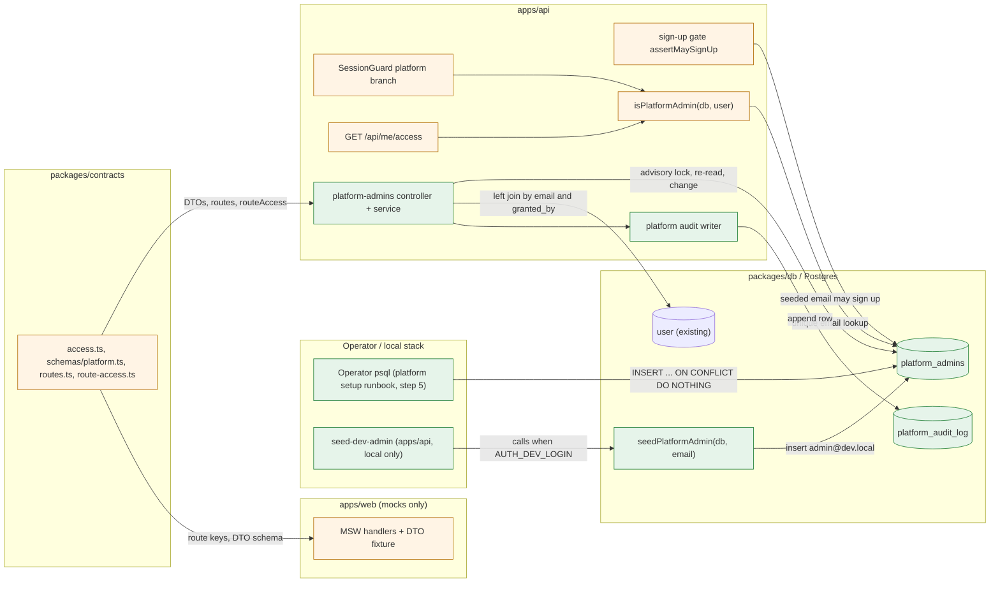
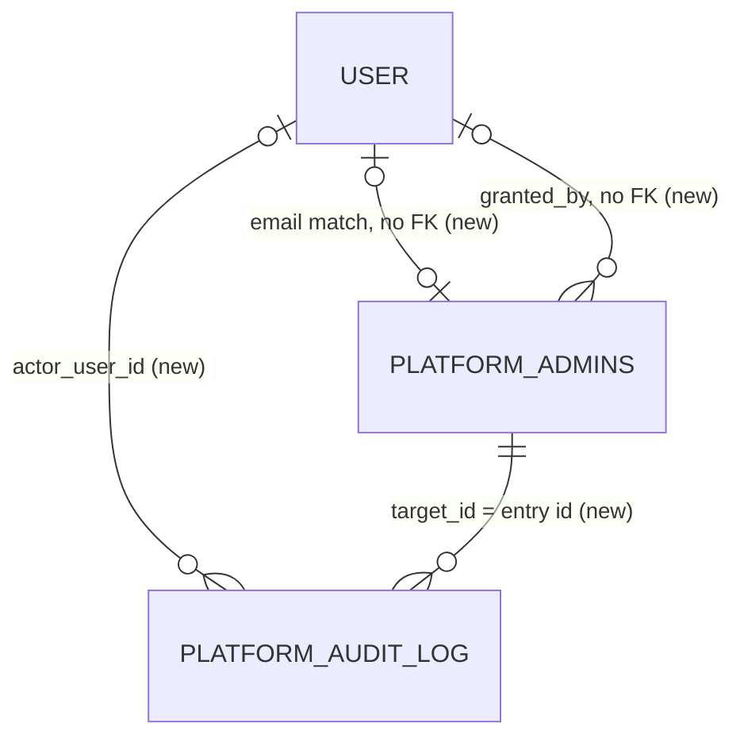

<!-- dev-plan: kind=spec id=platform-admin-role rev=2 hash=09619d7db012 source=issue#215 -->
# Platform admin role design

Status: draft. Sensitive paths: auth (the sign-up gate `assertMaySignUp`, the session guard's platform branch, the
platform admin resolver `isPlatformAdmin`, dev login now passing the gate through a seeded row); authz (three new
`scope: 'platform'` routes and three new platform permissions); migrations (new migration `0033_platform_admins.sql`:
two platform tables with no `org_id` and no RLS, plus grants to `agentdesk_app`). Needs `review:sensitive` and a
high-effort security review.
Source: issue #215 (the grant/revoke slice of the platform role in #192, epic #185)

## Summary

Today a platform admin exists only as an email in the `PLATFORM_ADMIN_EMAILS` env var, so adding one means editing
config and restarting the API. After this change, platform admins are read only from a new `platform_admins` table and
the env var is removed. An operator seeds the first admin by hand with one SQL statement, as one step of a new platform
setup runbook (`docs/runbooks/platform-setup.md`); local dev and e2e seed `admin@dev.local` automatically. From then on,
platform admins list, grant and revoke the role through the API (`/api/platform/admins`); the web UI is deferred to #192.

## Business rules

Confirmed by the human at planning time.

### Goal

Today the only way to add a platform admin is to edit config and restart the API. When solved: platform admins are read
only from the database. The first one is seeded by hand following the platform setup runbook. After that, a platform
admin grants and revokes the role for existing users from the product (the API in this slice).

Words used here:

- **Platform admin**: a person whose sign-in email has a row in `platform_admins` and is verified.
- **Seed**: one SQL statement the operator runs against the database (written in the runbook) that adds an email to
  `platform_admins`; the person may not have an account yet.
- **Working admin**: a `platform_admins` row whose email belongs to an existing user with a verified email.

### Actors

| Actor | May do |
| ----- | ------ |
| Operator (has database access) | Seeds the first platform admin by following the platform setup runbook. This is the only way to get a platform admin when there is none. |
| Platform admin | Lists platform admins; grants the role to any existing user with a verified email; revokes it from any platform admin entry except the last working one. Keeps every platform power it has today (create orgs, the platform member, assignment and invitation routes). |
| Any other user (org owner, org admin, project admin, member, viewer, no org) | Nothing on the new routes: 403 before any lookup. Sees only their own `platformAdmin` flag on `GET /api/me/access`. |
| Local developer and e2e | Sign in with dev login as `admin`, who is a platform admin on the local stack. |

No outside party (ticket source, SCM webhook) is involved.

### Rules

Surface: API (the human: "we just impl API only for now"; no screen, control or text a person sees changes in this
slice). The outermost surfaces are the `/api/platform/admins` routes, `GET /api/me/access`, and the sign-in endpoints
(provider sign-in and `/auth/dev-login`) through the sign-up gate. The seed is an operator step in a runbook, not a
product surface.

| Id    | Category         | Rule |
| ----- | ---------------- | ---- |
| BR-1  | permission       | When a platform admin calls `GET /api/platform/admins`, they get a page of every platform admin entry, each with id, email, userId, name, handle, grantedAt and grantedBy (userId, name and handle null when the email has no account; grantedBy null for a hand-seeded entry or a granter who is gone). |
| BR-4  | state-transition | When a platform admin grants the role (`POST /api/platform/admins`) to the email of an existing user with a verified email, they get 201 with the new entry, and a later list call includes it. |
| BR-5  | permission       | When a user has been granted the role, on their next request `GET /api/me/access` answers `platformAdmin: true` and platform routes (for example `GET /api/platform/orgs`) answer 200. |
| BR-6  | validation       | When the grant email is missing, not an email, or longer than 254 characters, the platform admin gets 400 and nothing is granted. |
| BR-7  | validation       | When no user has the grant email, the platform admin gets 404 pointing at `/email` and the list does not change. |
| BR-8  | validation       | When the user with the grant email is not verified, the platform admin gets 422 pointing at `/email` and the list does not change. |
| BR-9  | state-transition | When the grant email already belongs to a platform admin, the platform admin gets 200 with the existing entry, and the list still holds it once. |
| BR-10 | state-transition | When a platform admin revokes another entry (`DELETE /api/platform/admins/:adminId`) while at least one other working admin remains, they get 204 and a later list call no longer includes it. |
| BR-11 | permission       | When a user's role has been revoked, their next request on the same session gets `platformAdmin: false` from `GET /api/me/access` and 403 from every platform route. |
| BR-12 | limit            | When the entry to revoke is the last working platform admin, the platform admin gets 409 and the list does not change. |
| BR-13 | state-transition | When a platform admin revokes their own entry while another working admin remains, they get 204, and their next platform request gets 403. |
| BR-14 | limit            | When the last two working admins revoke each other at the same moment, one gets 204 and the other 409; one admin remains. |
| BR-15 | permission       | When a user who is not a platform admin (org owner, admin, project admin, member, viewer, or no org) calls the list, grant or revoke route, they get 403 before any lookup (an unknown email or id still gets 403, no existence hint); a platform admin still gets no tenant data on `/api/orgs/*` from this role. |
| BR-23 | permission       | When the product runs in production, `/auth/dev-login` answers 404 (existing behaviour, restated by the requirement). |
| BR-25 | permission       | When the operator has seeded an email and that person signs in for the first time with it (verified, no invitation), an account is created and `GET /api/me/access` answers `platformAdmin: true`. |
| BR-26 | permission       | When `PLATFORM_ADMIN_EMAILS` is still set in a deploy's config, an email listed there that is not seeded is no platform admin (`platformAdmin: false`, 403 on platform routes), and its first sign-in without an invitation is refused with the no-invitation code and no account. |
| BR-27 | permission       | When no platform admin entry matches a verified user, every caller gets 403 on platform routes and `platformAdmin: false`. |
| BR-28 | permission       | When the local stack starts on a fresh database (or after `devbox run db-reset`) with dev login on, `/auth/dev-login?handle=admin` signs in a user whose `GET /api/me/access` answers `platformAdmin: true`, with no extra step. |
| BR-29 | state-transition | When a seeded email has not signed in yet, the list returns its entry with the email and null userId, name, handle and grantedBy; a platform admin can revoke it (204), and it never counts as the last working admin. |
| BR-30 | state-transition | When a platform admin's account no longer exists (deleted outside the product; no product flow deletes accounts today), the list still returns the entry with null userId, name and handle, it does not count toward the last-admin 409, and the same email signing up again (verified, no invitation) gets `platformAdmin: true` until the entry is revoked. |

Ids not used: BR-2 and BR-16 to BR-22 (bootstrap and retire) were dropped by the human's design change; BR-3 (page
loading and error states) and BR-24 (menu entry) were deferred to #192 with the UI.

### Not observable

- Platform audit entries for grant and revoke (actor, target, action, time; a refused change writes none). There is no
  audit route in scope; proven at the API and DB layer. Target type `platform_admin`, target id = the entry id, and the
  payload holds the email and account id (null if none). Covers the effect of BR-4, BR-10, BR-13.
- The hand seed writes no audit entry (it happens outside the app).
- The removed config key being ignored: seen only through BR-26.
- The runbook's content: a document, checked in review.
- The existing screens that follow `platformAdmin` (Create organization, `/orgs/new`): no web change in this slice;
  their behaviour is already covered by the onboarding spec's BR-34, BR-40, BR-46, and BR-5 and BR-11 prove the flag
  they read.

### States

Per user:

- not admin → admin: a platform admin grants it (the user exists and the email is verified); or the operator seeds it.
- admin → not admin: a platform admin revokes it; refused if this is the last working admin.
- admin → admin: a repeat grant changes nothing and shows no error.
- not admin → revoke: refused (not found).
- platform with no admin → one admin: only through the seed (the product cannot do it).
- one admin → no admin: impossible through the product.

### Limits and validation

- Grant: `email` is required. It uses the invitation email format (`InvitationEmail` in
  `packages/contracts/src/schemas/access.ts`): at most 254 characters, trimmed, case-insensitive (lowercased).
- Revoke: the target entry's `adminId` from the list (a uuid; a malformed one gets 400). No other input.
- Seed: one lowercase email in a SQL statement; a database CHECK refuses an uppercase or blank email.
- No quota or rate limit is stated, so none is added.

### Edge cases

- No user has the email: refused (404), nothing changes.
- The user's email is not verified: refused (422).
- Already a platform admin: nothing changes, no error (200).
- Revoking an entry that does not exist: not found (404).
- Two admins left and each revokes the other at the same moment: exactly one revoke succeeds, the other is refused as
  last admin.
- Self-revoke while another working admin remains: allowed. The user loses platform access on their next request.
- No platform admin at all (fresh install not yet seeded, or an upgrade not yet seeded): nobody sees Create organization
  and the platform routes are 403 for everyone. Existing org users carry on as before. The runbook's seed step fixes it.
- `PLATFORM_ADMIN_EMAILS` still set in an old deploy config: it is no longer read and grants nothing, with no startup
  warning.
- A platform admin's account is deleted (no product flow does this today): the email entry stays, does not count for
  the last-admin guard, and the same email signing up again is a platform admin until revoked (BR-30).
- A seeded email nobody has signed in with yet: listed by email with null account fields, revocable, and it does not
  count as the last admin (BR-29).
- A row exists but the session email is not verified: no platform access (403).

### Tenancy and permission

- List platform admins: `platform-admin:read`, platform level. Reads the entries of platform admins only (id, email,
  account id, name, handle, grant time, granter's name and handle). No org or project data.
- Grant: `platform-admin:create`, platform level. Writes one `platform_admins` entry and one platform audit entry.
- Revoke: `platform-admin:delete`, platform level. Removes one entry and writes one platform audit entry.
- Every platform admin holds every `platform-*` permission, and tenant roles never do (ADR-0036). Permissions change
  only in `packages/contracts/src/access.ts`.
- Org owners and every other tenant role get 403 before any lookup. Being a platform admin gives no tenant data (rbac
  spec BR-38, BR-70; epic #185 G4).
- Org and project scope: none, because this is platform data. Tenant users never see who the platform admins are; they
  only see their own `platformAdmin` flag.
- The platform role belongs to the user (by email), never to an org membership.
- The seed is done outside the product, so no route and no permission apply.

### Lifecycle, compatibility and side effects

- Create: a seed or a grant. Delete: a revoke only. Deleting a user's account does not remove the entry: it stays, does
  not count toward the last-admin rule, and the same email signing up again is a platform admin until revoked. Entries
  are never edited.
- Audit: each grant and revoke writes an append-only platform audit entry (actor, action, time; target = the platform
  admin entry, with its email and account id, null if none, in the payload) that tenants can never read. No retention
  limit is stated, so entries are kept. A repeat grant and a refused change write none. The manual seed is not audited
  by the product; the runbook says so.
- Status is read on every request, so a grant or revoke takes effect on that user's next request.
- Existing deploys: after upgrade, config admins are no longer platform admins until the operator seeds them. Their
  accounts and org access are untouched. The runbook has an upgrade note: seed your admin before or right after
  deploying.
- Local stack and e2e: dev stack start and `devbox run db-reset` (followed by the next start) run the documented seed
  for `admin@dev.local` automatically when dev login is on; the API test helper seeds too; production is manual.
- Dev login: still 404 in production and refused by config there. It now signs up a handle whose email is seeded or has
  a pending invitation, instead of one listed in `PLATFORM_ADMIN_EMAILS`.
- Sign-up gate: the `PLATFORM_ADMIN_EMAILS` exception becomes "the email has a `platform_admins` row"; same refusal
  code, which still never says which check failed.
- Setup guide: one platform setup runbook walks the full setup of the platform step by step, with "seed the first
  platform admin" as one step, plus the recovery and upgrade notes for that step. The seed is also the recovery path if
  the platform ever ends up with no working admin.
- What a user sees: a granted user's `GET /api/me/access` answers `platformAdmin: true` on their next request and
  platform routes answer 2xx; a revoked user's answers `false` and platform routes 403. The existing screens gated by
  `platformAdmin` (Create organization on the welcome page and in the org switcher, `/orgs/new`; onboarding spec BR-34,
  BR-40) follow that flag unchanged. No ticket comments, notifications or live-stream events.
- Docs updated in the same change: ADR-0031 line 18 (amended by the new ADR-0037), `docs/conventions/database.md` §2
  exceptions, `docs/superpowers/specs/2026-11-20-rbac-foundation-design.md` lines 9, 23, 183, 262,
  `docs/superpowers/specs/2026-11-22-desk-access-matrix.md` line 57,
  `docs/superpowers/specs/2026-11-21-org-onboarding-design.md` line 33, `docs/runbooks/local-dev.md`,
  `docs/runbooks/tests-and-e2e.md` (line 87), `docs/runbooks/database-local.md`, `docs/runbooks/README.md`, and
  `.env.example`; the new `docs/runbooks/platform-setup.md` is added. The plan
  `docs/superpowers/plans/2026-11-21-rbac-foundation.md` is a record of finished work and is left as is.

### Out of scope

- The web UI for listing, granting and revoking platform admins (page, nav entry, dialog, states, stories, mock e2e):
  deferred to #192 by the human; a note goes on #192 listing that UI and its deferred tests.
- Tenant directory, suspend and support access stay in #192 and are not added here.
- Dropped by the human's design change: the env bootstrap phase, the retire step for a bootstrap account, and the
  stale env-list warning.
- No view of the platform audit log.

## Architecture

Confirmed by the human at planning time.

### Overview



Layers (imports `apps → core → db → contracts`, `web → contracts`):

- `packages/contracts`: three permissions, the DTOs, three route-table entries and their `routeAccess` entries.
- `packages/db`: schema for `platform_admins` and `platform_audit_log`, one new migration, and
  `seedPlatformAdmin(db, email)`.
- `packages/core`: the config schema loses `PLATFORM_ADMIN_EMAILS` (nothing else).
- `apps/api`: `access/platform-admin.ts` becomes an async DB lookup; the session guard, `/me/access` and the sign-up gate
  call it; a new `platform-admins` module (controller + service); a platform audit writer next to
  `audit/audit-entry.ts`; a new one-shot entrypoint `apps/api/src/seed-dev-admin.ts` with package script
  `seed:dev-admin`, wired into `process-compose.yaml`, `scripts/dev.sh` and `scripts/runner-stack.sh` (local stacks
  only).
- `apps/web`: no feature module, route or screen (UI deferred to #192). Only what the contracts change forces: the MSW
  `impl` map in `apps/web/src/mocks/msw/handlers.ts` is typed `Record<JsonKey, …>` and `mocks/msw/contract.test.ts`
  asserts a handler for every route key and parses every DTO fixture, so it gets three handlers
  (`platform.listAdmins` → `slicePage(platformAdminFixtures)`, `platform.grantAdmin` → a fixture with status 201 in
  `STATUS`, `platform.revokeAdmin` → `null`) and a `platformAdminFixtures` list in `mocks/dto/` added to the
  fixture-parse test. The generic platform-scope 403 in `contractHandler` already covers them. `AccessDto` is unchanged,
  so nothing else in web moves.
- `apps/worker`, runner: no change.

**Why the table is keyed by email (chicken-and-egg).** On a fresh platform nobody can get an account: sign-up needs a
pending invitation, invitations need an org, orgs need a platform admin. Today the env list breaks the loop. With it
gone, the hand-seeded row breaks it, so the row must work before the person has an account.

**Sign-up gate, dev login and local/e2e.**

- Sign-up gate: `assertMaySignUp` replaces "email in `PLATFORM_ADMIN_EMAILS`" with "email has a `platform_admins` row".
  Same shape, same refusal code (`NO_INVITATION_CODE`), still never says which check failed.
- Dev login: code unchanged. `admin@dev.local` signs in only after it is seeded (it passes the gate through its row;
  dev login already marks it verified). Still 404 in production; `AUTH_DEV_LOGIN=true` still refused in production.
- Local dev: every stack start seeds `admin@dev.local` automatically when dev login is on, so `dev-login?handle=admin`
  works on a fresh DB and after `devbox run db-reset` with no extra step.
- Local e2e: the stack is already seeded by its start. Grant/revoke specs use fresh `e2e-<rand>` users and never touch
  `admin@dev.local`'s row, so the shared stack keeps working.
- API integration tests: `validEnv` loses `PLATFORM_ADMIN_EMAILS`; `createTestApp` calls `seedPlatformAdmin` for
  `admin@dev.local` on the test DB (idempotent), so existing int files keep signing in as `admin` through the real guard.
- Existing deployments: after deploy nobody is a platform admin until an operator seeds a row (upgrade note in the
  runbook).

**How the first admin is seeded.** The seed is one statement, the same everywhere:

```sql
INSERT INTO platform_admins (email) VALUES ('ops@example.com') ON CONFLICT (email) DO NOTHING;
```

The email must be lowercase (a CHECK refuses anything else) and match the address the person signs in with (the
verified primary email from the sign-in provider; `admin@dev.local` locally). The person then signs in, the gate lets
the seeded email sign up without an invitation, and they are a platform admin. From then on admins are granted and
revoked in the product.

- Production and any deployed env (manual): the operator runs the statement with psql against the `agentdesk` database
  as a role with INSERT on `platform_admins` (`agentdesk_app` or `agentdesk_owner`), following step 5 of the platform
  setup runbook.
- Local stack (automatic): one function holds the statement, `seedPlatformAdmin(db, email)` in `packages/db` (bound
  parameter, email trimmed and lowercased, `ON CONFLICT (email) DO NOTHING`); it is the one source of the statement, and
  the runbook quotes it. No test compares the runbook text with the code. The entrypoint
  `apps/api/src/seed-dev-admin.ts` (package script `seed:dev-admin`, run with `tsx --env-file-if-exists=../../.env` like
  `migrate`) parses the config with core's `parseConfig`. Its gate is a pure exported function
  `devAdminSeedEnabled(config)`, true only when `AUTH_DEV_LOGIN` is on (production never reaches it, because
  `parseConfig` refuses dev login there), and the entrypoint is a thin wrapper: it does nothing and exits 0 when the gate
  is false; otherwise it connects with `DATABASE_APP_URL` and seeds `admin@dev.local`. It runs after `migrate` in every
  local stack starter: `process-compose.yaml` (new process `seed-dev-admin`, depends on `migrate` completed; `api`
  depends on it completed, so a ready API is a seeded API), `scripts/dev.sh up`, and `scripts/runner-stack.sh` (runner
  pods). `devbox run db-reset` wipes the volume; the next `devbox run dev` migrates and seeds, so db-reset only gets its
  message updated.
- API int tests: `createTestApp` calls `seedPlatformAdmin` for `admin@dev.local`.

**Platform setup runbook.** One new runbook, `docs/runbooks/platform-setup.md` ("Set up the platform"), walks the full
setup step by step; seeding the first platform admin is one step. Each step is taken from what the repo has:

1. Prerequisites: Postgres 18 and Temporal reachable; a Kubernetes cluster for run pods; images built from
   `apps/api/Dockerfile`, `apps/worker/Dockerfile`, `apps/web/Dockerfile` and `images/runner/` (CI `images / build`,
   `scripts/smoke-app-images.sh`).
2. Configure: the required env from `packages/core/src/config.ts` (`PUBLIC_ORIGIN`, `DATABASE_APP_URL`,
   `DATABASE_OWNER_URL`, `DATABASE_ADMIN_URL`, `TEMPORAL_ADDRESS`, `TEMPORAL_NAMESPACE`, `BETTER_AUTH_SECRET` (32+
   characters), `RUNNER_IMAGE`, `KUBE_MODE`), plus `AGENTDESK_OWNER_PASSWORD`, `AGENTDESK_APP_PASSWORD` and
   `TEMPORAL_PASSWORD` for the migrate step (`apps/api/src/migrate.ts`). The production rules the config enforces:
   `NODE_ENV=production` refuses `AUTH_DEV_LOGIN`, `ENABLE_FAKE_PROVIDER` and `KUBE_MODE=fake`, and needs a run-volume
   storage class; `GITHUB_*` keys are all-or-none, and sign-in needs `GITHUB_CLIENT_ID`/`GITHUB_CLIENT_SECRET`.
   `.env.example` is the reference list.
3. Create database roles and migrate: the api image with `node --import tsx src/migrate.ts` (`apps/api/Dockerfile`
   comment); `pnpm db:migrate` from a checkout.
4. Start api, worker and web, then check `GET /healthz` and `GET /readyz` on the api.
5. Seed the first platform admin: the one statement, the role to run it as, the lowercase email that must match the
   verified sign-in email, and the note that this step is not audited.
6. Sign in and create the first org: the seeded person signs in, creates an org (Create organization at `/orgs/new`, or
   `POST /api/platform/orgs`) and invites its owner (the platform invitation routes).

It also has an Upgrade note (existing deploys: run step 5 before or right after deploying, because nobody is a platform
admin until then), Recovery (no working admin left: run step 5 again), Local stack (`devbox run dev` does steps 3 to 5
for you, the seed only when dev login is on; see `local-dev.md`), and a troubleshooting table (403 on every platform
route → step 5 missing or the email does not match; sign-in shows the no-invitation message → the seeded email differs
from the provider's verified email).

How it fits with the other docs:

- `docs/runbooks/README.md`: a new row in Operations ("Set up a new Agent Desk platform: config, migrate, start, seed the
  first platform admin, first org"). The planned `agentdesk-install.md` row stays; that target-specific runbook (age
  key, secrets, tunnel, Flux) is not written yet and can link to `platform-setup.md` for the app steps when it is.
- `local-dev.md` §4 step 1: drops `PLATFORM_ADMIN_EMAILS`, says the local stack seeds `admin@dev.local` automatically
  when dev login is on, and links `platform-setup.md` step 5 for how seeding works.
- `tests-and-e2e.md` (line 87): the local e2e needs `AUTH_DEV_LOGIN=true` (the stack then seeds `admin@dev.local`);
  `PLATFORM_ADMIN_EMAILS` is removed.
- `database-local.md` "Seed data": one line that the stack start seeds the dev platform admin, linking the runbook.
- No other install or setup doc exists in the repo (`deploy/` does not exist; infra spec §9.1 only plans the ops
  runbooks), so nothing else changes.

### Data model

Migration: new `0033_platform_admins.sql` (generated tables plus hand-written grants). No backfill: the first row is
seeded by hand.



#### platform_admins (new; scope: platform, no org)

| Field | Type | Null | Default | Key / index | Change | Notes |
| ----- | ---- | ---- | ------- | ----------- | ------ | ----- |
| `id` | uuid | no | `gen_random_uuid()` | PK | added | The revoke path param `adminId`. |
| `email` | text | no | — | unique `platform_admins_email_key`; CHECK `platform_admins_email_check (email = lower(btrim(email)) and email <> '')` | added | Lowercased, like `invitations.email`. Matched against the session's verified email. |
| `granted_by` | text | yes | — | no FK (like `role_assignments.granted_by`) | added | The granting user's id; null for a seeded row. |
| `granted_at` | timestamptz | no | `now()` | — | added | Orders the list. |

No list index beyond the unique email index.

RLS: none, and no `org_id`. Platform data, reached only through `scope: 'platform'` routes, `/me/access` (own flag) and
the sign-up gate. A new exception to `docs/conventions/database.md` §2, recorded in ADR-0037. Grants: `agentdesk_app`
gets SELECT, INSERT, DELETE (no UPDATE: rows are granted or removed, never edited).

#### platform_audit_log (new; scope: platform, no org)

| Field | Type | Null | Default | Key / index | Change | Notes |
| ----- | ---- | ---- | ------- | ----------- | ------ | ----- |
| `id` | uuid | no | `gen_random_uuid()` | PK | added | |
| `actor_user_id` | text | yes | — | — | added | The session user who granted or revoked. |
| `action` | text | no | — | — | added | `platform_admin.granted` or `platform_admin.revoked`. |
| `target_type` | text | no | — | — | added | `'platform_admin'`. |
| `target_id` | text | no | — | — | added | The `platform_admins.id` of the entry. |
| `payload` | jsonb | no | `'{}'` | — | added | `{ email, userId }` (`userId` = the account id, null if the email has no account), passed through `redactBody`. |
| `created_at` | timestamptz | no | `now()` | index `platform_audit_log_created_at_idx (created_at, id)` | added | |

RLS: none, and no `org_id` (same exception and ADR as above). Grants: `agentdesk_app` gets SELECT, INSERT only
(append-only by grant).

No change to existing tables: `user` gets no role column; `audit_log` (`org_id` NOT NULL) is not used for platform
entries. Platform permissions are never seeded into role tables, so there is no role migration.

### API

| Method | Path | Who may call it | Request | Response | Contract |
| ------ | ---- | --------------- | ------- | -------- | -------- |
| GET | `/api/platform/admins` | platform admin (`platform-admin:read`, platform level) | `PageQuery` | 200 `Page<PlatformAdminDto>`, ordered `granted_at desc, id`; 403 | `platform.listAdmins` |
| POST | `/api/platform/admins` | platform admin (`platform-admin:create`, platform level) | `GrantPlatformAdminRequest { email }` | 201 `PlatformAdminDto` (new); 200 `PlatformAdminDto` (already an admin: no change, no audit row); 400 bad email; 404 no user with that email (pointer `/email`); 422 email not verified (pointer `/email`); 403 | `platform.grantAdmin` |
| DELETE | `/api/platform/admins/:adminId` | platform admin (`platform-admin:delete`, platform level) | path `adminId` (uuid) | 204; 400 bad uuid; 404 no such row; 409 last platform admin; 403 | `platform.revokeAdmin` |

All three are `scope: 'platform'`: session guard → `isPlatformAdmin(db, user)` → 403 (logged deny, before any lookup)
if not. No org, no project; `X-Org` is ignored (ADR-0035). Each has a `routeAccess` entry and goes through the guard;
the actor comes from the session, never the body.

Contracts:

- `access.ts`: add `platform-admin:read`, `platform-admin:create`, `platform-admin:delete` (12 → 15 platform
  permissions).
- `schemas/platform.ts`: `PlatformAdminDto { id, email, userId: string | null, name: string | null, handle: string |
  null, grantedAt, grantedBy: InviterDto | null }` (the human: "return full to repare for UI"). `userId`, `name` and
  `handle` come from the `user` whose email matches (left join), null when no account has that email (seeded and not
  signed in yet, or account deleted). `grantedBy` is `InviterDto { name, handle }` of the `user` whose id is
  `granted_by`, null for a seeded row or a granter who is gone (same pattern as `InvitationDto.invitedBy`). One query
  with two left joins, no per-row lookups (`database.md` §8). No `isYou` field. `GrantPlatformAdminRequest { email }`
  reuses `InvitationEmail` (trimmed, lowercased, max 254).
- `routes.ts` `platform.*`: `listAdmins`, `grantAdmin`, `revokeAdmin`; `route-access.ts`: three `platform(...)` entries.
- `routes.test.ts`: "12 platform routes under /api/platform/orgs" becomes 15 under `/api/platform/`
  (`route-access.test.ts` already pins scope `platform` to `/api/platform/` paths).
- Offset pagination (ADR-0028).

Resolver `isPlatformAdmin(db, user)`: false when the session email is not verified; else true when a row exists for
`lower(trim(email))` (one unique-index lookup). Used by the guard's platform branch and `/me/access`. No cache: grant and
revoke take effect on the user's next request. A DB error fails closed (500, no admin rights).

Writes run in one `db.orm.transaction` under `pg_advisory_xact_lock(hashtext('platform_admins'))` (the repo's
advisory-lock pattern, as in `apps/api/src/invitations/my-invitations.service.ts`): re-read, change, write the
`platform_audit_log` row. Revoke refuses (409) when, after removal, no row would remain whose email belongs to an
existing user with a verified email. A repeat grant answers 200 with no change. Self-revoke is allowed unless it is the
last working admin. A deleted account's entry stays and does not count, by design (email key, no FK to `user`, the
last-admin count only matches existing verified users).

Existing surfaces: `GET /api/me/access` keeps its shape; `AccessDto.platformAdmin` now comes from the database. The
sign-in endpoints (provider sign-in, `/auth/dev-login`) keep their shape; only the sign-up gate's exception changes.

WebSocket, terminal, webhooks: no change.

### Third-party libraries

| Library | New or existing | Used for | Approval |
| ------- | --------------- | -------- | -------- |
| better-auth | existing | Sessions, sign-up gate hook (the admin plugin is not used) | existing |
| drizzle-orm / drizzle-kit | existing | Schema, generated migration, queries | existing |
| zod | existing | Contracts schemas | existing |
| NestJS | existing | `platform-admins` controller and service | existing |
| tsx | existing | Running `seed-dev-admin.ts` | existing |
| MSW | existing | Web mock handlers for the three routes | existing |

### Services and integrations

| Service | New or existing | How it is used |
| ------- | --------------- | -------------- |
| Postgres | existing | Two new tables and one advisory lock key (`hashtext('platform_admins')`). |

No Temporal, Kubernetes, SecretStore or provider API.

### Configuration

| Name | Kind | Added or changed | Where it is set | Default | Used by | Purpose |
| ---- | ---- | ---------------- | --------------- | ------- | ------- | ------- |
| `PLATFORM_ADMIN_EMAILS` | env var | removed | was in `.env.example`, `packages/core/src/config.ts`, `apps/api/test/helpers/app.ts` `validEnv` | — | nothing | Replaced by `platform_admins`. A leftover value in an environment is dropped by the non-strict config schema, grants nothing, and logs no warning. |
| `AUTH_DEV_LOGIN` | env var | changed (one new reader) | `.env.example`, `packages/core/src/config.ts` | `false` (`true` in `.env.example`) | dev login; now also `seed-dev-admin` | Still refused in production; now also gates the local seed step. |

No new env var or feature flag. `PLATFORM_ADMIN_EMAILS` is also removed from its tests (`packages/core/test/config.test.ts`)
and from every doc and comment that names it (`local-dev.md`, `tests-and-e2e.md`, `scripts/e2e-local.ts`,
`apps/web/e2e/local/helpers.ts`).

### Other decisions

- Events and live updates: none. No web consumer in this change; `/api/me/access` keeps reporting `platformAdmin`, so the
  existing Create organization entry shows and hides correctly after a grant or revoke on the next access fetch.
- Workflows (worker), runner and Kubernetes, provider adapters: no change. Provider sign-in goes through the same gate; no
  provider name in the new tables, types or routes.
- Secrets: none touched. The audit payload holds the target email and account id, never a token, and goes through
  `redactBody`.
- Observability: info log on grant and revoke (actor and target user ids, no emails); the existing "access denied" log
  on 403. Errors a caller sees: 403 not an admin; 404 no such user or row; 422 unverified email; 409 last admin; 500 on a
  DB error (fails closed).
- A platform with no row: every platform route is 403 and sign-up needs an invitation; the fix is the runbook's seed
  step.
- Scale: one unique-index lookup per platform request and per `/me/access`; independent of orgs, projects and runs.
- Seed tests: a test of the gating (`devAdminSeedEnabled` and the entrypoint wrapper) and an integration test that runs
  `seedPlatformAdmin` on a real Postgres (lowercase, idempotent rerun, and that a seeded email then signs in as admin).
  The file names are in `## Testing`.
- Sensitive paths: auth (sign-up gate, guard platform branch), authz (new platform routes, resolver), migration (two
  tables, grants). `review:sensitive` plus a high-effort security review.
- ADR: new ADR-0037 "Platform admins are stored in the database and seeded by hand", amending ADR-0031's "Platform
  admins (`PLATFORM_ADMIN_EMAILS` …)" line and recording the two no-`org_id` platform tables. The same PR updates
  `database.md` §2 exceptions and the stale config-only platform admin lines in
  `docs/superpowers/specs/2026-11-20-rbac-foundation-design.md`.

## Testing

Confirmed by the human at planning time.

All API cases use real Postgres as `agentdesk_app`, the real `SessionGuard`, and `expectContract` on every response;
the access check is never mocked. Each behaviour gets its lowest layer plus e2e or a stated reason. This is a feature,
not a bug fix: red → green per plan task.

| Rule | Behaviour | Layer | Where the test lives | E2E env |
| ---- | --------- | ----- | -------------------- | ------- |
| BR-1 | A platform admin lists admins, paged, ordered `granted_at desc, id`. Each entry has exactly `id, email, userId, name, handle, grantedAt, grantedBy` with their nullability; a granted entry carries the granter as `grantedBy`; a seeded entry and an entry whose granter's account is deleted have `grantedBy: null`. E2E: the list includes `admin@dev.local`. | contract (`PlatformAdminDto`, `pageOf`); integration; e2e | `packages/contracts/src/schemas/platform.test.ts`; `apps/api/test/platform-admins.int.test.ts`; `apps/web/e2e/local/platform-admins.spec.ts` | local |
| BR-4 | Grant by the email of an existing verified user → 201, stored lowercased, audit row with actor = session user. E2E: the admin grants a fresh user → 201. | integration; e2e | platform-admins int; platform-admins spec | local |
| BR-5 | The grantee's next request (same user's cookie or context): `/api/me/access` true, `GET /api/platform/orgs` 200. | integration; e2e | platform-admins int; platform-admins spec | local |
| BR-6 | Empty, malformed, 255-character email; trim and lowercase; strict schema rejects extra keys → 400 with pointer, no row. | contract (`GrantPlatformAdminRequest`); integration; e2e (malformed email → 400 with pointer) | contracts; platform-admins int; platform-admins spec | local |
| BR-7 | No user with that email → 404, pointer `/email`, no row, no audit. E2E: a never-signed-in `e2e-<rand>@dev.local`. | integration; e2e | platform-admins int; platform-admins spec | local |
| BR-8 | Unverified target → 422, pointer `/email`, no row, no audit; a row plus an unverified session → 403. | integration | platform-admins int | — |
| BR-9 | Repeat grant → 200, no change, one row, no second audit row. E2E: same grant again → 200, the user listed once. | integration; e2e | platform-admins int; platform-admins spec | local |
| BR-10 | Revoke → 204, audited, gone from the list. | integration; e2e | platform-admins int; platform-admins spec | local |
| BR-11 | The revoked user's same session → 403 on the next platform call, `/me/access` false (replaces the old "removing the email from config" case). | integration; e2e | platform-admins int; platform-admins spec | local |
| BR-12 | Revoking the last working admin → 409, no change. | integration on a fresh DB | platform-admins int | — |
| BR-13 | Self-revoke while another verified admin remains → 204, then 403. | integration; e2e | platform-admins int; platform-admins spec | local |
| BR-14 | Same-moment mutual revokes (`Promise.all`) → one 204, one 409, one admin left; assert the set of outcomes, not their order. | integration on a fresh DB | platform-admins int | — |
| BR-15 | Owner, org admin, project admin, member, viewer, no-org user → 403 `FORBIDDEN_DETAIL` before lookup on every route (unknown email or `adminId` gives the same 403); deny log carries ids only. E2E (the role-based case): an org owner of a fresh org gets 403 on list, grant and revoke. | integration; e2e | platform-admins int; platform-admins spec | local |
| BR-23 | Dev login answers 404 in production; config refuses `AUTH_DEV_LOGIN=true` in production (existing tests, kept). | integration; unit | `apps/api/test/platform.int.test.ts` (N9); `packages/core/test/config.test.ts` | — |
| BR-25 | On a fresh DB: run the seed statement → dev login and a social sign-in with a verified email sign up with no invitation and are admin; an unverified provider email is refused; a seeded row revoked before first sign-in → refused. | integration on a fresh DB | `apps/api/test/auth.int.test.ts` (rewritten env cases) | — |
| BR-26 | `createTestApp({ env: { PLATFORM_ADMIN_EMAILS: 'stale@dev.local' } })`: not admin, sign-up refused `no_invitation`; config drops the key. | integration; unit | an API int test in `apps/api/test/` (the plan names the file); `packages/core/test/config.test.ts` | — |
| BR-27 | Fresh DB with no row: `/me/access` false, platform routes 403. | integration on a fresh DB | an API int test in `apps/api/test/` (the plan names the file) | — |
| BR-28 | Gate: with `AUTH_DEV_LOGIN` false the dev seed entrypoint exits 0 and calls no seeder; with true it seeds `admin@dev.local` once. Wiring: `scripts/dev.sh` and `scripts/runner-stack.sh` run `seed:dev-admin` after migrate (a stub `pnpm` on `PATH` records the order). Integration: `seedPlatformAdmin` on a real DB as `agentdesk_app` inserts the trimmed, lowercased email, runs twice without error and leaves one row; then a `createTestApp` dev login as `admin` gets `platformAdmin: true`. E2E: `asPlatformAdmin()` → `/api/me/access` `platformAdmin: true`. | unit; scripts test; integration; e2e | gate: `apps/api/test/seed-dev-admin.test.ts`; wiring: a new scripts test under `scripts/` (the plan names the file); integration: `packages/db/test/seed-platform-admin.int.test.ts` and platform-admins int; platform-admins spec | local |
| BR-29 | A seeded email with no account is listed with null user fields and is revocable (204). | integration | platform-admins int | — |
| BR-30 | Grant a verified user, then delete their `user` row as the owner role (outside the product). The list still returns the entry with `userId`, `name`, `handle` null (`grantedBy` unchanged). With one other working admin left, revoking that admin gets 409 (the orphan entry does not count). The same email signs up again through dev login with no invitation and gets `/api/me/access` `platformAdmin: true` and 200 on a platform route. After the entry is revoked, a new sign-in of that email with no invitation is refused (`no_invitation`). | integration on a fresh DB | platform-admins int | — |
| — | N-1: the audit row is written in the same transaction (read `platform_audit_log` as owner: `action` `platform_admin.granted` / `platform_admin.revoked`, `actor_user_id` = session user, `target_type = 'platform_admin'`, `target_id` = the entry id, payload `{ email, userId }` with `userId` null for an entry with no account); exactly one row per change, none on 4xx or a repeat grant. | integration | platform-admins int | — |
| — | N-2: the migration applies on a DB with users; no rows after; unique email; CHECK refuses uppercase or blank; app role has no UPDATE on `platform_admins` and no UPDATE/DELETE on `platform_audit_log`. | db integration | `packages/db/test/migrate.int.test.ts` | — |
| — | N-3: 15 platform routes under `/api/platform/`; scope and permission per new route key; the three permissions are platform level and in no tenant role. | contract | `packages/contracts/src/routes.test.ts`, `route-access.test.ts`, `access.test.ts` | — |
| — | N-4: the last-admin count ignores orphan seeded rows. | integration on a fresh DB | platform-admins int | — |
| — | N-5: the dev seed runs only when dev login is on, and `seedPlatformAdmin` is idempotent and stores the email lowercased. | unit; scripts test; db integration | the BR-28 gate, wiring and seed tests | — |
| — | N-6: MSW handlers and the DTO fixture parse with the contracts (handler per route key, GET through schema, fixture parses) plus one case driving the grant/revoke handlers (repeat 200, last-admin 409) so the new handler lines are covered. | web unit | `apps/web/src/mocks/msw/contract.test.ts` | — |

The e2e is one API-level local spec, `apps/web/e2e/local/platform-admins.spec.ts`: Playwright `APIRequestContext`s
only, no browser page, every response parsed with the contracts schemas (the `rbac-platform.spec.ts` pattern). Fresh
`e2e-<rand>` users come from the existing invite and dev-login helpers. Every grant is revoked in a `finally` with
cleanup errors swallowed, and `admin@dev.local`'s row is never touched. No mock e2e: there is no UI change.

### Not provable by e2e

- BR-8: dev login always marks the account verified, so the stack cannot produce an unverified user. Integration proves
  it (unverified row set through the owner role).
- BR-12, BR-14, N-4: the admin count on a shared stack is unknown. Getting it to one would mean revoking
  `admin@dev.local`, which every local spec uses, and a race is not reliable across HTTP clients. Integration on a fresh
  DB proves them.
- BR-23: production cannot run on the local stack. The existing N9 int test and the config refine unit test prove it.
- BR-25 (fresh install), BR-26, BR-27: they need an empty or differently configured DB or env, while the shared stack is
  always seeded with a fixed env. Integration on a fresh DB with its own env proves them. The seeded sign-in itself also
  runs in every local run (BR-28).
- BR-29: a seeded email with no account needs a direct DB insert on the shared stack, which the e2e does not do.
  Integration proves it.
- BR-30: there is no product route to delete an account, so the e2e would have to delete a `user` row directly in the
  shared stack's DB, and the last-admin part needs a known admin count (see BR-12). Integration on a fresh DB proves it,
  deleting the row as the owner role.
- N-1, N-2, N-3, N-5, N-6: not observable. Integration, db integration, contract, unit, scripts and web unit tests prove
  them.
- UI behaviours (page, nav entry, states): deferred to #192 with the UI.

### Fakes and fixtures

- No new fake. better-auth, dev login and Postgres (Testcontainers or `TEST_PG_MODE=local`) run locally; the social
  sign-in case uses the existing fake/recorded path in `auth.int.test.ts`; the scripts test stubs binaries on `PATH` in
  a temp dir with explicit env. The seed int test uses its own fresh DB, so its idempotency check does not depend on
  other files.
- The env-rule tests (`platform.int.test.ts` "platform admin from config" and "platform admin sign-up (BR-62, N9)";
  `auth.int.test.ts` "BR-1: a platform admin with no invitation signs in" and the GitHub env sign-up case) are rewritten
  into DB equivalents that are at least as strict, not dropped: config removal becomes BR-11; env sign-up becomes BR-25
  and BR-26; the config key test goes with the key.
- `createTestApp` seeds `admin@dev.local` after migrate (idempotent), so existing int files keep `asPlatformAdmin(t)`;
  `validEnv` drops `PLATFORM_ADMIN_EMAILS`.
- The test helper and the dev seed call one function, `seedPlatformAdmin(db, email)` in `packages/db`, which the runbook
  quotes. Tests prove that function; no test compares the runbook text with the code (the runbook is a document checked
  in review).
- Count-sensitive cases (BR-12, BR-14, BR-25, BR-27, BR-30, N-4) run on a fresh DB (`createTestApp({ pg: await startPg() })`),
  with seeding controlled per case.
- Shared helpers `grantPlatformAdmin` / `revokePlatformAdmin` in `apps/api/test/helpers/auth.ts` and
  `apps/web/e2e/local/helpers.ts`, so each test does not repeat the grant and revoke calls.
- The e2e helper fails fast, naming the platform setup runbook, when `admin` gets 403 on a platform route, so a missed
  seed shows up as one clear message instead of a cascade of failures.
- A `PlatformAdminDto` fixture list in `apps/web/src/mocks/dto/` and minimal MSW handlers for the three routes in
  `mocks/msw/handlers.ts` (`mockDb` users already have `platformAdmin`). No view fixtures or stories.
- Audit `created_at` and ids are asserted with `expect.any(String)`.

### Security tests

All through the real guard:

- Allowed: a platform admin gets 2xx on all three routes.
- Denied 403 before lookup: owner, org admin, project admin, member, viewer, no-org user. A random `adminId` or unknown
  email gives the same 403 (no existence oracle). The deny log carries ids only.
- 404 for an unknown `adminId` or an email with no user (as admin).
- Verified only: 422 for an unverified target; a row plus an unverified session gives 403.
- Revocation is immediate: same session, next call → 403.
- Cross-tenant: a platform admin with no assignment gets 403/404 on another org's `/api/orgs/*`, with or without an org
  header (rbac spec BR-38).
- Actor from the session: the audit actor is the session user; the strict schema rejects extra keys.
- Sign-up gate: only a seeded email or a pending invitation creates an account; a seeded row revoked before sign-in is
  refused; a leftover env var opens nothing.
- The last admin holds under concurrency; orphan seeded rows do not count.
- The dev seed never runs with dev login off; production refuses `AUTH_DEV_LOGIN=true` (existing).
- Migrations: N-2 in `migrate.int.test.ts`. No `org_id`, so no RLS leak test (the exception is recorded in ADR-0037);
  `APP_TABLES` and the org_id/RLS tests stay unchanged.
- Not touched: webhooks, terminal, untrusted ticket text. The audit payload goes through `redactBody`; the email is a
  bound parameter.

### Coverage risks

- `apps/api/src/auth/**` (sensitive floor 90/72): one int case per gate and guard branch (seeded, invitation, neither,
  unverified, revoked before sign-up, DB error fails closed).
- `packages/contracts` (100% lines): every new schema rule, permission and route entry is tested.
- `apps/api` (baseline 92.8%) and the 80% changed-lines gate: service, resolver and audit writer are covered by
  `platform-admins.int.test.ts`.
- `apps/web` (baseline 95.4%): only the new MSW handler lines change; the N-6 cases cover them.
- The `seed-dev-admin.ts` entrypoint and `seedPlatformAdmin` are new api and db lines, covered by the gate unit test and
  the db int test. The scripts wiring test is outside the gate. No threshold or baseline is lowered.

## Agent calls

- Agent call: plan this as its own slice, not folded into #192 (business: the requirement allows either; #192's other
  parts were not asked for).
- Agent call: "last platform admin" counts platform admins who have an account with a verified email (business: one
  definition everywhere, so the guard never leaves zero working admins).
- Agent call: the last-admin count is "rows that match an existing verified user" (architecture: matches the business
  area's definition; a hand-seeded email nobody has signed in with cannot keep the platform reachable).
- Agent call: a platform admin may grant the role to themselves (no-op if they already hold it) and may revoke their own
  role while another admin remains (business: the requirement guards only the last admin).
- Agent call: the seed in the setup runbook is also the recovery path if the platform ends up with no working admin
  (business: the product has no other way back).
- Agent call: a grant names the user by exact email, with no user picker or directory (business: a user directory
  belongs to #192's tenant directory; platform admins already see emails in `PlatformMemberDto`).
- Agent call: grant by email (architecture: the only identifier needed; no platform-wide user directory route, which was
  not asked for).
- Agent call: revoking an entry that is not a platform admin answers not found (business: same as revoking an unknown
  assignment).
- Agent call: a leftover `PLATFORM_ADMIN_EMAILS` gets no startup warning (business: the human dropped the stale-list
  warning together with the env bootstrap).
- Agent call: a leftover `PLATFORM_ADMIN_EMAILS` in an environment is ignored with no warning (architecture: the
  non-strict config schema drops it; it grants nothing; the human asked for less complexity).
- Agent call: the manual seed is not audited by the product (business: it happens directly in the database, outside the
  app; the runbook says so).
- Agent call: the hand-seeded row writes no platform audit entry, and the dev seed writes none either (architecture: it
  happens outside the app; same statement; matches business).
- Agent call: no automatic carry-over of today's config admins (business: a migration cannot read the old env value, and
  the human asked for the database only).
- Agent call: the runbook is named `docs/runbooks/platform-setup.md` (architecture: a plain name, not `agentdesk-*`,
  because the README reserves that prefix for one deployment target and these steps apply to any target).
- Agent call: key `platform_admins` by email, not by user id (architecture: the hand seed must work before the person has
  an account; better-auth's `user.changeEmail` is off by default and not enabled in `auth.ts`).
- Agent call: no list index on `platform_admins` beyond the unique email index (architecture: a handful of rows).
- Agent call: the local seed is a separate dev-only entrypoint, never inside `migrate.ts` (architecture: the migrate
  entrypoint also runs in deployed envs; keeping the seed out of it means no deployed path can ever run it).
- Agent call: the local seed is gated on `AUTH_DEV_LOGIN` through `parseConfig` (architecture: the existing rule that
  refuses dev login in production also covers the seed; no new env var).
- Agent call: the local seed uses the fixed email `admin@dev.local` (architecture: the dev-login admin handle every local
  spec and runbook already uses; no new env var).
- Agent call: the local seed connects as `agentdesk_app` (architecture: least privilege, it has INSERT on
  `platform_admins`; `database.md` §1 keeps the owner role for migrations).
- Agent call: platform admin rules stay in `apps/api`, not `packages/core` (architecture: all callers are in the api, as
  the current `isPlatformAdmin` and platform controllers are; the worker never reads platform admins).
- Agent call: no `isYou` field in `PlatformAdminDto` (architecture: a client compares `userId` with `AccessDto.userId`).
- Agent call: one advisory lock for grant and revoke (architecture: two admins revoking each other at once must leave
  one; follows the repo's advisory-lock pattern).
- Agent call: count-sensitive cases (BR-12, BR-14, BR-25, BR-27, BR-30, N-4) run on a fresh DB with seeding controlled
  per case (testing: the admin set is global).

## Open questions

None.

## E2E requirements

These rules are requirements. Each is what a user can see at the API (the `/api/platform/admins` routes, `GET /api/me/access`, and the sign-in endpoints through the sign-up gate; no screen changes in this slice); the feature is done when every case below passes as an e2e spec. Derived from this spec's business rules, not from the code.

Conventions for every case: "admin" is the dev-login user `admin` (`/auth/dev-login?handle=admin`, email `admin@dev.local`), a platform admin on the local stack. A "fresh user" is a new `e2e-<rand>` user (email `e2e-<rand>@dev.local`) created and signed in with the existing invite and dev-login helpers, using its own request context (own cookie). Every grant a case makes is revoked at the end and cleanup errors are ignored; no case touches `admin@dev.local`'s own entry.

### Rules

| Id    | Category         | Rule                                                                                                                                                                                                                                                                                                                                                                           | Source                                      |
| ----- | ---------------- | ------------------------------------------------------------------------------------------------------------------------------------------------------------------------------------------------------------------------------------------------------------------------------------------------------------------------------------------------------------------------------ | ------------------------------------------- |
| BR-1  | permission       | When a platform admin calls `GET /api/platform/admins`, they get a page of every platform admin entry, each with id, email, userId, name, handle, grantedAt and grantedBy (userId, name and handle null when the email has no account; grantedBy null for a hand-seeded entry or a granter who is gone).                                                                          | spec ## Business rules > Rules              |
| BR-4  | state-transition | When a platform admin grants the role (`POST /api/platform/admins`) to the email of an existing user with a verified email, they get 201 with the new entry, and a later list call includes it.                                                                                                                                                                                 | spec ## Business rules > Rules              |
| BR-5  | permission       | When a user has been granted the role, on their next request `GET /api/me/access` answers `platformAdmin: true` and platform routes (for example `GET /api/platform/orgs`) answer 200.                                                                                                                                                                                         | spec ## Business rules > Rules              |
| BR-6  | validation       | When the grant email is missing, not an email, or longer than 254 characters, the platform admin gets 400 and nothing is granted.                                                                                                                                                                                                                                              | spec ## Business rules > Rules              |
| BR-7  | validation       | When no user has the grant email, the platform admin gets 404 pointing at `/email` and the list does not change.                                                                                                                                                                                                                                                               | spec ## Business rules > Rules              |
| BR-8  | validation       | When the user with the grant email is not verified, the platform admin gets 422 pointing at `/email` and the list does not change.                                                                                                                                                                                                                                             | spec ## Business rules > Rules              |
| BR-9  | state-transition | When the grant email already belongs to a platform admin, the platform admin gets 200 with the existing entry, and the list still holds it once.                                                                                                                                                                                                                               | spec ## Business rules > Rules              |
| BR-10 | state-transition | When a platform admin revokes another entry (`DELETE /api/platform/admins/:adminId`) while at least one other working admin remains, they get 204 and a later list call no longer includes it.                                                                                                                                                                                 | spec ## Business rules > Rules              |
| BR-11 | permission       | When a user's role has been revoked, their next request on the same session gets `platformAdmin: false` from `GET /api/me/access` and 403 from every platform route.                                                                                                                                                                                                           | spec ## Business rules > Rules              |
| BR-12 | limit            | When the entry to revoke is the last working platform admin, the platform admin gets 409 and the list does not change.                                                                                                                                                                                                                                                         | spec ## Business rules > Rules              |
| BR-13 | state-transition | When a platform admin revokes their own entry while another working admin remains, they get 204, and their next platform request gets 403.                                                                                                                                                                                                                                     | spec ## Business rules > Rules              |
| BR-14 | limit            | When the last two working admins revoke each other at the same moment, one gets 204 and the other 409; one admin remains.                                                                                                                                                                                                                                                      | spec ## Business rules > Rules              |
| BR-15 | permission       | When a user who is not a platform admin (org owner, admin, project admin, member, viewer, or no org) calls the list, grant or revoke route, they get 403 before any lookup (an unknown email or id still gets 403, no existence hint); a platform admin still gets no tenant data on `/api/orgs/*` from this role.                                                               | spec ## Business rules > Rules              |
| BR-23 | permission       | When the product runs in production, `/auth/dev-login` answers 404 (existing behaviour, restated by the requirement).                                                                                                                                                                                                                                                          | spec ## Business rules > Rules              |
| BR-25 | permission       | When the operator has seeded an email and that person signs in for the first time with it (verified, no invitation), an account is created and `GET /api/me/access` answers `platformAdmin: true`.                                                                                                                                                                              | spec ## Business rules > Rules              |
| BR-26 | permission       | When `PLATFORM_ADMIN_EMAILS` is still set in a deploy's config, an email listed there that is not seeded is no platform admin (`platformAdmin: false`, 403 on platform routes), and its first sign-in without an invitation is refused with the no-invitation code and no account.                                                                                              | spec ## Business rules > Rules              |
| BR-27 | permission       | When no platform admin entry matches a verified user, every caller gets 403 on platform routes and `platformAdmin: false`.                                                                                                                                                                                                                                                     | spec ## Business rules > Rules              |
| BR-28 | permission       | When the local stack starts on a fresh database (or after `devbox run db-reset`) with dev login on, `/auth/dev-login?handle=admin` signs in a user whose `GET /api/me/access` answers `platformAdmin: true`, with no extra step.                                                                                                                                                | spec ## Business rules > Rules              |
| BR-29 | state-transition | When a seeded email has not signed in yet, the list returns its entry with the email and null userId, name, handle and grantedBy; a platform admin can revoke it (204), and it never counts as the last working admin.                                                                                                                                                          | spec ## Business rules > Rules              |
| BR-30 | state-transition | When a platform admin's account no longer exists (deleted outside the product; no product flow deletes accounts today), the list still returns the entry with null userId, name and handle, it does not count toward the last-admin 409, and the same email signing up again (verified, no invitation) gets `platformAdmin: true` until the entry is revoked.                  | spec ## Business rules > Rules              |

### Test cases

#### BR-1: Platform admin lists platform admin entries

| Case   | Type       | Env   | Given | Steps | Expected |
| ------ | ---------- | ----- | ----- | ----- | -------- |
| TC-1.1 | permission | local | Local stack running; `admin@dev.local` is seeded by the stack start (hand-seeded, so no granter). | 1. Sign in as admin. 2. `GET /api/platform/admins`. | 200 with a page of entries. The entry whose email is `admin@dev.local` is present and has id, email, userId, name, handle and grantedAt (userId, name and handle not null, since the account exists) and `grantedBy` null. |
| TC-1.2 | positive   | local | Fresh user F exists with a verified email. admin has granted F the role (`POST /api/platform/admins` `{ "email": "<F email>" }` returned 201). | 1. Sign in as admin. 2. `GET /api/platform/admins`. | 200. F's entry is present with F's email, F's userId, name and handle (not null), a grantedAt, and `grantedBy` holding the name and handle of admin. |

#### BR-4: Grant the role to an existing verified user

| Case   | Type     | Env   | Given | Steps | Expected |
| ------ | -------- | ----- | ----- | ----- | -------- |
| TC-4.1 | state    | local | Fresh user F exists with a verified email and is not a platform admin. | 1. Sign in as admin. 2. `POST /api/platform/admins` with body `{ "email": "<F email>" }`. | 201 with the new entry (id, email equal to F's email, userId equal to F's id, name, handle, grantedAt, grantedBy). |
| TC-4.2 | state    | local | Same as TC-4.1; the grant in step 2 of that case has just returned 201. | 1. Sign in as admin. 2. `POST /api/platform/admins` `{ "email": "<F email>" }`. 3. `GET /api/platform/admins`. | Step 2 answers 201. Step 3 answers 200 and the list includes an entry with F's email and the id returned by step 2. |

#### BR-5: A granted user gets the role on their next request

| Case   | Type       | Env   | Given | Steps | Expected |
| ------ | ---------- | ----- | ----- | ----- | -------- |
| TC-5.1 | permission | local | Fresh user F signed in with its own request context; F has no platform role. | 1. As F, `GET /api/me/access`. 2. As admin, `POST /api/platform/admins` `{ "email": "<F email>" }`. 3. As F, with the same context and no new sign-in, `GET /api/me/access`. | Step 1: `platformAdmin: false`. Step 2: 201. Step 3: `platformAdmin: true`. |
| TC-5.2 | permission | local | Same as TC-5.1. | 1. As F, `GET /api/platform/orgs`. 2. As admin, `POST /api/platform/admins` `{ "email": "<F email>" }`. 3. As F, with the same context, `GET /api/platform/orgs`. | Step 1: 403. Step 2: 201. Step 3: 200. |

#### BR-6: Grant email validation

| Case   | Type     | Env   | Given | Steps | Expected |
| ------ | -------- | ----- | ----- | ----- | -------- |
| TC-6.1 | negative | local | Local stack running. | 1. Sign in as admin. 2. `POST /api/platform/admins` with body `{}` (no `email`). | 400 with an error pointing at the email field (Q1). |
| TC-6.2 | negative | local | Local stack running. | 1. Sign in as admin. 2. `POST /api/platform/admins` `{ "email": "not-an-email" }`. 3. `GET /api/platform/admins`. | Step 2: 400 with an error pointing at the email field (Q1). Step 3: the list has no entry with the email `not-an-email`. |
| TC-6.3 | boundary | local | Local stack running. | 1. Sign in as admin. 2. `POST /api/platform/admins` with an email of 255 characters (local part "a" x 64, then `@`, then a domain of 190 characters made of labels of at most 63 characters ending in `.com`). 3. `GET /api/platform/admins`. | Step 2: 400 with an error pointing at the email field (Q1). Step 3: the list has no entry with that email. |
| TC-6.4 | boundary | local | Local stack running; no user has the 254-character email below. | 1. Sign in as admin. 2. `POST /api/platform/admins` with an email of exactly 254 characters (local part "a" x 64, `@`, a domain of 189 characters: labels of 63, 63 and 57 characters, then `com`, joined by dots). | Not 400: the email passes validation and the answer is 404 pointing at `/email` (no user has it). |
| TC-6.5 | positive | local | Fresh user F exists with a verified email `e2e-<rand>@dev.local`. | 1. Sign in as admin. 2. `POST /api/platform/admins` `{ "email": "  E2E-<RAND>@DEV.LOCAL  " }` (F's email in uppercase with a leading and trailing space). | 201 with an entry whose email is F's lowercase email without spaces (trimmed, lowercased). |

#### BR-7: Grant to an email with no account

| Case   | Type     | Env   | Given | Steps | Expected |
| ------ | -------- | ----- | ----- | ----- | -------- |
| TC-7.1 | negative | local | No user has the email `e2e-<rand>@dev.local` (nobody with it ever signed in). | 1. Sign in as admin. 2. `POST /api/platform/admins` `{ "email": "e2e-<rand>@dev.local" }`. 3. `GET /api/platform/admins`. | Step 2: 404 with an error pointing at `/email`. Step 3: the list has no entry with that email. |

#### BR-8: Grant to an unverified user

Not e2e: dev login always marks the account verified, so the stack cannot produce an unverified user; proved by integration (spec ## Testing).

#### BR-9: Repeat grant changes nothing

| Case   | Type  | Env   | Given | Steps | Expected |
| ------ | ----- | ----- | ----- | ----- | -------- |
| TC-9.1 | state | local | Fresh user F exists with a verified email; admin has already granted F the role (first grant returned 201 with entry E). | 1. Sign in as admin. 2. `POST /api/platform/admins` `{ "email": "<F email>" }` again. | 200 (not 201) with the existing entry: same id as E. |
| TC-9.2 | state | local | Same as TC-9.1, after the repeat grant. | 1. Sign in as admin. 2. `GET /api/platform/admins` (read every page if more than one). | F's email appears in exactly one entry. |

#### BR-10: Revoke another entry

| Case    | Type     | Env   | Given | Steps | Expected |
| ------- | -------- | ----- | ----- | ----- | -------- |
| TC-10.1 | state    | local | Fresh user F is a platform admin (granted by admin, entry E). `admin@dev.local` is also a working admin, so another working admin remains. | 1. Sign in as admin. 2. `DELETE /api/platform/admins/<E id>`. | 204 with no body. |
| TC-10.2 | state    | local | Same as TC-10.1; the revoke has just returned 204. | 1. Sign in as admin. 2. `GET /api/platform/admins` (all pages). | No entry has E's id or F's email. |
| TC-10.3 | negative | local | Same as TC-10.1; entry E was already revoked. | 1. Sign in as admin. 2. `DELETE /api/platform/admins/<E id>` again. | 404 (the entry no longer exists). |
| TC-10.4 | negative | local | Local stack running. | 1. Sign in as admin. 2. `DELETE /api/platform/admins/not-a-uuid`. | 400. |

TC-10.3 and TC-10.4 come from the spec's "Edge cases" and "Limits and validation" sections.

#### BR-11: Revoked user loses the role on the next request

| Case    | Type       | Env   | Given | Steps | Expected |
| ------- | ---------- | ----- | ----- | ----- | -------- |
| TC-11.1 | permission | local | Fresh user F signed in with its own request context and granted the role (entry E); F's `GET /api/me/access` answers `platformAdmin: true`. | 1. As admin, `DELETE /api/platform/admins/<E id>` (204). 2. As F, with the same context and no new sign-in, `GET /api/me/access`. | Step 2: 200 with `platformAdmin: false`. |
| TC-11.2 | permission | local | Same as TC-11.1; F's `GET /api/platform/orgs` answers 200 before the revoke. | 1. As admin, `DELETE /api/platform/admins/<E id>` (204). 2. As F, same context, `GET /api/platform/orgs`. 3. As F, `GET /api/platform/admins`. 4. As F, `POST /api/platform/admins` `{ "email": "<F email>" }`. | Steps 2, 3 and 4 each answer 403. |

#### BR-12: Revoke the last working admin

Not e2e: the admin count on a shared stack is unknown, and getting it to one would mean revoking `admin@dev.local`, which every local spec uses; proved by integration on a fresh DB (spec ## Testing).

#### BR-13: Self-revoke while another admin remains

| Case    | Type  | Env   | Given | Steps | Expected |
| ------- | ----- | ----- | ----- | ----- | -------- |
| TC-13.1 | state | local | Fresh user F signed in with its own context and granted the role by admin; `admin@dev.local` remains another working admin. F knows its own entry id E (the entry in `GET /api/platform/admins` whose userId equals F's `userId` from `GET /api/me/access`). | 1. As F, `DELETE /api/platform/admins/<E id>`. | 204. |
| TC-13.2 | state | local | Same as TC-13.1; F has just revoked its own entry. | 1. As F, same context, `GET /api/platform/admins`. 2. As F, `GET /api/me/access`. | Step 1: 403. Step 2: `platformAdmin: false`. |

#### BR-14: Last two admins revoke each other

Not e2e: a race between two admins is not reliable across HTTP clients and needs a known admin count on a shared stack; proved by integration on a fresh DB (spec ## Testing).

#### BR-15: Non-platform-admins are refused

Each case signs in as the named user with its own context. "Real entry id" is the id of an entry created for the case (a fresh user granted by admin and revoked in cleanup); "real email" is the email of a fresh verified user who is not a platform admin. The cases for org admin, project admin, member, viewer and no-org users go beyond the spec's one stated e2e case (org owner); they use the same env and the existing invite helpers. How the stack produces a user with no org is a test-setup detail (a new user signed in through the invite and dev-login helpers, not yet in any org).

| Case    | Type       | Env   | Given | Steps | Expected |
| ------- | ---------- | ----- | ----- | ----- | -------- |
| TC-15.1 | permission | local | An org owner O of a fresh org. | 1. As O, `GET /api/platform/admins`. | 403; the body shows no entries. |
| TC-15.2 | permission | local | An org owner O of a fresh org; a fresh verified user T who is not a platform admin. | 1. As O, `POST /api/platform/admins` `{ "email": "<T email>" }`. 2. As admin, `GET /api/platform/admins`. | Step 1: 403. Step 2: no entry for T's email. |
| TC-15.3 | permission | local | An org owner O of a fresh org; a real entry id E (a fresh platform admin). | 1. As O, `DELETE /api/platform/admins/<E id>`. 2. As admin, `GET /api/platform/admins`. | Step 1: 403. Step 2: the entry E is still listed. |
| TC-15.4 | permission | local | An org owner O of a fresh org; no user has the email `e2e-<rand>@dev.local`. | 1. As O, `POST /api/platform/admins` `{ "email": "e2e-<rand>@dev.local" }`. | 403 (not 404 and not 422): the answer gives no hint whether the user exists. Its status and error code equal those of TC-15.2. |
| TC-15.5 | permission | local | An org owner O of a fresh org. | 1. As O, `DELETE /api/platform/admins/<a random uuid that is no entry>`. | 403 (not 404): no existence hint. Its status and error code equal those of TC-15.3. |
| TC-15.6 | permission | local | An org admin A of a fresh org; a fresh verified user T; a real entry id E. | 1. As A, `GET /api/platform/admins`. 2. As A, `POST /api/platform/admins` `{ "email": "<T email>" }`. 3. As A, `DELETE /api/platform/admins/<E id>`. | Each of steps 1, 2 and 3 answers 403. |
| TC-15.7 | permission | local | A project admin P in a fresh org and project; a fresh verified user T; a real entry id E. | 1. As P, `GET /api/platform/admins`. 2. As P, `POST /api/platform/admins` `{ "email": "<T email>" }`. 3. As P, `DELETE /api/platform/admins/<E id>`. | Each of steps 1, 2 and 3 answers 403. |
| TC-15.8 | permission | local | A member M of a fresh org; a fresh verified user T; a real entry id E. | 1. As M, `GET /api/platform/admins`. 2. As M, `POST /api/platform/admins` `{ "email": "<T email>" }`. 3. As M, `DELETE /api/platform/admins/<E id>`. | Each of steps 1, 2 and 3 answers 403. |
| TC-15.9 | permission | local | A viewer V of a fresh org; a fresh verified user T; a real entry id E. | 1. As V, `GET /api/platform/admins`. 2. As V, `POST /api/platform/admins` `{ "email": "<T email>" }`. 3. As V, `DELETE /api/platform/admins/<E id>`. | Each of steps 1, 2 and 3 answers 403. |
| TC-15.10 | permission | local | A user N who belongs to no org; a fresh verified user T; a real entry id E. | 1. As N, `GET /api/platform/admins`. 2. As N, `POST /api/platform/admins` `{ "email": "<T email>" }`. 3. As N, `DELETE /api/platform/admins/<E id>`. | Each of steps 1, 2 and 3 answers 403. |
| TC-15.11 | permission | local | A fresh org X created by someone else; admin is not a member of X and has no assignment in it. | 1. As admin, send a read request to a tenant route under `/api/orgs/` of org X, with and without an org header naming X. | The role gives no tenant data: each answer is 403 or 404 and carries no data of org X (Q2). |

#### BR-23: Dev login in production

Not e2e: production cannot run on the local stack; proved by integration (the existing N9 test in `apps/api/test/platform.int.test.ts`) and a unit test (config refuses `AUTH_DEV_LOGIN=true` in production) (spec ## Testing).

#### BR-25: Seeded email signs up without an invitation

Not e2e: it needs a fresh DB with its own seed state, while the shared stack is always seeded with a fixed env; proved by integration on a fresh DB (spec ## Testing). The seeded sign-in also runs in every local run through BR-28.

#### BR-26: Leftover `PLATFORM_ADMIN_EMAILS`

Not e2e: it needs a differently configured env, while the shared stack has a fixed env; proved by integration (an API int test with the leftover key set) and a unit test (config drops the key) (spec ## Testing).

#### BR-27: No platform admin entry

Not e2e: it needs an empty admin table, while the shared stack is always seeded; proved by integration on a fresh DB (spec ## Testing).

#### BR-28: Local stack seeds the dev admin

| Case    | Type       | Env   | Given | Steps | Expected |
| ------- | ---------- | ----- | ----- | ----- | -------- |
| TC-28.1 | permission | local | Local stack started with dev login on and no other step run (no manual grant or seed). | 1. `GET /auth/dev-login?handle=admin`. 2. With that session, `GET /api/me/access`. | Step 1 signs in (the session is set). Step 2: 200 with `platformAdmin: true`. |

TC-28.1 runs against whatever stack is up, which was seeded by its start; the fresh-database and `devbox run db-reset` starts are proved by the unit, scripts and integration tests the spec lists, not by this case.

#### BR-29: Seeded email with no account

Not e2e: a seeded email with no account needs a direct database insert on the shared stack, which the e2e does not do; proved by integration (spec ## Testing).

#### BR-30: Admin whose account no longer exists

Not e2e: no product route deletes an account and the last-admin part needs a known admin count; proved by integration on a fresh DB, deleting the user row as the owner role (spec ## Testing).

### Open questions

- Q1 (BR-6, TC-6.1, TC-6.2, TC-6.3): the spec states the 400 "with pointer" but names the pointer only for 404 and 422 (`/email`). Until answered, the cases assert a 400 whose error points at the email field, as the 404 and 422 cases do.
- Q2 (BR-15, TC-15.11): the spec names `/api/orgs/*` but no concrete tenant route for the "no tenant data" check. Until answered, the case asserts only that a tenant read of another org answers 403 or 404 with no data of that org (the rbac spec reference in the security tests gives "403/404").
