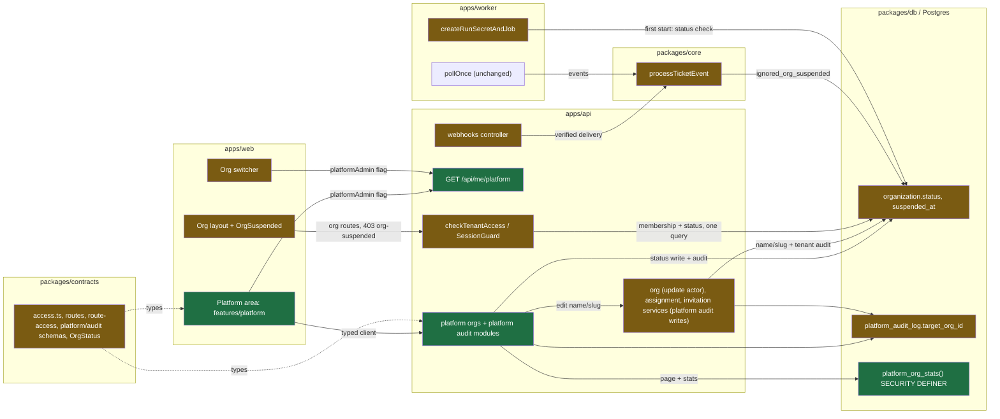
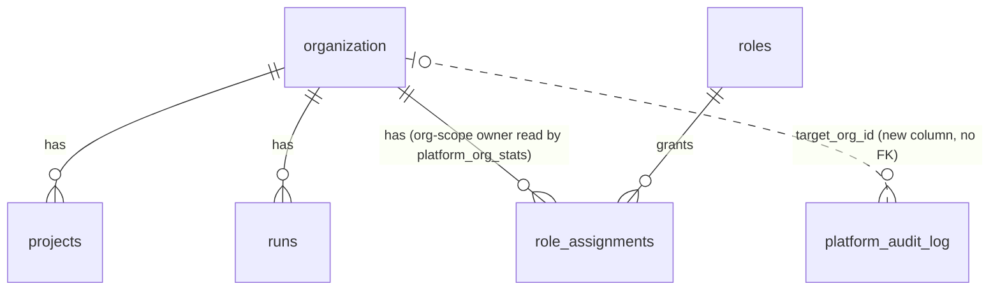

<!-- dev-plan: kind=spec id=platform-admin-dashboard rev=2 hash=955deb1e0f73 source=issue#192 -->
# Platform admin dashboard design

Status: draft. Sensitive paths: auth (tenant guard `checkTenantAccess` gains the org-active step, `SessionGuard`, new `routeAccess` entries with `scope: 'platform'` and a new `scope: 'user'` route), webhooks (intake refuses a suspended org after the unchanged signature check), run Job/runner (the worker activity `createRunSecretAndJob` refuses the first start of a suspended org, before any credential read, token mint or Secret write), terminal (attach and re-auth go through the changed `checkTenantAccess`; no terminal code change), RLS/`withOrg` (a new `SECURITY DEFINER` function, two new definer read policies, suspend and reactivate writes inside `withOrg`) and migrations (0036, 0037 and 0038).
Source: issue #192

## Summary

A platform admin can today manage platform admins and organizations only through `/api/platform/*`, with no web page, no way to suspend an organization and no readable platform audit trail.
This adds a `/platform` area in the web app: platform admins page, organization directory with owner, project count, last activity and status, organization detail (projects, members and assignments, invitations, edit name and slug), suspend and reactivate, and a platform audit log.
A suspended organization keeps its data, starts no new run from any entry point and refuses every member with a fixed "suspended" message; runs already running finish.
Every platform write is audited; the platform admin still never reads tenant content or secrets (epic #185 G4).

## Business rules

Confirmed by the human at planning time.

### Goal

Epic #185 G4: a platform admin manages tenants without reading their data or secrets. Solved when a platform admin can, in the web app: manage platform admins, see all orgs with status, open an org's people metadata, edit its name and slug, suspend and reactivate it, and read the platform audit trail.

In scope (human answer T1): F1 to F6 of the requirement, including F3.3 search/filter, F3.4 create organization, F4 org detail and F6.2 audit view. Added by the human at the prototype gate (design change): "Edit organization" (name and slug) on the org detail page, with its own platform route and audit entry (BR-52 to BR-62).

### Actors

| Actor | May do |
| ----- | ------ |
| Platform admin | The only actor of the dashboard: every `/platform` screen and every `platform-*` permission (all platform admins hold all of them). |
| Tenant roles (owner, admin, project admin, member, viewer) | Nothing on the platform: 403 on every platform route, a forbidden state on every `/platform` URL. |
| Member of a suspended org | Affected, not an actor: sees the suspended message instead of that org; their other orgs work. |
| Webhook sender and poller | Affected: no run starts for a suspended org. |
| Operator | Seeds the first platform admin (unchanged, ADR-0037). |

### Rules

Surface: UI (new `/platform` screens, the org menu entry and the suspended page are the outermost thing a person sees; API-only effects are rules too when a person or outside party sees them: webhook answer, API refusal).

| Id    | Category           | Rule |
| ----- | ------------------ | ---- |
| BR-1  | conditional-display | When a platform admin opens the org menu (in an org, or with no org), they see a "Platform admin" entry; a person who is not a platform admin never sees it. |
| BR-2  | navigation         | When a platform admin picks that entry, they land in the platform area (outside any org, its own layout) on the Organizations directory. |
| BR-3  | permission         | When a person who is not a platform admin types a /platform URL, they see a forbidden state and no platform data (a signed-out person goes to sign-in as on any page). |
| BR-4  | feedback-state     | When a platform screen (admins, organizations, org detail tab, audit) is loading, has no rows, or fails to load, the admin sees a loading state, an empty message, or an error with a retry. |
| BR-5  | conditional-display | When a platform admin opens Platform admins, they see a paged list with name, email, handle, added on and added by. |
| BR-6  | conditional-display | When the list includes the signed-in admin's own entry, that row is tagged "You". |
| BR-7  | conditional-display | When an entry is a seeded email with no account, its row shows "Not signed in yet" and empty name, handle and added by. |
| BR-8  | state-transition   | When an admin adds a platform admin by the email of a verified user, the dialog closes and the new entry shows in the list. |
| BR-9  | validation         | When the email is empty, not an email, or over 254 characters, the dialog shows the error at the email field and nothing is added. |
| BR-10 | validation         | When no user has the email, the dialog shows a "no such user" error at the email field and nothing is added. |
| BR-11 | validation         | When the user's email is not verified, the dialog shows a "not verified" error at the email field and nothing is added. |
| BR-12 | state-transition   | When the email already belongs to a platform admin, the dialog closes with no error and the list holds the entry once. |
| BR-13 | state-transition   | When an admin confirms Revoke on another entry, the entry leaves the list. |
| BR-14 | state-transition   | When an admin cancels the Revoke confirm, the entry stays. |
| BR-15 | state-transition   | When an admin revokes their own entry while another working admin remains, they are taken to `/` and the Platform admin entry and platform screens are gone for them. |
| BR-16 | limit              | When an entry is the last working admin (the only entry whose account exists and is verified), its Revoke control is disabled with the reason shown, on whichever page it is; seeded entries with no account do not count as working admins. (Human answer R14: the page needs the working-admin count, not the page's row count, so a long or paged list behaves the same; BR-17 stays as the fallback for a race.) |
| BR-17 | feedback-state     | When a revoke is refused because another admin just removed the other admin (409), the admin sees a toast and the list refreshes. |
| BR-18 | conditional-display | When a platform admin opens Organizations, they see a paged list newest first with name, slug, members, created, owner, projects, last activity and status. |
| BR-19 | conditional-display | When an org has no owner, its owner cell reads "No owner yet"; when it has owners, one owner's name shows; when it has no run yet, last activity reads "No activity yet". |
| BR-20 | conditional-display | When the admin searches by name or slug, or filters by status, only matching orgs show; with no match the directory says no organization matches and offers to clear the filters (F3.3). |
| BR-21 | state-transition   | When an admin creates an organization from the directory with a valid name and a free slug, it appears in the directory with "No owner yet". |
| BR-22 | validation         | When the new organization's name or slug is invalid or the slug is taken, the form shows the error at the field and nothing is created. |
| BR-23 | permission         | When a platform admin who is not a member opens an org's own pages (/o/<slug>), they get no org data (platform role gives no tenant data). |
| BR-24 | navigation         | When an admin picks an org in the directory, the org detail opens with its status and the Projects, Members and Invitations sections. |
| BR-25 | conditional-display | When an admin opens Projects, they see each project's id and name only, no project content (an id is metadata, not content; human answer R21). |
| BR-26 | conditional-display | When an admin opens Members, they see each member's name, handle, email and roles with scopes. |
| BR-27 | state-transition   | When an admin adds an assignment (member, role, scope), the roles offered include Owner (Owner, Admin, Member, Viewer for the whole organization; project scope follows the existing rules, where Owner is org-scope only), and the new assignment shows in the Members tab and that user's next request follows it. |
| BR-28 | state-transition   | When an admin removes an assignment, it leaves the Members tab; removing the org's last owner assignment is allowed here and the directory then shows "No owner yet". |
| BR-29 | state-transition   | When an admin lists Invitations, they see pending ones by default and can filter by status. |
| BR-30 | state-transition   | When an admin creates an invitation (email, role, scope), it shows as pending; resend and revoke change it as on the tenant side (revoked one leaves the pending list). |
| BR-31 | validation         | When the invitation email is invalid or too long, the form shows the error at the field and nothing is created. |
| BR-32 | state-transition   | When an admin confirms Suspend on an active org with a reason, the org shows "Suspended" in the directory and detail. |
| BR-33 | validation         | When the reason is empty or over 500 characters, the confirm shows the error at the reason field and the org stays active. |
| BR-34 | state-transition   | When an admin confirms Reactivate on a suspended org with a reason, the org shows "Active". |
| BR-35 | state-transition   | When an admin suspends an already suspended org (or reactivates an active one), nothing changes, no error shows, and no second audit entry appears. |
| BR-36 | permission         | When anyone who is not a platform admin (an owner of that org included) calls suspend or reactivate, they get 403 before any lookup and nothing changes. |
| BR-37 | permission         | When a member of a suspended org signs in, switches to it or types one of its URLs, they see the "This organization is suspended" message and no org data; their other orgs work as before. |
| BR-38 | permission         | When any member (owner included) calls an API route of a suspended org, they get a refusal that names the suspension and no data. |
| BR-39 | side-effect        | When a ticket-source comment webhook (or poll) for a project of a suspended org arrives, no run starts and the webhook sender gets the plain `{ outcome: 'ignored' }` body (the body of a payload without a command event). |
| BR-40 | side-effect        | When a person tries to start, resume or reopen a run in a suspended org, it is refused (BR-38 covers the response; this rule covers that nothing starts). |
| BR-41 | state-transition   | When an org is suspended while a run is running, the run keeps running to its end and its ticket still gets its normal updates. |
| BR-47 | state-transition   | When an org is suspended while a run is created or queued but its sandbox has not started, the run does not start and ends as failed, with a failure reason that says the organization is suspended (any wording that includes that, such as "create run Job failed: the organization is suspended", satisfies it); someone starts it again after reactivation. |
| BR-42 | state-transition   | When an org is reactivated, members get their access back on their next request, paused runs stay paused until a member resumes them, and triggers missed while suspended start no run. |
| BR-43 | side-effect        | When an org is suspended or reactivated, its Settings -> Audit (seen after reactivation) shows the entry with the actor marked "Platform admin" and no reason text (human T2). |
| BR-48 | conditional-display | When a person of a suspended org opens the org menu, the suspended org is still listed, marked "Suspended", and their other orgs can be switched to. |
| BR-51 | conditional-display | When a platform admin's active org is suspended, they still see the "Platform admin" entry and can open the platform area; only the org's own pages show the suspended message (T6 refuses `/api/me/access` for that org, so the platform-admin flag must reach the web another way). |
| BR-49 | conditional-display | When a person sees the suspended message, it is a fixed message with no reason text (human T2). |
| BR-44 | side-effect        | When a platform write succeeds (org create, org edit, suspend, reactivate, assignment add/remove, invitation create/resend/revoke, admin grant/revoke), one platform audit entry exists; a refused change or a no-op repeat adds none. |
| BR-45 | conditional-display | When an admin opens Audit, they see a paged list newest first with time, actor, action, target, the reason for suspend and reactivate entries, the old and new name or slug for org edit entries, and can filter by action with a dropdown. |
| BR-50 | navigation         | When an admin picks "View audit log" on an org's detail, the audit list opens filtered to that org with a removable org chip; there is no org picker (human T4). |
| BR-46 | permission         | When anyone who is not a platform admin asks for the platform audit, they get 403 and no entry; a tenant never reads platform entries. |
| BR-52 | permission         | When anyone who is not a platform admin (an owner or admin of that org included) sends an org name or slug change on the platform route, they get 403 before any lookup and nothing changes. |
| BR-53 | state-transition   | When a platform admin saves a valid new name and/or slug in Edit organization on the org detail, they stay on the org detail, see a success toast, and the detail header and the directory row show the new values. |
| BR-54 | validation         | When the new name is empty or over 100 characters, Edit organization shows an error at the name field and nothing changes. |
| BR-55 | validation         | When the new slug is outside the slug format (lowercase a to z, 0 to 9 and "-", no leading or trailing "-", 1 to 63 characters), Edit organization shows an error at the slug field and nothing changes. |
| BR-56 | validation         | When the new slug is taken by another org, Edit organization shows a "taken" error at the slug field (409) and nothing changes. |
| BR-57 | navigation         | When a platform admin saves a changed slug, a confirm first shows the old and new URL and warns that old links will stop working; cancelling the confirm changes nothing. |
| BR-58 | side-effect        | When an org's slug has changed, a member opening the old /o/<old-slug> link sees not found, the new /o/<new-slug> link opens the org, and the old slug can be taken by another org at once; a rename shows in the switcher and top bar for every member after their next reload. |
| BR-59 | state-transition   | When a platform admin saves values equal to the current name and slug, nothing changes, no error shows, and no audit entry is written. |
| BR-60 | side-effect        | When an edit changes the name or slug, the platform Audit shows one entry for it with the actor and the old and new value. |
| BR-61 | side-effect        | When an edit changes the name or slug, the org's own Settings > Audit shows an entry with the actor marked "Platform admin" and the old and new value. |
| BR-62 | state-transition   | When the org is suspended, a platform admin can still edit its name and slug, and the org stays suspended. |

Rule groups: Shell BR-1 to BR-4; Platform admins page (deferred from #215; its BR-3 and BR-24 land here as BR-4 and BR-1) BR-5 to BR-17; Organizations directory BR-18 to BR-23; Organization detail BR-24 to BR-31; Suspend and reactivate BR-32 to BR-43, BR-47 to BR-49, BR-51; Platform audit BR-44 to BR-46, BR-50; Edit organization (added by the human at the prototype gate; reuses the tenant org-edit rules of the org-tenant-admin spec BR-14 to BR-17, BR-22, §Limits, §Edge cases for fields, limits, errors and the slug-change warning) BR-52 to BR-62.

### Not observable

- The org status column and the narrow definer reads: seen only through BR-18, BR-32, BR-37.
- Worker-side block (a queued or retried workflow does not start a Job while suspended): observable only as "no run starts" in BR-39, BR-40, BR-42 (and the failed run of BR-47); the lowest proving layer is a worker integration test (see Testing).
- Platform audit payload beyond the listed columns and the reason (emails, account ids): never returned raw; covered at API and DB level.
- Seed and recovery of the first admin: operator runbook, unchanged (ADR-0037).
- Secrets: the dashboard shows none, not even names; nothing to observe. Agent call: no secret names or "set/not set" are shown (business: the requirement allows "names and set/not set at most", but no F-item needs it).

### States

- Org status: `active` -> `suspended` (platform admin, reason required) and `suspended` -> `active` (platform admin, reason required). No other move. A repeat of the current state is a no-op: 200, no change, no audit entry (same pattern as platform-admin-role spec BR-9). Only these two statuses exist (human T1: F7 org delete is out).
- Suspended means: no new run from any entry point (API create/resume/reopen, webhook intake, poller, worker); no tenant access for members (sign-in, switch, typed URL, API, SSE, terminal) with a clear "suspended" refusal; data kept; platform routes on that org keep working (epic #185 §7.5).
- Runs already running at suspend time: Agent call: running runs (starting, running, idle, done) finish, keep their automatic pod-crash recovery (ADR-0029) and still post to their tickets; anything a person or a trigger starts is blocked, including resume of a paused run and reopen (business: least destructive; data kept anyway; cancel from the platform side is F9.3, which is out of scope).
- Run created or queued whose sandbox has not started when the org is suspended (human T5): its start is refused and the run ends `failed` with a failure reason that contains the words "the organization is suspended"; someone starts it again after reactivation. No wait, no hold.
- A paused run, which a person cannot resume while suspended, stays paused; after reactivation it stays paused until a member resumes it.
- Triggers that arrive while suspended (webhook comment, polled ticket): Agent call: they start no run and are never replayed after reactivation; poll events are recorded as ignored and the cursor advances (business: no surprise burst of runs on reactivation). The webhook sender gets the plain `{ outcome: 'ignored' }` body.
- Org name and slug (Edit organization): a platform admin changes either or both; a save with values equal to the stored ones is a no-op. Agent call: a no-op save answers 200 with no change and no audit entry (business: same as a repeat suspend, BR-35, and the tenant edit, org-tenant-admin §PATCH "Nothing changed: 200, no audit entry"). Agent call: editing is allowed on a suspended org and the org stays suspended (business: platform routes keep working on a suspended org, and an admin may need to fix a name or free a slug without reactivating).
- Platform admin set (grant, revoke, last-working-admin rule): as the platform-admin-role spec §States, BR-9 to BR-14, BR-29, BR-30.
- The last owner of an org may be removed on platform routes only (rbac-foundation spec BR-46); the org then shows "No owner yet".

### Limits and validation

- Grant email: `InvitationEmail` (required, trimmed, lowercased, max 254), as the platform-admin-role spec §Limits.
- Suspend and reactivate reason: Agent call: required for both, trimmed, 1 to 500 characters (business: both are audited platform actions and the requirement says "with a reason").
- Directory search text (F3.3): Agent call: max 100 characters, case-insensitive contains on name or slug; status filter all / active / suspended; both kept in the URL (business: the longest org name is 100 characters, so a longer search can never match more).
- Create organization: as the org-tenant-admin and org-onboarding specs (name 1 to 100, slug format, a taken slug gives 409 at the slug field); reuses the existing flow.
- Edit organization: name 1 to 100; slug lowercase a-z, 0-9, "-", no leading or trailing "-", 1 to 63, unique (same as org creation, org-tenant-admin spec §Limits). Either field may be sent, at least one (the existing `UpdateOrgRequest`). Invalid input shows at the field and a taken slug is 409 at the slug field, nothing changes (org-tenant-admin BR-15, BR-17, §Edge). An unknown org is 404 after the 403 check (ADR-0036 guard order).
- Invitation create (email, role, scope): same rules as tenant invitations (rbac-foundation spec); a platform admin may grant `owner`.
- Paging: offset pagination (ADR-0028) with the existing page query on every list. No rate limit or quota is stated; none is added.

### Edge cases

- Two admins suspend or reactivate at once: Agent call: both get 200, one change, one audit entry; a suspend racing a reactivate: last write wins, each real change audited (business: a repeat of the current state is already a no-op by BR-35, so a race needs no new outcome and the audit stays one entry per real change).
- A platform admin suspends an org they are a member of: allowed; their tenant access is blocked like everyone's; platform routes still work.
- Org with no owner yet: shown "No owner yet"; the platform admin invites an owner (F4.3, rbac-foundation BR-69).
- Org with several owners: the directory shows one, the earliest-made owner assignment (T7 hand-off, recorded in answers.md: business decided it and architecture follows it). Agent call: one owner is shown, the earliest owner assignment (business: one owner is enough to identify the org).
- Open terminal when the org is suspended: Agent call: it closes at its next access re-check and a new attach is refused; an open event stream keeps going until it reconnects, then is refused (business: suspend must stop members' access, but an already open socket or stream cannot be refused before it reconnects, so it ends at the first re-check or reconnect, and runs themselves are not touched).
- Invitation accepted into a suspended org: Agent call: acceptance works (membership is created) and the invitee then sees the suspended message (business: refusing would show a misleading "invalid invitation").
- Platform admin revokes self, the last admin, or hits the 409 race: issue #192 comment and platform-admin-role spec BR-12 to BR-14.
- Suspend or any platform action on an unknown org id: 404 after the 403 check (ADR-0036 guard order).
- Seeded admin with no account: listed "Not signed in yet", revocable, not counted as working (platform-admin-role spec BR-29).
- Edit organization success: Agent call: the admin stays on the org detail and sees the new values (business: platform org URLs use the org id, so a slug change does not move the admin's page).
- Slug change: a confirm first shows the old and new URL; old links show not found, there is no redirect, and the old slug is free at once (org-tenant-admin BR-16, §Edge, T3). People inside the org see not found at the old slug on their next navigation or reload, and a rename after reload. Links posted earlier in tickets or comments with the old slug also stop working (the accepted T3 trade-off).
- Two saves of the same slug at once: one succeeds, one gets 409 (unique slug; org-tenant-admin §PATCH).
- Org name and slug are admin-typed text, shown as plain text (AGENTS rule 6).

### Tenancy and permission

All platform routes are platform level and never come from a tenant role (ADR-0036).

- Existing permissions used: `platform-org:create|read`, `platform-project:read`, `platform-role:read`, `platform-member:read`, `platform-assignment:*`, `platform-invitation:*`, `platform-admin:*`.
- New permissions (in `packages/contracts/src/access.ts`, platform level, code only, with the new ADR): `platform-org:update` (suspend, reactivate) and `platform-audit:read`. No delete or support permission (F7, F8 out).
- Per screen: Platform admins: `platform-admin:read|create|delete`, touches platform users only. Organizations directory: `platform-org:read` (create: `platform-org:create`), touches org metadata and counts. Org detail: `platform-org:read` (header), `platform-project:read` (Projects: project names), `platform-member:read` and `platform-assignment:read|create|delete` (Members: names, handles, emails, roles), `platform-invitation:*` (Invitations: invited emails), `platform-org:update` (Suspend, Reactivate: org status; Edit organization: the org's name, slug and audit rows). Audit log: `platform-audit:read`, touches audit entries with org ids and names. The per-route table is in Architecture § API.
- Agent call: Edit organization reuses `platform-org:update`, platform level (business: suspend, reactivate and edit all write the org row, every platform admin holds all `platform-*` permissions, and a separate permission would be a name nobody uses to tell admins apart).
- Tenant data touched: org metadata and counts, project names, member names, emails and roles, invited emails, status, audit entries. Never tickets, runs, comments, repo text or secret values.
- Every other user gets 403 before any lookup, an org owner included. A platform admin gets no tenant data from `/api/orgs/*` (epic G4; rbac-foundation BR-38). Agent call: platform admins have no inside access to an org (business: epic G4 default; nothing in F1 to F6 reads tenant content).
- RLS stays org-only; cross-org reads go only through narrow `SECURITY DEFINER` functions returning counts and metadata (epic §8). The org id in a platform path is a platform lookup; the tenant from the session is not used on platform routes.
- Members of a suspended org: every role, owner included, is refused on that org (BR-37, BR-38); their other orgs are unaffected.

### Lifecycle, compatibility and side effects

- Org status column: new, default `active`; existing orgs become `active` (additive migration, AGENTS rule 8).
- Platform audit log: append-only and kept (no retention stated, none added). Every platform write adds one entry; a refused change or a no-op repeat adds none (ADR-0037, platform-admin-role spec §Lifecycle). The existing platform write routes (org create, assignment grant/revoke, invitation create/resend/revoke) start writing entries too (F6.1); their responses do not change.
- Suspend and reactivate also add an entry in that org's own audit view, actor marked "Platform admin" (org-tenant-admin spec BR-20, actor kind `platform_admin`). The reason is not shown in the org's view or to org members (human T2); platform admins read it in the platform audit.
- `PlatformOrgDto` gains owner, project count, last activity and status: additive; existing consumers keep working.
- Edit organization audit: Agent call: one platform audit entry per real change (name and slug in one save are one entry with both from and to) plus the org's own audit entry marked "Platform admin"; neither is written for a no-op or a refused change (business: org-tenant-admin BR-22 says the org's Audit shows every name or slug change, and the org's people should see who changed it, as with suspend).
- Directory order stays newest first (current `listOrgs`).
- "Last activity": Agent call: the latest time a run was queued in the org; "No activity yet" when none (business: a timestamp only, no content; flagged for review).
- The `/orgs/new` flow and the org switcher keep working; a "Platform admin" entry is added (F1.1).
- #215 left the web UI deferred: its BR-3 (loading/error) and BR-24 (menu entry) land here as BR-4 and BR-1.
- Untrusted text shown to a platform admin (org name, slug, project name, member name, handle, email, invited email, suspend reason, audit labels): Agent call: all shown as plain text, never as HTML or a command, long values cut (business: AGENTS rule 6). Ticket, comment and repo text is not read or shown. Reason text is never put in shell, k8s specs or SQL strings.
- Provider-agnostic terms only: organization, project, member, assignment, invitation, connection, ticket source; "suspended" is generic (AGENTS rule 3).
- What users see: members of a suspended org see the suspended message instead of the org; suspend itself posts no ticket comment; running runs still post to their tickets as before; no notification or email (no sender exists, epic §2); suspend and reactivate appear in the org's audit view after reactivation; on a reactivated org paused runs stay paused until a member resumes them, and a run that failed because of the suspension stays failed and is started again by hand (human T5).

### Out of scope

- By human answer T1: F7 org delete and restore, F8 support access, F9 (health page, run overview, run cancel, usage counts). No rules, no deleted state, no support grant.
- Stated by the requirement: billing, quotas, metering, usage beyond counts, reading secret values.

## Architecture

Confirmed by the human at planning time.

### Overview

Placement by layer (imports `apps -> core -> db -> contracts`, `web -> contracts` only; AGENTS rule 2):

- `packages/contracts`: the two new permissions, DTOs, route table and `routeAccess` entries, the `org-suspended` problem type constant, the `OrgStatus` enum.
- `packages/db`: `organization` status columns, `platform_audit_log.target_org_id`, one new `SECURITY DEFINER` function, two read-only definer policies, migrations 0036, 0037 and 0038.
- `packages/core`: intake (`packages/core/src/intake/process-ticket-event.ts`) refuses a suspended org.
- `apps/api`: tenant guard (`access/check-access.ts`, `auth/session.guard.ts`), platform orgs module (detail, suspend, reactivate, stats), platform audit read module, platform audit writes in the existing org, assignment and invitation services, `GET /api/me/platform`.
- `apps/worker`: activity `createRunSecretAndJob` refuses the first start (not a resume) of a suspended org. No workflow change.
- `apps/web`: `features/platform/*`, routes `/platform/*` outside `/o/$org`, typed client from contracts, MSW handlers for the new route keys (`apps/web/src/mocks/msw/handlers.ts`, `contract.test.ts`). Screens are in § UI and Storybook.
- runner: no change.

Contracts (contracts first, AGENTS rule 1):

- `access.ts`: add `platform-org:update` (suspend, reactivate) and `platform-audit:read`. Platform permissions are code only, never seeded into tenant roles (as migration 0033 seeded none). Every platform admin holds all `platform-*` permissions.
- `enums.ts`: `OrgStatus = z.enum(['active','suspended'])`.
- `org-context.ts`: `ORG_SUSPENDED_PROBLEM_TYPE = 'org-suspended'` (next to `ORG_MISMATCH_PROBLEM_TYPE`).
- `schemas/platform.ts`:
  - `PlatformAdminDto` gains `lastWorkingAdmin: boolean` (human answer R14): true only for the one entry that is the sole remaining working admin, so the web disables Revoke with a reason on any page. It equals the server's revoke rule: a revoke is refused when no other working admin remains, and every caller of a platform route is itself a working admin, so that is the same as "the target is the only working admin". Additive; the list and grant responses carry it. Agent call: a per-entry flag, not a working-admin total on the page envelope (architecture: the envelope stays `{ items, page, pageSize, total }` (ADR-0028, `pageOf`), and a count alone cannot tell the web which entry is working, since the DTO has no verified flag and `userId !== null` is not enough).
  - `PlatformOrgDto` (list row) gains `status`, `suspendedAt | null`, `projectCount`, `lastActivityAt | null`, `owner` (`userId`, `name`, `handle`, `email`, or null for "No owner yet"; the earliest org-scope owner assignment). Additive.
  - `PlatformOrgDetailDto` = `PlatformOrgDto` + `suspension: { at, reason, by: { userId, name, handle } | null } | null` (null unless suspended). Returned by `getOrg`, `suspendOrg`, `reactivateOrg`; only the list returns `PlatformOrgDto`. Agent call: the three detail routes return `PlatformOrgDetailDto` (architecture: the detail header needs the reason). Platform-only; the reason is read from the latest `org.suspended` platform audit row, never stored on `organization`.
  - `OrgStatusChangeRequest = { reason: string }` (trimmed, 1..500, `.strict()`), used by suspend and reactivate.
  - `PlatformAuditEntryDto` `{ id, at, actor: { userId, name, handle } | null, action, target: { type, id, label }, org: { id, name } | null, reason | null, changes: AuditChange[] }`; `target.label` is built on read (admin email, org name, member or invitee label); never the raw payload (same rule as the tenant `AuditEntryDto`). `changes` uses the existing tenant `AuditChange` shape (fields `name` and `slug` for an edit; empty for other actions), so the audit page can say "renamed X to Y". Additive.
  - `PlatformAuditAction` enum: `platform_admin.granted|revoked`, `org.created|updated|suspended|reactivated`, `assignment.granted|revoked`, `invitation.created|resent|revoked`.
- `routes.ts` + `route-access.ts`: `platform.listOrgs` query gains `q` and `status` (extends `PageQuery`); new `platform.getOrg`, `platform.suspendOrg`, `platform.reactivateOrg`, `platform.updateOrg` (PATCH, request `UpdateOrgRequest` reused unchanged, response `PlatformOrgDetailDto`, `platform-org:update`: the "Edit organization" action), `platform.listAudit` (all `scope: 'platform'`); new `me.platform` (`{ scope: 'user' }`, response `PlatformSessionDto = { platformAdmin: boolean }`), how the web learns the flag without an org route.
- `schemas/audit.ts` (tenant audit): `AuditAction` += `org.suspended`, `org.reactivated`; `AuditChange.field` += `status`.
- `AccessDto.platformAdmin` stays as it is (fixtures and consumers do not move). The web reads the flag from `me.platform` wherever the org may be suspended: the `/platform` layout loader and the app bar.

### Data model

Migration: three new migrations, in order. 0036 (drizzle-generated, reviewed; slice 2, because the directory shows status): `organization.status` and `organization.suspended_at`. 0037 (hand-written, like 0001 and 0025; slice 2; no dependency on 0036, since it reads `projects`, `runs` and assignments, not the status): `platform_org_stats` and two definer read policies. 0038 (drizzle-generated; slice 3, the first slice that writes an org-targeted platform audit row): `platform_audit_log.target_org_id` and its index. Agent call: three migrations, one per slice need (architecture: each slice ships only the schema it uses, and migrations stay in order 0036, 0037, 0038, each depending only on earlier ones). Applied migrations 0000 to 0035 stay untouched (forward-only, AGENTS rule 8). Status is `text` + CHECK, not a pg enum; timestamps are `timestamptz` named `<event>_at`; defaults are constants (database.md §3, §5).

#### organization (changed, migration 0036; scope: org)

| Field | Type | Null | Default | Key / index | Change | Notes |
| ----- | ---- | ---- | ------- | ----------- | ------ | ----- |
| status | text | no | `'active'` | `organization_status_check (status in ('active','suspended'))` | added | Existing orgs become `active` by the default; no backfill. Declared to better-auth as an additional organization field with `input: false`. |
| suspended_at | timestamptz | yes | none | `organization_suspended_at_check ((status = 'suspended') = (suspended_at is not null))` | added | Not declared to better-auth. |

RLS: unchanged. `organization` has no RLS (better-auth table, database.md §2); `agentdesk_app` already has full DML on it. Agent call: platform list and detail reads run on plain `db.orm`, as `OrgsService.listOrgs` does today; the suspend and reactivate writes run inside `withOrg(orgId)`, with the org update, the tenant `audit_log` row and the platform audit row in one transaction (architecture: the tenant `audit_log` row is under RLS and needs the org context, and one transaction keeps the three writes atomic). `status` and `suspended_at` are visible to members; members see only a fixed message. No reason column: better-auth's `/organization/list` and `set-active` return whole `organization` rows to members, so a reason there would leak (human T2).

Agent call: the better-auth org plugin config declares `status` as an additional organization field with `input: false` (like `user.handle`), so `/auth/organization/list` returns it to the web and no client can write it; `suspended_at` is not declared (architecture: the switcher marks a suspended org, BR-48; only `/organization/list` and `set-active` are reachable, `allowed-paths.ts`).

`connections.status` already has a `suspended` value; `organization.status` is a separate concept.

#### platform_audit_log (changed, migration 0038; scope: platform, no tenant scope)

| Field | Type | Null | Default | Key / index | Change | Notes |
| ----- | ---- | ---- | ------- | ----------- | ------ | ----- |
| target_org_id | uuid | yes | none | no FK; `platform_audit_log_target_org_idx (target_org_id, created_at, id)` | added | No FK so the trail survives an org delete. Existing rows (admin grants and revokes) stay null; no backfill. |

RLS: none (unchanged); grants stay SELECT, INSERT for `agentdesk_app`. The suspend/reactivate reason lives only in `payload`, redacted with `redactBody`. The org detail reads the current reason from the latest `org.suspended` row of that org through the new index.

Agent call: `target_org_id` is a column, not a JSON path, and is not named `org_id` (architecture: "filter by org" (F6.2) becomes an index lookup, and no RLS lint or test treats the table as tenant data). ADR-0037's "no org_id" line is amended in the new ADR.

#### platform_org_stats (new `SECURITY DEFINER` function, migration 0037; scope: cross-org read, platform only)

| Field | Type | Null | Default | Key / index | Change | Notes |
| ----- | ---- | ---- | ------- | ----------- | ------ | ----- |
| p_org_ids (input) | uuid[] | no | none | at most 100 ids; raises above that | added | |
| org_id | uuid | no | none | one row per known org | added | |
| project_count | int | no | none | uses the existing `projects` `org_id` index | added | |
| last_activity_at | timestamptz | yes | none | latest `runs.queued_at` of the org | added | null when the org has no run |
| owner_user_id | text | yes | none | earliest-created org-scope `owner` assignment | added | null when none (one owner per org, T7) |

`SET search_path = public, pg_temp`, `REVOKE ALL FROM PUBLIC`, `GRANT EXECUTE TO agentdesk_app`, owner `agentdesk_owner`. Returns ids, counts and one timestamp only. Reads `projects` and `runs` (their `definer_read` policies from 0001 already exist) and org-scope `owner` assignments.

RLS: two new narrow read policies for `agentdesk_owner`: on `role_assignments` (`scope_type = 'org'`) and on `roles` (`key = 'owner'`). They add nothing for `agentdesk_app`. Tenant tables are otherwise untouched; platform reads of an org's own tables (projects, members) keep using `withOrg(orgId)` as today.

Agent call: `last_activity_at` = the latest `runs.queued_at` of the org, null when none (architecture: `runs` already has a definer policy; `audit_log` would need another).

Index on `runs (org_id, queued_at)`: if it is missing, the plan checks and adds it in 0036 (concurrent-index rule for big tables).

### API

| Method | Path | Who may call it | Request | Response | Contract |
| ------ | ---- | --------------- | ------- | -------- | -------- |
| GET | `/api/platform/admins` (changed, slice 1) | platform admin: `platform-admin:read`, platform level; tenant data: none (platform users only) | `?page&pageSize` (unchanged) | page of `PlatformAdminDto`, each with `lastWorkingAdmin`; order `granted_at desc, id` and paging unchanged | `platform.listAdmins` (existing key) |
| POST | `/api/platform/admins` (changed, slice 1) | platform admin: `platform-admin:create`, platform level; tenant data: none | `GrantPlatformAdminRequest` (unchanged) | `PlatformAdminDto`, now with `lastWorkingAdmin`; other statuses unchanged | `platform.grantAdmin` (existing key) |
| GET | `/api/platform/orgs/:orgId/projects` (existing, no change) | platform admin: `platform-project:read`, platform level; tenant data: project ids and names | `PageQuery` | page of `PlatformProjectDto = { id, name }`, read under `withOrg(orgId)` | `platform.listProjects` (existing key) |
| GET | `/api/platform/orgs` (changed) | platform admin: `platform-org:read`, platform level; tenant data: org metadata and counts | `?page&pageSize&q&status` (`PageQuery` extended; `q` max 100, `status` `OrgStatus`) | page of `PlatformOrgDto`, order `created_at desc, id` | `platform.listOrgs` |
| GET | `/api/platform/orgs/:orgId` (new) | platform admin: `platform-org:read`, platform level; tenant data: org metadata, counts, suspension | none | `PlatformOrgDetailDto`; 404 unknown or malformed id | `platform.getOrg` |
| POST | `/api/platform/orgs/:orgId/suspend` (new) | platform admin: `platform-org:update`, platform level; tenant data: org status, tenant and platform audit rows | `OrgStatusChangeRequest` | 200 `PlatformOrgDetailDto`; 404 unknown org; 400 bad body; a repeat on a suspended org answers 200 with no change and no audit rows | `platform.suspendOrg` |
| POST | `/api/platform/orgs/:orgId/reactivate` (new) | platform admin: `platform-org:update`, platform level; same data | `OrgStatusChangeRequest` | same shape as suspend | `platform.reactivateOrg` |
| PATCH | `/api/platform/orgs/:orgId` (new, slice 3b) | platform admin: `platform-org:update`, platform level; tenant data: the org's name and slug, tenant and platform audit rows | `UpdateOrgRequest` (`name` 1 to 100 and/or `slug`, at least one; the same `OrgSlug` rules as the tenant PATCH `/api/orgs/:orgId`) | 200 `PlatformOrgDetailDto`; 404 unknown org (after the platform 403); 400 bad body; 409 with pointer `/slug` when the slug is taken (unique index, not read-then-insert); values equal to the stored ones answer 200 with no change and no audit rows; works on a suspended org | `platform.updateOrg` |
| GET | `/api/platform/audit` (new) | platform admin: `platform-audit:read`, platform level; tenant data: org ids and names in targets | `?page&pageSize&orgId&action` | page of `PlatformAuditEntryDto`, order `created_at desc, id desc`; actor and org name resolved by left join (null when gone) | `platform.listAudit` |
| GET | `/api/me/platform` (new) | any signed-in user, own data only (`scope: 'user'`) | none; an org header is ignored | `PlatformSessionDto` from `isPlatformAdmin` (verified email and a `platform_admins` row) | `me.platform` |
| all | every org route under `/api/*`, terminal attach, SSE, install callback, dev-only routes (changed) | members of an active org as today | unchanged | for a suspended org: 403 problem `type: 'org-suspended'` for every member, whatever their role; `/api/me/access` included (human T6) | `ORG_SUSPENDED_PROBLEM_TYPE` |

- Every new route has a `routeAccess` entry (`scope: 'platform'`, or `scope: 'user'` for `me.platform`); the guard's platform branch refuses non-admins with 403 before any lookup (`apps/api/src/auth/session.guard.ts`; AGENTS rule 7; ADR-0036, ADR-0037). Offset pagination (ADR-0028, backend.md §11). Typed `Problem` errors (backend.md §4).
- Edit organization reuses `OrgsService.update` (row lock, diff, write only the changed fields, unique violation to 409) as the one implementation, with no second copy of the slug rules. Its first parameter changes from `actorUserId` to `actor: { userId, kind: 'member' | 'platform_admin' }` (the tenant controller passes `member`, the platform controller `platform_admin`), and the tenant audit row's hard-coded `actorKind: 'member'` takes `actor.kind`. When `actor.kind` is `platform_admin` the same transaction also writes the platform audit row. The platform controller then reads the detail DTO with the `getOrg` mapper.
- Slug-change effects: the session stores `activeOrganizationId` (the id), not the slug, and run Secrets, labels and workflow inputs carry the org id, so sessions, workflows and Jobs are unaffected. The slug is read at use time by the web route (`/o/$org` looks it up in the member's org list), by `connections.service` and by the worker's `orgSlug` for links in ticket comments. So after a change: the old slug URL answers not found for members (no redirect, same as today's tenant rename), the old slug is free to be taken, a member's open tab and cached org list are stale until refetch, and run links already posted in ticket comments (`/o/<old slug>/...`) stop resolving. Agent call: accept these effects and add no redirect or alias table (architecture: an alias needs a new table and its own ADR, and the tenant rename already behaves this way).
- Platform admins list: `list` runs one extra `count(*)` of working admins (an entry whose email matches an existing verified user, the same join as the revoke guard in `platform-admins.service.ts`) and selects the matched account's `email_verified`. A row is `lastWorkingAdmin = (its account is verified) && (workingCount === 1)`. `total` still counts seeded not-signed-in entries; only the flag reads the working count. `grant` and `findPlatformAdmin` fill the flag through the same mapper. The flag is read at list time; a race is still decided under the advisory lock and answered 409 (the web keeps its toast, BR-17).
- Projects: the existing route already returns `{ id, name }`; the Projects page shows each project's id and name (human answer R21) with no contract change.
- `q` is a case-insensitive contains on name and slug through a bound parameter with `%`, `_` and `\` escaped (never concatenated). The directory makes one page query, then one `platform_org_stats(ids)` call for that page.
- The web's audit `?org=<id>` chip maps to the API `orgId` param.
- `/api/me/platform` returns no org, membership or tenant data; it works when the active org is suspended or missing.
- Platform routes never read ticket, run output or comment text, and keep working on a suspended org (the platform admin must still manage its people and reactivate it).
- Accepting an invitation into a suspended org still works; `me.*` routes are `scope: 'user'` and bypass the org check.
- Agent call: suspend and reactivate are two POST action routes, not a PATCH of `status` (architecture: matches `runs.cancel` and `invitations.resend`; each action has its own audit action).

Tenant guard (all org routes, terminal attach, SSE, install callback):

- `checkTenantAccess` reads membership and org status in one query. Guard order: membership first (a non-member still gets the plain 403), then org active (`status = 'suspended'` gives 403 `org-suspended` for every member before the permission check), then permission, then scope. The `x-org-id` pin and `/organization/set-active` are untouched, so a user can still switch out. The web detects the state from that 403 and learns `platformAdmin` from `/api/me/platform`.
- Implementation: `AccessCheck` gets reason `org-suspended`; the guard throws `OrgSuspendedException` (a `ForbiddenException` with `problemType`); `ProblemFilter` reads `problemType` generically instead of only for `OrgMismatchException`. Terminal and the other callers already map any refusal to a close or deny.
- Dev-only routes (`match.kind === 'dev'`) use the same status check.
- Agent call: the refusal status is 403, not 423 or 409 (architecture: the guard already uses 403 for "you may not here", and the new problem `type` lets the web tell it apart).

Webhooks: the signature check stays first and unchanged (constant time, before any side effect). A verified delivery for a suspended org is recorded as `ignored_org_suspended` in `inbound_events` (operators and the local e2e read that row) and the HTTP body is the plain `{ outcome: 'ignored' }`, the same body a payload without a command event gets (a null parse). A non-command comment of an active org answers `ignored_no_command` and other ignored outcomes keep their bodies, so only a sender holding the platform webhook key sees any body at all, and the suspension reason stays in `inbound_events`. This is done in `webhooks.controller.ts` by mapping that one outcome.

WebSocket/terminal: authz on connect and on re-auth goes through `checkTenantAccess`, so attach and re-attach are refused for a suspended org; an already attached socket closes at its next re-auth (`terminal.gateway.ts` `check`). No terminal code change.

### Third-party libraries

| Library | New or existing | Used for | Approval |
| ------- | --------------- | -------- | -------- |
| NestJS (Fastify) | existing | new platform modules, guard change | existing |
| Drizzle | existing | migrations 0036 and 0038, queries | existing |
| Zod | existing | contracts DTOs and request schemas | existing |
| better-auth (organization plugin) | existing | `status` as an additional organization field (`input: false`) | existing |
| TanStack Router / Query / Form | existing | `/platform` routes, queries, forms | existing |
| Design system, Storybook, MSW | existing | components, stories, mock handlers | existing |
| Playwright | existing | mock and local e2e | existing |

No new dependency; the better-auth admin plugin is not used (ADR-0037).

### Services and integrations

| Service | New or existing | How it is used |
| ------- | --------------- | -------------- |
| Postgres | existing | three migrations (0036, 0037, 0038), one new definer function, two definer read policies |
| Temporal | existing | no new workflow, activity or signal; the existing activity `createRunSecretAndJob` gains the first-start check |
| Kubernetes | existing | untouched (no Job spec or KubeGateway change) |
| SecretStore | existing | untouched |
| Provider APIs | existing | untouched; poll schedules of a suspended org keep calling them |

### Configuration

No config change: no env var, no flag. Agent call: no feature flag (architecture: the repo has no flag mechanism, and a flag would be a bypass under the AGENTS access rules).

### Other decisions

Worker (no workflow code change, so no `patched()` marker and no new replay test; the existing replay tests run as they are; human T5, backend.md §6):

- Where: activity `createRunSecretAndJob` (`apps/worker/src/activities/run.activities.impl.ts`). `RunWorkflow` calls it with no options for the first start (`run.workflow.ts` line ~559) and with `{ resume: true, ... }` for every resume and auto-resume (`resumeAttempt`, line ~1029). The refusal sits in the `!resume` branch only: a first start is refused, a resume of an already-running run (pod-crash recovery) is not.
- How: `details(tx, orgId, runId)` (inside `mustDetails`) also selects `organization.status`. Right after the `isFinal` check and before the credential read, token mint and Secret write: `if (!resume && d.orgStatus === 'suspended') throw ApplicationFailure.nonRetryable('the organization is suspended', 'OrgSuspended')`. No Job, Secret or token exists yet, so nothing needs cleanup. The workflow's existing catch turns it into a `failed` run; the reason text reads "create run Job failed: the organization is suspended" (the existing `activityFailureReason` prefix). Agent call: that text satisfies BR-47, which asks for a failure reason that contains the words "the organization is suspended", not an exact string (architecture: the prefix comes from the existing `activityFailureReason`, and changing it would touch every failed start). Finalize releases the slot and posts the failure comment as for any failed start.
- Covers: a run queued in the project gate or waiting for a slot at suspend time (it reaches this activity after the grant), a run swept by the outbox sweep, and a run created a moment before the suspend commits. A person starts it again after reactivation (a new run from the ticket).
- Accepted: a person's resume accepted just before the suspend commits still resumes (it uses the resume path).
- Running runs finish and keep automatic pod-crash recovery (ADR-0029, BR-41); paused runs stay paused and a person's resume or reopen is refused at the API guard (BR-40, BR-42).
- Poller: `pollOnce` unchanged. Its events reach `processTicketEvent`, which records them as ignored and advances the cursor, so a reactivated org does not run old comments. Agent call: poll schedules for a suspended org keep ticking and provider calls continue (architecture: skipping them would replay old commands on reactivation, and pausing schedules adds Temporal state to restore; revisit at scale).

Runner and Kubernetes: no runner, Job spec or KubeGateway change; the only touch is the first-start refusal above, before any Secret or Job is built. No ticket, comment or repo text enters a shell, a k8s spec or SQL: the new text inputs are the platform admin's `reason` (stored as a JSON value via Drizzle parameters, never put in a Job or a query string) and `q` (bound parameter).

Provider adapters: no change; the intake outcome is `ignored_org_suspended`, and routes, columns and DTO keys use no provider names (AGENTS rule 3).

Secrets: no new secret. The dashboard returns no secret names or values. `reason` goes through `redactBody` before it is stored and is not logged (logs carry request id, actor id, org id and action only). The worker refusal runs before the credential is read and before a token is minted.

Events and live updates: no new stream or SSE payload. The web refetches with TanStack Query after a mutation. The `LISTEN/NOTIFY` run-status flow is unchanged. A reconnecting SSE client of a suspended org is refused by the guard at connect; an open stream keeps going until it reconnects, and runs still running keep emitting.

Failure, observability and scale:

- Suspend is one transaction inside `withOrg(orgId)` (see the Agent call in § Data model): `select ... for update` on the org row, change `status` and `suspended_at`, write the tenant `audit_log` row (`org.suspended`, actor kind `platform_admin`, change `status active -> suspended`, no reason) and the `platform_audit_log` row (with the reason and `target_org_id`). A failed step rolls back all of it. Reactivate is the same with `org.reactivated`. A repeat on the current state writes nothing and answers 200 (BR-35). Two concurrent calls serialize on the row lock: one change, one audit entry. Status is read per request, so suspend takes effect on the next request, and reactivation likewise. No cache.
- The intake check (no new run row) and the worker first-start refusal (a run created earlier fails instead of starting) are separate rules, not duplicates; the only race is a resume accepted just before the commit.
- User-facing failure: a member gets 403 `org-suspended` (the web shows the message page); a platform admin gets 404 for an unknown org and 400 for a bad body (a Zod failure is 400 in backend.md §4; 422 is for a valid-shaped reference that does not resolve, which nothing here has).
- Logs: `info` with requestId, actorUserId, orgId and action on each platform write; the deny log keeps `routeKey`. No metrics added (the repo has none for this area).
- Scale: the directory page makes 2 queries (page, then one stats call for up to 100 ids; the function is bounded at 100). `projects` and `runs` lookups use existing `org_id` indexes. Audit list: index on `(created_at, id)` plus the new org index. The tenant guard adds one join to an existing query, no extra round trip.
- Edit organization audit: tenant side, one `org.updated` row (actor kind `platform_admin`, from/to of the changed fields, already rendered by `audit-view.ts`), so the org's admins see a rename marked "Platform admin"; platform side, one `platform_audit_log` row `org.updated` (target type `org`, `target_org_id`, payload from/to). Agent call: reuse the existing tenant action `org.updated`, no new tenant audit action (architecture: it holds only name and slug). Agent call: an edit has no reason field (architecture: the human asked for name and slug only, and a reason would be added scope).
- Platform audit for every platform action (F6.1): the existing org create, assignment grant/revoke and invitation create/revoke/resend (the services already branch on `actor.kind === 'platform_admin'`) write a `platform_audit_log` row in the same transaction, next to the tenant row they already write. A test lists every mutating `scope: 'platform'` route of the route table and fails if one has no audit action. Refused changes write nothing.

Sensitive paths touched: auth (tenant guard, session guard, platform branch), webhooks and intake, the run workflow's first start, terminal (through `checkTenantAccess`), RLS and `SECURITY DEFINER` (new function and two policies), migrations. Needs `review:sensitive` and a high-effort security review.

ADR: new ADR-0038 "Suspended orgs are refused at the tenant guard and the intake, and the worker's first start": status model; guard order (membership, org active, permission, scope); the first-start refusal (resume and auto-resume exempt); the `/api/me/platform` route; platform audit extended with `target_org_id`; the fifth definer function. It amends ADR-0037's "no org_id" line and the "ids only" rule for definer functions in database.md §2 and architecture.md §4 ("five functions; ids, counts and timestamps"). ADR-0036's guard order gains the "org active" step after membership.

Docs to update in the same slice: database.md §2 and architecture.md §4 (definer list), the ADR-0036 order note, runbooks/platform-setup.md (how suspend and reactivate work), the rbac specs that list the guard order, and frontend.md §3 (query keys, see § UI and Storybook).

Suggested slicing (PR size rule):

1. Web shell and platform admins page: no migration; the `lastWorkingAdmin` flag on `PlatformAdminDto` (R14) and one new route, `GET /api/me/platform` (`scope: 'user'`, own data only), so the web reads `platformAdmin` from its final source from the start. Agent call: `me.platform` ships in slice 1 (architecture: it is tiny, and using `/api/me/access` first would be rework in slice 3).
2. Directory: migrations 0036 and 0037, the wider `PlatformOrgDto`, `q`/`status`, `getOrg` (status shown, no suspension yet), UI.
3. Suspend: migration 0038, guard, intake, worker, suspend and reactivate routes, platform audit write for them.
3b. Edit organization, right after slice 3 in its own PR: `platform.updateOrg`, the `OrgsService.update` actor change, the `org.updated` platform audit action, and the Edit organization UI (see § UI and Storybook). Agent call: a separate slice 3b (architecture: it needs migration 0038 and the platform audit writer from slice 3, and slice 3 is already large).
4. Platform audit for the existing actions plus `listAudit` and its UI.
5. Org detail pages on existing routes. The org detail header may land with slice 2 or 3; § UI and Storybook places it in slice 3.

## UI and Storybook

Screens and components this changes:

- Routes (flat dot route files in `src/app/routes/`, outside `/o/$org`; `routeTree.gen.ts` is generated, frontend.md §2):

  | Route file | URL | New/changed | Entry |
  | --- | --- | --- | --- |
  | `platform.tsx` | `/platform` (layout) | new | org switcher "Platform admin" |
  | `platform.index.tsx` | `/platform` | new; redirects to `/platform/orgs` (to `/platform/admins` while the directory is not built) | same |
  | `platform.admins.tsx` | `/platform/admins?page=N` | new (F2) | side menu |
  | `platform.orgs.index.tsx` | `/platform/orgs?page=N&q=&status=` | new (F3) | side menu |
  | `platform.orgs.$orgId.tsx` | layout: header, status banner, suspend/reactivate | new (F4, F5) | click a directory row |
  | `platform.orgs.$orgId.index.tsx` | Overview (facts as `KeyValue`) | new | detail, side menu "Overview" |
  | `platform.orgs.$orgId.projects.tsx` | `?page=N` | new (F4.1) | side menu group "<org name>" |
  | `platform.orgs.$orgId.members.tsx` | `?page=N` | new (F4.2) | same |
  | `platform.orgs.$orgId.invitations.tsx` | `?page=N&status=` (default pending) | new (F4.3) | same |
  | `platform.audit.tsx` | `/platform/audit?page=N&action=&org=<id>` | new (F6.2) | side menu; "View audit log" on detail |
  | `orgs.new.tsx` | `/orgs/new` | unchanged; reused by the directory button (F3.4) | directory, switcher |
  | `o.$org.tsx` + `app/boundaries.tsx` | `/o/$org/*` | changed: a 403 with problem type `org-suspended` (from `ORG_SUSPENDED_PROBLEM_TYPE`) renders `OrgSuspended` instead of `Forbidden` | any org URL |

- Agent call: the org detail URL uses the org id (ui-ux: platform routes take `:orgId`, and a slug can be edited by the org).
- Agent call: detail sub-pages are routes under one layout, each with its own `?page=N` and loading only its own data, and the Overview is the index page (ui-ux: slice 3 works before the tabs exist).
- Agent call: the web reads `platformAdmin` from one new query, `platformAdminQuery` (`features/access/queries.ts`, key `['session','platform']`, source `GET /api/me/platform`), outside `['org', slug]`; the switcher item (`useAppBar`, on org and personal pages), the `/platform` layout loader and the guards use only this query, never `sessionAccessQuery`/`orgAccessQuery` (ui-ux: an org switch or a suspended active org must not touch it, and the access queries are refused for a suspended active org). `platform.tsx` renders `PlatformForbidden` itself for a non-admin (as `o.$org.settings.tsx` does for no tabs), so no `/api/platform/*` call is made; a 403 from a child (role revoked meanwhile) maps to the same state through the layout's `errorComponent`.
- Agent call: tenant-side detection of suspension: `RouteError` maps `ApiError` 403 + `type === 'org-suspended'` to `OrgSuspended` (the org layout's `ensureQueryData(orgAccessQuery)` is the first call and gets the refusal); for a page already open when the org is suspended, `queryClient.ts` gets one global handler that, on an `org-suspended` error, removes `['org', slug]` data and calls `router.invalidate()` so the layout re-runs and shows the message (ui-ux: covers BR-38 on pages already open). The `OrgSuspended` page keeps the TopBar and org switcher (`useAppBar(null)`, non-suspense, so a refused access query does not break it; the platform item comes from `platformAdminQuery`), so the person can switch out.
- Top bar: on every `/platform` page the top bar has no org crumb: the org switcher reads "No organization" (muted) and there are no Projects or Settings tabs; the brand, notifications and account menu stay. The `OrgSuspended` page's top bar shows the switcher with the org name and no Projects or Settings tabs. A non-admin who types a `/platform` URL keeps their normal org top bar (with tabs) above the forbidden state.
- A queued run that fails because the org is suspended adds no UI: it ends in the existing failed-run state, the same path as the "agent has no credential" failure.
- Reused unchanged: `DataTable`, `Pagination` + `usePaginationProps`/`PageSearch`/`useClampToLastPage`, `EmptyState`, `RouteLoadError`, `RouteSkeleton`/`Skeleton`, `Banner`, `Dialog`, `Field`, `TextInput` (`rows` for Reason), `Select`, `Button`, `Toast`, `SubNav`, `TopBar`, `KeyValue`, `InvitationRow` + `InviteDialog` + invitation status filter (platform invitations have the same shape), `StatusIcon`/`LabelChip`, `useRowMenu`/`menuKeyDown`.
- New components (in `components/`: `.tsx`, `.module.css`, `.stories.tsx`, unit test, barrel export):

  | Component | Purpose |
  | --- | --- |
  | `PlatformLayout` | side menu (`SubNav`) + scrolling main, geometry of `OrgSettingsLayout`; groups "Platform admin" (Organizations, Platform admins, Audit log) and, inside an org, "<org name>" (Overview, Projects, Members, Invitations) |
  | `PlatformAdminRow` + `platformAdminColumns` | columns Name, Email, Handle, Added, Added by, Actions; tags "You" (after the name) and "Not signed in yet" (in place of the name); "—" for an empty handle or added by; small Revoke button, disabled with the muted reason "Last admin" beside it on the last working admin |
  | `PlatformOrgRow` + `platformOrgColumns` | name (a link) with `/o/<slug>` in mono beside it, owner, members, projects, last activity, status, created; relative times with the full date in `title` |
  | `OrgStatus` | glyph + text: "Active" with a green check disc, "Suspended" with an orange pause disc (`--late` token) |
  | `PlatformOrgHeader` | org h1, `/o/<slug>` in mono, `OrgStatus`, actions in this order: "Edit organization" (default button), "Suspend organization" (danger button) or "Reactivate organization" (default button), then the "View audit log" link |
  | `PlatformProjectRow` + `platformProjectColumns` | Projects tab row: project id (mono, ellipsis, full value in `title`) and name; plain text, no link, no actions (R21) |
  | `PlatformMemberRow` + columns | columns Name (name with the handle under it; the handle alone when there is no name), Email, Roles, Actions; Roles lists each assignment as "<Role> (organization)" or "<Role> (<project name>)", joined with ", ", and "—" when there is none; row menu button labelled "Actions for <name or handle>": "Add assignment", then one "Remove <Role> (<scope>)" item per assignment |
  | `AddPlatformAdminDialog` | email form (values/errors/saving props), like `InviteDialog` |
  | `SuspendOrgDialog` | `mode: 'suspend' \| 'reactivate'`, reason field, pending state |
  | `EditOrgDialog` | Edit organization form: Name, URL (`PrefixInput` `/o/`), Save/Cancel; props `values`, `errors`, `dirty`, `saving`, `formError`, handlers; the route shows the slug confirm instead of it (one modal at a time) |
  | `SlugChangeConfirm` | the "Change the organization URL?" dialog, extracted from `OrgGeneral.tsx` (private there) so the tenant page and this dialog share it; `OrgGeneral` renders it unchanged (its story and test keep passing) |
  | `AssignmentDialog` | shows the person (name and handle); Role select (from `platform.listRoles`): Owner, Admin, Member, Viewer for "Whole organization"; Admin, Member, Viewer for "One project" (Owner is org scope only, human answer); Access radio "Whole organization" / "One project", with a Project select listing the org's projects shown for "One project"; buttons "Cancel", "Add assignment" |

- Changed shared: `OrgSwitch` + `OrgSwitchProps` (optional `platformHref`: item "Platform admin" in the bottom group above "Create organization", also in the no-org menu; `useAppBar` passes `/platform` when `platformAdmin`; a suspended org is listed and marked "Suspended", BR-48); `AuditRow` + `AuditRowView` (optional muted `note` under a sentence, used for the reason on the platform audit page only); `features/audit/map.ts` (sentences for `org.suspended`, `org.reactivated`); `boundaries.tsx` (`PlatformForbidden`, `OrgSuspended` mapping).
- Screens (presentational, props + callbacks, in `screens/`): `PlatformAdmins`, `PlatformOrgs`, `PlatformOrgDetail` (header + Overview), `PlatformOrgProjects` (table: Id, Name; `DataTable` + `Pagination`), `PlatformOrgMembers`, `PlatformOrgInvitations`, `PlatformAudit`, `OrgSuspended`.
- Agent call: confirms (revoke, remove assignment) stay inline in their screen, as `OrgMembers.removeConfirm` does; dialogs with form state are components; no new ds primitive (ui-ux: follows the existing screen pattern, and no tabs or combobox are needed).
- States. Every data screen: loading (`Skeleton` rows from the page layout, `role=status aria-busy`), empty (`EmptyState` headingLevel 2), error (`RouteLoadError`: title, requestId, Retry), forbidden, default, paging/stale (`Pagination busy`, table `aria-busy`, `keepPreviousData`). No SSE, so no "reconnecting".

  | Screen/component | States |
  | --- | --- |
  | PlatformAdmins | loading, empty ("No platform admins"), error, forbidden, default, paged, last admin disabled (any page), own row, never-signed-in row |
  | AddPlatformAdminDialog | idle, saving ("Adding…", not closable), email error 404/422/400, Banner (403, 5xx: problem title and request id) |
  | Revoke confirm | idle, busy ("Revoking…", not closable), own-row wording |
  | PlatformOrgs | loading, empty ("No organizations yet"), empty filtered, error, default, paged, suspended row, "No owner yet", "No activity yet" |
  | PlatformOrgDetail | loading, not found ("Page not found", "This organization does not exist.", "Back to organizations", inside the platform layout), error, active, suspended (warning Banner with the reason) |
  | SuspendOrgDialog | idle, saving, reason error ("Enter a reason."), Banner (problem title and request id, reason kept); reactivate mode |
  | EditOrgDialog | idle (Save disabled), dirty, saving, name error, URL error (format, taken), Banner (403, 5xx with request id), slug confirm step |
  | Projects | loading, empty, error, default, paged |
  | Members | loading, empty, error, default, paged, row menu open, add assignment, remove confirm, removing (busy) |
  | Invitations | loading, empty (with an "Invite people" action), error, default (pending), paged, invite dialog, resending (row busy), copy failed |
  | PlatformAudit | loading, empty, empty filtered, error, default, paged, org chip (known/unknown) |
  | OrgSuspended | default (loads nothing); switcher open with the suspended org marked; platform admin (switcher shows "Platform admin") |
  | OrgSwitch | with/without platform item (with orgs, and in the no-org menu) |

- Role-based UI (ADR-0036/0037: every platform admin holds every `platform-*` permission, so there is one platform role in the UI; the API stays the authority):

  | Person | Sees |
  | --- | --- |
  | Platform admin | switcher item; all of `/platform/*`; every control |
  | Org owner, admin, project admin, member, viewer, no-org user | no switcher item; typed `/platform/...` shows the forbidden state, no platform request |
  | Any member of a suspended org | `OrgSuspended` instead of the org pages |
  | Platform admin, own row | "You" tag; Revoke allowed unless last admin |

- Data on screen: `features/platform/{queries,mutations,map}.ts` over the contracts `api` client; mappers pure with `now` passed in and unit-tested; `Pagination` + `?page=N` + `usePageSize()` (frontend.md §3).
  - Agent call: platform query keys start `['platform', ...]` (`['platform','admins',q]`, `['platform','orgs',q]`, `['platform','orgs',orgId]`, `['platform','orgs',orgId,'members'|'projects'|'invitations',q]`, `['platform','audit',q]`) (ui-ux: platform data is not org data and must survive an org switch). frontend.md §3 ("every key starts `['org', slug]`") is amended in the same PR.
  - Mutations (no optimistic updates): grant and revoke invalidate `['platform','admins']`; self-revoke also removes `accessKeys.session()` then goes to `/`; suspend and reactivate return `PlatformOrgDetailDto`, so they `setQueryData` the detail from their response and invalidate `['platform','orgs']`; Edit organization returns the org detail DTO: `setQueryData` on `['platform','orgs',orgId]`, invalidate `['platform','orgs']` and the session org list (`orgsQuery`, so the admin's own switcher shows the new name or URL if they are a member); `['org', oldSlug]` data is untouched (a platform admin holds none for an org they are not in); the page URL carries the org id, so a slug change needs no navigation (unlike the tenant General page, which navigates to the new slug); assignment and invitation writes invalidate that org's members or invitations keys. In flight: "-ing…" label, `aria-busy`, dialog not closable, row busy. Invitation links are never cached.
  - Human answer R14: the admins page lists every admin, paged with the shared `Pagination` and `?page=N` pattern (`app/pagination.ts`, `usePaginationProps`, as `o.$org.settings.members.tsx`). Revoke is always disabled for the last working admin, on any page, with the reason shown. The page does not count admins: Revoke is disabled when the row's `lastWorkingAdmin` is true. The 409 toast stays as the race fallback. "You" = `sessionQuery.user.id === entry.userId`.
  - Directory search and status are server params (`q`, `status` on `platform.listOrgs`); the URL holds them; a changed filter resets `page`. Audit `?org=` maps to the API `orgId` param. The owner cell shows the one owner of the DTO `owner`.
- Forms and input: TanStack Form + the contracts request schema, `fieldErrorsFromProblem`, unmapped errors to a form Banner, input kept on failure, pending on submit (frontend.md §11). Add admin: `GrantPlatformAdminRequest` (pointer `/email`). Suspend/reactivate: `OrgStatusChangeRequest` (`reason` trimmed, 1..500; pointer `/reason`; `TextInput rows`). Assignment: `CreateAssignmentRequest` with roles from `platform.listRoles` and projects from `platform.listProjects`. Invitation: `CreateInvitationRequest` through `InviteDialog`. Edit organization: `UpdateOrgRequest` (name 1..100, slug format, at least one field); the form reuses `features/orgSettings/general.form.ts` (`validateGeneral`, `changedFields`, `generalProblem`, `GENERAL_ERRORS`), so client and server reject the same inputs and a taken slug (409 on `/slug`) lands at the URL field; only changed fields are sent. Errors show on submit, and on blur after the first touch.
- Visual system: tokens only; no new colour, font or spacing scale; spacing copied from the closest boards `OrgMembers*`, `OrgInvitations*`, `OrgAudit*` (tables, paging, dialogs, states), `CreateOrg*` (forbidden, form), `OrgGeneral*` (page header) (frontend.md §5). Agent call: Suspended is an orange pause disc (`--late` token) with the text "Suspended", Active a green check disc (`ok`) with "Active"; the suspended Banner on the detail uses the warning style with a triangle icon (ui-ux: amber `--idle` is for "needs you"). Dialog confirm buttons: "Suspend", "Revoke" and "Remove" are solid danger; "Reactivate", "Save", "Change URL" and "Add" are primary; "Cancel" is a ghost button. Dark theme only. Any spacing without a board is a board decision for the Prototyper, not a new token.
- Accessibility (frontend.md §10): side menu `nav` labelled "Platform admin", `aria-current="page"`; one `h1` per page with `tabIndex={-1}` (focus goes there after a revoke); dialogs trap focus, close on Escape, return focus to the opener, are not closable while busy; row actions name their target; disabled-with-reason has visible text and `aria-describedby`; status is glyph + text; field errors through `Field error`; toasts `role=status`, errors `role=alert`; `th scope=col`; the org chip has a labelled remove button. Edit dialog: opens with focus on Name, a failed save focuses the first invalid field (as `OrgGeneral`), Enter submits, Escape cancels, focus returns to the "Edit organization" button; the URL prefix `/o/` is linked to the input (`aria-describedby`). Axe runs on every story.
- Layout: the app has no narrow-viewport CSS (boards are 1280 and 1440 wide), so no mobile layout is designed. Same geometry as org settings: fixed top bar and side menu, `main` scrolls inside the viewport. The 7-column directory scrolls horizontally inside `main`; long names ellipsis with `title`. The org header stays above the table.
- UI per suggested slice: (1) shell + admins: `platform.tsx`, `PlatformLayout`, `PlatformForbidden`, switcher item, `platform.admins.tsx`, admins screens and dialogs; (2) directory: `platform.orgs.index.tsx`, `PlatformOrgRow`, `OrgStatus`, search + status filter, Create organization button; (3) suspend: `platform.orgs.$orgId.tsx` (header) + `index` Overview (header without the "Edit organization" button), `SuspendOrgDialog`, `OrgSuspended` screen + boundary mapping, tenant audit sentences; (3b) edit org, its own PR right after slice 3 (it needs migration 0038 and the platform audit writer from slice 3): `EditOrgDialog`, `SlugChangeConfirm` extraction from `OrgGeneral.tsx`, the "Edit organization" button on `PlatformOrgHeader`, the `PlatformOrgEdit*` stories; (4) audit: `platform.audit.tsx`, audit mappers, `?org=` chip, Action select, "View audit log" links; (5) org detail tabs: Projects, Members (assignments), Invitations.
- Storybook: stories file `screens/platform.stories.tsx`, title `Screens/Platform`, fullscreen; `OrgSuspended` in `Screens/Entry`. Fixtures: new `mocks/dto/platform.ts` (orgs including one suspended and one without owner, projects, members, invitations, audit entries) and view fixtures in `@/mocks`; MSW handlers and scenarios shared with the mock Playwright specs.
  - Admins: `PlatformAdmins`, `…Loading`, `…Empty`, `…Error`, `…Forbidden`, `…Paged`, `…Add`, `…AddError`, `…AddFieldErrors`, `…AddSaving`, `…RevokeConfirm`, `…RevokeSelf`, `…Revoking`, `…LastAdmin`
  - Directory: `PlatformOrgs`, `…Loading`, `…Empty`, `…EmptyFiltered`, `…Error`, `…Paged`
  - Detail: `PlatformOrgOverview`, `…Loading`, `…Error`, `…NotFound`, `…Suspended`, `…SuspendDialog`, `…SuspendError`, `…SuspendFormError`, `…SuspendSaving`, `…ReactivateDialog`
  - Edit: `PlatformOrgEdit`, `PlatformOrgEditFieldErrors`, `PlatformOrgEditSlugTaken`, `PlatformOrgEditSaving`, `PlatformOrgEditSlugConfirm`, `PlatformOrgEditError`
  - Projects: `PlatformOrgProjects`, `…Loading`, `…Empty`, `…Error`, `…Paged`
  - Members: `PlatformOrgMembers`, `…Loading`, `…Empty`, `…Error`, `…Paged`, `…RowMenu`, `…AddAssignment`, `…RemoveConfirm`, `…Removing`
  - Invitations: `PlatformOrgInvitations`, `…Loading`, `…Empty`, `…Error`, `…Paged`, `…Invite`, `…Resending`, `…CopyFailed`
  - Audit: `PlatformAudit`, `…Loading`, `…Empty`, `…EmptyFiltered`, `…Error`, `…Paged`, `…OrgChip`, `…OrgChipUnknown`
  - Switcher item on existing screens: `MyInvitationsEmptyPlatformAdminMenu` (no org, menu open with "Platform admin"), `ProjectsOrgSwitchAdminPlatform` (switcher open, "Platform admin" above "Create organization")
  - Tenant: `OrgSuspended`, `OrgSuspendedSwitcher` (switcher open, the suspended org marked, other orgs listed), `OrgSuspendedPlatformAdmin` (a platform admin whose active org is suspended still sees "Platform admin"); `OrgAudit` stories (`Screens/OrgSettings`, one board each): `OrgAuditPlatformSuspend` (slice 3: tenant Settings > Audit row "<actor> suspended the organization", tagged "Platform admin", no reason) and `OrgAuditPlatformEdit` (slice 3b: row for a platform org edit, tagged "Platform admin", old and new name and URL, the existing `org.updated` sentence); `features/audit/map.ts` and `AuditRow` already render both once the rows exist
  - Components (`Components/`): `EditOrgDialog`, `SlugChangeConfirm`, `PlatformLayout`, `PlatformAdminRow`, `PlatformOrgRow`, `OrgStatus`, `PlatformOrgHeader`, `PlatformProjectRow`, `PlatformMemberRow`, `AddPlatformAdminDialog`, `SuspendOrgDialog`, `AssignmentDialog`; updated: `OrgSwitch` (platform item with orgs and with none), `AuditRow` (note).
  - `src/test/coverage.test.ts` fails on any Screens story with no board in `canvas.json` or listed state, and pins the board count (189) and the number of Screens story files (9); so `canvas.json`, `screens/storyIds.ts`, `scripts/parity.mjs` and the two counts change together, and `design/prototype/interactive/` is regenerated in the same PR (frontend.md §8). Each story above has its approved board of the same name (see Prototype below); the 73 boards are registered in `canvas.json`, `screens/storyIds.ts` and `scripts/parity.mjs` together with the two counts. The interactive prototype's "Platform admin (Morgan Avery)" role gains the switcher item and `#/platform/*` routes (its README line "no Settings... Create organization" updates).

User flows:

1. Open: switcher "Platform admin" -> `/platform` -> directory. A non-admin typing `/platform/...` gets the forbidden state and no platform request (BR-3). Signed-out goes to sign-in (root guard, unchanged).
2. Add platform admin (BR-8 to BR-12): "Add platform admin" -> email -> "Add". 201 or 200 (repeat): dialog closes, toast "Platform admin added", list refetches (entry once). 404: error under Email "No account has this email yet." 422: "This email is not verified yet." 400: schema message at the field. 403/5xx: Banner in the dialog. Input kept.
3. Revoke (BR-13 to BR-17): row "Revoke" -> confirm -> "Revoke"; cancel leaves the row. 204: toast "Platform admin revoked", refetch, focus to the page h1. Own row: the wording warns; on 204 remove `accessKeys.session()` and go to `/` (BR-15). Last working admin: disabled with visible reason. 409 or 404: toast with the problem title, refetch.
4. Directory (BR-18 to BR-22): list newest first -> search/status (URL params, server-side) -> row -> detail. "Create organization" -> `/orgs/new` (existing form and states; its "Done" goes to `/`, unchanged).
5. Suspend (BR-32 to BR-35): detail header "Suspend organization" -> dialog, reason (required, 1 to 500) -> "Suspend". 200: dialog closes, header shows Suspended (orange pause disc) and the warning Banner with the reason, toast "Organization suspended", list and detail refetch. A repeat (200, no change) looks the same. 400: error at Reason. 403/5xx: Banner in dialog. 404: toast "Organization not found", go to the directory. Reactivate (BR-34): same with "Reactivate organization".
5b. Edit organization (BR-52 to BR-62): detail header "Edit organization" -> dialog with Name and URL, prefilled -> "Save" (disabled until something changed). If the URL changed, a confirm replaces the dialog first: "Change the organization URL?" -> "Change URL" (Cancel returns to the dialog with input kept). 200: dialog closes, toast "Organization updated", header, Overview and side-menu group label show the new name and slug at once (`setQueryData` from the response), directory refetches, the admin's own org switcher refetches. The page URL does not change: it holds the org id, so a new slug never breaks it. Failures: 400 or 409 on `/name` or `/slug` show at that field (a taken URL: "This URL is taken. Try another."), the first invalid field takes focus; 404 toast "Organization not found" and go to the directory; 403 and 5xx a Banner in the dialog with the request id. Input is kept on every failure. Allowed on a suspended org too (platform routes still work there).
6. Person of a suspended org (BR-37): signs in, switches, or types a URL -> `OrgSuspended`; other orgs work from the switcher. Fixed message only (human T2).
7. Org detail (BR-24 to BR-31): Overview, Projects, Members (row menu "Add assignment" -> dialog role + scope; per assignment "Remove" -> confirm), Invitations (status filter default pending; create, copy link, resend, revoke as on the org page, driven by the platform routes).
8. Audit (BR-45, BR-50): "Audit log" -> paged list; Action select (`?action=`); from detail "View audit log" -> `?org=<id>` shows a removable chip "Organization: <name>" (name from `platform.getOrg`; unknown id: chip "Unknown organization" and an empty list). Removing the chip drops `org` from the URL. No org picker (human T4).
9. Tenant audit (BR-43): after reactivation the org's Settings -> Audit shows "<Platform admin actor> suspended the organization" / "reactivated the organization" with the existing "Platform admin" tag and no reason.

Copy (sentence case, no full stop on titles). Agent call: all copy below (ui-ux: the requirement gives none, and none changes meaning).

- Menu: item "Platform admin"; side menu heading "Platform admin"; items "Organizations", "Platform admins", "Audit log"; detail group items "Overview", "Projects", "Members", "Invitations".
- Forbidden: title "You don't have access", body "This area is for platform admins.", action "Go to projects".
- Admins: h1 "Platform admins"; button "Add platform admin"; columns Name, Email, Handle, Added, Added by, Actions; tags "You", "Not signed in yet"; row button "Revoke" (aria-label "Revoke platform access for <email>"); disabled reason text "Last admin", title "Grant the role to someone else first."
- Add dialog: title "Add platform admin"; label "Email"; hint "They need an Agent Desk account with a verified email."; buttons "Cancel", "Add"/"Adding…"; errors "No account has this email yet." and "This email is not verified yet."; toast "Platform admin added".
- Revoke: title "Revoke platform access for <name or email>?", body "They can no longer open the platform admin area."; own: "Revoke your own platform access?", "You lose access right away and go to the home page."; buttons "Cancel", "Revoke"/"Revoking…"; toast "Platform admin revoked".
- Directory: h1 "Organizations"; button "Create organization"; search label "Search organizations"; status select "All statuses / Active / Suspended"; columns Organization, Owner, Members, Projects, Last activity, Status, Created; empty "No organizations yet" / "Create one to invite its first owner."; filtered "No organizations match" / action "Clear filters"; cells "No owner yet", "No activity yet".
- Detail: buttons "Suspend organization", "Reactivate organization"; link "View audit log"; Overview labels Slug, Owner, Members, Projects, Last activity, Created, Status; Banner title "This organization is suspended", body "Since <date> by <name>. People cannot open it and no new runs start." plus the line "Reason: <text>" (platform admins only; from `suspension.reason` of `PlatformOrgDetailDto`); Banner date as "21 Nov 2026"; section headings "Overview", "Projects", "Members", "Invitations"; muted note on Members and Invitations "Platform view: names and emails only. Tickets, runs and secrets are never shown here."; Projects table columns "Id", "Name" (each project's id and name, nothing else; human R21); empty titles "No projects", "No members", "No invitations"; not found: title "Page not found", body "This organization does not exist.", action "Back to organizations"; load error: the problem title (for example "Internal server error"), "Request ID: <id>", "Retry".
- Members: columns Name, Email, Roles, Actions; role labels "<Role> (organization)" and "<Role> (<project name>)", joined with ", "; "—" when a member has no assignment; row menu "Add assignment" and "Remove <Role> (<scope>)".
- Invitations: button "Invite people"; status filter Pending, Accepted, Declined, Revoked, Expired, All; columns Email, Role, Access, Status, Expires, Invited by, Actions; access "Whole organization" or the project names; expiry "Expires in <time>"; invite dialog title "Invite people", labels Email, Role (Owner, Admin, Member, Viewer), Access ("Whole organization", "Some projects"), buttons "Cancel", "Create invitation"; link dialog "Invitation link" with "Done"; copy failed "Could not copy. Select the link and copy it."; empty "No invitations" with the action "Invite people".
- Edit organization (same wording as the tenant General page where it exists): header button "Edit organization"; dialog title "Edit organization"; labels "Name", "URL"; URL help `Links that use the old URL will show "not found".`; buttons "Cancel", "Save"/"Saving…"; errors "Enter a name.", "Use 100 characters or fewer.", "Use lowercase letters, numbers and dashes, with no dash at the start or end.", "This URL is taken. Try another." (the existing `GENERAL_ERRORS`); toast "Organization updated"; URL confirm title "Change the organization URL?", body "/o/<old> becomes /o/<new>. Links that use /o/<old> will show \"not found\". Share the new link with its members." (the tenant text says "your members"; `SlugChangeConfirm` takes the last sentence as a prop), button "Change URL"; platform audit Action label "Organization updated".
- Suspend dialog: title "Suspend <org>?"; body "People in this organization cannot open it and no new runs start. Runs already in progress finish. Nothing is deleted."; label "Reason"; reason error "Enter a reason."; buttons "Cancel", "Suspend"/"Suspending…"; toast "Organization suspended". Reactivate: title "Reactivate <org>?", body "People can open it again.", button "Reactivate"/"Reactivating…", toast "Organization reactivated". 404 toast "Organization not found".
- Assignment: dialog title "Add assignment", labels "Role" (Owner, Admin, Member, Viewer for the whole organization; Admin, Member, Viewer for one project), "Access" ("Whole organization", "One project"), "Project" (one project only); button "Add assignment"; remove confirm "Remove <role> from <name>?" with "Cancel", "Remove"/"Removing…"; toasts "Assignment added", "Assignment removed".
- Audit: h1 "Audit log"; columns When, Who, What; Action select "All actions" plus one label per `PlatformAuditAction` value (a test requires every enum value to have one): "Platform admin added", "Platform admin revoked", "Organization created", "Organization updated", "Organization suspended", "Organization reactivated", "Assignment added", "Assignment removed", "Invitation created", "Invitation resent", "Invitation revoked"; chip "Organization: <name>" or "Unknown organization" (remove button labelled "Remove filter <chip text>"); empty "No audit entries"; empty filtered "No audit entries match" with "Clear filters"; a gone actor reads "Deleted user"; reason shown as a muted "Reason: <text>" note under suspend and reactivate entries.
- Platform audit sentences (actor and org in bold): "<actor> created <org>"; "<actor> changed the name of <org> from <old name> to <new name> and the URL from /o/<old> to /o/<new>" (an edit of both fields; URLs in mono); "<actor> suspended <org>"; "<actor> reactivated <org>"; "<actor> added <email> as a platform admin"; "<actor> revoked platform access for <email>"; "<actor> gave <name> the <Role> role in <org>"; "<actor> removed <name>'s <Role> role on <project> in <org>"; "<actor> invited <email> to <org> as <Role>"; "<actor> resent the invitation for <email> to <org>"; "<actor> revoked the invitation for <email> to <org>".
- `OrgSuspended`: title "This organization is suspended", body "You can't open <org> right now. Contact your Agent Desk administrator." (no reason shown, human T2).
- Tenant audit sentences (Settings > Audit, actor tagged "Platform admin"): "<actor> suspended the organization", "<actor> reactivated the organization", and for a platform edit the existing `org.updated` sentence, for example "<actor> changed the organization name from <old> to <new>" (and "changed the organization URL from /o/<old> to /o/<new>").

Prototype: approved by the human, no changes asked. The 73 boards are in `design/prototype/project/`; the interactive prototype is `design/prototype/interactive/index.html`. By screen:

- Platform admins: `PlatformAdmins.dc.html`, `PlatformAdminsLoading.dc.html`, `PlatformAdminsEmpty.dc.html`, `PlatformAdminsError.dc.html`, `PlatformAdminsForbidden.dc.html`, `PlatformAdminsPaged.dc.html`, `PlatformAdminsLastAdmin.dc.html`, `PlatformAdminsAdd.dc.html`, `PlatformAdminsAddError.dc.html`, `PlatformAdminsAddFieldErrors.dc.html`, `PlatformAdminsAddSaving.dc.html`, `PlatformAdminsRevokeConfirm.dc.html`, `PlatformAdminsRevokeSelf.dc.html`, `PlatformAdminsRevoking.dc.html`
- Organizations directory: `PlatformOrgs.dc.html`, `PlatformOrgsLoading.dc.html`, `PlatformOrgsEmpty.dc.html`, `PlatformOrgsEmptyFiltered.dc.html`, `PlatformOrgsError.dc.html`, `PlatformOrgsPaged.dc.html`
- Org detail Overview, suspend and reactivate: `PlatformOrgOverview.dc.html`, `PlatformOrgOverviewLoading.dc.html`, `PlatformOrgOverviewError.dc.html`, `PlatformOrgOverviewNotFound.dc.html`, `PlatformOrgOverviewSuspended.dc.html`, `PlatformOrgOverviewSuspendDialog.dc.html`, `PlatformOrgOverviewSuspendError.dc.html`, `PlatformOrgOverviewSuspendFormError.dc.html`, `PlatformOrgOverviewSuspendSaving.dc.html`, `PlatformOrgOverviewReactivateDialog.dc.html`
- Edit organization (slice 3b): `PlatformOrgEdit.dc.html`, `PlatformOrgEditFieldErrors.dc.html`, `PlatformOrgEditSlugTaken.dc.html`, `PlatformOrgEditSaving.dc.html`, `PlatformOrgEditSlugConfirm.dc.html`, `PlatformOrgEditError.dc.html`
- Projects: `PlatformOrgProjects.dc.html`, `PlatformOrgProjectsLoading.dc.html`, `PlatformOrgProjectsEmpty.dc.html`, `PlatformOrgProjectsError.dc.html`, `PlatformOrgProjectsPaged.dc.html`
- Members: `PlatformOrgMembers.dc.html`, `PlatformOrgMembersLoading.dc.html`, `PlatformOrgMembersEmpty.dc.html`, `PlatformOrgMembersError.dc.html`, `PlatformOrgMembersPaged.dc.html`, `PlatformOrgMembersRowMenu.dc.html`, `PlatformOrgMembersAddAssignment.dc.html`, `PlatformOrgMembersRemoveConfirm.dc.html`, `PlatformOrgMembersRemoving.dc.html`
- Invitations: `PlatformOrgInvitations.dc.html`, `PlatformOrgInvitationsLoading.dc.html`, `PlatformOrgInvitationsEmpty.dc.html`, `PlatformOrgInvitationsError.dc.html`, `PlatformOrgInvitationsPaged.dc.html`, `PlatformOrgInvitationsInvite.dc.html`, `PlatformOrgInvitationsResending.dc.html`, `PlatformOrgInvitationsCopyFailed.dc.html`
- Platform audit log: `PlatformAudit.dc.html`, `PlatformAuditLoading.dc.html`, `PlatformAuditEmpty.dc.html`, `PlatformAuditEmptyFiltered.dc.html`, `PlatformAuditError.dc.html`, `PlatformAuditPaged.dc.html`, `PlatformAuditOrgChip.dc.html`, `PlatformAuditOrgChipUnknown.dc.html`
- Org switcher "Platform admin" item: `ProjectsOrgSwitchAdminPlatform.dc.html`, `MyInvitationsEmptyPlatformAdminMenu.dc.html`
- Suspended org, tenant side: `OrgSuspended.dc.html`, `OrgSuspendedSwitcher.dc.html`, `OrgSuspendedPlatformAdmin.dc.html`
- Org's own audit log: `OrgAuditPlatformSuspend.dc.html` (slice 3), `OrgAuditPlatformEdit.dc.html` (slice 3b)

**Blocker: Storybook first.** Before any task that implements this UI in `apps/web/src/{app,features}` or wires it to data starts, the related Storybook stories are added or updated and reviewed: every changed or new `ds/`, `components/` and `screens/` piece has a story for each state above (default, loading, empty, error, and the others the spec names), fed from `@/mocks` fixtures, matching the approved prototype boards, with each new board registered in `canvas.json`, `screens/storyIds.ts` and `scripts/parity.mjs` together. No UI implementation work begins until that is done.

## Testing

Confirmed by the human at planning time.

Every BR is proved at the lowest layer that can prove it (testing.md §1), plus an e2e for each user-visible or cross-component behaviour: mock when the web app alone proves it, local when it crosses API, worker or the fake pod (AGENTS.md Workflow). "web" means a route test plus `features/platform/map.test.ts`; "API int" means `apps/api/test/*.int.test.ts`. No bug fix in this change: each plan task goes red then green (testing.md §6). No network in tests and nothing new to fake (testing.md §4).

| Rule | Behaviour | Layer | Where the test lives | E2E env |
| ---- | --------- | ----- | -------------------- | ------- |
| BR-1, BR-2 | "Platform admin" item only for platform admins, also in the no-org menu; lands on the directory | component/story, unit, e2e | web `features/orgs/orgSwitch.route.test.tsx`, `features/chrome/appBar.test.tsx`; component test + story `OrgSwitch`; mock `e2e/mock/platform-shell.spec.ts` (admin with orgs and `platformAdminNoOrg` see the item and land on the directory; a non-admin sees none) | mock |
| BR-3 | Non-admin on a `/platform` URL sees Forbidden and no platform request; signed-out goes to sign-in | unit, integration, e2e | web route test on the `platform.tsx` layout (zero `/api/platform/*` requests logged by MSW); API 403 under BR-36/BR-46; mock (typed `/platform/admins` as owner); local `e2e/local/platform-access.spec.ts` (role-based, required: fresh org owner, member and viewer see Forbidden in the browser and get 403 on list, grant, suspend, audit) | mock, local |
| BR-4 | Loading, empty, error with Retry on every platform screen | unit, component/story, e2e | web route tests per screen (MSW `serverError`); stories per state (smoke + axe); mock one spec per list screen (admins, directory, audit): slow response shows loading, `serverError` shows the error and Retry works, empty shows the message | mock |
| BR-5, BR-6, BR-7 | Admins list columns, "You" tag, "Not signed in yet" | unit, e2e | web map unit test ("You" from `session.user.id === entry.userId`, "Not signed in yet" when `userId` null) and route test; API already covered by platform-admin-role BR-1, BR-29; local `platform-admins-ui.spec.ts` (BR-5, BR-6); mock `platform-admins.spec.ts` (BR-5 to BR-7) | mock, local |
| BR-8 | Grant a verified user | unit, e2e | web route test; API covered by platform-admin-role BR-4 to BR-9; local `platform-admins-ui.spec.ts` grants a fresh verified user | local |
| BR-9, BR-10, BR-11 | Field errors 400/404/422 at the email field | unit, e2e | web route tests (`fieldErrorsFromProblem`); API covered by platform-admin-role spec; mock `platform-admins.spec.ts` | mock |
| BR-12 | Repeat grant closes with no error, one entry | unit, e2e | web route test; local `platform-admins-ui.spec.ts` | local |
| BR-13 | Confirm Revoke removes the entry | unit, e2e | web route test; local `platform-admins-ui.spec.ts` | local |
| BR-14 | Cancel Revoke keeps the entry | unit, e2e | web route test; mock `platform-admins.spec.ts` | mock |
| BR-15 | Self-revoke drops the access cache and goes to `/` | unit, e2e | web route test; local (a freshly granted admin revokes themselves, lands on `/`, item gone); mock too | mock, local |
| BR-16 | Last working admin's Revoke disabled with the reason on any page, from the server flag `lastWorkingAdmin` | contract, integration, unit, e2e | contract `platform.test.ts` (flag present, boolean); API int `platform-admins.int.test.ts` on a fresh DB (flag true only for the sole working admin; false when two working admins exist; a seeded entry with no account and an entry whose account is unverified or deleted do not count and are never the flagged one; the flag is the same on page 1 and page 2 of a paged list; list, grant and repeat-grant responses carry it; it agrees with the 409 rule: revoking the flagged entry is 409, any other 204); web route test (Revoke disabled with the visible reason when the flag is true, also on page 2 of a multi-page list; enabled when false) and map unit test mapping the flag; MSW store `mocks/msw/platformAdmins.ts` computes the flag the same way, covered by `mocks/msw/contract.test.ts`; mock `platform-admins.spec.ts`, scenario `lastAdmin` with more than one page of entries (disabled with the reason on page 1 and page 2; with two working admins none disabled); local `platform-admins-ui.spec.ts` positive side only (`admin@dev.local` and a freshly granted user both working: Revoke enabled on both rows; revoked in `finally`) | mock, local |
| BR-17 | 409 shows a toast and refetches | unit, e2e | web route test; API covered by platform-admin-role BR-14; mock `platform-admins.spec.ts` with the `revoke409` scenario | mock |
| BR-18, BR-19 | Directory columns, newest first, one owner (earliest), "No owner yet", "No activity yet" | contract, integration, unit, e2e | contract `packages/contracts/src/schemas/platform.test.ts` (new keys, nullable owner and lastActivity); db int `packages/db/test/functions.int.test.ts` (`platform_org_stats`: two orgs, counts only, earliest owner only, last activity = latest `runs.queued_at`, no ticket/run/comment text, over 100 ids raises, empty array); API int `platform.int.test.ts` (exact keys, newest first, null owner, two owners shows the earliest, null activity, page of 100 cap); web route test; mock `platform-orgs.spec.ts`; local `platform-orgs.spec.ts` (fresh org with owner invite shows owner, project count, status) | mock, local |
| BR-20 | Search by name/slug, status filter, Clear filters | contract, integration, unit, e2e | contract (`q` max 100, `status` enum); API int (case-insensitive contains on name and slug, `%` `_` `\` as literals, status filter, no other org's data beyond the directory); web route test (params in the URL, Clear filters); mock `platform-orgs.spec.ts`; local `platform-orgs.spec.ts` (search by its slug finds exactly it) | mock, local |
| BR-21, BR-22 | Create organization from the directory; field errors | integration, unit, e2e | existing `platform.int.test.ts` org create cases and `createOrg.route.test.tsx`; new web route test for the directory entry; audit row under BR-44; mock `platform-orgs.spec.ts`; local `platform-orgs.spec.ts` (created-from-UI org appears with "No owner yet") | mock, local |
| BR-23 | Platform admin who is not a member gets no org data on `/o/<slug>` | integration, unit, e2e | API int `platform.int.test.ts` existing "BR-38" case kept green; web `orgRoute.test.tsx`; local `platform-access.spec.ts` | local |
| BR-24, BR-25, BR-26 | Org detail sub-pages with own `?page`; project id and name only; members with roles and scopes | integration, unit, e2e | web route tests (Projects rows show each project's id and name, nothing else); API int `platform.int.test.ts` (project list returns exactly `{ id, name }` per project, no other field); API reads already in `platform.int.test.ts`; new `getOrg` API int (200, 404 unknown or malformed id, 403 before lookup); mock `platform-org-detail.spec.ts`; local `platform-org-detail.spec.ts` (members show the owner) | mock, local |
| BR-27, BR-28 | Add and remove assignment; last owner removal shows "No owner yet" | integration, unit, e2e | web route tests (assignment dialog offers Owner, Admin, Member, Viewer for "Whole organization" and Admin, Member, Viewer plus the project select for "One project"; adding an org-scope Owner sends role owner; remove confirm); API covered by rbac-foundation BR-46/BR-69 and `assignments.int.test.ts`, audit row under BR-44; mock `platform-org-detail.spec.ts`; local `platform-org-detail.spec.ts` (add then remove an assignment; directory shows "No owner yet" after removing the last owner) | mock, local |
| BR-29, BR-30, BR-31 | Invitations: pending by default, status filter, create, resend, revoke, field errors | integration, unit, e2e | web route tests; API in `invitations.int.test.ts` / `platform.int.test.ts`; mock `platform-org-detail.spec.ts`; local `platform-org-detail.spec.ts` (invite then revoke) | mock, local |
| BR-32, BR-34 | Suspend and reactivate with a reason; status shows | contract, integration, unit, e2e | contract; new API int `apps/api/test/platform-suspend.int.test.ts` (200 `PlatformOrgDetailDto` from suspend, reactivate and `getOrg`, `suspended_at` from `Clock`, a bad body is 400, one `platform_audit_log` row with `target_org_id`, one tenant `audit_log` row); web route test (dialog, confirm, banner, refetch); mock `platform-suspend.spec.ts`; local `platform-suspend.spec.ts` (suspend a fresh org, reactivate restores) | mock, local |
| BR-33 | Reason empty or over 500 refused at the field | contract, integration, unit, e2e | contract (`reason` empty, spaces only, 1, 500, 501, extra key rejected); API int 400 with pointer `/reason`, org unchanged, no audit; web route test; mock `platform-suspend.spec.ts` | mock |
| BR-35 | Repeat suspend/reactivate is a no-op with no audit | integration | API int (repeat: 200, no change, no row in either audit table; concurrent `Promise.all` suspends give one change and one audit row; suspend racing reactivate leaves rows equal to real changes) | — |
| BR-36 | Non-admin (owner of that org included) gets 403 before lookup on suspend/reactivate | integration, e2e | API int 403 matrix on suspend, reactivate, getOrg (owner of that org, admin, project admin, member, viewer, no-org user, other org's owner); unknown org id gives the same 403; 401 signed out; local `platform-suspend.spec.ts` API case (owner gets 403 on suspend) and `platform-access.spec.ts` | local |
| BR-37 | Member of a suspended org sees the message; other orgs work | integration, unit, component/story, e2e | new API int `apps/api/test/org-suspended.int.test.ts` (`/api/me/access` 403 `org-suspended`; other org 200; `set-active` to it works; non-member gets the plain 403); web route test (`o.$org` renders `OrgSuspended`, switcher kept, no org data requested, no reason); story `OrgSuspended`; mock `platform-suspend.spec.ts` (`suspendedMember`); local `platform-suspend.spec.ts` (owner's browser shows the message on `/o/<slug>/projects`, other org works) | mock, local |
| BR-38 | Every role gets 403 `org-suspended` on every org route | integration, e2e | API int `org-suspended.int.test.ts`: read, write, SSE connect, terminal attach, open terminal closes at next re-auth (small `TERMINAL_REAUTH_MS`), dev routes; problem body has no reason or status internals; platform routes for that org still 200 for the admin; invitation accept still creates the membership; local `platform-suspend.spec.ts` API cases (owner and member get 403 `org-suspended`) | local |
| BR-39 | Webhook or poll for a suspended org starts no run; sender gets the plain `ignored` body (a null-parse event's body) | integration, e2e | core int `packages/core/test/intake.int.test.ts` (webhook and poll channel: `ignored_org_suspended`, no run row, event recorded; active unchanged); API int `webhooks.int.test.ts` (bad signature refused first with no lookup; valid delivery answers plain `ignored`); worker `poll.int.test.ts` (cursor advances, nothing replays after reactivation); local `platform-suspend-runs.spec.ts` (fake provider comment starts no run; `inbound_events` outcome `ignored_org_suspended`; webhook body plain `ignored`) | local |
| BR-40 | Person's start/resume/reopen refused; nothing starts | integration, e2e | API int (refused with `org-suspended` at the guard; `FakeTemporalClient` saw no workflow start or signal; no run row); local `platform-suspend-runs.spec.ts` (start/reopen by a person refused) | local |
| BR-41 | Running run finishes; auto-resume still works | integration, e2e | worker `apps/worker/test/run.activities.int.test.ts` (resume and auto-resume attempt on a suspended org proceeds and creates its Job; other activities unaffected); local `platform-suspend-runs.spec.ts` (a run already `running` before suspend reaches `idle`; `touchPodFile(runId, 'hardkill')` on the suspended org, then reactivate and check "Resuming automatically" and status back to `running`/`idle`, or read the fake pod log) | local |
| BR-47 | Queued run not yet started fails with a reason containing "the organization is suspended" | integration, unit | worker `run.activities.int.test.ts` (first start on a suspended org: non-retryable failure before token and Secret; run ends `failed` with a reason containing "the organization is suspended"; on an active org it starts); workflow-level case in `run.workflow.test.ts` (activity failure ends the run `failed` with that reason through the existing failure path); race test (intake passes, suspend commits, first-start check refuses) | — |
| BR-42 | Reactivation: access back, paused stays paused, missed triggers start nothing | integration, e2e | API int (member's next request 200); worker int (paused run stays paused, nothing starts by itself); core int (a comment received while suspended starts no run after reactivation); local `platform-suspend-runs.spec.ts` (after reactivate the missed comment starts no run and a new comment starts one on the fake pod). A run that failed under BR-47 stays failed. | local |
| BR-43 | Org's own audit shows the entry, "Platform admin" tag, no reason | integration, unit, e2e | API int `audit.int.test.ts` (tenant `audit_log` row `org.suspended`/`org.reactivated`, `actorKind` platform_admin, change on `status`, no reason, none on a repeat, readable after reactivation); web `features/audit/map.test.ts`; mock `org-audit.spec.ts` extended; local (after reactivation the owner's audit page shows both rows with the tag) | mock, local |
| BR-48 | Suspended org listed and marked in the switcher | contract, unit, component/story, e2e | web route test (`OrgSwitch` marks it "Suspended", other org still links); contract test for the org-list status field; story `OrgSwitch`; mock `platform-suspend.spec.ts` | mock |
| BR-51 | Platform admin with a suspended active org still reaches `/platform` | integration, unit, e2e | API int on `GET /api/me/platform` (platform admin with a suspended active org gets `platformAdmin: true` while `/api/me/access` is 403; a non-admin gets false); web route test (item shown, `/platform` opens, org pages show the message); mock `platform-suspend.spec.ts`; local one case (fresh org, admin joined as owner, suspend, `/platform` still opens) | mock, local |
| BR-49 | Suspended message is fixed, no reason | integration, unit, e2e | web route test and API int (message and `org-suspended` problem body carry no reason, no `suspended_at` detail); mock (message has no reason) | mock |
| BR-44 | One platform audit entry per successful platform write; none on refusal or no-op | integration, e2e | new API int `apps/api/test/platform-audit.int.test.ts`: table-driven over every mutating `scope: 'platform'` route key (org create, org edit `platform.updateOrg`, suspend, reactivate, assignment create/delete, invitation create/resend/revoke, admin grant/revoke): one row, correct `action`, `target_org_id`, actor from session, payload redacted (a seeded secret-looking value is never stored); none on 4xx or a no-op; local `platform-audit.spec.ts` (suspend and reactivate a fresh org, both rows show on `/platform/audit?org=<id>`) | local |
| BR-45 | Audit list newest first, actor, action, target, reason on suspend/reactivate, old and new value on org edit entries (under BR-60), Action filter | contract, integration, unit, e2e | contract (query `orgId`, `action` enum, page); API int (filter by org, by action, both; order `created_at desc, id desc`; actor and org name null after deletion; rows without an org; `reason` present on those entries for the admin only); web route test (chip with remove, Action select, empty filtered, reason only on suspend and reactivate rows as text); local `platform-audit.spec.ts` (Action select narrows); mock `platform-audit.spec.ts` (filters, paging, empty filtered, error) | mock, local |
| BR-50 | "View audit log" opens the org-filtered list with a removable chip; no picker | contract, unit, e2e | web route test (`?org=<id>` chip, removing it clears the filter, no org picker); contract (`orgId`); mock `platform-audit.spec.ts` (chip from "View audit log" link); local `platform-audit.spec.ts` (chip present and removable) | mock, local |
| BR-46 | Non-admin gets 403 on the platform audit; no tenant route returns platform entries | integration, e2e | API int 403 matrix on `GET /api/platform/audit` (before lookup; an unknown org id filter gives the same 403); a tenant route never returns platform entries; db: no tenant route reads `platform_audit_log`; local `platform-access.spec.ts` (owner gets 403 on the audit route) | local |
| BR-52 | Non-admin (org owner or admin included) gets 403 before any lookup on `PATCH /api/platform/orgs/:orgId` | integration, e2e | new API int `apps/api/test/platform-org-edit.int.test.ts`: 403 before any lookup for the org's owner, org admin, project admin, member, viewer, another org's owner and a no-org user; 401 signed out; an unknown org id gives a non-admin the same 403; `X-Org` ignored; 404 unknown or malformed org id for the admin; local `platform-access.spec.ts` (role-based: the org's owner and a member send the PATCH from the API and get 403 with the org unchanged; the owner's browser shows no Edit control on `/platform`); mock `platform-org-edit.spec.ts` | mock, local |
| BR-53 | Valid save stays on the detail, toast, header and directory row show the new values | contract, integration, unit, e2e | API int (200 `PlatformOrgDetailDto` with the new name and slug; only the named org changes, a second org is untouched; the directory list shows the new values); contract `platform.test.ts` (`UpdateOrgRequest` reused: at least one field, strict; `PlatformAuditAction` includes `org.updated`); web route test (dialog prefilled, Save disabled until dirty, saves and stays on the detail, toast, header and `['platform','orgs']` cache updated) using the `general.form.ts` helpers; mock `platform-org-edit.spec.ts` (dialog prefilled, name-only save toasts with no confirm, directory row shows the new values); local `platform-org-edit.spec.ts` (the admin edits name and slug through the page and confirm; header and directory row show them) | mock, local |
| BR-54, BR-55 | Name and slug errors at the field; nothing changes | contract, integration, unit, e2e | contract (name empty, spaces only, 100, 101; slug uppercase, leading or trailing dash, 0 and 64 characters, other characters); API int (400 with a pointer at `/name` or `/slug`, nothing written, no audit rows); web route test (field errors from the same validators, first invalid field focused); mock `platform-org-edit.spec.ts` | mock |
| BR-56 | Taken slug: 409 at the URL field, nothing changes | integration, unit, e2e | API int (409 pointer `/slug`, org and audit unchanged; two edits racing for one slug with `Promise.all`: one 200, one 409); web route test (409 lands at the URL field, input kept); mock `platform-org-edit.spec.ts`; local `platform-org-edit.spec.ts` (a second fresh org taking the first's new slug gets the 409 at the URL field) | mock, local |
| BR-57 | Changed slug shows the confirm with old and new URL; Cancel changes nothing | unit, e2e | web route test (confirm with old and new URL and the warning; Cancel sends no request; a name-only change shows no confirm); mock `platform-org-edit.spec.ts` (Cancel keeps the old values) | mock |
| BR-58 | After a slug change: old link not found, new link opens, old slug free at once, rename shows after reload | integration, unit, e2e | API int (the owner's existing session still answers `/api/me/access` 200 and `/api/orgs/:orgId` by id works; the old slug is free at once for a new org create (201); a run started afterwards carries the same org id in its labels); web route test (`/o/<old>` renders not found from a refetched org list, `/o/<new>` opens; the rename shows in the switcher and top bar after the org list refetch); local `platform-org-edit.spec.ts` (the owner's browser at `/o/<old>` sees not found and at `/o/<new>` opens the org; a new org can take the old slug at once) | local |
| BR-59 | Equal values: no change, no error, no audit entry | integration, unit, e2e | API int (same name and slug: 200, no change, no row in either audit table; a name-only change audits only `name`); web route test (Save disabled when nothing changed); mock `platform-org-edit.spec.ts` (Save disabled when unchanged) | mock |
| BR-60, BR-61 | One platform audit entry and one org audit entry marked "Platform admin", with old and new values | integration, unit, e2e | API int (one `platform_audit_log` row `org.updated`, target type `org`, `target_org_id`, from/to of the changed fields only, actor from the session, one row when name and slug are saved together; one tenant `audit_log` row `org.updated` with `actorKind: platform_admin` that the org's admins can read; both in one transaction, proved with the owner-added CHECK as in BR-44; none on no-op, 400, 404 or 409); web `features/audit/map.test.ts` and the platform audit route test (sentence built from `changes`); local `platform-org-edit.spec.ts` (the owner's `Settings > Audit` shows the entry marked "Platform admin"; `/platform/audit?org=<id>` shows the platform row) | local |
| BR-62 | Edit allowed on a suspended org; it stays suspended | integration, unit, e2e | API int (edit on a suspended org: 200, status stays `suspended`, `suspended_at` unchanged); web route test (Edit enabled on a suspended org); mock `platform-org-edit.spec.ts` (editable on a suspended org) | mock |
| — | The tenant PATCH `/api/orgs/:orgId` still writes `actorKind: member` after the `OrgsService.update` actor change | integration | existing tenant org API int tests, kept green | — |
| — | Migration 0036: existing orgs read `active` with null `suspended_at`; the status CHECK refuses an unknown value; the pair CHECK refuses suspended with a null time and active with a time | integration | `packages/db/test/migrate.int.test.ts` (DB migrated to 0035 with orgs, pattern of "the pause and resume migration changes no runs rows") | — |
| — | Migration 0038: existing platform audit rows have null `target_org_id`; the `(target_org_id, created_at, id)` index exists; `platform_audit_log` grants stay SELECT, INSERT | integration | `packages/db/test/migrate.int.test.ts` (DB migrated to 0037 with platform audit rows) | — |
| — | Migration 0037: `platform_org_stats` is `SECURITY DEFINER`, `search_path` pinned, executable only by `agentdesk_app`, no PUBLIC; the two owner policies match their predicates and add nothing for `agentdesk_app` (a plain `agentdesk_app` select on `role_assignments` without `withOrg` returns 0 rows) | integration | `packages/db/test/migrate.int.test.ts`, `functions.int.test.ts`; `rls.int.test.ts` existing "rls forced on every org table" and "app tables have org_id" stay green (no new `org_id` table) | — |
| — | Worker refusal happens before token mint and Secret write | integration | `apps/worker/test/run.activities.int.test.ts` | — |
| — | Platform audit written in the same transaction as the change | integration | `platform-audit.int.test.ts`: a CHECK that refuses the audit insert, added as owner on a fresh DB; the change rolls back and the org stays active | — |
| — | Route-table completeness: every mutating `scope: 'platform'` route key has an audit case | unit | `platform-audit.int.test.ts` completeness test | — |
| — | Tenant guard order: non-member gets the plain 403 with no suspension hint | integration | `org-suspended.int.test.ts` | — |
| — | Platform query keys `['platform', ...]` survive an org switch | unit | key factory unit test in `features/platform` | — |
| — | Concurrent suspend and suspend-vs-reactivate race | integration | API int with `Promise.all` (outcome sets) | — |
| — | Existing workflow replay tests stay green (no workflow code change) | integration | existing `apps/worker/test/run.workflow*.test.ts` replay tests, named in the plan | — |

### Not provable by e2e

- BR-11 (unverified email 422), by local e2e: dev login always marks users verified; proved by the web route test, the platform-admin-role API int and the mock spec.
- BR-16, the disabled state at exactly one working admin, by local e2e: getting the shared stack to one working admin would mean revoking `admin@dev.local`, which every local spec uses; API int on a fresh DB proves the flag and mock e2e proves the disabled control on any page (the local spec covers the enabled side).
- BR-59 (edit with equal values writes nothing): nothing visible and Save is disabled, so the UI cannot send it; API int and route test.
- BR-56 race of two edits to one slug, and the same-transaction audit of an edit: a race across HTTP clients is unreliable; API int with `Promise.all` and the owner-added CHECK.
- BR-58 links already posted in ticket comments (`/o/<old slug>/...`) stop resolving: an accepted trade-off with nothing to prove beyond the old slug returning not found (covered); no posted-link test.
- BR-62 (edit on a suspended org) and the BR-60 payload shape, by local e2e: API int and mock e2e; the local suspend flow already covers the suspended path, so no extra local spec.
- BR-17 (409 race toast), by local e2e: a race across HTTP clients is unreliable; web route test and mock e2e with the `revoke409` scenario.
- BR-35 (repeat no-op, no audit): nothing visible; API int.
- BR-42, the part "paused runs stay paused and nothing starts by itself on reactivation": nothing visible to hold on the shared stack; worker and core int.
- BR-47 (queued run fails at first start): the stack cannot hold a run between created and sandbox start deterministically (the suspend would have to land in that window); worker `run.activities.int.test.ts` and `run.workflow.test.ts` prove it, and the race test covers the window.
- BR-39, poll channel: the local stack cannot isolate one org's poll tick without touching shared schedules; worker `poll.int.test.ts` and core int (the webhook channel is e2e).
- BR-44 same-transaction, redaction and completeness; migrations; definer shape and cap; worker refusal before token and Secret; guard order for a non-member: not observable; db int, API int, worker int.
- Suspend/reactivate race: int with `Promise.all`.
- Stories, tokens, axe: story smoke test and `coverage.test.ts`.

### Fakes and fixtures

- Existing: `FakeStore` provider (webhook intake), `FakeKubeGateway`, file-backed fake cluster (local stack), `MemorySecretStore`, `FakeTemporalClient` (API: no workflow start for a refused run), Temporal time-skipping env, `Clock` (injected for `suspended_at`, `lastActivityAt`; no real sleeps), `expectContract`, `rbac-cast`, MSW with contracts schemas, the `platformAdminNoOrg` org switcher fixture.
- New: `mocks/dto/platform.ts` (`PlatformOrgDto` list: active, suspended, no owner, no activity, long name; org detail; `PlatformAuditEntryDto` list with actor gone and org gone), parsed by `mocks/msw/contract.test.ts`.
- New: MSW handlers for `platform.getOrg`, `suspendOrg`, `reactivateOrg`, `listAudit`, a stateful `updateOrg` (400, 409 on a taken slug, no-op), and `q`/`status` on `listOrgs`; the existing admins store `mocks/msw/platformAdmins.ts` computes `lastWorkingAdmin` the same way as the server (`contract.test.ts` fails without a handler per route key); a stateful store in `mocks/msw/platformOrgs.ts` like `platformAdmins.ts`, reset through `mockDb.onReset`; an MSW handler and fixture for `me.platform`.
- New mock scenarios (onboardingScenarios style): `platformAdminOrgs`, `suspendedMember` (one suspended org plus one active org), `ownerNoPlatform`, `lastAdmin`, `revoke409`, `platformOrgEdit` (two orgs); `seedPlatform(page, scenario)` in `e2e/mock/mock.ts`.
- New story view fixtures in `@/mocks` for `Screens/Platform`. `src/test/coverage.test.ts` pins board and Screens-file counts, so the boards, `canvas.json`, `screens/storyIds.ts` and those two counts change together with the stories (a count update that follows real new boards, never a weakening).
- Local e2e: only `admin@dev.local` is seeded. Each case makes its own org and users (`createOrg`, `freshUser`, `rbac-cast`); new helpers `suspendOrg`, `reactivateOrg`, `platformAuditFor(orgId)` in `e2e/local/helpers.ts`; every case that suspends reactivates in `finally`, cleanup errors swallowed; `platform-org-edit.spec.ts` uses fresh `e2e-<rand>` orgs only, never a shared org, and restores the original name and slug in `finally`, errors swallowed.
- API/DB: data built through the real routes and `withOrg` (testing.md §3); new `suspendedOrgApp` helper in `apps/api/test/helpers/` that suspends through the real route.
- Determinism: fixed clock in mock e2e (`SESSION_MOCK_NOW` pattern), `timezoneId: 'UTC'`, relative times from `now`; lists asserted in documented order (`created_at desc, id`; audit `created_at desc, id desc`) and, on the shared local stack, by filtering to the test's own org (`?org=<id>`), never by position or global count; races assert outcome sets, never order; the 409 revoke race is an MSW scenario; "no run started" is asserted on the recorded intake outcome and on that ticket's run list, never by waiting for an absence to time out; never suspend the shared org or revoke `admin@dev.local`, use fresh `e2e-<rand>` orgs; search uses `waitFor`, and route tests use fake timers if the input is debounced and restore them; ids and audit timestamps use `expect.any(String)`.

### Security tests

All through the real `SessionGuard`/`checkTenantAccess` and real Postgres as `agentdesk_app`; the access check is never mocked.

- Every new route (`getOrg`, `suspendOrg`, `reactivateOrg`, `listAudit`, `listOrgs` with `q`): platform admin 2xx; 403 before any lookup for owner (of that org and of another), admin, project admin, member, viewer, no-org user; 401 signed out; an unknown org id gives the same 403; `X-Org` ignored.
- Cross-org and project scope: an org A owner cannot suspend, read or audit org B; a project admin on P1 gets 403 everywhere on the platform and sees none of the platform audit; a platform admin gets no tenant data on `/api/orgs/*` with or without `X-Org`.
- Tenant guard on a suspended org: every role including owner gets 403 `org-suspended` on read, write, SSE, terminal attach and re-auth, dev routes and `/api/me/access`; a non-member gets the plain 403 (membership first, no suspension hint); platform routes for that org still work.
- `/api/me/platform`: own data only, `platformAdmin` true for a platform admin (also with a suspended active org), false otherwise.
- No leak of the reason: problem body, `/api/me/access`, tenant audit and the web message hold no reason text.
- `platform_org_stats`: pinned `search_path`, only `agentdesk_app` executes, ids, counts and one timestamp only, no ticket, run, comment or repo text, cap of 100 enforced; the two new owner policies expose nothing to `agentdesk_app`.
- Platform audit: not readable via any tenant route; payload redacted, no secret value stored; actor from the session; strict bodies reject extra keys.
- Intake: a bad webhook signature is refused before any suspended-org lookup or side effect; a verified delivery for a suspended org starts nothing and reveals nothing; the worker refuses before minting a token or writing a Secret.
- Edit organization: name and slug are untrusted text: bound parameters only; a name with markup or SQL text is stored as typed and escaped in the web; slug format and length enforced server side; the actor kind comes from the route and never from the body; a body `orgId` is ignored; an org's own owner cannot edit through the platform route.
- Untrusted text: reason, org name, member and project names render as text (no HTML) on every platform screen and dialog (route test with ``-style names), never reach shell, k8s or SQL; `q` is a bound parameter with `%`, `_` and `\` escaped (tested with those characters); length limits tested.
- Role-based e2e: owner, member and viewer cannot open `/platform` or call platform routes (`e2e/local/platform-access.spec.ts`).

### Coverage risks

- tenancy group (`packages/db/src/functions.ts`, 89/85): the new `platformOrgStats` wrapper needs hit, empty list, over-cap and miss cases.
- auth group (`apps/api/src/auth/**`, 90/72) and `apps/api/src/access/check-access.ts`: suspended, active, non-member and platform-admin cases.
- webhooks group (`apps/api/src/intake/**`, 90/75) and core intake (`packages/core/src/intake/process-ticket-event.ts`, core floor 80/70): suspended and active outcomes on the webhook and poll channels.
- terminal group (`apps/api/src/terminal/**`, 90/77): no code change; existing int tests plus one suspended attach and re-auth case keep the branches covered.
- Web (lines 60, patch 80): `features/platform/*` carried by route and map tests (mock e2e is not measured); `coverage.test.ts` counts updated with real boards only.
- `OrgsService.update` (the actor kind branch) and the platform org controller: platform_admin and member actors, no-op, 400, 409, suspended; the tenant tests keep the member branch covered.
- contracts (80/70): new DTOs, `OrgStatusChangeRequest`, list query `q`/`status`, audit query edge values.
- `coverage-baseline.json` raised with `--update` where coverage rises; no ignore comment, wider exclude or lowered threshold. Each slice (Architecture § Other decisions) ships with its own tests and stays near 800 lines.

## Agent calls

- Agent call: platform admins have no inside access to an org (business: epic G4 default; nothing in F1 to F6 reads tenant content).
- Agent call: runs already running at suspend time (starting, running, idle, done) finish, keep automatic pod-crash recovery and still post to their tickets; anything a person or trigger starts is blocked, including resume of a paused run and reopen (business: least destructive; data kept anyway; platform-side cancel is F9.3, out of scope).
- Agent call: triggers that arrive while suspended start no run and are never replayed after reactivation (business: no surprise burst of runs on reactivation).
- Agent call: a reason is required for both suspend and reactivate, trimmed, 1 to 500 characters (business: both are audited platform actions and the requirement says "with a reason"; ui-ux follows business).
- Agent call: directory search max 100 characters, case-insensitive contains on name or slug, status filter all / active / suspended, both in the URL (business: the longest org name is 100 characters, so a longer search can never match more).
- Agent call: concurrent suspends or reactivates give 200 to both with one change and one audit entry; a suspend racing a reactivate is last write wins, each real change audited (business: a repeat of the current state is already a no-op by BR-35, so a race needs no new outcome and the audit stays one entry per real change).
- Agent call: an org with several owners shows one, the earliest owner assignment (business: one owner is enough to identify the org).
- Agent call: an open terminal closes at its next access re-check and a new attach is refused; an open event stream keeps going until it reconnects, then is refused (business: suspend must stop members' access, but an already open socket or stream cannot be refused before it reconnects, so it ends at the first re-check or reconnect, and runs themselves are not touched).
- Agent call: accepting an invitation into a suspended org works and the invitee then sees the suspended message (business: refusing would show a misleading "invalid invitation").
- Agent call: tenant- and admin-written text is shown as plain text, never HTML or a command, long values cut (business: AGENTS rule 6).
- Agent call: last activity is the latest `runs.queued_at` of the org, "No activity yet" when none (business: a timestamp only, no content, flagged for review; architecture: `runs` already has a definer policy, `audit_log` would need another).
- Agent call: no secret names or "set/not set" are shown (business: the requirement allows them at most, but no F-item needs them).
- Agent call: suspend and reactivate are two POST action routes, not a PATCH of `status` (architecture: matches `runs.cancel` and `invitations.resend`; each action has its own audit action).
- Agent call: Edit organization reuses `platform-org:update` (business: suspend, reactivate and edit all write the org row, every platform admin holds all `platform-*` permissions, and a separate permission would be a name nobody uses).
- Agent call: after an Edit organization save the admin stays on the org detail and sees the new values (business: platform org URLs use the org id, so a slug change does not move the page).
- Agent call: an Edit organization save with equal values answers 200 with no change and no audit entry (business: same as a repeat suspend, BR-35, and the tenant edit).
- Agent call: one platform audit entry per real edit (name and slug in one save are one entry) plus the org's own audit entry marked "Platform admin", none for a no-op or refused change (business: org-tenant-admin BR-22 shows every name or slug change in the org's Audit, and the org's people should see who changed it).
- Agent call: editing is allowed on a suspended org (business: platform routes keep working there, and an admin may need to fix a name or free a slug without reactivating).
- Agent call: no redirect or alias table after a slug change (architecture: an alias needs a new table and its own ADR, and the tenant rename already behaves this way).
- Agent call: the tenant audit reuses the existing `org.updated` action for a platform edit (architecture: it holds only name and slug).
- Agent call: an edit has no reason field (architecture: the human asked for name and slug only, and a reason would be added scope).
- Agent call: Edit organization ships as slice 3b, its own PR right after slice 3 (architecture: it needs migration 0038 and the platform audit writer from slice 3, and slice 3 is already large).
- Agent call: `getOrg`, `suspendOrg` and `reactivateOrg` return `PlatformOrgDetailDto`; only the list returns `PlatformOrgDto` (architecture: the detail header needs the reason).
- Agent call: three migrations, 0036 and 0037 in slice 2 and 0038 in slice 3 (architecture: each slice ships only the schema it uses, and migrations stay in order, each depending only on earlier ones).
- Agent call: platform list and detail reads run on plain `db.orm`; suspend and reactivate writes run in one transaction inside `withOrg(orgId)` (architecture: the tenant `audit_log` row is under RLS and needs the org context, and one transaction keeps the three writes atomic).
- Agent call: the worker failure reason "create run Job failed: the organization is suspended" satisfies BR-47 (architecture: the prefix comes from the existing `activityFailureReason`, and changing it would touch every failed start).
- Agent call: `GET /api/me/platform` ships in slice 1 (architecture: it is tiny, and using `/api/me/access` first would be rework in slice 3).
- Agent call: `platform_audit_log.target_org_id` is a column, not a JSON path, and is not named `org_id` (architecture: filter by org is an index lookup, and no RLS lint or test treats the table as tenant data).
- Agent call: the better-auth org plugin declares `status` as an additional organization field with `input: false`; `suspended_at` is not declared (architecture: `/auth/organization/list` returns it so the switcher can mark a suspended org, BR-48, and no client can write it).
- Agent call: the suspended refusal is 403 with problem type `org-suspended`, not 423 or 409 (architecture: the guard already uses 403 for "you may not here", and the problem type lets the web tell it apart).
- Agent call: poll schedules for a suspended org keep ticking (architecture: skipping them would replay old commands on reactivation, and pausing schedules adds Temporal state to restore; revisit at scale).
- Agent call: no feature flag (architecture: the repo has no flag mechanism, and a flag would be a bypass under the AGENTS access rules).
- Agent call: the platform org detail URL uses the org id (ui-ux: platform routes take `:orgId`, and a slug can be edited by the org).
- Agent call: org detail sub-pages are routes under one layout, with the Overview as the index page (ui-ux: each keeps its own `?page` and data, and slice 3 works before the tabs exist).
- Agent call: the web reads `platformAdmin` only from `platformAdminQuery` (key `['session','platform']`) (ui-ux: an org switch or a suspended active org must not touch it, and the access queries are refused for a suspended active org).
- Agent call: suspension is detected on the tenant side by `RouteError` mapping 403 `org-suspended` to `OrgSuspended`, plus one global `queryClient` handler for pages already open (ui-ux: the org layout's first call gets the refusal; the handler covers BR-38 on open pages).
- Agent call: confirms stay inline in their screen, dialogs with form state are components, no new ds primitive (ui-ux: follows the existing `OrgMembers.removeConfirm` pattern; no tabs or combobox needed).
- Agent call: all UI copy in § UI and Storybook (ui-ux: the requirement gives none, and none changes meaning).
- Agent call: Suspended is an orange pause disc (`--late` token) with text, Active a green check disc (`ok`), and the detail's suspended Banner uses the warning style (ui-ux: amber `--idle` is for "needs you").
- Agent call: platform query keys start `['platform', ...]` and frontend.md §3 is amended (ui-ux: platform data is not org data and must survive an org switch).
- Agent call: last-admin state is a per-entry `lastWorkingAdmin` flag on `PlatformAdminDto`, not a working-admin total on the page envelope (architecture: the envelope stays `{ items, page, pageSize, total }`, and a count alone cannot tell the web which entry is working).

## Open questions

- None.

## E2E requirements

These rules are requirements. Each is what a user can see at the UI (new `/platform` screens, the org menu entry and the suspended page, plus API-only effects a person or outside party sees: webhook answer, API refusal); the feature is done when every case below passes as an e2e spec. Derived from this spec's business rules and the sibling specs and ADRs it cites (platform-admin-role, org-tenant-admin, rbac-foundation, ADR-0036/0037), not from the code.

### Rules

| Id | Category | Rule | Source |
| -- | -------- | ---- | ------ |
| BR-1  | conditional-display | When a platform admin opens the org menu (in an org, or with no org), they see a "Platform admin" entry; a person who is not a platform admin never sees it. | spec § Business rules > Rules |
| BR-2  | navigation         | When a platform admin picks that entry, they land in the platform area (outside any org, its own layout) on the Organizations directory. | spec § Business rules > Rules |
| BR-3  | permission         | When a person who is not a platform admin types a /platform URL, they see a forbidden state and no platform data (a signed-out person goes to sign-in as on any page). | spec § Business rules > Rules |
| BR-4  | feedback-state     | When a platform screen (admins, organizations, org detail tab, audit) is loading, has no rows, or fails to load, the admin sees a loading state, an empty message, or an error with a retry. | spec § Business rules > Rules |
| BR-5  | conditional-display | When a platform admin opens Platform admins, they see a paged list with name, email, handle, added on and added by. | spec § Business rules > Rules; platform-admin-role spec § States (cited by spec § States) |
| BR-6  | conditional-display | When the list includes the signed-in admin's own entry, that row is tagged "You". | spec § Business rules > Rules; platform-admin-role spec § States (cited by spec § States) |
| BR-7  | conditional-display | When an entry is a seeded email with no account, its row shows "Not signed in yet" and empty name, handle and added by. | spec § Business rules > Rules; platform-admin-role spec § States (cited by spec § States) |
| BR-8  | state-transition   | When an admin adds a platform admin by the email of a verified user, the dialog closes and the new entry shows in the list. | spec § Business rules > Rules; platform-admin-role spec § States (cited by spec § States) |
| BR-9  | validation         | When the email is empty, not an email, or over 254 characters, the dialog shows the error at the email field and nothing is added. | spec § Business rules > Rules; platform-admin-role spec § States (cited by spec § States) |
| BR-10 | validation         | When no user has the email, the dialog shows a "no such user" error at the email field and nothing is added. | spec § Business rules > Rules; platform-admin-role spec § States (cited by spec § States) |
| BR-11 | validation         | When the user's email is not verified, the dialog shows a "not verified" error at the email field and nothing is added. | spec § Business rules > Rules; platform-admin-role spec § States (cited by spec § States) |
| BR-12 | state-transition   | When the email already belongs to a platform admin, the dialog closes with no error and the list holds the entry once. | spec § Business rules > Rules; platform-admin-role spec § States (cited by spec § States) |
| BR-13 | state-transition   | When an admin confirms Revoke on another entry, the entry leaves the list. | spec § Business rules > Rules; platform-admin-role spec § States (cited by spec § States) |
| BR-14 | state-transition   | When an admin cancels the Revoke confirm, the entry stays. | spec § Business rules > Rules; platform-admin-role spec § States (cited by spec § States) |
| BR-15 | state-transition   | When an admin revokes their own entry while another working admin remains, they are taken to `/` and the Platform admin entry and platform screens are gone for them. | spec § Business rules > Rules; platform-admin-role spec § States (cited by spec § States) |
| BR-16 | limit              | When an entry is the last working admin (the only entry whose account exists and is verified), its Revoke control is disabled with the reason shown, on whichever page it is; seeded entries with no account do not count as working admins. (Human answer R14: the page needs the working-admin count, not the page's row count, so a long or paged list behaves the same; BR-17 stays as the fallback for a race.) | spec § Business rules > Rules; platform-admin-role spec § States (cited by spec § States) |
| BR-17 | feedback-state     | When a revoke is refused because another admin just removed the other admin (409), the admin sees a toast and the list refreshes. | spec § Business rules > Rules; platform-admin-role spec § States (cited by spec § States) |
| BR-18 | conditional-display | When a platform admin opens Organizations, they see a paged list newest first with name, slug, members, created, owner, projects, last activity and status. | spec § Business rules > Rules |
| BR-19 | conditional-display | When an org has no owner, its owner cell reads "No owner yet"; when it has owners, one owner's name shows; when it has no run yet, last activity reads "No activity yet". | spec § Business rules > Rules |
| BR-20 | conditional-display | When the admin searches by name or slug, or filters by status, only matching orgs show; with no match the directory says no organization matches and offers to clear the filters (F3.3). | spec § Business rules > Rules |
| BR-21 | state-transition   | When an admin creates an organization from the directory with a valid name and a free slug, it appears in the directory with "No owner yet". | spec § Business rules > Rules; org-tenant-admin spec (cited by spec § Limits, § Edge cases) |
| BR-22 | validation         | When the new organization's name or slug is invalid or the slug is taken, the form shows the error at the field and nothing is created. | spec § Business rules > Rules; org-tenant-admin spec (cited by spec § Limits, § Edge cases) |
| BR-23 | permission         | When a platform admin who is not a member opens an org's own pages (/o/<slug>), they get no org data (platform role gives no tenant data). | spec § Business rules > Rules |
| BR-24 | navigation         | When an admin picks an org in the directory, the org detail opens with its status and the Projects, Members and Invitations sections. | spec § Business rules > Rules |
| BR-25 | conditional-display | When an admin opens Projects, they see each project's id and name only, no project content (an id is metadata, not content; human answer R21). | spec § Business rules > Rules |
| BR-26 | conditional-display | When an admin opens Members, they see each member's name, handle, email and roles with scopes. | spec § Business rules > Rules |
| BR-27 | state-transition   | When an admin adds an assignment (member, role, scope), the roles offered include Owner (Owner, Admin, Member, Viewer for the whole organization; project scope follows the existing rules, where Owner is org-scope only), and the new assignment shows in the Members tab and that user's next request follows it. | spec § Business rules > Rules; rbac-foundation spec (cited by spec § States, § Limits) |
| BR-28 | state-transition   | When an admin removes an assignment, it leaves the Members tab; removing the org's last owner assignment is allowed here and the directory then shows "No owner yet". | spec § Business rules > Rules; rbac-foundation spec (cited by spec § States, § Limits) |
| BR-29 | state-transition   | When an admin lists Invitations, they see pending ones by default and can filter by status. | spec § Business rules > Rules |
| BR-30 | state-transition   | When an admin creates an invitation (email, role, scope), it shows as pending; resend and revoke change it as on the tenant side (revoked one leaves the pending list). | spec § Business rules > Rules; rbac-foundation spec (cited by spec § States, § Limits) |
| BR-31 | validation         | When the invitation email is invalid or too long, the form shows the error at the field and nothing is created. | spec § Business rules > Rules; rbac-foundation spec (cited by spec § States, § Limits) |
| BR-32 | state-transition   | When an admin confirms Suspend on an active org with a reason, the org shows "Suspended" in the directory and detail. | spec § Business rules > Rules |
| BR-33 | validation         | When the reason is empty or over 500 characters, the confirm shows the error at the reason field and the org stays active. | spec § Business rules > Rules |
| BR-34 | state-transition   | When an admin confirms Reactivate on a suspended org with a reason, the org shows "Active". | spec § Business rules > Rules |
| BR-35 | state-transition   | When an admin suspends an already suspended org (or reactivates an active one), nothing changes, no error shows, and no second audit entry appears. | spec § Business rules > Rules |
| BR-36 | permission         | When anyone who is not a platform admin (an owner of that org included) calls suspend or reactivate, they get 403 before any lookup and nothing changes. | spec § Business rules > Rules |
| BR-37 | permission         | When a member of a suspended org signs in, switches to it or types one of its URLs, they see the "This organization is suspended" message and no org data; their other orgs work as before. | spec § Business rules > Rules |
| BR-38 | permission         | When any member (owner included) calls an API route of a suspended org, they get a refusal that names the suspension and no data. | spec § Business rules > Rules |
| BR-39 | side-effect        | When a ticket-source comment webhook (or poll) for a project of a suspended org arrives, no run starts and the webhook sender gets the same answer as for any ignored event. | spec § Business rules > Rules |
| BR-40 | side-effect        | When a person tries to start, resume or reopen a run in a suspended org, it is refused (BR-38 covers the response; this rule covers that nothing starts). | spec § Business rules > Rules |
| BR-41 | state-transition   | When an org is suspended while a run is running, the run keeps running to its end and its ticket still gets its normal updates. | spec § Business rules > Rules |
| BR-47 | state-transition   | When an org is suspended while a run is created or queued but its sandbox has not started, the run does not start and ends as failed, with a failure reason that says the organization is suspended (any wording that includes that, such as "create run Job failed: the organization is suspended", satisfies it); someone starts it again after reactivation. | spec § Business rules > Rules |
| BR-42 | state-transition   | When an org is reactivated, members get their access back on their next request, paused runs stay paused until a member resumes them, and triggers missed while suspended start no run. | spec § Business rules > Rules |
| BR-43 | side-effect        | When an org is suspended or reactivated, its Settings -> Audit (seen after reactivation) shows the entry with the actor marked "Platform admin" and no reason text (human T2). | spec § Business rules > Rules |
| BR-48 | conditional-display | When a person of a suspended org opens the org menu, the suspended org is still listed, marked "Suspended", and their other orgs can be switched to. | spec § Business rules > Rules |
| BR-51 | conditional-display | When a platform admin's active org is suspended, they still see the "Platform admin" entry and can open the platform area; only the org's own pages show the suspended message (T6 refuses `/api/me/access` for that org, so the platform-admin flag must reach the web another way). | spec § Business rules > Rules |
| BR-49 | conditional-display | When a person sees the suspended message, it is a fixed message with no reason text (human T2). | spec § Business rules > Rules |
| BR-44 | side-effect        | When a platform write succeeds (org create, org edit, suspend, reactivate, assignment add/remove, invitation create/resend/revoke, admin grant/revoke), one platform audit entry exists; a refused change or a no-op repeat adds none. | spec § Business rules > Rules |
| BR-45 | conditional-display | When an admin opens Audit, they see a paged list newest first with time, actor, action, target, the reason for suspend and reactivate entries, the old and new name or slug for org edit entries, and can filter by action with a dropdown. | spec § Business rules > Rules |
| BR-50 | navigation         | When an admin picks "View audit log" on an org's detail, the audit list opens filtered to that org with a removable org chip; there is no org picker (human T4). | spec § Business rules > Rules |
| BR-46 | permission         | When anyone who is not a platform admin asks for the platform audit, they get 403 and no entry; a tenant never reads platform entries. | spec § Business rules > Rules |
| BR-52 | permission         | When anyone who is not a platform admin (an owner or admin of that org included) sends an org name or slug change on the platform route, they get 403 before any lookup and nothing changes. | spec § Business rules > Rules; org-tenant-admin spec (cited by spec § Limits, § Edge cases) |
| BR-53 | state-transition   | When a platform admin saves a valid new name and/or slug in Edit organization on the org detail, they stay on the org detail, see a success toast, and the detail header and the directory row show the new values. | spec § Business rules > Rules; org-tenant-admin spec (cited by spec § Limits, § Edge cases) |
| BR-54 | validation         | When the new name is empty or over 100 characters, Edit organization shows an error at the name field and nothing changes. | spec § Business rules > Rules; org-tenant-admin spec (cited by spec § Limits, § Edge cases) |
| BR-55 | validation         | When the new slug is outside the slug format (lowercase a to z, 0 to 9 and "-", no leading or trailing "-", 1 to 63 characters), Edit organization shows an error at the slug field and nothing changes. | spec § Business rules > Rules; org-tenant-admin spec (cited by spec § Limits, § Edge cases) |
| BR-56 | validation         | When the new slug is taken by another org, Edit organization shows a "taken" error at the slug field (409) and nothing changes. | spec § Business rules > Rules; org-tenant-admin spec (cited by spec § Limits, § Edge cases) |
| BR-57 | navigation         | When a platform admin saves a changed slug, a confirm first shows the old and new URL and warns that old links will stop working; cancelling the confirm changes nothing. | spec § Business rules > Rules; org-tenant-admin spec (cited by spec § Limits, § Edge cases) |
| BR-58 | side-effect        | When an org's slug has changed, a member opening the old /o/<old-slug> link sees not found, the new /o/<new-slug> link opens the org, and the old slug can be taken by another org at once; a rename shows in the switcher and top bar for every member after their next reload. | spec § Business rules > Rules; org-tenant-admin spec (cited by spec § Limits, § Edge cases) |
| BR-59 | state-transition   | When a platform admin saves values equal to the current name and slug, nothing changes, no error shows, and no audit entry is written. | spec § Business rules > Rules; org-tenant-admin spec (cited by spec § Limits, § Edge cases) |
| BR-60 | side-effect        | When an edit changes the name or slug, the platform Audit shows one entry for it with the actor and the old and new value. | spec § Business rules > Rules; org-tenant-admin spec (cited by spec § Limits, § Edge cases) |
| BR-61 | side-effect        | When an edit changes the name or slug, the org's own Settings > Audit shows an entry with the actor marked "Platform admin" and the old and new value. | spec § Business rules > Rules; org-tenant-admin spec (cited by spec § Limits, § Edge cases) |
| BR-62 | state-transition   | When the org is suspended, a platform admin can still edit its name and slug, and the org stays suspended. | spec § Business rules > Rules; org-tenant-admin spec (cited by spec § Limits, § Edge cases) |

### Test cases

Common setup. mock: the mock Playwright stack seeded with `seedPlatform(page, scenario)`; scenarios `platformAdminOrgs` (platform admin with orgs), `platformAdminNoOrg` (platform admin in no org), `ownerNoPlatform`, `lastAdmin`, `revoke409`, `suspendedMember`, `platformOrgEdit` (two orgs). local: the local stack with the signed-in platform admin `admin@dev.local`; "fresh" means created by the case itself with a unique name, and removed or reverted at the end (shared stack).

#### BR-1: "Platform admin" entry in the org menu

| Case | Type | Env | Given | Steps | Expected |
| ---- | ---- | --- | ----- | ----- | -------- |
| TC-1.1 | positive | mock | Scenario `platformAdminOrgs`: signed in as a platform admin who belongs to an org. | 1. Open the org's projects page. 2. Open the org menu in the top bar. | The menu shows a "Platform admin" entry, above "Create organization". |
| TC-1.2 | positive | mock | Scenario `platformAdminNoOrg`: platform admin in no org. | 1. Open `/`. 2. Open the org menu. | The menu shows a "Platform admin" entry. |
| TC-1.3 | negative | mock | Scenario `ownerNoPlatform`: an org owner who is not a platform admin. | 1. Open the org's projects page. 2. Open the org menu. | The menu shows no "Platform admin" entry. |

#### BR-2: The entry lands on the Organizations directory

| Case | Type | Env | Given | Steps | Expected |
| ---- | ---- | --- | ----- | ----- | -------- |
| TC-2.1 | positive | mock | Scenario `platformAdminOrgs`. | 1. Open the org menu. 2. Press "Platform admin". | The page is `/platform/orgs`, heading "Organizations". The side menu is headed "Platform admin" with "Organizations", "Platform admins", "Audit log". The top bar shows "No organization" as the org and has no Projects or Settings tabs. |
| TC-2.2 | positive | mock | Scenario `platformAdminNoOrg`. | 1. Open `/`. 2. Open the org menu. 3. Press "Platform admin". | The same directory page opens. |
| TC-2.3 | positive | mock | Scenario `platformAdminOrgs`, directory open. | 1. Open `/platform` directly by typing the URL. | The browser ends on `/platform/orgs` with the "Organizations" heading. |

#### BR-3: A non-admin on a /platform URL

| Case | Type | Env | Given | Steps | Expected |
| ---- | ---- | --- | ----- | ----- | -------- |
| TC-3.1 | permission | mock | Scenario `ownerNoPlatform`. | 1. Type `/platform/admins` in the address bar. | Title "You don't have access", body "This area is for platform admins.", action "Go to projects". No platform data is shown. The normal org top bar with its tabs stays above it. No `/api/platform/*` request was made. |
| TC-3.2 | permission | local | A fresh org with three fresh users signed in one at a time: its owner, a member, a viewer. | 1. As each user, type `/platform/orgs` in the address bar. 2. Repeat for `/platform/admins` and `/platform/audit`. | Each user sees "You don't have access" on each URL and no org name, admin or audit row. |
| TC-3.3 | positive | mock | Scenario `ownerNoPlatform`, forbidden page shown. | 1. Press "Go to projects". | The org's projects page opens. |
| TC-3.4 | negative | mock | Signed out. | 1. Type `/platform/admins` in the address bar. | The sign-in page opens, not the forbidden state. |

#### BR-4: Loading, empty and error with retry on platform screens

| Case | Type | Env | Given | Steps | Expected |
| ---- | ---- | --- | ----- | ----- | -------- |
| TC-4.1 | state | mock | Platform admin; the admins list answers slowly. | 1. Open `/platform/admins`. | While the response is pending, skeleton rows show (a busy status region), not the table and not the empty message. After it arrives the table shows. |
| TC-4.2 | state | mock | Platform admin; the admins list answers with an empty page. | 1. Open `/platform/admins`. | The message "No platform admins" shows. |
| TC-4.3 | negative | mock | Platform admin; the admins list fails with a server error (`serverError`). | 1. Open `/platform/admins`. 2. Make the next response succeed. 3. Press "Retry". | Step 1 shows the problem title (for example "Internal server error"), "Request ID: <id>" and a "Retry" button. After step 3 the list shows. |
| TC-4.4 | state | mock | Platform admin; the organizations list is slow. | 1. Open `/platform/orgs`. | Skeleton rows show, then the table. |
| TC-4.5 | state | mock | Platform admin; no organizations exist. | 1. Open `/platform/orgs`. | "No organizations yet" with "Create one to invite its first owner." |
| TC-4.6 | negative | mock | Platform admin; the organizations list fails with a server error. | 1. Open `/platform/orgs`. 2. Make the next response succeed. 3. Press "Retry". | The error with "Request ID" and "Retry" shows; after "Retry" the list shows. |
| TC-4.7 | state | mock | Platform admin; the audit list is slow. | 1. Open `/platform/audit`. | Skeleton rows show, then the entries. |
| TC-4.8 | state | mock | Platform admin; the audit list is empty. | 1. Open `/platform/audit`. | "No audit entries". |
| TC-4.9 | negative | mock | Platform admin; the audit list fails with a server error. | 1. Open `/platform/audit`. 2. Make the next response succeed. 3. Press "Retry". | The error with "Retry" shows; after "Retry" the entries show. |
| TC-4.10 | state | mock | Platform admin; one org's Projects, Members and Invitations lists each: slow, empty, failing (one tab at a time). | 1. Open the org's Projects tab. 2. Repeat for Members and Invitations. | Each tab shows its skeleton while loading, its empty title ("No projects", "No members", "No invitations"), and on failure the error with "Retry" that reloads the tab. |
| TC-4.11 | negative | mock | Platform admin; the org detail answers 404. | 1. Open `/platform/orgs/<unknown id>`. | Title "Page not found", body "This organization does not exist.", action "Back to organizations" inside the platform layout. |

#### BR-5: Platform admins list columns and paging

| Case | Type | Env | Given | Steps | Expected |
| ---- | ---- | --- | ----- | ----- | -------- |
| TC-5.1 | positive | mock | Platform admin; 3 admins with name, email, handle, added date and added by. | 1. Open `/platform/admins`. | Heading "Platform admins". Columns Name, Email, Handle, Added, Added by, Actions. One row per admin with those values. |
| TC-5.2 | positive | local | Signed in as `admin@dev.local`; one fresh verified user granted platform admin. | 1. Open `/platform/admins`. | The fresh user's row shows their name, email, handle, a Added value, and `admin@dev.local` as Added by. |
| TC-5.3 | boundary | mock | More admins than one page (a paged list). | 1. Open `/platform/admins`. 2. Press the next page control. | Page 1 shows the page-size rows; the URL carries `?page=2` and page 2 shows the remaining rows. |

#### BR-6: "You" tag on the own row

| Case | Type | Env | Given | Steps | Expected |
| ---- | ---- | --- | ----- | ----- | -------- |
| TC-6.1 | positive | mock | Signed-in admin and another admin both listed. | 1. Open `/platform/admins`. | The signed-in admin's row shows "You" after the name. The other row has no "You". |
| TC-6.2 | positive | local | Signed in as `admin@dev.local` plus a fresh admin. | 1. Open `/platform/admins`. | `admin@dev.local`'s row is tagged "You"; the fresh admin's is not. |

#### BR-7: Seeded email with no account

| Case | Type | Env | Given | Steps | Expected |
| ---- | ---- | --- | ----- | ----- | -------- |
| TC-7.1 | positive | mock | A seeded admin entry with no account, plus a normal one. | 1. Open `/platform/admins`. | The seeded row shows "Not signed in yet" in place of the name; its Handle and Added by cells read "—". The normal row shows its name, handle and added by. |

#### BR-8: Add a platform admin by a verified user's email

| Case | Type | Env | Given | Steps | Expected |
| ---- | ---- | --- | ----- | ----- | -------- |
| TC-8.1 | positive | local | Signed in as `admin@dev.local`; a fresh verified user (dev login marks users verified) who is not an admin. | 1. Open `/platform/admins`. 2. Press "Add platform admin". 3. Type the fresh user's email in "Email". 4. Press "Add". | The dialog closes. Toast "Platform admin added". The list shows the new entry. (Cleanup: revoke it.) |

#### BR-9: Email validation in the add dialog

| Case | Type | Env | Given | Steps | Expected |
| ---- | ---- | --- | ----- | ----- | -------- |
| TC-9.1 | negative | mock | Platform admin; dialog "Add platform admin" open. | 1. Leave "Email" empty. 2. Press "Add". | An error shows at the Email field; the dialog stays open; no entry is added. |
| TC-9.2 | negative | mock | Same. | 1. Type `not-an-email`. 2. Press "Add". | An error shows at the Email field; nothing is added. |
| TC-9.3 | boundary | mock | Same. | 1. Type a 254-character valid email (local part 64 characters, valid domain labels). 2. Press "Add". | No length error shows at the Email field (the request is accepted as far as length goes). |
| TC-9.4 | boundary | mock | Same. | 1. Type a 255-character email. 2. Press "Add". | An error shows at the Email field; nothing is added; the dialog stays open. |

#### BR-10: No user has the email

| Case | Type | Env | Given | Steps | Expected |
| ---- | ---- | --- | ----- | ----- | -------- |
| TC-10.1 | negative | mock | Platform admin; dialog open; no account has `nobody@example.test`. | 1. Type `nobody@example.test`. 2. Press "Add". | Under Email: "No account has this email yet." The dialog stays open with the input kept; the list is unchanged. |

#### BR-11: User's email not verified

| Case | Type | Env | Given | Steps | Expected |
| ---- | ---- | --- | ----- | ----- | -------- |
| TC-11.1 | negative | mock | Platform admin; dialog open; the account for `unverified@example.test` exists with an unverified email. | 1. Type `unverified@example.test`. 2. Press "Add". | Under Email: "This email is not verified yet." The dialog stays open; nothing is added. |

#### BR-12: Repeat grant

| Case | Type | Env | Given | Steps | Expected |
| ---- | ---- | --- | ----- | ----- | -------- |
| TC-12.1 | state | local | `admin@dev.local` signed in; a fresh verified user already granted. | 1. Press "Add platform admin". 2. Type the same user's email. 3. Press "Add". | The dialog closes with no error. The list holds that user once. (Cleanup: revoke it.) |

#### BR-13: Confirm Revoke

| Case | Type | Env | Given | Steps | Expected |
| ---- | ---- | --- | ----- | ----- | -------- |
| TC-13.1 | state | local | `admin@dev.local` signed in; a fresh admin granted. | 1. Press "Revoke" on the fresh admin's row. 2. In the dialog "Revoke platform access for <name or email>?" press "Revoke". | Toast "Platform admin revoked". The row is gone from the list. |

#### BR-14: Cancel Revoke

| Case | Type | Env | Given | Steps | Expected |
| ---- | ---- | --- | ----- | ----- | -------- |
| TC-14.1 | state | mock | Platform admin; another admin listed. | 1. Press "Revoke" on the other admin's row. 2. Press "Cancel". | The dialog closes; the row stays; no toast. |

#### BR-15: Self-revoke with another working admin

| Case | Type | Env | Given | Steps | Expected |
| ---- | ---- | --- | ----- | ----- | -------- |
| TC-15.1 | state | mock | The signed-in admin and another working admin are listed. | 1. Press "Revoke" on the "You" row. 2. Read the dialog. 3. Press "Revoke". | The dialog reads "Revoke your own platform access?" with "You lose access right away and go to the home page." After step 3 the browser is on `/`, the org menu has no "Platform admin" entry, and typing `/platform/admins` shows "You don't have access". |
| TC-15.2 | state | local | A fresh verified user granted platform admin and signed in as that user, with `admin@dev.local` still an admin. | 1. Open `/platform/admins`. 2. Revoke the own ("You") row and confirm. | The browser lands on `/`; the "Platform admin" entry is gone from the org menu; `/platform/orgs` shows "You don't have access". |

#### BR-16: Last working admin cannot be revoked

| Case | Type | Env | Given | Steps | Expected |
| ---- | ---- | --- | ----- | ----- | -------- |
| TC-16.1 | boundary | mock | Scenario `lastAdmin`: one working admin plus seeded entries with no account. | 1. Open `/platform/admins`. | On the working admin's row, "Revoke" is disabled and the text "Last admin" is visible beside it (explanation "Grant the role to someone else first."). The seeded rows' "Revoke" is enabled. |
| TC-16.2 | boundary | mock | Scenario `lastAdmin` with enough seeded entries to fill several pages; the last working admin is on page 2. | 1. Open `/platform/admins?page=2`. | The working admin's "Revoke" is disabled with "Last admin" on page 2. |
| TC-16.3 | boundary | mock | Scenario `lastAdmin` with the last working admin on page 1 and a multi-page list. | 1. Open `/platform/admins`. 2. Go to page 2. | Page 1 shows the disabled "Revoke" with the reason; page 2 rows have "Revoke" enabled. |
| TC-16.4 | boundary | local | `admin@dev.local` and one fresh verified admin, both working. | 1. Open `/platform/admins`. | "Revoke" is enabled on both rows. (Cleanup: revoke the fresh one.) |

#### BR-17: Revoke refused with 409

| Case | Type | Env | Given | Steps | Expected |
| ---- | ---- | --- | ----- | ----- | -------- |
| TC-17.1 | negative | mock | Scenario `revoke409`: the revoke answers 409. | 1. Press "Revoke" on a row. 2. Press "Revoke" in the dialog. | A toast shows with the problem title; the list refreshes from the server. |

#### BR-18: Organizations directory list

| Case | Type | Env | Given | Steps | Expected |
| ---- | ---- | --- | ----- | ----- | -------- |
| TC-18.1 | positive | mock | Platform admin; 3 orgs created at different times. | 1. Open `/platform/orgs`. | Columns Organization, Owner, Members, Projects, Last activity, Status, Created. The org name is a link with `/o/<slug>` beside it. The newest org is first. |
| TC-18.2 | positive | local | A fresh org created via the platform with an owner invited and accepted (or assigned) and one project. | 1. Open `/platform/orgs`. 2. Find the org. | The row shows the org first (newest), its owner's name, Members count, Projects 1, and "Active". |
| TC-18.3 | boundary | mock | More orgs than a page. | 1. Open `/platform/orgs`. 2. Go to page 2. | Page 2 shows the next, older orgs; URL `?page=2`. |

#### BR-19: Owner and last activity cells

| Case | Type | Env | Given | Steps | Expected |
| ---- | ---- | --- | ----- | ----- | -------- |
| TC-19.1 | positive | mock | One org with no owner, one with an owner, one with two owners, one with no run, one with a run. | 1. Open `/platform/orgs`. | The no-owner org reads "No owner yet". The org with owners shows exactly one owner's name (the one made owner first for the two-owner org). The org with no run reads "No activity yet"; the org with a run shows a relative time. |
| TC-19.2 | positive | local | A fresh org with one owner assignment and no run. | 1. Open `/platform/orgs`. | The owner's name shows and Last activity reads "No activity yet". |

#### BR-20: Search and status filter

| Case | Type | Env | Given | Steps | Expected |
| ---- | ---- | --- | ----- | ----- | -------- |
| TC-20.1 | positive | mock | Orgs "Acme" (slug `acme`), "Beta" (slug `beta-labs`), one suspended. | 1. Type `ACME` in "Search organizations". | Only Acme shows (case-insensitive); the URL holds `q`. |
| TC-20.2 | positive | mock | Same. | 1. Type `labs` (part of a slug). | Only Beta shows. |
| TC-20.3 | positive | mock | Same. | 1. Choose "Suspended" in the status select. | Only suspended orgs show; the URL holds `status`. |
| TC-20.4 | negative | mock | Same. | 1. Type `zzz-no-match`. 2. Press "Clear filters". | Step 1 shows "No organizations match" with "Clear filters". After step 2 all orgs show and the search box and status are cleared. |
| TC-20.5 | boundary | mock | Same, on page 2 of the list. | 1. Type any search text. | The page resets to 1. |
| TC-20.6 | positive | local | A fresh org with a unique slug. | 1. Type the slug in "Search organizations". | Exactly that org shows. |

#### BR-21: Create an organization from the directory

| Case | Type | Env | Given | Steps | Expected |
| ---- | ---- | --- | ----- | ----- | -------- |
| TC-21.1 | positive | mock | Platform admin. | 1. Press "Create organization" on the directory. 2. Fill name `Gamma Co` and a free slug `gamma-co`. 3. Submit. 4. Go back to the directory. | The create form from `/orgs/new` opens at step 1; after step 4 "Gamma Co" is listed with owner "No owner yet". |
| TC-21.2 | positive | local | `admin@dev.local` signed in. | 1. Press "Create organization". 2. Enter a unique name and slug and submit. 3. Open `/platform/orgs`. | The org is listed with "No owner yet". |

#### BR-22: Create organization errors

| Case | Type | Env | Given | Steps | Expected |
| ---- | ---- | --- | ----- | ----- | -------- |
| TC-22.1 | negative | mock | Create form open. | 1. Leave name empty. 2. Submit. | An error shows at the name field; nothing is created. |
| TC-22.2 | boundary | mock | Same. | 1. Enter a 101-character name. 2. Submit. | An error shows at the name field; nothing is created. |
| TC-22.3 | negative | mock | Same. | 1. Enter slug `Bad_Slug-`. 2. Submit. | An error shows at the slug field; nothing is created. |
| TC-22.4 | negative | mock | An org with slug `acme` exists. | 1. Enter a valid name and slug `acme`. 2. Submit. | A "taken" error shows at the slug field; no second org appears in the directory. |

#### BR-23: Platform admin who is not a member gets no org data

| Case | Type | Env | Given | Steps | Expected |
| ---- | ---- | --- | ----- | ----- | -------- |
| TC-23.1 | permission | local | `admin@dev.local` is not a member of a fresh org that has a project. | 1. Type `/o/<fresh slug>/projects` in the address bar. | No project, member or other org data is shown (the page is the same refusal as for any non-member). |
| TC-23.2 | permission | local | Same. | 1. Request `GET /api/orgs/<org id>` as `admin@dev.local` with the org pinned. | The response is 403 and carries no org data. |

#### BR-24: Org detail from the directory

| Case | Type | Env | Given | Steps | Expected |
| ---- | ---- | --- | ----- | ----- | -------- |
| TC-24.1 | positive | mock | Platform admin; directory open. | 1. Press an org's name. | The detail opens at `/platform/orgs/<org id>` with the org name as heading, its `/o/<slug>`, its status, and the Overview facts Slug, Owner, Members, Projects, Last activity, Created, Status. The side menu group "<org name>" lists Overview, Projects, Members, Invitations. |
| TC-24.2 | positive | mock | Same, on the detail. | 1. Press "Projects", then "Members", then "Invitations" in the side menu. | Each opens its section with heading "Projects", "Members", "Invitations". |
| TC-24.3 | positive | local | A fresh org with an owner. | 1. Open `/platform/orgs`. 2. Press the org's name. 3. Press "Members". | The detail opens and Members shows the owner. |

#### BR-25: Projects show id and name only

| Case | Type | Env | Given | Steps | Expected |
| ---- | ---- | --- | ----- | ----- | -------- |
| TC-25.1 | positive | mock | Org with 2 projects. | 1. Open the org's "Projects". | Columns "Id" and "Name" only; each row has the project id and name as plain text, no link, no actions. |
| TC-25.2 | positive | local | A fresh org with one project. | 1. Open the org's "Projects". | The one project shows with its id and name and no other column. |
| TC-25.3 | boundary | mock | Org with more projects than a page. | 1. Open "Projects". 2. Go to page 2. | URL `?page=2`; remaining rows show; Members keeps its own page. |

#### BR-26: Members tab content

| Case | Type | Env | Given | Steps | Expected |
| ---- | ---- | --- | ----- | ----- | -------- |
| TC-26.1 | positive | mock | Org with one member holding Owner on the whole org and Member on project "Alpha", one member with no assignment, one with no name. | 1. Open "Members". | Columns Name, Email, Roles, Actions. Roles read "Owner (organization), Member (Alpha)"; "—" when none; the nameless member shows the handle alone; the handle shows under a name. The note "Platform view: names and emails only. Tickets, runs and secrets are never shown here." shows. |

#### BR-27: Add an assignment

| Case | Type | Env | Given | Steps | Expected |
| ---- | ---- | --- | ----- | ----- | -------- |
| TC-27.1 | positive | mock | Org with a member and a project. | 1. Open "Members". 2. Open the row menu "Actions for <name>". 3. Press "Add assignment". | Dialog "Add assignment" with Access "Whole organization" selected; the Role select offers Owner, Admin, Member, Viewer. |
| TC-27.2 | boundary | mock | Same dialog. | 1. Choose Access "One project". | A "Project" select appears listing the org's projects; the Role select offers Admin, Member, Viewer (no Owner). |
| TC-27.3 | positive | mock | Same dialog. | 1. Choose Role "Owner", Access "Whole organization". 2. Press "Add assignment". | Toast "Assignment added"; the member's Roles now include "Owner (organization)". |
| TC-27.4 | positive | local | A fresh org with a fresh member (no owner role). | 1. Add Owner for the whole organization through the dialog. 2. Sign in as that member in another session and open the org's Settings. | Members tab shows "Owner (organization)"; the member's next request is allowed owner-only settings pages. |

#### BR-28: Remove an assignment

| Case | Type | Env | Given | Steps | Expected |
| ---- | ---- | --- | ----- | ----- | -------- |
| TC-28.1 | state | mock | A member with two assignments. | 1. Open the row menu. 2. Press "Remove Member (Alpha)". 3. In "Remove <role> from <name>?" press "Remove". | Toast "Assignment removed"; the assignment leaves the Roles cell; the other stays. |
| TC-28.2 | state | mock | A member with two assignments. | 1. Open the row menu. 2. Press a "Remove ..." item. 3. Press "Cancel". | The assignment stays. |
| TC-28.3 | state | local | A fresh org whose only owner assignment belongs to a fresh user. | 1. Remove that Owner assignment and confirm. 2. Open `/platform/orgs`. | Removal succeeds with no refusal; the org's Owner reads "No owner yet". |

#### BR-29: Invitations list and filter

| Case | Type | Env | Given | Steps | Expected |
| ---- | ---- | --- | ----- | ----- | -------- |
| TC-29.1 | positive | mock | Org with one pending and one revoked invitation. | 1. Open "Invitations". | Only the pending one shows; the status filter reads Pending. Columns Email, Role, Access, Status, Expires, Invited by, Actions. |
| TC-29.2 | positive | mock | Same. | 1. Choose "Revoked" in the status filter. 2. Choose "All". | Step 1 shows only the revoked invitation; step 2 shows both. |

#### BR-30: Create, resend, revoke an invitation

| Case | Type | Env | Given | Steps | Expected |
| ---- | ---- | --- | ----- | ----- | -------- |
| TC-30.1 | positive | mock | Org detail, Invitations. | 1. Press "Invite people". 2. Enter email `new@example.test`, Role Owner, Access "Whole organization". 3. Press "Create invitation". 4. Press "Done" on the "Invitation link" dialog. | The new invitation shows as Pending with that email. |
| TC-30.2 | state | mock | A pending invitation. | 1. Use its row action to resend. | The row shows it is resending, then its expiry refreshes; it stays pending. |
| TC-30.3 | state | mock | A pending invitation. | 1. Use its row action to revoke and confirm. | The invitation leaves the default pending list; filter "Revoked" shows it. |
| TC-30.4 | positive | local | A fresh org. | 1. Invite a fresh email as Owner. 2. Revoke it. | It shows pending after step 1 and leaves the pending list after step 2. |

#### BR-31: Invitation email validation

| Case | Type | Env | Given | Steps | Expected |
| ---- | ---- | --- | ----- | ----- | -------- |
| TC-31.1 | negative | mock | Invite dialog open. | 1. Type `not-an-email`. 2. Press "Create invitation". | An error shows at Email; no invitation is created. |
| TC-31.2 | boundary | mock | Same. | 1. Type a 255-character email. 2. Press "Create invitation". | An error shows at Email; nothing is created. |
| TC-31.3 | boundary | mock | Same. | 1. Type a valid 254-character email. 2. Press "Create invitation". | No error at Email; the invitation is created. |
| TC-31.4 | negative | mock | Same. | 1. Leave Email empty. 2. Press "Create invitation". | An error shows at Email; nothing is created. |

#### BR-32: Suspend an active org

| Case | Type | Env | Given | Steps | Expected |
| ---- | ---- | --- | ----- | ----- | -------- |
| TC-32.1 | positive | mock | An active org detail. | 1. Press "Suspend organization". 2. Read the dialog. 3. Type reason `Billing hold` in "Reason". 4. Press "Suspend". | Dialog "Suspend <org>?" with its body. After step 4: toast "Organization suspended"; header shows "Suspended"; a banner "This organization is suspended" with "Reason: Billing hold" shows; the directory row shows "Suspended". |
| TC-32.2 | positive | local | A fresh org. | 1. Suspend it with a reason. 2. Open `/platform/orgs`. | Detail shows "Suspended" and the directory row shows "Suspended". |

#### BR-33: Reason validation

| Case | Type | Env | Given | Steps | Expected |
| ---- | ---- | --- | ----- | ----- | -------- |
| TC-33.1 | negative | mock | Suspend dialog open on an active org. | 1. Leave "Reason" empty. 2. Press "Suspend". | "Enter a reason." at Reason; the org stays "Active". |
| TC-33.2 | negative | mock | Same. | 1. Type only spaces. 2. Press "Suspend". | "Enter a reason." at Reason; org stays active. |
| TC-33.3 | boundary | mock | Same. | 1. Type a 500-character reason. 2. Press "Suspend". | The org is suspended. |
| TC-33.4 | boundary | mock | Same. | 1. Type a 501-character reason. 2. Press "Suspend". | An error shows at Reason; the org stays "Active". |
| TC-33.5 | negative | mock | Reactivate dialog open on a suspended org. | 1. Leave Reason empty. 2. Press "Reactivate". | "Enter a reason." at Reason; the org stays "Suspended". |

#### BR-34: Reactivate

| Case | Type | Env | Given | Steps | Expected |
| ---- | ---- | --- | ----- | ----- | -------- |
| TC-34.1 | positive | mock | A suspended org detail. | 1. Press "Reactivate organization". 2. Read the dialog. 3. Type a reason. 4. Press "Reactivate". | Title "Reactivate <org>?", body "People can open it again.". After step 4: toast "Organization reactivated"; header "Active"; the warning banner is gone. |
| TC-34.2 | positive | local | A fresh suspended org. | 1. Reactivate with a reason. | Detail and directory row show "Active". |

#### BR-35: Repeat suspend or reactivate

Not e2e: nothing visible; proved by API integration test (spec ## Testing).

#### BR-36: Non-admin cannot suspend or reactivate

| Case | Type | Env | Given | Steps | Expected |
| ---- | ---- | --- | ----- | ----- | -------- |
| TC-36.1 | permission | local | A fresh org and its owner signed in. | 1. As the owner send `POST /api/platform/orgs/<org id>/suspend` with `{"reason":"x"}`. | 403; the org is still active (its pages open for the owner). |
| TC-36.2 | permission | local | Same org; a suspended copy for reactivate; its member signed in. | 1. As the member send `POST /api/platform/orgs/<org id>/reactivate` with `{"reason":"x"}`. | 403; the org stays suspended. |
| TC-36.3 | permission | local | A fresh user not in any org. | 1. Send `POST /api/platform/orgs/<an unknown id>/suspend` with `{"reason":"x"}`. | 403, the same as for a real org id (no 404 that reveals existence). |
| TC-36.4 | permission | local | Signed out. | 1. Send `POST /api/platform/orgs/<org id>/suspend`. | 401. |

#### BR-37: Members of a suspended org

| Case | Type | Env | Given | Steps | Expected |
| ---- | ---- | --- | ----- | ----- | -------- |
| TC-37.1 | permission | mock | Scenario `suspendedMember`: member of one suspended org and one active org, active org is the suspended one. | 1. Sign in (or open `/`). | Title "This organization is suspended", body "You can't open <org> right now. Contact your Agent Desk administrator." No org data shows. |
| TC-37.2 | permission | mock | Same. | 1. Type `/o/<suspended slug>/projects`. | The same message; no project data. |
| TC-37.3 | positive | mock | Same. | 1. Open the org menu. 2. Choose the active org. | The active org's pages open normally. |
| TC-37.4 | permission | local | A fresh org with its owner; another fresh org of the same owner; the first org suspended by `admin@dev.local`. | 1. As the owner open `/o/<suspended slug>/projects`. 2. Open the org menu and choose the other org. | Step 1 shows "This organization is suspended". Step 2 opens the other org's pages. |

#### BR-38: API refusal for a suspended org

| Case | Type | Env | Given | Steps | Expected |
| ---- | ---- | --- | ----- | ----- | -------- |
| TC-38.1 | permission | local | A fresh org suspended; its owner signed in. | 1. As the owner send `GET /api/orgs/<org id>/projects`. | 403 with problem type `org-suspended`; no project data; the body carries no reason. |
| TC-38.2 | permission | local | Same org; a member signed in. | 1. As the member send `GET /api/me/access` with the org pinned. | 403 with problem type `org-suspended`. |
| TC-38.3 | permission | local | Same org; `admin@dev.local` signed in. | 1. Send `GET /api/platform/orgs/<org id>`. | 200 with the org's detail (platform routes keep working). |
| TC-38.4 | negative | local | A fresh org, not suspended, and a non-member user. | 1. As the non-member send `GET /api/orgs/<org id>/projects`. | 403 without the `org-suspended` type. |

#### BR-39: Webhook for a suspended org starts no run

| Case | Type | Env | Given | Steps | Expected |
| ---- | ---- | --- | ----- | ----- | -------- |
| TC-39.1 | state | local | A fresh org with a project on the fake ticket source; the org suspended. | 1. Deliver a correctly signed comment webhook that would start a run. | The answer body is the plain `ignored`, the same as for any ignored event. No run appears in the project. |
| TC-39.2 | state | local | The same project in an active org. | 1. Deliver the same kind of webhook. | A run starts (control case). |
| TC-39.3 | negative | local | The suspended org. | 1. Deliver the webhook with a wrong signature. | The delivery is refused as for any bad signature (the signature check stays first); no hint of suspension. |

#### BR-40: Person cannot start, resume or reopen a run

| Case | Type | Env | Given | Steps | Expected |
| ---- | ---- | --- | ----- | ----- | -------- |
| TC-40.1 | state | local | A suspended org with a project; its owner signed in. | 1. As the owner send the API request that starts a run. | 403 with `org-suspended`; the project shows no new run. |
| TC-40.2 | state | local | A suspended org with a paused run. | 1. As the owner send the request to resume it. 2. Send the request to reopen a finished run. | Both 403 `org-suspended`; the paused run stays paused, the finished run stays finished. |

#### BR-41: A running run finishes

| Case | Type | Env | Given | Steps | Expected |
| ---- | ---- | --- | ----- | ----- | -------- |
| TC-41.1 | state | local | A run `running` on the fake pod in a fresh org. | 1. Suspend the org. 2. Wait for the fake pod to finish. | The run reaches its normal end state (`idle`) and its ticket still gets its normal updates. |
| TC-41.2 | state | local | Same, org suspended, pod killed with `touchPodFile(runId, 'hardkill')`. | 1. Reactivate the org. 2. Watch the run. | "Resuming automatically" shows and the status returns to `running` or `idle`. |

#### BR-47: Queued run whose sandbox has not started

Not e2e: the stack cannot hold a run between created and sandbox start; proved by worker integration tests `run.activities.int.test.ts`, `run.workflow.test.ts` and a race test (spec ## Testing).

#### BR-42: Reactivation

| Case | Type | Env | Given | Steps | Expected |
| ---- | ---- | --- | ----- | ----- | -------- |
| TC-42.1 | state | local | A fresh org suspended, its owner signed in and seeing the suspended message. | 1. Reactivate the org. 2. As the owner reload an org page. | The org's pages open again on that next request. |
| TC-42.2 | state | local | A project with a fake-provider comment delivered while suspended (no run started). | 1. Reactivate. 2. Check runs. 3. Deliver a new comment. | Step 2 shows no run from the missed comment. Step 3 starts a run on the fake pod. |

#### BR-43: Org's own audit shows the entry

| Case | Type | Env | Given | Steps | Expected |
| ---- | ---- | --- | ----- | ----- | -------- |
| TC-43.1 | positive | mock | Org audit seeded with platform suspend and reactivate entries. | 1. Open Settings > Audit as the org owner. | Rows "<actor> suspended the organization" and "<actor> reactivated the organization", each tagged "Platform admin", with no reason text. |
| TC-43.2 | positive | local | A fresh org suspended then reactivated by `admin@dev.local`; its owner signed in. | 1. Open Settings > Audit. | Both rows show, tagged "Platform admin", no reason. |

#### BR-48: Suspended org in the switcher

| Case | Type | Env | Given | Steps | Expected |
| ---- | ---- | --- | ----- | ----- | -------- |
| TC-48.1 | positive | mock | Scenario `suspendedMember`. | 1. Open the org menu (on the suspended page). | The suspended org is listed marked "Suspended"; the other org is listed and links to its pages. |

#### BR-51: Platform admin whose active org is suspended

| Case | Type | Env | Given | Steps | Expected |
| ---- | ---- | --- | ----- | ----- | -------- |
| TC-51.1 | positive | mock | A platform admin whose active org is suspended. | 1. Open the org menu. 2. Press "Platform admin". | The menu shows "Platform admin"; `/platform/orgs` opens. The org's own pages show the suspended message. |
| TC-51.2 | positive | local | A fresh org with `admin@dev.local` as owner. | 1. Suspend the org. 2. Open `/platform/orgs`. | The page opens. `/o/<slug>/projects` shows "This organization is suspended". |

#### BR-49: Fixed suspended message

| Case | Type | Env | Given | Steps | Expected |
| ---- | ---- | --- | ----- | ----- | -------- |
| TC-49.1 | positive | mock | `suspendedMember` where the org's suspension reason is `Billing hold`. | 1. Open the suspended org's page. | The message shows its fixed title and body and the text "Billing hold" appears nowhere. |

#### BR-44: One platform audit entry per successful platform write

| Case | Type | Env | Given | Steps | Expected |
| ---- | ---- | --- | ----- | ----- | -------- |
| TC-44.1 | state | local | A fresh org. | 1. Suspend it with a reason. 2. Reactivate it with a reason. 3. Open `/platform/audit?org=<id>`. | Exactly two entries for that org: "Organization reactivated" above "Organization suspended". |
| TC-44.2 | negative | local | A fresh org. | 1. Submit suspend with an empty reason (refused). 2. Open `/platform/audit?org=<id>`. | No entry for it ("No audit entries"). |

#### BR-45: Audit list

| Case | Type | Env | Given | Steps | Expected |
| ---- | ---- | --- | ----- | ----- | -------- |
| TC-45.1 | positive | mock | Audit entries of every action, one with a gone actor. | 1. Open `/platform/audit`. | Heading "Audit log"; columns When, Who, What; newest first; sentences as in the spec; suspend and reactivate rows show a muted "Reason: <text>"; edit rows show old and new name or URL; a gone actor reads "Deleted user"; other rows show no reason. |
| TC-45.2 | positive | mock | Same. | 1. Choose "Organization suspended" in the Action select. 2. Choose "All actions". | Step 1 lists only suspend entries (URL `?action=`); step 2 restores all. |
| TC-45.3 | negative | mock | Same. | 1. Choose an action with no entries. | "No audit entries match" with "Clear filters". |
| TC-45.4 | boundary | mock | More entries than a page. | 1. Go to page 2. | Older entries show; `?page=2`. |
| TC-45.5 | positive | local | A fresh org suspended then reactivated. | 1. Open `/platform/audit`. 2. Choose "Organization suspended". | Step 1 shows both entries, the reason shown as typed. Step 2 shows only the suspend entry. |

#### BR-50: "View audit log" from org detail

| Case | Type | Env | Given | Steps | Expected |
| ---- | ---- | --- | ----- | ----- | -------- |
| TC-50.1 | positive | mock | An org detail. | 1. Press "View audit log". | `/platform/audit?org=<id>` opens with chip "Organization: <name>"; only that org's entries; no org picker. |
| TC-50.2 | positive | mock | Same page. | 1. Press the chip's "Remove filter Organization: <name>" button. | The chip goes, `org` leaves the URL, all entries show. |
| TC-50.3 | boundary | mock | Platform admin. | 1. Open `/platform/audit?org=<random unknown id>`. | Chip "Unknown organization" and an empty list. |
| TC-50.4 | positive | local | A fresh org with a suspend entry. | 1. Press "View audit log" on its detail. 2. Remove the chip. | The chip shows and is removable; entries of other orgs appear after removal. |

#### BR-46: Non-admin cannot read the platform audit

| Case | Type | Env | Given | Steps | Expected |
| ---- | ---- | --- | ----- | ----- | -------- |
| TC-46.1 | permission | local | A fresh org's owner signed in; a platform entry exists for that org. | 1. Send `GET /api/platform/audit`. | 403 and no entry. |
| TC-46.2 | permission | local | Same. | 1. Send `GET /api/platform/audit?orgId=<unknown id>`. | 403, the same as for a real org id. |
| TC-46.3 | permission | local | Same; the owner opens Settings > Audit. | 1. Open the org's Settings > Audit. | Only tenant entries show; no platform-only entries (no "Reason" text). |

#### BR-52: Non-admin cannot edit an org's name or slug

| Case | Type | Env | Given | Steps | Expected |
| ---- | ---- | --- | ----- | ----- | -------- |
| TC-52.1 | permission | local | A fresh org with its owner and a member signed in. | 1. As the owner send `PATCH /api/platform/orgs/<org id>` with `{"name":"Hacked"}`. 2. As the member send the same. | Both 403; the org's name is unchanged. |
| TC-52.2 | permission | local | Same; the owner's browser. | 1. Open `/platform/orgs/<org id>`. | "You don't have access"; no "Edit organization" control. |
| TC-52.3 | permission | mock | Scenario `ownerNoPlatform`. | 1. Type `/platform/orgs/<id>`. | "You don't have access"; no Edit control. |

#### BR-53: Valid edit

| Case | Type | Env | Given | Steps | Expected |
| ---- | ---- | --- | ----- | ----- | -------- |
| TC-53.1 | positive | mock | Scenario `platformOrgEdit`: org "Acme" slug `acme`. | 1. Press "Edit organization". 2. Read the dialog. 3. Change Name to `Acme Inc`. 4. Press "Save". | Dialog "Edit organization" with Name and URL prefilled and "Save" disabled until changed. After step 4: no URL confirm; toast "Organization updated"; the page stays on `/platform/orgs/<id>`; header shows "Acme Inc"; directory row shows it. |
| TC-53.2 | positive | mock | Same. | 1. Change URL to `acme-inc`. 2. Press "Save". 3. Press "Change URL". | Toast "Organization updated"; header and Overview show `/o/acme-inc`; directory row shows it; the page URL is unchanged. |
| TC-53.3 | positive | local | A fresh org. | 1. Edit name and URL, confirm the URL change. 2. Open `/platform/orgs`. | The header and the directory row show the new values. |

#### BR-54: Name validation

| Case | Type | Env | Given | Steps | Expected |
| ---- | ---- | --- | ----- | ----- | -------- |
| TC-54.1 | negative | mock | Edit dialog open. | 1. Clear Name. 2. Press "Save". | "Enter a name." at Name; focus on Name; nothing changes. |
| TC-54.2 | negative | mock | Same. | 1. Type only spaces. 2. Press "Save". | "Enter a name." at Name. |
| TC-54.3 | boundary | mock | Same. | 1. Type a 100-character name. 2. Press "Save". | Saved; toast "Organization updated". |
| TC-54.4 | boundary | mock | Same. | 1. Type a 101-character name. 2. Press "Save". | "Use 100 characters or fewer." at Name; nothing changes. |

#### BR-55: Slug format

| Case | Type | Env | Given | Steps | Expected |
| ---- | ---- | --- | ----- | ----- | -------- |
| TC-55.1 | negative | mock | Edit dialog open. | 1. Type URL `Acme`. 2. Press "Save". | "Use lowercase letters, numbers and dashes, with no dash at the start or end." at URL; nothing changes. |
| TC-55.2 | negative | mock | Same. | 1. Type `-acme`; Save. 2. Type `acme-`; Save. 3. Type `ac_me`; Save. | The same error each time at URL. |
| TC-55.3 | boundary | mock | Same. | 1. Clear URL; Save. | The format error shows at URL (zero characters). |
| TC-55.4 | boundary | mock | Same. | 1. Type a 63-character slug; Save; confirm. | Saved. |
| TC-55.5 | boundary | mock | Same. | 1. Type a 64-character slug; Save. | The format error shows at URL; nothing changes. |

#### BR-56: Taken slug

| Case | Type | Env | Given | Steps | Expected |
| ---- | ---- | --- | ----- | ----- | -------- |
| TC-56.1 | negative | mock | `platformOrgEdit`: orgs `acme` and `beta`; Edit on `beta`. | 1. Type URL `acme`. 2. Press "Save". 3. Press "Change URL". | "This URL is taken. Try another." at URL; the input is kept; `beta` unchanged. |
| TC-56.2 | negative | local | Two fresh orgs A and B. | 1. Edit A to a new unique slug. 2. Edit B to A's new slug and confirm. | Step 2 shows "This URL is taken. Try another." at URL; B keeps its slug. |

#### BR-57: Slug change confirm

| Case | Type | Env | Given | Steps | Expected |
| ---- | ---- | --- | ----- | ----- | -------- |
| TC-57.1 | positive | mock | Edit dialog on `acme`. | 1. Change URL to `acme-inc`. 2. Press "Save". | Dialog "Change the organization URL?" with "/o/acme becomes /o/acme-inc. Links that use /o/acme will show "not found". Share the new link with its members." and "Change URL". |
| TC-57.2 | negative | mock | Same, confirm shown. | 1. Press "Cancel". 2. Close the edit dialog. | Step 1 returns to the edit dialog with input kept, nothing saved; after step 2 header and directory still show `acme`. |
| TC-57.3 | boundary | mock | Name-only change (TC-53.1). | 1. Change only Name; Save. | No confirm shows. |

#### BR-58: Old and new slug links

| Case | Type | Env | Given | Steps | Expected |
| ---- | ---- | --- | ----- | ----- | -------- |
| TC-58.1 | state | local | A fresh org with its owner signed in; slug changed by `admin@dev.local` from `old-x` to `new-x`. | 1. As the owner open `/o/old-x/projects`. 2. Open `/o/new-x/projects`. | Step 1 shows not found. Step 2 opens the org. |
| TC-58.2 | state | local | Same. | 1. Create a new org with slug `old-x`. | It succeeds (the old slug is free). |
| TC-58.3 | state | local | A rename to a new name. | 1. As the owner reload the page. | The switcher and the top bar show the new name. |

#### BR-59: Equal values

| Case | Type | Env | Given | Steps | Expected |
| ---- | ---- | --- | ----- | ----- | -------- |
| TC-59.1 | state | mock | Edit dialog opened, nothing changed. | 1. Open "Edit organization". 2. Type a character into Name and delete it. | "Save" is disabled when the values equal the current ones; no request is sent. |

#### BR-60: One platform audit entry for an edit

| Case | Type | Env | Given | Steps | Expected |
| ---- | ---- | --- | ----- | ----- | -------- |
| TC-60.1 | state | local | A fresh org renamed and re-slugged in one save. | 1. Open `/platform/audit?org=<id>`. | One entry: "<actor> changed the name of <org> from <old name> to <new name> and the URL from /o/<old> to /o/<new>". |
| TC-60.2 | state | local | A fresh org; a refused edit (invalid slug). | 1. Open `/platform/audit?org=<id>`. | No edit entry. |

#### BR-61: Org's own audit shows the edit

| Case | Type | Env | Given | Steps | Expected |
| ---- | ---- | --- | ----- | ----- | -------- |
| TC-61.1 | state | local | A fresh org with its owner; `admin@dev.local` edited name and slug. | 1. As the owner open Settings > Audit. | One entry for the change with old and new name and URL, tagged "Platform admin". |

#### BR-62: Edit on a suspended org

| Case | Type | Env | Given | Steps | Expected |
| ---- | ---- | --- | ----- | ----- | -------- |
| TC-62.1 | state | mock | A suspended org on `platformOrgEdit`. | 1. Press "Edit organization". 2. Change Name; Save. | Toast "Organization updated"; header shows the new name and still "Suspended" with the banner. |

### Open questions

- Q1 (BR-9, TC-9.1, TC-9.2, TC-9.4; BR-31, TC-31.1, TC-31.2, TC-31.4): the spec gives no text for the email schema errors ("the schema message at the field"). Until answered, the cases assert only that an error shows at the Email field.
- Q2 (BR-33, TC-33.4): the message for a reason over 500 characters is unstated; only "Enter a reason." is given (for empty). The case asserts an error at Reason.
- Q3 (BR-39, BR-40, TC-39.x, TC-40.x, TC-42.2): the spec names no webhook route, signing method or run-start/resume/reopen route for the local e2e. Until answered, the cases assert only the outcomes ("ignored" body, 403 `org-suspended`, no run).
- Q4 (BR-23, TC-23.1): what a non-member platform admin sees at `/o/<slug>`; the spec states only "no org data". The case asserts no org data shows and the API is 403.
- Q5 (BR-59, TC-59.1): "Not provable by e2e" lists BR-59 (nothing visible), yet the Testing row gives env mock for "Save disabled when unchanged". TC-59.1 covers only the disabled Save; "no audit entry" is left to the API integration test. Confirm.
- Q6 (BR-30, TC-30.2, TC-30.3): labels of the invitation row actions (resend, revoke) are not stated; the cases describe them by purpose.
- Q7 (BR-16, BR-11, BR-17, BR-62, BR-42, BR-39 poll, BR-56 race): the spec's "Not provable by e2e" excludes these only in the local env; the cases above are written only in the env its table row allows (BR-11 mock, BR-16 mock plus local enabled side, BR-17 mock, BR-62 mock, BR-42 local without the paused-run part, BR-39 webhook only, BR-56 no race).
