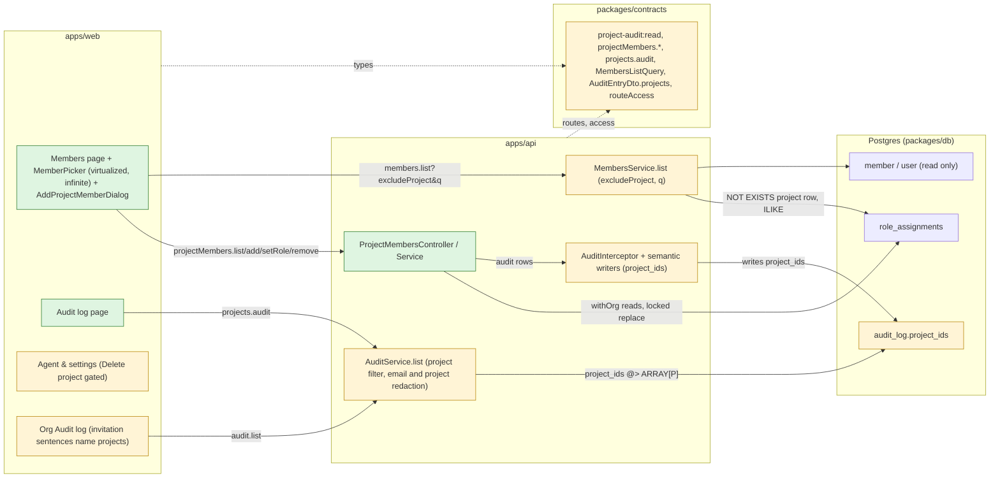
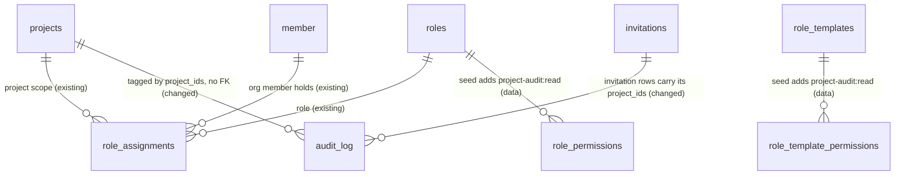

<!-- dev-plan: kind=spec id=rbac-project-admin-space rev=3 hash=6733433e0b42 source=issue#191 -->
# Project admin space design

Status: draft. Sensitive paths: auth (the new permission `project-audit:read`, five new `routeAccess` entries, the changed `members.list` filter with its own access check, and project grant writes), RLS/`withOrg` (`role_assignments` and `audit_log` reads and writes, and the audit backfill under `app.org_id`) and migrations (four new ones), plus the audit interceptor and writers with per-viewer invitee email redaction. Terminal: no code change.
Source: issue #191

## Summary

An admin of a project (the `admin` role granted on that project) can already edit the project's Desk, but cannot see or change who has a role on it, cannot read its audit log, and is shown a Delete project control that only earns a 403.
This adds, inside the existing project Settings tab, a Members page (list, add an org member, change role, remove, invite people) and an Audit log page, both under ADR-0036 RBAC, and hides Delete project from project admins.
Org owners and org admins get the same pages on every project of the org; members and viewers get nothing new.
No new membership table: project members are the existing project-scope role assignments. `audit_log` gains a project tag so a project's history can be read on its own.
Invitation entries in both the project and the org Audit log name the listed projects the reader can see.

## Business rules

Confirmed by the human at planning time.

### Goal

A project admin manages their project without org-admin help: configures it, sees and changes who has a role on it, and sees who changed what in it. Success: each action shows after a reload, the person's next load follows it, and the API refuses it for every other role and project.

In scope: project members and roles UI; project settings gating; project audit view; RBAC per ADR-0036.

Draft items checked against the current system (main at 85513f5, 2026-11-23):

| Draft item | Current system | Verdict |
| ---------- | -------------- | ------- |
| New project members table with `org_id` and RLS | Project roles already exist: `role_assignments` with `scope_type = 'project'` (migration 0024, RLS and leak test); grant, revoke and list routes `assignments.*` and project-scoped invitations exist (rbac-foundation spec §API; `packages/contracts/src/route-access.ts`). | No new table: project members are project-scope assignments (ADR-0036 §Decision; rbac-foundation §Data model). |
| Roles project admin, member, viewer | "Project admin" is `admin` granted on a project scope; `member` and `viewer` likewise; `owner` is org-only. | Follows ADR-0036 §"Where each dimension lives". |
| Resolution: a project role can add or restrict | ADR-0036: assignments add up, nothing restricts, no deny. | Assignments add up; a project role never restricts an org role (draft question 2: no). |
| Draft question 1: needed for v1? | The project-role backend shipped in slice 1; the UI and the project audit are missing. | Built now (rbac-foundation §Out of scope said UI later; human note asks for the project admin space). |
| Draft question 3: project members who are not org members | A grant to a non-member answers 422 `/userId` (rbac-foundation BR-37); invitations create the membership on accept. | Impossible by construction. |
| Gate project settings | Done by #216 (desk access matrix). Gap: Delete project (Agent & settings → Danger zone) is shown to a project admin, who gets 403 (`project:delete` is org-level; `apps/web/src/screens/DeskAgent.tsx`). | Kept: hide Delete project and prove project-scope admin end to end. |
| Project audit view | `audit:read` is org-level (`access.ts` ORG_LEVEL; 0035); `audit_log` has no project column. | In scope: a new project-level read permission in `access.ts`, a seed migration, and the ADR-0036 list update. |
| Replace the `projects.created_by` special case | Already gone (rbac-foundation §Tenancy; `apps/api/src/projects/project-access.ts` checks visibility only). | Nothing to migrate. |

### Actors

| Actor | May do |
| ----- | ------ |
| Org owner, org admin (org scope) | Everything a project admin may do, on every project of the org; plus Delete project. |
| Project admin (`admin` on P) | On P only: Settings (Routing rules, Skills, Workspace setup, Agent & settings without Delete project); Members (add an org member, change role, remove; roles Admin, Member, Viewer); Audit log of P. Invites people to P with Invite people on Members (the existing invite dialog, P fixed, project roles only) or through org Settings → Invitations, unchanged. Never project delete or create, connections, org members or org audit (org-level permissions; ADR-0036 levels). |
| Member, viewer (org or project scope) | Nothing new; no project Settings (desk access matrix §UI routes). |
| Person added or removed | P appears in or leaves their project list on their next load. |
| Ticket source, SCM webhook sender | Not affected. |

These follow ADR-0036, the rbac-foundation tenancy matrix and the desk access matrix.

### Rules

Surface: UI (the project Settings pages Members, Audit log and Agent & settings are the outermost surface the change reaches; BR-23 and BR-24 state what the API answers where a screen cannot show it).

| Id    | Category            | Rule |
| ----- | ------------------- | ---- |
| BR-1  | conditional-display | When an org owner, org admin or admin of P opens P's Settings, the side menu shows Members and Audit log next to Routing rules, Skills, Workspace setup and Agent & settings. |
| BR-2  | permission          | When a member or viewer opens P's Members or Audit log URL, they see the Forbidden page and no names or entries. |
| BR-3  | permission          | When an admin of P1 only opens P2's Settings, Members or Audit log URL, they see not found and nothing of P2. |
| BR-4  | happy-path          | When an org owner, org admin or admin of P opens Members, they see only the people with a role granted on P, paged, each with display name (or handle), handle and project role(s), and a note that roles in the organization also apply to this project. |
| BR-5  | happy-path          | When an admin of P adds an org member to P as Admin, Member or Viewer, the person shows on Members after a reload, and on their next load P is in their project list with that role's rights. |
| BR-6  | permission          | When an admin of P chooses a role in Add or Change role, only Admin, Member and Viewer are offered, never Owner. |
| BR-7  | validation          | When an admin of P opens Add, only org members without a role on P are offered, searchable by name or handle, with more people loading as they scroll down (or with Load more people), and saving without a person or a role shows a field error. |
| BR-8  | happy-path          | When an admin of P changes a person's project role, the row shows the one new role after a reload and that person's next load follows it (made Viewer: no run controls on P). |
| BR-9  | happy-path          | When an admin of P removes a person from P after confirming, the row leaves the list and P leaves that person's project list (a link to P shows not found unless an org role still covers it). |
| BR-10 | side-effect         | When a removed person had a P run terminal open, it closes; runs they own keep running and still show them as owner. |
| BR-11 | conditional-display | When an admin of P looks at their own row on Members, it offers no Change role and no Remove (and the API refuses removing yourself, BR-23). |
| BR-12 | edge                | When an admin of P adds, changes or removes a person who left the org or whose P role was removed meanwhile, they see an error that the person is no longer there, the list refreshes and nothing else changes; a role changed meanwhile is simply replaced and the list refreshes; adding a person who got a role on P meanwhile shows that they already have a role on this project and nothing changes. |
| BR-13 | navigation          | When an admin of P clicks Invite people on Members, the existing invite dialog opens with P as the only project and only Admin, Member and Viewer offered; the invitation then shows on Settings → Invitations, and once that person accepts it they show on P's Members. |
| BR-14 | persistence         | When an admin of P changes someone's project role, an org owner sees the new project role on org Settings → Members after a reload. |
| BR-15 | feedback-state      | When P's Members list is loading or fails, or no one holds a project role on P, the page shows its loading, error (with retry) or empty state. |
| BR-16 | happy-path          | When an org owner, org admin or admin of P opens P's Audit log, they see P's entries newest first, paged, each with time, actor (name or handle; "Deleted user" when gone), action and target, including entries from before this change that belong to P. |
| BR-17 | side-effect         | When a person is added to P, their P role changed or removed, P's Audit log and the org Audit log show an entry with the actor, the person and the role before and after. |
| BR-18 | side-effect         | When P's settings (name, trigger mode, poll interval, limits), agent or credential (never its value), rules, skills, setup script or tests, or environment entries change, or a run in P is controlled, P's Audit log shows the entry. |
| BR-19 | permission          | When anyone opens P's Audit log, it never shows entries of another project or another org. |
| BR-27 | conditional-display | When an invitation lists P, P's Audit log shows its entries (created, resent, revoked, accepted, declined, expired); the invitee email shows only when the viewer administers every project the invitation lists, and only the listed projects the viewer can see are named. The org Audit log's invitation entries name their listed projects the same way (human spec gap 6). |
| BR-20 | feedback-state      | When P's Audit log is loading or fails, or P has no entries, the page shows its loading, error (with retry) or empty state. |
| BR-21 | conditional-display | When an admin of P only opens Agent & settings, no Delete project control shows; an org owner or org admin still sees it. |
| BR-22 | permission          | When an admin of P only changes P's routing rules, skills, workspace setup, trigger mode, concurrency, per-ticket limit or agent, the change is saved and shows after a reload. |
| BR-23 | permission          | When a member or viewer sends a project member add, change or removal, or a project audit read for P to the API, they get 403 and nothing changes; an admin of P1 sending them for P2 gets not found; an admin of P sending Owner is refused, adding someone who already has a role on P gets 409, removing themselves gets 403, and nothing changes. |
| BR-24 | permission          | When an owner or admin of org A acts on org B's project members or audit, they get not found, and org A's views never show org B's people or entries. |
| BR-25 | edge                | When an admin of P is demoted or removed while Members or Audit log is open, their next change is refused and after a refresh they see the Forbidden page (still on P) or not found. |
| BR-26 | permission          | When a person holds Viewer on the org and Admin on P, they can manage P's Settings, Members and Audit log and only read other projects (roles add up; no project role restricts an org role). |

### Not observable

- The new project-level audit permission is seeded into existing orgs' owner and admin roles. Effect: BR-16, BR-2.
- A role change is one audited replace in one transaction. Effect: BR-8, BR-17.
- Concurrent role changes are serialized; the last write wins. Effect: BR-12.
- Existing audit rows are tagged with their project by a backfill. Effect: BR-16.

### States

Assignment states only: an assignment is created by a grant (Add) or by an accepted invitation, replaced by Change role, and deleted by a revoke (Remove). No new state machine; runs, tickets, sessions and connections are untouched.

### Limits and validation

- Add member: one person (an org member) and one role (Admin, Member or Viewer); both required; no role preselected.
- Add candidates come from the existing org members list, which a project admin already reads through `assignment:create` (names and handles of every org member, and project roles only on projects they read): `route-access.ts` `members.list`, rbac-foundation §API members row, `apps/api/src/members/members.service.ts` `visibleFor`. No widening: org-scope roles stay hidden from a project admin.
- That list gets (human round 2 T3) a filter that leaves out people with a role on P, checked against the caller's access to P (a project they cannot see is not found), a server-side search on name or handle, and paging. So Add offers only org members without a role on P.
- The picker sends no search when the box is empty, which lists everyone eligible; when a search is sent, the API requires 1 to 100 characters (human spec gap 3). Agent call: the search is trimmed and matches name or handle case-insensitively (business: no separate reason given).
- The picker loads the next 20 people when the person scrolls near the bottom (infinite scroll), with "Load more people" as the keyboard fallback, over a virtualized list (`@tanstack/react-virtual`, approved by the human) (human spec gap 4).
- Lists use the shared offset paging (ADR-0028). No filter on the Members list or the Audit log (org-tenant-admin §Limits).
- No rate or count limits (rbac-foundation §Limits).

### Edge cases

- Add a person who left the org meanwhile → field error "no longer in the organization"; the picker refreshes.
- Add a person who got a role on P meanwhile (another admin added them) → error "already has a role on this project"; the list and picker refresh; nothing changes.
- A project admin removing themselves through the API → 403; nothing changes.
- Change role or Remove on a person whose P role was removed meanwhile → error; the list refreshes; nothing else changes. A role changed meanwhile → last write wins, both changes audited (org-tenant-admin BR-8 answer).
- The same grant twice → one assignment (rbac-foundation BR-41).
- Project admin demoted or removed while Members or Audit log is open → their next change is refused; after a refresh, Forbidden (still member or viewer on P) or not found.
- Removed person with an open P terminal → it closes on the re-check; their runs keep running and keep them as owner (rbac-foundation BR-35).
- Removed person whose only access was P → no projects / no-access state on their next load (rbac-foundation BR-32, BR-35).
- Project deleted → its assignments cascade; its Members and Audit log URLs show not found; its audit rows stay in the org Audit log.
- Person removed from the org → their project roles go too.
- Someone not in the org → Invite people on Members (P fixed); after accepting an invitation listing P they appear on Members.
- An invitation listing P and P2, seen in P's audit by an admin of P only → the entry shows, without the email and without P2's name.
- Audit actor deleted → "Deleted user".

### Tenancy and permission

| Screen / action | Permission (level) | Holders |
| --------------- | ------------------ | ------- |
| Settings → Members (list) | `assignment:read` (project) | owner, org admin, admin on P |
| Add / Change role | `assignment:create` on P (plus `assignment:delete` for each replaced role), subset rule | same |
| Remove | `assignment:delete` on P; never yourself (403) | same |
| Add candidates | existing `members.list` (`assignment:create` held anywhere) plus the exclude-P filter, checked with `assignment:read` on P | same |
| Invite people (P fixed) | existing `invitations.create` (`assignment:create` on P; project roles only) | same |
| Settings → Audit log | `project-audit:read` (project; new) | owner, admin (org or P); not member, viewer |
| Delete project control | `project:delete` (org) | owner, org admin |

- Access is the union of org-scope and project-scope assignments (ADR-0036).
- `owner` is never granted on a project scope (rbac-foundation BR-37).
- A project admin grants and revokes only Admin, Member and Viewer, on their own project (rbac-foundation BR-61, subset rule).
- Members lists only people with a project-scope role on P, plus a note that roles in the org also apply here (human round 1 T1; ADR-0036 org-level vs project-level). A project admin never reads org-scope roles.
- Agent call: Change role replaces all of the person's project-scope assignments on P with exactly one role, as one audited change with from and to (business: matches org Change role and the architecture set-role route). A person holding several roles on P (older data) shows them all; after Change role they hold one. The same role again: no change, no audit entry.
- Agent call: Remove from project deletes every project-scope assignment of that person on P only; org-scope assignments and other projects are untouched (business: no separate reason given).
- Agent call: no "last project admin" rule (business: org owners and admins always manage every project).
- Agent call: the own row on Members offers no Change role and no Remove (business: avoids a self lock-out by a click).
- The API refuses removing yourself from a project with 403 and the UI hides it (human round 2 T2). Changing your own role through the API stays under the subset rule (nobody can raise their own role).
- Add is its own action. Adding a person who already holds any role on P, including the same role, is refused with 409 "already has a role on this project"; Change role is the only way to alter an existing role (human round 2 T3b).
- A project admin may create invitations for their own project: `invitations.create` = `orgAdmin('member:create', 'assignment:create')`, with the service rule "project admin holding `assignment:create` on every listed project, roles admin, member or viewer, never org scope or owner" (rbac-foundation §Endpoint rules "Tenant invitation create", BR-60; org-onboarding BR-29).
- Guard order: 403 before any lookup, 404 out of scope or another org (ADR-0036 §How a request is checked).
- Agent call: the project audit read is held by owner and admin only (business: the same admin-level line as Desk config, #216).
- Invitation entries that list P show in P's audit (human round 2 T1). The invitee email shows only to a viewer who administers every project the invitation lists (org owner and org admin always; a project admin only when every listed project is theirs), as on the Invitations page (org-onboarding BR-31). An invitation entry names the listed projects the viewer can see, and only those (human spec gap 1), in both P's Audit log and the org Audit log (human spec gap 6; an org owner or org admin reading the org Audit log sees every listed project of the org).
- Never: an admin of P1 sees P2's members, roles or audit; org A never sees org B; P's audit never shows another project's entries, the name of a project the viewer cannot see, or an invitee email outside BR-31.

### Lifecycle, compatibility and side effects

- Add, Change role and Remove each write one audit entry with actor, person, and role(s) before and after, tagged with P; it is visible in P's and the org Audit log.
- Agent call: P's Audit log shows the entries tied to P: project settings (name, trigger mode, poll interval, limits), agent and credential (never the value), rules, skills, setup script and tests, environment entries (name and kind only), run actions, project role grants, revokes and changes (including those created when an invitation listing P is accepted), and invitation entries that list P (business: no separate reason given).
- Invitation entries (created, resent, revoked, accepted, declined, expired) that list P show in P's Audit log, with the email and project names limited by scope as above (human round 2 T1; spec gap 2 confirms expired). Org-scope invitations list no project and stay org-only. All of them stay in the org Audit log, whose invitation entries now also name their listed projects (human spec gap 6); its other entries are unchanged.
- Agent call: existing audit rows are tied to P where their target leads to P (a project, rule, run, setup test or agent still present), so an existing project's Audit log shows its history from before this change; rows that cannot be tied stay org-only (business: every existing project would otherwise open on an empty log, and the org audit already holds that history).
- The audit log stays append-only with no retention limit. The new permission is seeded into existing orgs' owner and admin roles (as 0035 did).
- Compatibility: existing project-scope assignments show on Members; no data migration besides the permission seed and the audit project tagging. Existing Settings pages are unchanged except that Delete project is hidden from project admins. Org Settings → Invitations and org Members (project roles read-only) are unchanged. Org Settings → Audit log changes only in its invitation sentences, which gain the listed projects (human spec gap 6).
- What a user sees happen: an added, role-changed or removed person sees P appear, their rights change, or P leave their list on their next load; an open terminal closes on removal. Member changes show in P's and the org Audit log. No ticket comments, email or notifications.
- Terms stay provider-agnostic (AGENTS rule 3): member, role, assignment, invitation, project, audit.
- Untrusted text: no ticket, comment or repo text is involved. Names, handles and audit fields render as plain text; raw payloads and secret values are never shown (org-tenant-admin §Untrusted text; workspace-env-secrets spec).
- Existing decisions this builds on: ADR-0036; ADR-0031; rbac-foundation (project grants, BR-37, BR-41, BR-61, BR-64, `members.list` rights, `created_by` decides nothing); org-onboarding (BR-29, BR-31); desk access matrix (#216); org-tenant-admin (Members shows project roles read-only, "project members are slice 4", audit view shape, self-removal); workspace-env-secrets; #238. The org-tenant-admin spec's invitation audit copy (no project names) is stale after human spec gap 6; this newer spec wins, and that doc is fixed in the same PR (see Architecture › Other decisions).

### Out of scope

Org-level role changes (slice 1) and cross-org sharing, as the requirement states.

## Architecture

Confirmed by the human at planning time.

### Overview

Layering follows `apps → core → db → contracts` and `web → contracts` (AGENTS rule 2).

- `packages/contracts`: the permission `project-audit:read`; the routes `projectMembers.list`, `projectMembers.add`, `projectMembers.setRole`, `projectMembers.remove` and `projects.audit`; a new query schema for `members.list`; the DTOs (including the new `AuditEntryDto.projects` field), `routeAccess` entries and new `AuditAction` values.
- `packages/db`: the column `audit_log.project_ids`; four migrations (column, GIN index, permission seed, backfill).
- `packages/core`: no change.
- `apps/api`:
  - a new `ProjectMembersService` and `ProjectMembersController` in `apps/api/src/assignments/`, reusing `checkTenantAssign`, `loadRole` and `toAssignmentDto`;
  - `MembersService.list` and `MembersService.load` gain the `excludeProject` and `q` filters;
  - `AuditService.list` gains a project filter and per-viewer redaction of invitee emails and listed projects on invitation rows (on both audit routes); `toAuditEntry` maps the new actions;
  - `AuditInterceptor`, `buildAuditRow` and `writeAuditEntry` write `project_ids`;
  - these writers pass the project ids: `AssignmentsService.grant` and `revoke` (project scope); `accept-invitations.ts`; `invitations.service.ts` (created, resent, revoked, and expired in `expireStalePending`); `my-invitations.service.ts` (declined).
- `apps/worker`, runner: no change.
- `apps/web`: routes `o.$org.p.$project.desk.members.tsx` and `o.$org.p.$project.desk.audit.tsx`, guarded in `beforeLoad`. The picker calls `members.list` with `excludeProject`, `q` (left out when empty) and `pageSize=20` through `useInfiniteQuery`, and renders a virtualized list with `@tanstack/react-virtual`. Invite people reuses the existing invite dialog and `invitations.create`. The Agent & settings route passes `onDeleteProject` only with `project:delete`. The org Audit log screen (`screens/OrgAudit.tsx`, route `/o/$org/settings/audit`) shows the new `projects` in its invitation sentences through the shared `features/audit/map.ts` and `components/AuditRow.tsx`.

### Data model

Migration: four new migrations, numbered with the next free numbers at build time (`0035` is taken, and the workspace-env-secrets plan wants the next number too): (a) add the column `audit_log.project_ids`; (b) the GIN index, in its own plain `CREATE INDEX` migration like `0023`, `0029` and `0034`; (c) the `project-audit:read` permission seed; (d) the audit backfill. Applied migrations are never edited (AGENTS rule 8; `database.md` §5).

#### audit_log (changed; scope: org)

| Field | Type | Null | Default | Key / index | Change | Notes |
| ----- | ---- | ---- | ------- | ----------- | ------ | ----- |
| `project_ids` | `uuid[]` | not null | `'{}'` | `audit_log_project_ids_idx` (GIN), for `project_ids @> ARRAY[P]` | added | The projects a row belongs to; `{}` for org-only rows. No foreign key. |

RLS: unchanged (org-only, forced). The project filter is explicit in every query (AGENTS rule 4; ADR-0036).

- Agent call: an array, because invitation rows that list P must show in P's audit (round 2 T1) and one invitation can list several projects.
- The constant default is safe on a live table (`database.md` §5).
- Agent call: no foreign key, because audit history outlives a deleted project.
- Writers:
  - The interceptor sets `[req.authz.projectId]` on project-kind routes. This also covers the in-flight workspace-env-secrets routes.
  - Semantic project-scope grants and revokes set `[projectId]`.
  - Project-scope invitation events set the invitation's `project_ids`, including `invitation.expired` (written only by `expireStalePending` in `invitations.service.ts`) (human spec gap 2).
  - Org-level events stay `{}`: `member.removed`, `member.role_changed`, `org.*`, org-scope invitations, and generic org-kind rows.

#### Permission seed (data; scope: org)

- Template lines for `owner` and `admin` gain `project-audit:read`, copied into every org's built-in roles with the per-org `app.org_id` DO loop, idempotent, as `0035_seed_audit_read.sql` does.
- Agent call: holders are owner and admin (business §7: the same admin-level line as Desk config).

#### Audit backfill (data; scope: org)

- Runs per org, inside the DO loop that sets `app.org_id`, because `audit_log` forces RLS.
- Idempotent: it touches only rows `where project_ids = '{}'`.
- It sets:
  - `target_type = 'projects'`: `[target_id]` when the target id is a uuid;
  - `runs`, `rules`, `agents` and `setup-tests`: the joined row's `project_id`;
  - `assignment.granted` and `assignment.revoked`: the project id at payload `to.scope.projectId` / `from.scope.projectId`;
  - invitation actions, `invitation.expired` included: the joined `invitations.project_ids` for project-scope invitations.
- Anything that cannot be tied to a project stays org-only.

#### role_assignments, member (unchanged)

No change to `role_assignments` or `member`. RLS is unchanged (org-only).

### API

Common to every route below: the guard runs the ADR-0036 order through `checkTenantAccess` (org membership, permission 403 before any id lookup, target and project scope 404, then `any`/`own`). The tenant comes from the session, and the `x-org-id` check applies (ADR-0035). Contracts first, and every route has a `routeAccess` entry (AGENTS rule 1; ADR-0004).

| Method | Path | Who may call it | Request | Response | Contract |
| ------ | ---- | --------------- | ------- | -------- | -------- |
| GET | `/api/projects/:projectId/members` | `project('assignment:read')`: owner, org admin, admin on P | `PageQuery` | `pageOf(ProjectMemberDto)` | `projectMembers.list` (new) |
| POST | `/api/projects/:projectId/members` | `project('assignment:create')`, subset rule | `AddProjectMemberRequest {userId, roleId: Id}` (`userId` uses the schema of `CreateAssignmentRequest.userId`) | 201 `ProjectMemberDto` | `projectMembers.add` (new) |
| PUT | `/api/projects/:projectId/members/:userId/role` | `project('assignment:create')`, plus `assignment:delete` on each replaced role | `SetProjectRoleRequest {roleId: Id}` | 200 `ProjectMemberDto` | `projectMembers.setRole` (new) |
| DELETE | `/api/projects/:projectId/members/:userId` | `project('assignment:delete')`; never your own userId | none | 204, empty | `projectMembers.remove` (new) |
| GET | `/api/projects/:projectId/audit` | `project('project-audit:read')`: owner, org admin, admin on P | `PageQuery` | `pageOf(AuditEntryDto)` (`target.label` is null for a redacted invitation, which the DTO already allows; `projects` as below) | `projects.audit` (new) |
| GET | `/api/orgs/:orgId/audit` | unchanged (org-level `audit:read`: owner, org admin) | unchanged | `pageOf(AuditEntryDto)`, which now also carries `projects` on invitation entries, filled the same way (an org-scope reader sees every listed project of the org) (human spec gaps 1 and 6) | `audit.list` (changed DTO) |
| GET | `/api/orgs/:orgId/members` | unchanged entry `orgAdmin('member:read', 'assignment:create')`; `excludeProject` adds its own check (below) | `MembersListQuery = PageQuery & {q?: string, excludeProject?: Id}`; `q` optional, 1 to 100 characters after trimming when present (400 otherwise) | `pageOf(MemberDto)`, unchanged (no email) | `members.list` (changed) |
| POST | `/api/orgs/:orgId/invitations` | unchanged `orgAdmin('member:create', 'assignment:create')` | unchanged | unchanged | `invitations.create` (unchanged) |

- `ProjectMemberDto {userId, name, handle, projectRoles: {assignmentId, role: RoleRef}[]}`. There is no `orgRole` field (human round 1 T1).
- `AuditAction` adds `project_member.role_changed` and `project_member.removed`. Add writes the existing `assignment.granted` with a project scope.
- `AuditEntryDto` gains `projects: {id: Id, name: string}[]` (human spec gap 1). It is filled only for `invitation.*` rows and is empty for every other row. It holds the listed projects that still exist and are in the caller's `visibleProjects(access, 'project:read')`, sorted by name, then id (human spec gap 7); hidden projects are left out, never counted. Agent call: one shared DTO field, filled the same way on both audit routes; an org owner or admin sees every listed project, a project admin only the ones they can see.
- `project-audit:read` is project-level: it is not added to `ORG_LEVEL`. Agent call: a new permission, because `audit:read` is org-level and levels are per permission (ADR-0036).
- Agent call: project-scoped paths for the project routes. The `project` route kind gives the ADR-0036 order (403 before lookup, 404 out of scope) and `req.authz.projectId` for audit tagging.
- Agent call: Change role is atomic. All of the person's project-scope rows on P are replaced in one transaction, so there is no half-way loss of access.

GET `/members`:

- Returns users with at least one project-scope row on P, never org-scope rows (human round 1 T1).
- Sorted by name, then id. Offset paging (ADR-0028).

POST `/members` (Add), checks in this order:

1. The role is in the org and assignable at project scope, else 422 `/roleId`.
2. The user is an org member, else 422 `/userId`.
3. `checkTenantAssign('assignment:create')`, else 403.
4. The user's rows on P are locked `FOR UPDATE`. No role on P: insert and answer 201. Any role on P, including the same role: 409 "already has a role on this project", nothing written and no audit row (human round 2 T3b).

Audit: `assignment.granted`, project scope.

PUT `/members/:userId/role` (Change role):

- Locks the user's project-scope rows on P. None: 404.
- 422 `/roleId` as above.
- `checkTenantAssign`: create on the new role, delete on each replaced role (403).
- Deletes and inserts in one transaction. Same role: 200, no audit.
- Audit: `project_member.role_changed {projectId, from, to}`.
- Last write wins.
- Agent call: changing your own role stays allowed under the subset rule (org `members.updateRole` precedent; nobody can raise their own role; the UI hides it).

DELETE `/members/:userId` (Remove):

- Your own userId is refused with 403 before any lookup (human round 2 T2; same as `members.remove`).
- Deletes the user's project-scope rows on P only. None: 404.
- `checkTenantAssign('assignment:delete')` on each row (403).
- Audit: `project_member.removed {projectId, from}`. Answers 204.

GET `/audit`:

- Rows of the session org with `project_ids @> ARRAY[P]`, sorted `at desc, id desc`, with `count(*)`. Mapped by `toAuditEntry`; the raw payload is never returned.
- Per-viewer redaction of `invitation.*` rows (human round 2 T1): the invitee email is the target label only when the caller holds `member:read` at org scope, or holds `assignment:read` on every project in the invitation's `project_ids`. This is the same test as `visibilityFilter` in `invitations.service.ts` (org-onboarding BR-31). Otherwise `target.label` is null.
- The redaction is done at read time in `AuditService` with the caller's `Access`, so the `projects.audit` controller passes `@CurrentAccess`.
- `projects` on invitation rows lists only the listed projects the caller can see (`visibleProjects(access, 'project:read')`) that still exist, sorted by name, then id; hidden projects are left out, never counted (human spec gaps 1 and 7).
- Expired invitation rows are included, with the same per-viewer email and project redaction (human spec gap 2).

Changed `members.list`, when `excludeProject = P` is given, in this order after the existing route check:

1. P must be in the session org, checked under `withOrg`. A missing, foreign or malformed id is 404.
2. P must be in the caller's scope (`inScope`), else 404.
3. The caller must hold `assignment:read` on P (`can`), else 403. Agent call: `assignment:read`, because excluding P's members reveals who is on P, which is exactly what reading P's assignments allows. Someone who cannot read P learns nothing, not even whether P exists. The order follows ADR-0036 steps 4 and 5 and `AssignmentsService.visibleFor`.
4. The exclusion is a `NOT EXISTS (role_assignments where org_id = org and user_id = member.user_id and scope_type = 'project' and project_id = P)` in the WHERE of both the `count(*)` and the page query, so it runs before paging and the totals are right.

`q` on `members.list`:

- Optional. When present it must be 1 to 100 characters after trimming (400 otherwise). The picker leaves it out when empty (human spec gap 3).
- Matched case-insensitively against `user.name` and `user.handle` with `ILIKE ... ESCAPE '\'`.
- The value is bound as a parameter after escaping `\`, `%` and `_` (AGENTS rule 6).
- It goes in the same WHERE, so it also applies before paging.
- The sort stays handle, then id. The assignment visibility in the response is unchanged.

Invitations (confirmed, no change): a project admin may create invitations for their own project through POST `/api/orgs/:orgId/invitations`. The service checks `mayStartInvite` and `mayInvite` in `invitations.service.ts`: `assignment:create` on every listed project, and the `checkTenantAssign` subset rule (admin, member or viewer only; never `owner`; never org scope). This is rbac-foundation BR-60. The project admin then sees the invitation in org Settings → Invitations (org-onboarding BR-31). Nothing new is needed.

Agent call: no last-project-admin rule, because org owners and admins always manage every project.

No WebSocket, SSE or webhook change. Other existing routes are unchanged.

### Third-party libraries

| Library | New or existing | Used for | Approval |
| ------- | --------------- | -------- | -------- |
| zod | existing | contract schemas (`MembersListQuery`, new DTOs and requests) | existing |
| NestJS | existing | `ProjectMembersController`, services | existing |
| Drizzle | existing | queries, migrations | existing |
| TanStack Router and Query | existing | new routes, lists, mutations; `useInfiniteQuery` for the picker | existing |
| `@tanstack/react-virtual` | new, `apps/web` only (exact pinned version in `apps/web/package.json` plus the lockfile) | virtualizing the Add member picker list | approved by the human |

### Services and integrations

| Service | New or existing | How it is used |
| ------- | --------------- | -------------- |
| Postgres | existing | four migrations; reads and writes under `withOrg` |
| better-auth `user` and `member` tables | existing | read only (names, handles, org membership) |
| Temporal, Kubernetes, SecretStore, provider APIs | existing | unchanged |

### Configuration

No config change.

### Other decisions

- Worker: no change. Runner and Kubernetes: no change; `q` and ids are Zod-parsed and bound, so no user text reaches a shell, a k8s spec or SQL text (AGENTS rule 6).
- Provider adapters: no change; names stay generic (AGENTS rule 3; ADR-0005).
- Secrets: none touched. Payloads still pass `redactBody` and are never returned. `members.list` and the project members route return no email. The audit returns an email only under the BR-31 test above.
- Events and live updates: no new SSE event; lists are plain queries, invalidated after mutations (ADR-0015). A person removed from P loses an open terminal on the next reauth (`TERMINAL_REAUTH_MS`, close 4403). An open SSE stream lasts until it reconnects (existing follow-up).
- Failures the user sees: 403 or 404 from the guard; 403 on self-removal; 422 for a bad role or a non-member; 409 on Add when the person already has a role on P; 404 on Change role or Remove when the person is gone meanwhile; on `members.list` with `excludeProject`, 404 when P is out of scope and 403 without `assignment:read` on P.
- Logs at `info`: `{requestId, orgId, projectId, actorUserId, targetUserId, action}`. No email, no `q`.
- Scale: member writes touch a few rows; the `members.list` filters run over one org's members; the project audit uses the GIN index plus a sort of the project's rows (ADR-0028 accepts the `count(*)` cost); the backfill runs once per org.
- Sensitive paths touched: auth (the new permission, five new `routeAccess` entries, the changed `members.list` filter with its own access check, grant writes); RLS/`withOrg` (`role_assignments` and `audit_log`, and the backfill under `app.org_id`); migrations; the audit interceptor and writers, plus per-viewer email redaction; terminal: no code change. Needs `review:sensitive` and a high-effort security review.
- Agent call: no new ADR. The same PR adds `project-audit:read` to ADR-0036's project-level list and adds rows to the desk access matrix spec, as the org slice did.
- Stale doc fixed in the same PR (AGENTS: the newer accepted doc wins): `docs/superpowers/specs/2026-11-22-org-tenant-admin-design.md`, whose invitation audit copy has no project names (§UI and Storybook: the `components/AuditRow.tsx` line "invited sam.reyes@contractor.io as Viewer" and the Copy sentences "<actor> invited <email> as Viewer", "resent the invitation for <email>", "revoked the invitation for <email>", "accepted an invitation as Member", "declined an invitation"; and the TC-23.1 expected text). It is updated to the invitation sentences of this spec (human spec gap 6).

## UI and Storybook

Screens and components this changes:

- Agent call: the project admin space is the existing project Settings tab (Desk side menu), not a new area (ui-ux: it is already the project's settings home, already gated per project, and already reached from the top bar and the Projects row menu; a second area would split one project's settings in two).
- New route `apps/web/src/app/routes/o.$org.p.$project.desk.members.tsx` (`?page`), guard `assignment:read` on the project; screen `screens/DeskMembers.tsx` inside `DeskFrame` (active `members`).
- New route `o.$org.p.$project.desk.audit.tsx` (`?page`), guard `project-audit:read` on the project; screen `screens/DeskAudit.tsx` inside `DeskFrame` (active `audit`).
- Changed route `o.$org.p.$project.desk.agent.tsx`: passes `onDeleteProject` only with `can(access, 'project:delete')`.
- Changed screen `/o/$org/settings/audit` (`screens/OrgAudit.tsx`, through `features/audit/map.ts` and `components/AuditRow.tsx`): its invitation rows (created, resent, revoked, accepted, declined, expired) gain " to <projects>" for project-scoped invitations; its other rows are unchanged (human spec gap 6). Its states are unchanged.
- Routes use flat dot names under `/o/$org/...`, Zod `validateSearch` with fallback, and `?page=` (`frontend.md` §2, §3; ADR-0028).
- Entry points (unchanged): project top-bar Settings tab → Routing rules, then side menu "Members" / "Audit log"; Projects row menu "Settings"; project switcher. No change to org Settings (a project admin keeps Invitations only).
- Reused as is (`frontend.md` §1, §6): `DeskFrame`, `DeskLayout` (props extended), `SubNav`, `DataTable`, `Pagination`, `useRowMenu`, `EmptyState`, `RouteLoadError`, `Skeleton`, `Dialog`, `Field`, `TextInput`, `RadioCard`, `Banner`, `Toast`/`ToastRegion`, `LabelChip`, `Button`, `AuditRow`, `InviteDialog` + `InviteLink` (with `projectsOnly`, one project, project roles), `ChangeRoleDialog` (unchanged: Admin, Member, Viewer options with the project role texts and no "No role" card, `self=false`, `currentIsOwner=false`, `error.kind='forbidden'`), `Forbidden` (route boundary).
- Changed:
  - `components/DeskLayout.tsx`: `active` gains `'members' | 'audit'`; `links` gains optional `members` and `audit` (absent = item hidden, like `setup`). New side-menu group "Access" after "Desk" (that is, after "Agent & settings"), before "Repository": "Members", "Audit log". States: with and without the Access group (hidden while grants load or fail: fail closed, `useCan`). Stories: update Default; add WithAccess (both items), MembersActive, AuditActive.
  - `screens/DeskFrame.tsx`: `DeskLinks` gains `members?`, `audit?`; `active` gains the two keys.
  - `features/desk/frame.ts`: `projectPaths` adds `members`, `audit`; `useDeskRights` adds `members` (`assignment:read`) and `audit` (`project-audit:read`); a link is set only when its right holds.
  - `screens/DeskAgent.tsx`: renders the Danger zone section only when `onDeleteProject` is given. States: with Danger zone (owner, org admin), without (project admin). Story DeskAgentProjectAdmin.
  - `ds/icons.tsx`: new `users` icon (same stroke style) for "Members"; "Audit log" reuses `clock`. Agent call: every Desk side-menu item has an icon, none of the existing ones means people, and the org slice added `grid` the same way. Story `Primitives/Icon` updated.
- New (each with a story, AGENTS rule 10):
  - `components/ProjectMemberRow.tsx` (+ `projectMemberColumns`): Name (name + muted mono handle, "You" tag), Role (role names joined with ", " when the person holds several project roles here), row menu (Change role, Remove from project) absent on the own row. Agent call: a new row, not `MemberRow`, because `MemberRow` carries org Role + Project roles columns and Remove-from-org semantics. Stories: Admin, Member, Viewer, SeveralRoles, You (no menu), LongName, Busy.
  - `components/MemberPicker.tsx`: a controlled combobox (TextInput + listbox in the field). The route gives it the results of a server search (`members.list` with `excludeProject` and `q`). Each option shows name and handle; a picked person shows in the field as "Name (handle)", and a "Load more people" option sits at the end when more pages exist. It does no filtering itself (presentational: `query`, `onQueryChange`, `options`, `total`, `hasMore`, `state`, `onLoadMore`, `onPick`). The list is virtualized with `@tanstack/react-virtual` (approved by the human) and loads more on scroll; "Load more people" is the keyboard fallback (human spec gap 4):
    - The next page of 20 loads when the last rendered option comes within 5 rows of the end of the scroll area. The "Load more people" option stays at the end.
    - The listbox has a fixed height of 8 rows with inner scroll inside the dialog. Only the visible rows plus an overscan of 5 are in the DOM.
    - End-row states: loading more ("Loading…") and load-more error ("Could not load more people." + "Try again"). The loaded people stay in both.
    - The virtualizer lives inside `components/MemberPicker.tsx`. `@tanstack/react-virtual` is not a router, Query, Form or contracts import, so the `components/` boundary holds (`frontend.md` §1).
    - States: loading, searching, error (retry), no match, everyone already added (empty first page with no `q`), more pages, loading more, load-more error. Stories: EmptyInput, Results, Selected, Loading, Searching, Error, NoMatch, AllAdded, MorePages, LoadingMore, LoadMoreError, LongList (200 people, virtualized), LongName.
  - `components/AddProjectMemberDialog.tsx`: `MemberPicker`, role radio cards and a form Banner. Stories: Default, Picked, FieldErrors, Saving, FormError, GoneFromOrg, AlreadyOnProject (409 Banner, Person cleared).
  - `screens/DeskMembers.tsx`, `screens/DeskAudit.tsx` (stories under `Screens/Desk`).
- States:
  - DeskMembers: loading (skeleton rows in the Desk content column), ready, paged, empty, error (Banner "Internal server error", request id, Retry), busy row (menu disabled), row menu open, add dialog (default, search open, searching, no match, everyone added, field errors, saving, form error, 409 already on the project), invite dialog from the space (project fixed; form, saving, created), added toast, change-role dialog (default, saving, 403 Banner), role changed toast, remove confirm (default, removing), removed toast, gone (404 toast + refetch). Permission denied: member or viewer → route `Forbidden` under the project bar with no Settings tab and no side menu (same as other Desk routes; `deskAccess` pattern).
  - DeskAudit: loading, ready, paged, empty, error, forbidden (route `Forbidden`). No live updates.
  - No stale or reconnecting state: no SSE on these pages.
- Role-based UI (the web hides, the API decides; ADR-0036 levels):

| Control | Owner | Org admin | Project admin (this project) | Member / viewer (org or project) |
| ------- | ----- | --------- | ---------------------------- | -------------------------------- |
| Project Settings tab | yes | yes | yes | hidden (unchanged) |
| "Members" item and page (`assignment:read`, project) | yes | yes | yes | hidden; URL → Forbidden |
| Add member, Change role, Remove (`assignment:create` / `delete`, project) | yes | yes | yes, not on own row | — |
| "Invite people" on Members (`assignment:create`, project; existing invite rules) | yes | yes | yes | — |
| "Audit log" item and page (`project-audit:read`, project) | yes | yes | yes | hidden; URL → Forbidden |
| Danger zone "Delete project" (`project:delete`, org) | yes | yes | hidden | — |
| Desk edits (rules, skills, setup, agent, trigger mode, limits) | yes | yes | yes | — (unchanged) |
| Org Settings tabs | unchanged | unchanged | Invitations only (unchanged) | none |

  A project admin of P1 opening P2 gets the existing project not-found (project out of scope → 404).

- Data on screen (`frontend.md` §3: keys start `['org', slug]`, no optimistic updates, invalidate on success, mappers in `features/projectMembers/map.ts` with tests):
  - `['org', slug, 'projects', projectId, 'members', 'list', page, pageSize]` (`projectMembers.list`; keeps old rows across pages).
  - Picker (human round 2 T3, spec gaps 3 and 4): `members.list` with `excludeProject=<projectId>`, `q` and `pageSize=20`, as an infinite query (`useInfiniteQuery`) with key `['org', slug, 'members', 'list', 'infinite', {excludeProject, q}]`, page by page. It sits under the `['org', slug, 'members']` prefix, so invalidating that prefix also refreshes it. It runs only while the Add dialog is open. `q` is debounced 250 ms and trimmed; an empty `q` is left out of the request and lists everyone eligible, page by page. The input has `maxLength=100`, so `q` is always 1 to 100 characters. Agent call: the input never allows what the API refuses (ui-ux: the API answers 400 outside 1 to 100 characters). The next page loads on scroll or through "Load more people". While a new `q` loads, the previous results stay with a "Searching…" status. There is no client-side filtering.
  - `['org', slug, 'roles']` for the role cards and the invite role options (existing; keep the roles whose `assignableScopes` include `project`, which are Admin, Member and Viewer).
  - After Add (`projectMembers.add`), Change role (`setRole`) or Remove (`remove`): invalidate the project members list, `['org', slug, 'members']` (org Members and the picker) and the project audit list. After a 409 or 422 on Add, invalidate the same keys.
  - After an invite: invalidate the org invitations list (existing invite mutation).
  - `['org', slug, 'projects', projectId, 'audit', 'list', page, pageSize]` (`projects.audit`), default staleTime, no SSE.
  - In flight: button pending label, dialog cannot close (Escape ignored), row menu disabled.
- Forms (`frontend.md` §11): TanStack Form validated by `AddProjectMemberRequest` (`userId`, `roleId`). The project comes from the route and is never typed. Submit with `mutateAsync`. `fieldErrorsFromProblem` maps `/userId` to Person and `/roleId` to Role. A 409 goes to the form Banner with Person cleared. Anything else unmapped goes to the form Banner with the request id; input is kept on failure; errors show on submit, then update on change (org slice pattern). Agent call: no role preselected in Add (same as the invite dialog). Change role: current role preselected, "Save role" disabled until it differs (existing dialog).
- Visual system: tokens only, no new color, font size, radius or spacing scale (`frontend.md` §5). Remove uses `solid-danger`. Closest existing boards: layout `DeskAgent.dc.html` / `DeskRules.dc.html` (Desk frame and side menu); members table and row menu `OrgMembers*.dc.html`; change role `OrgMembersChangeRole.dc.html`; add dialog `OrgInvitationsInvite.dc.html` (role cards, field layout); audit `OrgAudit*.dc.html`.
- Accessibility: the side menu stays `<nav aria-label="Desk">`, active item `aria-current="page"`. Row menu buttons "Actions for <name>"; role cards are a radio group with legend "Role". Picker: `role="combobox"` with `aria-expanded`, `aria-controls` and `aria-activedescendant`. The listbox is virtualized: each option carries `aria-setsize` (the response total) and `aria-posinset` (1-based), and the active option is scrolled into view (`scrollToIndex`) before it becomes the active descendant, so it always exists in the DOM. ArrowUp and ArrowDown move; ArrowDown on the last loaded option moves to "Load more people", and Enter on it loads the next page and moves the active option to the first new person; Home and End go to the first and last loaded option; Enter picks; Escape closes the list first, then the dialog. A `role="status"` line announces "<n> people" after a search and "<n> more people loaded" after a page. Dialogs use `useFocusTrap`; Add focuses Person; Change role focuses the current card; focus returns to the opener; after a remove, focus goes to the "Members" heading. Field errors via `Field error` (`aria-invalid`, `aria-describedby`). Toasts `role="status"`, error Banners `role="alert"`. Contrast checked in built Storybook.
- Layout: the Desk frame (fixed top bar, fixed-width side menu, scrolling content column); desktop artboards 1440x900, no new mobile layout (org slice precedent). Tables cut long names with ellipsis + `title`. The picker list has a fixed height of 8 rows with inner scroll inside the dialog.

User flows:

- Open: project → Settings tab → side menu "Members" (or "Audit log").
- Add member: "Add member" (page header) → dialog → type in "Person" (server search over org members not yet on the project: `members.list?excludeProject&q`) → pick one → pick a role card (Admin, Member, Viewer) → "Add member" (`POST projectMembers.add`) → list refetches → toast "<name> added as <Role>" → focus back on "Add member".
  - No role or no person picked: field errors "Choose a person." / "Choose a role." on submit; input kept.
  - 409 (the person got a role on P meanwhile): form Banner with title "This person already has a role on this project." and detail "Use Change role to change it."; Person cleared, role kept; the members list and picker refetch; the dialog stays open.
  - 422 `/userId` (the person left the org meanwhile): field error "This person is no longer in the organization."; the picker list refetches.
  - 403 or another error: form Banner with title and "Request ID: <id>"; the dialog stays open, input kept.
  - Person not in the org: help text under the picker says to use "Invite people" (BR-13).
- Invite (BR-13): "Invite people" (page header) → the existing `InviteDialog` (title "Invite people") with `projectsOnly`: Email empty, Role showing "Choose a role" with options Admin, Member, Viewer, Access "Some projects" with this project as the only project and preselected → "Create invitation" → the existing created step with the copy link → Done. Existing 409s ("already a member", "already invited") and field errors as today. The invitation then shows under org Settings → Invitations; once it is accepted, the person shows on Members.
- Change role: row menu "Change role" → `ChangeRoleDialog` with Admin, Member, Viewer cards carrying the project role texts (the same as in Add) and no "No role" card, current preselected → "Save role" → refetch → toast "Role changed".
  - 404 (removed meanwhile): the dialog closes, error toast "Member is no longer on this project", list refetches.
  - 403: dialog Banner "You don't have access" with request id.
- Remove: row menu "Remove from project" (red) → confirm → "Remove" → refetch → toast "<name> removed from <project>"; focus to the "Members" heading. 404: error toast as above plus refetch.
- Own row: "You" tag, no row menu (BR-11; the API refuses self-removal with 403).
- Audit: Settings → "Audit log" → paged table, newest first.
- Delete project (Agent & settings): owner and org admin see the Danger zone as today; a project admin does not see it.
- Access change on the target person: their next page load follows it (as in the org slice; no live push).

Copy (Agent call: sentence case, short sentences, verb buttons, no provider names, in the style of the OrgMembers and OrgAudit boards; ui-ux: no separate reason given):

- Side menu group "Access"; items "Members", "Audit log".
- Members: h1 "Members"; intro "People with a role on this project. A role in <Org> also applies here." Buttons, in this order: "Invite people" (secondary, the same wording as org Invitations), then "Add member" (primary). Columns "Name", "Role", "Actions" (sr-only). Tag "You". Menu "Change role", "Remove from project" (red). Menu button "Actions for <name>".
- Empty: "No project roles yet" / "Add a member of <Org> to give them a role on this project." with "Add member".
- Add dialog: title "Add member to <project>". Field "Person", placeholder "Search by name or handle". Help "Only members of <Org> are listed. To add someone new, use Invite people." Legend "Role". Buttons "Cancel", "Add member" / "Adding…". Errors "Choose a person.", "Choose a role." (same as the invite dialog), "This person is no longer in the organization." Picker: "Loading people…", "Searching…", "Could not load people." + "Try again", "No member matches "<q>".", "Everyone in <Org> already has a role here.", "Load more people", "Loading…", "Could not load more people." + "Try again", status lines "<n> people" and "<n> more people loaded". 409 Banner: title "This person already has a role on this project.", detail "Use Change role to change it." Toast "<name> added as <Role>".
- Role cards (project scope, matching the seeded permissions in `0026` + `0032`): Admin "Manage this project's members, agent, rules, skills and setup."; Member "See runs, start runs and act on their own runs."; Viewer "See this project and its runs."
- Change role: existing dialog copy ("Change role for <name>", legend "Role", "Save role" / "Saving…", toast "Role changed"); the cards carry the project role texts above and there is no "No role" card.
- Remove confirm: title "Remove <name> from <project>?"; body "They lose their role on this project. A role they hold in <Org> stays."; "Cancel", "Remove" / "Removing…"; toast "<name> removed from <project>".
- Gone toast: "Member is no longer on this project".
- Audit: h1 "Audit log"; intro "Changes to this project, newest first."; columns "When", "Who", "What"; empty "No activity yet".
- Audit sentences on the project Audit log (the invitation and expired sentences below also apply on the org Audit log, human spec gap 6):
  - Agent call: an `assignment.granted` entry that carries a role change reads "<actor> added <member> to this project as <Role>"; without a role change it shows the raw key (ui-ux: Add writes `assignment.granted` with project scope). The org Audit log's rendering of `assignment.granted` is unchanged.
  - `project_member.role_changed` always reads "<actor> changed <member>'s project role from <A> to <B>" (Add is a separate action).
  - `project_member.removed` reads "<actor> removed <member> from this project (was <Role>)".
  - Invitation entries (created, resent, revoked, accepted, declined, expired) name the listed projects the viewer can see, on both the project and the org Audit log (human spec gaps 1 and 6). `<projects>` is the visible names, in the order the API sends them (sorted by name, human spec gap 7), joined with ", "; more than 3 become "p1, p2, p3 and N more", with the full visible list in the cell `title`. The email shows only when the API sends it (a viewer who administers every listed project); otherwise the "someone" / "an invitation" forms apply:
    - created: "<actor> invited <email> as <Role> to <projects>" / no email: "<actor> invited someone as <Role> to <projects>"
    - resent: "<actor> resent the invitation for <email> to <projects>" / no email: "<actor> resent an invitation to <projects>"
    - revoked: "<actor> revoked the invitation for <email> to <projects>" / no email: "<actor> revoked an invitation to <projects>"
    - accepted: "<actor> accepted an invitation as <Role> to <projects>"
    - declined: "<actor> declined an invitation to <projects>"
    - expired (human spec gap 2): "The invitation for <email> to <projects> expired" / no email: "An invitation to <projects> expired"; without project names: "The invitation for <email> expired" / "An invitation expired". Who shows the writer's actor, the person whose new invite expired the old one (`invitations.service.ts`). This sentence applies in both the org and the project Audit log, because the shared mapper shows `invitation.expired` as a raw key today. Agent call: the sentence states the fact rather than calling the actor's request "expiring" it (ui-ux: no separate reason given).
    - Project names are plain text, never links, never HTML (AGENTS rule 6).
    - An org-scope invitation (no projects) keeps today's sentence with no " to …" part; that is the only case the suffix is left out (human spec gap 6).
    - The "and N more" cap keeps the What column on one line, as the org boards do.
  - Every other entry (generic `METHOD route-key` rows for settings, rules, skills, setup, environment and run actions, and backfilled old rows) keeps `AuditRow`'s raw key in mono with its target label (existing behaviour). Agent call: no readable sentences for those other actions (ui-ux: they are not asked for, and the raw key already names the change).
- Errors: `RouteError` copy ("Internal server error", "Request ID: <id>"); Forbidden "You don't have access" / "Ask an owner of this organization to give you access." (existing).

Stories (`Screens/Desk`, `screens/desk.stories.tsx`): DeskMembers, DeskMembersLoading, DeskMembersEmpty, DeskMembersError, DeskMembersPaged, DeskMembersForbidden, DeskMembersRowMenu, DeskMembersBusy, DeskMembersAdd, DeskMembersAddSearch, DeskMembersAddNoMatch, DeskMembersAddAllAdded, DeskMembersAddFieldErrors, DeskMembersAddSaving, DeskMembersAddFormError, DeskMembersAddAlreadyOnProject, DeskMembersAdded, DeskMembersInvite, DeskMembersInviteCreated, DeskMembersChangeRole, DeskMembersChangeRoleSaving, DeskMembersChangeRoleError, DeskMembersRoleChanged, DeskMembersRemoveConfirm, DeskMembersRemoving, DeskMembersRemoved, DeskMembersGone, DeskAudit, DeskAuditLoading, DeskAuditEmpty, DeskAuditError, DeskAuditPaged, DeskAuditInvitationNoEmail (invitation entries without the email, naming only the visible projects, for an admin of only some of the listed projects), DeskAuditInvitationExpired, DeskAgentProjectAdmin. DeskAudit's main list includes an invitation entry with its email and projects, plus one with more than 3 projects ("and N more"). `AuditRow` stories gain InvitationWithProjects, InvitationManyProjects, InvitationOrgScope (no suffix), InvitationExpired and InvitationExpiredNoEmail. Org audit (human spec gap 6): OrgAudit, OrgAuditPaged and the other OrgAudit stories use fixtures whose project-scoped invitation entries carry project names; new stories `Screens/OrgSettings` OrgAuditInvitationProjects (one entry with 2 projects, one with more than 3 projects, one org-scope invitation with no suffix, one expired) and OrgAuditInvitationNoEmail (the org audit list with an expired entry without the email). The existing OrgAudit boards (`OrgAudit*.dc.html`) were not redrawn and still draw the old sentences; their drift is recorded in `design/parity-notes.md` as "intentional: invitation sentences name projects". Picker loading, searching, error, loading more and load-more error, the Add 422 field error ("This person is no longer in the organization."), invite saving and the invite 409s are component stories only, with no board. Component stories: DeskLayout, ProjectMemberRow, MemberPicker, AddProjectMemberDialog, Icon (as listed above). Fixtures: `@/mocks/projectMembers.ts` (You row, several roles, long name, 25 rows for paging), project audit entries in `@/mocks/audit.ts`, DTOs in `mocks/dto/`, MSW handlers for every new route answering 403 like the guard per role (desk access matrix agent call).

Prototype: approved by the human. New boards: `design/prototype/project/DeskMembers.dc.html`, `design/prototype/project/DeskMembersLoading.dc.html`, `design/prototype/project/DeskMembersEmpty.dc.html`, `design/prototype/project/DeskMembersError.dc.html`, `design/prototype/project/DeskMembersPaged.dc.html`, `design/prototype/project/DeskMembersForbidden.dc.html`, `design/prototype/project/DeskMembersRowMenu.dc.html`, `design/prototype/project/DeskMembersBusy.dc.html`, `design/prototype/project/DeskMembersAdd.dc.html`, `design/prototype/project/DeskMembersAddSearch.dc.html`, `design/prototype/project/DeskMembersAddNoMatch.dc.html`, `design/prototype/project/DeskMembersAddAllAdded.dc.html`, `design/prototype/project/DeskMembersAddFieldErrors.dc.html`, `design/prototype/project/DeskMembersAddSaving.dc.html`, `design/prototype/project/DeskMembersAddFormError.dc.html`, `design/prototype/project/DeskMembersAddAlreadyOnProject.dc.html`, `design/prototype/project/DeskMembersAdded.dc.html`, `design/prototype/project/DeskMembersInvite.dc.html`, `design/prototype/project/DeskMembersInviteCreated.dc.html`, `design/prototype/project/DeskMembersChangeRole.dc.html`, `design/prototype/project/DeskMembersChangeRoleSaving.dc.html`, `design/prototype/project/DeskMembersChangeRoleError.dc.html`, `design/prototype/project/DeskMembersRoleChanged.dc.html`, `design/prototype/project/DeskMembersRemoveConfirm.dc.html`, `design/prototype/project/DeskMembersRemoving.dc.html`, `design/prototype/project/DeskMembersRemoved.dc.html`, `design/prototype/project/DeskMembersGone.dc.html`, `design/prototype/project/DeskAudit.dc.html`, `design/prototype/project/DeskAuditLoading.dc.html`, `design/prototype/project/DeskAuditEmpty.dc.html`, `design/prototype/project/DeskAuditError.dc.html`, `design/prototype/project/DeskAuditPaged.dc.html`, `design/prototype/project/DeskAuditInvitationNoEmail.dc.html`, `design/prototype/project/DeskAuditInvitationExpired.dc.html`, `design/prototype/project/DeskAgentProjectAdmin.dc.html`, `design/prototype/project/OrgAuditInvitationProjects.dc.html`, `design/prototype/project/OrgAuditInvitationNoEmail.dc.html`. Changed, side menu only (the new "Access" group with Members and Audit log, after "Agent & settings"; the human's review answer "1"): 40 existing Desk boards (`DeskAgent`, `DeskAgentAddressChanged`, `DeskAgentAutoResume*`, `DeskAgentCustomModel`, `DeskRules*`, `DeskSetup*`, `DeskSetupEnvironment*` except the two read-only boards named below, `DeskSkills*`, `DeskSkillDelete`) and the interactive prototype (`design/prototype/interactive`: the Desk side menu links to desk/members and desk/audit, the Access group is hidden live for anyone who is not org owner, org admin or admin of the project, including the read-only and secrets-read-only states, and the README rows are updated). `DeskSetupEnvironmentReadOnly` and `DeskSetupEnvironmentSecretsReadOnly` are unchanged and show no Access group (human answer "1"). The boards are drawn for Lee Park (project admin of invoicer-api) or Kim Hale (org owner) as the signed-in person; DeskMembersEmpty, DeskAudit, DeskAuditPaged and the two OrgAudit boards use Kim Hale, and DeskMembersForbidden a member or viewer (Mira Chen); every other new board uses Lee Park.

**Blocker: Storybook first.** Before any task that implements this UI in `apps/web/src/{app,features}` or wires it to data starts, the related Storybook stories are added or updated and reviewed: every changed or new `ds/`, `components/` and `screens/` piece has a story for each state above (default, loading, empty, error, and the others the spec names), fed from `@/mocks` fixtures, matching the approved prototype boards, with each new board registered in `canvas.json`, `screens/storyIds.ts` and `scripts/parity.mjs` together. No UI implementation work begins until that is done.

## Testing

Confirmed by the human at planning time.

Every new or changed route gets the full access matrix (AGENTS.md › Access control › Testing). Lowest layer that proves each behaviour (`docs/conventions/testing.md` §1); every BR has an e2e with its env (AGENTS.md › Workflow › E2E; `docs/runbooks/tests-and-e2e.md` §3a). New mock specs: `apps/web/e2e/mock/project-members.spec.ts`, `apps/web/e2e/mock/project-audit.spec.ts`. Local cases: a new describe in `apps/web/e2e/local/rbac-project-admin.spec.ts`, using the `buildCast` cast (O owner, A admin P1, B member P1+P2, C member P1, V org viewer; runs RB, RC on P1, RP2 on P2).

| Rule | Behaviour | Layer | Where the test lives | E2E env |
| ---- | --------- | ----- | -------------------- | ------- |
| BR-1 | Owner, org admin and project admin see Members and Audit log in the side menu | unit, component/story, e2e | Desk route tests; `features/desk/frame.test.ts`; `DeskLayout` stories; mock: owner, admin, projectAdmin see both items | mock |
| BR-2 | Member and viewer typed URLs → Forbidden, no data request | integration, unit, e2e | route tests for `o.$org.p.$project.desk.members.tsx` / `.desk.audit.tsx`; API int; mock; local role-based (B, V Forbidden on P1 Members/Audit) | mock, local |
| BR-3 | Admin of P1 on P2 Settings/Members/Audit → not found, nothing of P2 | integration, unit, e2e | route tests; API int; local (A on P2 Members/Audit → not found, no P2 names); mock | mock, local |
| BR-4 | Members lists project-scope rows only, paged, name-then-id sort, intro note | integration, unit, e2e | `apps/api/test/project-members.int.test.ts` (org-only admin not listed, paging, sort); `features/projectMembers/map.test.ts`; route test (intro note); mock (rows, intro note); local (A sees B and C on P1, not O or V) | mock, local |
| BR-5 | Add answers 201; the target's next access lists P | integration, e2e | API int (Add 201; target's next `/api/me/access` lists it); local (A adds a person with a P2-only role as Member on P1; reload shows the row; P1 in their list) | local |
| BR-6 | Only Admin, Member, Viewer offered; Owner refused | integration, unit, component/story, e2e | API int (Owner role id → 422); unit role-card filter by `assignableScopes`; dialog component tests; mock (only the three offered) | mock |
| BR-7 | Picker offers only org members without a role on P, searchable, loading more on scroll or with Load more people; empty submit field errors | contract, integration, unit, component/story, e2e | API int `members.int.test.ts` (N-FILTER: access check, exclusion before paging with page 2 totals, `q` absent vs `q=''` / whitespace / 101 characters → 400, `q` of 1 and 100 characters accepted, `%` `_` `\` literal, no email key); contracts unit (query schema: `excludeProject` uuid, `q` optional 1..100 after trim, pageSize 20 allowed); web unit `features/projectMembers/picker.test.ts` (the query builder omits `q` for empty or whitespace input; the pure "load next" helper table-tested); `MemberPicker` component tests (N-PICKER); form route test (field errors on empty submit); mock (see below); local (A's picker on P1 leaves out C and lists an org member with no P1 role) | mock, local |
| BR-8 | Change role replaces, one audit row from/to, target's next access follows | integration, e2e | API int; local (A changes C Member → Viewer; reload shows Viewer; C's cancel of RC → 403) | local |
| BR-9 | Remove deletes only P's project rows; org row and P2 row kept; 404 when none | integration, e2e | API int; local (A removes C from P1; row gone; C's list has no P1; C's P1 link → not found) | local |
| BR-10 | Removed person's terminal closes 4403 on re-check; runs keep owner | integration, e2e | `apps/api/test/terminal.int.test.ts`; local (C's RC terminal closes 4403 on the re-check; RC keeps running, owned by C), TC-35.1 pattern with `E2E_TERMINAL_REAUTH_MS` | local |
| BR-11 | Own row: "You", no Actions menu; API DELETE of self → 403 | component/story, integration, e2e | `ProjectMemberRow` component test; API int (N-SELF); mock (own row "You", no menu); local (A's self DELETE over the API → 403, A still admin) | mock, local |
| BR-12 | Gone from org on Add → 422 `/userId`; P role gone → 404 on Change/Remove; role added meanwhile → 409; concurrent set-role: last write wins, two audit rows | integration, unit, e2e | API int (concurrency via `Promise.all`); route tests; mock (field error; toast + refetch; 409 Banner) | mock |
| BR-13 | Invite people dialog with P fixed; accepted invitation listing P → person on P's Members | unit, integration, e2e | route test of the Invite people dialog with P fixed; existing invitations int tests; API int (accepted invitation listing P → person on P's members list); mock (Invite people dialog); local (accepted invitation for P1 → person on P1 Members) | mock, local |
| BR-14 | Org Members shows the new project role | integration, e2e | `members.int.test.ts`; local (O sees C's new role on org Members) | local |
| BR-15 | Members loading, error + Retry, empty | unit, component/story, e2e | route tests; stories; mock (slow, error + Retry, empty) | mock |
| BR-16 | Project audit `at desc, id desc`, paged, "Deleted user", backfilled rows | integration, e2e | `apps/api/test/audit.int.test.ts`; `migrate.int.test.ts` (backfill); mock (paged, "Deleted user"); local (P1 Audit newest first) | mock, local |
| BR-17 | Granted / role_changed / removed rows tagged P, also in org audit | integration, e2e | `audit.int.test.ts`; local (from/to entry in P1 Audit and O's org Audit) | local |
| BR-18 | Project-kind routes tag P, org-kind `{}`; each route family lists in P's audit; no credential value | unit, integration, e2e | `audit.interceptor.test.ts`; API int one call per route family (projects.update, agents.put, agents.putCredential with no value in payload, rules.create, skills.put, setupScript.put, setupTests.create, runs.cancel); local (A changes P1 trigger mode, a rule and the credential; P1 Audit lists all three; no credential value) | local |
| BR-19 | P's audit never shows another project's or org's entries | unit, integration, e2e | API int (P1's audit has no P2-only, org-only or org B rows); unit `audit-view.test.ts` (no other project's id in output); local (O changes P2: absent from A's P1 Audit; entries of a second org never show); mock (P1 audit fixture without other-project rows) | mock, local |
| BR-27 | Invitation entries listing P show (expired included); email and project names per viewer | unit, integration, e2e | unit `apps/api/src/audit/audit-view.test.ts`, table over viewer access × invitation projects (owner / org admin see email and every project name; A with an invitation listing P1 only sees email and P1; A with P1 + P2 sees no email and only P1's name, P2's id and name absent) for created, resent, revoked, accepted, declined and expired; API int `audit.int.test.ts` (the same through the route; an expired invitation listing P, made by setting `expires_at` in the past as the owner then re-inviting as `invitations.int.test.ts` does, shows in P's audit redacted alike; an invitation listing only P2 never shows in P1's audit); `migrate.int.test.ts` (backfilled invitation rows, expired included, get the invitation's projects); local (O invites X to P1 only and Y to P1 + P2: A's P1 Audit shows X's email, and Y's row without Y's email and without P2's name; O's P1 Audit shows Y's email and both project names); mock (a redacted invitation entry naming only the visible project; an expired invitation entry in P's audit, redacted alike). Org audit (human spec gap 6): unit `audit-view.test.ts` (the shared mapper fills `projects` for invitation entries on the org route too: an org-scope reader gets every listed project's name, sorted by name, then id (human spec gap 7); a deleted project is left out, never shown as a raw id; non-invitation entries carry no `projects`); API int `audit.int.test.ts` on the org route (owner and org admin get the project names of an invitation listing P1 + P2; project admin, member and viewer still get 403, existing org BR-18 tests; org B's project names never appear; `expectContract('audit.list', …)` with the changed DTO); contracts unit (`AuditEntryDto.projects`, array of `{id, name}`); web unit `apps/web/src/features/audit/map.test.ts` (invitation sentences with one, two and many project names for invited, resent, revoked, accepted, declined, expired; the org-scope invitation sentence without projects unchanged; names render as text); route test `apps/web/src/features/audit/audit.route.test.tsx` and the org audit stories (story smoke + axe); local: the existing `apps/web/e2e/local/org-audit.spec.ts` TC-23.x re-pointed to the new sentences (O invites to P1 + P2; O's org Audit log reads the sentence with the email and both project names); mock: the existing `apps/web/e2e/mock/org-audit.spec.ts` gets an invitation entry with project names and keeps TC-20.6 (markup shows as text) for a project name containing markup | mock, local |
| BR-20 | Audit loading, error + Retry, empty | unit, component/story, e2e | route tests; stories; mock (slow, error + Retry, empty) | mock |
| BR-21 | No Delete project for a project admin; owner sees it | unit, component/story, e2e | `apps/web/src/features/desk/agent.route.test.tsx` (bug fix, failing first); `DeskAgentProjectAdmin` story; mock (projectAdmin: no Danger zone; owner: shown); local (A on P1: no Delete project) | mock, local |
| BR-22 | Project admin saves Desk settings | integration, e2e | existing tests re-run; local existing TC-29.1 / TC-29.2 re-run | local |
| BR-23 | Member/viewer → 403, nothing changes; A on P2 → 404; Owner → 422; 409 on Add with an existing role; self-removal 403 | integration, e2e | API int matrix (Security tests); local role-based (B, V → 403; A on P2 → 404; A sending Owner → 422; nothing changes) | local |
| BR-24 | Org A on org B's project members or audit → 404; no org B data | integration, e2e | API int matrix; local (second org's owner → 404 on P1 members/audit/add; `excludeProject=P1` in their org → same answer as an unknown project) | local |
| BR-25 | Demoted admin's next change refused; refresh → Forbidden or not found | integration, unit, e2e | API int (after revoke, the former admin's next Add/set-role → 403 or 404); route test (refused Banner); local (O revokes A while A has Members open; Add refused; reload → not found) | local |
| BR-26 | Org viewer + P admin manages P, only reads others | unit, integration, e2e | `packages/contracts/src/access.test.ts` (`can`: org viewer + P admin); API int; local (org viewer + admin P1 manages P1; P2 Members → Forbidden) | local |
| — | N-ROUTES: `projectMembers.list|add|setRole|remove` and `projects.audit` each have a `routeAccess` entry and go through `checkTenantAccess` (403 before lookup, 404 out of scope / other org) | unit, integration | `packages/contracts/src/route-access.test.ts` (map, key count, param); `apps/api/test/authz.int.test.ts` | — |
| — | N-FILTER: `members.list?excludeProject=P&q=&page=&pageSize=20` checked against access to P (same answer for out-of-scope, unknown, malformed, other-org P); exclusion in SQL before paging; `q` absent = no search, present = 1..100 characters trimmed (else 400 with pointer), case-insensitive, `%` `_` `\` escaped and bound; no email field; never widens the assignments a caller sees | contract, integration | contracts unit; API int `members.int.test.ts` | — |
| — | N-ADD: 201; 409 for any existing role on P, including the same role, with no new audit row; 422 `/roleId`, 422 `/userId`; 403 escalation | integration | `apps/api/test/project-members.int.test.ts` | — |
| — | N-SELF: DELETE on the caller's own userId → 403, nothing written | integration | `apps/api/test/project-members.int.test.ts` | — |
| — | N-REPLACE: set-role replaces in one transaction under a row lock; 404 when none | integration | `apps/api/test/project-members.int.test.ts` | — |
| — | N-PERM: `project-audit:read` project-level; seeded into owner/admin only | unit, integration | `access.test.ts` (level project); `migrate.int.test.ts` seed test on an upgraded DB | — |
| — | N-AUDITCOL: `audit_log.project_ids`, GIN index, RLS forced; new rows tagged (project routes, project grants/revokes, invitation created/resent/revoked/accepted/declined/expired with the invitation's projects); `projects` empty on non-invitation rows | unit, integration | `migrate.int.test.ts` (upgraded DB); `rls.int.test.ts` insert map with `project_ids`; `audit-view.test.ts` | — |
| — | N-BACKFILL: tied rows get their projects (including invitation rows, expired ones too); untied rows stay `{}` | integration | `migrate.int.test.ts` on an upgraded DB | — |
| — | N-PICKER: page size 20; next page requested when the last rendered option is near the bottom; "Load more people" loads the next page by keyboard; only the visible window plus overscan is in the DOM; listbox semantics kept (`aria-setsize`, `aria-posinset`, `aria-activedescendant` on a rendered option) | unit, component/story, e2e | `MemberPicker` component tests: typing debounced (fake timers); "Load more people" reached by keyboard (Tab / Arrow to it, Enter) requests page 2 and keeps focus on the list; no match, all added, loading, error + retry; options carry `aria-setsize` (total) and `aria-posinset`; the active option has an id referenced by `aria-activedescendant`; with a stubbed viewport and 60 loaded people, fewer than 60 options are in the DOM; mock BR-7 below | mock |

BR-7 mock e2e in detail:

- empty input: the first request carries no `q`; typing sends `q`; people already on P are absent; "Everyone in <Org> already has a role here."; empty submit field errors;
- infinite scroll: a scenario with 45 eligible people; scrolling the listbox to the bottom requests page 2 (request seen on the page's network log), more options appear, and a third load follows another scroll; the number of `option` elements in the DOM stays below the loaded count (virtualized) while `aria-setsize` reports the total;
- keyboard fallback: focus "Load more people" with the keyboard, press Enter, page 2 loads, focus stays usable.

Virtualization in jsdom. Agent call: the component test stubs the scroll container size (`getBoundingClientRect` / `offsetHeight` on the element, restored after) so `@tanstack/react-virtual` measures a fixed viewport, then asserts that with 60 loaded people fewer than 60 options are in the DOM; scroll-triggered loading is not asserted in jsdom and is proved in mock Playwright, where layout is real; the load decision is a pure helper in unit tests (testing: jsdom has no layout or scrolling).

BR-21 is a bug fix (AGENTS rule 9). Failing test first: `apps/web/src/features/desk/agent.route.test.tsx` `it('shows no Delete project control to an admin of this project only')`. It fails today because `o.$org.p.$project.desk.agent.tsx` passes `onDeleteProject` unconditionally and `DeskAgent` always renders the Danger zone.

### Not provable by e2e

- BR-12 concurrent change: two exactly parallel requests cannot be timed through a browser; API int with `Promise.all` proves the end state and two audit rows. The visible part of BR-12 is in mock e2e.
- BR-27 expired invitation on the local stack: expiry is 2 days and a local spec has no database access to move `expires_at`; API int (expiry forced in SQL, as `invitations.int.test.ts` does) proves the entry and its redaction; the mock e2e proves the display.
- Backfill (BR-16 "entries from before this change"; BR-27 old invitation rows): pre-migration rows cannot exist on a migrated stack; `migrate.int.test.ts` on an upgraded DB.
- N-FILTER edge inputs (escaping, 101 characters, page boundaries): exact in API int; the BR-7 and BR-24 e2e cover the visible effect.
- Virtualized rendering and scroll-load in jsdom: no layout; proved in mock Playwright (BR-7); jsdom covers the window size with a stubbed viewport and the load decision as a pure helper.
- N-ROUTES, N-PERM, N-AUDITCOL, N-REPLACE: not user-visible; contracts, db and API layers.

### Fakes and fixtures

- No network (`testing.md` §4). Existing fakes only: Testcontainers Postgres as `agentdesk_app`, `FakeTemporalClient`, the fake provider, the `KUBE_MODE=fake` stack (fake pod for BR-10), MSW `onUnhandledRequest: 'error'`, the IntersectionObserver stub in `apps/web/src/test/setup.ts`.
- Web (stories, route tests and mock e2e share them), new: `apps/web/src/mocks/projectMembers.ts` (You row, several roles, long name, 25 rows); a candidates fixture of 45 eligible people with names containing `%` and `_` for the picker; DTO fixtures in `mocks/dto/` for project members and project audit entries (invoicer-api, another project, "Deleted user", invitation rows: full, redacted, expired); a project-space scenario module on the `tenantAdminScenarios.ts` pattern (membersEmpty/Error/Slow/Paged, goneFromOrg, roleRemovedMeanwhile, roleAddedMeanwhile (409), demotedMeanwhile, pickerMany (45), pickerError, auditEmpty/Error/Slow/Paged) with a `seed…` helper in `apps/web/e2e/mock/mock.ts`. The MSW `members.list` handler honours `excludeProject`, `q` (400 for empty or over 100 characters, like the API) and `page`/`pageSize`. Handlers answer in guard order. Every fixture is parsed in `mocks/msw/contract.test.ts`. Fixed seed times; error scenarios fail `MAX_RETRIES + 1` times.
- Agent call: a mock scenario of 45 eligible people, three picker pages of 20, for scroll-load (testing: no separate reason given).
- API: existing real-path helpers `createOrg`, `inviteAndLogin`, `invite`, `acceptInvite`, `grant`, `revoke`, `auditList`, `makeProject`; new `addProjectMember`, `setProjectRole`, `removeProjectMember`, `projectAudit`, `memberSearch` in `apps/api/test/helpers/auth.ts`; a fresh org per describe; a second org for cross-tenant; 25+ members for paging; members named with `%`, `_`, `\` for the escaping test.
- DB, new: a `startPgAt` upgraded-DB fixture with pre-migration audit rows per target kind (project, run, rule, agent, setup test), a project-scope grant payload, an invitation listing two projects, an expired invitation, an org route row, a deleted run, a second org.
- Local: existing `buildCast`; extra people (BR-5, BR-13, BR-27's X and Y, BR-24's org) built inside the case; `e2e-<rand>` handles; cleanup in `finally`.
- Migration tests (`testing.md` §1; AGENTS rule 8; `database.md` §5): column + GIN index apply on a DB with existing rows, default `{}`, index exists, RLS still forced, and the `rls.int.test.ts` insert map sets `project_ids` so the two-org leak test covers it. Backfill: per-org loop; each target kind, payload scope and invitation (expired included) rule; untied rows stay `{}`; org B rows only get org B projects; a re-run changes nothing; row count unchanged. Permission seed: owner and admin of two pre-existing orgs only; templates updated; idempotent (0035 pattern).
- Determinism (`testing.md` §5, §7): mock: fixed seed times; reseed per page load; click navigation after the first `goto`; `findBy*`; scroll-load waits for the page-2 response and the new option (`expect.poll` on the request log / `toBeVisible`), never a sleep; the option count assertion compares with the loaded count, not a pixel-dependent number. jsdom: debounce with `vi.useFakeTimers()` (restored); viewport size stubs restored in `afterEach`. API: fresh org per describe; sorts asserted by name then id and `at desc, id desc`; ids via `expect.any(String)`; concurrency asserts end state and row count only. Local: fresh cast per case; effects on the target's next request; BR-10 waits one `E2E_TERMINAL_REAUTH_MS` plus margin (TC-35.1); BR-25 revokes over the API, then acts in the UI.
- Worker and time: not touched; no Temporal test.

### Security tests

API int per new route (`projectMembers.list`, `add`, `setRole`, `remove`, `projects.audit`) and the changed `members.list` filter, through the real guard and `withOrg` (AGENTS.md › Access control › Testing; ADR-0036 §How a request is checked; AGENTS rule 6):

- allowed: owner, org admin, A (admin P1) on P1; org viewer + P1 admin (BR-26);
- 403 before any lookup: member, viewer, member with no assignment; missing, foreign and malformed ids answer the same;
- 404 out of scope: A on P2 for every new route;
- cross-tenant: org A owner on org B's P → 404, the body names nothing of B; an org B `userId` in Add → 422 `/userId` like an unknown user;
- `members.list?excludeProject`: P out of the caller's scope, unknown, malformed or in another org → one identical answer (no existence leak); the filter never adds assignments the caller could not see without it; a member or viewer still gets 403;
- `q`: bound and escaped (`%`, `_`, `\` match literally); absent vs present validation (1..100, else 400);
- project scope: A sees no P2 rows in members, audit or search;
- `own`: not applicable (`assignment:*` and `project-audit:read` have no own condition);
- escalation: Owner role id → 422; Add, set-role and remove never touch org-scope rows; self-removal → 403 (N-SELF);
- org-level permissions never come from a project grant: existing TC-29.5..7 and org BR-18 tests kept;
- tenant from the session, never the body;
- no email field in members, project members or search responses (key absent);
- BR-27 per-viewer redaction: the email and other projects' ids and names are absent unless the viewer administers every listed project (owner and org admin see all), for every invitation action including expired, on the project audit route; on the org audit route the `projects` list holds only the session org's projects (org B names never), and the route stays 403 for project admin, member and viewer;
- secrets: P's audit never carries credential or environment values (re-redaction);
- untrusted text: display names and project names with markup render as text;
- terminal: BR-10 close 4403 after project removal (int + local); webhooks unchanged.
- Role-based e2e: BR-2, BR-23.

### Coverage risks

- contracts (100% lines baseline): the new permission, routes, DTOs (including `AuditEntryDto.projects`), the `members.list` query schema (`excludeProject`, `q`) and the `routeAccess` entries are each unit tested.
- web (95.4%): every screen state, dialog error, picker branch (debounce, load next on scroll, load more by keyboard, no match, all added, error) and side-menu branch has a route or component test and a story (smoke + axe); the pure "load next" helper keeps the scroll branch covered in unit tests even though jsdom cannot scroll.
- api (92.8%): project members service branches (201/409/422/403/404, self 403, replace, lock), filter and search validation, the audit project filter, interceptor tagging, invitation redaction per viewer and action on both audit routes: int + unit. 80% on changed lines.
- web: the changed org audit sentences (`features/audit/map.ts`) keep their map tests at full branch coverage.
- Sensitive globs: none expected (terminal re-check unchanged). If `withOrg.ts` or `functions.ts` change, the tenancy floors 89/85 apply. Thresholds are never lowered (`testing.md` §10).

## Needs approval

- `@tanstack/react-virtual`: virtualizing the Add member picker list, in `apps/web` only (exact pinned version in `apps/web/package.json` plus the lockfile). Approved by the human.

## Agent calls

- Agent call: Change role replaces all of the person's project-scope assignments on P with exactly one role, one audited change with from and to; the same role again changes nothing and writes no audit entry (business: matches org Change role and the architecture set-role route).
- Agent call: Remove from project deletes every project-scope assignment of that person on P only; org scope and other projects are untouched (business: no separate reason given).
- Agent call: no "last project admin" rule (business and architecture: org owners and admins always manage every project).
- Agent call: the own row on Members offers no Change role and no Remove (business: avoids a self lock-out by a click).
- Agent call: the search is trimmed and matches name or handle case-insensitively (business: no separate reason given).
- Agent call: the project audit read is held by owner and admin only (business: the same admin-level line as Desk config, #216).
- Agent call: P's Audit log shows settings, agent and credential (no value), rules, skills, setup, environment entries (name and kind), run actions, project role changes and invitation entries that list P (business: no separate reason given).
- Agent call: existing audit rows are tied to P where their target leads to P; untied rows stay org-only (business: every existing project would otherwise open on an empty log, and the org audit already holds that history).
- Agent call: a new permission `project-audit:read` (architecture: `audit:read` is org-level and levels are per permission, ADR-0036).
- Agent call: project-scoped paths for the project member and audit routes (architecture: the `project` route kind gives the ADR-0036 order and `req.authz.projectId` for audit tagging).
- Agent call: Change role is atomic, all project-scope rows on P replaced in one transaction (architecture: no half-way loss of access).
- Agent call: `audit_log.project_ids` is an array (architecture: one invitation can list several projects and must show in each one's audit).
- Agent call: no foreign key on `audit_log.project_ids` (architecture: audit history outlives a deleted project).
- Agent call: the permission seed gives `project-audit:read` to owner and admin (architecture: follows business §7).
- Agent call: `AuditEntryDto.projects` is one shared field, filled the same way on both audit routes; an org owner or admin sees every listed project, a project admin only the ones they can see (architecture: no separate reason given).
- Agent call: the `excludeProject` filter requires `assignment:read` on P (architecture: excluding P's members reveals who is on P, which is what reading P's assignments allows).
- Agent call: changing your own project role through the API stays allowed under the subset rule (architecture: org `members.updateRole` precedent; nobody can raise their own role; the UI hides it).
- Agent call: no new ADR; ADR-0036's project-level list and the desk access matrix spec are updated in the same PR (architecture: as the org slice did).
- Agent call: the project admin space is the existing project Settings tab (ui-ux: already the project's settings home and gated per project; a second area would split its settings in two).
- Agent call: a new `users` icon for "Members" (ui-ux: every Desk side-menu item has an icon and none means people; the org slice added `grid` the same way).
- Agent call: a new `ProjectMemberRow`, not `MemberRow` (ui-ux: `MemberRow` carries org Role + Project roles columns and Remove-from-org semantics).
- Agent call: the picker input has `maxLength=100` and is trimmed, so `q` is always 1 to 100 characters (ui-ux: the API refuses anything else, so the input never allows it).
- Agent call: no role preselected in Add (ui-ux: same as the invite dialog).
- Agent call: copy in sentence case, short sentences, verb buttons, no provider names, in the style of the OrgMembers and OrgAudit boards (ui-ux: no separate reason given).
- Agent call: a project-scope `assignment.granted` entry with a role change reads "<actor> added <member> to this project as <Role>" on the project Audit log (ui-ux: Add writes `assignment.granted`).
- Agent call: the expired sentence states the fact ("The invitation for <email> to <projects> expired") rather than calling the actor's request "expiring" it (ui-ux: no separate reason given).
- Agent call: no readable sentences for the other audit actions (ui-ux: not asked for, and the raw key already names the change).
- Agent call: Add answers 409 for any existing role on P, including the same role; tests assert 409 and no new audit row (testing: human round 2 T3b says 409 if the person already has a role).
- Agent call: self-refusal is tested on DELETE only (testing: human round 2 T2 names removal only).
- Agent call: BR-13 tests the Invite people dialog with P fixed, the entry this spec keeps; the local accepted-invitation case covers the rest (testing: test the entry the spec keeps).
- Agent call: BR-10 gets a local e2e on the TC-35.1 pattern (testing: removal from a project is a new trigger of a user-visible close).
- Agent call: virtualization in jsdom is proved with a stubbed scroll-container size and a bounded option count; scroll-triggered loading only in mock Playwright; the load decision as a pure helper in unit tests (testing: jsdom has no layout or scrolling).
- Agent call: a mock scenario of 45 eligible people (three picker pages of 20) for scroll-load (testing: no separate reason given).
- Agent call: a deleted project is left out of an invitation's project names, never shown as a raw id, and a test pins it (testing: the audit must outlive projects, and an id is not a name a user can read).
- Agent call: the org audit changes are proved by updating the existing org audit tests (map, route, stories, mock and local org-audit specs) rather than new spec files (testing: no separate reason given).
- Agent call: new mock specs `project-members.spec.ts` and `project-audit.spec.ts`; local cases in `rbac-project-admin.spec.ts`; no new person in `buildCast` (testing: only a few cases need one; building it inside the case keeps other rbac specs unchanged).

Superseded by the human's answers and not kept:

- architecture's "Add with exactly the same role answers 200, no audit" (now 409 for any existing role, round 2 T3b) and its earlier separate candidates route (now `members.list` with `excludeProject` and `q`, round 2 T3);
- architecture's round 2 reading "no other project is named" on invitation rows (now the visible listed projects are named, spec gap 1);
- ui-ux's client-side filtering of loaded members (now server-side search, round 2 T3), its round 3 "no new copy for invitation entries" (now the spec gap 1 and 2 sentences), its round 4 agent call "the ' to <projects>' part is added only when the DTO carries project names, so the org Audit log renders as today" (now the suffix shows on both logs and is left out only for org-scope invitations, spec gap 6), and its picker key `['org', slug, 'members', 'candidates', projectId, q]` (the spec uses architecture's key `['org', slug, 'members', 'list', 'infinite', {excludeProject, q}]`, the one in the confirmed contracts).

## Open questions

None.

## E2E requirements

These rules are requirements. Each is what a user can see at the UI (the project Settings pages Members, Audit log and Agent & settings are the outermost surface the change reaches; BR-23 and BR-24 state what the API answers where a screen cannot show it); the feature is done when every case below passes as an e2e spec. Derived from this spec's business rules and its sibling sources (ADR-0036, rbac-foundation, org-onboarding, org-tenant-admin, desk access matrix), not from the code.

Conventions used by the cases. `mock` = mock Playwright spec (`apps/web/e2e/mock/project-members.spec.ts`, `project-audit.spec.ts`); `local` = local Playwright spec (`apps/web/e2e/local/rbac-project-admin.spec.ts`) on the `buildCast` cast: O org owner, A admin on P1, B member on P1 and P2, C member on P1, V org viewer; runs RB, RC on P1, RP2 on P2. Mock roles: owner, admin (org admin), projectAdmin (admin on P only), member, viewer. "P" is the project under test (P1 in local).

### Rules

Surface: UI (the project Settings pages Members, Audit log and Agent & settings are the outermost surface the change reaches; BR-23 and BR-24 state what the API answers where a screen cannot show it).

| Id    | Category            | Rule | Source |
| ----- | ------------------- | ---- | ------ |
| BR-1  | conditional-display | When an org owner, org admin or admin of P opens P's Settings, the side menu shows Members and Audit log next to Routing rules, Skills, Workspace setup and Agent & settings. | spec § Business rules › Rules |
| BR-2  | permission          | When a member or viewer opens P's Members or Audit log URL, they see the Forbidden page and no names or entries. | spec § Business rules › Rules |
| BR-3  | permission          | When an admin of P1 only opens P2's Settings, Members or Audit log URL, they see not found and nothing of P2. | spec § Business rules › Rules |
| BR-4  | happy-path          | When an org owner, org admin or admin of P opens Members, they see only the people with a role granted on P, paged, each with display name (or handle), handle and project role(s), and a note that roles in the organization also apply to this project. | spec § Business rules › Rules |
| BR-5  | happy-path          | When an admin of P adds an org member to P as Admin, Member or Viewer, the person shows on Members after a reload, and on their next load P is in their project list with that role's rights. | spec § Business rules › Rules |
| BR-6  | permission          | When an admin of P chooses a role in Add or Change role, only Admin, Member and Viewer are offered, never Owner. | spec § Business rules › Rules |
| BR-7  | validation          | When an admin of P opens Add, only org members without a role on P are offered, searchable by name or handle, with more people loading as they scroll down (or with Load more people), and saving without a person or a role shows a field error. | spec § Business rules › Rules |
| BR-8  | happy-path          | When an admin of P changes a person's project role, the row shows the one new role after a reload and that person's next load follows it (made Viewer: no run controls on P). | spec § Business rules › Rules |
| BR-9  | happy-path          | When an admin of P removes a person from P after confirming, the row leaves the list and P leaves that person's project list (a link to P shows not found unless an org role still covers it). | spec § Business rules › Rules |
| BR-10 | side-effect         | When a removed person had a P run terminal open, it closes; runs they own keep running and still show them as owner. | spec § Business rules › Rules |
| BR-11 | conditional-display | When an admin of P looks at their own row on Members, it offers no Change role and no Remove (and the API refuses removing yourself, BR-23). | spec § Business rules › Rules |
| BR-12 | edge                | When an admin of P adds, changes or removes a person who left the org or whose P role was removed meanwhile, they see an error that the person is no longer there, the list refreshes and nothing else changes; a role changed meanwhile is simply replaced and the list refreshes; adding a person who got a role on P meanwhile shows that they already have a role on this project and nothing changes. | spec § Business rules › Rules |
| BR-13 | navigation          | When an admin of P clicks Invite people on Members, the existing invite dialog opens with P as the only project and only Admin, Member and Viewer offered; the invitation then shows on Settings → Invitations, and once that person accepts it they show on P's Members. | spec § Business rules › Rules |
| BR-14 | persistence         | When an admin of P changes someone's project role, an org owner sees the new project role on org Settings → Members after a reload. | spec § Business rules › Rules |
| BR-15 | feedback-state      | When P's Members list is loading or fails, or no one holds a project role on P, the page shows its loading, error (with retry) or empty state. | spec § Business rules › Rules |
| BR-16 | happy-path          | When an org owner, org admin or admin of P opens P's Audit log, they see P's entries newest first, paged, each with time, actor (name or handle; "Deleted user" when gone), action and target, including entries from before this change that belong to P. | spec § Business rules › Rules |
| BR-17 | side-effect         | When a person is added to P, their P role changed or removed, P's Audit log and the org Audit log show an entry with the actor, the person and the role before and after. | spec § Business rules › Rules |
| BR-18 | side-effect         | When P's settings (name, trigger mode, poll interval, limits), agent or credential (never its value), rules, skills, setup script or tests, or environment entries change, or a run in P is controlled, P's Audit log shows the entry. | spec § Business rules › Rules |
| BR-19 | permission          | When anyone opens P's Audit log, it never shows entries of another project or another org. | spec § Business rules › Rules |
| BR-27 | conditional-display | When an invitation lists P, P's Audit log shows its entries (created, resent, revoked, accepted, declined, expired); the invitee email shows only when the viewer administers every project the invitation lists, and only the listed projects the viewer can see are named. The org Audit log's invitation entries name their listed projects the same way (human spec gap 6). | spec § Business rules › Rules (cites human spec gap 6) |
| BR-20 | feedback-state      | When P's Audit log is loading or fails, or P has no entries, the page shows its loading, error (with retry) or empty state. | spec § Business rules › Rules |
| BR-21 | conditional-display | When an admin of P only opens Agent & settings, no Delete project control shows; an org owner or org admin still sees it. | spec § Business rules › Rules |
| BR-22 | permission          | When an admin of P only changes P's routing rules, skills, workspace setup, trigger mode, concurrency, per-ticket limit or agent, the change is saved and shows after a reload. | spec § Business rules › Rules |
| BR-23 | permission          | When a member or viewer sends a project member add, change or removal, or a project audit read for P to the API, they get 403 and nothing changes; an admin of P1 sending them for P2 gets not found; an admin of P sending Owner is refused, adding someone who already has a role on P gets 409, removing themselves gets 403, and nothing changes. | spec § Business rules › Rules |
| BR-24 | permission          | When an owner or admin of org A acts on org B's project members or audit, they get not found, and org A's views never show org B's people or entries. | spec § Business rules › Rules |
| BR-25 | edge                | When an admin of P is demoted or removed while Members or Audit log is open, their next change is refused and after a refresh they see the Forbidden page (still on P) or not found. | spec § Business rules › Rules |
| BR-26 | permission          | When a person holds Viewer on the org and Admin on P, they can manage P's Settings, Members and Audit log and only read other projects (roles add up; no project role restricts an org role). | spec § Business rules › Rules |

### Test cases

Copy used in expected results is the spec's own (## UI and Storybook › Copy and User flows). Side menu: nav "Desk", group "Access" after "Agent & settings", items "Members" and "Audit log". Forbidden page: "You don't have access" / "Ask an owner of this organization to give you access." Members: h1 "Members", intro "People with a role on this project. A role in <Org> also applies here.", columns "Name", "Role", row menu button "Actions for <name>", menu "Change role" / "Remove from project". Not-found page: heading "Page not found". Audit: h1 "Audit log", intro "Changes to this project, newest first.", columns "When", "Who", "What".

#### BR-1: Members and Audit log in the side menu

| Case | Type | Env | Given | Steps | Expected |
| ---- | ---- | --- | ----- | ----- | -------- |
| TC-1.1 | positive | mock | Signed in as owner on P | 1. Open P. 2. Click the Settings tab. | The Desk side menu shows Routing rules, Skills, Workspace setup, Agent & settings, and under the group "Access" the items "Members" and "Audit log". |
| TC-1.2 | positive | mock | Signed in as org admin on P | 1. Open P. 2. Click the Settings tab. | Same side menu as TC-1.1, with "Members" and "Audit log". |
| TC-1.3 | positive | mock | Signed in as projectAdmin (admin on P only) | 1. Open P. 2. Click the Settings tab. | Same side menu as TC-1.1, with "Members" and "Audit log". |
| TC-1.4 | negative | mock | Signed in as member on P | 1. Open P. | No Settings tab is shown, so no side menu with "Members" or "Audit log" is reachable. |
| TC-1.5 | negative | mock | Signed in as viewer on P | 1. Open P. | No Settings tab is shown, so no side menu with "Members" or "Audit log" is reachable. |
| TC-1.6 | state | mock | Signed in as projectAdmin; Settings open | 1. Click "Members". 2. Click "Audit log". | After each click the clicked item is the active item of the side menu and its page (h1 "Members", then h1 "Audit log") shows in the content column. |

#### BR-2: Member and viewer get Forbidden on Members and Audit log

| Case | Type | Env | Given | Steps | Expected |
| ---- | ---- | --- | ----- | ----- | -------- |
| TC-2.1 | permission | mock | Signed in as member on P | 1. Type P's Members URL in the address bar. | The Forbidden page shows "You don't have access"; no member names, no Members table; the app made no request for P's members. |
| TC-2.2 | permission | mock | Signed in as viewer on P | 1. Type P's Audit log URL. | The Forbidden page shows "You don't have access"; no audit entries; no request for P's audit. |
| TC-2.3 | permission | mock | Signed in as viewer on P | 1. Type P's Members URL. | The Forbidden page shows; no names. |
| TC-2.4 | permission | mock | Signed in as member on P | 1. Type P's Audit log URL. | The Forbidden page shows; no entries. |
| TC-2.5 | permission | local | Signed in as B (member on P1) | 1. Type P1's Members URL. 2. Type P1's Audit log URL. | Each shows the Forbidden page with no names and no entries. |
| TC-2.6 | permission | local | Signed in as V (org viewer) | 1. Type P1's Members URL. 2. Type P1's Audit log URL. | Each shows the Forbidden page with no names and no entries. |

#### BR-3: Admin of P1 only gets not found on P2

| Case | Type | Env | Given | Steps | Expected |
| ---- | ---- | --- | ----- | ----- | -------- |
| TC-3.1 | permission | mock | Signed in as projectAdmin of P1 only | 1. Type P2's Members URL. | The heading "Page not found" shows; no name or detail of P2. |
| TC-3.2 | permission | local | Signed in as A (admin P1 only) | 1. Type P2's Settings URL. | The heading "Page not found" shows; nothing of P2 (no name, no settings). |
| TC-3.3 | permission | local | Signed in as A | 1. Type P2's Members URL. | The heading "Page not found" shows; none of P2's people names (for example B) appear. |
| TC-3.4 | permission | local | Signed in as A; an entry exists in P2's audit | 1. Type P2's Audit log URL. | The heading "Page not found" shows; no P2 entries or names appear. |

#### BR-4: Members lists only people with a project role

| Case | Type | Env | Given | Steps | Expected |
| ---- | ---- | --- | ----- | ----- | -------- |
| TC-4.1 | positive | mock | Signed in as projectAdmin; P has Admin, Member and Viewer rows | 1. Open P → Settings → Members. | The table lists each person with name (or handle if no name), handle and role; the intro reads "People with a role on this project. A role in <Org> also applies here." |
| TC-4.2 | boundary | mock | Signed in as owner; 25 project-role rows (fixture of 25) | 1. Open Members. 2. Read page 1. 3. Go to page 2 with the pager. | Page 1 holds the first page of rows sorted by name; page 2 shows the remaining rows; no row repeats across pages. |
| TC-4.3 | positive | mock | Signed in as owner; one person holds several project roles on P | 1. Open Members. | That person's Role cell lists the role names joined with ", ". |
| TC-4.4 | positive | local | Signed in as A | 1. Open P1 → Settings → Members. | Rows show B and C (and A, tagged "You") each with their role; the intro note shows. |
| TC-4.5 | negative | local | Signed in as A; O has only an org-scope role, V has only an org Viewer role | 1. Open P1 Members. | O and V do not appear in the list. |
| TC-4.6 | positive | local | Signed in as O (org owner) | 1. Open P1 Members. | The same project-role people as TC-4.4 show. |

#### BR-5: Add a member to P

| Case | Type | Env | Given | Steps | Expected |
| ---- | ---- | --- | ----- | ----- | -------- |
| TC-5.1 | positive | local | Signed in as A; person D is an org member whose only role is on P2 | 1. Open P1 Members. 2. Click "Add member". 3. Pick D in "Person". 4. Pick the "Member" role card. 5. Click "Add member" in the dialog. 6. Reload. | A toast "<D name> added as Member" shows after step 5; after the reload D is a row on Members with role Member. |
| TC-5.2 | positive | local | As TC-5.1; D has not signed in since | 1. Add D as Member (TC-5.1). 2. Sign in as D (or reload D's session). | On D's next load P1 is in D's project list, D can open P1 and its runs, and the "Cancel run" button shows on a P1 run page. |
| TC-5.3 | positive | local | Signed in as A; D has no role on P1 | 1. Add D as "Viewer". 2. Reload Members. 3. As D, open P1. | D's row shows Viewer; D sees P1 and its runs, and no "Cancel run" button shows on a P1 run page. |
| TC-5.4 | positive | local | Signed in as A; D has no role on P1 | 1. Add D as "Admin". 2. Reload Members. 3. As D, open P1 → Settings. | D's row shows Admin; D sees the Settings tab with Members and Audit log. |

#### BR-6: Owner never offered

| Case | Type | Env | Given | Steps | Expected |
| ---- | ---- | --- | ----- | ----- | -------- |
| TC-6.1 | permission | mock | Signed in as projectAdmin | 1. Open Members. 2. Click "Add member". | The Role group (legend "Role") offers exactly the cards Admin, Member, Viewer, with no Owner card and none preselected. |
| TC-6.2 | permission | mock | Signed in as projectAdmin; a Member row exists | 1. Open the row menu "Actions for <name>". 2. Click "Change role". | The dialog "Change role for <name>" offers exactly Admin, Member, Viewer, the current role preselected, no Owner card and no "No role" card. |

#### BR-7: Add picker and field validation

| Case | Type | Env | Given | Steps | Expected |
| ---- | ---- | --- | ----- | ----- | -------- |
| TC-7.1 | positive | mock | Signed in as projectAdmin; org has members, some already on P | 1. Open Add member. 2. Focus "Person" with the box empty. | The first request carries no search text; options list only org members without a role on P, each with name and handle; people already on P are absent. |
| TC-7.2 | positive | mock | As TC-7.1 | 1. Type part of an eligible person's name in "Person". 2. Clear it and type part of another person's handle in different letter case. | After each, the list shows only matching eligible people (by name, then by handle, case-insensitive); the status "Searching…" shows while loading. |
| TC-7.3 | negative | mock | As TC-7.1 | 1. Type a text no eligible person matches. | The picker shows `No member matches "<q>".`. |
| TC-7.4 | boundary | mock | Everyone in the org already has a role on P | 1. Open Add member. | The picker shows "Everyone in <Org> already has a role here." |
| TC-7.5 | boundary | mock | Scenario pickerMany: 45 eligible people (pages of 20) | 1. Open Add member. 2. Scroll the list to the bottom. 3. Scroll to the bottom again. | After step 2 a second page is requested and more options appear; after step 3 a third page loads (45 people); the number of option elements in the DOM stays below the loaded count while each option reports the total (45) as set size. |
| TC-7.6 | positive | mock | Scenario pickerMany | 1. Open Add member. 2. Move the keyboard to the "Load more people" option. 3. Press Enter. | The next page loads, "20 more people loaded" is announced as status, and the list stays usable by keyboard. |
| TC-7.7 | boundary | mock | Scenario pickerMany; two people with names containing `%` and `_` | 1. Type `%` in "Person". 2. Type `_`. | Only people whose name or handle contains that literal character show (no wildcard match of everyone). |
| TC-7.8 | boundary | mock | As TC-7.1 | 1. Paste 101 characters into "Person". | The field keeps at most 100 characters. |
| TC-7.9 | negative | mock | Add dialog open, nothing picked | 1. Click "Add member" in the dialog. | The field errors "Choose a person." and "Choose a role." show; nothing is added; the dialog stays open. |
| TC-7.10 | negative | mock | Add dialog, a person picked, no role | 1. Pick a person. 2. Click "Add member". | Only "Choose a role." shows; the person stays picked as "Name (handle)". |
| TC-7.11 | negative | mock | Add dialog, a role picked, no person | 1. Pick the "Viewer" card. 2. Click "Add member". | Only "Choose a person." shows; the role stays picked. |
| TC-7.12 | positive | local | Signed in as A; C holds a role on P1; E is an org member with no P1 role | 1. Open P1 → Members → "Add member". 2. Open the "Person" list. | The list contains E and does not contain C. |

#### BR-8: Change a person's project role

| Case | Type | Env | Given | Steps | Expected |
| ---- | ---- | --- | ----- | ----- | -------- |
| TC-8.1 | positive | local | Signed in as A; C is Member on P1 with run RC | 1. Open P1 Members. 2. Open "Actions for <C>" → "Change role". 3. Pick "Viewer". 4. Click "Save role". 5. Reload. | Toast "Role changed" shows; after the reload C's row shows only Viewer. |
| TC-8.2 | positive | local | After TC-8.1 | 1. As C, load P1. 2. Try to cancel run RC (the API call for cancel). | C's P1 run page shows no "Cancel run" button; the cancel of RC answers 403. |
| TC-8.3 | boundary | local | Signed in as A; Change role dialog open for C (Member) | 1. Leave the current role selected. | "Save role" is disabled until a different role is picked. |
| TC-8.4 | positive | local | Signed in as A; O has granted person F two project roles on P1 (Member and Viewer) through the existing grant route | 1. Open P1 Members. 2. See F's Role cell. 3. Change F's role to "Admin". 4. Reload. | Before: both roles listed joined with ", "; after the reload F's row shows only Admin. |

#### BR-9: Remove a person from P

| Case | Type | Env | Given | Steps | Expected |
| ---- | ---- | --- | ----- | ----- | -------- |
| TC-9.1 | positive | local | Signed in as A; C is Member on P1 only | 1. Open P1 Members. 2. "Actions for <C>" → "Remove from project". 3. Read the confirm dialog. 4. Click "Remove". 5. Reload. | Dialog title "Remove <C name> from <P1 name>?" with body "They lose their role on this project. A role they hold in <Org> stays."; toast "<C name> removed from <P1 name>"; the row is gone after the reload. |
| TC-9.2 | positive | local | After TC-9.1 | 1. As C, load the project list. 2. Open P1's link directly. | C's page shows the heading "No projects yet" (C has no other project); P1's link shows the heading "Page not found". |
| TC-9.3 | negative | local | Signed in as A; confirm dialog open for C | 1. Click "Cancel". | The dialog closes; C's row is still listed. |
| TC-9.4 | boundary | local | B is Member on P1 and P2 | 1. As A, remove B from P1. 2. As B, load the project list. | P1 is gone from B's list; P2 is still there. |
| TC-9.5 | boundary | local | V is org Viewer; O gave V an Admin role on P1 | 1. As A, remove V from P1. 2. As V, open P1's link. | V's row leaves Members; P1 still opens for V, read-only, because the org Viewer role covers it (not not found). |

#### BR-10: Removed person's terminal and runs

| Case | Type | Env | Given | Steps | Expected |
| ---- | ---- | --- | ----- | ----- | -------- |
| TC-10.1 | side-effect | local | C has the terminal of run RC (on P1) open; `E2E_TERMINAL_REAUTH_MS` set short | 1. As A, remove C from P1. 2. Wait one `E2E_TERMINAL_REAUTH_MS` plus margin. | C's terminal closes (close code 4403). |
| TC-10.2 | side-effect | local | As TC-10.1 | 1. As A, remove C from P1. 2. Wait as above. 3. As A, open RC's run page. | RC is still running and shows C as owner. |

#### BR-11: Own row on Members

| Case | Type | Env | Given | Steps | Expected |
| ---- | ---- | --- | ----- | ----- | -------- |
| TC-11.1 | conditional-display | mock | Signed in as projectAdmin; Members has own row and other rows | 1. Open Members. | Own row has the tag "You" and no "Actions for" menu button, so no Change role and no Remove; other rows each have "Actions for <name>". |
| TC-11.2 | negative | local | Signed in as A | 1. Send DELETE `/api/projects/{P1}/members/{A's userId}` as A. 2. Open P1 Members. | The DELETE answers 403; A still opens Members and still has Admin on P1. |

#### BR-12: Person gone or role changed meanwhile

Not e2e (part): two exactly parallel requests ("last write wins", two audit rows) cannot be timed through a browser; proved by API int with `Promise.all` (spec ## Testing). The visible parts follow.

| Case | Type | Env | Given | Steps | Expected |
| ---- | ---- | --- | ----- | ----- | -------- |
| TC-12.1 | state | mock | Scenario goneFromOrg: the picked person left the org after the picker loaded | 1. Open Add member. 2. Pick that person and a role. 3. Click "Add member". | Field error "This person is no longer in the organization." on Person; the picker list refetches without them; nothing is added. |
| TC-12.2 | state | mock | Scenario roleAddedMeanwhile (409) | 1. Open Add member. 2. Pick the person and a role. 3. Click "Add member". | Banner title "This person already has a role on this project." with detail "Use Change role to change it."; Person is cleared, role kept; dialog stays open; list and picker refetch; nothing changes. |
| TC-12.3 | state | mock | Scenario roleRemovedMeanwhile | 1. Open "Actions for <name>" → "Change role". 2. Pick another role. 3. Click "Save role". | The dialog closes; error toast "Member is no longer on this project"; the list refetches and no other row changes. |
| TC-12.4 | state | mock | Scenario roleRemovedMeanwhile | 1. "Actions for <name>" → "Remove from project". 2. Click "Remove". | Error toast "Member is no longer on this project"; the list refetches; no other row changes. |
| TC-12.5 | state | mock | Signed in as projectAdmin; a Member row exists | 1. Open Change role for that person. 2. Pick a role. 3. Click "Save role". | The save succeeds with toast "Role changed" and the list refetches showing the saved role (no error). |

#### BR-13: Invite people from Members

| Case | Type | Env | Given | Steps | Expected |
| ---- | ---- | --- | ----- | ----- | -------- |
| TC-13.1 | navigation | mock | Signed in as projectAdmin | 1. Open Members. 2. Click "Invite people". | The dialog "Invite people" opens with Email empty, Role showing "Choose a role" with options Admin, Member, Viewer only, Access "Some projects" with this project as the only project, preselected. |
| TC-13.2 | navigation | mock | Invite dialog open | 1. Type a valid email. 2. Pick "Member". 3. Click "Create invitation". 4. Click "Done". | The created step shows the copy link; "Done" closes the dialog back on Members. |
| TC-13.3 | navigation | mock | Invite dialog open | 1. Close the dialog without creating (close control). | The dialog closes, Members is unchanged. |
| TC-13.4 | positive | local | Signed in as A | 1. On P1 Members, "Invite people" with a new email as Viewer, "Create invitation". 2. Open org Settings → Invitations. | The invitation for that email shows under Invitations. |
| TC-13.5 | positive | local | The invitation from TC-13.4 | 1. The invitee accepts it with the link. 2. As A, reload P1 Members. | The invitee shows on Members with the invited role. |

#### BR-14: Org Members shows the new project role

| Case | Type | Env | Given | Steps | Expected |
| ---- | ---- | --- | ----- | ----- | -------- |
| TC-14.1 | persistence | local | A changes C from Member to Viewer on P1 | 1. As O, open org Settings → Members. 2. Reload. | C's project role on P1 shows as Viewer (and not Member), after the reload as well. |

#### BR-15: Members loading, error, empty

| Case | Type | Env | Given | Steps | Expected |
| ---- | ---- | --- | ----- | ----- | -------- |
| TC-15.1 | feedback-state | mock | Scenario membersSlow | 1. Open Members. | Skeleton rows show in the content column until the list arrives, then the rows. |
| TC-15.2 | feedback-state | mock | Scenario membersError | 1. Open Members. 2. Click "Retry" after the Banner shows. | Banner "Internal server error" with "Request ID: <id>" and a Retry control shows; after the scenario recovers, Retry shows the list. |
| TC-15.3 | feedback-state | mock | Scenario membersEmpty; signed in as owner | 1. Open Members. | "No project roles yet" / "Add a member of <Org> to give them a role on this project." with an "Add member" button; no table rows. |
| TC-15.4 | feedback-state | mock | Scenario with rows | 1. Open Members. | No empty-state text and no error Banner show. |

#### BR-16: Project Audit log

Not e2e (part): entries from before this change that belong to P (backfill) cannot exist on a migrated stack; proved by `migrate.int.test.ts` on an upgraded DB (spec ## Testing).

| Case | Type | Env | Given | Steps | Expected |
| ---- | ---- | --- | ----- | ----- | -------- |
| TC-16.1 | positive | mock | Signed in as projectAdmin; P audit fixture | 1. Open Settings → Audit log. | h1 "Audit log", intro "Changes to this project, newest first.", columns "When", "Who", "What"; entries newest first, each with time, actor, action and target. |
| TC-16.2 | boundary | mock | Scenario auditPaged | 1. Open Audit log. 2. Go to page 2. | Page 2 shows older entries than page 1, none repeated; the pager reflects the page. |
| TC-16.3 | state | mock | A fixture entry whose actor was deleted | 1. Open Audit log. | That entry's Who shows "Deleted user". |
| TC-16.4 | positive | local | A made two changes on P1 in order (first the trigger mode, then a new rule) | 1. As A, open P1 → Audit log. | Both entries show, the rule entry above the trigger-mode entry. |
| TC-16.5 | positive | local | Signed in as O | 1. Open P1 Audit log. | The same entries show (owner may read it). |

#### BR-17: Member changes are audited

| Case | Type | Env | Given | Steps | Expected |
| ---- | ---- | --- | ----- | ----- | -------- |
| TC-17.1 | side-effect | local | A adds D to P1 as Member | 1. As A, open P1 Audit log. 2. As O, open org Settings → Audit log. | P1 Audit shows "<A> added <D> to this project as Member"; the org Audit log's assignment.granted entry shows the existing org audit text, whatever the entry shows today. |
| TC-17.2 | side-effect | local | A changes C from Member to Viewer | 1. Open P1 Audit log. 2. As O, open org Audit log. | P1 Audit shows "<A>  changed <C>'s project role from Member to Viewer"; the org Audit log shows an entry with A, C and both roles. |
| TC-17.3 | side-effect | local | A removes C (Member) from P1 | 1. Open P1 Audit log. 2. As O, open org Audit log. | P1 Audit shows "<A> removed <C> from this project (was Member)"; the org Audit log shows an entry with A and C. |

#### BR-18: Project changes are audited

| Case | Type | Env | Given | Steps | Expected |
| ---- | ---- | --- | ----- | ----- | -------- |
| TC-18.1 | side-effect | local | Signed in as A | 1. Change P1's trigger mode (also once: name, poll interval, a limit) in Agent & settings and save. 2. Open P1 Audit log. | An entry for each settings change shows with A as actor, each entry showing its raw action key in monospace with the target label. |
| TC-18.2 | side-effect | local | Signed in as A | 1. Change the agent's configuration and save. 2. Open P1 Audit log. | An entry for the agent change shows, with its raw action key in monospace and the target label. |
| TC-18.3 | side-effect | local | Signed in as A | 1. Set the agent credential to a known test value. 2. Open P1 Audit log. | An entry for the credential change shows, with its raw action key in monospace and the target label; the test value appears nowhere on the page. |
| TC-18.4 | side-effect | local | Signed in as A | 1. Create a routing rule. 2. Open P1 Audit log. | An entry for the rule shows, with its raw action key in monospace and the target label. |
| TC-18.5 | side-effect | local | Signed in as A | 1. Add or change a skill. 2. Open P1 Audit log. | An entry for the skill shows, with its raw action key in monospace and the target label. |
| TC-18.6 | side-effect | local | Signed in as A | 1. Change the setup script, then create a setup test. 2. Open P1 Audit log. | An entry for each shows, with its raw action key in monospace and the target label. |
| TC-18.7 | side-effect | local | Signed in as A | 1. Add an environment entry with a secret value. 2. Open P1 Audit log. | An entry shows with its raw action key in monospace and the target label, naming the entry and its kind only; the value appears nowhere. |
| TC-18.8 | side-effect | local | Run RB is running on P1 | 1. As A, cancel RB. 2. Open P1 Audit log. | An entry for the run action shows, with its raw action key in monospace and the target label. |

#### BR-19: Audit never shows other projects or orgs

| Case | Type | Env | Given | Steps | Expected |
| ---- | ---- | --- | ----- | ----- | -------- |
| TC-19.1 | permission | mock | Signed in as projectAdmin; P audit fixture | 1. Open Audit log. | Every entry belongs to P; no entry of another project or of the org alone shows. |
| TC-19.2 | permission | local | O changes P2's trigger mode | 1. As A, open P1 Audit log. | The P2 change is not listed. |
| TC-19.3 | permission | local | An org-only event exists (O changes an org setting) | 1. As A, open P1 Audit log. | The org-only entry is not listed. |
| TC-19.4 | permission | local | A second org has activity in a project of the same name | 1. As A, open P1 Audit log. | No entry of the second org shows. |

#### BR-20: Audit loading, error, empty

| Case | Type | Env | Given | Steps | Expected |
| ---- | ---- | --- | ----- | ----- | -------- |
| TC-20.1 | feedback-state | mock | Scenario auditSlow | 1. Open Audit log. | The skeleton with the role status label "Loading" shows until the entries arrive. |
| TC-20.2 | feedback-state | mock | Scenario auditError | 1. Open Audit log. 2. Click "Retry". | The banner with "Internal server error", "Request ID: <id>" and a Retry button shows; after recovery, Retry shows the entries. |
| TC-20.3 | feedback-state | mock | Scenario auditEmpty | 1. Open Audit log. | "No activity yet" shows; no rows. |

#### BR-21: Delete project hidden from project admins

| Case | Type | Env | Given | Steps | Expected |
| ---- | ---- | --- | ----- | ----- | -------- |
| TC-21.1 | conditional-display | mock | Signed in as projectAdmin | 1. Open Settings → Agent & settings. | No Danger zone and no "Delete project" control. |
| TC-21.2 | conditional-display | mock | Signed in as owner | 1. Open Agent & settings. | The Danger zone with "Delete project" shows. |
| TC-21.3 | conditional-display | mock | Signed in as org admin | 1. Open Agent & settings. | The Danger zone with "Delete project" shows. |
| TC-21.4 | negative | local | Signed in as A | 1. Open P1 Agent & settings. | No "Delete project" control. |

#### BR-22: Project admin saves Desk settings

| Case | Type | Env | Given | Steps | Expected |
| ---- | ---- | --- | ----- | ----- | -------- |
| TC-22.1 | positive | local | Signed in as A | 1. Create or edit a routing rule, save. 2. Reload. | The rule shows. |
| TC-22.2 | positive | local | Signed in as A | 1. Change a skill, save. 2. Reload. | The change shows. |
| TC-22.3 | positive | local | Signed in as A | 1. Change Workspace setup, save. 2. Reload. | The change shows. |
| TC-22.4 | positive | local | Signed in as A | 1. Change trigger mode, save. 2. Reload. | The new mode shows. |
| TC-22.5 | positive | local | Signed in as A | 1. Change concurrency, save. 2. Reload. | The new value shows. |
| TC-22.6 | positive | local | Signed in as A | 1. Change the per-ticket limit, save. 2. Reload. | The new value shows. |
| TC-22.7 | positive | local | Signed in as A | 1. Change the agent, save. 2. Reload. | The change shows. |

#### BR-23: API refusals

Self-removal (403) is proved by TC-11.2.

| Case | Type | Env | Given | Steps | Expected |
| ---- | ---- | --- | ----- | ----- | -------- |
| TC-23.1 | permission | local | Signed in as B (member P1) | 1. POST `/api/projects/{P1}/members` {userId, roleId}. 2. PUT `/api/projects/{P1}/members/{C}/role` {roleId}. 3. DELETE `/api/projects/{P1}/members/{C}`. | Each answers 403; C keeps the same role. |
| TC-23.2 | permission | local | Signed in as V (org viewer) | 1. Send the same three requests as TC-23.1. | Each answers 403; nothing changes. |
| TC-23.3 | permission | local | Signed in as B | 1. GET `/api/projects/{P1}/members`. 2. GET `/api/projects/{P1}/audit`. | Both answer 403. |
| TC-23.4 | permission | local | Signed in as V | 1. GET `/api/projects/{P1}/members`. 2. GET `/api/projects/{P1}/audit`. | Both answer 403. |
| TC-23.5 | permission | local | Signed in as A (admin P1 only) | 1. GET, POST, PUT role and DELETE on `/api/projects/{P2}/members...` with B's userId. | Each answers 404; B's role on P2 is unchanged. |
| TC-23.6 | permission | local | Signed in as A | 1. GET `/api/projects/{P2}/audit`. | 404. |
| TC-23.7 | negative | local | Signed in as A; the Owner role id | 1. POST `/api/projects/{P1}/members` {userId of an org member, roleId: Owner}. | Refused with 422 on `/roleId`; no row added. |
| TC-23.8 | negative | local | Signed in as A; C already holds a role on P1 | 1. POST `/api/projects/{P1}/members` {userId: C, roleId: Viewer}. | 409 "already has a role on this project"; C's role is unchanged. |

#### BR-24: Cross-org

| Case | Type | Env | Given | Steps | Expected |
| ---- | ---- | --- | ----- | ----- | -------- |
| TC-24.1 | permission | local | Signed in as the owner of org B (a second org) | 1. GET `/api/projects/{P1}/members`. 2. POST `/api/projects/{P1}/members`. 3. GET `/api/projects/{P1}/audit`. | Each answers 404 and the body names nothing of org A. |
| TC-24.2 | permission | local | Signed in as org B owner | 1. GET members of org B with `excludeProject={P1}`. 2. Same with an unknown project id. | Both answer the same (not found); nothing tells P1 exists. |
| TC-24.3 | permission | local | Org B has people and audit entries | 1. As O, open P1 Members, org Members, P1 Audit and org Audit log. | None shows org B's people or entries. |

#### BR-25: Demoted or removed admin with a page open

| Case | Type | Env | Given | Steps | Expected |
| ---- | ---- | --- | ----- | ----- | -------- |
| TC-25.1 | edge | local | A has P1 Members open | 1. O removes A's Admin role and grants A Member on P1 (API). 2. A adds a person in the open page. 3. A reloads. | The Add is refused (error Banner with a request id; nothing added); after the reload the Forbidden page shows. |
| TC-25.2 | edge | local | A has P1 Members open | 1. O removes all of A's roles on P1. 2. A attempts Change role in the open page. 3. A reloads. | The change is refused, nothing changes; after the reload the heading "Page not found" shows. |
| TC-25.3 | edge | local | A has P1 Audit log open | 1. O demotes A to Member on P1. 2. A reloads. | The Forbidden page shows, no entries. |

#### BR-26: Org Viewer plus project Admin

| Case | Type | Env | Given | Steps | Expected |
| ---- | ---- | --- | ----- | ----- | -------- |
| TC-26.1 | permission | local | New person G: org Viewer role and Admin on P1 (built in the case) | 1. As G, open P1 → Settings. 2. Open Members, add a person as Viewer. 3. Open Audit log. | Settings, Members and Audit log all open; the Add succeeds and shows after a reload. |
| TC-26.2 | permission | local | As TC-26.1 | 1. As G, open P2. 2. Type P2's Members URL. | P2 opens read-only with no Settings tab; the Members URL shows the Forbidden page. |

#### BR-27: Invitation entries per viewer

Not e2e (part): an expired invitation cannot be made on the local stack (expiry is 2 days; no database access in a local spec), and backfilled old invitation rows need an upgraded DB; proved by API int and `migrate.int.test.ts`; the mock cases below prove the display (spec ## Testing).

| Case | Type | Env | Given | Steps | Expected |
| ---- | ---- | --- | ----- | ----- | -------- |
| TC-27.1 | positive | mock | Projectadmin of P; fixture: invitation created for P only | 1. Open Audit log. | The entry reads "<actor> invited <email> as <Role> to 
" with the email. |
| TC-27.2 | conditional-display | mock | projectAdmin of P only; fixture: invitation listing P and P2 | 1. Open Audit log. | The entry reads "<actor> invited someone as <Role> to 
": no email and P2's name absent. |
| TC-27.3 | positive | mock | Fixtures: resent, revoked, accepted and declined invitations listing P | 1. Open Audit log. | Entries read "<actor> resent the invitation for <email> to 
", "<actor> revoked the invitation for <email> to 
", "<actor> accepted an invitation as <Role> to 
", "<actor> declined an invitation to 
". |
| TC-27.4 | positive | mock | Fixture: expired invitation listing P (email visible) | 1. Open Audit log. | The entry reads "The invitation for <email> to 
 expired". |
| TC-27.5 | conditional-display | mock | Fixture: expired invitation listing P and P2, projectAdmin of P only | 1. Open Audit log. | The entry reads "An invitation to 
 expired", no email, no P2 name. |
| TC-27.6 | boundary | mock | Signed in as owner; fixture: invitation listing 4 projects | 1. Open the org Audit log. | The sentence reads "... to p1, p2, p3 and 1 more"; the cell `title` lists all four. |
| TC-27.7 | positive | mock | Owner; fixtures: project-scoped invitation entries and one org-scope invitation | 1. Open the org Audit log. | Project-scoped invitation sentences name their projects; the org-scope invitation sentence has no " to ..." part. |
| TC-27.8 | negative | mock | Fixture: a project named with markup | 1. Open the org Audit log and P's Audit log. | The project name shows as plain text, not as markup or a link. |
| TC-27.9 | conditional-display | local | O invites X to P1 only and Y to P1 and P2 | 1. As A, open P1 Audit log. | X's entry shows X's email; Y's entry shows no email and no P2 name. |
| TC-27.10 | positive | local | As TC-27.9 | 1. As O, open P1 Audit log. | Y's entry shows Y's email and both project names. |
| TC-27.11 | negative | local | O invites Z to P2 only | 1. As A, open P1 Audit log. | No entry for Z shows. |
| TC-27.12 | positive | local | O invites Y to P1 and P2 | 1. As O, open the org Audit log. | The invitation sentence has Y's email and both project names. |
