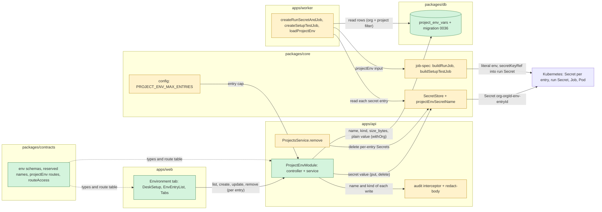
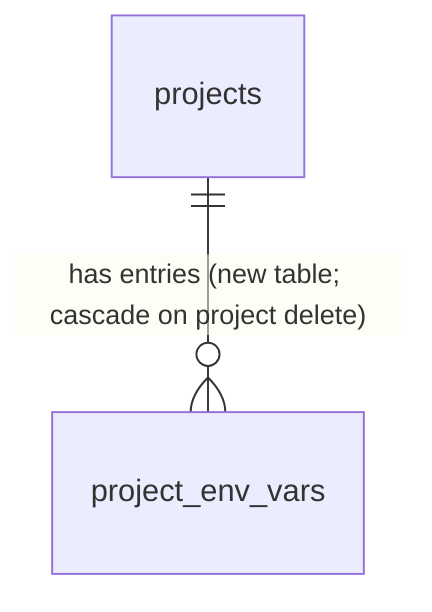

<!-- dev-plan: kind=spec id=workspace-env-secrets rev=4 hash=eb3c8d2268b0 source=issue#176 -->
# Workspace environment variables and secrets design

Status: draft. Sensitive paths: secrets/tokens (SecretStore, redaction list), run Job/runner (`job-spec.ts`, per-run Secret), RLS/`withOrg` and migrations (new table, new migration), and the audit interceptor (records env name and kind), as the architecture area lists them.
Source: issue #176

## Summary

Workspace setup (`desk/setup`) has no way to give a project's workspace Pods environment variables or secrets, so users cannot supply the values their workloads need.
This adds an Environment tab to that page where an owner or admin of the project adds, edits and removes plain variables and secrets, kept apart.
Pods created after a save get the values as environment variables; running Pods keep the values they started with, and the page says so.
Secret values are kept in the SecretStore, are write-only (masked after saving), and are never in Postgres, logs, events, errors or API responses.
This is follow-up F2 of `docs/superpowers/specs/2026-11-13-workspace-setup-and-plugins-design.md` §7.

## Business rules

Confirmed by the human at planning time.

### Goal

An admin can define, on the Environment tab of the workspace setup page, the environment variables and secrets their project's workspace Pods need; Pods created afterwards start with them; secrets stay hidden after saving.

In scope, from the requirement: add, edit (replace) and remove plain variables; add, edit (replace) and remove secrets, kept apart from variables; inject them into the workspace Pod as environment variables; secrets masked after save and never in logs or other UI responses; a clearly defined apply flow. The apply flow (human answer T1): new values apply only to Pods created after the save; running Pods keep their old values and the page says so; to apply to a live run, use the existing Stop then Resume. No restart action is added.

### Actors

| Actor | May do |
| ----- | ------ |
| Owner, and admin (at org scope or on that project) | Read and change all variables and secrets of the project; see the Environment tab with add, edit and remove controls. |
| Run owner, or an admin | Stop and resume a run (existing behaviour); the new Pod gets the current values (BR-21). |
| Member, viewer | Nothing here: no access to the page or the routes (desk access matrix "Roles after this change", "UI routes"). |
| Ticket source, SCM webhook sender | Never touch this feature; the runs they trigger get the values. |

### Rules

Surface: UI (the Environment tab of `/o/$org/p/$project/desk/setup`; it is the outermost surface the change reaches). The API contract is the second surface, for what a screen cannot show (a 403, a response that never carries a secret).

| Id    | Category          | Rule                                                                                                                                                                                                                                                                                        |
| ----- | ----------------- | ------------------------------------------------------------------------------------------------------------------------------------------------------------------------------------------------------------------------------------------------------------------------------------------- |
| BR-1  | permission        | When a member or viewer opens the workspace setup page (also the Environment tab), they see the Forbidden page and none of the entry names or values.                                                                                                                                       |
| BR-2  | permission        | When a member or viewer calls the variable or secret routes of a project, they get 403 and no data (API).                                                                                                                                                                                   |
| BR-3  | permission        | When an owner or an admin of the project opens the Environment tab, they see the variables list and the secrets list with add, edit and remove controls.                                                                                                                                    |
| BR-4  | permission        | When an admin granted on project P1 only opens P2's Environment tab or calls P2's routes, they get not found and nothing of P2; an owner of org B never sees or changes org A's project entries.                                                                                            |
| BR-5  | feedback-state    | When the project has no variables, the variables list shows an empty state; when it has no secrets, the secrets list shows its own; while loading it shows a loading state; when loading fails it shows an error state with retry.                                                          |
| BR-6  | persistence       | When an admin adds a variable NAME with a value and saves, the list shows NAME and its value, also after a reload.                                                                                                                                                                          |
| BR-7  | persistence       | When an admin edits a variable's value and saves, the list shows the new value after a reload.                                                                                                                                                                                              |
| BR-8  | persistence       | When an admin removes a variable, it is gone from the list after a reload.                                                                                                                                                                                                                  |
| BR-9  | persistence       | When an admin adds a secret NAME with a value and saves, the secrets list shows NAME with a masked value and who set it and when, never the value, also after a reload.                                                                                                                     |
| BR-10 | persistence       | When an admin opens an existing secret to replace it, the value field starts empty (never the stored value); saving a new value replaces the old one; saving without a new value changes nothing.                                                                                          |
| BR-11 | persistence       | When an admin removes a secret, it is gone from the list after a reload.                                                                                                                                                                                                                    |
| BR-12 | validation        | When an admin enters a name that is not a valid env name (empty, starts with a digit, has spaces or symbols, over 128 chars), they see an error on the name and nothing is saved.                                                                                                           |
| BR-13 | validation        | When an admin enters a reserved name, they see an error that says the name is reserved and nothing is saved.                                                                                                                                                                                |
| BR-14 | validation        | When an admin adds a name that already exists (in the other list, or in the same list), they see an error that says it exists and the existing value is unchanged. (T6: add is a create that fails when the name exists in either kind; edit is a separate change that fails when the name is missing.) |
| BR-15 | validation        | When an admin saves a secret with no value or fewer than 6 characters, they see an error and nothing is saved.                                                                                                                                                                              |
| BR-16 | limit             | When the project already has the maximum number of entries (500 by default, set by the deployment; variables and secrets counted together), an admin who adds another sees a limit error and nothing is saved; editing and removing still work.                                              |
| BR-17 | feedback-state    | When a secret has been saved, no screen, API response or error shows its value (list, edit form, save response, failed save).                                                                                                                                                               |
| BR-18 | side-effect       | When a run or setup test is created after a variable or secret is saved, the script and the agent in its Pod see it as an env var of the same name and value.                                                                                                                               |
| BR-19 | side-effect       | When a script or agent prints a secret's value, the stored run log, transcript, setup test log and ticket comment show `***` instead.                                                                                                                                                       |
| BR-20 | state-transition  | When values change while runs are active, those runs keep the values they started with and the Environment tab says so, and that a new run or a resume gets the new values (T1; no restart action).                                                                                         |
| BR-21 | state-transition  | When an admin or the run's owner stops a run and resumes it after values changed, or a crashed run resumes, the new Pod gets the current values.                                                                                                                                            |
| BR-22 | persistence       | When two admins change different entries at once, both changes are there after a reload; when they change the same entry, the later save is shown.                                                                                                                                          |
| BR-23 | feedback-state    | When saving fails (store unreachable, server error), the admin sees an error, the typed input is kept and the list is unchanged after a reload.                                                                                                                                             |
| BR-24 | conditional-display | The Environment tab says that plain values are shown and logged as they are and points sensitive values to secrets; the script editor hint points to the Environment tab.                                                                                                                  |
| BR-25 | validation        | When an admin enters a value with a line break, or a plain value over 8 KiB or a secret over 8 KiB, they see an error on the value and nothing is saved.                                                                                                                                    |
| BR-26 | limit             | When saving would take the names and values of the project over 256 KiB together (one fixed cap for both kinds, T7), the admin sees a size error and nothing is saved.                                                                                                                      |
| BR-27 | navigation        | When a list holds more entries than one page, the admin sees a page control under that list and the list's total in its header, entries sorted by name; moving to another page of one list leaves the other list and any open form as they are (ADR 0028, the architecture's paged API).     |
| BR-28 | feedback-state    | When an admin edits or replaces an entry that another admin has just removed, they see an error that says it no longer exists, nothing is created, and the list refreshes without it.                                                                                                       |
| BR-29 | conditional-display | When a user whose role can read the project's setup but cannot change it opens the Environment tab, they see both lists (variable values; secret names with who set them and when, never values) with no Add, Edit, Replace or Remove control and a read-only note. (Human decision. E2E on the mock surface with a `setup-reader` role fixture (`project:read`, `setup:read`) and a sign-in scenario; built-in roles never reach this state, so the role is a test fixture, and the API still answers 403 to a write from it.) |

### Not observable

- Audit entries (actor, project, name, kind, never a value): no screen reads the audit log; covered below the UI by an API test; BR-17 covers the no-value part for what a user sees.
- Entries removed with the project: no screen shows a deleted project's data; covered by a project-delete integration test.
- The split between `setup:update` and `secret:update` (a role with one but not the other): no built-in role holds one without the other and no custom role can be made, so no e2e shows it; covered by role-matrix, API and component tests. (The read-only view for a role with `setup:read` and no write permission is BR-29.)
- Where secret values are stored (SecretStore, not Postgres): BR-17 covers what a user sees; storage is a below-UI test.
- The reserved-name list: BR-13 covers its effect; the list is in the Architecture section.
- A deployment lowering the cap below the current count: needs a redeploy with a changed environment; covered by an API test (BR-16).
- A Job-build clash with an adapter-specific name: run-start failure text covered by a worker test.

### States

No status machine, so no state move to allow or forbid. A Pod's environment is set when the Pod is created (T1). "Created afterwards" means a new run, a resume (Stop then Resume, or the automatic resume after a crash), or a new setup test. Running Pods and a setup test in flight keep what they started with.

### Limits and validation

- Name: required, `^[A-Za-z_][A-Za-z0-9_]*$`, 1 to 128 chars, not trimmed (an invalid name is rejected, not fixed silently). Case-sensitive. A name exists once per project across both kinds.
- Reserved names (names the platform sets for the Pod, `AGENTDESK_*`, token and agent-credential variables, `PATH`, `HOME`, `LD_PRELOAD`, and the list under Architecture > Contracts) are rejected with a message that says the name is reserved.
- Plain value: may be empty; at most 8 KiB (UTF-8 bytes); single line only (no line break, no NUL).
- Secret value: required; 6 to 8192 chars (UTF-8 bytes at most 8 KiB); single line.
- Entry count (T2): at most 500 entries per project in total, plain and secret together. 500 is the default and a deployment environment variable can change it. It replaces the old 50-per-kind rule. A lowered cap never deletes existing entries: with more entries than the cap, adding is refused, editing and removing still work.
- Total size (T7): at most 256 KiB for all names and values of a project together, one fixed cap for both kinds, not configurable. 500 entries of 8 KiB would be 4 MB, over the 1 MiB Secret limit (the per-run Secret also holds the token and the agent credential) and over what a process environment can hold; 256 KiB leaves headroom for both and is far above real use (500 short entries are about 50 KiB). When a save would pass it the admin sees a limit error.
- Default: no entries.
- Duplicate name (same list or other list): rejected.

### Edge cases

- Empty project: an empty state for each list.
- Add (POST, T6) of a name that already exists in either list: rejected with 409, existing value untouched (BR-14). Edit (PUT) of a name that is missing: 404, shown as "no longer exists" (BR-28); an edit never creates.
- Two admins at once: edits of different entries both persist; same entry, the later save wins (no 409). Two adds of the same name: one succeeds, the other gets "already exists". Two adds racing for the last free slot or the size cap: one succeeds, the other gets the limit error (serialized by the architecture, T4). Edit racing a remove: the edit gets "no longer exists".
- More than a page of entries: lists are paged per kind (BR-27); an add may land on another page, the list stays on its page.
- Running Pods keep old values (T1); the page says so. To apply to a live run: Stop then Resume, which builds a new Pod with the current values.
- Resume of a paused run and the automatic resume after a crash: the new Pod gets the current values (ADR 0022). Setup does not run again on resume (unchanged).
- Removing an entry a script still expects: allowed; the next Pod lacks it.
- A script or agent prints a secret: stored output shows `***` (BR-19). A live terminal attach can still show it (same as the agent credential today, ADR 0012 negative; F2 "visible to the agent"). Recorded accepted risk: a member who owns a run can attach to it and read the Pod env, though members cannot open Desk.
- Plain values are shown in clear and are not redacted from logs; the page says so and points sensitive values to secrets.
- Secret store unreachable on save: save fails with an error and the list is unchanged.
- Project deleted: its entries go with it.
- A reserved-name clash that only shows at Job build (adapter-specific names): the run fails to start with a message naming the variable, never its value.

### Tenancy and permission

Project-level data under `withOrg` plus a project filter; the tenant comes from the session (AGENTS rules 4 and 7; ADR 0036; desk matrix). Org B never sees or changes org A's entries; an admin on P1 only gets 404 on P2; member and viewer get 403 on every route (permission checked before any id lookup). Each route has a `routeAccess` entry, with tests for allowed, 403, 404, cross-org and project scope, and one role-based e2e. `own` does not apply. Sensitive paths: secrets, run Job, RLS, migrations: `review:sensitive`.

Plain variables use `setup:read` / `setup:update`; secrets use `secret:update` to write and `setup:read` to list names and metadata (never values). Owner and admin of the project hold all three; member and viewer hold none.

### Lifecycle, compatibility and side effects

- Create, edit and remove take effect at once (no draft). Secret values live in the SecretStore (ADR 0012); Postgres holds plain values and secret names and metadata. No version history or restore here (secret values cannot be restored).
- Audit (T3): each add, edit and remove writes an audit entry with the actor, the project, the entry name and kind, never a value; the audit interceptor is extended to record the name and kind.
- Existing projects start empty. Existing runs and Pods are unaffected. Project delete removes entries and their Secrets.
- Runs and setup tests created after a save see the values. Stored run logs, transcripts, finish comments on tickets and setup-test logs show `***` for a secret. No ticket comment, notification or stream event is added by a config change.
- Terms are provider-agnostic: "project", "SecretStore", "workspace Pod". Ticket, comment and repo text is not read by this feature. Admin-entered names and values are data too: strict name pattern, values only as env values, never interpolated into shell, k8s spec text or SQL.
- Stale docs fixed in the same PR: workspace setup spec §2 non-goal "Secrets/env vars for setup", §3 decision 6 "Secrets: none in v1", §7 F2, §5.4 editor hint "secrets are F2", the editor hint "Don't put passwords or tokens here" (points to the Environment tab), and the test panel "Credentials" and "Limits" copy (see UI and Storybook > Copy). ADR 0019 decision 8 stands; the new ADR (see Architecture > Other decisions) records that env secrets are visible to setup and to the agent.

### Out of scope

None stated. The business area did not add: org-wide shared variables, import from `.env`, per-branch values, an onboarding wizard step (the wizard is unchanged), and a history of which values a past run had.

## Architecture

Confirmed by the human at planning time.

### Overview

Layer placement (apps, then core, then db, then contracts; web imports contracts only):

- `packages/contracts`: env schemas, reserved-name list, route table entries, `routeAccess` entries.
- `packages/db`: new table and migration.
- `packages/core`: `projectEnvSecretName(orgId, entryId)` next to `credentialSecretName` in `packages/core/src/secrets/secret-store.ts`; `buildRunJob` / `buildSetupTestJob` accept project env; a name-collision assert in `job-spec.ts`; the config key. `secretValues` in `apps/worker/src/activities/activity-utils.ts` is not changed.
- `apps/api`: new `ProjectEnvModule` (controller and service) under `apps/api/src/setup/` (or its own folder), uses SecretStore (`SECRET_STORE`) like `AgentsService`; the audit interceptor extension; `ProjectsService.remove` change.
- `apps/worker`: `createRunSecretAndJob` (resume included) and `createSetupTestJob` read the project env and secrets through a shared helper `loadProjectEnv(db, secrets, ctx)` in `apps/worker/src/activities/`.
- `apps/web`: the Setup page Environment tab (the UI area owns the screens); web imports contracts only.
- Runner image: no change (env is inherited by clone, plugins, setup, tmux and Claude; the entrypoint only does `unset SETUP_SCRIPT`).

"Workspace Pod" in this repo is the Job pod built by `buildRunJob` / `buildSetupTestJob` in `packages/core/src/kube/job-spec.ts` (run pods, resumed run pods, setup-test pods).

Contracts (a new file `packages/contracts/src/schemas/env.ts` and a `projectEnv` group in `routes.ts`, additive):

- `EnvName`: `^[A-Za-z_][A-Za-z0-9_]*$`, max 128, and not reserved. `RESERVED_ENV_NAMES` / `RESERVED_ENV_PREFIXES` are exported from contracts (the static part): PATH, HOME, SHELL, IFS, PS4, ENV, BASH_ENV, BASH_*, LD_*, NODE_OPTIONS, TMUX*, KUBERNETES_*, REPO_CLONE_URL, PROMPT, CHECKOUT_REF, RESUME_NOTE, MAX_TURNS, BOT_*, RUN_*, SETUP_*, PLUGIN_*, AGENT_*, AGENTDESK_*, ANTHROPIC_*, CLAUDE_*, GH_TOKEN, GITHUB_TOKEN. Dynamic names (the code host adapter's `cliTokenEnvName`, the agent adapter's `credentialEnv`) are checked again in `job-spec.ts` at Job build (defense in depth); a clash fails the run non-retryably with the variable name only.
- `EnvVarValue` (both kinds): string, max 8 KiB UTF-8 (the same UTF-8 byte refine as `SetupScriptBody`), refuses NUL (`\u0000`), `\n` and `\r` with the message "a value cannot contain a line break" (business BR-25, human answer). Otherwise stored verbatim. The web input is single-line, so API and UI agree. Secret value: the same plus a minimum of 6 characters (shorter ones are not redacted: `MIN_SECRET_LENGTH` in `apps/worker/src/activities/activity-utils.ts`); the message says "too short to hide in logs".
- Total size limit (T7): one fixed constant `ENV_MAX_TOTAL_BYTES = 262144` (256 KiB) on all names and values of a project together (the sum of UTF-8 bytes of every name plus every value, both kinds). Not configurable. 500 entries of 8 KiB would be 4 MB, over the 1 MiB Kubernetes Secret limit (the run Secret also holds the token and the agent credential; 256 KiB is about 342 KiB after base64) and over a process environment.
- Entry cap (T2): 500 entries per project, variables and secrets together, default from config `PROJECT_ENV_MAX_ENTRIES`. It is a platform setting, not a contract constant, so the web does not know it; it learns from the 409.
- DTOs: `EnvEntryDto = { name, kind: 'plain'|'secret', value: string | null, updatedAt, updatedBy }` (value is always null for secrets; a secret DTO has no value, length or hash). `EnvListQuery = PageQuery + { kind: 'plain'|'secret' }`.
- Requests (T6): `CreateEnvVarRequest { name: EnvName, value }`, `CreateEnvSecretRequest { name: EnvName, value (secret rules) }`, `UpdateEnvVarRequest { value }`, `UpdateEnvSecretRequest { value }`.
- Names in paths are validated by `EnvName`, so the regex also protects the path.
- The list is paged: offset pages with total (ADR 0028; shared `PageQuery` / `pageOf` / `pageWindow` / `toPage`). With a 500 cap one response can reach 4 MB, so the web asks per kind with a page (the UI may use `pageSize=100`).
- A name that exists as the other kind is a 409 on create and a 404 on update and remove of the wrong kind (the entry is not a resource of that collection). Rename is remove then add.
- Per-entry routes, not one whole-document PUT: a secret cannot be echoed back, and per-entry maps each kind to its own permission.

### Data model

Migration: new `0036_project_env_vars.sql` (Drizzle generated, plus a hand-written `GRANT SELECT, INSERT, UPDATE, DELETE ... TO agentdesk_app`); it never edits an applied migration. No backfill (new table). No other schema change: there is no new column on `runs` (a Pod keeps the values it was created with).

#### project_env_vars (new; scope: project, with org_id for RLS)

Table in `packages/db/src/schema/app.ts`, name provider-agnostic.

| Field      | Type        | Null | Default | Key / index                                                            | Change | Notes                                                                                                                                  |
| ---------- | ----------- | ---- | ------- | ---------------------------------------------------------------------- | ------ | -------------------------------------------------------------------------------------------------------------------------------------- |
| id         | uuid        | no   | `gen_random_uuid()` | primary key                                                | added  | Generated uuid (`uuid('id').primaryKey().defaultRandom()`, like every other app table). Also the entry id in the Secret name `org-{orgId}-env-{id}`.                                                                           |
| org_id     | uuid        | no   | —       | index `project_env_vars_org_idx`                                       | added  | RLS tenant column.                                                                                                                     |
| project_id | uuid        | no   | —       | foreign key to `projects`, on delete cascade; part of the unique key and the list index | added  | Project scope.                                                                                                                         |
| name       | text        | no   | —       | unique `project_env_vars_project_name_key (project_id, name)`          | added  | One env namespace per project: the same name cannot be both plain and secret. Name regex check.                                        |
| kind       | text        | no   | —       | list index `project_env_vars_project_kind_name_idx` on `(project_id, kind, (name COLLATE "C"))` | added  | Check in (`'plain'`, `'secret'`). The index is an expression index for the paged list (Drizzle `index().on(t.projectId, t.kind, sql`${t.name} COLLATE "C"`)`; if drizzle-kit cannot emit it, the migration SQL is hand-written, like the GRANT).                                                                                                      |
| value      | text        | yes  | —       | —                                                                      | added  | `project_env_vars_value_check`: kind='plain' implies value not null, `octet_length(value) <= 8192`, and no CR, LF or NUL (defense in depth behind the contract); kind='secret' implies value is null (the database itself cannot hold a secret value: rule 5). |
| size_bytes | integer     | no   | —       | —                                                                      | added  | `octet_length(name) + octet_length(value)` for both kinds, set by the API on every write; metadata used only for the 256 KiB total (the sum over the project's rows; a secret's length stays inside the API and database, never in a DTO). Check `project_env_vars_size_check`: between 1 and 8320 (name up to 128 bytes + value up to 8192). |
| updated_by | text        | no   | —       | —                                                                      | added  | The actor.                                                                                                                             |
| created_at | timestamptz | no   | `now()` | —                                                                      | added  | `ts('created_at').notNull().defaultNow()` with the file's local `ts` helper (`timestamp(name, { withTimezone: true, mode: 'date' })`).                                                                                                                                       |
| updated_at | timestamptz | no   | `now()` | —                                                                      | added  | `ts('updated_at').notNull().defaultNow()`. No other app table has an `updated_at` and the repo has no update trigger, so the API sets `updated_at = now()` on every update (PUT), as it already does for `credentialUpdatedAt`.                                                                                                                                       |

RLS: `orgPolicy()` (enable and force, plus the policy), the org tenant scope; project data is also filtered by `project_id` and checked for project access (RLS covers orgs only). A leak test goes in the RLS integration test (`packages/db/test/rls.int.test.ts`; database.md §2).

The entry cap (T2) and the total size (T7) are enforced in the API write transaction (see API), not in SQL. The unique key `(project_id, name)` is unchanged: the column keeps the database default collation.

### API

| Method | Path | Who may call it | Request | Response | Contract |
| ------ | ---- | --------------- | ------- | -------- | -------- |
| GET | `/api/projects/:projectId/env?kind=&page=&pageSize` | `setup:read`, project level (owner, admin) | `EnvListQuery` | `pageOf(EnvEntryDto)` ordered by `name COLLATE "C"` | `projectEnv.list` |
| POST | `/api/projects/:projectId/env-vars` | `setup:update`, project level | `CreateEnvVarRequest { name, value }` | 201 `EnvEntryDto`; 409 if the name exists in either kind | `projectEnv.createVar` |
| PUT | `/api/projects/:projectId/env-vars/:name` | `setup:update`, project level | `UpdateEnvVarRequest { value }` | `EnvEntryDto`; 404 if no plain var has that name | `projectEnv.updateVar` |
| DELETE | `/api/projects/:projectId/env-vars/:name` | `setup:update`, project level | none | empty; 404 if missing | `projectEnv.removeVar` |
| POST | `/api/projects/:projectId/env-secrets` | `secret:update`, project level | `CreateEnvSecretRequest { name, value }` | 201 `EnvEntryDto` (value null); 409 if the name exists in either kind | `projectEnv.createSecret` |
| PUT | `/api/projects/:projectId/env-secrets/:name` | `secret:update`, project level | `UpdateEnvSecretRequest { value }` | `EnvEntryDto` (value null); 404 if no secret has that name | `projectEnv.updateSecret` |
| DELETE | `/api/projects/:projectId/env-secrets/:name` | `secret:update`, project level | none | empty; 404 if missing | `projectEnv.removeSecret` |

Tenant data touched by every route: the project's entries in `project_env_vars` and, for secrets, their per-entry Secrets. `own` does not apply.

- Every route has a `routeAccess` entry and goes through `checkTenantAccess` (AGENTS rule 7; ADR 0036; `route-access.ts`): `projectEnv.list` = `project('setup:read')`; `createVar`, `updateVar`, `removeVar` = `project('setup:update')`; `createSecret`, `updateSecret`, `removeSecret` = `project('secret:update')`. All use the default `projectId` param (no new `ProjectParam`). The existing permissions are reused: no new permission or role migration. Owner and admin hold all three; member and viewer hold none (migration 0026; 0032 removed `setup:read` from them), so no role is widened.
- List order: `ORDER BY name COLLATE "C"` (byte order, so uppercase sorts before lowercase and `_` between), in the same `withOrg` transaction as the `count(*)` with the same `WHERE` (project_id, kind). `name` is unique per project, so the order ends in a unique column (ADR 0028). The expression index above is the one the planner matches for this `ORDER BY`. The web shows the server order and does not re-sort.
- Errors: 400 invalid name or value (problem+json with pointer `/name` or `/value`); 403 permission (before any id lookup); 404 project not visible, or entry missing (update, remove); 409 create of an existing name (either kind), entry cap reached, or 256 KiB total reached (409 with a clear detail).
- Audit (T3 and T6): extend the audit interceptor (`apps/api/src/audit/audit.interceptor.ts`, `redact-body.ts`) with a map `AUDIT_ENV_BY_ACTION` keyed by the action string: `'POST projectEnv.createVar'`, `'PUT projectEnv.updateVar'`, `'DELETE projectEnv.removeVar'` map to kind `plain`; the three secret actions map to kind `secret`. After `redactBody(req.body, action)` the interceptor merges `{ kind }` and `{ name }` into the payload: the name comes from the path param for PUT and DELETE and from the body for POST (the body key `name` survives `redactBody`; the key `value` is dropped). The name is validated by the route's `EnvName` pipe and is never a value; `targetId` stays the project id. A new action with a name only needs its entry in the map.
- Write flow (T4: no transaction and no lock across the Secret store call). Per-entry Secrets mean no read-modify-write of a shared Secret and nothing to serialize across store I/O. Short DB transactions take `SELECT ... FROM projects ... FOR UPDATE` only to serialize cap and total accounting; that lock is released at commit and never spans a store call (credential precedent: `agents.service.ts` `putCredential`, `storeCredential`).
  - Create secret: tx1 (`withOrg`, project visible) pre-checks the name is free in both kinds, the cap and the total; generates the entry id; `secrets.put(projectEnvSecretName(orgId, id), { value })` runs outside any transaction; tx2 (short, project row lock) re-checks cap, total and uniqueness and inserts the row. If tx2 loses (409), the new Secret is deleted best effort.
  - Update secret: tx1 loads the row (kind secret, else 404) and checks the total delta; the Secret is put at the row's id; tx2 (project row lock) re-loads the row (gone: 404 and delete that Secret best effort), re-checks the total, and updates `size_bytes`, `updated_at`, `updated_by`.
  - Create, update and remove plain var: one short transaction with the project row lock, no store call.
  - Remove secret: a transaction deletes the row; then `secrets.delete(...)` runs best effort (a failure logs the error class and leaves an inert orphan Secret that nothing reads).
- No WebSocket, SSE or webhook. The web must never cache or re-send a secret value (security.md §1).

Worker (no workflow change: no new workflow, signal or query, so no determinism impact):

- Secrets are fetched inside activities, with ids only in workflow inputs (security.md §1; `RunContext` already carries orgId and projectId).
- `createRunSecretAndJob` (fresh run and resume) and `createSetupTestJob` read `project_env_vars` rows under `withOrg` (filter org and project), then read each secret entry's Secret via `deps.secrets.get(projectEnvSecretName(orgId, id))` with bounded concurrency (10), and build `{ plain: [{name,value}], secrets: {name: value} }`. Values stay inside the activity.
- Idempotency: reads only; the existing `ensureSecret` / `ensureJob` 409-is-success path is unchanged, so an activity retry re-reads current values (a retry may see a newer save: accepted, same as the credential).
- Half-way failure: the rows are authoritative for which names exist; a Secret with no row is never read (orphan ignored); a row of kind secret whose Secret is missing fails Job creation non-retryably, naming the variable only (re-saving the secret heals it).
- Apply flow (human answer T1, option 1): a Pod keeps the values it was created with; only Pods created after a save read the new ones (fresh runs, resumes, setup tests). To apply to a live run: the existing Stop then Resume. No new column, route, signal or activity. A resume reads fresh values, so a resume is a natural apply point.

Runner and Kubernetes (all through KubeGateway and `buildRunJob`; env values only, never interpolated; AGENTS rule 6; security.md §5):

- Plain vars: literal `env` entries (not secret; they may be visible via `get jobs`). Secret vars: copied as keys into the existing per-run Secret `run-{runId}` (and the setup-test Secret) and added to `secretEnvKeys`, so `podJob` emits explicit `secretKeyRef` env (no `envFrom`; security.md §1 bullet 5). Env names are valid Secret keys and cannot clash with `workspace-token` (no dash allowed).
- `podJob` gets a `projectEnv` input; env order: project vars first, platform env after, and a clash is rejected (duplicate names would otherwise be last-wins).
- Pod hardening is unchanged (non-root, no SA token, egress rules).
- The entrypoint needs no change. Known and accepted (F2, ADR 0019 decision 8): setup and the agent can read all values, and a prompt injection can exfiltrate them. Holders of `setup:test` can read them via the draft script in a setup test; today only owner and admin hold both `setup:test` and `secret:update`.

Provider adapters: no provider-specific code. Only `codeHost.cliTokenEnvName()` and the agent adapter's `credentialEnv()` are read, for the dynamic reserved-name check; no provider names in the new table, types or routes.

Secrets:

- Values live only in Kubernetes Secrets via SecretStore; Postgres holds the name and metadata (AGENTS rule 5; security.md §1; ADR 0012).
- One Kubernetes Secret per secret entry, name `org-{orgId}-env-{entryId}` (uuids, passes `assertSecretName`), data `{ value }`, in the app namespace through `SecretStore.put`, helper `projectEnvSecretName(orgId, entryId)` beside `credentialSecretName`. Reasons: no shared read-modify-write, so no lock is needed across store I/O (T4); no per-project Secret that 500 values could push past 1 MiB (T2). Costs: up to N Secret reads per Pod start (bounded concurrency; typical N is a handful) and N deletes on project removal (names come from the rows collected in the remove transaction, like `agentIds`). A single per-project Secret was rejected: it needs a read-modify-write that cannot be serialized without holding a lock across the store call.
- The per-run Secret `run-{runId}` and the setup-test Secret still carry every secret value as keys, so the 256 KiB total (T7) is what keeps them under 1 MiB.
- Redaction: the worker's `redactionList` already reads the run Secret, so project secret values join the list automatically. No change to `secretValues` is needed: values cannot contain a line break (BR-25), so the existing whole-value match works on each redacted log line (`follow-core.ts` redacts one line at a time). Never a value in logs, Temporal inputs or results, events, errors (`safeError` gets the values in `known`), audit (key `value` dropped), problem+json, or API responses (write-only, like `PUT /api/agents/:id/credential`).
- Project delete: a best-effort `secrets.delete(projectEnvSecretName(...))` per secret entry in `ProjectsService.remove` (ids read in the same transaction that deletes the project), next to the credential Secret delete; rows cascade.
- Orphans: add is Secret first then row; remove is row first then Secret. A crash leaves an inert Secret only. No reconcile sweep is added (not asked; recorded as a known gap).

Events and live updates: none. No SSE or stream change. The web refetches the list after each mutation (TanStack Query). Run Pods keep the env they started with.

Failure, observability and scale:

- API: a SecretStore failure gives a 5xx with a fixed message and the error class only in the log (copy the `storeCredential` pattern in `agents.service.ts`); nothing echoes the value.
- Worker: a missing secret key or a reserved-name clash fails the run start with a name-only message shown on the run and the ticket comment.
- Logs and metrics: names and counts only, never values.
- Scale: per Pod start, 1 query plus one Secret get per secret entry (bounded concurrency 10); cap 500 entries (config); 256 KiB of names and values in total so the run Secret and the Job stay under 1 MiB; paged list (ADR 0028); per-project and org-scoped; no many-org hot path.
- API store failure: the PUT fails with a generic 5xx before any row is written (Secret first); a row-write failure after a successful Secret put leaves an inert Secret (new entry) or a new value live with stale metadata (replace), the credential precedent.

### Third-party libraries

| Library | New or existing | Used for | Approval |
| ------- | --------------- | -------- | -------- |
| zod | existing | Contract schemas (`env.ts`) | existing |
| drizzle-orm | existing | New table and queries | existing |
| @kubernetes/client-node (via SecretStore and KubeGateway) | existing | Secret and Job calls | existing |
| nestjs-zod pipes | existing | Request and path param validation | existing |

No new library.

### Services and integrations

| Service | New or existing | How it is used |
| ------- | --------------- | -------------- |
| Postgres | existing | New table `project_env_vars` (names, kinds, plain values, metadata). |
| Kubernetes Secrets via SecretStore | existing | One Secret per secret entry (`org-{orgId}-env-{entryId}`); values copied into the per-run and setup-test Secrets at Pod start. |
| KubeGateway | existing | Builds and creates the Job and Pod with the project env. |
| Temporal, provider APIs | existing | Untouched. |

### Configuration

| Name | Kind | Added or changed | Where it is set | Default | Used by | Purpose |
| ---- | ---- | ---------------- | --------------- | ------- | ------- | ------- |
| `PROJECT_ENV_MAX_ENTRIES` | env var | added | Zod schema `packages/core/src/config.ts` as `blankDefault(z.coerce.number().int().min(1).default(500))` (same style as `RUN_SETUP_TIMEOUT_SECONDS`), plus `.env.example` | 500 | API only (through the injected Config, not `process.env`) | Maximum entries per project, variables and secrets together. |
| `org-{orgId}-env-{entryId}` | secret | added | SecretStore (one Kubernetes Secret per secret entry, app namespace) | none | API writes it, worker reads it | A secret entry's value, under the key `value`. |

The repo has no chart directory, so no chart change here (flag for the infra repo or values if it holds `agentdesk-config`). The total-size limit is a contract constant (`ENV_MAX_TOTAL_BYTES`), not config. No new flag, no new dependency.

### Other decisions

- Sensitive paths touched: secrets/tokens (SecretStore, redaction list), run Job/runner (`job-spec.ts`, run Secret), RLS/`withOrg` and migrations (new table), and the audit interceptor (records name and kind). Access reuses permissions: no `access.ts` change. `review:sensitive` and a high-effort security review.
- ADR needed (an architectural choice, AGENTS Workflow): a new ADR, next free number (0038 today), "Project environment variables and secrets are injected into workspace pods", extending 0012 and 0019 decision 8 and closing F2. Also update the setup-and-plugins spec non-goal line and `security.md` §1 only if the wording needs it (flag, do not edit agent config).
- No workflow, signal or query change; no new events.

## UI and Storybook

Screens and components this changes:

- `desk/setup` (`/o/$org/p/$project/desk/setup`, nav label "Workspace setup", route file `apps/web/src/app/routes/o.$org.p.$project.desk.setup.tsx`, screen `apps/web/src/screens/DeskSetup.tsx`) gains a tab strip under the header: "Setup script" (today's content, unchanged) and "Environment" (new). One route, no new route. The tab is kept in the URL as `?tab=environment` (default `script`), declared in the route's `validateSearch` next to the existing `page` search param (the version history's page, Setup script tab), falling back to `script` on bad input (frontend.md §2, §4). The Environment tab's two lists add `varsPage` and `secretsPage` (page 1 left out, bad input falls back to 1). The entry is the Desk nav "Workspace setup", then the "Environment" tab. The org/project guard is unchanged: `requirePermission(..., 'setup:read', {projectId})` (owner and admin only, `docs/superpowers/specs/2026-11-22-desk-access-matrix.md` UI routes table). Not touched: the onboarding wizard step `setup` (`screens/SetupWorkspace.tsx`), the run page, other Desk pages. A separate desk tab (`desk/environment`) was rejected: the requirement says the section lives in workspace setup, and a new route needs a new access-matrix row.
- New `ds/Tabs.tsx` (role tablist/tab/tabpanel, arrow-key roving, controlled `value` / `onChange`; domain-free so it goes in `ds`, frontend.md §6) with `ds/Tabs.stories.tsx`. `TerminalBar` keeps its own private tab strip, untouched.
- New `components/EnvEntryList.tsx` (+ `.module.css`, `.stories.tsx`, `.test.tsx`): one list component with `kind: 'variable' | 'secret'` (rows: name, value or mask, who and when for secrets, Edit or Replace, Remove; an "add" row form; per-row pending and error).
- New `screens/DeskSetupEnvironment.tsx`: the tab body (intro line, two `EnvEntryList` groups, loading, error and read-only states), composed by `DeskSetup.tsx`.
- Changed: `screens/DeskSetup.tsx` (tab strip, two reworded sentences, new `environment` props), and the `screens/index.ts`, `components/index.ts`, `ds/index.ts` barrels.
- Reused: `Banner`, `Button`, `Field`, `TextInput` (mono), `PasswordInput`, `Dialog`, `Skeleton`, `Icon`, `LabelChip` (ds); `Section`, `SettingsSection`, `KeyValue`, `DeskFrame` (components and screens). Patterns reused from `components/SecretField.tsx` (empty-start password entry, "Hidden for good after saving") and `components/VersionHistory.tsx` (list rows with ghost View and Restore buttons).
- Pagination: the shared `Pagination` under each list, page in the URL, page size from `usePageSize()` (frontend.md §3; ADR 0028). With the 500-entry cap above the API's 100 page-size ceiling, the lists cannot load in one response. Two lists, so two paginations (`varsPage`, `secretsPage`), each with its own total in the group header ("12 variables", "3 secrets"), shown only when the list has rows and is not loading or failing (same condition as the version history). Sorted by name, the server's fixed order (`COLLATE "C"`: uppercase before lowercase; the story fixtures show it). No search.
- States of the Environment tab: loading (`Skeleton` rows, `aria-busy`, per list, so one list can load while the other shows); load error (Banner err plus Retry, per list); empty variables and empty secrets (each group has its own empty text); populated; a later page past the end (clamped back with `useClampToLastPage`, as the version history); row editing; row saving (button disabled, `aria-busy`); row error (Banner or field error, input kept); removing (dialog, confirm busy); read-only (no write permission: values and secret names visible, no Add, Edit or Remove, one note); permission-denied for the whole page (the existing Forbidden route page, unchanged). Secret row: saved (mask plus "Set ... by ..."), replacing, saving, error; never a "revealed" state. Stale or reconnecting: not applicable (plain queries, no stream); another user's change appears on refetch (focus refetch is off for non-run queries, so on tab re-entry; staleTime 30 s). The Setup tab states are unchanged. In test mode the tab strip stays visible, the Environment tab is usable while a test runs, and the running test keeps the values it started with (one line). An unsaved script draft is kept when switching tabs (the draft is state in `DeskSetup`, which stays mounted).
- Role-based UI: owner and admin (org or this project) see the tab and all controls; member and viewer already get the Forbidden route page (access matrix). The list needs `setup:read` (project); variables are written with `setup:update`, secrets with `secret:update`. The controls of each group check their own permission with `useCan(org, 'setup:update' | 'secret:update', {projectId})`, for show/hide only; the API is the authority. A custom role with `setup:read` only sees the tab read-only (variable values, secret names with who and when; no Add, Edit, Replace or Remove; one note). A role with `setup:update` but not `secret:update` sees variable controls and a read-only Secrets group (and the reverse).
- Visual system: tokens only (`--line`, `--panel`, `--faint`, `--fs-*`, `--radius-*`), spacing copied from the closest board (frontend.md §5): `design/prototype/project/DeskSetup.dc.html` (page frame, 20px gutters, save bar), `DeskAgent.dc.html` (SettingsSection groups, credential row with key icon, Replace panel), `DeskSetupVersions*` (list rows). The Environment tab uses the DeskAgent SettingsSection look inside the setup main column. No new color, font or spacing scale.
- Layout: wide, the Environment tab fills the main column (max readable width for rows, 20px gutters like the script tab); the side panel stays and keeps Plugins and Version history unchanged. Narrow, rows wrap (name above value, actions below) and the form fields stack. The page itself still never scrolls: the tab panel scrolls inside the main column (`overflow-y: auto`, as `.setupDeskMain` already does; `e2e/mock/desk-setup-layout.spec.ts` pins this). The script tab keeps the editor and log split exactly as today. A section below the editor would sit below the fold and the 320px side panel is too narrow for name, value and action rows and add forms, which is why a tab was chosen.
- Data on screen: `setupQueries.env(org, projectId, {kind, page, pageSize})` in `features/setup-script/queries.ts`, called twice (kind `plain` for Variables, `secret` for Secrets), one `Page<EnvEntryDto>` each (keys `['org', org, 'projects', projectId, 'setup', 'env', kind, {page, pageSize}]`, `placeholderData: keepPreviousData` like the version history), via `api.*` from the contracts client. A secret entry arrives with `value: null` always; the mapper never reads a value for it. The mapper in `map.ts` (`now` passed in, "Set 2 days ago by ...") has a unit test. Mutations in `mutations.ts`: set or replace an entry and remove an entry, each invalidating its own kind's list keys on success; no optimistic update (rows are few, a secret cannot be shown optimistically, and a failure must keep the typed value); the row shows pending while in flight. Writes are per entry (one entry per call), no draft, no Save bar. Add calls `POST`; Edit and Replace call `PUT :name`. Secrets are never cached (frontend.md §3, §11): the typed value lives only in the entry component's state (mounted only while entering, like `SecretEntry`), the mutation variables are cleared after settle, the response is not stored; the "secret not in cache" test of the credential flow (`features/desk/agent.form.test.ts`) is repeated for secrets. Test Pods and runs read the stored values server-side; nothing about that is on screen except the rewording below.
- Forms and input: validated with the contracts request schema (frontend.md §11), errors mapped with `fieldErrorsFromProblem` by pointer (`/name`, `/value`), unmapped errors to a Banner; input kept on failure; the submit button shows pending. Errors show on submit, not on every keystroke; name format and value limits come from the Zod schema, not a web copy. Secret input is `type=password`, starts empty, `autocomplete=new-password` (the `PasswordInput` ds primitive). Enter submits the row form; Escape cancels it. Name collisions and reserved names come back from the server as a field error on Name.
- Accessibility: Tabs have `role=tablist`, `aria-selected`, `aria-controls`; arrow keys move between tabs and Tab moves into the panel. Add and Edit forms: each input has a real `<label>` (via `Field`), errors linked with `aria-invalid` and `aria-describedby`, error Banners `role=alert` (existing `Banner live`). Lists are a `ul` with an `aria-label` per group ("Environment variables", "Secrets"); row buttons carry the name ("Edit DB_HOST", "Replace NPM_TOKEN", "Remove NPM_TOKEN"). The mask is `aria-hidden` dots plus visually hidden text "Value hidden". Dialogs use `Dialog` (focus moves in, Escape closes, focus returns to the opener). After add or replace, focus returns to the Add button or the row's Replace button; after remove it moves to the group's Add button. Status is text, not color alone. The axe smoke test covers every story.
- Stories to add (all fed by `@/mocks`): `ds/Tabs.stories.tsx` (Default, Narrow, with keyboard note); `components/EnvEntryList.stories.tsx` (Variables, Secrets, Empty, Loading, Error, Adding, Editing, Saving, Row error, Read-only, Paged with `Pagination`, Long name and value with ellipsis); `screens/desk.stories.tsx` (group `Screens/Desk`): `DeskSetupEnvironment`, `DeskSetupEnvironmentEmpty`, `DeskSetupEnvironmentLoading`, `DeskSetupEnvironmentError`, `DeskSetupEnvironmentReadOnly`, `DeskSetupEnvironmentAdding`, `DeskSetupEnvironmentSecretReplace`, `DeskSetupEnvironmentPaged`; the existing `DeskSetup*` stories are updated for the tab strip and the three reworded sentences.
- Fixtures: `mocks/dto/setup.ts` gets `environmentFixtures` (invoicer-api: 3 variables, 2 secrets, plus a generated set of more than one page for the paged story and the lists-paging e2e; every other project empty); `mocks/msw/handlers.ts` gets the environment handlers (set, remove, list) and a 403 for roles without the permission; `mocks/setup.ts` gets the view fixtures.
- UI tests: `deskSetup.test.tsx` and `EnvEntryList.test.tsx` (unit), route test `setup-script/setup.route.test.tsx` extended; mock e2e spec `apps/web/e2e/mock/desk-setup-environment.spec.ts`, plus `desk-setup-layout.spec.ts` re-run unchanged (the local e2e and the role cases are in Testing). The mock e2e spec also has a read-only case, titled BR-29: a role that holds `setup:read` and `project:read` but no write permission opens `?tab=environment`, sees names and variable values and secret names with who and when, no Add, Edit, Replace or Remove, and the read-only note. The mock cannot build that role today (its roles are the four fixtures in `mocks/dto/access.ts` `roleFixtures`; member and viewer are Forbidden on the page), so it needs one new fixture: a role `setup-reader` (`project:read`, `setup:read`) in `roleFixtures`, and a scenario in `mocks/msw/onboardingScenarios.ts` that signs in as it on Acme (`inAcme('setup-reader')`), which the handlers' existing permission check then answers with 403 on the write routes.

User flows:

- Add variable: Environment tab, "Add variable", row form (Name, Value), "Add variable" submits, the row appears, the form closes, focus returns to the Add button.
- Edit variable: row "Edit", the Value field opens in place (name read-only; to rename, remove and add), "Save" / "Cancel".
- Remove variable: row "Remove", confirm dialog "Remove NAME?", "Remove variable"; the row goes away.
- Add secret: "Add secret", Name and Value (password input, starts empty, reveal toggle), "Add secret". The row then shows the name, a fixed mask, and "Set <ago> by <user>" ("Set just now by <user>" right after saving). The value is never shown again. The reveal toggle reads "Show value" and, once pressed, "Hide value".
- Replace secret: row "Replace", a new empty password input, "Save"; the old value is overwritten and "Set ... by ..." updates.
- Remove secret: row "Remove", confirm dialog, "Remove secret".
- Failure paths: name invalid, duplicate or reserved (field error from the server problem pointer, typed input kept); too long value (same); too many entries or too large a total (form Banner, see Copy); network or 5xx (form Banner with the problem title, typed input kept, Retry is pressing the button again); 403 on write (inline message, form stays); load failure (Banner tone err, with Retry).
- Apply flow (T1): a save applies only to Pods created after it (new runs, setup tests, resumes: BR-20, BR-21). Running Pods keep their old values and the tab says so, with the way to apply a change to a live run: the run's existing Stop session, then Resume. No restart button, no new run control, no "N runs use old values" notice.
- Add a name that already exists (either kind): the Name field shows the server's "already exists" message, the typed value is kept, the existing value is untouched (BR-14). Add calls `POST` (409 if the name exists in either kind). Edit and Replace call `PUT :name` (404 if the entry is gone: row Banner "This entry no longer exists. Reload the list." and the list refetches).
- Add at the entry cap, or any add or edit that would pass the 256 KiB total: form Banner with the server's limit message (BR-16, BR-26); nothing saved, typed input kept. Editing and removing still work at the entry cap.
- Value with a line break or over 8 KiB: error on Value from the contracts schema (BR-25); the web input is single-line, so a pasted line break is stripped by the browser and the schema message covers the rest.
- Paging: Next page on either list changes only that list's page in the URL; the other list and the open form stay.
- After an add the row may sit on another page (sorted by name): the list stays on its page and a Toast "Added NAME" confirms.
- Setup test: the test gets the same values as a run (setup spec §2 anti-goal "test passed while real runs take a different path", F2). The test panel row "Credentials" and the "Limits" banner become false and are reworded (see Copy).

Copy (existing style: sentence case, plain, short, full stops, no exclamation marks):

- Tabs: "Setup script", "Environment".
- Tab intro (T1): "Every run and setup test in this project gets these as environment variables. Runs and tests that start after you save use the new values. A running run keeps its old ones: stop its session and resume it to pick up the change."
- Variables group: title "Environment variables"; help "Plain values are shown in full and are not hidden in logs. Put anything sensitive in Secrets." (BR-24); empty "No environment variables yet. Add one to pass a setting to every run."; button "Add variable".
- Secrets group: title "Secrets"; help "Write-only. After you save, a value is hidden for good: you can replace or remove it, not read it back."; empty "No secrets yet. Add one for the tokens and passwords your setup or agent needs."; button "Add secret"; row line "Set 2 days ago by kim-hale".
- Fields: "Name", "Value", reveal button "Show value" (then "Hide value"); replace field "New value".
- Dialogs: "Remove NAME?" / "Runs that start after this do not get it. Running runs keep it." / "Keep" and "Remove variable" or "Remove secret".
- Visibility note under Secrets: "Setup scripts and the agent can read these values. Run output shows them as ***, but keep each secret to what this project needs." (F2 "visible to the agent", ADR 0012, BR-19)
- Secret value rules are shown as field help or error, text from the contracts schema, not copied in web: the secret Value field has the help "At least 6 characters." and the error "Too short to hide in logs."
- Field errors on submit (as drawn): Name: "Enter a name." / "Use letters, digits and _, and do not start with a digit." / "Use 128 characters or fewer."; reserved name: "GITHUB_TOKEN is reserved: Agent Desk sets it for every run." (the name typed replaces GITHUB_TOKEN); name already exists (either list): "DB_HOST already exists. A name can be used once, as a variable or a secret." (the name typed replaces DB_HOST); Value: "Enter a value." (secrets; a plain value may be empty), "Use 8 KiB or less.", "A value cannot contain a line break."
- An empty plain value is shown in the row as "Empty".
- Cap reached (500 entries by default, set by the deployment): form Banner with the title "Too many entries" and the server's message as detail, typed input kept; the board draws the detail as "This project has 500 entries, the most this deployment allows. Remove one to add another.", and the number in it comes from the server's message: the page must not print a number it is not given. Size reached (fixed 256 KiB for all names and values together, T7): form Banner with the title "Too large" and the detail "Names and values of this project would pass 256 KiB together. Shorten or remove entries to make room."; edits that grow the total can fail the same way, typed input kept. A save that fails with a server error (5xx): form Banner titled with the problem title (drawn: "Internal server error") and its Request ID, typed input kept.
- Errors: field messages come from the contracts schema or problem+json text; unmapped: "Something went wrong. Try again." (`GENERIC` in the setup route); load (per list, with its Request ID and a "Retry" button): "Could not load the environment. Reload to try again."; read-only note: "You can see these but not change them." (shown under the tab intro when neither list can be changed, and under the Secrets help when only the secrets are read-only); loading lists show "Loading variables" and "Loading secrets"; test running (under the tab intro, on the Environment tab while a setup test runs): "A test is running. It keeps the values it started with."; Toast after an add: "Added NAME"; edit of a removed entry: row Banner "This entry no longer exists. Reload the list."
- Existing sentences made false by this change, reworded (the minimum that keeps the page true; no other copy is rewritten). These three are drawn on the approved `DeskSetup` and `DeskSetupTest` boards, and the copy below is as drawn:
  - `DeskSetup.tsx` save note "Don't put passwords or tokens here." becomes "Don't put passwords or tokens here. Add them as secrets on the Environment tab. Runs that start after you save use the new version; running runs keep theirs."
  - Test panel "Credentials: Repo token only. Claude is not started." becomes "Repo token and this project's environment values. Claude is not started."
  - Test panel Limits banner "Private package feeds need secrets / Setup has no secrets or private network yet..." becomes "Private package feeds need a secret / Add it on the Environment tab. Setup has no private network yet, so only feeds reachable from the internet work."

Prototype: approved by the human, as drawn in these boards (new unless marked changed), and in the live interactive screen.

- `design/prototype/project/DeskSetup.dc.html` (changed): tab strip "Setup script" (selected) / "Environment" under the header; the reworded save note.
- `design/prototype/project/DeskSetupTest.dc.html` (changed): tab strip; the reworded test panel "Credentials" row and Limits banner.
- `design/prototype/project/DeskSetupEnvironment.dc.html`: Environment tab with 3 variables and 2 secrets, tab intro, group headers with counts, row actions, Secrets visibility note, side panel (Plugins, Version history) unchanged.
- `design/prototype/project/DeskSetupEnvironmentEmpty.dc.html`: both lists empty, each with its empty text and Add button, no count.
- `design/prototype/project/DeskSetupEnvironmentLoading.dc.html`: "Loading variables" and "Loading secrets".
- `design/prototype/project/DeskSetupEnvironmentError.dc.html`: the variables list failed to load (Banner with Request ID and Retry) while the secrets list shows.
- `design/prototype/project/DeskSetupEnvironmentAdding.dc.html`: Add variable form (Name, Value, Cancel, "Add variable") open under the rows.
- `design/prototype/project/DeskSetupEnvironmentAddSecret.dc.html`: Add secret form (Name, Value password input with "Show value", help "At least 6 characters.", Cancel, "Add secret").
- `design/prototype/project/DeskSetupEnvironmentEditing.dc.html`: a variable row edited in place (name read-only, Value, Cancel, Save).
- `design/prototype/project/DeskSetupEnvironmentSaving.dc.html`: the edit form with the button reading "Saving…".
- `design/prototype/project/DeskSetupEnvironmentSecretReplace.dc.html`: a secret row opened for Replace ("New value" empty, "Show value", Cancel, Save).
- `design/prototype/project/DeskSetupEnvironmentRemove.dc.html`: confirm dialog "Remove DB_HOST?" with "Keep" and "Remove variable".
- `design/prototype/project/DeskSetupEnvironmentFieldErrors.dc.html`: Add secret with a reserved name error and the "Too short to hide in logs." error.
- `design/prototype/project/DeskSetupEnvironmentNameTaken.dc.html`: Add variable with a name that already exists, error on Name, typed value kept.
- `design/prototype/project/DeskSetupEnvironmentLimit.dc.html`: Add variable form with the "Too many entries" Banner.
- `design/prototype/project/DeskSetupEnvironmentSaveError.dc.html`: Add secret form with a server-error Banner and Request ID, typed input kept.
- `design/prototype/project/DeskSetupEnvironmentGone.dc.html`: row Banner "This entry no longer exists. Reload the list." after the entry was removed meanwhile.
- `design/prototype/project/DeskSetupEnvironmentPaged.dc.html`: both lists on page 2 (23 variables, 22 secrets) with the page control (Showing, Previous, page numbers, Next, Go to page, Rows per page) under each list.
- `design/prototype/project/DeskSetupEnvironmentAdded.dc.html`: after an add the variables list stays on its page (24 variables, page 2) and the Toast "Added AWS_REGION" shows.
- `design/prototype/project/DeskSetupEnvironmentReadOnly.dc.html`: read-only role: both lists, the read-only note under the tab intro, no Add, Edit, Replace or Remove.
- `design/prototype/project/DeskSetupEnvironmentSecretsReadOnly.dc.html`: variables writable, Secrets read-only with the note under its help.
- `design/prototype/project/DeskSetupEnvironmentTesting.dc.html`: a setup test is running, tab strip visible, "A test is running. It keeps the values it started with." under the intro.
- Live interactive screen: `design/prototype/interactive/screens/desksetup.js`, route `#/o/<org>/p/<project>/desk/setup?tab=environment` (Environment tab with variables and secrets held in memory: add, edit, replace, remove, paging, validation, entry limit, size, removed meanwhile, loading, error, read-only and test-running scenarios). The human asked that everything drawn also works in the interactive prototype; it does. Also changed: `design/prototype/interactive/index.html`, `js/controls.js`, `data/boards.js`, `README.md`.

**Blocker: Storybook first.** Before any task that implements this UI in `apps/web/src/{app,features}` or wires it to data starts, the related Storybook stories are added or updated and reviewed: every changed or new `ds/`, `components/` and `screens/` piece has a story for each state above (default, loading, empty, error, and the others the spec names), fed from `@/mocks` fixtures, matching the approved prototype boards, with each new board registered in `canvas.json`, `screens/storyIds.ts` and `scripts/parity.mjs` together. The build step must register the new boards in those three files. No UI implementation work begins until that is done.

## Testing

Confirmed by the human at planning time.

Test files, for the short names in the table: new `packages/contracts/src/schemas/env.test.ts`; new `apps/api/test/project-env.int.test.ts`; new `apps/web/e2e/mock/desk-setup-environment.spec.ts`; new `apps/web/e2e/local/project-env.spec.ts`; new `EnvEntryList.test.tsx` and `ds/Tabs.test.tsx` in `apps/web/src`; extended existing files `rbac-desk-access.spec.ts`, `rbac-project-admin.spec.ts`, `pagination.spec.ts` (local e2e), `lists-paging.spec.ts`, `pagination-control.spec.ts` (mock e2e), `desk-access.int.test.ts`, `authz.int.test.ts`, `run.activities.int.test.ts`, `setup-test.activities.int.test.ts`, `job-spec.test.ts`, `secrets.test.ts`, `config.test.ts`, `rls.int.test.ts`, `migrate.int.test.ts`, `routes.test.ts`, `route-access.test.ts`, `setup.route.test.tsx`, `deskSetup.test.tsx`.

| Rule  | Behaviour | Layer | Where the test lives | E2E env |
| ----- | --------- | ----- | -------------------- | ------- |
| BR-1  | Member or viewer opens `desk/setup?tab=environment`: Forbidden, no names or values. | e2e, component/story | `desk-setup-environment.spec.ts`; `setup.route.test.tsx` (incl. `?tab=environment`) | mock |
| BR-2  | Member B, member C and viewer V get 403 with the generic body on the 7 `projectEnv` routes, also for a made-up and a malformed id; nothing written. | e2e, integration | `rbac-desk-access.spec.ts` (GET in `deskReads`, the writes in a mutation list); `project-env.int.test.ts`, `desk-access.int.test.ts`, `authz.int.test.ts` | local |
| BR-3  | Owner sees both lists with Add, Edit/Replace and Remove controls. | e2e, component/story | `desk-setup-environment.spec.ts`; `EnvEntryList.test.tsx`, `deskSetup.test.tsx` | mock |
| BR-4  | Admin of P1 only reads and writes P1 and gets 404 on P2's routes; a second org's owner gets 404 on org A's project. | e2e, integration | `rbac-project-admin.spec.ts`; `project-env.int.test.ts` (all 7 routes) | local |
| BR-5  | An empty project shows both empty states. | e2e, component/story | `desk-setup-environment.spec.ts`; `EnvEntryList.test.tsx`; stories | mock |
| BR-5  | Loading state and error state with Retry (`scenarios.serverError('projectEnv.list')`). | component/story | `setup.route.test.tsx`; `EnvEntryList.test.tsx`; stories | — |
| BR-6  | Add `DB_HOST` with a value; the list shows it (mock: leave the tab and return by click, never reload; local: `page.reload()`). | e2e, integration, component/story | `desk-setup-environment.spec.ts`; `project-env.spec.ts`; `project-env.int.test.ts`; `EnvEntryList.test.tsx` | mock, local |
| BR-7  | Edit the variable's value; the list shows the new value (same mock and local method). | e2e, integration, component/story | `desk-setup-environment.spec.ts`; `project-env.spec.ts`; `project-env.int.test.ts`; `EnvEntryList.test.tsx` (name read-only on edit) | mock, local |
| BR-8  | Remove the variable; it is gone (same mock and local method). | e2e, integration | `desk-setup-environment.spec.ts`; `project-env.spec.ts`; `project-env.int.test.ts` | mock, local |
| BR-9  | Add a secret: the row shows mask and "Set ... by ...", the value is absent from the page text; local: reload, the row shows as set, no value. | e2e, integration, component/story | `desk-setup-environment.spec.ts`; `project-env.spec.ts`; `project-env.int.test.ts`; `EnvEntryList.test.tsx`, `map.test.ts` | mock, local |
| BR-10 | Replace a secret: the field starts empty; a new value replaces the old; a blank replace sends nothing. | e2e, component/story | `desk-setup-environment.spec.ts`; `project-env.spec.ts`; `EnvEntryList.test.tsx` | mock, local |
| BR-11 | Remove a secret; it is gone. | e2e, integration | `desk-setup-environment.spec.ts`; `project-env.spec.ts`; `project-env.int.test.ts` | mock, local |
| BR-12 | Invalid names (`1BAD`, empty, a space, 129 chars; 128 and 129 boundary, `1A`) give a field error on Name and nothing is added. | contract, integration, e2e, component/story | `env.test.ts` (`it.each`); `project-env.int.test.ts` (400, pointer `/name`); `desk-setup-environment.spec.ts`; `EnvEntryList.test.tsx` | mock |
| BR-13 | Reserved names (`PATH`, `AGENTDESK_X`) give a "reserved" error and nothing is added; each reserved name and prefix has a near-miss (`PATHS`, `MY_RUN_ID`). | contract, integration, e2e | `env.test.ts`; `project-env.int.test.ts` (400); `desk-setup-environment.spec.ts` | mock |
| BR-14 | Adding a name that exists in the same list and in the other list gives an "exists" error (409); the first value is unchanged and no Secret is written. | e2e, integration, component/story | `desk-setup-environment.spec.ts`; `project-env.spec.ts` (real API 409, first value untouched after reload); `project-env.int.test.ts`; `EnvEntryList.test.tsx` | mock, local |
| BR-15 | A secret with no value or 5 characters gives an error and nothing is saved (5 is 400, 6 is accepted). | contract, integration, e2e | `env.test.ts`; `project-env.int.test.ts`; `desk-setup-environment.spec.ts` | mock |
| BR-16 | The 501st entry is refused 409 and nothing is written; `PROJECT_ENV_MAX_ENTRIES` sets the limit (default 500); a lowered cap never deletes entries and edit and remove still work above it; the message shows in the form. | integration, unit, component/story | `project-env.int.test.ts` (cap lowered through `createTestApp({ env })`, plus one test at the 500 default with rows seeded by SQL); `config.test.ts`; `EnvEntryList.test.tsx` | — |
| BR-17 | No screen, API response, problem body or error carries a secret value (password input, `autocomplete=new-password`, empty after save, value not in the DOM, Query cache holds no value, mutation variables cleared). | e2e, integration, component/story | `desk-setup-environment.spec.ts` (also after a failed submit); `project-env.spec.ts` (`GET /env?kind=secret`, 400 and 409 bodies); `project-env.int.test.ts`; `EnvEntryList.test.tsx`; `setup.route.test.tsx` | mock, local |
| BR-18 | Run side: a run created after a save sees `E2E_PLAIN_<rand>` and `E2E_SECRET_<rand>` in its Pod (the `agentdesk: env <NAME> <sha256 prefix>` lines with the expected hashes). | e2e, integration | `project-env.spec.ts`; `run.activities.int.test.ts` (plain literal; secrets copied into `run-{id}` keys and referenced by `secretKeyRef`) | local |
| BR-18 | Setup-test side: plain literal env; secrets in the setup-test Secret referenced by `secretKeyRef`. | integration, unit | `setup-test.activities.int.test.ts`; `job-spec.test.ts` | — |
| BR-19 | Run side: with `--fake-echo-env=E2E_SECRET_<rand>` the fake pod prints the raw value; `/api/runs/:id/log` never the value, and the posted ticket comments never contain the value (the `***` in the finish comment is proven by `run.activities.int.test.ts`). | e2e, integration | `project-env.spec.ts`; `run.activities.int.test.ts` (redaction of prompt, failure reason, finish comment, scrollback, transcript) | local |
| BR-19 | Setup log and transcript: the env secret in the redaction list is stored as `***`. | integration | `setup-test.activities.int.test.ts` | — |
| BR-20 | Mock: the tab intro shows the phrase "A running run keeps its old ones" (the UI intro text, "... A running run keeps its old ones: stop its session and resume it to pick up the change."; the check is on that phrase only). Local: a live run keeps its old hash after the change; a run started after it shows the new hash; the first run is then stopped (`POST /api/runs/:id/stop`, an idle run stops at once) and resumed (`POST .../resume`) and the resumed Pod shows the new hash. | e2e, integration | `desk-setup-environment.spec.ts`; `project-env.spec.ts`; `run.activities.int.test.ts` (a save after Job creation leaves the existing Job and Secret untouched) | mock, local |
| BR-21 | A `--fake-fail` run pauses (`autoResumeMax` 0 set first with `setAutoResumeMax`), the value changes, a manual resume starts a Pod with the new hash; the resume Job reads fresh rows and Secrets. | e2e, integration | `project-env.spec.ts`; `run.activities.int.test.ts` | local |
| BR-22 | Two PUTs on different entries both persist; on the same entry the last wins; two POSTs of one name give exactly one 2xx and one 409; two POSTs for the last free slot (cap set to count + 1) give one 2xx and one 409, the count equals the cap, and the loser's new Secret is deleted. | integration | `project-env.int.test.ts` (`Promise.all`) | — |
| BR-23 | When the store `put` rejects: generic 500, no row, list unchanged, body and log without the value; error Banner and typed input kept in the UI. | integration, component/story | `project-env.int.test.ts` (`vi.spyOn(t.secrets, 'put')`); `setup.route.test.tsx` | — |
| BR-24 | The Environment tab note about plain values and the script editor hint are on the page. | e2e, component/story | `desk-setup-environment.spec.ts`; `deskSetup.test.tsx` | mock |
| BR-25 | A plain value and a secret of 8193 characters (`fill`) give a value error; a line break (`\n`, `\r`, `\r\n`) or NUL is 400 at `/value`; 8192 and 8193 UTF-8 bytes with a multibyte case. | contract, integration, e2e | `env.test.ts`; `project-env.int.test.ts`; `desk-setup-environment.spec.ts` (8193 characters only) | mock |
| BR-26 | Names plus values of exactly 256 KiB are accepted; one byte more is 409 on create and on edit (old value untouched) with no row and no Secret written; the total counts both kinds. Local: fill the project near 256 KiB through the API (about 31 plain entries of 8 KiB values), add one more in the UI, see a size error, and the entry is not in the list after reload. | integration, unit, e2e | `project-env.int.test.ts` (exact boundary); `job-spec.test.ts` (worst cases); `routes.test.ts` (`ENV_MAX_TOTAL_BYTES` pinned at 262144); `project-env.spec.ts` | local |
| BR-27 | Control and total in each list header; Next on one list leaves the other list and an open Add form as they are; `?varsPage=2` reloads to page 2; a page past the end is clamped. API: `kind=plain` and `kind=secret` each return only their kind, page 1 of 23 gives 20 rows with `total` 23, page 2 gives 3, past the end gives an empty page with the total, `pageSize` 100 accepted and 101 refused, a missing or bad `kind` is 400, order by name in byte order (`COLLATE "C"`: names `A1`, `B`, `Z`, `_X`, `a`, `b` created scrambled list as `A1, B, Z, _X, a, b`), secret rows have `value: null`. Local: 21 variables and 21 secrets created over the API read on pages 1 and 2, sorted by name, each name once, secrets without values. | e2e, integration, component/story | `desk-setup-environment.spec.ts`, `lists-paging.spec.ts`, `pagination-control.spec.ts`; `pagination.spec.ts`; `project-env.int.test.ts`; `EnvEntryList.test.tsx`; `setup.route.test.tsx` | mock, local |
| BR-28 | An edit or replace of an entry another admin removed shows the row Banner "This entry no longer exists. Reload the list.", creates nothing and refreshes the list without it (local: the owner opens the edit form, admin D removes the entry over the API, the owner saves). PUT of a missing name is 404 and creates nothing; update-secret racing a remove is 404 and leaves no Secret for that entry. | e2e, integration, component/story | `project-env.spec.ts`; `project-env.int.test.ts`; `setup.route.test.tsx` (PUT answered 404, list refetched); `EnvEntryList.test.tsx` | local |
| BR-29 | Read-only role: signed in through the `inAcme('setup-reader')` scenario (role fixture `setup-reader`: `project:read`, `setup:read`), the user opens the Environment tab and sees both lists (variable values; secret names with who set them and when, never a value), no Add, Edit, Replace or Remove control in either list, and the read-only note ("You can see these but not change them."). Built-in roles never reach this state, so this is the only browser proof of it; the API still answers 403 to a write from such a role (all 6 write routes). | e2e, component/story, integration | `desk-setup-environment.spec.ts`; `EnvEntryList.test.tsx`, `deskSetup.test.tsx`; `setup.route.test.tsx` (the `setup-reader` access fixture: read-only state, no write control, write routes answer 403 from the MSW guard); `project-env.int.test.ts` (custom role with `setup:read` only) | mock |
| —     | Audit: each of the 6 write routes writes one `audit_log` row (`POST\|PUT\|DELETE projectEnv.*`, actor, project) with env name and kind and never a value; the name comes from the path param for PUT and DELETE and from the body for POST; other actions' rows unchanged. | unit, integration | audit interceptor unit test beside `audit.interceptor`; `redact-body.test.ts`; `project-env.int.test.ts` | — |
| —     | Permission split: `setup:read` lists; `setup:update` writes plain vars; `secret:update` writes secrets (create, edit, remove each); a custom role proves it. | integration, component/story | `project-env.int.test.ts` (custom roles inserted through `withOrg`); `EnvEntryList.test.tsx`, `setup.route.test.tsx` (per-group read-only); `role-matrix.test.ts` unchanged | — |
| —     | Project delete removes the rows and every per-entry Secret (a failing Secret delete does not block the project delete). | integration | `project-env.int.test.ts` | — |
| —     | Storage and write order: secret rows have `value` null (DB check); the value lives only in Secret `org-{orgId}-env-{entryId}` (data `{ value }`); add and edit are Secret first then row; remove is row first then Secret; an orphan Secret (no row) is never read; a secret row whose Secret is missing fails Job creation non-retryably naming the variable only; a racing add that loses the cap or total re-check deletes its new Secret. | integration | `project-env.int.test.ts`; `run.activities.int.test.ts` | — |
| —     | Pod env shape: plain is literal `env`, secret is `secretKeyRef` into the per-run or setup-test Secret, no `envFrom`, project vars before platform env, built-in and dynamic names never overridden (a clash fails the run non-retryably, name only). | unit, integration | `job-spec.test.ts` (`it.each` over run, resume and setup-test Jobs); `fake-gateway.test.ts`; `run.activities.int.test.ts` | — |
| —     | Redaction list: project secret values join `redactionList` (run Secret read; the setup-test list too). | integration | `run.activities.int.test.ts`; `setup-test.activities.int.test.ts` | — |
| —     | Reserved names: the static list and prefixes in contracts. | contract | `env.test.ts` | — |
| —     | Secrets stay inside activities: workflow inputs and results hold ids only. | integration | `run.activities.int.test.ts` | — |
| —     | Lock: no transaction and no lock held across a store call; the DB-only project lock in the second transaction serializes cap and total accounting. | integration | `project-env.int.test.ts` | — |
| —     | Worker loader `loadProjectEnv`: reads rows under `withOrg` (org and project filter), reads each secret entry's Secret with bounded concurrency 10, and fails closed (a read error is retryable with no value in the message). | integration | `run.activities.int.test.ts` (new `loadProjectEnv` tests) | — |
| —     | Route table and `routeAccess`: 7 routes (count 80 to 87 in the two hard-coded tests); list = `setup:read`; create, update, remove var = `setup:update`; create, update, remove secret = `secret:update`. | contract | `routes.test.ts`, `route-access.test.ts` | — |
| —     | Database: `inserts` entry for `project_env_vars` (cross-org read and write denied as `agentdesk_app`); `id`, `created_at` and `updated_at` are NOT NULL with defaults (an insert with none of them gets a generated uuid and `now()` timestamps; an explicit NULL is refused); unique `(project_id, name)`; `kind` check; secret row with a non-null `value` rejected; plain value over 8192 bytes rejected; `size_bytes` check; bad name rejected; cascade from projects; list index present; migration applies on a database with existing projects and leaves them with no rows. | integration | `rls.int.test.ts`, `migrate.int.test.ts` | — |
| —     | Secret naming and store implementations: `projectEnvSecretName(orgId, entryId)` equals `org-{orgId}-env-{entryId}`, passes `assertSecretName`, differs from `credentialSecretName`'s `org-...-agent-...`, one key `value`; put, replace, get, delete through `MemorySecretStore`, `FileSecretStore` and `KubeSecretStore` with a fake CoreV1Api. | unit | `secrets.test.ts` | — |
| —     | Config key `PROJECT_ENV_MAX_ENTRIES`: default 500; a set value used; blank gives 500; 0, -1, 1.5 and `abc` refused. | unit | `config.test.ts` | — |
| —     | Mock data layer: `environmentFixtures` parse with the contracts schema; mock handlers validate requests with the real body schemas and return 403 by the same permission as the real guard; stories render for every state (smoke and axe). | unit, component/story | `mocks/msw/contract.test.ts`; `mocks/msw/deskAccess.test.ts`; story smoke and axe tests | — |

Layer detail (the lowest layer that proves each behaviour):

- Contract unit (`env.test.ts`, `routes.test.ts`, `route-access.test.ts`): BR-12, 13, 15, 25 as `it.each` tables (name 128/129, `1A`, space, empty; value 8192/8193 UTF-8 bytes with a multibyte case; NUL; `\n` and `\r\n` refused; secret 5/6 chars); reserved names and prefixes, each with a near-miss; create body `{name,value}` and update body `{value}` shapes; list query (`kind` required and one of two values, page, pageSize ceiling 100); the route table and `routeAccess`; `role-matrix.test.ts` needs no edit. `ENV_MAX_TOTAL_BYTES` is pinned at 262144 (as `SETUP_SCRIPT_MAX_BYTES` is pinned at `routes.test.ts:91`); the sum over a project's entries is checked in the API and the entry cap is platform config, so neither is a schema test.
- Core unit: `job-spec.test.ts` (`it.each` over run, resume and setup-test Jobs): no secret value anywhere in `JSON.stringify(job)`, no `envFrom`, platform env wins, a dynamic-name clash throws, no label or annotation carries a name or value; worst cases at the 256 KiB total: all-plain (Job JSON under 1 MiB) and all-secret (per-run Secret data, base64, with token and credential, under 1 MiB). `fake-gateway.test.ts`: the fake resolves the `secretKeyRef`s and writes the `E2E_` env log line. `secrets.test.ts` and `config.test.ts` as in the table (the config cases copy the `RUN_LEASE_TTL_SECONDS` cases).
- DB integration (`rls.int.test.ts`, `migrate.int.test.ts`): as in the table; `size_bytes` check cases 0 and 8321 rejected; all int tests connect as `agentdesk_app`; the GRANT is covered by that.
- API integration (new `project-env.int.test.ts`; real Postgres, real guard, `MemorySecretStore`, `expectContract` on every response): create and edit (T6): POST new gives 201 and the row; POST an existing name of the same kind and of the other kind both give 409 with the existing value untouched and no Secret written; PUT an existing entry edits; PUT a missing name is 404 and creates nothing; PUT `/env-vars/:name` where the name is a secret (and the reverse) is 404 and the other entry untouched; DELETE of a missing name (either route) is 404; update or remove on the wrong kind is 404 with the other entry untouched. BR-2 and BR-4 on every route; BR-6..11 data side; BR-17 (no value anywhere). Size: a smaller edit at the limit works. Lock (T4): a `put` blocked on a promise the test releases; while it is in flight a setup-script PUT, a plain-var POST and a list on the same project complete, and a separate connection's `SELECT ... FROM projects WHERE id = $1 FOR UPDATE NOWAIT` succeeds (no row lock held over the store call); a rejected `put` leaves no row and no later save is blocked. Failure paths: store `put` rejects (generic 500, no row, list unchanged, no value in body or log); a row insert that fails after the Secret write (no row says "set" for a missing Secret, the orphan is inert); remove with a rejecting Secret delete (the list shows removed, no value in any message). Extends the `desk-access.int.test.ts` and `authz.int.test.ts` lists with the new routes.
- Worker integration (`run.activities.int.test.ts` new `describe('createRunSecretAndJob project env')`, `setup-test.activities.int.test.ts`, new `loadProjectEnv` tests): retry idempotency (one Secret and one Job, identical env; a retry after a later save re-reads current values, accepted by the architecture and pinned so a change is deliberate); a Job-create failure deletes the run Secret again and leaks no value; 25 secret entries are read with at most 10 reads in flight (a store spy counting concurrency, released by the test); an orphan Secret with no row is never read; another project's or org's rows are never read; a missing Secret for a secret row fails non-retryably naming only the variable; a store read error is retryable and the message has no value; activity errors carry no value; a dynamic-name clash fails the run start with the variable name only. The apply flow (T1) needs nothing else to build or test: Stop then Resume uses existing code.
- Web component and route tests: BR-3, 5, 6..11, 12..16, 25, 26 messages on the right field with typed input kept; edit shows the name read-only; blank replace sends nothing; BR-24 copy; BR-27 (control under each list, total in the header, a page of one list does not change the other list or an open form); draft kept across a tab switch; focus return; per-group read-only (variable controls without `secret:update`, and the reverse); the three reworded sentences; tab, `varsPage` and `secretsPage` fallbacks; request shapes (create is POST `{name,value}`, edit is PUT `{value}`).
- Stories: one per new component and state (`ds/Tabs`, `EnvEntryList` including Paged, `DeskSetupEnvironment*`), rendered by smoke and axe. `coverage.test.ts` (147 boards) changes because new boards are drawn and registered.
- E2E titles carry the BR id (`BR-9: ...`). Mock e2e proves UI behaviour only (the MSW store reseeds on every load); reload persistence, injection, resume, redaction and size are local e2e. The fake pod `packages/core/src/kube/fake-pod.mjs` gets new behaviour (see Fakes and fixtures).

### Not provable by e2e

- BR-5 loading and error states: the mock has no hook to hold or fail one route (`e2e/mock/mock.ts`). Proved by the route test with `serverError`, component tests and stories.
- BR-16 entry cap: 501 saves at the default and a stack with a lowered cap would need a special stack start. Proved by an API integration test with the cap lowered through config plus one test at 500; a config unit test for the default and the override; a component test for the message.
- BR-18 setup-test side: the fake setup-test pod is deleted the moment its result is recorded (ADR 0025), so reading its env races. Proved by the worker integration test (`setup-test.activities.int.test.ts`) and `job-spec.test.ts`.
- BR-19 setup log and transcript: the fake pod does not run the setup script. Proved by a worker integration test with the env secret in the redaction list.
- BR-22 two admins at once, and a race for the last slot: a browser race is not deterministic. Proved by the API integration `Promise.all` tests.
- BR-23 store unreachable: neither the stack nor the mock can inject it. Proved by an API integration test (`vi.spyOn(t.secrets, 'put')`) and the route test.
- BR-25 line break: a text or password input strips line breaks, so a browser cannot send one. Proved by the contract unit test and the API integration test (400 `/value`).
- The permission split and per-group read-only (custom role): no built-in role holds one permission without the other and none can be made over HTTP. Proved by API integration with DB-built custom roles, a component test (per-group read-only), and a route test with custom grants. The all-read-only state (read but not write) is not in this list: it has a mock e2e case (BR-29).
- Audit, storage and write order, Pod env shape, redaction list, reserved-name list, secrets inside activities, lock, worker loader, size boundary, list order and shape: no screen shows them. Proved by the API, DB, core and worker integration tests above.
- The real runner image seeing the variable: the e2e pod is the fake pod; Kubernetes does the pass-through. Proved by `job-spec.test.ts` and `fake-gateway.test.ts`. An `images/runner/test` case only if `entrypoint.sh` changes (the architecture says it does not).
- A real cluster's Secret RBAC: e2e runs `KUBE_MODE=fake`. Proved by `secrets.test.ts` (`KubeSecretStore`).
- BR-26 exact boundary: the local e2e fills the project through the API and adds one entry in the UI; the exact byte boundary is proved only in the API integration test (the UI cannot type 256 KiB quickly and the boundary needs exact bytes).

### Fakes and fixtures

- Fake pod `packages/core/src/kube/fake-pod.mjs` (new behaviour): logs `agentdesk: env <NAME> <first 12 hex of sha256(value)>` for env names starting `E2E_`; with `--fake-echo-env=<NAME>` in the prompt it also prints that variable's raw value.
- Web: `environmentFixtures` in `apps/web/src/mocks/dto/setup.ts` (new; parsed with the contracts schema in `mocks/msw/contract.test.ts`; secret entries carry `value: null`; invoicer-api has 3 variables and 2 secrets plus a generated set of more than one page per list); view fixtures in `mocks/setup.ts` (new); MSW handlers in `mocks/msw/handlers.ts` (new: list per kind with paging, POST create 409 when the name exists in either kind, PUT edit 404 when missing, DELETE; requests parsed with the contracts body schemas so validation is the real one; the secret branch stores name, who and when only and never echoes a value; 403 by the same permission as the real guard, checked in `mocks/msw/deskAccess.test.ts`).
- Read-only case (BR-29), new and owned by this change: a `setup-reader` role fixture (`project:read`, `setup:read`) in `apps/web/src/mocks/dto/access.ts` `roleFixtures`, and a sign-in scenario `inAcme('setup-reader')` in `apps/web/src/mocks/msw/onboardingScenarios.ts`. The mock answers 403 to the 6 write routes for this role like the real guard (checked in `mocks/msw/deskAccess.test.ts`), the page shows the read-only state, and the spec seeds the scenario with `seedOnboarding` before the first `goto`, as `desk-access.spec.ts` does. Adding the role fixture must keep `mocks/msw/contract.test.ts` (role fixtures parse with the contracts schema) and `deskAccess.test.ts` green.
- Backend helpers (new, `apps/api/test/helpers/`): a custom role with `setup:update` only and one with `secret:update` only (inserted through `withOrg` like `members.int.test.ts:189`); a slow-store helper whose `put` waits on a promise the test releases; a seeder that inserts N `project_env_vars` rows by SQL (`generate_series`) for paging and cap tests.
- Local e2e seed: a fresh project per test (`signInAndStartProject`), unique `E2E_PLAIN_<rand>` / `E2E_SECRET_<rand>` names, random secret values of 6 or more characters, a fresh `buildCast` for role and BR-28 cases. No shared state, so the specs can run on a stack in use.
- Existing doubles used: `MemorySecretStore`, `FileSecretStore`, `FakeKubeGateway`, `FakeTemporalClient`, fake provider, MSW with `onUnhandledRequest: 'error'`. Secret values in fixtures are obvious fakes (`test-token-not-real-...`). Nothing outside loopback (no network in tests).

### Security tests

Real guard and RLS; the access check is never mocked.

1. Cross-org: an org B owner gets 404 on all 7 routes for org A's project; store and Postgres unchanged; no org A name in any body (API integration, local BR-4).
2. Project scope: an admin on P1 reads and writes P1, gets 404 on P2's 7 routes, and no P2 name appears in any list (API integration, local BR-4).
3. Owner, admin, member and viewer at org and P1 scope: 403 before any id lookup with the same generic body (also for a made-up or malformed id); 401 without a session. `own` does not apply (recorded as not applicable, as the matrix spec does for setup rows).
4. Permission split: a custom role with `setup:update` only writes plain vars (create, edit, remove) and gets 403 on every secret write with nothing stored; `secret:update` only is the reverse; `setup:read` only lists and writes nothing.
5. A secret value is in none of: API stdout and stderr (spies), any Postgres table dump, `audit_log`, `run_events`, 400/404/409/500 bodies, response DTOs, Temporal inputs and results, Kubernetes labels and annotations, Job literal env (`JSON.stringify(job)`), the finish comment, `final_prompt`, `failure_reason`, scrollback, transcript, setup log, activity errors, or the Secret name.
6. Output that prints a value is stored as `***` (worker integration for run, setup test and transcript; local BR-19).
7. Untrusted text (rule 6): names and values with `=`, quotes, `$()`, backticks and a very long value reach the Job only as `value` or `secretKeyRef`; invalid names are 400 (the path param is validated by the same `EnvName` pipe); reserved names are 400; a dynamic clash fails the run name-only; a line break or NUL in a value is 400.
8. Job spec invariants (run-sandbox group): no literal secret value, no `envFrom`, platform env wins, no label or annotation carries a name or value, the serialized Job and per-run Secret are under 1 MiB at the 256 KiB total.
9. Audit: all 6 write routes record name and kind and no value; other routes' rows unchanged.
10. A 5-character secret is a 400 (BR-15), so nothing unmaskable is saved.
11. Store failure paths: `put` rejects (no row, generic 500); a row insert fails after the Secret write (no "set" row for a missing Secret, the orphan is never read); `delete` fails after the row delete (the list shows removed); a corrupt Secret file does not leak its content in the error; a racing add that loses the re-check deletes its new Secret.
12. Lock: no row lock and no transaction held across a store call (`FOR UPDATE NOWAIT` from a second connection succeeds while `put` is blocked).
13. Size refusal: the 256 KiB boundary refusal is a defined 409, never a 500, and writes neither a row nor a Secret.
14. Webhook signature and terminal attach are untouched by this change: no test row.

### Coverage risks

No threshold, baseline, ignore comment or exclude is touched.

- `secrets-tokens` group (84/73): `packages/core/src/secrets/secret-store.ts` gets `projectEnvSecretName`; its branches are tiny and covered by `secrets.test.ts`. `apps/api/src/secrets/**` is untouched. The new store-calling code lives in the API service and the worker loader (outside the group, but under the `api` and `worker` floors), so every store error branch (put, get and delete failure, missing, corrupt, lost re-check cleanup) has a test.
- `run-sandbox` group (86/65): new `job-spec.ts` branches (secret vs plain, resume, setup-test, reserved clash, empty set, worst-case sizes) are hit by the `it.each` table.
- `config.ts` new key `PROJECT_ENV_MAX_ENTRIES`: default, override, blank and invalid branches in `config.test.ts`.
- Audit interceptor extension (`apps/api/src/audit/`): its own unit test plus the API integration rows keep patch coverage above 80%.
- Patch coverage 80%: web component, route mapping, mock handlers (every state: loading, empty, error, populated, paged, editing, saving, removed-meanwhile, read-only per group), API service branches (create vs edit, 404 and 409 paths, cap, total, lowered cap, two-transaction flow), worker loader (concurrency, orphan, missing, error).
- `api` (70/60) and `worker` (68/58) floors: covered by the integration tests; CI merges with unit coverage.
- `tenancy` group untouched.
- `route-access.test.ts` and `routes.test.ts` edits (80 to 87, 7 new `expected` entries) touch a protected approval map: additions, not a weakening; the PR says so.
- `coverage-baseline.json` is raised with `--update` if coverage rose.

### Other test notes

- Bug fixes: none. This is a feature, so no bug-first test; new features follow red then green and each plan task lists its failing test first (testing.md §6). The three reworded sentences change existing assertions to the new copy: not a weakening; the PR notes it.
- Worker and time: no workflow, signal or query change, so no new time-skipping test and no new replay fixture; the existing replay test passing unchanged is the check. The change lives in the activities `createRunSecretAndJob` (run and resume), `createSetupTestJob` and the shared `loadProjectEnv` helper, tested as activity integration tests with the injected `Clock`. Loader concurrency (bound 10) is tested with a store spy and a released promise, not a timer.
- Migrations: the `inserts` entry in `rls.int.test.ts`, the constraints and index, applies on existing projects with no rows created, the `GRANT` to `agentdesk_app`. No role or permission migration (no `access.ts` change), so no `desk-reads-revoked`-style test. No backfill. Secrets are not in Postgres, so no migration for values.
- Determinism: time uses the injected `Clock` in worker integration, `expect.any(String)` for `updatedAt` in API integration, and the web mapper takes `now`. Ids use seeded fixtures or `expect.any(String)`; the entry id inside the Secret name is read back from the row, never asserted as a literal. E2E uses no sleeps: `expect.poll` on the pod log file and `/api/runs/:id/log`, `toBeVisible` in the UI, unique `E2E_*_<rand>` names; the hash line is deterministic (sha256 of a value the test chose). BR-20 and BR-21 e2e need no timer: an idle run stops at once; `--fake-fail` pauses at once with `autoResumeMax` 0 set first (no race with automatic resume). Mock e2e never reloads or does a second `goto` to prove persistence (the MSW store reseeds on load); it navigates by clicks. Concurrency tests (BR-22, cap race, slow store) assert the final state, never order; the slow store waits on a promise the test releases. List order: the spec states `ORDER BY name COLLATE "C"` (byte order), so the order is the same on every database. Ordinary paging and e2e tests keep uppercase-and-digit names; one API integration list test asserts byte order explicitly with the names `A1`, `B`, `Z`, `_X`, `a`, `b` created in a scrambled order and listed as `A1, B, Z, _X, a, b` (digits before uppercase, uppercase before `_`, `_` before lowercase). The local size test (BR-26) builds its fill over the API in a loop with fixed-length values. No new SSE or terminal, so nothing to flake; the mock store and Query client reset per test.

## Agent calls

- Agent call: plain variables use `setup:read` / `setup:update`; secrets use `secret:update` to write and `setup:read` to list names and metadata, never values (business and architecture: no new permission, so no `access.ts` change and no migration; no built-in role holds one without the other).
- Agent call: the onboarding wizard is unchanged (business: the requirement names `desk/setup` only).
- Agent call: edit changes the value only; rename is remove then add (business: a secret cannot be read back; same for both kinds; UI: name read-only on Edit).
- Agent call: reserved names are rejected with a message that says the name is reserved (business: a project value must not override what Agent Desk sets or the agent credential).
- Agent call: name format `^[A-Za-z_][A-Za-z0-9_]*$`, 1 to 128 chars, not trimmed (business: valid shell and Kubernetes env names).
- Agent call: plain and secret values are single line only, no line break and no NUL (business: the secret input is a single-line password field, the requirement does not ask for multi-line values like PEM keys, and it keeps redaction line-safe; the human confirmed at gate AR that a value with a line break is refused at the API, BR-25).
- Agent call: a secret value is required and at least 6 characters (business: redaction only masks values of 6 or more characters, `MIN_SECRET_LENGTH`, so a shorter one could not be kept out of logs).
- Agent call: a lowered cap never deletes existing entries; adding is refused, editing and removing still work (business: stays predictable).
- Agent call: no version history or restore for entries (business: secret values cannot be restored).
- Agent call: new file `packages/contracts/src/schemas/env.ts` and a `projectEnv` group in `routes.ts` (architecture: additive, architecture.md §2).
- Agent call: per-entry routes, not one whole-document PUT (architecture: a secret cannot be echoed back, and per-entry maps each kind to its own permission).
- Agent call: one table `project_env_vars` in `packages/db/src/schema/app.ts`, with a provider-agnostic name (architecture: the area file gives no further reason).
- Agent call: a database check that a plain value has no CR, LF or NUL, and that a secret row's `value` is null (architecture: defense in depth behind the contract; the database cannot hold a secret value, rule 5).
- Agent call: reuse the existing permissions, no new permission or role migration (architecture: owner and admin already hold all three; member and viewer hold none, so no role widening).
- Agent call: one Kubernetes Secret per secret entry, `org-{orgId}-env-{entryId}`, changed from round 1 (architecture: no shared read-modify-write so no lock across store I/O, T4, and no per-project Secret that 500 values could push past 1 MiB, T2).
- Agent call: one route, `desk/setup`, with a tab strip and `?tab=environment` (ui-ux: the page is a fixed-height editor that must not scroll the page, a section below it would sit below the fold, and the 320px side panel is too narrow).
- Agent call: one `EnvEntryList` component with a `kind` prop, not two (ui-ux: the layout and actions are identical and only the value cell and input type differ).
- Agent call: after an add the list stays on its page and a Toast "Added NAME" confirms, no jump to the row's page (ui-ux: the server does not tell us which page).
- Agent call: no optimistic update (ui-ux: rows are few, a secret cannot be shown optimistically, and failure must keep the typed value).
- Agent call: single-line values only in the web input, with no new masked textarea (ui-ux: password inputs strip newlines and frontend.md §11 requires password inputs for secrets; business confirmed single line is enough).
- Agent call: hide, not disable, the write controls when the permission is missing, and say why in the read-only note (ui-ux: a disabled button with no reason is worse).
- Agent call: on the Environment tab the side panel keeps Plugins and Version history unchanged (ui-ux: it is page-level context, do not rearrange it).
- Agent call: three existing sentences are reworded (the save note, the test panel "Credentials" row, the test panel Limits banner) and no other copy; the wording is as drawn on the approved `DeskSetup` and `DeskSetupTest` boards (ui-ux: the minimum that keeps the page true).
- Agent call: the fake pod prints an `E2E_*` hash line, and `--fake-echo-env` prints the raw value (testing: proves injection and stored-log redaction without a secret in the log by default; follows the "git identity" line precedent).
- Agent call: mock e2e proves UI behaviour only; reload persistence, injection, resume, redaction and size are local e2e (testing: the MSW store reseeds on every load).
- Agent call: the BR-20 local e2e stops an idle run and resumes it; the BR-21 e2e uses `--fake-fail` with `autoResumeMax` 0 and a manual resume (testing: no timer, no race).
- Agent call: setup-test injection is proved at worker integration, not e2e (testing: ADR 0025 deletes the fake setup-test pod as soon as its result is recorded).
- Agent call: the BR-26 local e2e fills the project through the API and adds one entry in the UI; the exact boundary is API integration (testing: the UI cannot type 256 KiB quickly and the boundary needs exact bytes).
- Agent call: paging and e2e tests keep uppercase-and-digit names so they read the same on any database, and one API integration list test asserts byte order so the stated `COLLATE "C"` is tested (testing: the collation itself was settled by the human).
- Agent call: test titles carry the BR id, for example `BR-9: ...` (testing: the area file gives no further reason).

## Open questions

None.

## E2E requirements

These rules are requirements. Each is what a user can see at the UI (the Environment tab of `/o/$org/p/$project/desk/setup`; it is the outermost surface the change reaches), with the API contract as the second surface, for what a screen cannot show (a 403, a response that never carries a secret). The feature is done when every case below passes as an e2e spec. Derived from this spec's business rules and its sibling source, the Copy and User flows of its "UI and Storybook" section, not from the code.

### Rules

| Id    | Category            | Rule                                                                                                                                                                                                                                                                                        | Source |
| ----- | ------------------- | ------------------------------------------------------------------------------------------------------------------------------------------------------------------------------------------------------------------------------------------------------------------------------------------- | ------ |
| BR-1  | permission          | When a member or viewer opens the workspace setup page (also the Environment tab), they see the Forbidden page and none of the entry names or values.                                                                                                                                       | spec ## Business rules > Rules |
| BR-2  | permission          | When a member or viewer calls the variable or secret routes of a project, they get 403 and no data (API).                                                                                                                                                                                   | spec ## Business rules > Rules |
| BR-3  | permission          | When an owner or an admin of the project opens the Environment tab, they see the variables list and the secrets list with add, edit and remove controls.                                                                                                                                    | spec ## Business rules > Rules |
| BR-4  | permission          | When an admin granted on project P1 only opens P2's Environment tab or calls P2's routes, they get not found and nothing of P2; an owner of org B never sees or changes org A's project entries.                                                                                            | spec ## Business rules > Rules |
| BR-5  | feedback-state      | When the project has no variables, the variables list shows an empty state; when it has no secrets, the secrets list shows its own; while loading it shows a loading state; when loading fails it shows an error state with retry.                                                          | spec ## Business rules > Rules |
| BR-6  | persistence         | When an admin adds a variable NAME with a value and saves, the list shows NAME and its value, also after a reload.                                                                                                                                                                          | spec ## Business rules > Rules |
| BR-7  | persistence         | When an admin edits a variable's value and saves, the list shows the new value after a reload.                                                                                                                                                                                              | spec ## Business rules > Rules |
| BR-8  | persistence         | When an admin removes a variable, it is gone from the list after a reload.                                                                                                                                                                                                                  | spec ## Business rules > Rules |
| BR-9  | persistence         | When an admin adds a secret NAME with a value and saves, the secrets list shows NAME with a masked value and who set it and when, never the value, also after a reload.                                                                                                                     | spec ## Business rules > Rules |
| BR-10 | persistence         | When an admin opens an existing secret to replace it, the value field starts empty (never the stored value); saving a new value replaces the old one; saving without a new value changes nothing.                                                                                          | spec ## Business rules > Rules |
| BR-11 | persistence         | When an admin removes a secret, it is gone from the list after a reload.                                                                                                                                                                                                                    | spec ## Business rules > Rules |
| BR-12 | validation          | When an admin enters a name that is not a valid env name (empty, starts with a digit, has spaces or symbols, over 128 chars), they see an error on the name and nothing is saved.                                                                                                           | spec ## Business rules > Rules |
| BR-13 | validation          | When an admin enters a reserved name, they see an error that says the name is reserved and nothing is saved.                                                                                                                                                                                | spec ## Business rules > Rules |
| BR-14 | validation          | When an admin adds a name that already exists (in the other list, or in the same list), they see an error that says it exists and the existing value is unchanged. (T6: add is a create that fails when the name exists in either kind; edit is a separate change that fails when the name is missing.) | spec ## Business rules > Rules |
| BR-15 | validation          | When an admin saves a secret with no value or fewer than 6 characters, they see an error and nothing is saved.                                                                                                                                                                              | spec ## Business rules > Rules |
| BR-16 | limit               | When the project already has the maximum number of entries (500 by default, set by the deployment; variables and secrets counted together), an admin who adds another sees a limit error and nothing is saved; editing and removing still work.                                              | spec ## Business rules > Rules |
| BR-17 | feedback-state      | When a secret has been saved, no screen, API response or error shows its value (list, edit form, save response, failed save).                                                                                                                                                               | spec ## Business rules > Rules |
| BR-18 | side-effect         | When a run or setup test is created after a variable or secret is saved, the script and the agent in its Pod see it as an env var of the same name and value.                                                                                                                               | spec ## Business rules > Rules |
| BR-19 | side-effect         | When a script or agent prints a secret's value, the stored run log, transcript, setup test log and ticket comment show `***` instead.                                                                                                                                                       | spec ## Business rules > Rules |
| BR-20 | state-transition    | When values change while runs are active, those runs keep the values they started with and the Environment tab says so, and that a new run or a resume gets the new values (T1; no restart action).                                                                                         | spec ## Business rules > Rules |
| BR-21 | state-transition    | When an admin or the run's owner stops a run and resumes it after values changed, or a crashed run resumes, the new Pod gets the current values.                                                                                                                                            | spec ## Business rules > Rules |
| BR-22 | persistence         | When two admins change different entries at once, both changes are there after a reload; when they change the same entry, the later save is shown.                                                                                                                                          | spec ## Business rules > Rules |
| BR-23 | feedback-state      | When saving fails (store unreachable, server error), the admin sees an error, the typed input is kept and the list is unchanged after a reload.                                                                                                                                             | spec ## Business rules > Rules |
| BR-24 | conditional-display | The Environment tab says that plain values are shown and logged as they are and points sensitive values to secrets; the script editor hint points to the Environment tab.                                                                                                                  | spec ## Business rules > Rules |
| BR-25 | validation          | When an admin enters a value with a line break, or a plain value over 8 KiB or a secret over 8 KiB, they see an error on the value and nothing is saved.                                                                                                                                    | spec ## Business rules > Rules |
| BR-26 | limit               | When saving would take the names and values of the project over 256 KiB together (one fixed cap for both kinds, T7), the admin sees a size error and nothing is saved.                                                                                                                      | spec ## Business rules > Rules |
| BR-27 | navigation          | When a list holds more entries than one page, the admin sees a page control under that list and the list's total in its header, entries sorted by name; moving to another page of one list leaves the other list and any open form as they are (ADR 0028, the architecture's paged API).     | spec ## Business rules > Rules |
| BR-28 | feedback-state      | When an admin edits or replaces an entry that another admin has just removed, they see an error that says it no longer exists, nothing is created, and the list refreshes without it.                                                                                                       | spec ## Business rules > Rules |
| BR-29 | conditional-display | When a user whose role can read the project's setup but cannot change it opens the Environment tab, they see both lists (variable values; secret names with who set them and when, never values) with no Add, Edit, Replace or Remove control and a read-only note. (Human decision. E2E on the mock surface with a `setup-reader` role fixture (`project:read`, `setup:read`) and a sign-in scenario; built-in roles never reach this state, so the role is a test fixture, and the API still answers 403 to a write from it.) | spec ## Business rules > Rules |

### Test cases

Conventions. Mock cases sign in through the mock scenario for Acme and use the `invoicer-api` fixture project (3 variables including `DB_HOST`, 2 secrets, plus a generated set of more than one page per list; every other project is empty). A mock case never reloads to prove persistence: it clicks "Setup script" then "Environment" to come back. Local cases use a fresh project per test, unique `E2E_PLAIN_<rand>` and `E2E_SECRET_<rand>` names, and secret values of 6 or more characters; "reload" is a browser reload. "Run hash line" means the line `agentdesk: env <NAME> <first 12 hex of sha256(value)>` the fake pod logs for env names starting `E2E_`. Labels and messages are quoted from the spec's Copy and User flows.

#### BR-1: Member and viewer get the Forbidden page

| Case   | Type       | Env  | Given | Steps | Expected |
| ------ | ---------- | ---- | ----- | ----- | -------- |
| TC-1.1 | permission | mock | Signed in to Acme as a member; project `invoicer-api` has variables and secrets. | 1. Open `/o/acme/p/invoicer-api/desk/setup?tab=environment`. | The Forbidden page is shown. No tab strip, no variable or secret name (for example `DB_HOST`) and no value appears anywhere on the page. |
| TC-1.2 | permission | mock | Signed in to Acme as a viewer; same project. | 1. Open `/o/acme/p/invoicer-api/desk/setup?tab=environment`. | The Forbidden page is shown, with no entry names or values. |
| TC-1.3 | permission | mock | Signed in to Acme as a member. | 1. Open `/o/acme/p/invoicer-api/desk/setup` (no `tab`). | The Forbidden page is shown: the page, not only the Environment tab, is denied. |

#### BR-2: Member and viewer get 403 from the env routes

| Case   | Type       | Env   | Given | Steps | Expected |
| ------ | ---------- | ----- | ----- | ----- | -------- |
| TC-2.1 | permission | local | A project with one variable `E2E_PLAIN_<rand>` and one secret `E2E_SECRET_<rand>`; a member of the project's org signed in over the API. | 1. `GET /api/projects/:projectId/env?kind=plain`. 2. `POST /api/projects/:projectId/env-vars` `{name, value}`. 3. `PUT /api/projects/:projectId/env-vars/E2E_PLAIN_<rand>` `{value}`. 4. `DELETE` the same path. 5. `POST /api/projects/:projectId/env-secrets` `{name, value}`. 6. `PUT /api/projects/:projectId/env-secrets/E2E_SECRET_<rand>` `{value}`. 7. `DELETE` the same path. | Each of the 7 calls answers 403 with the generic body and no entry data. As owner, the list afterwards still holds the same two entries with the same values. |
| TC-2.2 | permission | local | Same project; a viewer signed in over the API. | 1. Repeat the 7 calls of TC-2.1. | Each call answers 403 with the same generic body and no data; nothing was written. |
| TC-2.3 | permission | local | A member signed in over the API. | 1. `GET /api/projects/<a made-up uuid>/env?kind=plain`. 2. `GET /api/projects/not-a-uuid/env?kind=plain`. 3. `POST /api/projects/<a made-up uuid>/env-vars` `{name, value}`. | Each call answers 403 with the same generic body as TC-2.1, not 404 or 400: the permission is checked before any id lookup. |

#### BR-3: Owner and admin see both lists with controls

| Case   | Type       | Env  | Given | Steps | Expected |
| ------ | ---------- | ---- | ----- | ----- | -------- |
| TC-3.1 | permission | mock | Signed in to Acme as owner; `invoicer-api` has 3 variables and 2 secrets. | 1. Open `/o/acme/p/invoicer-api/desk/setup`. 2. Press the "Environment" tab. | The URL has `?tab=environment`. A group titled "Environment variables" lists the variables with an "Add variable" button and, per row, "Edit <NAME>" and "Remove <NAME>" buttons. A group titled "Secrets" lists the secrets with an "Add secret" button and, per row, "Replace <NAME>" and "Remove <NAME>" buttons. |
| TC-3.2 | permission | mock | Signed in to Acme as admin (org scope); same project. | 1. Open `/o/acme/p/invoicer-api/desk/setup?tab=environment`. | The same two lists and the same Add, Edit, Replace and Remove controls as TC-3.1. |
| TC-3.3 | permission | mock | Signed in to Acme as owner. | 1. Open `/o/acme/p/invoicer-api/desk/setup?tab=environment`. | No read-only note ("You can see these but not change them.") is shown. |

#### BR-4: Project scope and org isolation

| Case   | Type       | Env   | Given | Steps | Expected |
| ------ | ---------- | ----- | ----- | ----- | -------- |
| TC-4.1 | permission | local | Org A with projects P1 and P2, each with an own variable (`E2E_P1_<rand>`, `E2E_P2_<rand>`); user X is admin on P1 only. | 1. Sign in as X. 2. Open P1's Environment tab. 3. Add the variable `E2E_NEW_<rand>`. | P1's list shows `E2E_P1_<rand>` and, after step 3, `E2E_NEW_<rand>`; the admin can read and write P1. |
| TC-4.2 | permission | local | Same as TC-4.1; signed in as X. | 1. Open `/o/<orgA>/p/<P2>/desk/setup?tab=environment`. | The app's existing not-found page is shown, unchanged (not the Forbidden page). No P2 entry name (`E2E_P2_<rand>`) appears. |
| TC-4.3 | permission | local | Same as TC-4.1; X signed in over the API. | 1. Call the 7 env routes on P2 (the list, then create, edit and remove for variables and for secrets). | Each call answers 404 with no P2 data; afterwards P2's list, read as the org owner, is unchanged. |
| TC-4.4 | permission | local | Org A has a project with the variable `E2E_A_<rand>`; user B is owner of a separate org B. | 1. Sign in as B. 2. Open org A's project path `/o/<orgA>/p/<projectA>/desk/setup?tab=environment`. 3. Over the API call the 7 env routes on org A's project. | The page shows the app's existing not-found page, unchanged (not the Forbidden page), with no org A entry name; every route answers 404; org A's entry list is unchanged. |

#### BR-5: Empty states

| Case   | Type     | Env  | Given | Steps | Expected |
| ------ | -------- | ---- | ----- | ----- | -------- |
| TC-5.1 | positive | mock | Signed in to Acme as owner; a project with no variables and no secrets (every project but `invoicer-api`). | 1. Open that project's `desk/setup?tab=environment`. | The variables group shows "No environment variables yet. Add one to pass a setting to every run." with an "Add variable" button. The secrets group shows "No secrets yet. Add one for the tokens and passwords your setup or agent needs." with an "Add secret" button. Neither header shows a count. |
| TC-5.2 | negative | mock | Signed in to Acme as owner; `invoicer-api` with variables and secrets. | 1. Open `/o/acme/p/invoicer-api/desk/setup?tab=environment`. | Neither empty text is shown. |
| TC-5.3 | state    | mock | Signed in to Acme as owner; a project with no entries. | 1. Open the Environment tab. 2. Add the variable `DB_HOST` with value `db`. | The variables empty text is gone and the row `DB_HOST` is shown; the secrets group still shows its own empty text. |

Loading and error states of BR-5: Not e2e: the mock has no hook to hold or fail one route; proved by the route test with `serverError`, component tests and stories (spec ## Testing, "Not provable by e2e").

#### BR-6: Add a variable

| Case   | Type        | Env   | Given | Steps | Expected |
| ------ | ----------- | ----- | ----- | ----- | -------- |
| TC-6.1 | positive    | mock  | Signed in to Acme as owner; `invoicer-api` Environment tab, no variable `AWS_REGION`. | 1. Press "Add variable". 2. Fill "Name" with `AWS_REGION` and "Value" with `us-east-1`. 3. Press "Add variable" in the form. 4. Press the "Setup script" tab, then the "Environment" tab. | After step 3 the row `AWS_REGION` with value `us-east-1` is in the list, the form is closed, a Toast "Added AWS_REGION" shows, focus is on the "Add variable" button. After step 4 the row is still there with the same value. |
| TC-6.2 | positive    | local | Fresh project, signed in as its owner, Environment tab open. | 1. Add the variable `E2E_PLAIN_<rand>` with value `value-<rand>`. 2. Reload the browser. | After the reload the list shows `E2E_PLAIN_<rand>` with `value-<rand>`. |
| TC-6.3 | boundary    | mock  | Signed in to Acme as owner; Environment tab. | 1. Press "Add variable". 2. Fill "Name" with `EMPTY_ONE`, leave "Value" empty. 3. Press "Add variable" in the form. | The row `EMPTY_ONE` is added and its value is shown as "Empty" (a plain value may be empty). |

#### BR-7: Edit a variable

| Case   | Type     | Env   | Given | Steps | Expected |
| ------ | -------- | ----- | ----- | ----- | -------- |
| TC-7.1 | positive | mock  | Signed in to Acme as owner; `invoicer-api` has the variable `DB_HOST`. | 1. Press "Edit DB_HOST". 2. Observe the form. 3. Replace "Value" with `db.internal`. 4. Press "Save". 5. Press the "Setup script" tab, then the "Environment" tab. | The Value field opens in place with the name read-only (no way to rename). After step 4 and after step 5 the `DB_HOST` row shows `db.internal`. |
| TC-7.2 | positive | local | Fresh project with the variable `E2E_PLAIN_<rand>` = `old-<rand>`; owner signed in. | 1. Press "Edit E2E_PLAIN_<rand>". 2. Set "Value" to `new-<rand>`. 3. Press "Save". 4. Reload the browser. | After the reload the list shows `E2E_PLAIN_<rand>` with `new-<rand>` and not `old-<rand>`. |
| TC-7.3 | negative | mock  | Signed in to Acme as owner; `invoicer-api` has `DB_HOST`. | 1. Press "Edit DB_HOST". 2. Type a different value. 3. Press "Cancel". | The form closes and `DB_HOST` still shows its previous value. |

#### BR-8: Remove a variable

| Case   | Type     | Env   | Given | Steps | Expected |
| ------ | -------- | ----- | ----- | ----- | -------- |
| TC-8.1 | positive | mock  | Signed in to Acme as owner; `invoicer-api` has `DB_HOST`. | 1. Press "Remove DB_HOST". 2. Press "Remove variable" in the dialog. 3. Press the "Setup script" tab, then the "Environment" tab. | The dialog is titled "Remove DB_HOST?" with the text "Runs that start after this do not get it. Running runs keep it." and the buttons "Keep" and "Remove variable". After step 2 the row is gone; focus moves to the group's "Add variable" button; after step 3 it is still gone. |
| TC-8.2 | positive | local | Fresh project with the variable `E2E_PLAIN_<rand>`; owner signed in. | 1. Remove it through "Remove E2E_PLAIN_<rand>" and "Remove variable". 2. Reload the browser. | After the reload the list does not contain `E2E_PLAIN_<rand>`. |
| TC-8.3 | negative | mock  | Signed in to Acme as owner; `invoicer-api` has `DB_HOST`. | 1. Press "Remove DB_HOST". 2. Press "Keep". | The dialog closes and the `DB_HOST` row is still in the list. |

#### BR-9: Add a secret

| Case   | Type     | Env   | Given | Steps | Expected |
| ------ | -------- | ----- | ----- | ----- | -------- |
| TC-9.1 | positive | mock  | Signed in to Acme as owner; `invoicer-api` Environment tab; no secret `API_KEY`. | 1. Press "Add secret". 2. Fill "Name" with `API_KEY` and "Value" with `test-token-not-real-1`. 3. Press "Add secret" in the form. | The row `API_KEY` is listed with a fixed mask (text "Value hidden" for assistive tech) and the line "Set just now by <user>". The text `test-token-not-real-1` appears nowhere on the page. The form is closed. |
| TC-9.2 | positive | local | Fresh project, owner signed in. | 1. Add the secret `E2E_SECRET_<rand>` with a random value of 12 characters. 2. Reload the browser. | After the reload the row shows the name, the mask and "Set <ago> by <user>"; the value is not in the page text. |

#### BR-10: Replace a secret

| Case    | Type     | Env   | Given | Steps | Expected |
| ------- | -------- | ----- | ----- | ----- | -------- |
| TC-10.1 | positive | mock  | Signed in to Acme as owner; `invoicer-api` has a secret (for example `NPM_TOKEN`). | 1. Press "Replace NPM_TOKEN". | A new password input labelled "New value" is shown and is empty; the stored value is not shown. |
| TC-10.2 | positive | mock  | Same. | 1. Press "Replace NPM_TOKEN". 2. Fill "New value" with `test-token-not-real-2`. 3. Press "Save". | The input closes; the row's "Set ... by ..." line updates to "Set just now by <user>"; the text `test-token-not-real-2` is nowhere on the page. |
| TC-10.3 | negative | mock  | Same; the row shows "Set 2 days ago by <user>" or similar. | 1. Press "Replace NPM_TOKEN". 2. Leave "New value" empty. 3. Observe "Save". | "Save" is disabled while "New value" is empty, so nothing can be sent. After pressing "Cancel", the secret is unchanged: its "Set ... by ..." line is the same as before. |
| TC-10.4 | positive | local | Fresh project with the secret `E2E_SECRET_<rand>` = `old-secret-<rand>`; owner signed in. | 1. Replace it with `new-secret-<rand>` via "Replace E2E_SECRET_<rand>" and "Save". 2. Start a new run of the project. | The run's pod log has the run hash line for `E2E_SECRET_<rand>` with the hash of `new-secret-<rand>`, not of `old-secret-<rand>`. |
| TC-10.5 | negative | local | Fresh project with the secret `E2E_SECRET_<rand>` = `old-secret-<rand>`. | 1. Press "Replace E2E_SECRET_<rand>", leave "New value" empty, press "Save". 2. Start a new run. | The run hash line for `E2E_SECRET_<rand>` is the hash of `old-secret-<rand>`. |

#### BR-11: Remove a secret

| Case    | Type     | Env   | Given | Steps | Expected |
| ------- | -------- | ----- | ----- | ----- | -------- |
| TC-11.1 | positive | mock  | Signed in to Acme as owner; `invoicer-api` has a secret `NPM_TOKEN`. | 1. Press "Remove NPM_TOKEN". 2. Press "Remove secret" in the dialog. 3. Press the "Setup script" tab, then the "Environment" tab. | The dialog is titled "Remove NPM_TOKEN?" with the buttons "Keep" and "Remove secret". After step 2 the row is gone; after step 3 it is still gone. |
| TC-11.2 | positive | local | Fresh project with the secret `E2E_SECRET_<rand>`. | 1. Remove it through "Remove E2E_SECRET_<rand>" and "Remove secret". 2. Reload the browser. | After the reload the secrets list does not contain it. |
| TC-11.3 | negative | mock  | Same as TC-11.1. | 1. Press "Remove NPM_TOKEN". 2. Press "Keep". | The dialog closes; `NPM_TOKEN` is still listed. |

#### BR-12: Invalid names

| Case    | Type     | Env  | Given | Steps | Expected |
| ------- | -------- | ---- | ----- | ----- | -------- |
| TC-12.1 | negative | mock | Owner, `invoicer-api` Environment tab, "Add variable" form open. | 1. Leave "Name" empty, fill "Value" with `x`. 2. Press "Add variable" in the form. | The Name field shows "Enter a name."; no row is added; the typed Value is kept. |
| TC-12.2 | negative | mock | Same. | 1. Fill "Name" with `1BAD` and "Value" with `x`. 2. Submit. | The Name field shows "Use letters, digits and _, and do not start with a digit."; nothing is added. |
| TC-12.3 | negative | mock | Same. | 1. Fill "Name" with `MY VAR`. 2. Submit. | The same Name error as TC-12.2; nothing is added. |
| TC-12.4 | negative | mock | Same. | 1. Fill "Name" with `MY-VAR`. 2. Submit. | The same Name error as TC-12.2; nothing is added. |
| TC-12.5 | negative | mock | Same. | 1. Fill "Name" with ` DB` (leading space, not trimmed). 2. Submit. | The Name field shows an error; nothing is added (the name is rejected, not fixed silently). |
| TC-12.6 | boundary | mock | Same. | 1. Fill "Name" with 129 characters (`A` x 129). 2. Submit. | The Name field shows "Use 128 characters or fewer."; nothing is added. |
| TC-12.7 | boundary | mock | Same. | 1. Fill "Name" with 128 characters (`A` x 128), "Value" `x`. 2. Submit. | The row is added; no Name error. |
| TC-12.8 | boundary | mock | Same. | 1. Fill "Name" with `A` (1 character), "Value" `x`. 2. Submit. | The row `A` is added. |
| TC-12.9 | boundary | mock | Same. | 1. Fill "Name" with `_A1`, "Value" `x`. 2. Submit. | The row `_A1` is added (a leading underscore is valid). |
| TC-12.10 | negative | mock | Owner, `invoicer-api` Environment tab, "Add secret" form open. | 1. Fill "Name" with `1BAD`, "Value" with `test-token-not-real-3`. 2. Press "Add secret" in the form. | The Name field shows "Use letters, digits and _, and do not start with a digit."; no secret is added. |

#### BR-13: Reserved names

| Case    | Type     | Env  | Given | Steps | Expected |
| ------- | -------- | ---- | ----- | ----- | -------- |
| TC-13.1 | negative | mock | Owner, "Add variable" form open on `invoicer-api`. | 1. Fill "Name" with `PATH`, "Value" `x`. 2. Submit. | The Name field says the name is reserved, in the form "PATH is reserved: Agent Desk sets it for every run."; nothing is added. |
| TC-13.2 | negative | mock | Owner, "Add secret" form open. | 1. Fill "Name" with `GITHUB_TOKEN`, "Value" `test-token-not-real-4`. 2. Submit. | The Name field shows "GITHUB_TOKEN is reserved: Agent Desk sets it for every run."; no secret is added. |
| TC-13.3 | negative | mock | Owner, "Add variable" form open. | 1. Fill "Name" with `AGENTDESK_X` (a reserved prefix), "Value" `x`. 2. Submit. | A reserved-name error on Name; nothing is added. |
| TC-13.4 | negative | mock | Same as TC-13.3. | 1. Fill "Name" with `PATHS` (near-miss of `PATH`), "Value" `x`. 2. Submit. | The row `PATHS` is added; no reserved error. |
| TC-13.5 | negative | mock | Same. | 1. Fill "Name" with `MY_RUN_ID` (near-miss of the prefix `RUN_`), "Value" `x`. 2. Submit. | The row `MY_RUN_ID` is added; no reserved error. |

#### BR-14: Duplicate names

| Case    | Type     | Env   | Given | Steps | Expected |
| ------- | -------- | ----- | ----- | ----- | -------- |
| TC-14.1 | negative | mock  | Owner; `invoicer-api` has the variable `DB_HOST`. | 1. Press "Add variable". 2. Fill "Name" `DB_HOST`, "Value" `other`. 3. Submit. | The Name field shows "DB_HOST already exists. A name can be used once, as a variable or a secret."; the typed value is kept; the `DB_HOST` row still shows its previous value. |
| TC-14.2 | negative | mock  | Owner; `invoicer-api` has the secret `NPM_TOKEN` and no variable `NPM_TOKEN`. | 1. Press "Add variable". 2. Fill "Name" `NPM_TOKEN`, "Value" `x`. 3. Submit. | The Name field shows "NPM_TOKEN already exists. A name can be used once, as a variable or a secret."; no variable is added; the secret row is unchanged. |
| TC-14.3 | negative | mock  | Owner; `invoicer-api` has the variable `DB_HOST`. | 1. Press "Add secret". 2. Fill "Name" `DB_HOST`, "Value" `test-token-not-real-5`. 3. Submit. | The Name field shows "DB_HOST already exists. A name can be used once, as a variable or a secret."; no secret is added. |
| TC-14.4 | negative | mock  | Owner; `invoicer-api` has the secret `NPM_TOKEN`. | 1. Press "Add secret". 2. Fill "Name" `NPM_TOKEN`, "Value" `test-token-not-real-6`. 3. Submit. | The Name field shows the same "already exists" error with `NPM_TOKEN`; the secret's "Set ... by ..." line is unchanged. |
| TC-14.5 | boundary | mock  | Owner; `invoicer-api` has `DB_HOST`. | 1. Press "Add variable". 2. Fill "Name" `db_host`, "Value" `lower`. 3. Submit. | The row `db_host` is added next to `DB_HOST` (names are case-sensitive). |
| TC-14.6 | negative | local | Fresh project with the variable `E2E_PLAIN_<rand>` = `first-<rand>`. | 1. Press "Add variable", fill "Name" `E2E_PLAIN_<rand>`, "Value" `second-<rand>`, submit. 2. Reload. | Step 1 shows the "already exists" Name error. After the reload the list shows `E2E_PLAIN_<rand>` with `first-<rand>`. |
| TC-14.7 | negative | local | Fresh project with the secret `E2E_SECRET_<rand>`. | 1. Add a variable with the name `E2E_SECRET_<rand>`. 2. Reload. | Step 1 shows the "already exists" Name error. After the reload the variables list does not contain the name and the secrets list still does. |
| TC-14.8 | negative | local | Fresh project with the variable `E2E_PLAIN_<rand>`; owner signed in over the API. | 1. `POST /api/projects/:projectId/env-vars` `{name: "E2E_PLAIN_<rand>", value}` twice with different values. 2. `POST /api/projects/:projectId/env-secrets` with the same name. | The first POST was a create; the second POST of the same name answers 409; the secret POST with a name that exists as a variable answers 409. The list still shows the first value. |

#### BR-15: Secret value required, at least 6 characters

| Case    | Type     | Env  | Given | Steps | Expected |
| ------- | -------- | ---- | ----- | ----- | -------- |
| TC-15.1 | negative | mock | Owner, "Add secret" form open on `invoicer-api`. | 1. Fill "Name" `SHORT_ONE`, leave "Value" empty. 2. Press "Add secret" in the form. | The Value field shows "Enter a value."; no secret is added. |
| TC-15.2 | boundary | mock | Same. | 1. Fill "Name" `SHORT_ONE`, "Value" `12345` (5 characters). 2. Submit. | The Value field shows "Too short to hide in logs."; no secret is added. |
| TC-15.3 | boundary | mock | Same. | 1. Fill "Name" `SHORT_ONE`, "Value" `123456` (6 characters). 2. Submit. | The secret is added with the mask. |
| TC-15.4 | state    | mock | Same. | 1. Open the "Add secret" form. | The Value field shows the help "At least 6 characters." |
| TC-15.5 | negative | mock | Owner; `invoicer-api` has `NPM_TOKEN`. | 1. Press "Replace NPM_TOKEN". 2. Fill "New value" with `12345`. 3. Press "Save". | An error "Too short to hide in logs." is shown; the secret's "Set ... by ..." line is unchanged. |

#### BR-16: Entry cap

Not e2e: 501 saves at the default and a stack with a lowered cap would need a special stack start; proved by an API integration test with the cap lowered through config plus one test at 500, a config unit test and a component test for the message (spec ## Testing).

#### BR-17: No screen or response shows a secret value

| Case    | Type     | Env   | Given | Steps | Expected |
| ------- | -------- | ----- | ----- | ----- | -------- |
| TC-17.1 | positive | mock  | Owner, `invoicer-api` Environment tab. | 1. Press "Add secret". 2. Observe the Value input. 3. Fill "Name" `API_KEY` and "Value" `test-token-not-real-7`. 4. Submit. 5. Press "Replace API_KEY". | The Value input hides what is typed (a password input with `autocomplete=new-password`). After step 4 the page text does not contain `test-token-not-real-7`. In step 5 "New value" is empty. |
| TC-17.2 | negative | mock  | Owner, "Add secret" form open. | 1. Fill "Name" `1BAD`, "Value" `test-token-not-real-8`. 2. Submit (fails on the name). | The Name error shows; the page text does not contain `test-token-not-real-8`. |
| TC-17.3 | negative | mock  | Owner, "Add secret" form open. | 1. Fill "Name" `API_KEY` and "Value" `12345`. 2. Submit (fails: too short). | "Too short to hide in logs." shows; the page text does not contain `12345` as a stored value (the entered text stays only in the password input). |
| TC-17.4 | positive | mock  | Owner; a secret `API_KEY` was just saved with `test-token-not-real-9`. | 1. Press "Replace API_KEY". 2. Look for the "Show value" control. | "Show value" belongs to the entry form only: after the save the stored value is not shown by pressing it, and "New value" starts empty. |
| TC-17.5 | positive | local | Fresh project with the secret `E2E_SECRET_<rand>` = `secret-value-<rand>`; owner signed in over the API. | 1. `GET /api/projects/:projectId/env?kind=secret`. 2. `PUT /api/projects/:projectId/env-secrets/E2E_SECRET_<rand>` `{value: "secret-value2-<rand>"}`. | Both responses carry the entry with `value: null` and the metadata, and neither body contains `secret-value-<rand>` or `secret-value2-<rand>`. |
| TC-17.6 | negative | local | Same project. | 1. `POST /api/projects/:projectId/env-secrets` `{name: "E2E_SECRET_<rand>", value: "dup-value-<rand>"}` (409). 2. `POST` with `{name: "PATH", value: "reserved-value-<rand>"}` (400). 3. `POST` with `{name: "E2E_OK_<rand>", value: "12345"}` (400). | The 409 and both 400 bodies are problem responses that do not contain the value that was sent. |
| TC-17.7 | positive | local | Fresh project with a secret saved through the UI; owner signed in. | 1. Open the Environment tab. 2. Reload. | The row shows the name, the mask and "Set ... by ..."; the secret value is not in the page text before or after the reload. |

#### BR-18: Run sees saved variables and secrets

| Case    | Type     | Env   | Given | Steps | Expected |
| ------- | -------- | ----- | ----- | ----- | -------- |
| TC-18.1 | positive | local | Fresh project; variable `E2E_PLAIN_<rand>` = `plain-<rand>` and secret `E2E_SECRET_<rand>` = `secret-<rand>` saved in the UI. | 1. Start a new run of the project. 2. Read the run's pod log. | The log has `agentdesk: env E2E_PLAIN_<rand> <h1>` and `agentdesk: env E2E_SECRET_<rand> <h2>`, where `<h1>` and `<h2>` are the first 12 hex of sha256 of `plain-<rand>` and `secret-<rand>`. |
| TC-18.2 | boundary | local | Fresh project; variable `E2E_EMPTY_<rand>` saved with an empty value. | 1. Start a new run. 2. Read the pod log. | The log has the line for `E2E_EMPTY_<rand>` with the hash of the empty string. |
| TC-18.3 | negative | local | Fresh project; variable `E2E_PLAIN_<rand>` saved, then removed. | 1. Start a new run. 2. Read the pod log. | The log has no `agentdesk: env E2E_PLAIN_<rand>` line. |

Setup-test side of BR-18: Not e2e: the fake setup-test pod is deleted the moment its result is recorded (ADR 0025), so reading its env races; proved by the worker integration test and `job-spec.test.ts` (spec ## Testing).

#### BR-19: Printed secrets are stored as `***`

| Case    | Type     | Env   | Given | Steps | Expected |
| ------- | -------- | ----- | ----- | ----- | -------- |
| TC-19.1 | positive | local | Fresh project with the secret `E2E_SECRET_<rand>` = `secret-<rand>`; a ticket that triggers a run. | 1. Start a run whose prompt contains `--fake-echo-env=E2E_SECRET_<rand>` (the fake pod prints the raw value). 2. Wait for the run to finish. 3. `GET /api/runs/:id/log`. 4. Read the comments posted on the ticket with the existing e2e helper `postedComments` (used by other specs for the fake provider). | The log shows `***` where the value was printed and never `secret-<rand>`. No comment returned by `postedComments` contains `secret-<rand>`. |
| TC-19.2 | negative | local | Fresh project with the variable `E2E_PLAIN_<rand>` = `plain-<rand>`. | 1. Start a run with `--fake-echo-env=E2E_PLAIN_<rand>` in the prompt. 2. `GET /api/runs/:id/log`. | The log shows `plain-<rand>` as it is (plain values are not hidden in logs). |

Transcript and setup test log of BR-19: Not e2e: the fake pod does not run the setup script and the run transcript has no e2e read path; proved by worker integration tests with the secret in the redaction list (spec ## Testing).

#### BR-20: Running runs keep their values

| Case    | Type     | Env   | Given | Steps | Expected |
| ------- | -------- | ----- | ----- | ----- | -------- |
| TC-20.1 | positive | mock  | Owner, `invoicer-api` Environment tab. | 1. Read the text under the tab strip. | The intro says: "Every run and setup test in this project gets these as environment variables. Runs and tests that start after you save use the new values. A running run keeps its old ones: stop its session and resume it to pick up the change." (the check is on the phrase "A running run keeps its old ones"). No restart control for runs is on the page. |
| TC-20.2 | state    | mock  | Owner, `invoicer-api` Environment tab. | 1. Press "Remove DB_HOST". | The dialog says "Runs that start after this do not get it. Running runs keep it." |
| TC-20.3 | state    | local | Fresh project; variable `E2E_PLAIN_<rand>` = `v1-<rand>`; run A started and live. | 1. In the UI edit `E2E_PLAIN_<rand>` to `v2-<rand>` and save. 2. Read run A's pod log. | Run A's log has only the hash line of `v1-<rand>` for the name and none for `v2-<rand>`. |
| TC-20.4 | state    | local | Same, after the edit in TC-20.3. | 1. Start run B. 2. Read run B's pod log. | Run B's log has the hash line of `v2-<rand>`. |
| TC-20.5 | state    | local | Same: run A live, value changed to `v2-<rand>`. | 1. `POST /api/runs/:id/stop` for run A (an idle run stops at once). 2. `POST /api/runs/:id/resume` for run A. 3. Read the resumed pod's log. | The resumed Pod's log has the hash line of `v2-<rand>`. |

#### BR-21: Resume gets the current values

| Case    | Type     | Env   | Given | Steps | Expected |
| ------- | -------- | ----- | ----- | ----- | -------- |
| TC-21.1 | state    | local | Fresh project with `E2E_PLAIN_<rand>` = `v1-<rand>`; auto-resume max set to 0 (`setAutoResumeMax`); a run with `--fake-fail` that has paused. | 1. Change `E2E_PLAIN_<rand>` to `v2-<rand>` in the UI. 2. Resume the paused run by hand. 3. Read the new Pod's log. | The new Pod's log has the hash line of `v2-<rand>`. |
| TC-21.2 | state    | local | Fresh project with a variable `E2E_PLAIN_<rand>` = `v1-<rand>` and a run started by an admin, live. | 1. The admin stops the run. 2. The admin changes the variable to `v2-<rand>`. 3. The admin resumes the run. | The resumed Pod has the hash line of `v2-<rand>`. (The member run owner is covered by the existing stop/resume tests.) |
| TC-21.3 | state    | local | A run stopped with no value change since. | 1. Resume it. | The resumed Pod has the same hash line as before (nothing else changes). |

#### BR-22: Two admins at once

Not e2e: a browser race is not deterministic; proved by the API integration `Promise.all` tests (spec ## Testing).

#### BR-23: Save failure

Not e2e: neither the stack nor the mock can inject an unreachable store; proved by an API integration test (`vi.spyOn(t.secrets, 'put')`) and the route test (spec ## Testing).

#### BR-24: Plain-value note and editor hint

| Case    | Type     | Env  | Given | Steps | Expected |
| ------- | -------- | ---- | ----- | ----- | -------- |
| TC-24.1 | positive | mock | Owner, `invoicer-api` Environment tab. | 1. Read the variables group. | The group help reads "Plain values are shown in full and are not hidden in logs. Put anything sensitive in Secrets." |
| TC-24.2 | positive | mock | Owner, `invoicer-api` "Setup script" tab. | 1. Read the note by the save control. | It reads "Don't put passwords or tokens here. Add them as secrets on the Environment tab. Runs that start after you save use the new version; running runs keep theirs." |

#### BR-25: Value size and line break

| Case    | Type     | Env  | Given | Steps | Expected |
| ------- | -------- | ---- | ----- | ----- | -------- |
| TC-25.1 | boundary | mock | Owner, "Add variable" form open. | 1. Fill "Name" `BIG_ONE` and "Value" with 8193 characters (`fill`). 2. Submit. | The Value field shows "Use 8 KiB or less."; nothing is added. |
| TC-25.2 | boundary | mock | Owner, "Add secret" form open. | 1. Fill "Name" `BIG_SECRET` and "Value" with 8193 characters. 2. Submit. | The Value field shows "Use 8 KiB or less."; nothing is added. |
| TC-25.3 | boundary | mock | Owner, "Add variable" form open. | 1. Fill "Name" `BIG_ONE` and "Value" with 8192 characters. 2. Submit. | The row is added; no Value error. |
| TC-25.4 | boundary | mock | Owner, "Add secret" form open. | 1. Fill "Name" `BIG_SECRET` and "Value" with 8192 characters. 2. Submit. | The secret is added with the mask; no Value error. |

Line break and NUL of BR-25: Not e2e: a text or password input strips line breaks, so a browser cannot send one; proved by the contract unit test and the API integration test (400 at `/value`) (spec ## Testing).

#### BR-26: Total size of 256 KiB

| Case    | Type     | Env   | Given | Steps | Expected |
| ------- | -------- | ----- | ----- | ----- | -------- |
| TC-26.1 | boundary | local | Fresh project; through the API 31 plain entries `E2E_FILL_01` to `E2E_FILL_31` with 8192-character values (about 254 KiB of names and values); owner signed in. | 1. Open the Environment tab. 2. Press "Add variable", fill "Name" `NEWVAR` and "Value" with 8192 characters, submit. 3. Reload. | A form Banner titled "Too large" reads "Names and values of this project would pass 256 KiB together. Shorten or remove entries to make room."; the typed input is kept. After the reload `NEWVAR` is not in the list. |
| TC-26.2 | boundary | local | Same fill as TC-26.1. | 1. Add the variable `SMALL` with value `x`. | The row is added (the total is still under 256 KiB). |
| TC-26.3 | negative | local | The fill of TC-26.1 plus the variable `GROW` = `short`. | 1. Press "Edit GROW". 2. Set "Value" to 8192 characters. 3. Save. 4. Reload. | The "Too large" Banner shows; after the reload `GROW` still has `short`. |
| TC-26.4 | negative | local | Fresh project; through the API 31 secrets with 8192-character values; owner signed in. | 1. Press "Add variable", fill "Name" `NEWVAR` and "Value" with 8192 characters, submit. | The "Too large" Banner shows; nothing is added (the total counts both kinds). |

Exact byte boundary of BR-26: Not e2e: the UI cannot type 256 KiB quickly and the boundary needs exact bytes; proved by the API integration test and `routes.test.ts` (spec ## Testing).

#### BR-27: Paged lists

| Case    | Type       | Env   | Given | Steps | Expected |
| ------- | ---------- | ----- | ----- | ----- | -------- |
| TC-27.1 | positive   | mock  | Owner; `invoicer-api` has a generated set of more than one page in each list. | 1. Open `?tab=environment`. | Under each list a page control (Showing, Previous, page numbers, Next, Go to page, Rows per page) is shown, and each group header shows its list's total (like "23 variables" and "22 secrets"). |
| TC-27.2 | positive   | mock  | Same. | 1. Read the names of the variables list, then the secrets list, on page 1. | Each list is in ascending order of name (the server's order). |
| TC-27.3 | navigation | mock  | Same. | 1. Press Next under the variables list. | The URL has `varsPage=2` and no `secretsPage`; the variables list shows page 2; the secrets list is still on page 1. |
| TC-27.4 | navigation | mock  | Same; "Add variable" form open with Name `KEEP_ME` typed. | 1. Press Next under the secrets list. | The secrets list moves to page 2 (`secretsPage=2`); the variables list stays on page 1; the open form and `KEEP_ME` are still there. |
| TC-27.5 | navigation | mock  | Same. | 1. Open `/o/acme/p/invoicer-api/desk/setup?tab=environment&varsPage=2` directly. | The variables list is on page 2; the secrets list is on page 1. |
| TC-27.6 | boundary   | mock  | Same. | 1. Open the same path with `varsPage=99`. | The list is clamped back to its last page. |
| TC-27.7 | positive   | local | Fresh project; through the API 21 variables and 21 secrets with ordered names; owner signed in. | 1. Open the Environment tab; read page 1 of each list. 2. Go to page 2 of each list. | The page size is 20 (the UI uses the saved page size, else 20; the API default is also 20): page 1 holds the first 20 entries by name and page 2 holds the 21st; every name appears exactly once; the headers show a total of 21; secret rows have no value. |

One-page negative of BR-27: Not e2e: no fixture has a list of one page; the component test proves the page control is hidden for one page (spec ## Testing).

#### BR-28: Edit of an entry removed meanwhile

| Case    | Type     | Env   | Given | Steps | Expected |
| ------- | -------- | ----- | ----- | ----- | -------- |
| TC-28.1 | negative | local | Fresh project with the variable `E2E_PLAIN_<rand>`; owner and admin D both able to write. | 1. Owner presses "Edit E2E_PLAIN_<rand>" and types a new value. 2. D removes the variable over the API (`DELETE /api/projects/:projectId/env-vars/E2E_PLAIN_<rand>`). 3. Owner presses "Save". | A row Banner reads "This entry no longer exists. Reload the list."; the list refreshes without the entry; no row for the name is created (also after a reload). |
| TC-28.2 | negative | local | Fresh project with the secret `E2E_SECRET_<rand>`. | 1. Owner presses "Replace E2E_SECRET_<rand>" and types a new value. 2. D removes it over the API. 3. Owner presses "Save". | The same row Banner shows; the secrets list refreshes without it; nothing is created. |

#### BR-29: Read-only role

| Case    | Type       | Env  | Given | Steps | Expected |
| ------- | ---------- | ---- | ----- | ----- | -------- |
| TC-29.1 | permission | mock | Signed in to Acme through the `setup-reader` scenario (`project:read`, `setup:read`). | 1. Open `/o/acme/p/invoicer-api/desk/setup?tab=environment`. | Both lists are shown: variable names with values; secret names with "Set ... by ..." and never a value. The read-only note "You can see these but not change them." is under the tab intro. |
| TC-29.2 | permission | mock | Same. | 1. Look for write controls in both lists. | No "Add variable", "Add secret", Edit, Replace or Remove control exists in either list. |
| TC-29.3 | negative   | mock | Signed in to Acme as owner. | 1. Open the same path. | No read-only note is shown and the write controls are shown. |
