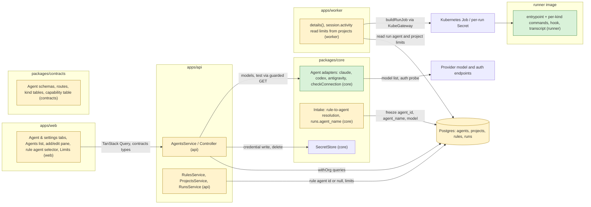
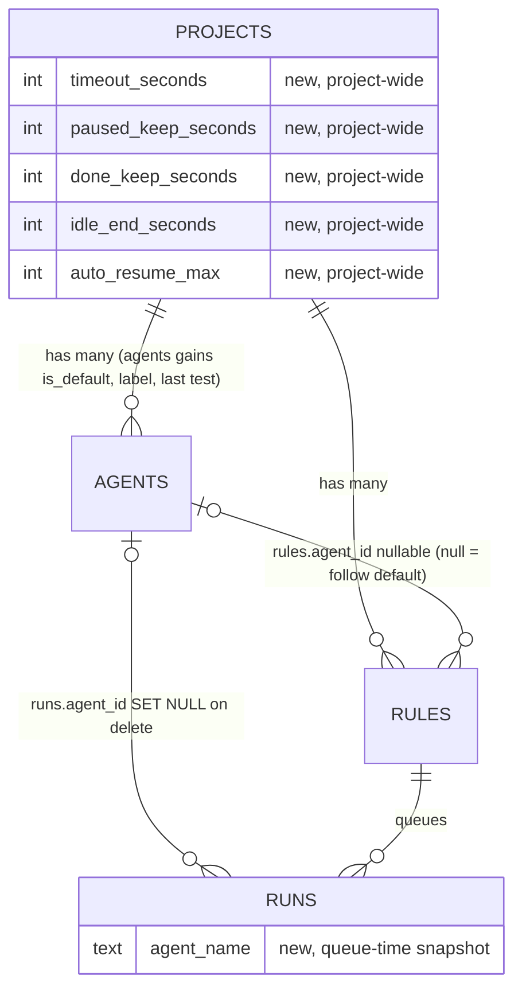

<!-- dev-plan: kind=spec id=multi-agent-configs rev=3 hash=1472c118460c source=issue#277 -->
# Multiple agent configurations per project design

Status: draft. Sensitive paths: secrets/tokens (credential route, Secret delete, per-run Secret), run Job/runner (worker launch, new runner entrypoint branches), webhooks (intake resolves the agent only; the signature path is untouched), RLS/withOrg (new queries), migrations (0045, 0046, 0047).
Source: issue #277

## Summary

Agent & settings today holds one fixed Claude configuration (one model, one address, one credential), although the database already allows many agents per project and rules and runs already point at an agent.
This change lets an admin keep several named agent configurations per project (also several of one provider, each with its own credential, address and model), choose one as the project default, point a rule at any of them, and have every run keep the configuration it was queued with.
Claude Code, OpenAI Codex and Google Antigravity run; ten more providers are listed as "Coming soon" and cannot be saved or run.

A new project still starts with one placeholder default agent (Claude Code, named "Claude", no credential), so every project always has at least one agent. The new-project wizard's Agent step no longer defaults to Claude: the person picks the agent they work with (Claude Code, Codex or Antigravity), nothing is preselected, and a person with no Claude credential can finish setup.
The five run-lifecycle limits become project-wide, and the Agent & settings page becomes a tab strip (Agents, GitHub connection, Limits, Danger zone).

## Business rules

Confirmed by the human at planning time.

### Goal

A project can hold several named agent configurations (also several of one provider, each with its own credential, address and model); one is the default; rules pick any of them; runs keep the one they were queued with. Success: an admin adds "Claude - Work" next to "Claude - Personal", points a rule at it, and the run shows that agent.

### Actors

| Actor | May do |
| ----- | ------ |
| Org admin, project admin (on that project) | View, add, edit, test, set default and delete agents; save credentials; choose an agent on a rule. They hold `agent:read`, `agent:update` and `secret:update` (owner and admin only). |
| Member, viewer | Cannot open Agent & settings and cannot read the agent list; they hold none of those permissions. |
| Outside party (ticket-source commenter) | A comment triggers a rule; the rule's agent (or the default) runs. No agent data is shown to them. |

### Rules

Surface: UI (Desk -> Agent & settings, the rule form, run detail), plus API for old consumers, permission checks and refusals (the UI is the outermost surface a user reaches; the API is named where a rule cannot be driven from the UI). BR-1 to BR-62 are final ids: never renumbered, never reused. BR-55 to BR-60 cover the tab strip, BR-61 the page fit and BR-62 the empty-list fallback; all are user-visible surfaces.

| Id | Category | Rule |
| -- | -------- | ---- |
| BR-1 | conditional-display | When an admin opens Agent & settings, they see in the "Agents" tab (the default tab) the heading "Agents", the description text, Add agent, and rows with the provider's logo and name (not a monogram), configuration name, account label and auth type, model, status, a Default marker, and Edit / Set as default / Delete. |
| BR-2 | conditional-display | When the list shows, exactly one row has "Default" and that row has no "Set as default". |
| BR-3 | feedback-state | While the list loads, it shows skeleton rows; when the list cannot load, it shows an error with Retry. |
| BR-4 | conditional-display | When an admin picks Add agent, each of Claude Code, OpenAI Codex and Google Antigravity (choosable) and each of Gemini CLI, GitHub Copilot CLI, Cursor, Amp, OpenCode, Aider, Cline, Goose, Qwen Code and Kiro (shown as "Coming soon", cannot be picked, cannot be saved) shows its logo and name; a logo never replaces the name. |
| BR-5 | conditional-display | When a provider is picked, only its auth methods and (if it supports one) its API address show; no Claude-only label (`ANTHROPIC_BASE_URL`) shows for another provider. |
| BR-6 | persistence | When an admin saves a new agent (name, label, auth, credential, model), the agent is created with the model when one is chosen, the row appears and still shows after reload; model discovery after the credential only refines the choice on a later Edit. |
| BR-7 | persistence | When two agents of one provider exist, each keeps its own name, label, model, address and credential status. |
| BR-8 | validation | When the name is empty or over 256 characters, or the label is over 256, the admin sees a field error and nothing is saved. |
| BR-9 | validation | When the name is already used in the project (ignoring case), the admin sees a field error and nothing is saved. |
| BR-10 | validation | When the API address is invalid (carry-over of routing spec BR-12), the admin sees a field error and nothing is saved. |
| BR-11 | validation | When the model id is invalid (carry-over of routing spec BR-7), the admin sees a field error on Model. |
| BR-12 | persistence | When a credential is saved, the field is empty afterwards and the row shows set, type, updated time and who; the value is in no response or page state. |
| BR-13 | persistence | When agent A's credential is replaced, agent B's status and updated time are unchanged. |
| BR-14 | state-transition | When an admin edits the API address (only for a provider that supports an address, Claude Code today; Codex and Antigravity have none, so it cannot arise for them), the credential shows "Credential needed again" and Save is blocked until a new credential is typed (routing spec BR-13 to BR-16). |
| BR-15 | state-transition | When an admin changes the auth method (only Claude Code and Codex offer more than one; Antigravity has only an API key, so it cannot arise for it), a new credential of that type is needed and Save is blocked without it. Replacing the credential value with the same auth method needs no address or method rule. |
| BR-16 | conditional-display | When an admin edits an agent, the provider is read-only. |
| BR-17 | persistence | When an admin edits name, label or model, they are saved and shown after reload. |
| BR-18 | conditional-display | When the model list shows for an agent, it comes from that agent's own credential and address (agent A's list can differ from B's). |
| BR-19 | feedback-state | When the model list cannot load, the standard names and "Other model..." show and a typed model saves. |
| BR-20 | feedback-state | When an admin runs Test connection, the row and the Test result show "Connected" (ok) or a word and message per failure: "Credential rejected" (rejected), "Can't reach address" (unreachable, host only), "Can't verify" (invalid: the provider answered in an unexpected way), "Not checkable" (unsupported: the provider has no way to check), or "Needs credential" (no credential); never provider text or the credential. |
| BR-21 | persistence | When an admin saves an agent whose connection fails, it is still saved and the row shows the failure word of BR-20. |
| BR-22 | persistence | When the list reloads, the row keeps its last test status; the row shows "Not tested" before any test and after the credential, auth method or address changes. |
| BR-23 | state-transition | When an admin uses Set as default from the list, the marker moves and a Toast says "Default agent changed. New runs only." |
| BR-24 | state-transition | When an admin uses "Use as the project default" in the editor, the same happens as BR-23. |
| BR-25 | conditional-display | When the Agents tab shows, text explains the default is used only when a rule picks no agent. |
| BR-26 | state-transition | When the default changes, queued, running and paused runs stay on their agent. |
| BR-27 | state-transition | When an admin confirms Delete on an unused agent, the row is gone. |
| BR-28 | validation | When an admin deletes the default agent while the project has another agent, it is refused with "Set another agent as default first" and nothing changes. |
| BR-29 | validation | When an admin deletes an agent a rule names, it is refused, the rule commands are listed, and nothing changes. |
| BR-30 | validation | When an admin deletes an agent with a queued, running, paused or reopenable run, it is refused with the reason. |
| BR-31 | persistence | When an agent is deleted, its finished runs still list and show the name the agent had at queue time and the run's model. |
| BR-32 | conditional-display | When the rule form opens, "With agent" lists "Project default (<name>)" first, then every agent by name. |
| BR-33 | persistence | When a rule is saved with an agent, it shows it after reload and the rule row shows the agent name. |
| BR-34 | persistence | When a rule is saved on Project default, it shows "Project default" and follows later changes of the default. |
| BR-35 | side-effect | When a comment triggers a rule with agent B, run detail shows B and its model. |
| BR-36 | side-effect | When a comment triggers a rule on Project default, the run uses the default at that moment. |
| BR-37 | state-transition | When a run was queued with A, it keeps A after the rule or the default changes. |
| BR-38 | state-transition | When a paused run resumes after the default changed, it uses the run's own agent. |
| BR-39 | state-transition | When a paused run resumes after its agent's credential was replaced, it uses the new credential, the same agent and the run's frozen model. |
| BR-40 | state-transition | When another agent is picked in the rule form, Model resets to "Default model"; a rule's own model still works with its agent. |
| BR-41 | feedback-state | When a rule's agent has no credential, its row shows a warning and its run fails at start with the existing reason. |
| BR-42 | permission/validation | When a rule names another project's agent, it is refused (422); the form offers only this project's agents. |
| BR-43 | conditional-display | When an admin opens the "Limits" tab, it is its own tab, labelled "Project-wide", apart from the "Agents" tab, and each limit says it applies to every agent. |
| BR-44 | conditional-display | When the agent editor shows, it has no run-limit fields. |
| BR-45 | persistence | When limits are saved once, they apply to runs of every agent. |
| BR-46 | permission | When a member or viewer reaches the page, they have no entry and get no-access; the API answers 403. |
| BR-47 | permission | When an admin on project P1 asks for P2's agents, they get not-found; another org's agent id answers 404. |
| BR-48 | persistence (migration) | When an existing project is migrated, it shows agent "Claude" as Default with the previous model, address and credential set; existing projects keep their "Claude" agent. |
| BR-49 | persistence (migration) | When an existing project is migrated, its rules, run history and limits are unchanged. |
| BR-50 | persistence (API) | When an old consumer calls `GET` or `PUT /api/projects/:id/agent`, it acts on the default agent and the project limits; after the wizard replaces the placeholder it acts on the new default agent (a different id than the placeholder, whose id then answers 404, only inside the wizard before the project is ready). |
| BR-51 | validation (API) | When an agent of a Coming-soon provider is created, it is refused (422). |
| BR-52 | side-effect | When a run starts, the pod's first log line shows the run's agent kind, model and endpoint. |
| BR-53 | conditional-display | When an owner or admin opens the new-project wizard's Agent step, they see the provider picker (Claude Code, OpenAI Codex, Google Antigravity choosable; ten Coming-soon providers not pickable) with the chosen provider's own auth methods, address field (only if it supports one) and model picker, and no Claude-only text for another provider; nothing is preselected on a first visit; they can set up the agent they actually work with. |
| BR-54 | persistence | When a run is listed or opened, it shows the agent's current name while the agent exists (a rename shows on its runs), and the name saved at queue time once the agent is deleted. |
| BR-55 | conditional-display | When an owner or admin opens Agent & settings, they see a tab strip named "Agent and project settings" with Agents, GitHub connection, Limits and Danger zone in that order; Agents is selected when the URL has no `tab`, and only the selected tab's content shows. |
| BR-56 | navigation | When a person clicks a tab, the URL shows `?tab=github`, `?tab=limits` or `?tab=danger` (nothing for Agents); reload and Back keep or restore that tab, and arrow keys, Home and End move between tabs. |
| BR-57 | navigation | When a person opens a URL with an unknown `tab`, or `?tab=danger` without `project:delete` (org level, so a project admin never has it), they land on the Agents tab; a project admin sees three tabs and no Danger zone. |
| BR-58 | state-transition | When a person changes tab while the add or edit agent pane is open, the pane closes and the typed values, including a credential, are dropped; coming back to Agents shows the list with the pane closed. `?agent=` and `?page=` belong to Agents only and are cleared on tab change. |
| BR-59 | feedback-state | When one tab's data fails to load or save (for example the agent list gives a 500), that tab shows its own error with Retry; the other tabs still load and save normally. |
| BR-60 | navigation | When a person follows a link that points at a setting, they land on the right tab: run "Connection details", run "Switch to polling" and the projects-list switch-to-polling link open GitHub connection; run "Change time limit" and the Routing rules "Change" for runs per ticket open Limits; run "Replace credential" opens Agents with that agent's pane; the nav link, the project Settings link and the onboarding checklist open Agents. |
| BR-61 | conditional-display | When an owner or admin opens Agent & settings at any window size, the page fits the window and only the active tab's panel scrolls; the heading and tab strip stay in view while a long panel (for example many agents) scrolls. It applies to all four tabs. |
| BR-62 | conditional-display | When the Agents tab has no agent (a fallback state only: a project is created with a placeholder default agent and the last agent cannot be deleted), an admin sees "No agents yet" with the sentence "The first one you add becomes the project default." and the Add agent button; the agent they then add is marked Default. The server decides this: `POST agents` into a project with no default marks the new agent default in the same step. |
| BR-63 | state-transition | When an admin picks Codex or Antigravity in the Agent step while the placeholder agent is untouched, enters its credential and clicks Continue, the project's agent list (Agent & settings) shows exactly one agent, of the chosen provider, marked Default, and no "Claude" agent; rules created in step 4 default to it. |
| BR-64 | state-transition | When an admin has no Claude credential and completes the Agent step with another provider's credential, the wizard lets them Continue through to the last step and the checklist "Add an agent" shows done; no step asks for a Claude credential. |
| BR-65 | persistence | When an admin leaves after the Agent step and resumes setup from the project list, the step shows the saved provider (read-only), name, model and the credential as set; the provider cannot be switched there (add another agent from Agent & settings instead). |
| BR-66 | validation | When an admin deletes the only agent of a project, it is refused with "A project needs at least one agent. Add another agent first." and the agent stays and the project keeps its default; nothing changes (also true when the agent is unused). |

### Not observable

- The credential Secret of a deleted agent is removed: no user can see a Kubernetes Secret; the effect is covered only by BR-27 (a deleted agent leaves the list).
- The agent id a run holds: a user sees the agent name on the run (BR-35, BR-54).
- The placeholder agent's id and how the wizard replaces it: a person sees BR-63, not the mechanism.
- Uniqueness of the default is enforced in the data layer: a user sees it as one Default badge (BR-2).
- A tab loads its data only while it is open: the effect a person sees is BR-59.

### States

- Default: any agent -> default, made by an admin from the list or the editor; the old default loses it in the same step. Forbidden: no default, two defaults, deleting the default, deleting the only agent. The empty-list fallback (BR-62) also covers a project whose data has no default (a broken invariant): adding an agent then makes it the default: `POST agents` marks the new agent as the default in the same step when the project has none (human answer), never leaving zero defaults.
- Credential: not set -> set (save), set -> set (replace), set -> not set (address change before the new credential is saved, routing spec BR-16). Forbidden: using a credential for an address it was not saved for (ADR 0026).
- Delete: allowed only when the agent is not the default, no rule names it, and no run of it is queued, running, idle, paused or has a reopenable kept session. Delete is blocked, never reassigned silently; the message lists the rules so the admin re-points them first.
- Last test result: not tested -> connected | rejected | unreachable | can't verify (`invalid`) | not checkable (`unsupported`); reset to not tested when the credential, auth method or address changes. The result and its time are stored (non-secret) so a row shows them after a reload; "Test connection" runs on demand and also runs after a credential save; the list never calls the provider.
- Provider: fixed after creation (changing it would invalidate credential, model and address; add a new agent instead).
- A project always has at least one agent and exactly one default (human requirement: "A project should start with at least one agent (any) or the project won't work"). A new project is created with a placeholder default agent named "Claude" (Claude Code, no credential), which the wizard's Agent step configures or replaces. The placeholder is replaced only while the setup is still at the Agent step; no rule, run or credential is ever re-pointed silently.
- A run records its agent at queue time (`runs.agent_id`, set at intake) and its model is frozen (ADR 0026). Resume uses the same agent record. Changing the default never changes a queued, running or paused run.
- "Exact configuration" means the same agent record (same credential identity; the Secret name derives from org and agent id) with the model frozen on the run. Edits to that record (a rotated credential, a changed address) apply on resume, as the accepted ADR 0026 and spec 2026-11-19-agent-model-routing-design.md BR-36 already say. No snapshot copy of the whole configuration is made per run.
- "Runnable" means full parity with Claude for the run lifecycle: start, live watch, terminal attach, pause and resume, finish, per-agent model. If a CLI cannot do one of these, it is raised as a conflict; no degraded provider ships silently (see Architecture, Other decisions).
- No "disabled" state exists: the requirement lists the user actions (view, add, edit, test, set default, delete), "disabled" has no action, and the delete safeguard covers the rule-reference case.

### Limits and validation

- Name: required, trimmed, 1 to 256 characters, unique per project ignoring case.
- Account label: optional, trimmed, 1 to 256 characters when given.
- Provider: one of the runnable kinds (`claude`, `codex`, `antigravity`); a Coming-soon name or unknown value is refused (422 on `/provider`).
- Auth method: per provider (Architecture, API, capability table). Credentials are a pasted value, write-only (ADR 0012). In-app sign-in is out of scope (human): "connect/sign in" is the pasted subscription token (Claude `oauth_token`, Codex `auth_json`).
- Credential value: required non-empty on create-with-credential or replace; never returned.
- API address: optional, public https, rules unchanged (`AgentBaseUrl`; routing spec BR-12); shown only for providers that support one.
- Model: 1 to 200 characters, pattern `AgentModelId`; discovered or typed (routing spec BR-1 to BR-10 carry over per agent). Each runnable adapter owns its built-in model names and its model discovery; where a provider has no list API the picker shows built-ins plus "Other model...".
- Run limits (run time limit, keep paused, keep finished, end idle, automatic resumes): all project-wide, bounds unchanged from the `AGENT_*_SECONDS_*` and `AGENT_AUTO_RESUME_MAX_*` constants. `maxTurns` stays agent-specific (a CLI launch option).
- Agent count per project: none stated, none added.

### Edge cases

- Delete while a rule names it: refused, rules listed, nothing changes.
- Delete races a rule being saved for it: the rule save or the delete loses with a clear 409 or 422; never a 500.
- Two admins set the default at once: last write wins; exactly one default always.
- Two admins edit one agent: fields not sent are not reverted (routing spec BR-8 carries over).
- Duplicate name: field error, nothing saved.
- Model list fails: the dropdown falls back to built-in names or a typed model; saving still works.
- Credential rejected, endpoint unreachable, or the provider replies oddly: actionable message, host only, never provider text or the credential (routing spec BR-3). The save is never blocked by it: an agent is always saved and the test result is the agent's status.
- A rule names an agent with no credential: the run fails at start with the existing reason "the agent has no credential set", visible on the run and the ticket; no silent reroute.
- Agent deleted after its runs finished: history stays; run list and detail show the name saved at queue time and the run's model (legacy runs queued before the snapshot show "(deleted agent)").
- A rule's agent is changed: the Model resets to "Default model" whenever another agent is picked, because model lists differ per agent and provider (one provider's model id is never sent to another). This replaces routing spec BR-28 ("a model already picked stays selected") for the multi-agent rule form.
- Delete the only agent: refused (BR-66), also when it has no rules or runs. The earlier "deleting the only agent with no rules or runs succeeds" case no longer holds. Project delete still removes all its agents (project deletion is not an agent delete).
- A legacy project sitting at the Agent step with the seeded credential-less "Claude" agent: the wizard offers the same choice (BR-63); the person never needs to delete the last agent to switch.
- The wizard's swap fails after the new agent is created or made default: the project keeps every agent it had plus the new one, with exactly one default; the step shows the error and a retry reuses the created agent. If only the placeholder delete fails, a stray "Claude" row stays, shows "Needs credential" and is deletable from the Agents tab (it is no longer the default).
- Project deleted: all its agents and their credentials go (unchanged).

### Tenancy and permission

- Every agent read and write goes through `withOrg` and the project filter; agent routes stay project-level with a `projectId` or `agentId` param.
- Guard order per ADR-0036: org membership, permission (403), project scope (404). Another org's or another project's agent id answers 404. An admin on P1 gets nothing on P2.
- A rule can name only an agent of its own project (422 on `/agentId`).
- The tenant comes from the session, never from the body. The credential Secret name derives from org and agent id, never from the client.
- The web hides Desk entries without `agent:read`; the API is the authority.
- Permissions: list agents `agent:read`; create, update, set default, delete, test `agent:update`; credential write `secret:update` (existing `agents.putCredential`); models `agent:read` (existing). All project-level. Tenant data touched: agents, rules (delete check), runs (delete check), project limits. No new permission, role or migration for access (`access.ts` unchanged), because no role would differ.

### Lifecycle, compatibility and side effects

- Create: an admin adds an agent; the credential is optional at create (an agent may be saved with no credential and get one later, as the project's first agent is today).
- Placeholder: created at project creation; replaced only by the wizard's Agent step; its (empty) credential needs no Secret removal.
- Change: edit, set default, replace credential; the model is frozen per run.
- Delete: removes the agent and its credential Secret. No agent-specific audit trail is added (not stated). The generic `AuditInterceptor` already writes one `audit_log` row per mutating `/api` route and drops `value` and credential-like keys, so agent routes are audited at that level and no secret is in any payload.
- Retention: the kept-session limits keep their meaning but become project-wide.
- Migration: the existing agent row becomes the project default and keeps its name, model, address, credential reference and `maxTurns`; no credential is re-entered. Rules keep their explicit agent. Runs and history keep `agent_id`, model and transcript.
- New rules created without an agent follow the project default (null), as the requirement says; today a create without `agentId` binds the single agent.
- Limits: the five run-lifecycle limits move from the agent row to the project and become project-wide; values are carried over from the (single) existing agent row. The old columns on the agent row are kept, unread and unwritten by the new code, until the follow-up in https://github.com/haicanhdieu/agent-desk/issues/287. The Limits tab says "Applies to every agent in this project". They are project-wide because they guard runs of any provider and the requirement says not to make users set the same limit per provider.
- Old API: `GET` and `PUT /api/projects/:projectId/agent` keep working against the project's default agent and the project-wide limits (same body and response shape); the credential and models routes keep their paths. API project creation behaves as before (a Claude placeholder default exists), so these routes always find a default agent for a project created after this change (the 404-when-no-agent case remains only for a broken invariant). New list, create, update, delete, default and test routes are added.
- Superseded text the change updates: PRD FR-3 "one agent credential per project", PRD "Out of scope" (Codex/Cursor), and the Rule form help "One agent per project in the PoC."; ADRs 0021 and 0022 call the limits "agent" settings and the spec notes they move to the project (no change of meaning).
- What a user sees happen: run detail and list show the agent's configuration name and the run's model (existing `agent: {name, model}`); the pod's first log line prints the run's agent kind, model and endpoint (routing spec BR-35); a run for an agent without a credential fails with the existing reason on the run and the ticket. No new ticket comments, notifications or stream events.
- Provider-agnostic terms: "agent", "provider", "credential", "endpoint" (ADR 0005, AGENTS rule 3). Provider names appear only as values of the provider kind and in adapter code. Claude-only text (`ANTHROPIC_BASE_URL`) comes from the adapter, not the shared form. `oauth_token` is shown as a subscription token by the UI.
- Untrusted text: ticket and comment text reaches the agent only as data in the prompt (unchanged). Agent name, account label, API address, model id and credential are new untrusted inputs; they are validated, stored as data and never put in shell, k8s specs or SQL strings (AGENTS rule 6); the address and model keep the launch-line character limits (routing spec). Names and labels are shown as text, never as markup.
- Existing decisions this builds on: ADR 0026 and spec 2026-11-19-agent-model-routing-design.md (per-agent adapter, model frozen on run, credential tied to address, SSRF guard, BR-1 to BR-37 carry over per agent); ADR 0012 (Secret `org-{orgId}-agent-{agentId}`, write-only; per-agent Secret gives isolation for free); ADR 0005; ADR 0036 and the access matrix; ADR 0020 (agent status protocol) and ADR 0027 (agent-neutral transcript), which a second runnable provider must speak.

### Out of scope

- In-app sign-in flow (an OAuth redirect, device code or browser sign-in inside Agent Desk): out of scope, by the human's answer "leave it out". Subscription login stays a pasted, write-only credential (Claude `oauth_token`, Codex `auth_json`); the sign-in flow is for later. No sign-in route, callback or token exchange is added, and the Add and Edit panes offer no Sign in button or link.
- Dropping the five old run-limit columns from the `agents` table: out of scope for this change, which only adds the project columns and keeps the old ones (expand only). The human asked for a follow-up issue to retire them: https://github.com/haicanhdieu/agent-desk/issues/287.
- A subscription login for Google Antigravity in this change: out of scope, by the human's answer "API key only now". Antigravity takes an API key only; a subscription login comes later, once a spike shows it works headless.
- The reference products in the requirement are not requirements to copy.

## Architecture

Confirmed by the human at planning time.

### Overview

Parts by layer (Follows: `apps -> core -> db -> contracts`, web imports contracts only):

- `packages/contracts`: agent schemas and routes, kind tables, rule and project schema additions.
- `packages/db`: schema and three migrations.
- `packages/core`: `codex` and `antigravity` adapters beside `claude`; `AgentAdapter.checkConnection`; rule-to-agent resolution used by intake; intake writes `runs.agent_name`.
- `apps/api`: `AgentsService` and `AgentsController` (list, create, update, remove, setDefault, test); `RulesService`, `ProjectsService` and `RunsService` adjusted.
- `apps/worker`: `details()` and `session.activity.ts` read the five limits from `projects`.
- Runner: `images/runner/agents/{codex,antigravity}/` and the entrypoint list.
- `apps/web`: Agents list, add/edit pane, rule agent selector, Limits section, tab strip.

What exists today (evidence): `agents` already allows many rows per project, unique on `(project_id, name)`; `rules.agent_id` is NOT NULL; `runs.agent_id` is nullable `ON DELETE SET NULL`. Intake pins the agent and model at queue time (`packages/core/src/intake/process-ticket-event.ts`, about lines 451-471) and resume reads `runs.agent_id`, never the project default. The credential Secret is per agent (`org-{orgId}-agent-{agentId}`, ADR 0012), so credential isolation per configuration needs no new mechanism. The API is single-record; `AgentKind = z.enum(['claude'])`; `agentAdapterFor` has only the Claude case; the runner entrypoint accepts only `AGENT=claude`; the image installs only the Claude CLI. The five run-lifecycle limits live on `agents`; `maxConcurrentRuns` and `maxRunsPerTicket` live on `projects`. Readers: `run.activities.impl.ts` (about 444-467), `session.activity.ts` (about 58-68), `runs.service.ts` (about 139-155).

### Data model

Migration: three new migrations, none edits an applied one.

- `0045_agent_configs.sql` (schema only, expand step, safe with the previous app live).
- `0046_agent_configs_backfill.sql` (data, idempotent, batched by project id).
- `0047_agent_name_lower_key.sql` (the case-insensitive unique name index).

Expand only (human decision): this change adds the five limit columns on `projects` and keeps the old five on `agents`, unread and unwritten by the new code; the old app can still write them during the rolling release. Dropping them is a later release (the contract step of expand/contract, database.md §5), tracked in follow-up issue https://github.com/haicanhdieu/agent-desk/issues/287. No contract migration is in this change.

#### agents (changed; scope: project)

| Field | Type | Null | Default | Key / index | Change | Notes |
| ----- | ---- | ---- | ------- | ----------- | ------ | ----- |
| `account_label` | text | yes | none | check `agents_account_label_check`: null or `char_length` 1 to 256 | added | Optional label such as Personal or Work. CHECK added NOT VALID then VALIDATE. |
| `is_default` | boolean | no | `false` | partial unique index `agents_project_default_key` on `(project_id) where is_default` | added | At most one default by the index; at least one by the service. |
| `last_test_status` | text | yes | none | check: `ok`, `rejected`, `unreachable`, `invalid`, `unsupported` | added | Non-secret last test result. `no_credential` is returned, never stored. |
| `last_test_at` | timestamptz | yes | none | none | added | Time of the stored result. |
| `name` | text | no | none | check `agents_name_length_check` (`char_length(name) between 1 and 256`); unique `agents_project_name_lower_key` on `(project_id, lower(name))` (0047); existing `agents_project_name_key` stays | changed | Length check added NOT VALID then VALIDATE. `23505` on the lower-case key maps to 409 on `/name`. |
| `credential_type` | text | yes | none | `agents_credential_type_check` widened to `oauth_token`, `api_key`, `auth_json` | changed | Drop and re-add, NOT VALID then VALIDATE. From `oauth_token`, `api_key`. |

The existing five limit columns on `agents` (`timeout_seconds`, `paused_keep_seconds`, `done_keep_seconds`, `idle_end_seconds`, `auto_resume_max`) stay in place and unused until the follow-up in https://github.com/haicanhdieu/agent-desk/issues/287.

RLS: unchanged (existing policies on `agents` cover the columns).

#### projects (changed; scope: org, project rows)

| Field | Type | Null | Default | Key / index | Change | Notes |
| ----- | ---- | ---- | ------- | ----------- | ------ | ----- |
| `timeout_seconds` | integer | no | 86400 | check 60 to 604800 | added | Same default and bound as the `agents` column today. |
| `paused_keep_seconds` | integer | no | 604800 | check 3600 to 2592000 | added | Same as today. |
| `done_keep_seconds` | integer | no | 86400 | check 0 to 604800 | added | Same as today. |
| `idle_end_seconds` | integer | no | 1800 | check 300 to 604800 | added | Same as today. |
| `auto_resume_max` | integer | no | 5 | check 0 to 10 | added | Same as today. |

Constant defaults and bounds mirror the `AGENT_*` constants in contracts; the checks are added NOT VALID then VALIDATE. RLS: unchanged.

#### rules (changed; scope: project)

| Field | Type | Null | Default | Key / index | Change | Notes |
| ----- | ---- | ---- | ------- | ----------- | ------ | ----- |
| `agent_id` | uuid | yes | none | existing FK to `agents`, no cascade | changed | From NOT NULL to nullable (relaxing is safe for the old app). Null means follow the project default. |

RLS: unchanged.

#### runs (changed; scope: project)

| Field | Type | Null | Default | Key / index | Change | Notes |
| ----- | ---- | ---- | ------- | ----------- | ------ | ----- |
| `agent_name` | text | yes | none | none | added | Snapshot written once at intake; never updated by a rename; no backfill. Legacy runs read `coalesce(agents.name, runs.agent_name, '(deleted agent)')`. |

RLS: unchanged. No data statement on `runs` or `rules` in 0045.

Backfill (0046): rename case-only duplicate agent names inside a project (the later row gets a ` (2)` suffix) so the 0047 index cannot fail; set `is_default = true` on each project's oldest agent where the project has no default; copy that agent's five limits into the project row; existing rules keep their explicit `agent_id`; credentials need nothing (the Secret name derives from `(orgId, agentId)` and the row id is unchanged, so nothing is re-entered).

"Exactly one default": at most one by the partial unique index; at least one agent and exactly one default by the service (project create seeds the placeholder `Claude` with `is_default = true`; set-default moves the flag; delete never removes the default or the only agent). No deferred constraint trigger.

RLS across the change: no new table; existing policies on `agents`, `projects`, `rules` and `runs` cover the columns. The existing two-org tests are extended for the new queries.

List order: `is_default desc, lower(name), id`. The compat `GET /agent` returns the default agent explicitly (it used to take "the first row").

### API

Contracts (additive, ADR 0004):

- `AgentKind = z.enum(['claude','codex','antigravity'])`. `CredentialType` gains `auth_json` (a JSON credential file pasted write-only; the Codex ChatGPT-subscription `auth.json`).
- `AGENT_KINDS_COMING_SOON`: `{ id, label, logo }` for Gemini CLI, GitHub Copilot CLI, Cursor, Amp, OpenCode, Aider, Cline, Goose, Qwen Code, Kiro. These are not `AgentKind` values; adding one later is a one-line data change.
- `AGENT_KIND_CAPABILITIES[kind]`: `label`, `credentialTypes: [{ type, label, help }]`, `baseUrl: { help } | null`, `modelHelp`, `supportsMaxTurns`, `logo`. Provider-specific help text (for example Claude's `ANTHROPIC_BASE_URL`) is data in this keyed table, never in shared form code. A contracts test asserts each runnable kind has a row and a registered adapter. The picker needs no server route.
- Logos (human: in scope; replaces the monogram): `AGENT_KIND_CAPABILITIES[kind].logo` and each `AGENT_KINDS_COMING_SOON` entry carry `logo: string`, a plain asset key (for example `'claude'`, `'codex'`, `'antigravity'`, `'gemini-cli'`), never a path, URL or markup. Contracts holds the key (contracts must not carry markup); the web holds the drawing: static SVG path data in one module `apps/web/src/ds/providerLogos.ts`, keyed by that key and rendered inline by `ProviderMark` (no file import, no image asset, no CDN), with a monogram fallback for a key it does not know. `ProviderMark` takes the key as data, so web code names no provider. No package or icon set is added. A contracts test asserts every kind and coming-soon id has a non-empty `logo` key; a web test asserts every key resolves to path data or the fallback. No API, DB or runner change; no logo URL travels in the API.
- In-app sign-in (an OAuth redirect or device login inside Agent Desk) is out of scope (human). Subscription credentials are pasted write-only values (`oauth_token` for Claude Code, `auth_json` for Codex), so no sign-in route, callback or token exchange is added; the test-connection and credential routes are unchanged.
- Auth-method change (BR-15) applies only to kinds with more than one credential type: Claude Code and Codex. Antigravity offers `api_key` only, so a method change cannot arise; the credential route still rejects a type not listed in the kind's capabilities with 422 on `/type`.
- Capabilities, to be confirmed by the per-CLI spike in the plan: claude = `oauth_token` or `api_key`, address supported; codex = `auth_json` or `api_key`, no address; antigravity = `api_key` only (`GEMINI_API_KEY`), no address, no Google ADC (human: API key only now; a subscription login comes later once a spike shows it works headless). Sources read: developers.openai.com/codex/auth, antigravity.google/docs/install.
- `AGENT_NAME_MAX = 256`, `AGENT_ACCOUNT_LABEL_MAX = 256`; both trimmed, 1 to 256.
- `AgentDto` adds `accountLabel: string | null`, `isDefault: boolean`, `lastTest: { status, at } | null`, `usage: { rules, blockingRuns }`. The five limits stay on it for the compat route, sourced from the project. Credential metadata stays `{ set, type, updatedAt, setBy }`.
- `CreateAgentRequest { provider: AgentKind, name, accountLabel?, model? (absent = the adapter's first built-in), maxTurns? }`; `UpdateAgentRequest { name?, accountLabel? | null, model?, maxTurns? | null }`. `provider` is immutable after create. `baseUrl` and credential type are in neither body: they change only through `PUT /api/agents/:agentId/credential` (ADR 0026).
- `AgentConnectionDto { status: 'ok' | 'no_credential' | 'rejected' | 'unreachable' | 'invalid' | 'unsupported', message, testedAt: Timestamp | null }`. `message` comes from the constant map `AGENT_TEST_MESSAGES`, never from upstream text.
- `RuleDto.agentId` becomes `string | null` (null = follows the project default); create: `agentId` optional (absent = follow default); update: `uuid | null`. This widens a response type.
- `ProjectDto` and `UpdateProjectRequest` gain the five limits with the existing bounds constants.
- `RunDto.agent` keeps `{ name, model }`; the name is `coalesce(agents.name, runs.agent_name, '(deleted agent)')`.
- The rule select's whole-set read (`allAgents`) pages through `agents.list` like `allSkills`.

Routes (group `agents` in `routes.ts`). Authz per ADR-0036; every route has a `routeAccess` entry in `packages/contracts/src/route-access.ts` and runs through `checkTenantAccess`. All are project level.

| Method | Path | Who may call it | Request | Response | Contract |
| ------ | ---- | --------------- | ------- | -------- | -------- |
| GET | `/api/projects/:projectId/agents` | `agent:read` | none (paging per ADR 0028) | `pageOf(AgentDto)`, order `is_default desc, lower(name), id` | `agents.list` (new) |
| POST | `/api/projects/:projectId/agents` | `agent:update` | `CreateAgentRequest` | `AgentDto`; 422 on `/provider` for a Coming-soon or unknown kind; 409 on `/name` for a duplicate | `agents.create` (new) |
| PATCH | `/api/agents/:agentId` | `agent:update` (param `agentId`) | `UpdateAgentRequest` | `AgentDto` | `agents.update` (new) |
| DELETE | `/api/agents/:agentId` | `agent:update` (param `agentId`) | none | empty; 409 when it is the project's only agent ("A project needs at least one agent. Add another agent first."), when it is the default and another agent exists ("Set another agent as default first"), when a rule uses it (up to 5 rule commands in the message), or when a run is not final, or paused, or has a kept session | `agents.remove` (new) |
| POST | `/api/agents/:agentId/default` | `agent:update` (param `agentId`) | none | `AgentDto` | `agents.setDefault` (new) |
| POST | `/api/agents/:agentId/test` | `agent:update` (param `agentId`) | none | `AgentConnectionDto` | `agents.test` (new) |
| GET, PUT | `/api/projects/:projectId/agent` | unchanged | unchanged | unchanged; act on the default agent; `PUT` also writes the five limits to the project | `agents.get`, `agents.put` (existing, compat alias) |
| PUT | `/api/agents/:agentId/credential` | `secret:update` | unchanged | unchanged | `agents.putCredential` (existing) |
| GET | `/api/agents/:agentId/models` | `agent:read` | none | unchanged; `source: builtin` plus a reason when discovery fails | `agents.models` (existing) |

Behaviour:

- The `agentId` param is resolved by the existing `agentId` case in `apps/api/src/access/target-resolver.ts`. `agents.test` is `agent:update` because it writes `last_test_*`. 404 for another org's or another project's agent, never 403.
- No new permission or role (a new permission needs `access.ts`, a role migration and an ADR 0036 change the requirement does not ask for).
- Compat endpoints are aliases, no `/v2` prefix (the repo has no versioned API).
- `POST agents`: 422 on `/provider` for a Coming-soon or unknown kind; 409 on `/name` for a duplicate. The new agent becomes the default in the same transaction when the project has none (human answer): the create transaction takes `SELECT ... FOR UPDATE` on the project row, checks for an existing default, and inserts with `is_default = true` only when there is none. Concurrent creates serialise on the project lock, so only one gets `true`; if a race ever reaches the partial unique index (`agents_project_default_key`, `23505` on that name) the service re-inserts that agent as a non-default instead of failing. In normal use a project always has a default (project create seeds one), so this covers a broken or legacy project. The model goes in the create body when one is chosen (absent = the adapter's first built-in model). The agent starts with no credential. The web does create (with the model), then `PUT credential`, then `test`. Model discovery after the credential only refines the model later through `PATCH` (an edit); it is not a step of the add flow. Row status words (human answer): `unsupported` shows "Not checkable", `invalid` shows "Can't verify", the other statuses use the UI/UX words. There is no probe route that takes a credential in a body; saves always succeed (T2), so a configuration that fails its test stays saved and shows the failed status.
- `DELETE agents/:id`: one `withOrg` transaction that first takes `SELECT ... FOR UPDATE` on the agent row (a concurrent run insert takes a FK key-share lock, so they serialise). 409 when it is the project's only agent, with the text "A project needs at least one agent. Add another agent first." (checked first, also when the agent is unused and has no rules or runs); 409 when it is the project default and another agent exists, with "Set another agent as default first"; 409 when any rule names it (up to 5 rule commands in the message); 409 when any run that is not final, or is paused, or whose session is still kept, uses it. Otherwise a hard delete (no soft-delete flag), then the Secret is deleted after the transaction (idempotent, error class only logged, same as project delete in `projects.service.ts`). History runs keep `agent_id = NULL` (existing SET NULL) and show their `agent_name`. A `23503` from a racing rule insert maps to 409. Block, never offer a replacement. Rules that follow the default never block deleting a non-default agent.
- `POST agents/:id/default`: locks the project row `FOR UPDATE`, clears the old default, sets the new one. Touches no run; affects new runs only because intake resolves the default at queue time and freezes it.
- `POST agents/:id/test`: the adapter call runs outside any transaction, then a short transaction stores `last_test_status` and `last_test_at`. `no_credential` is returned and not stored. `unsupported` when the adapter cannot probe that credential type.
- `GET agents/:id/models` and `test` use only that configuration's own credential and address (`agentAdapterFor(row.provider)`). A failed model list never blocks saving a typed model (`PATCH` accepts any valid `AgentModelId`).
- WebSocket and terminal untouched. The webhook signature path is untouched.

Project creation and the setup wizard (human requirement: "A project should start with at least one agent (any) or the project won't work"; human complaint: "why we default Claude for user, if they don't have claude, how they continue setup? we should allow user setup with what the agent they working on"). Both hold: the seed keeps the invariant, and the wizard lets the person end up with the agent they use.

- `ProjectsService.create` keeps seeding one placeholder default agent in the same transaction as the project and poll cursor (`database.md` section 6 stays true). Placeholder: `claude`, `Claude`, model `sonnet`, `max_turns` 50, no credential, `is_default = true`. The initial `setupStep` stays `'agent'`.
- Agent call (no new route, BR-16 kept): the wizard replaces the placeholder by orchestrating the routes already designed, in this order: (1) `GET agents`; (2) if the person picked the placeholder's provider (Claude Code), configure the placeholder itself in place (`PATCH` model if changed, `PUT credential`, `POST test`); (3) otherwise `POST agents {provider, name, model?}` (the new agent is not the default because a default exists), then `POST agents/:newId/default`, then `DELETE` the placeholder (allowed by the ordinary rules: it is no longer the default, no rule names it, no run uses it; its empty credential needs no Secret removal), then `PUT credential` on the new agent and `POST test`; (4) `PATCH project {setupStep:'setup'}`. Provider stays immutable on every agent: nothing retypes the placeholder, and no wizard-only server action exists. At every moment the project has at least one agent and exactly one default, so a failure in the middle leaves the invariant intact (at worst two agents, the chosen one already default) and the wizard resumes from the saved state. Rejected alternatives: a wizard-only "retype an untouched placeholder" action (adds a provider-mutation path and a definition of "untouched" the server must trust); one atomic "replace" route (a new route and permission surface for something three existing calls do safely).
- "Untouched placeholder" is not a server concept: the wizard deletes the placeholder only after it is no longer the default, and the ordinary delete safeguards (409 for rules or runs) protect anything that is in use. The wizard offers the swap only while the setup step is still the Agent step (UI rule below).
- Agent call: the default name of a replacement agent is the kind's capability `label`, set client-side and editable (name rules unchanged). A wizard step is complete when the project's default agent has a credential; in-app sign-in is out of scope, so subscriptions are pasted values.
- Old API consumers: `GET/PUT /projects/:id/agent` keep acting on the default agent. After the wizard swaps the placeholder they act on the new default (a different id); a client that cached the placeholder's id before the wizard finished gets 404 for it, only inside the wizard, before the project is ready.
- Onboarding checklist (`packages/core/src/access/checklist.ts` `add_agent`): done when the project's default agent has a credential (`agents.is_default and credential_secret_name is not null`), replacing "any agent has a credential"; provider-neutral.
- Rules: a rule with `agentId` absent or null follows the default, which always exists, so no extra guard is needed. `rules.service.ts` `resolveAgent` changes only to stop picking "any agent of the project" when `agentId` is absent: null is stored and intake resolves the default.
- Legacy projects: nothing to migrate; they keep their existing agent (usually the seeded `Claude`) and the wizard handles it the same way. No migration deletes an agent.

### Third-party libraries

| Library | New or existing | Used for | Approval |
| ------- | --------------- | -------- | -------- |
| Zod, Drizzle, `guardedGetJson`, TanStack Query and Form | existing | Contracts, queries, guarded provider calls, web data and forms (api, web, core, db: no new library) | existing |
| Icon package | none | Provider logos are 13 assets (static path data in the repo), not a package; if the human wants an icon package instead it stays undecided and goes under Needs approval | not proposed |
| OpenAI Codex CLI (npm `@openai/codex`, pinned version), runner image | new | Runs the `codex` agent kind in the run pod | approved by the human |
| Google Antigravity CLI (`agy`, official installer, pinned version and checksum, per security.md), runner image | new | Runs the `antigravity` agent kind in the run pod | approved by the human |

### Services and integrations

| Service | New or existing | How it is used |
| ------- | --------------- | -------------- |
| Postgres | existing | New columns and indexes (above) |
| SecretStore | existing | One more Secret per configuration (`org-{orgId}-agent-{agentId}`) |
| Anthropic `/v1/models` through `guardedGetJson` | existing | Claude model list and connection test |
| OpenAI and Gemini model/auth probes | new | New outbound calls through the same guarded GET; the spike decides which endpoints work per credential type |
| Temporal | existing | No new calls |
| Kubernetes | existing | No new calls; the Job spec is still built by `buildRunJob` through KubeGateway |

### Configuration

No config change. No new env var or flag. `AGENT_MODELS_SOURCE` still controls live versus built-in model lists.

### Other decisions

- Worker (Follows: architecture.md §6, ADR 0009, 0022, 0029): no workflow, signal or activity-shape change. `details()` in `run.activities.impl.ts` reads `timeoutSeconds`, `idleEndSeconds` and `autoResumeMax` from `projects`, and `provider`, `model`, `baseUrl` and `maxTurns` from the agent joined by `runs.agent_id`. `session.activity.ts` reads paused and done keep from `projects`. Resume uses the run's own `agent_id`, so a default change or another account never moves it. Edits to the same configuration (key rotation, address change) apply when its paused runs resume, because a rotated key must keep them resumable; `provider` is immutable and the model stays frozen on the run. "Same configuration and credential identity" is read as the same configuration row. A missing agent or credential on resume keeps the existing non-retryable `NoAgentCredential` path. Activities stay idempotent.
- Intake (`process-ticket-event.ts`, existing transaction): `agentId = rule.agentId ?? (select id from agents where project_id = $p and is_default)`; the same transaction freezes `runs.agent_id`, `runs.agent_name` and `runs.model = rule.model ?? agent.model`. A missing default (broken invariant) throws and is retried; it never falls back to another provider. A rule's own model override keeps working with the selected agent.
- Runner and Kubernetes (Follows: ADR 0010, 0011, 0020, 0026, 0027): per kind, `images/runner/agents/<kind>/commands.sh`, `hook.mjs` (status protocol), `transcript.mjs` (transcript protocol) and managed hook config. `entrypoint.sh` `case` list gains `codex` and `antigravity` (still a fixed list; the value is never used as a path). The credential reaches the pod as the env var named by the adapter's `credentialEnv` through the per-run Secret `run-{runId}` (only the pinned agent's credential). For `auth_json` the entrypoint writes it to `$CODEX_HOME/auth.json` (0600, per-run volume) before launch; for antigravity it writes the CLI settings file with `modelProvider: gemini`. Values are expanded only as quoted values. No ticket, comment, name, label or repo text is interpolated into a shell, spec or SQL: `launchEnv` passes `model` as an env value; `name` and `accountLabel` never reach the pod.
- Provider adapters (Follows: architecture.md §3, ADR 0005, 0026): each kind owns an adapter in `packages/core/src/adapters/agents/` registered in `agentAdapterFor`. `AgentAdapter` gains `checkConnection({credential, baseUrl}) -> status` (Claude: over `listModels`, mapping `AgentModelsError` kinds). Provider names appear only as values of the kind and in adapter code and the contracts capability table; no table, route or module name carries one. The `fake` counterpart is added wherever a fake exists. Built-in model names for the new kinds are verified in the plan's spike.
- Risks: (1) a ChatGPT `auth.json` is refreshed by the CLI inside the pod, so the stored Secret can go stale (refresh-token rotation); (2) hook, session-log, model-name and address support for Codex and Antigravity are unverified: the plan starts with a spike per CLI; "runnable" means full lifecycle parity (start, watch, terminal attach, pause/resume, finish, per-agent model), and if a kind cannot meet ADR 0020 and 0027 the plan asks the human before shipping it degraded (the 5-minute `needs_input startup` check must not mislabel it).
- Secrets (Follows: ADR 0012, security.md): write-only through the existing credential route; one Secret per configuration; the Secret is deleted with the configuration and with the project; DTOs expose only `{ set, type, updatedAt, setBy }`; audit drops `value` and credential keys (the generic `AuditInterceptor`, `redact-body.ts`); logs carry error class and host only; the web never caches a secret; `AgentConnectionDto.message` is fixed text.
- Events and live updates: none. There is no agents stream; the web refetches through TanStack Query invalidation after each mutation. Run SSE is unchanged; `RunDto.agent` keeps its shape. A reconnecting client refetches.
- Failure, observability, scale: saving never calls the provider. If the credential store is down, create and update still work; credential and test return the existing "credential store unavailable" 5xx. A half-failed delete (database deleted, Secret delete fails) leaves an orphan Secret that is never reused (the name has the dead agent id) and is logged by error class; same trade-off as project delete. A rule that selects an agent with no credential: the run fails at start with the existing "agent has no credential" reason. Logs carry agent id, error class and host, never name text or credentials. No new metrics. The list is one page query plus two grouped count queries over the page's ids (no per-row query); no cap on agents per project (none stated); each adds one Secret.
- Sensitive paths touched: secrets/tokens, run Job/runner, webhook intake (agent resolution only), RLS/`withOrg` queries, migrations. Label `review:sensitive`.
- ADR needed: yes, `0039-multiple-agent-configurations-per-project` (named configurations, the `is_default` partial unique index, null rule agent = follow default, run limits project-wide, delete safeguards (including never deleting the only agent), the project-creation seed and the wizard swap, the `agent_name` snapshot, runnable kinds and the Coming soon list); it leaves ADR 0026's address-change rule as is. ADR 0036 is unchanged; the desk access matrix rows for the new routes are updated.

## UI and Storybook

Screens and components this changes:

Page shape (Follows: the repo's tab pattern, same as Workspace setup: `Tabs` and `TabPanel` from `@/ds`, a Zod `tab` search param left out of the URL for the first tab, lists load only while their tab is open; `app/routes/o.$org.p.$project.desk.setup.tsx`, `screens/DeskSetup.tsx`, frontend.md §2, §4, §10):

- Route `/o/$org/p/$project/desk/agent` stays; nav label "Agent & settings"; heading "Agent & settings" (h1) with the tab strip under it and the active panel below.
- Tabs and order: `Agents` | `GitHub connection` | `Limits` | `Danger zone`. Agents is first because it is the part that grew and the reason for the page; the other three keep their old relative order.
  - `Agents`: the agent list, `Add agent`, the add/edit pane. Default tab; `tab` is omitted from the URL.
  - `GitHub connection`: repository, last event or check, trigger mode, Manage installation, Send test ping or Check now.
  - `Limits`: the project-wide limits (all five lifecycle limits plus concurrent runs and runs per ticket) and Save limits.
  - `Danger zone`: Delete project. Shown only to a caller with `project:delete` (org level; a project admin never sees it, as today). It is a tab, not a footer, because the human asked for every section in the strip.
- Tab states: Agents: skeleton rows, empty, populated, paged, load-error Banner with Retry inside the tab, read-only. GitHub connection: loading skeleton rows, error Banner, default, polling, checking now, check refused, trigger save error. Limits: default, saving, per-field errors, form error Banner, read-only note for a caller who cannot write. Danger zone: default, confirm dialog, deleting (the existing delete-project flow, unchanged). The strip hides Danger zone when not allowed. No count badge on the tabs.
- Layout: see "Page fit" below. The strip uses the setup page's strip look (a `.agentTabs` class copying `.setupTabs`). Rows truncate with ellipsis and `title` (names can be 256 characters; the pane shows the full name); status and actions wrap to a second line when narrow. No responsive redesign (not asked; the app has none). The provider picker is a 3-card row with the coming-soon chips wrapping beneath. The Limits grid is unchanged.
- Data per tab: each tab loads its own data so a failure in one never blanks the page: the route loader no longer waits for the agent; `GitHub connection` uses the project and connection queries already read by the layout; `Limits` uses the project; `Agents` uses `deskQueries.agents` only while its tab is open (`enabled: tab === 'agents'`).
- Components reused for the strip: `Tabs`, `TabPanel`, `SettingsSection`, `KeyValue`, `TriggerModeSetting`, `DangerZone`, `Dialog`; only a CSS class (`.agentTabs`) is added in `Screens.module.css`. `DeskAgent` splits its body into four panel parts inside the same file or small sibling files (`DeskAgentPanels`); `DeskAgent` gets `tab` and `onTabChange` props (as `DeskSetup`), plus the per-tab props it already has.

Page fit (human: "we need each column can scroll inside, sticky the header and footer"). Applies to Agent & settings and Routing rules. It replaces the earlier "the page keeps scrolling normally (no viewport-fit)" lines. Follows the pattern the repo already has: `AppShell height="viewport"` (`components/AppShell.tsx`: top bar stays, content scrolls inside), `DeskRules` and `DeskSetup` (`height="viewport"` in `o.$org.p.$project.desk.rules.tsx` and `desk.setup.tsx`; Setup's tab panel scrolls inside while its header and tab strip stay: `.setupDeskMain`, `.setupTabs`), and `SidePane` (`.pane` head fixed, `.paneBody` the only scroll area, `.paneFoot` fixed; `components/Composites.module.css`), pinned today by `e2e/mock/rules-layout.spec.ts`.

- `DeskAgent` takes `height?: 'viewport'` as `DeskRules` does and the route passes it. The page never scrolls (`documentElement.scrollHeight === innerHeight`); the top bar stays.
- Agent & settings, main column (left): the fixed header is the h1 "Agent & settings" and the tab strip; the active tab panel is the one scroll area (`flex: 1 1 auto; min-height: 0; overflow-y: auto`, side padding with a negative margin so focus rings are not clipped, as `.paneBody` does); a fixed footer only where the tab has actions.
- Pinned bands by tab: Agents = the list's `Pagination` (pinned under the scrolling rows; "Add agent" sits in the section header, which is the panel's first row and scrolls, so the pinned header is only the h1 and the tabs, not a third pinned band); Limits = the "Save limits" bar and its form error banner; GitHub connection and Danger zone = no footer.
- Pane column (right, Agents tab only): with the pane open the Agents panel is two columns (the list and a 560px pane). `SidePane` as is: title pinned, body scrolls, footer ("Cancel", "Save agent", progress line) pinned. It spans the full height beside the h1 and tab strip, as the rule pane does on Routing rules, so the strip belongs to the main column only.
- Routing rules: the main column's header (h1, help line, "New rule") is pinned, the rule list is the scroll area (the guards card sits at the end of the scroll), `Pagination` is the pinned footer; the rule pane is unchanged (already pinned header and footer). The header and footer move out of today's single scrolling `.rulesCol` into three bands.
- A too-short window: the scroll area keeps a minimum height (120px, a plain CSS `min-height`); below that the column itself scrolls, like `.setupDeskMain` today, so nothing is cut off.
- Keyboard: a scroll box must be keyboard-reachable (axe `scrollable-region-focusable`). The scroll area is the tab panel wrapper with `tabIndex={0}` and the panel's accessible name; the pane body already has focusable fields. The loading skeleton and empty states fill the same scroll area, so the footer never jumps.
- Tokens and spacing: CSS modules, existing tokens, pixel values from the prototype boards; no new token.
- Stories: boards keep a numeric artboard height (`AppShell height={n}`). Every Agent & settings board uses one artboard size (1440x900, as the Rules boards do) because the content scrolls inside; `canvas.json` heights for the agent boards shrink from 1320 and 1480 to 900. One extra state story per page renders `height="viewport"` in a short canvas with a long list so the scroll boxes are visible (state stories `DeskAgentListFitsViewport`, `board: 'DeskAgentList'`, and `DeskRulesAgentFitsViewport`, `board: 'DeskRulesAgent'`); neither is drawn in `canvas.json`, so neither needs a parity entry. Smoke and axe run on all stories, including the scroll-box focus rule.
- Convention line (human: include it in the implementing PR; the human reviews the wording there): one line in `docs/conventions/frontend.md` §5 or §9, in the same PR: "A Desk page fits the window: the top bar, page header, tab strip and action footer stay put; only the body scrolls, and every scroll box is keyboard-reachable." frontend.md has no page-fit rule today. This page fit is business rule BR-61, and its boards and tests cite BR-61.

Agents tab pieces. Rule 10: every shared component below has a story. `ds/`, `components/` and `screens/` import no router, Query or contracts at runtime beyond what existing components already do (frontend.md §1; type imports are fine).

New in `components/`:

- `AgentRow`: provider mark, name, Default chip, the line "<provider label> . <account label> . <auth type>", model (mono), status, Edit button, row menu (Test connection, Set as default, Delete).
- `AgentList`: the section body: rows, `Pagination`, skeleton rows, empty state, error banner with Retry.
- `AgentPane`: `SidePane` with the add/edit form and footer.
- `ProviderPicker`: radio cards for runnable providers and the "Coming soon" chip group. Labels and availability come from props built from `AGENT_KIND_CAPABILITIES`, so web holds no provider names (AGENTS rule 3).
- `ProviderMark`: the provider's logo in a small tile, falling back to a monogram tile (see "Provider logos" below). No new dependency.
- `DeleteAgentDialog`: confirm, deleting, blocked-by-server, error.
- `AgentStatus`: maps a connection status to `InlineStatus` tone, glyph and text (can be a helper inside `AgentRow` if tiny).

Changed:

- `SecretField`: credential type names and token label come from props; submit label "Save and test"; replace-panel help becomes "We save it, then test it with one small call. If the test fails it stays saved and the agent shows the result."
- `RuleForm`: agent options `{id, label, provider}` plus the Project default entry; `agentLocked` kept for a reader without `agent:read`.
- `RuleDraft`: `agent` name becomes `agentId: string | null` plus a display label.
- `RuleSentence`, `RuleRow` ("with <name>" or "with the project default agent"; the `warning` slot is used for an agent with no usable credential), `RulePane` (model help).
- `screens/DeskAgent` (list, pane, limits scope labels), `Setup2` (provider picker and the chosen provider's fields; see "New-project wizard, Agent step" below), and the stepper label on every setup screen.
- Reused unchanged: `ModelPicker`, `SidePane`, `SettingsSection`, `Field`, inputs, `Checkbox`, `RadioCard`, `LabelChip`, `Dialog`, `Skeleton`, `EmptyState`, `Pagination`, `Popover`, `Toast`, `Banner`.
- Elsewhere: the Routing rules page (agent select unlocked, shows agent names); setup step 2 (copy only); run detail unchanged (it shows the run's `agent.name`, which the architecture snapshots on the run).

States:

- Agents list: loading (route pending skeleton with 3 skeleton rows), empty (fallback "No agents yet" with its own Add agent button; the project invariant is one default), populated, paged ("Showing 21–24 of 24" with Previous, page numbers and Next), testing (one row shows "Testing…"), row menu open (Test connection, Set as default, Delete), default changed (the Default chip moves to the chosen row and a dismissible Toast shows), load error (Retry, requestId), stale (cached rows stay during a refetch). Agents tab only: a project admin sees the strip without Danger zone.
- Row status (glyph plus text, never color alone; the row, the pane and Test connection use the same words): Ready (`ok`, ok tone: credential saved and the last test passed), Needs credential (`no_credential`, idle, amber: needs you), Not tested (no stored result, off: a new agent with a credential before its first test, or after a credential, auth method or address change), Credential rejected (`rejected`, err), Can't reach address (`unreachable`, err), Can't verify (`invalid`, warn: the provider answered in a way the check cannot read), Not checkable (`unsupported`, off: the provider has no check Agent Desk can run; the credential is still saved), Testing (UI only, off, `aria-busy`). "Not checkable" is neutral, not an error, and a runnable agent in that state shows no rule warning (only `no_credential` and `rejected` warn on a rule row). If the API sends a status the web does not know, the row shows "Can't verify" (fail soft, no crash). Row also: Default marked, busy (menu disabled while its write runs), read-only (no actions but Edit as "View").
- Pane: add without provider ("Pick a provider to set up its name, login and model."), add with provider (Claude Code, OpenAI Codex, Google Antigravity forms), edit (Claude Code, Codex), saving (add: "Saving credential…"; edit: "Saving agent…"), testing, field errors (name taken, empty Other model), partial (the pane shows "Edit agent" with the banner "Agent saved, credential not saved: <reason>" and the new row in the list reads Needs credential), address changed (credential needed again), replace credential, no credential, test failed, model list loading ("Loading models…") / ready / fallback ("The model list at <host> could not be loaded.") / error (existing `ModelPicker`), read-only, gone (agent deleted meanwhile).
- Delete dialog: confirm, deleting ("Deleting…"), blocked by a rule, blocked by an open run, server error (title and request id, with "Keep agent" and "Delete agent" still shown).
- Limits: default, saving ("Saving…"), field errors (per field), form error Banner ("Your values are still here. Try saving again." with request id), read-only ("You can see these but not change them.", no Save limits); all project-wide; the section has a "Project-wide" chip.
- GitHub connection: default (webhook), polling (interval chips 5, 10, 15, 30 min, Check now), checking now ("Checking…"), check refused ("Polling is paused: the connection’s token was revoked. Reconnect it, then check again."), trigger save error, loading ("Loading the connection"), load error ("Could not load the connection. Try again." with Retry and request id).
- Rule pane: agent list loading (the select shows the current agent and "Loading agents…", disabled), agent with no usable credential (row warning), no `agent:read` (locked select, "You can’t see the agent list. This rule keeps its agent."), agent gone (the existing `withCurrent` keeps the saved id selectable and shows it as "<name> (unavailable)" with "This agent no longer exists. Pick another agent or the project default before you save."; the Model help reads "The model of the deleted agent. Pick an agent to see its models.").
- Permission denied: the existing 403 `EmptyState` from the guard.

User flows:

Tab navigation and URL:
- `?tab=github | limits | danger` (Zod enum, optional, `.catch(undefined)`). `?agent=new|<id>` and `?page=N` only belong to the Agents tab; changing tab clears both (closes the pane). `?tab=danger` for a caller who may not delete, or any bad value, falls back to Agents. Reload and deep links keep the tab.
- Arrow keys move and select (existing `Tabs`); Home and End work. The panel unmounts the old tab, so an open pane closes and unsaved input is dropped, the same as Cancel (the app has no discard confirm, and a typed secret must not outlive its pane). Saved data is never lost.
- Links that point at a setting carry the tab, otherwise they land on Agents: `features/runs/map.ts` "Connection details" and "Switch to polling" -> `?tab=github`; `features/runs/detail.map.ts` "Change time limit" -> `?tab=limits`; Routing rules `GuardsCard` "Change" (runs per ticket) -> `?tab=limits`; projects list `switchToPollingHref` -> `?tab=github`; the run "Replace credential" action -> `?agent=<id>` on the Agents tab; the project settings link, the nav link and the onboarding checklist stay on the default tab. Story hrefs in `mocks/connection.ts` and `mocks/runDetail.tsx` change the same way.

Add and edit selection: add and edit open in a side pane on the Agents tab, selected by a Zod `validateSearch` param `?agent=new | <agentId>` (a bad value falls back to closed), with the list page in `?page=N` (frontend.md §2, §3, §4). This reuses `SidePane`; deep links and refresh work; no second route.

Add agent (three calls: create with the chosen model, credential, test):
1. "Add agent" (or the empty-state button) opens pane "Add agent"; focus goes to the first provider card.
2. Pick a provider: three runnable cards; below them a "Coming soon" group of ten disabled chips (not selectable, not in the tab order, text "Coming soon").
3. Enter Name (required) and optional Account label.
4. Authentication: a segmented control when the provider offers several credential types (Claude: subscription token or API key; Codex: sign-in file (auth.json) or API key), else a plain label (Antigravity: API key only, no segmented control; a subscription login for Antigravity comes later, once a spike shows it works headless); type or paste the secret (write-only password input, starts empty). The auth.json is pasted into the same masked single-line input (its newlines are dropped by the browser and the JSON stays valid); the credential type's help from the provider says where the file comes from. Labels and help come from the capability table, not from web.
5. API address, only when the provider supports one (today Claude only; Codex and Antigravity show no address field).
6. Default model: `ModelPicker` showing the provider's standard names plus "Other model..." (before a credential exists the existing "Save a credential to load the provider's list" note shows). A typed model is always accepted.
7. "Use as the project default" checkbox (unchecked on add).
8. "Save agent" runs: create (with the chosen model, if any; if none is chosen the field is left out and the adapter's first standard model applies) -> save credential -> test. The add pane never writes the model a second time. The pane shows progress ("Saving agent...", "Saving credential...", "Testing connection...") on the footer button and a `role="status"` line.
9. Success or a failed test: the pane closes, the row appears with its status, Toast "Agent saved". A failed test is not an error: the agent and credential are saved and the row shows the result (T2). Choosing "default" calls set-default after create.
- Failure at a step: the pane stays open and the steps already done are kept. If create worked and the credential save failed, the agent exists, the pane switches to "Edit agent" with the banner "Agent saved, credential not saved: <reason>" and "Your typed values are kept. Save the credential again; the agent is not created twice.", and a retry skips create (the pane remembers the new id and switches the URL to `?agent=<id>`). Field errors map by problem pointer (`/name` 409 "An agent with this name already exists."); everything typed stays.

Edit agent: Edit button opens pane "Edit agent", provider read-only ("Fixed after creation"). The pane shows, in order: Provider, Name, Account label, API address (Claude Code only), Credential (type, "Set <date> by <user>. Hidden for good after saving.", status word, Replace), Default model, Max turns (Claude Code's Edit pane only: not in the Add pane, not for Codex or Antigravity), "Use as the project default", and a Connection block (last test time or result, Test connection). Name, account label, default model and max turns save with "Save agent" (PATCH), and a successful save closes the pane. Model discovery after the credential only refines the choice here: the person opens Edit, sees the discovered list in `ModelPicker`, and saves a different model. API address and credential keep today's panel: changing the address puts the credential panel in "Credential needed again" and its button "Save and test" replaces address and credential together (the credential route). Replacing the credential saves it, then tests it; the result updates the row status.

Test connection: row menu or pane button -> "Testing..." -> the status updates (Ready / Credential rejected / Can't reach address / Can't verify / Not checkable). Fixed message per status; never provider text.

Set as default: row menu or editor checkbox -> after the write succeeds the Default chip moves and Toast "Default agent changed. New runs only."; on failure a Toast with the problem title. Not optimistic (frontend.md §3).

Delete: row menu "Delete" -> dialog "Delete agent <name>?". Delete is disabled in the menu for the default agent (reason in the menu item text: "Delete (set another default first)") and for the project's only agent ("Delete (a project needs at least one agent)"; the API refuses with 409 too, only the wizard's create-then-remove replacement ends with fewer agents than it began, and never at zero). The only-agent menu item has no board of its own (specified in text). For other agents the dialog sends the delete; a 409 (rules, live runs) fills a banner in the dialog with the API's title and detail (rule count and commands) and the dialog stays open with "Close". Success: Toast "Agent deleted", the row is gone, the pane closes if it was that agent.

Rules: the rule pane "With agent" lists "Project default (<name>)" first, then agents by name; saving "Project default" sends `agentId: null`. Changing agent always resets the model to "Default model" (model lists differ per agent) and the model help names the chosen agent's default.

New-project wizard, Agent step: set up the agent you work with (human change after spec approval: "why we default Claude for user, if they don't have claude, how they continue setup? we should allow user setup with what the agent they working on"). This supersedes every earlier "Setup step 2: copy only" line. Step 2 of 5 (`o.$org.projects.new.$step`, `screens/Setup2.tsx`, board `Setup2DefaultAgent`) lets the person choose Claude Code, Codex or Antigravity and set that one up. Nothing is preselected.

- Provider choice (Follows: the Add agent pane's `ProviderPicker`): three runnable cards with logos plus the Coming-soon chips, from `AGENT_KIND_CAPABILITIES`. Agent call: nothing is preselected on a first visit (the human's complaint is the Claude default); pressing Continue with none picked shows "Pick an agent to continue." under the cards (same pattern as "Paste the token to continue."). On a return visit the project's default agent's provider is selected, read-only (BR-65).
- Fields appear after a pick, all from the capability table (no provider names in web): credential type as two radio cards only when the provider has more than one (Claude: Claude Code token or API key; Codex: sign-in file (auth.json) or API key; none for Antigravity, API key only, just its label); token or key in `SecretField` entering (write-only password input, starts empty, entry help from the capability table, revealed only by the person); API address only when the provider supports one (today Claude only) with that provider's help text; default model in `ModelPicker` with the provider's standard names and "Other model..." (before a credential exists the `no_credential` note shows, as on the Add pane; a typed model is always accepted); Concurrent runs, kept (project-wide, unchanged).
- Agent call: not in the wizard (edit later on the Agents tab): agent name, account label, max turns and the default checkbox. The name defaults to the provider's label from the capability table (for example "Codex"); the agent becomes the project default.
- Switching provider in the step drops the typed secret (the entry unmounts) and resets credential type, address and model.
- A project always has at least one agent (human rule): creation seeds a credential-less placeholder default named "Claude", so the wizard never leaves the project with zero agents, not even for a moment.
- Agent call: what Continue does (no new API, only the routes the Architecture section lists): (1) if the chosen provider already has an agent in the project (the placeholder when they pick Claude Code, or an agent from an earlier visit), use it; (2) otherwise CREATE the chosen provider's agent FIRST (`POST agents`, with the chosen model if any), so the project then has two agents and never zero; (3) set the new agent as the project default; (4) only then delete the untouched placeholder (no credential, no rule, no run, no longer the default), which the delete rules allow because the project still has another agent; (5) save the credential (with the address when it changed); (6) test it; (7) save concurrent runs and mark the step done. Order matters: create, then default, then delete, then credential. If any step fails, the project keeps every agent it had plus the new one, the default is either the placeholder or the new agent, and the step shows the error; the placeholder delete is best effort: if it fails the stray "Claude" row stays, shows "Needs credential" and is deletable from the Agents tab. A legacy project sitting at this step with the seeded row follows the same path. If the list is somehow empty (not expected), step (2) alone applies and the new agent becomes the default.
- Result of the test (T2: always saved, the result is the status): `ok`, `unsupported` ("Not checkable") and `invalid` ("Can't verify") advance. `rejected` ("Credential rejected") and `unreachable` ("Can't reach address") keep the person on the step with a Banner under the token (status word plus the API's fixed text) and a second button "Continue anyway"; Continue again retries "Save and test". Reason: the credential is already saved, so nothing is lost, but a wrong token should not slip by unseen.
- Agent call: the step is not skippable and not optional, as today, because no run can start without an agent that has a credential, and the checklist item "Add an agent" completes when the default agent has one. Not ready: the line "Not ready yet? You can leave setup and come back; the project keeps your progress." (the project exists from step 1 and resumes from its saved step). A person whose agent is only Coming soon finishes later; there is no empty "Skip".
- Checklist: item "Add an agent" is unchanged in label and link; its done state follows the default agent having a credential, whichever provider. Mid-wizard it links to the wizard step as today.
- States of the step: nothing picked; picked (three providers); returning with a saved agent; saving with a progress line ("Saving agent...", "Saving credential...", "Testing connection..."); field errors (no provider, empty token, empty model, bad concurrent runs, address needs the token again); test failed with "Continue anyway"; form error Banner; loading (route pending skeleton while the agent list and the capability table load); model list loading, fallback and error (existing `ModelPicker`).
- Copy: h1 "Add your agent" (was "Add the Claude credential"); stepper label "Add agent" (was "Add Claude credential"); intro "Pick the agent you work with. Runs use it unless a rule picks another agent. You can add more agents later."; picker legend "Agent"; Coming-soon group "Coming soon"; error "Pick an agent to continue."; the leave-and-return line above; buttons "Continue" and "Continue anyway". The stepper detail after the step is done reads "<provider label>, <model>" (was "Claude Code token, opus"), from `credentialDetail` in `features/setup/map.ts`, which stops using a Claude-only name table (`DEFAULT_CREDENTIAL_DETAIL` fixture becomes "Claude Code, opus"). `ProjectsEmpty` step card "Add Claude" / "Paste an API key or Claude Code token." becomes "Add an agent" / "Choose the agent you work with and add its credential."; the prototype index (`Overview`, board `Main`) label "2. Claude credential" becomes "2. Agent". Step 1 (Connect repository) and the GitHub copy have no Claude text and stay. The rule step (`Setup4`, locked agent field) reads "Project default (<name>)"; the ready page row keeps `agentSummary`.
- The stepper change touches every setup screen: step 2's label is drawn in `Setup1`, `Setup1Polling`, `Setup1PollingOk`, `SetupWorkspace`, `Setup3`, `Setup4` and `SetupReady`; those boards are redrawn for the label (and `Setup4` for its agent field), as are `ProjectsEmpty` and `Main` for their copy. Parity notes record any drift.
- Boards: changed `Setup2DefaultAgent` (provider picker, nothing picked, Coming-soon chips, fields hidden); new `Setup2AgentCodex` (Codex picked: auth.json or API key choice, no address field, model, Concurrent runs) and `Setup2AgentRejected` (test failed: Banner and "Continue anyway"). State stories on board `Setup2DefaultAgent`: `Setup2AgentClaude` (address field shown), `Setup2AgentAntigravity` (API key only), `Setup2AgentSaving`, `Setup2AgentFieldErrors`, `Setup2AgentNoneChosen`; the existing `Setup2DefaultAgentFallback` stays. Boards total 322 - 14 + 51 + 2 = 361.
- Stories and tests that cite the old step text change: `Setup2` story props (provider list, selected kind, credential labels from the capability fixtures); e2e specs that look for the heading "Add the Claude credential" or the stepper "Add Claude credential" (`e2e/mock/setup-agent.spec.ts`, `setup.spec.ts`, `agent-model.spec.ts`, `e2e/local/helpers.ts`, `rule-model.spec.ts`); unit tests `features/setup/setup.route.test.tsx`, `screens/setup.test.tsx`, `runs.test.tsx`, `Composites.test.tsx`; stories `SetupLayout`, `Stepper`, `runs`.
- Known limit, not changed (not asked): steps 3 and 4 and the workspace plugins read `.claude/skills` and `.claude/settings.json` (Claude Code files), the run boards still say "Claude Code token", and run copy such as "Claude Code started" in `features/runs/detail.map.ts` and `RunTerminalArea` is Claude-worded. Steps 3 and 5 stay optional, so a Codex or Antigravity user can skip them; no provider-aware behaviour is added here, and runs of other providers read "Claude Code started" until that copy is made provider-neutral. The sign-in tagline and the product line on the index page ("Hand GitHub issues to Claude Code...") are marketing copy, not part of this change; flagged for the human.

Data on screen:
- Queries (`features/desk/queries.ts`, keys under `['org', org, 'projects', projectId, 'desk', ...]`): `deskQueries.agents(org, projectId, q)` paged list (default first, then name), `deskQueries.allAgents` (whole-set read for the rule select, as `allSkills`), existing `agentModels(org, agentId)`, existing `agent` (compat route: the default agent; the setup wizard keeps it).
- Mutations (`features/desk/agent.form.ts` / `mutations.ts`): create, update (PATCH), remove, set default, test; the credential stays the hook `useReplaceCredential` (not a Query mutation; no secret kept). "Save agent" in add mode is one orchestrated function: create, credential (if typed), test, set-default (if ticked); it returns per-step results so the pane can resume.
- Not optimistic. On success invalidate: agents list(s), rules lists (agent names on rows), the checklist (`add_agent`), the agent's models key; a delete also removes that agent's models key; test and credential invalidate list and models. No stream; refetch on mutation and focus only.
- From the API the screen needs: `AgentDto` (name, accountLabel, provider, isDefault, model, baseUrl, maxTurns, credential `{set, type, updatedAt, setBy}`, lastTest), and the capabilities per kind (label, credential types with labels and help, supports address and its help, model typed-help, supports max turns, available or coming soon).
- In flight: Save agent is disabled with `aria-busy`, the row menu is disabled for the row in a write, a test shows "Testing..." on the row.

Forms and input (Follows: TanStack Form validated with the contracts request schemas `CreateAgentRequest` and `UpdateAgentRequest`; reuse `AgentModelId` and the address rules; problem pointers mapped with `fieldErrorsFromProblem`; secrets in `type="password"` starting empty; input kept on failure; frontend.md §11): errors show on submit first, then on change (as the rule form). Name and account label are trimmed, name required, both up to 256 characters; the inputs set no UI-only limit beyond the contract's. An empty "Other model..." shows "Enter a model name." A failed model list never blocks Save. A blank token on edit keeps the saved credential; a changed address or credential type needs a new token before "Save and test". Create has no credential or address in its body, so add mode sends them through the credential route after create.

Role-based UI (Follows: guard `agent:read` for the page and list; writes by `agent:update`, credential by `secret:update`; no new permission): the UI hides, the API decides. A reader without `agent:update` sees the list and a read-only pane ("View agent", note "You can see this agent but not change it.", the wording of the Environment tab); the list has no Add agent button and no row menu, each row's button reads "View", the pane's fields are disabled, Test connection is shown disabled, and the only action is Close (no Set as default, Delete or Save). A reader without `secret:update` sees the credential panel without Replace. Delete project stays org-level (hidden for project admins, existing). The rule pane for a user without `agent:read` keeps the locked select. Member and viewer never reach the page.

Accessibility (Follows: frontend.md §10): `Tabs label="Agent and project settings"`, `idPrefix="agent-settings"`; panels are `role="tabpanel"` linked by ids; focus stays on the tab after arrow keys; the Add agent button is the first tab stop inside the Agents panel; tab names are text, no color-only state. The pane opens with focus on the first control, Escape closes it unless a save runs, focus returns to the opener (Add agent, Edit or the row menu button). Provider cards are a radio group with a visible legend, arrow keys move; coming-soon chips are not radios and not tabbable but are read in the list with "coming soon". Rows are list items; Edit has `aria-label="Edit <name>"`; the menu button has `aria-label="Actions for <name>"` with `aria-haspopup` and `aria-expanded` (as `RuleRow`). Status is glyph plus text; Default is a text chip. Step progress and test results are in `role="status"`, errors in `role="alert"` (Banner `live="assertive"`). Field errors via `Field error`. The delete dialog traps focus (`Dialog`) and returns it. Contrast is checked in the built Storybook.

Visual system (Follows: tokens only, `--fs-*`, `--radius-*`, spacing from the prototype, no new token, frontend.md §5): `StatusTone` for status (amber only for "needs you"). Closest boards: `DeskAgent.dc.html` (sections, limits), `DeskRules.dc.html` and `DeskRulesPrompt.dc.html` (rows, side pane, rule form), `DeskMembers*.dc.html` (row menu), `DeskSetupEnvironment*.dc.html` (read-only, saving, gone, paging). The logo tile uses existing surface and border tokens and `--radius-*`.

Copy (sentence case, short, no exclamation marks):

- Section "Agents"; description: "Configure the agent runtimes and accounts available to this project." Second line: "The default agent runs a command when its routing rule does not pick an agent." Button "Add agent". Tabs: "Agents", "GitHub connection", "Limits", "Danger zone".
- Row: chip "Default"; menu "Test connection", "Set as default", "Delete"; button "Edit".
- Pane titles: "Add agent", "Edit agent", "View agent". Fields: "Provider", "Name" (help "How this agent shows in rules and runs, for example Claude - Personal."), "Account label" (help "Optional. Who or what this account is, for example Personal or Work."), "Authentication", the token label from the provider, "API address" (help from the provider; `ANTHROPIC_BASE_URL` stays Claude-only because it comes from the provider's help), "Default model", "Max turns" (help "Optional. The most turns one run may take on this agent. Leave empty for no limit."; shown only for a provider whose capabilities say it supports it, which in the prototype is Claude Code's Edit pane only), "Use as the project default" (when already default: checked, disabled, help "Set another agent as default to change this."). Buttons "Test connection", "Save agent", "Save and test", "Cancel". Footer line "Saving does not change runs that already started."
- Provider group labels: "Provider", "Coming soon". Coming-soon chip accessible name: "<name>, coming soon".
- Status text: "Ready", "Needs credential", "Not tested", "Credential rejected", "Can't reach address", "Can't verify", "Not checkable"; messages under Test connection come from the API's fixed text ("Connected" for `ok`).
- Toasts: "Agent saved", "Default agent changed. New runs only.", "Agent deleted".
- Delete dialog: title "Delete agent <name>?"; body "Rules and runs stop using it. Run history keeps its name."; buttons "Keep agent", "Delete agent".
- Limits: description "Applies to every agent in this project."; one chip "Project-wide" on the section (all five and the two guards are project-wide).
- Empty list: "No agents yet" / "Add an agent so a routing rule has something to run. The first one you add becomes the project default." (BR-62, kept as a fallback message; it shows in the empty state only). Load error: "Could not load the agents. Try again." with "Request ID: <id>" and "Retry". Loading: "Loading agents". Paged: "Showing 21–24 of 24", "Previous", "Next".
- Provider and pane: empty add pane "Pick a provider to set up its name, login and model."; Codex credential types "Sign-in file (auth.json)" and "API key", token label "auth.json contents", help "Paste the contents of the auth.json file Codex CLI writes when you sign in. It is saved write-only and never shown again."; Claude "Subscription token" help "Paste the token from your Claude subscription. It is saved write-only and never shown again."; Antigravity label "API key" help "Create the key in your Google account. It is saved write-only and never shown again."; API key help "Billed per token. Usage cost shows on each run."; API address help "Optional. Leave empty for Anthropic’s default. Runs get it as ANTHROPIC_BASE_URL. Public https addresses only. Changing it needs the credential again."; model notes "Showing the standard names. Save a credential to load the provider’s list.", "Loaded from the provider. Rules that don’t name a model use this one.", "Sent to Claude Code exactly as typed. Rules that don’t name a model use this one.", "Loading models…", "The model list at <host> could not be loaded.", "Enter a model name."; name error "An agent with this name already exists."
- Credential panel: "Subscription token" or "API key" or "Sign-in file (auth.json)" with "Set <date> by <user>. Hidden for good after saving."; "No credential saved" with "Runs on this agent fail until you save one."; buttons "Replace" and (no credential) "Add credential"; address changed: "Changed from <old address>. It is saved together with the new credential below.", "Credential needed again" with "The API address changed. A saved credential is only sent to the address it was saved with, so paste it again for the new one.", "Replaced when you save", and the footer "We test the new token with one small call before saving. The address and the token are saved together; runs already in progress keep the ones they started with."; no-credential and replace help "We save it, then test it with one small call. If the test fails it stays saved and the agent shows the result."; progress buttons "Saving credential…" (add) and "Saving agent…" (edit).
- Connection block (Edit and View panes): "Not tested yet.", "Last test <time>.", "Ready" with "Connected", or the failure word with its fixed message, for example "Credential rejected" with "The provider refused the saved credential. Replace it, then test again."
- Partial failure: banner "Agent saved, credential not saved: <reason>" with "Your typed values are kept. Save the credential again; the agent is not created twice." and the request id. Agent gone: "This agent no longer exists." with "Another admin deleted it. Close this pane and reload the list." and "Close".
- Delete refusals (dialog body shows the standard text, then the reason, and only "Close"): "A routing rule uses this agent" with "<n> rule names it: <command>. Point it at another agent first, then delete."; "This agent has open runs" with "Run <n> is paused and can be resumed. Finish it first, then delete."; server error shows the problem title and "Request ID: <id>" with "Keep agent" and "Delete agent"; in flight "Deleting…". The Toast "Default agent changed. New runs only." has a dismiss button.
- Rules page: the rule sentence reads "with <agent name>" or "with the project default agent"; the rule pane texts are "Project default (<name>)", "Runs use the project default when this stays on Project default.", "Loading agents…", "You can’t see the agent list. This rule keeps its agent.", "<name> (unavailable)" with "This agent no longer exists. Pick another agent or the project default before you save.", and the model help "Default model of <agent> is <model>, set on Agent & settings." or "The model of the deleted agent. Pick an agent to see its models."
- GitHub connection tab: "GitHub connection" with "Where commands come from and where agents write."; "Loading the connection"; "Could not load the connection. Try again."; "Polling is paused: the connection’s token was revoked. Reconnect it, then check again."; "Checking…". Limits tab: "You can see these but not change them."; "Your values are still here. Try saving again."; "Saving…".
- Run detail and run list: no copy change; the agent name shown is the current one while the agent exists, else the name saved when the run was queued.
- Rule form: label "With agent"; first option "Project default (<name>)"; help "Runs use the project default when this stays on Project default."; model help "Default model of <agent> is <model>, set on Agent & settings."; row warning "<name> has no working credential. Runs from this rule will fail."
- Setup step 2 copy: see "New-project wizard, Agent step" above (heading, stepper label, intro, errors and buttons); the old intro "Every run in this project uses it." goes with the Claude-only step.
- Stale text fixed in the same change: the rule form help "One agent per project in the PoC.", the page text "Every run in this project uses this agent and credential.", and "Claude Code CLI. Other agents come later."

Storybook, fixtures and boards:

- Fixtures: `mocks/dto/agents.ts` gains a list with two Claude agents (Personal default, Work), one Codex, one Antigravity, one with no credential, one with a failed test; view fixtures in `mocks/types.ts`; MSW handlers and scenarios in `mocks/msw/handlers.ts` and `db.ts` for list, create, update, delete (default, rules and runs 409), set default, test, credential.
- Component stories (title by folder, frontend.md §7): `components/AgentRow`, `AgentList`, `AgentPane`, `ProviderPicker`, `ProviderMark` (logos, sizes, tint, fallback), `DeleteAgentDialog` (the states above); updated `SecretField`, `RuleForm`, `RuleRow`, `RuleSentence`, `Setup2`.
- Screen stories (`desk.stories.tsx`, export name = board name; each registered in `storyIds.ts`, `canvas.json` and `scripts/parity.mjs`): the 62 boards of the prototype line below (53 new boards and 9 existing boards redrawn for the wizard change), plus the state stories listed under "Board and story names after the retire" below (each names a real board). The Danger zone tab has no board (its existing delete-project dialog story stays). The old one-page boards are retired in the implementing PR (human decision); the names are settled below. In the prototype the run boards and the projects list still link to the one-page agent board; the tab-carrying links of BR-60 are specified in text, not drawn. Max turns shows only on Claude Code's Edit pane.
- Board and story names after the retire (human decision; one name per screen state; `apps/web/src/test/coverage.test.ts` allows nothing else in `screens/*.stories.tsx`: every board has a story, every state story names a real board in `canvas.json`, no orphan export, the module count stays 10, so nothing may dangle):
  - Boards that stay or arrive: exactly the 53 below (the 51 earlier boards plus the two wizard boards `Setup2AgentCodex` and `Setup2AgentRejected`), all files in `design/prototype/project/`; nine existing boards (`Main`, `ProjectsEmpty`, `Setup1`, `Setup1Polling`, `Setup1PollingOk`, `SetupWorkspace`, `Setup3`, `Setup4`, `SetupReady`) keep their names and are redrawn for the stepper label and copy. Agents tab list: `DeskAgentList`, `DeskAgentListEmpty`, `DeskAgentListError`, `DeskAgentListLoading`, `DeskAgentListPaged`, `DeskAgentListProjectAdmin`, `DeskAgentListReadOnly`, `DeskAgentListTesting`, `DeskAgentRowMenu`, `DeskAgentTestFailed`, `DeskAgentDefaultChanged`. Add pane: `DeskAgentAdd`, `DeskAgentAddForm`, `DeskAgentAddCodex`, `DeskAgentAddAntigravity`, `DeskAgentAddFieldErrors`, `DeskAgentAddPartial`, `DeskAgentAddSaving`. Edit pane: `DeskAgentEdit`, `DeskAgentEditWork`, `DeskAgentEditCodex`, `DeskAgentEditAddressChanged`, `DeskAgentEditReplace`, `DeskAgentEditNoCredential`, `DeskAgentEditSaving`, `DeskAgentEditGone`, `DeskAgentEditModelFallback`, `DeskAgentEditModelLoading`. Delete: `DeskAgentDelete`, `DeskAgentDeleteBlocked`, `DeskAgentDeleteBlockedRuns`, `DeskAgentDeleteError`, `DeskAgentDeleting`. GitHub connection tab: `DeskAgentGitHub`, `DeskAgentGitHubPolling`, `DeskAgentGitHubCheckingNow`, `DeskAgentGitHubCheckRefused`, `DeskAgentGitHubTriggerError`, `DeskAgentGitHubLoading`, `DeskAgentGitHubError`. Limits tab: `DeskAgentLimits`, `DeskAgentLimitsSaving`, `DeskAgentLimitsFieldErrors`, `DeskAgentLimitsError`, `DeskAgentLimitsReadOnly`. Routing rules: `DeskRulesAgent`, `DeskRulesAgentGone`, `DeskRulesAgentLoading`, `DeskRulesAgentLocked`, `DeskRulesAgentWarning`. Setup: `Setup2DefaultAgent`, `Setup2AgentCodex`, `Setup2AgentRejected`.
  - Boards retired (14; removed from `canvas.json` entries and `order`, `storyIds.ts` `boardStories`, `scripts/parity.mjs`, `desk.stories.tsx` and `setup.stories.tsx`; the 14 `.dc.html` files deleted): `DeskAgent`, `DeskAgentProjectAdmin`, `DeskAgentCustomModel`, `DeskAgentAddressChanged`, `DeskAgentAutoResume`, `DeskAgentAutoResumeChanged`, `DeskAgentAutoResumeError`, `DeskRules`, `DeskRulesPrompt`, `DeskRulesPromptNew`, `DeskRulesPromptError`, `DeskRulesPaged`, `DeskRulesEmpty`, `Setup2`. Replaced by (old to new): `DeskAgent` to `DeskAgentList`; `DeskAgentProjectAdmin` to `DeskAgentListProjectAdmin`; `DeskAgentCustomModel` to `DeskAgentEditModelFallback`; `DeskAgentAddressChanged` to `DeskAgentEditAddressChanged`; `DeskAgentAutoResume*` to `DeskAgentLimits` and `DeskAgentLimitsFieldErrors` (the field is one of the seven Limits fields, no separate board); `DeskRules` to `DeskRulesAgent`; `Setup2` to `Setup2DefaultAgent`. `DeskAgent` is no longer a board name (the React component `DeskAgent` keeps its name).
  - State stories removed because each state has an approved board: `DeskAgentPolling` (board `DeskAgentGitHubPolling`), `DeskAgentCheckingNow` (`DeskAgentGitHubCheckingNow`), `DeskAgentCheckNowRefused` (`DeskAgentGitHubCheckRefused`), `DeskAgentLoadingModels` (`DeskAgentEditModelLoading`), `DeskAgentModelsFailed` (`DeskAgentEditModelFallback`), `DeskAgentSaveErrors` (`DeskAgentAddFieldErrors`). The old stories keep neither name nor story: the state keeps one name, on its approved board.
  - State stories kept and renamed on `DeskRulesAgent` (`board: 'DeskRulesAgent'`), so the prompt, paged, empty and error states keep smoke and axe in the page-fit layout: `DeskRulesPrompt` to `DeskRulesAgentPrompt`, `DeskRulesPromptNew` to `DeskRulesAgentPromptNew`, `DeskRulesPromptError` to `DeskRulesAgentPromptError`, `DeskRulesPaged` to `DeskRulesAgentPaged`, `DeskRulesEmpty` to `DeskRulesAgentEmpty`, `DeskRulesNewRuleError` to `DeskRulesAgentNewRuleError`. `Setup2Fallback` to `Setup2DefaultAgentFallback` (`board: 'Setup2DefaultAgent'`). Wizard state stories (all `board: 'Setup2DefaultAgent'`): `Setup2AgentClaude`, `Setup2AgentAntigravity`, `Setup2AgentSaving`, `Setup2AgentFieldErrors`, `Setup2AgentNoneChosen`.
  - New state stories: `DeskAgentListFitsViewport` (`board: 'DeskAgentList'`) and `DeskRulesAgentFitsViewport` (`board: 'DeskRulesAgent'`); they render `height="viewport"` in a short canvas and are not drawn in `canvas.json`.
  - Counts and files: `canvas.json` goes from 322 to 322 - 14 + 51 + 2 = 361 boards (the 2 are `Setup2AgentCodex` and `Setup2AgentRejected`); `coverage.test.ts` "lists exactly the 322 boards" is updated to 361 and keeps checking the order. `boardStories` gets the 53 names (the 51 plus the two wizard boards), `stateStories` the entries above, `parity.mjs` the 53 boards, and `design/parity-notes.md` records any drift. The screens stories file count stays 10 (new stories go into `desk.stories.tsx` and `setup.stories.tsx`). `design/prototype/interactive/` is regenerated (`_tools/build-boards.mjs`, `_checks/nav-check.mjs`). Other files that cite a retired name change too (`e2e/mock/*`, and the board lists in `docs/superpowers/` that name `DeskAgent`); a repo-wide search for each retired name is part of the implementing PR's checks and finds none.
- `design/prototype/interactive/` is regenerated (`_tools/build-boards.mjs`, `_checks/nav-check.mjs`) in the same PR (frontend.md §8).

Provider logos (human: "we need logo, add it to scope", then "want real logo for provider, let search on internet"; replaces the earlier monogram-only decision). Real marks replace the monogram tile wherever `ProviderMark` shows: agent rows, the provider picker cards, the Coming-soon chips, and the Add and Edit pane header. Covered: Claude Code, OpenAI Codex, Google Antigravity and the ten Coming-soon agents (Gemini CLI, GitHub Copilot CLI, Cursor, Amp, OpenCode, Aider, Cline, Goose, Qwen Code, Kiro): 13 marks, all drawn in the prototype boards. The provider name is always text beside the logo; a logo never replaces it.

- Where the assets live: one data module `apps/web/src/ds/providerLogos.ts` exporting `providerLogos: Record<string, { viewBox: string; paths: string[]; source: string }>`, keyed by the provider kind value `AGENT_KIND_CAPABILITIES` uses (13 keys), following `ds/icons.tsx` `iconPaths` and `Brand`'s inline marks. The path data is copied once from an SVG file. No SVG import, no `dangerouslySetInnerHTML`, no `?raw`, no loader, no icon package (no `@lobehub/icons` or similar; nothing is installed). The same path data is in the prototype boards. Rule 3 holds: provider names appear only as kind-value keys and in `source` URLs, never in component, type or module names. Nothing changes in contracts beyond the `logo` key.
- Sourcing order: (1) the vendor's own brand page or kit; (2) when the vendor offers PNG only or no file, the LobeHub icon SVG (https://lobehub.com/icons, an MIT-licensed collection; the marks stay the vendors' trademarks) as a convenience copy of the vendor's mark; (3) when the vendor ships nothing usable or the terms are unclear, that provider keeps the monogram fallback. One-colour (mono) variants only, no alteration of the shape (several brand pages forbid it): only scale and tint.
- Artwork: each mark is a one-colour (monochrome) mark drawn with no fill attributes so it takes `currentColor` (the app is dark theme only, raw colors are forbidden outside `tokens.css`, and full-colour or gradient marks would bring hex values).
- Theming: dark only, no light variant, no new token. Tint with existing tokens: `--text` for a runnable provider, `--muted` for a Coming-soon one.
- Size: three geometries with CSS-module classes, in px copied from the prototype: `sm` tile 24 with a 14 logo (chips and the pane title), `md` tile 32 with an 18 logo (agent rows), `lg` tile 40 with a 24 logo (picker cards). The tile uses existing surface and border tokens and `--radius-*`.
- Accessibility: the logo is decorative (`aria-hidden="true"`, `focusable="false"`, no `<title>`), never an ``, because the provider's name is always in adjacent text; the tile adds no accessible name of its own, so radio card names, "<name>, coming soon" chip names and `Edit <name>` are unchanged. Non-text contrast of `--text` and `--muted` on the tile surface is checked in the built Storybook (frontend.md §10).
- Fallback: `ProviderMark` takes `kind` and `label`. A kind with no entry in `providerLogos` (a future provider, or a mark the human did not confirm) shows the first letter of `label`, uppercase, in the same tile. This is a normal state, not an error. A kind with no logo must either add one or be on a short documented allow-list of monogram-only kinds in the test file (one reason per kind).
- Stories: `components/ProviderMark.stories.tsx` covers all 13 logos at the three sizes, the muted Coming-soon tint, and the monogram fallback; `ProviderPicker`, `AgentRow`, `AgentList` and `AgentPane` stories show it in place.
- Source and terms record (the proof list; pages found by a web search, untrusted and unverified, nothing was downloaded). Every row needs the human's confirmation before merge: this is a pre-merge item for the human, not an open question. The implementer opens each page, copies the one-colour path data once, fills `source` per entry, and records the exact page, terms, date and "confirmed by" in the PR body table. A mark the human does not confirm is removed from `providerLogos.ts`, and that provider shows the monogram.

| Provider | Source of the mark drawn | Terms noted | Human confirmation before merge |
| -------- | ------------------------ | ----------- | ------------------------------- |
| Claude Code | LobeHub `claudecode` SVG (https://lobehub.com/icons/claudecode); no official Claude Code download page found; rules at https://www.anthropic.com/legal/trademark-guidelines | LobeHub collection MIT; the mark is Anthropic's trademark, Anthropic trademark guidelines apply | pending |
| OpenAI Codex | LobeHub SVG (https://lobehub.com/icons); https://openai.com/brand/ names no Codex logo | Needs OpenAI permission (partnercomms@openai.com); no alteration; only to refer to OpenAI services | pending |
| Google Antigravity | Official one-colour mark, https://www.antigravity.google/press (the press page lists PNG only; LobeHub `antigravity` SVG is a third-party copy: https://lobehub.com/icons/antigravity) | Press page, terms not stated | pending |
| Gemini CLI | LobeHub SVG (https://lobehub.com/icons); official kit at https://geminicli.com/brand-kit/ | LobeHub collection MIT; vendor brand kit | pending |
| GitHub Copilot CLI | LobeHub SVG (https://lobehub.com/icons); https://brand.github.com/brand-identity/copilot | No standalone Copilot logo since 2025; needs GitHub Brand Studio approval | pending |
| Cursor | LobeHub SVG (https://lobehub.com/icons); official page https://cursor.com/brand | LobeHub collection MIT; vendor brand page | pending |
| Amp | LobeHub SVG (https://lobehub.com/icons); press kit https://ampcode.com/press-kit (not opened) | LobeHub collection MIT; press kit terms not read | pending |
| OpenCode | Official one-colour mark, https://opencode.ai/brand | Official brand page | pending |
| Aider | Official one-colour mark, https://github.com/Aider-AI/aider | Repo is Apache 2.0; terms for the logo not stated (unconfirmed) | pending |
| Cline | Official one-colour mark, https://cline.bot/brand | Official brand page | pending |
| Goose | LobeHub `goose` SVG (https://lobehub.com/icons/goose); no official source found | Project moved to the Agentic AI Foundation (Linux Foundation); no brand page found | pending |
| Qwen Code | LobeHub `qwen` SVG (https://lobehub.com/icons/qwen); no official source found | No official brand page found | pending |
| Kiro | LobeHub SVG (https://lobehub.com/icons); https://github.com/kirodotdev/kiro (`assets/kiro-icon.png`, PNG only) | Licence of the asset unconfirmed | pending |

The Add and Edit panes offer only the pasted write-only fields: there is no Sign in button or link (in-app sign-in is out of scope).

Prototype: approved by the human, 62 boards (53 new boards and 9 existing boards redrawn for the wizard change: `Main`, `ProjectsEmpty`, `Setup1`, `Setup1Polling`, `Setup1PollingOk`, `SetupWorkspace`, `Setup3`, `Setup4`, `SetupReady`): `design/prototype/project/Main.dc.html`; `design/prototype/project/ProjectsEmpty.dc.html`; `design/prototype/project/Setup1.dc.html`; `design/prototype/project/Setup1Polling.dc.html`; `design/prototype/project/Setup1PollingOk.dc.html`; `design/prototype/project/Setup3.dc.html`; `design/prototype/project/Setup4.dc.html`; `design/prototype/project/SetupReady.dc.html`; `design/prototype/project/SetupWorkspace.dc.html`; `design/prototype/project/DeskAgentAdd.dc.html`; `design/prototype/project/DeskAgentAddAntigravity.dc.html`; `design/prototype/project/DeskAgentAddCodex.dc.html`; `design/prototype/project/DeskAgentAddFieldErrors.dc.html`; `design/prototype/project/DeskAgentAddForm.dc.html`; `design/prototype/project/DeskAgentAddPartial.dc.html`; `design/prototype/project/DeskAgentAddSaving.dc.html`; `design/prototype/project/DeskAgentDefaultChanged.dc.html`; `design/prototype/project/DeskAgentDelete.dc.html`; `design/prototype/project/DeskAgentDeleteBlocked.dc.html`; `design/prototype/project/DeskAgentDeleteBlockedRuns.dc.html`; `design/prototype/project/DeskAgentDeleteError.dc.html`; `design/prototype/project/DeskAgentDeleting.dc.html`; `design/prototype/project/DeskAgentEdit.dc.html`; `design/prototype/project/DeskAgentEditAddressChanged.dc.html`; `design/prototype/project/DeskAgentEditCodex.dc.html`; `design/prototype/project/DeskAgentEditGone.dc.html`; `design/prototype/project/DeskAgentEditModelFallback.dc.html`; `design/prototype/project/DeskAgentEditModelLoading.dc.html`; `design/prototype/project/DeskAgentEditNoCredential.dc.html`; `design/prototype/project/DeskAgentEditReplace.dc.html`; `design/prototype/project/DeskAgentEditSaving.dc.html`; `design/prototype/project/DeskAgentEditWork.dc.html`; `design/prototype/project/DeskAgentGitHub.dc.html`; `design/prototype/project/DeskAgentGitHubCheckRefused.dc.html`; `design/prototype/project/DeskAgentGitHubCheckingNow.dc.html`; `design/prototype/project/DeskAgentGitHubError.dc.html`; `design/prototype/project/DeskAgentGitHubLoading.dc.html`; `design/prototype/project/DeskAgentGitHubPolling.dc.html`; `design/prototype/project/DeskAgentGitHubTriggerError.dc.html`; `design/prototype/project/DeskAgentLimits.dc.html`; `design/prototype/project/DeskAgentLimitsError.dc.html`; `design/prototype/project/DeskAgentLimitsFieldErrors.dc.html`; `design/prototype/project/DeskAgentLimitsReadOnly.dc.html`; `design/prototype/project/DeskAgentLimitsSaving.dc.html`; `design/prototype/project/DeskAgentList.dc.html`; `design/prototype/project/DeskAgentListEmpty.dc.html`; `design/prototype/project/DeskAgentListError.dc.html`; `design/prototype/project/DeskAgentListLoading.dc.html`; `design/prototype/project/DeskAgentListPaged.dc.html`; `design/prototype/project/DeskAgentListProjectAdmin.dc.html`; `design/prototype/project/DeskAgentListReadOnly.dc.html`; `design/prototype/project/DeskAgentListTesting.dc.html`; `design/prototype/project/DeskAgentRowMenu.dc.html`; `design/prototype/project/DeskAgentTestFailed.dc.html`; `design/prototype/project/DeskRulesAgent.dc.html`; `design/prototype/project/DeskRulesAgentGone.dc.html`; `design/prototype/project/DeskRulesAgentLoading.dc.html`; `design/prototype/project/DeskRulesAgentLocked.dc.html`; `design/prototype/project/DeskRulesAgentWarning.dc.html`; `design/prototype/project/Setup2AgentCodex.dc.html`; `design/prototype/project/Setup2AgentRejected.dc.html`; `design/prototype/project/Setup2DefaultAgent.dc.html`. The interactive prototype is `design/prototype/interactive/`.

**Blocker: Storybook first.** Before any task that implements this UI in `apps/web/src/{app,features}` or wires it to data starts, the related Storybook stories are added or updated and reviewed: every changed or new `ds/`, `components/` and `screens/` piece has a story for each state above (default, loading, empty, error, and the others this section names), fed from `@/mocks` fixtures, matching the approved prototype boards, with each new board registered in `canvas.json`, `screens/storyIds.ts` and `scripts/parity.mjs` together. No UI implementation work begins until that is done.

## Testing

Confirmed by the human at planning time.

Layers follow "lowest layer that proves each" (testing.md §1). Test files named below: API integration on real Postgres as `agentdesk_app` with the real guard and `expectContract`, in `apps/api/test/` (`agents.int.test.ts` extended, new `agents-multi.int.test.ts`, `rules.int.test.ts`, `projects.int.test.ts`, `runs.int.test.ts`, `authz.int.test.ts`); core and worker integration in `packages/core/test/` and `apps/worker/test/`; web route and component tests under `apps/web/src/`; mock e2e under `apps/web/e2e/mock/`; local e2e under `apps/web/e2e/local/`.

| Rule | Behaviour | Layer | Where the test lives | E2E env |
| ---- | --------- | ----- | -------------------- | ------- |
| BR-1 | Agents tab shows the heading, description, Add agent and rows with the provider's logo and name, label, auth, model, status, Default chip and actions | component/story, e2e | `AgentRow` and `AgentList` component tests and stories, `ProviderMark` tests; `features/desk/agent.route.test.tsx`; `e2e/mock/agents-list.spec.ts` (each row from the fixtures has a logo `svg` with `aria-hidden="true"` inside its provider mark and the provider name as visible text next to it; the Edit button name stays `Edit <name>`; two Claude configs, one Codex and one Antigravity) | mock |
| BR-2 | Exactly one Default; the default row has no Set as default; at most one by partial unique index, at least one by service | integration, e2e | `apps/api/test/agents-multi.int.test.ts` (concurrent set-default asserts one default with `Promise.all`); `packages/db/test/migrate.int.test.ts`; `e2e/mock/agents-list.spec.ts`; `e2e/local/agents-multi.spec.ts` (two quick set-default calls leave one Default) | mock, local |
| BR-3 | List loading skeleton and load failure with Retry | component/story, e2e | `AgentList` stories; route test; `e2e/mock/agents-list.spec.ts` (scenario `agents.list` 500) | mock |
| BR-4 | Three runnable providers choosable, ten Coming-soon not pickable (disabled with a reason, not by keyboard); each of the 13 shows its logo and name | contract, unit, component/story, e2e | contracts `it.each` over the ten names; contracts test that every kind and coming-soon id has a non-empty `logo` key; `apps/web/src/ds/providerLogos.test.ts` and `ProviderMark.test.tsx` (logo coverage and rendering, see "Logo tests" below); `ProviderPicker` component test; `e2e/mock/agents-editor.spec.ts` (3 radio cards, each logo plus name, radio accessible name is the provider name only; 10 Coming-soon chips, each logo plus "<name>, coming soon", not radios, not tabbable; the Edit pane header shows the agent's provider logo and name) | mock |
| BR-5 | Provider-conditional auth methods and address; no `ANTHROPIC_BASE_URL` for Codex or Antigravity; Antigravity shows API key only (no segmented control); Max turns shows only on Claude Code's Edit pane | contract, component/story, e2e | contracts capability table test; `ProviderPicker`, `AgentPane`, `SecretField` tests; `e2e/mock/agents-editor.spec.ts` | mock |
| BR-6 | A saved new agent shows its row and persists after reload; create carries the chosen model (adapter's first built-in when none); the add flow is create, credential, test with no `PATCH`; a later edit that picks a discovered model sends one `PATCH` | integration, component, e2e | `apps/api/test/agents-multi.int.test.ts` (create stores the model sent; first built-in when absent); web route test and mock e2e assert the create request carries the model, the credential and test requests follow, and the MSW request log shows no `PATCH` from the add flow; `e2e/mock/agents-editor.spec.ts`; `e2e/local/agents-multi.spec.ts` (add through the UI, reload; each test creates its own org, project and agents through the API) | mock, local |
| BR-7 | Two agents of one provider keep their own name, label, model, address and credential status | integration, e2e | `apps/api/test/agents-multi.int.test.ts`; `e2e/local/agents-multi.spec.ts` (two Claude configs with different model and address; rules A and B start runs whose first pod line shows each config's model and endpoint; both pods run in one project) | local |
| BR-8 | Name empty or over 256, label over 256: field error, nothing saved; trimmed; 256 accepted, 257 refused for both | contract, integration, e2e | contracts boundary and hostile-string tests (shell metacharacters, newline, control characters, 61/81/10k characters); `apps/api/test/agents-multi.int.test.ts` (400 `/name`, `/accountLabel`); `e2e/mock/agents-editor.spec.ts` | mock |
| BR-9 | Duplicate name ignoring case: 409 on `/name`, nothing saved | integration, e2e | `apps/api/test/agents-multi.int.test.ts` (case-insensitive 409); `packages/db/test/migrate.int.test.ts` (0047 index); `e2e/mock/agents-editor.spec.ts` | mock |
| BR-10 | Invalid API address: field error, nothing saved; SSRF checks (`isAllowedAgentBaseUrl`, guarded GET) | contract, integration, e2e | contracts `AgentBaseUrl` tests (existing); `agents.int.test.ts` (`putCredential` invalid `baseUrl` is 400 `/baseUrl` and changes nothing, existing; SSRF cases); `e2e/mock/agents-editor.spec.ts` (Edit Claude, bad address, field error on API address, no credential PUT answered 2xx, row unchanged); `e2e/local/agent-settings.spec.ts` (existing TC-12.x, reopened on the Agents tab pane) | mock, local |
| BR-11 | Invalid model id: field error on Model (spaces, 201 chars, empty Other model... shows "Enter a model name.") | contract, integration, e2e | contracts `AgentModelId` tests (existing); `apps/api/test/agents-multi.int.test.ts` (create and `PATCH` 400 `/model` with pointer); `e2e/mock/agents-editor.spec.ts`; `e2e/local/agent-settings.spec.ts` (existing TC-7.x, now through create and `PATCH`) | mock, local |
| BR-12 | Credential write-only: field empty after save, row shows set, type, time, who; value never in responses, logs, audit rows, errors, events, browser query or mutation cache; DTO only `{set,type,updatedAt,setBy}` | integration, component, e2e | `apps/api/test/agents-multi.int.test.ts` (responses, audit rows, captured log output, `MemorySecretStore` names); `features/desk/agent.route.test.tsx` (no query or mutation cache entry holds the secret); contracts tests on `AgentDto` and `AgentConnectionDto`; `e2e/mock/agents-editor.spec.ts` (token absent from DOM, localStorage and every later request body in the MSW log); `e2e/local/agents-multi.spec.ts` | mock, local |
| BR-13 | Replacing A's credential leaves B untouched (two distinct fake Secret files) | integration, e2e | `apps/api/test/agents-multi.int.test.ts`; `apps/worker/test/run.activities.int.test.ts`; `e2e/local/agents-multi.spec.ts` | local |
| BR-14 | Address edit (Claude Code only; Codex and Antigravity have no address) shows "Credential needed again"; Save blocked until a new credential; stored test result reset | integration, component, e2e | `apps/api/test/agents-multi.int.test.ts`; `AgentPane` and `SecretField` tests; `e2e/mock/agents-editor.spec.ts`; `e2e/local/agent-settings.spec.ts` (existing TC-14/15 pattern) | mock, local |
| BR-15 | Auth-method change (Claude Code and Codex only; Antigravity has only `api_key`, so it cannot arise) needs a new credential of that type; "Save and test" stays disabled until a key is typed, then the row shows Not tested; a type the kind does not list is refused with 422 on `/type` | integration, contract, e2e | `apps/api/test/agents-multi.int.test.ts` (`putCredential` with a type the kind does not list is refused; with a listed other type it replaces the credential, resets the stored test and leaves the address check as before); contracts capability test; `e2e/mock/agents-editor.spec.ts` (Edit a Claude agent, switch Subscription token to API key); `e2e/local/agents-multi.spec.ts` (same on the real stack, then `GET` shows `credential.type` changed and the other agent's credential unchanged) | mock, local |
| BR-16 | Provider read-only on Edit; `PATCH` with `provider` ignored or 400 (one pinned test) | integration, e2e | `apps/api/test/agents-multi.int.test.ts`; `e2e/mock/agents-editor.spec.ts` | mock |
| BR-17 | Edit name, label, model persists after reload; a successful Save agent closes the pane | integration, e2e | `apps/api/test/agents-multi.int.test.ts` (`PATCH`); `e2e/mock/agents-editor.spec.ts`; `e2e/local/agents-multi.spec.ts` | mock, local |
| BR-18 | Model list comes from that agent's own credential and address (B's token never goes to A's address and the reverse) | integration, unit, e2e | `agents.int.test.ts` (generalised) and `apps/api/test/agents-multi.int.test.ts` with injected `AGENT_HTTP` per config; `packages/core/test/adapters/agents.test.ts` shared contract suite and one file per adapter (`codex`, `antigravity`) with recorded, scrubbed payloads in `packages/core/test/fixtures/agents/<kind>/`; `e2e/mock/agents-editor.spec.ts` (two agents, two MSW lists) | mock |
| BR-19 | List cannot load: standard names and "Other model..." show; a typed model saves | integration, component, e2e | `apps/api/test/agents-multi.int.test.ts` (built-in fallback); `ModelPicker` tests; `e2e/mock/agents-editor.spec.ts` (existing `agent-model` TC-9.2 pattern) | mock |
| BR-20 | Test connection shows the row words Ready ("Connected" in the message), Credential rejected, Can't reach address, Can't verify, Not checkable or Needs credential; fixed messages (host only, no upstream text); `agents.test` needs `agent:update` | integration, unit, e2e | `apps/api/test/agents-multi.int.test.ts` (ok, no_credential returned and not stored, rejected, unreachable, invalid, unsupported; leak test; `AGENT_HTTP` never called for a refused caller); core adapter error mapping; `e2e/mock/agents-editor.spec.ts` (MSW scenarios; words asserted by `getByText` on the row, never by color) | mock |
| BR-21 | A failing test never blocks save (T2); the row shows the failure word | integration, e2e | `apps/api/test/agents-multi.int.test.ts` (credential PUT then rejected test leaves the agent saved); `e2e/mock/agents-editor.spec.ts` | mock |
| BR-22 | Last test result and time stored in a short transaction after the provider call; kept on reload; Not tested after credential, auth method or address change | integration, e2e | `apps/api/test/agents-multi.int.test.ts` (fixed `Clock` asserts the stored time); `e2e/mock/agents-editor.spec.ts`; `e2e/local/agents-multi.spec.ts` (test, reload, replace credential, row Not tested) | mock, local |
| BR-23 | Set default from the list moves the chip and shows the Toast, in one transaction | integration, e2e | `apps/api/test/agents-multi.int.test.ts`; `e2e/mock/agents-list.spec.ts`; `e2e/local/agents-multi.spec.ts` | mock, local |
| BR-24 | Set default from the editor behaves the same | integration, component, e2e | `apps/api/test/agents-multi.int.test.ts` (create with default ticked calls set-default); `AgentPane` test; `e2e/mock/agents-editor.spec.ts` | mock |
| BR-25 | The Agents tab explains the default is used only when a rule picks no agent; the pane shows the disabled checkbox help for the default | component/story, e2e | `AgentList` and `AgentPane` component tests and stories (text assertion with `getByText`); `e2e/mock/agents-list.spec.ts` | mock |
| BR-26 | Changing the default changes new runs only; queued, running and paused runs keep their agent | integration, e2e | `packages/core/test/intake.int.test.ts`; `apps/worker/test/run.activities.int.test.ts`; `e2e/local/agents-multi.spec.ts` (a run queued before the change keeps A; a new run uses B) | local |
| BR-27 | Delete an unused agent: row gone; Secret removed after commit; orphan tolerated if the Secret delete fails | integration, e2e | `apps/api/test/agents-multi.int.test.ts` (failing Secret delete still succeeds and logs the error class only); `e2e/mock/agents-delete.spec.ts`; `e2e/local/agents-multi.spec.ts` (allowed after the rule is moved, another agent is default and the run is closed) | mock, local |
| BR-28 | Delete of the default while another agent exists refused (409), "Set another agent as default first" | integration, e2e | `apps/api/test/agents-multi.int.test.ts`; `e2e/mock/agents-delete.spec.ts` (Delete disabled when list data says blocked); `e2e/local/agents-multi.spec.ts` | mock, local |
| BR-29 | Delete refused when a rule names it (409, rule count and up to 5 commands, never reassigns) | integration, e2e | `apps/api/test/agents-multi.int.test.ts` (delete versus rule create with `Promise.all`: 409 or success, never 500; `23503` mapped); `e2e/mock/agents-delete.spec.ts`; `e2e/local/agents-multi.spec.ts` | mock, local |
| BR-30 | Delete refused when a run is queued, running, paused or has a kept session | integration, e2e | `apps/api/test/agents-multi.int.test.ts` (per run state; delete versus run insert serialised); `e2e/mock/agents-delete.spec.ts` (dialog text); `e2e/local/agents-multi.spec.ts` (a paused run exists) | mock, local |
| BR-31 | After delete, finished runs keep the queue-time name and the run's model | integration, e2e | `apps/api/test/runs.int.test.ts`; `e2e/local/agents-multi.spec.ts` | local |
| BR-32 | Rule form lists "Project default (<name>)" first, then agents by name | component/story, e2e | `RuleForm` tests; `e2e/mock/rule-agent.spec.ts` | mock |
| BR-33 | A rule saved with an agent shows it after reload and on its row | integration, e2e | `apps/api/test/rules.int.test.ts`; `e2e/mock/rule-agent.spec.ts`; `e2e/local/agents-multi.spec.ts` | mock, local |
| BR-34 | A rule saved on Project default sends `agentId: null` and follows later default changes | integration, e2e | `rules.int.test.ts` (null agent); `packages/core/test/intake.int.test.ts`; `e2e/local/agents-multi.spec.ts` | local |
| BR-35 | A rule naming B runs on B (including Codex and Antigravity); run detail shows B and its model | integration, e2e | `packages/core/test/intake.int.test.ts`; `e2e/local/agents-multi.spec.ts` | local |
| BR-36 | A rule on Project default uses the default at queue time (`agentId = rule.agentId ?? default`; `runs.agent_id`, `agent_name`, `model` frozen in one transaction); a missing default throws and retries | integration, e2e | `packages/core/test/intake.int.test.ts`; `e2e/local/agents-multi.spec.ts` | local |
| BR-37 | A run keeps its agent after the rule or default changes | integration, e2e | `packages/core/test/intake.int.test.ts`; `apps/worker/test/run.activities.int.test.ts`; `e2e/local/agents-multi.spec.ts` | local |
| BR-38 | Resume after a default change uses the run's own agent | integration, e2e | `apps/worker/test/run.activities.int.test.ts`; `run.workflow.resuming.test.ts` (one added case); `e2e/local/agents-multi.spec.ts` (pause a run on A, make B default, resume; short-idle stack of `tests-and-e2e.md` §4, pattern TC-34.1 in `e2e/local/run-model.spec.ts`) | local |
| BR-39 | Resume after credential rotation uses the new credential, same agent, frozen model | integration, e2e | `apps/worker/test/run.activities.int.test.ts`; `e2e/local/agents-multi.spec.ts` (launch line and Secret file) | local |
| BR-40 | Picking another agent resets Model to "Default model"; the rule's own model still works with its agent | component, e2e | `RuleForm` and `RulePane` tests; `e2e/mock/rule-agent.spec.ts`; `e2e/local/agents-multi.spec.ts` (model override shows on run detail) | mock, local |
| BR-41 | A rule agent with no credential shows a row warning; its run fails at start with the existing reason | component, integration, e2e | `RuleRow` test; worker `NoAgentCredential` test in `run.activities.int.test.ts`; `e2e/mock/rule-agent.spec.ts` (warning); `e2e/local/agents-multi.spec.ts` (run fails) | mock, local |
| BR-42 | A rule cannot name another project's agent (422 `/agentId`); intake cannot run another project's agent; the form offers only this project's agents | integration, e2e | `rules.int.test.ts`; `packages/core/test/intake.int.test.ts` (cross-project); `e2e/local/rbac-agents.spec.ts` (API call, 422); `e2e/mock/rule-agent.spec.ts` (options) | mock, local |
| BR-43 | Limits is its own tab labelled Project-wide, apart from Agents; "Applies to every agent in this project." | component/story, e2e | `DeskAgent` screen tests; `e2e/mock/agent-limits.spec.ts` (extended); `e2e/mock/agent-tabs.spec.ts` | mock |
| BR-44 | The agent editor has no run-limit fields | component, e2e | `AgentPane` test; `e2e/mock/agents-editor.spec.ts` | mock |
| BR-45 | Project-wide limits apply to every agent's runs; five limits on `ProjectDto` and project update; `maxTurns` stays agent-specific | integration, e2e | `apps/api/test/projects.int.test.ts`; `apps/worker/test/run.activities.int.test.ts` and `session.activity.int.test.ts` read `projects`; `e2e/local/agents-multi.spec.ts` (Limits tab, then a run on each of two agents; idle end via `E2E_IDLE_END_SECONDS` stack) | local |
| BR-46 | Member and viewer: no entry, no-access page; API 403 on list, create, edit, set default, delete, test, models and credential; nothing stored; permission checked before any id lookup | integration, e2e | `apps/api/test/authz.int.test.ts`; `apps/api/test/agents-multi.int.test.ts`; `e2e/local/rbac-agents.spec.ts`; `e2e/mock/desk-access.spec.ts` | mock, local |
| BR-47 | Another project's or org's agent id gives 404; admin on P1 gets nothing on P2; lists never show P2 agents | integration, e2e | `apps/api/test/agents-multi.int.test.ts`; `authz.int.test.ts`; `e2e/local/rbac-agents.spec.ts` | local |
| BR-48 | Migrated project shows agent "Claude" as Default with its previous model, address, credential set | integration | `packages/db/test/migrate.int.test.ts` with `runMigrationsUpTo` on seeded legacy data across 0045, 0046, 0047 (see Migrations below); `e2e/local/agents-multi.spec.ts` also checks that a fresh project shows its seeded default `Claude` | — |
| BR-49 | Migrated rules, run history and limits unchanged | integration | `packages/db/test/migrate.int.test.ts` (see Migrations below) | — |
| BR-50 | Old `GET` and `PUT /agent`, credential and models routes keep path, body and shape and act on the default agent and project limits; `GET /agent` returns the default whatever the creation order; after the wizard swap they act on the new default and the placeholder's id answers 404 | integration, e2e | `agents.int.test.ts` (first failing test: "GET /agent returns the default agent when the project has two agents, whatever their creation order", written first in the plan task that adds `is_default`); `e2e/local/agents-multi.spec.ts` (API call: legacy `GET` returns the default with the project limits; on a fresh project it returns the seeded `Claude`, and after a Codex swap it returns the Codex agent and the old id is 404); unchanged existing `agent-settings`, `run-model`, `rule-model`, `auto-resume` local specs | local |
| BR-51 | Creating a Coming-soon agent is refused (422 `/provider`), also via `PATCH provider` and compat `PUT`; nothing stored | contract, integration, e2e | contracts `it.each` over the ten names (not in the saved-kind enum, capability row marked coming-soon, no registry entry); `apps/api/test/agents-multi.int.test.ts`; `e2e/local/agents-multi.spec.ts` or `rbac-agents.spec.ts` (API call, each of the ten) | local |
| BR-52 | First pod log line names the run's agent kind, model and endpoint | unit, e2e | `images/runner/test/entrypoint.test.ts` per kind (`agentdesk: agent <kind> model <m> endpoint <origin>`); fake-pod unit test; `e2e/local/agents-multi.spec.ts` (Codex and Antigravity run end to end on the fake pod; terminal and finish still work) | local |
| BR-53 | Wizard Agent step shows the provider picker (3 runnable, 10 Coming soon not pickable) and the chosen provider's own auth methods, address (only if supported) and model picker, no Claude-only text for another provider; nothing preselected | component, integration, e2e | `Setup2` component tests (`screens/setup.test.tsx`), route test `features/setup/setup.route.test.tsx`, contracts capability table; mock `e2e/mock/setup-agent.spec.ts` (per provider, `it.each` over the runnable kinds); local `e2e/local/setup-agent-wizard.spec.ts` | mock, local |
| BR-54 | Run shows `coalesce(agents.name, runs.agent_name, '(deleted agent)')`: live name while the agent exists, queue-time name after delete, "(deleted agent)" only for a legacy run with neither | integration, e2e | `apps/api/test/runs.int.test.ts`; `e2e/local/agents-multi.spec.ts` (rename, then delete) | local |
| BR-55 | Tab strip "Agent and project settings" shows Agents, GitHub connection, Limits, Danger zone in that order; Agents selected with no `tab` | component, e2e | new `features/desk/agent.tabs.route.test.tsx` (default tab; each `?tab=` value renders its tabpanel); `DeskAgent` screen tests with `tab` and `onTabChange`; `e2e/mock/agent-tabs.spec.ts` (`getByRole('tablist', { name: 'Agent and project settings' })`) | mock |
| BR-56 | Clicking a tab sets `?tab=github|limits|danger` (omitted for Agents); reload and Back keep or restore it; arrow keys, Home, End move and select with focus on the tab | component, e2e | `agent.tabs.route.test.tsx` (clicking sets the param and omits it for Agents; keyboard); `e2e/mock/agent-tabs.spec.ts` (deep links, Back; tests move between tabs by click because the mock reseeds on reload) | mock |
| BR-57 | Unknown `tab`, or `?tab=danger` without `project:delete`, lands on Agents; a project admin sees three tabs; the API still refuses `DELETE /api/projects/:id` for a project admin | component, integration, e2e | `agent.tabs.route.test.tsx` (real session permissions, no mocked check); existing `projects.int.test.ts` and `rbac-project-admin*.spec.ts` stay, never relaxed; `e2e/mock/agent-tabs.spec.ts` (project admin sees three tabs; owner sees four; Delete project works from the Danger zone tab); `e2e/local/rbac-project-admin-desk.spec.ts` TC-21.4 now asserts the Danger zone tab is absent and `?tab=danger` falls back to Agents (same denial, same strength) plus an owner case | mock, local |
| BR-58 | Changing tab closes an open pane and drops typed values including a credential; `?agent` and `?page` are cleared | component, e2e | `agent.tabs.route.test.tsx` (tab change clears `agent` and `page`); `e2e/mock/agent-tabs.spec.ts` (type a token in the Add agent pane, switch to Limits and back: pane closed, field empty, token absent from DOM and from the MSW request log; an unsaved Limits field is dropped, saved values stay) | mock |
| BR-59 | One tab's load or save failure shows its own error with Retry; the other tabs still load and save | component, e2e | `agent.tabs.route.test.tsx` (a 500 on the agents list leaves GitHub connection and Limits rendered; the MSW request log shows a tab's queries run only while it is open); `e2e/mock/agent-tabs.spec.ts` (scenario `agents.list` 500; a Limits 4xx on save shows field errors without touching Agents) | mock |
| BR-60 | Links that point at a setting land on the right tab | unit, component, e2e | pure mapper tests (`features/runs/map.test.ts`, `detail.map.test.ts`, the guards card in `features/desk/*`, `features/projects` `switchToPollingHref`) assert exact hrefs and search objects; story href fixtures (`mocks/connection.ts`, `mocks/runDetail.tsx`) checked by their existing story smoke tests; one route test that a `?tab=limits` link lands on Limits; `e2e/mock/agent-tabs.spec.ts` | mock |
| BR-61 | The Agent & settings page fits the window and only the active tab panel scrolls: the page itself never scrolls (`scrollHeight === innerHeight`), the top bar, h1 and tab strip stay, the Agents pager and the Limits "Save limits" bar stay pinned under the scroll area, the add/edit pane keeps its title and footer pinned while its body scrolls, Routing rules keeps its header and pager pinned; a too-short window keeps a 120 px minimum scroll area and the column scrolls so nothing is cut off; every scroll box is keyboard-reachable | component/story, e2e | new `e2e/mock/agent-layout.spec.ts` at 1280x420 (model `e2e/mock/rules-layout.spec.ts`, which stays green unchanged; helpers `pageScroll` and `box`; scenario `manyAgents` seeds more agents than one page so the list overflows; per tab the page height equals the window and the top bar is at y 0; scrolling the Agents panel moves the rows but not the h1, tab strip or pager; the pane title and "Save agent" keep their y while the pane body scrolls; "Save limits" and its error banner stay pinned; GitHub connection and Danger zone scroll alone; Tab reaches the panel wrapper, which has `tabindex="0"` and an accessible name, and `PageDown` moves its `scrollTop`; at 240 px the scroll area keeps 120 px and the last control can be scrolled into view; Routing rules "New rule" and the pager stay in view; layout is asserted from boxes and scroll positions only, no screenshots and no timeouts); `DeskAgent` and `DeskRules` screen tests (no router) assert the `height="viewport"` prop reaches the shell, the tab panel wrapper has `tabIndex={0}` and the panel's accessible name, and the Agents `Pagination` and Limits save bar render outside the scrolling wrapper; state stories `DeskAgentListFitsViewport` (`board: 'DeskAgentList'`) and `DeskRulesAgentFitsViewport` (`board: 'DeskRulesAgent'`) (a short canvas with a long list) under `Screens/` pass smoke and axe, including `scrollable-region-focusable`; `cssModules.test.ts` covers the new classes. jsdom cannot compute scroll, so the pinned and scrolling behaviour is proved only in the browser spec | mock |
| BR-62 | When the Agents tab has no agent, it shows "No agents yet", the sentence "The first one you add becomes the project default." and the Add agent button; the agent then added is marked Default; `POST agents` into a project with no default marks the new agent default in the same step and never leaves zero defaults | integration, component/story, e2e | API integration `apps/api/test/agents-multi.int.test.ts` (section "BR-62 cases" below): first create becomes default, second does not, concurrent creates give one default, a project with agents but no default gets one on the next create; `AgentList` empty story and test; route test; `DeskAgentListEmpty` board story; mock `e2e/mock/agents-list.spec.ts` with the new scenario `agentsEmpty` in `apps/web/src/mocks/msw/scenarios.ts` (an empty paged list, which the one-default invariant normally prevents): the sentence and button show; add an agent through the flow and its row shows the Default chip, the sentence is gone and the Toast "Agent saved" shows; add a second and it has no Default chip while the first keeps it; the request log shows one `POST agents` per add and no `set-default` request for the first (the server decides); the MSW `agents.create` handler follows the same rule and a handler test pins both cases. Not local e2e: a real project always has its default and the last agent cannot be deleted, so the empty state cannot be reached on the stack; the API integration proves the rule | mock |
| BR-63 | Picking Codex or Antigravity in the Agent step, entering its credential and Continue: the project's agent list shows one agent of the chosen provider, marked Default, and no "Claude" agent; rules created in step 4 default to it | integration, component, e2e | API integration (section "Seed, swap and delete guards" below): swap sequence per kind; route test; local `setup-agent-wizard` (Claude Code, Codex and Antigravity: the Agents tab shows exactly one agent, that provider, Default; for Codex and Antigravity no `Claude` row; the step 4 rule is saved with `agentId: null`; a comment runs on it and the launch line names the kind); mock `setup-agent` | mock, local |
| BR-64 | A person with no Claude credential completes the Agent step with another provider and goes through to the last step; checklist "Add an agent" shows done; no step asks for a Claude credential | integration, e2e | API integration checklist cases per provider, core `checklist` test; local `setup-agent-wizard` (Codex and Antigravity walk steps 3, 4 and ready; `GET checklist` has `add_agent` done); mock `setup-agent` (walk all steps, assert no Claude credential prompt on any) | mock, local |
| BR-65 | Leaving after the Agent step and resuming from the project list shows the saved provider (read-only), name, model and credential as set; the provider cannot be switched there | component, integration, e2e | route test with a saved agent; API integration `PATCH` cannot change `provider`; local `setup-agent-wizard` (leave, reopen from the projects list, read-only provider, credential set); mock `setup-agent` | mock, local |
| BR-66 | Deleting the only agent of a project is refused with "A project needs at least one agent. Add another agent first." and the agent stays, still default, also when it is unused; deleting the default while another agent exists is refused (BR-28) | integration, e2e | API integration (section "Seed, swap and delete guards" below): 409 and row kept for the only agent unused with no rules and no runs, with a credential, and with a rule; 409 for the default with another agent; Secret not removed on refusal; concurrent delete of two agents leaves at least one, never zero; mock `agents-delete` (single-agent project: the Delete menu item is disabled with the reason, and when the API answers 409 the dialog shows the text and the row stays); local `agents-multi` (a fresh project's only agent: `DELETE` answers 409, `GET agents` still lists it as default; add a second agent, the default still cannot be deleted; set the second default, the first can be deleted) | mock, local |
Behaviours with no BR-<n> (no user sees them, or they are a guard on what is out of scope), still tested:

| Rule | Behaviour | Layer | Where the test lives | E2E env |
| ---- | --------- | ----- | -------------------- | ------- |
| — | Per-agent Secret name stays `org-<org>-agent-<id>`; credential isolation per configuration | integration | `agents-multi.int.test.ts` with `MemorySecretStore` | — |
| — | Delete serialises with a concurrent rule save or run insert (409, never 500; FK `23503` mapped) | integration | `agents-multi.int.test.ts` | — |
| — | Limit readers (`details()`, `session.activity.ts`, `runs.service.ts`) read the project row; `provider`, `model`, `baseUrl`, `maxTurns` come from the run's agent | integration | `run.activities.int.test.ts`, `session.activity.int.test.ts`, `session.activity.test.ts` | — |
| — | Agent route audit rows carry no `value` or `credential` key | integration | `apps/api/test/audit-tagging.int.test.ts` pattern (no test asserts agent audit exists beyond what the interceptor does) | — |
| — | Adapter registry is extensible: every registered kind satisfies one adapter contract (`credentialEnv` per listed type, `launchEnv`, `builtinModels`, `listModels` errors, `checkConnection` mapping; every capability row has an adapter) | unit | `packages/core/test/adapters/agents.test.ts` (`describe.each(registeredKinds)`) | — |
| — | Intake with a missing default throws and retries, never falls back to another provider | integration | `packages/core/test/intake.int.test.ts` | — |
| — | Runner per kind: `AGENT` case accepted, command file from the fixed list, unknown value still `unsupported agent` exit 2; per-kind hook, status and transcript tests; `dockerfile.test.ts` for the CLI install | unit | `images/runner/test/` (stub CLIs in `images/runner/test/stubs`, recorded fixtures in `images/runner/test/fixtures/`) | — |
| — | Job spec: `AGENT` and the credential env name come from the adapter per kind; name, label and model text never reach a shell or spec field unquoted | unit | `packages/core/test/kube` job-spec test | — |
| — | Two agents of one project run concurrently, each pod gets only its own agent's credential; they share the project's concurrency gate | integration, e2e | `apps/worker/test/gate.workflow.test.ts` (one added case); `e2e/local/agents-multi.spec.ts` | local |
| — | Migrations 0045, 0046, 0047 schema and backfill assertions, and that the five old `agents` limit columns still exist (follow-up https://github.com/haicanhdieu/agent-desk/issues/287) | integration | `packages/db/test/migrate.int.test.ts` (section "Migrations") | — |
| — | Out of scope guard: the Add and Edit panes offer no Sign in button or link, only the pasted write-only fields | e2e | `e2e/mock/agents-editor.spec.ts` | mock |

Retired boards (human decision; the names are exactly those under "Board and story names after the retire" in UI and Storybook): `canvas.json` goes from 322 to 322 - 14 + 51 + 2 = 361 boards (the 2 are the wizard boards `Setup2AgentCodex` and `Setup2AgentRejected`). The 14 retired boards are `DeskAgent`, `DeskAgentProjectAdmin`, `DeskAgentCustomModel`, `DeskAgentAddressChanged`, `DeskAgentAutoResume`, `DeskAgentAutoResumeChanged`, `DeskAgentAutoResumeError`, `DeskRules`, `DeskRulesPrompt`, `DeskRulesPromptNew`, `DeskRulesPromptError`, `DeskRulesPaged`, `DeskRulesEmpty`, `Setup2`; their `.dc.html` files, `canvas.json` and `order` entries, `boardStories`, `scripts/parity.mjs` entries and stories are removed. Tests that follow:

- `apps/web/src/test/coverage.test.ts`: the "lists exactly the 322 boards" case is updated to 361 and keeps checking the order; `boardStories` holds the 53 names (51 plus the two wizard boards); every state story names a real board in `canvas.json`; no orphan export; the screens stories file count stays 10 (no new `screens/*.stories.tsx`; new stories go into `desk.stories.tsx` and `setup.stories.tsx`). These checks already exist, so no new dangling-entry case is needed.
- State stories removed because each state has an approved board: `DeskAgentPolling` (board `DeskAgentGitHubPolling`), `DeskAgentCheckingNow` (`DeskAgentGitHubCheckingNow`), `DeskAgentCheckNowRefused` (`DeskAgentGitHubCheckRefused`), `DeskAgentLoadingModels` (`DeskAgentEditModelLoading`), `DeskAgentModelsFailed` (`DeskAgentEditModelFallback`), `DeskAgentSaveErrors` (`DeskAgentAddFieldErrors`), `DeskAgentAutoResume*` (`DeskAgentLimits`, `DeskAgentLimitsFieldErrors`). They are not kept. Their states are covered by the approved boards' stories, which run smoke and axe, and by the mock e2e cases above.
- State stories kept and renamed on `DeskRulesAgent`, so the prompt, paged, empty and error states keep smoke and axe in the page-fit layout: `DeskRulesAgentPrompt`, `DeskRulesAgentPromptNew`, `DeskRulesAgentPromptError`, `DeskRulesAgentPaged`, `DeskRulesAgentEmpty`, `DeskRulesAgentNewRuleError`; and, on `Setup2DefaultAgent`, `Setup2DefaultAgentFallback` and the wizard states `Setup2AgentClaude`, `Setup2AgentAntigravity`, `Setup2AgentSaving`, `Setup2AgentFieldErrors`, `Setup2AgentNoneChosen`. Existing tests, specs or docs that cite an old story or board id are updated to the new ids (`e2e/mock/*`, `docs/superpowers/` board lists); the implementing PR runs a repo-wide search for each retired name and finds none.
- `design/prototype/interactive/` is regenerated; parity runs on the 53 boards only, drift recorded in `design/parity-notes.md` (a review step, not part of `pnpm test`).

BR-62 cases (API integration, `apps/api/test/agents-multi.int.test.ts`, real Postgres as `agentdesk_app`, through the real create route, `expectContract('agents.create', res)` on each response). Setup: a project whose default agent is removed through the owner connection or a `withOrg` update (the service never allows it, so the test builds the empty or broken state directly: one case with zero agents, one with two agents and none default); each case uses a fresh org.

- first create becomes default: `POST agents` into the project with no agent returns `isDefault: true`, `GET agents` lists it first with `isDefault: true`, and the compat `GET /api/projects/:id/agent` returns it;
- second create does not: a second `POST agents` returns `isDefault: false`, the first stays default, exactly one row has `is_default`;
- broken invariant: a project with agents but no default gets `isDefault: true` on the next create (the new agent, not an older one), and exactly one default exists afterwards;
- concurrent creates give one default: `Promise.all` of several creates into the no-default project all succeed (201, no 409 from the default index, no 500), exactly one response has `isDefault: true`, exactly one row has `is_default`, and the others are non-default; the assertion is on the final invariant, not on which request won, and the broken-invariant setup is built directly in the test database, not by timing;
- create with the default option ticked: into a project that has a default it switches through set-default (BR-24, existing case); into a project with no default it is default once, not twice;
- the DTO and the stored row agree (`isDefault` equals the column); a rejected first create (422 coming-soon kind, 409 duplicate name, 400 bad name) writes no agent row and marks nothing;
- the permission matrix holds: member and viewer get 403 and the project stays without a default; an admin on P2 cannot create into P1 (404).

The default is chosen inside the create transaction by locking the project row (as set-default does), so these cases prove the lock; no deferred constraint is assumed ("at least one" is a service rule).

Seed, swap and delete guards (API integration, R28, R29, BR-66; the placeholder is seeded by project creation, the wizard swaps it through the real routes):

Files: `apps/api/test/projects.int.test.ts`, `agents-multi.int.test.ts`, `rules.int.test.ts`, `checklist.int.test.ts`; core `packages/core/test/access/checklist*.test.ts`. Real Postgres as `agentdesk_app`, real guard, `expectContract` on each response, a fresh org per case.
- project creation seed: `POST projects` writes exactly one `agents` row in the same transaction as the project (and the poll cursor for polling): provider `claude`, name `Claude`, model `sonnet`, `max_turns` 50, no credential, `is_default` true, `last_test_status` null; `GET agents` lists it; `setupStep` is `'agent'`; a failed create (bad input, polling cursor insert failing) leaves no project and no agent; a second project in the same org gets its own placeholder (name unique per project, not per org); `GET /api/projects/:id/agent` returns it.
- swap sequence, `describe.each` over Codex and Antigravity (the placeholder's own provider, Claude, is the configure-in-place case below), each step through the real route: `POST agents { provider, name: <capability label>, model? }` returns 201 with `isDefault: false` (a default exists); `POST agents/:id/default` makes it default and the placeholder not; `DELETE` the placeholder returns 204 (no longer default, no rule names it, no run, no credential, so no Secret to remove); `PUT credential` with each type the kind lists (codex `auth_json` and `api_key`, antigravity `api_key`) stores one Secret named for org and the new agent; `POST test` through the injected `AGENT_HTTP` returns a status and never blocks (T2); `PATCH /projects/:id { setupStep: 'setup' }` advances. After it `GET agents` lists exactly one agent of that provider, default, credential set, and no `Claude`. After every single step the project has at least one agent and exactly one default (a helper asserts the invariant after each call).
- configure in place (Claude Code): `PATCH` model if changed, `PUT credential` (`oauth_token`, and `api_key` with `baseUrl`), `POST test`; the placeholder's id is kept, still one agent, still default; an address for Codex or Antigravity and a credential type the kind does not list are refused (400 or 422) and store nothing.
- partial failure keeps one default: stop after `POST agents` (two agents, placeholder default); stop after set default (two agents, new default); stop after the placeholder delete (one agent, new default, no credential yet, checklist `add_agent` not done); a refused credential leaves the agent and default as saved; in every case exactly one default and at least one agent, and a retry of the whole sequence with the same provider reuses the existing agent and creates none (the route test also covers this at the client).
- compat routes: after the swap `GET /api/projects/:id/agent` returns the new default, `PUT` updates the new agent and the project limits; the placeholder's id answers 404 on `GET/PATCH/DELETE agents/:id`, `credential`, `test` (never another project's data).
- BR-66 and the delete guards: `DELETE` on the only agent of a project answers 409 with the BR-66 text, the agent and its default flag stay, for the unused credential-less placeholder, for an agent with a credential (Secret untouched) and for an agent a rule names; `DELETE` on the default while another agent exists answers 409 ("Set another agent as default first"); after set-default moves the default, the former default is deletable and a project is left with the remaining agent; concurrency with `Promise.all`: two deletes of the two agents of a project end with at least one agent left and no 500, and delete of the only agent versus rule create never leaves a rule without a default; a rule that follows the default does not block deleting a non-default agent.
- rules: `POST rules` with no `agentId` stores `agentId: null` and runs follow the default (the default always exists, so there is no guard and no new 422 here); a rule naming another project's agent is 422.
- checklist `add_agent`: not done for the seeded placeholder (agent without credential); not done when only a non-default agent has a credential; done when the default agent has a credential, for each kind (provider-neutral); other items unchanged.
- legacy projects: nothing migrates; a project created before this change with its seeded credential-less `Claude` follows the same swap, and the data test in section 9 shows no migration deletes or changes an agent (a text assertion that 0046 has no `delete from agents`).
- permissions: member and viewer get 403 on `POST agents`, set default, `DELETE`, credential, test and the wizard's step save, and the project keeps its placeholder; an admin on P2 gets 404 for P1; each call needs its own permission (`agent:update`, `secret:update`, the setup permission), refused alone without the others (existing matrix extended, never relaxed).
- audit: the create, default, delete and credential calls write audit rows with no `value` or `credential` key (existing pattern).
Existing tests keep working because creation still seeds an agent: `agents.int.test.ts` `agentOf()`, `audit-tagging`, `authz`, `auth`, `rules`, `runs`, `checklist`, `desk-access` and `helpers/app.ts` need no new helper; a helper `swapAgent(app, projectId, provider)` in `apps/api/test/helpers/` runs the swap through the real routes for the Codex and Antigravity cases.

- R28 (wizard Agent step), web: `apps/web/src/screens/setup.test.tsx` for `Setup2` (nothing preselected, picker with 3 runnable and 10 Coming-soon not pickable, "Pick an agent to continue.", fields per capability row for Claude, Codex and Antigravity, no Claude-only text or `ANTHROPIC_BASE_URL` for the other two, switching provider drops the secret and resets type, address and model, return visit read-only provider, rejected test shows the Banner and "Continue anyway", copy "Add your agent" and stepper label "Add agent"); `apps/web/src/features/setup/setup.route.test.tsx` (MSW request log per runnable kind, the project starting with the seeded placeholder `Claude`: picking Claude Code configures the placeholder in place (`GET agents`, `PATCH` model if changed, `PUT credential`, `POST test`, step save; no create, no delete); picking Codex or Antigravity runs the swap in this order: `GET agents`, `POST agents` with `{provider, name: capability label, model?}`, `POST agents/:id/default`, `DELETE` the placeholder, `PUT credential` with a type the kind lists and `baseUrl` only when supported and changed, `POST test`, then the concurrent-runs and step save; a replay of the request log asserts at least one agent and exactly one default after every call; the wizard sends no `GET/PUT /projects/:id/agent`; the secret is in no query or mutation cache entry; the delete is never sent while the placeholder is still default, has a credential, or when the step is past the Agent step; a failure after create or after set default keeps the agents as saved, shows the error, and the retry reuses the created agent and creates none; the placeholder delete failing (`swapDeleteFails`) leaves a stray `Claude` row with "Needs credential" that is still deletable from the Agents tab and does not block Continue; a project with a saved agent shows its provider read-only; a legacy project with the seeded row follows the same path); `apps/web/src/features/setup/map.test.ts` (`credentialDetail` gives "<provider label>, <model>" for every kind in the capability table through `it.each`, no Claude-only table); component tests for the stepper label (`Composites.test.tsx`, `SetupLayout`/`Stepper` stories) and `ProjectsEmpty` copy ("Add an agent").

Wizard e2e (mock, rewritten `apps/web/e2e/mock/setup-agent.spec.ts`, plus the heading and stepper text in `setup.spec.ts` and `agent-model.spec.ts`; `it.each` over the runnable kinds Claude Code, Codex and Antigravity, so no provider is a special case):
  - step 2 shows h1 "Add your agent", the stepper label "Add agent", the three runnable cards and ten "<name>, coming soon" chips (not tabbable, not pickable), with no provider selected and no credential field shown (BR-53);
  - Continue with nothing picked shows "Pick an agent to continue." and sends no request;
  - picking a provider shows only its fields: Claude (token or API key radios, address), Codex (sign-in file or API key radios, no address), Antigravity (API key only, no radios, no address); no "Claude" or `ANTHROPIC_BASE_URL` text for Codex and Antigravity;
  - switching provider empties the typed secret and resets the type, address and model, and the old secret is absent from the DOM and the request log;
  - paste a credential, Continue: for Claude Code the request log shows the placeholder configured in place (credential, test, step save; no create, no delete); for Codex and Antigravity it shows `POST agents` (provider, capability-label name, chosen model), `POST agents/:id/default`, `DELETE` of the placeholder, then the credential save, the test and the step save, in that order, with the Agents tab then showing one agent (BR-63); a mock scenario where the placeholder delete fails still advances and leaves a deletable `Claude` row with "Needs credential"; the stepper then reads "<provider label>, <model>" and step 3 opens (BR-63);
  - walk steps 3, 4 and ready and assert no step prompts for a Claude credential (BR-64); the rule created in step 4 says "Project default (<name>)";
  - a rejected or unreachable test (MSW scenarios) keeps the person on the step with a Banner and "Continue anyway", which advances; `ok`, Not checkable and Can't verify advance at once;
  - leave and resume from the projects list: the saved provider is shown read-only with the credential set (BR-65);
  - the `checklist` mock spec shows "Add an agent" done after a Codex wizard and not done before the credential.

Wizard e2e (local, new `apps/web/e2e/local/setup-agent-wizard.spec.ts`, real stack, fake provider, `AGENT_MODELS_SOURCE=builtin` so the test result is `ok`, `unsupported` or `no_credential`; `it.each` over Claude Code, Codex and Antigravity, all three unblocked because both CLIs are approved):
  - create a project through step 1; its agent list (API `GET agents`) has exactly one agent, the placeholder `Claude`, default, no credential, and the compat `GET /api/projects/:id/agent` returns it (BR-50, R29);
  - pick the provider in step 2, paste a fake credential, Continue, walk steps 3, 4 and ready through the UI (BR-64); picking Claude Code configures the placeholder itself (same agent id, no second agent), picking Codex or Antigravity swaps it;
  - the Agents tab then lists exactly one agent of that provider, marked Default, and no `Claude` row for Codex or Antigravity (BR-63); the fake secret store holds one file for that agent only, none for the deleted placeholder; after a swap the compat `GET /agent` returns the new agent and the placeholder's id answers 404;
  - `GET checklist` has `add_agent` done only after the credential is saved (not done before), whichever provider;
  - the rule from step 4 stores `agentId: null`; a comment on a ticket starts a run whose first pod line names that kind (`agentdesk: agent <kind> model <m> endpoint ...`), the run detail shows the agent's name, and it finishes on the fake pod (BR-63, R19);
  - leave after step 2 and resume from the projects list: provider read-only, credential set, no second agent created by resuming (BR-65);
  - a project that reaches the Agent step on the stack always has the placeholder, so the legacy case (a credential-less seeded `Claude` at the Agent step) is the normal case here, not a separate one; partial failure in the middle of the swap (delete of the placeholder failing, credential failing) cannot be forced on the real stack and is proved at API integration and by the route test with injected failures.
- Helpers and scripts (R29): project creation still seeds the default agent, so `apps/web/e2e/local/helpers.ts` (`signInAndCreateProject`, `signInAndStartProject`), `readAgent`, `rbac-cast.ts`, `project-admin.ts`, `scripts/e2e-local.ts` and every existing local spec keep working unchanged; `helpers.ts` gains an optional `provider` argument that runs the wizard swap through the API for a Codex or Antigravity project (create, set default, delete the placeholder, credential). `checklist.spec.ts` gains the agent-without-credential state (the seeded placeholder, not done) and the done state after any provider's credential.

Logo tests (BR-1, BR-4; web unit and component tests, no network):

- `apps/web/src/ds/providerLogos.test.ts`: every key of `AGENT_KIND_CAPABILITIES` (contracts) and every id of `AGENT_KINDS_COMING_SOON` has an entry in `providerLogos` or is on a short, documented allow-list of monogram-only kinds in the test file (one reason per kind, such as licensing); the test fails for a kind in neither, and for an allow-listed kind that now has a logo (stale list). The count (13 today) is derived from contracts and never hard-coded. Each entry has an https `source` string, a `viewBox` of the form `0 0 w h` and non-empty `paths` whose characters are only SVG path data (`/^[MmLlHhVvCcSsQqTtAaZz0-9eE.,\s-]+$/`), and the module holds no fill, stroke or hex colour, so a logo can only take `currentColor`.
- An unconfirmed mark is removed on purpose, not by accident: its kind then goes on the monogram-only allow-list with the reason (the source and terms record under UI and Storybook).
- `apps/web/src/components/ProviderMark.test.tsx`: renders the logo for each of the 13 kinds at `sm`, `md`, `lg`; the logo is an `svg` with `aria-hidden="true"` and `focusable="false"`, has no `<title>`, and the component renders no `` (no network load, no alt text to forget); the tile adds no accessible name of its own; an unknown or allow-listed kind shows the uppercase first letter of `label` in the same tile; runnable kinds take the `--text` class and Coming-soon kinds the muted class.
- Existing component tests (`AgentRow`, `ProviderPicker`, `AgentPane`, `AgentList`) assert the name text stays next to the logo and the accessible names are unchanged by the logo.
- Guard in the same test file: `providerLogos.ts` and `ProviderMark.tsx` contain no `dangerouslySetInnerHTML`, no `?raw` or `.svg` import, and no provider name in a component, type or module name (rule 3).
- Mock e2e: the specs collect request origins with `page.on('request')` and assert only the app origin appears, so no logo loads from the network; no screenshot is asserted; logo assertions use `locator('svg[aria-hidden="true"]')` inside the named row, card or chip, never a timeout.
- Stories: `components/ProviderMark.stories.tsx` (smoke plus axe on each): one story per size showing all 13 logos, one with the muted Coming-soon tint, one for the monogram fallback; the picker, row, list and pane stories show the logos in place. Alt text is proved by construction and by axe (the logo is `aria-hidden` with the name as text, no ``). The app is dark theme only, so there is no light render to test; logos carry no fill, stroke or hex, so they follow `currentColor` and the tokens. Contrast of `--text` and `--muted` on the tile surface cannot be computed in jsdom (the smoke test disables `color-contrast`), so it is checked by hand in the built Storybook and recorded in the PR; parity on the `DeskAgent`, `DeskAgentAdd`, `DeskAgentAddForm`, `DeskAgentEdit` boards stays a review step.

Existing specs that open `/desk/agent` and touch GitHub, Limits or credential controls open the right tab first: mock `e2e/mock/agent-limits`, `auto-resume`, `agent-model`, `trigger`, `checklist`, `setup-agent`, `desk-access`; local `rule-model`, `agent-settings`, `auto-resume`, through an updated `openAgent(page, handle, projectId, tab?)` helper in `apps/web/e2e/local/helpers.ts` (the existing signature keeps working and defaults to Agents). This is a navigation change only; no assertion is weakened or dropped. `agent-model.spec.ts` keeps passing against the default agent. Local e2e adds no tab-only spec: tab routing is web-only and proved in mock e2e.

New mock specs: `agent-tabs.spec.ts`, `agents-list.spec.ts`, `agents-editor.spec.ts`, `agents-delete.spec.ts`, `rule-agent.spec.ts`; `agent-limits.spec.ts` is extended. New local specs: `agents-multi.spec.ts`, `rbac-agents.spec.ts` and `setup-agent-wizard.spec.ts`, reusing `signInAndStartProject`, `commentOnNewTicket`, `podLogLines`, `FAKE_STATE_DIR`, `cancelRun`, and adding helpers `createAgent`, `setDefaultAgent`, `deleteAgent`, `ruleWithAgent` to `apps/web/e2e/local/helpers.ts` without changing existing helper signatures. The local role e2e (`rbac-agents.spec.ts`): member and viewer get 403 on list, create, edit, set default, delete, test, models and credential and nothing is stored; an admin on P1 gets 404 on a P2 agent id and sees no P2 agent in a list; another org's agent id gives 404 and no org or secret text. Existing `rbac-denials`, `rbac-project-admin-desk`, `agent-settings`, `run-model`, `rule-model` and `auto-resume` specs keep passing against the compat routes.

Tab and e2e determinism: state lives in the URL, so tests assert `page.url()` with `toHaveURL` and role queries (`getByRole('tab')`, `getByRole('tabpanel')`), never a sleep; tests that need a fresh state move between tabs by click because the mock reseeds on reload; the "Testing..." and per-tab loading states are held with deferred promises, not timers; request-log assertions on "queries only for the open tab" wait for the panel to be visible first and count only requests after the switch. Local e2e uses new `e2e-<rand>` handles and per-test projects; agent names include a random suffix; runs are cancelled in `finally`. Concurrency tests use `Promise.all` against the real database and assert the final invariant, not response order. Time uses the injected `Clock`; worker timers only in the time-skipping env; local idle cases use the short-idle stack and run with `-g` only. No assertion on generated ids; list order is asserted on the documented order with seeded `created_at`. Test-connection and model-list doubles never sleep.

Migrations (`packages/db/test/migrate.int.test.ts`): existing migration tests assert SQL text or final schema only, so a helper `runMigrationsUpTo(ownerUrl, tag)` is added in `packages/db/test/helpers/` (it copies the migrations folder with a truncated journal into a temp dir and uses the existing drizzle migrator; no dependency). Legacy data seeded at 0044: orgs, projects, agents with credential metadata, address and non-default limits, rules, runs including a paused one. After 0045, 0046 and 0047 the test asserts:

- the helper applies up to 0044, seeds, then applies 0045, 0046 and 0047 in order and asserts after each: after 0045 the new columns exist with their defaults and checks and legacy rows are untouched; after 0046 the defaults and project limits are set; after 0047 the unique index exists and inserting `Claude` next to `claude` is a `23505` that the API maps to 409 on `/name`;
- exactly one default per project (the oldest agent); a project with two legacy agents gets one; a project with none gets none;
- the project's five limits equal that agent's, with other projects not mixed up (two orgs, two projects);
- model, `base_url`, `credential_secret_name`, `credential_type`, `max_turns`, rule and run `agent_id` unchanged, row counts unchanged, `credentialSecretName(org, agent)` unchanged (no re-entry);
- rules accept `agent_id` null; runs have `agent_name` null for legacy rows;
- 0046 is idempotent (the statements applied twice give the same result) and batched by project;
- `agents_project_name_lower_key` is created with legacy rows present: a project whose legacy agents differ only by case (renamed with the ` (2)` suffix in 0046) does not break the migration; the test seeds such a pair and pins the outcome;
- the widened `agents_credential_type_check` accepts `auth_json` and still rejects an unknown type; the `last_test_status` check accepts `ok|rejected|unreachable|invalid|unsupported` only; `last_test_*` are null for legacy rows; the `account_label` check is 1 to 256;
- the partial unique index `agents_project_default_key`, the CHECKs on the five project columns (added NOT VALID then validated), the FK-index rule test still passes, forced RLS and `org_id` lists unchanged (no new table, so no new leak-test table; the two-org queries in `packages/db/test/rls.int.test.ts` are extended for the new columns and the default-agent select);
- Expand only (human decision, follow-up issue https://github.com/haicanhdieu/agent-desk/issues/287): a migration test asserts that the five old limit columns on `agents` (`timeout_seconds`, `paused_keep_seconds`, `done_keep_seconds`, `idle_end_seconds`, `auto_resume_max`) still exist after 0047, so a drop slipped into this change fails; the old app can still write them during the rolling release and the new code never reads or writes them.
- a text assertion that 0045 has no data statement on `runs` or `rules`, and that no applied migration is edited (rule 8).

Bug fix: none stated. A latent defect reached by this change is `GET /api/projects/:id/agent` returning "the first row" with no order (`apps/api/src/agents/agents.service.ts`); its failing test is named under BR-50 and is written first (rule 9). It fails today only with a second row, so the test creates it through the new create route plus a manual `is_default` update.

Worker and time: no workflow signal or shape change. `details()` reads `timeoutSeconds`, `idleEndSeconds`, `autoResumeMax` from the project and provider, model, address, `maxTurns` from the run's agent; `session.activity` keep seconds from the project; a run whose agent was deleted keeps working for a legacy row (existing fallback comment in `loadRun`); resume with an agent whose credential is missing keeps the non-retryable `NoAgentCredential` path; resume after rotation reads the new credential; cancel and idempotent resume unchanged. All timers in the time-skipping env, no real sleeps. A replay test is required only if workflow code changes (none planned); if the plan touches workflow code it adds the replay case (testing.md §1).

### Not provable by e2e

- BR-18, BR-20 (real rejected, unreachable and invalid statuses): the local stack runs `AGENT_MODELS_SOURCE=builtin` and the local test route can return `ok` or `no_credential` only, so these are not shown on the real stack; they are proved at API integration with the injected `AGENT_HTTP`, core adapter tests, and mock e2e with MSW scenarios.
- BR-48, BR-49: migration of pre-existing data: a live stack has no pre-migration rows; proved at DB integration with `runMigrationsUpTo`. Local e2e uses fresh projects.
- The read-only agent pane (a reader with `agent:read` but not `agent:update`): the business area and the access matrix give both permissions to the same roles, so no real role reaches it; tested at component and story level only.
- Provider refresh-token rotation of a ChatGPT `auth.json` inside the pod: no test can prove it offline; the lowest layer is a worker test that resume always injects the stored value and a failed start reports `no credential`, not a silent reuse of another agent's value.
- Real Codex and Antigravity CLI session-log and hook behaviour: the local e2e cannot run the real CLIs (no network); the fake pod prints the kind's launch line and runs fake output, `images/runner/test` uses stub CLIs, and the real behaviour is proved only by recorded fixtures from the spike.
- Secret removal for a deleted agent (no user can see a Kubernetes Secret): proved at API integration (BR-27 row).
- Partial failure in the middle of the wizard swap (the placeholder delete failing, the credential failing): it cannot be forced on the real stack; proved at API integration and by the route test with injected failures (`swapDeleteFails`).
- Contrast of `--text` and `--muted` logos on the tile surface: jsdom cannot compute it (the smoke test disables `color-contrast`); checked by hand in the built Storybook and recorded in the PR.

### Fakes and fixtures

- Web, new: `apps/web/src/mocks/dto/agents.ts` gets three agents (two Claude, one Codex; one default, one with no credential, one with a failed test); `mocks/msw/handlers.ts` and `db.ts` for list, create, update, delete, set-default, test (with 409 blocked-delete variants); `scenarios.ts` entries for delete-blocked, test-rejected, test-unreachable, list-error; each fixture parsed with its contracts schema in `mocks/msw/contract.test.ts`; `RuleDto.agentId` nullable fixtures; `ProjectDto` fixtures carry the five limits; stories use the same set.
- API, new: `makeAgent(overrides)` helper in `apps/api/test/helpers/` that calls the real create route. Existing: injected `AgentHttpGet` (`AGENT_HTTP` in `apps/api/test/helpers/app.ts`), `MemorySecretStore`.
- Core, new: scrubbed recorded fixtures per added adapter in `packages/core/test/fixtures/agents/<kind>/*.json`; a hostile-string table for names, labels and model ids. Existing: `FakeKubeGateway`, `FakeTemporalClient`, the time-skipping env.
- Runner, new: recorded session transcripts and hook payloads per kind in `images/runner/test/fixtures/`, stub CLIs.
- Fake pod, changed (existing): `packages/core/src/kube/fake-pod.mjs` prints `agent <kind>` from the job's `AGENT` env and reads the endpoint variable of that kind instead of hard-coding `claude` and `ANTHROPIC_BASE_URL`; its own unit test makes drift fail fast; its existing tests and the local launch-line assertions stay valid for Claude.
- Migration test helper, new: `runMigrationsUpTo` (above).
- MSW `agents.create` handler (BR-62): marks the new agent default when the project has none and not otherwise, in the same step, with a handler test pinning both cases so the mock cannot drift from the API.
- MSW (R29): the mock `projects.create` handler in `apps/web/src/mocks/msw/db.ts` still pushes the placeholder default agent (a handler test pins it); wizard handlers (list agents, create not default when a default exists, set default, delete refuses the default and the only agent, credential, test, step save) and scenarios `testRejected` and `testUnreachable` for "Continue anyway" and `swapDeleteFails` (the placeholder delete answers 500) so the stray-row path is tested; each handler is checked by `contract.test.ts`.
- Existing worker and API fixtures that seed limits on `agents` are updated to seed them on `projects`; assertions are kept, not weakened. Secrets in fixtures are obvious fakes only.
- Logos need no fake: the logo data is the production module `apps/web/src/ds/providerLogos.ts` (inline path data, no file loader, no network); the 13 kinds come from contracts, so no fixture can drift from the capability table.
- No network anywhere: provider APIs use the injected `AgentHttpGet` and recorded payloads; the subscription sign-in needs no fake (in-app sign-in is out of scope; the token is pasted). The local stack keeps `AGENT_MODELS_SOURCE=builtin`.

### Security tests

- Matrix for every new or changed route: `agents.list`, `create`, `update`, `remove`, `setDefault`, `test`, and the existing `get`, `put`, `putCredential`, `models`, plus `rules.create` and `rules.update` (agent id) and project update (limits). Cases: allowed (owner, project admin on that project); 403 for member and viewer, with permission checked before any id lookup; 404 for another project's or another org's agent id (never 403 for another org's record); cross-tenant (org A session, org B agent id on `/api/agents/:id/*`); project scope (admin on P1 gets nothing on P2; the list never shows P2 agents via `visibleProjects`). `own` versus someone else's: not applicable, agents have no own variant (one line in the test file). All through the real guard and `withOrg`/RLS; no mocked access check. Files: `agents-multi.int.test.ts`, `authz.int.test.ts`, `apps/api/src/access/authorize.test.ts`, and the `packages/contracts/src/route-access` test that every new route has an entry. No `access.ts` change, so no role-template migration test. At least one role-based e2e: `rbac-agents.spec.ts`.
- Secret hygiene (rule 5): no secret in any response, audit row, log, error or event; a store failure is a generic 500 without the value (pattern in `agents.int.test.ts`); a delete with a failing Secret delete still succeeds and logs the error class only.
- `auth_json` and multi-line secrets: redaction covers the whole pasted value and each token field inside the JSON (`packages/core/test/redact.test.ts`, `apps/worker/test/run.activities.int.test.ts`); the credential is never in the pod log, the job spec or the transcript; a runner test that the entrypoint writes `$CODEX_HOME/auth.json` with mode 0600 on the per-run volume and the antigravity settings file without echoing either (`images/runner/test/entrypoint.test.ts`).
- Capability enforcement: `AGENT_KIND_CAPABILITIES` is checked by a core test (every row has an adapter and a `credentialEnv` for each listed type) and at the API (`putCredential` with a type the kind does not list, or an address for a kind without address support, is refused and stores nothing).
- Test route: `agents.test` needs `agent:update`; member, viewer and another project's admin are refused before any provider call (assert the injected `AGENT_HTTP` was never called). No database transaction is held across the provider call (pattern: "a slow Secret store holds no transaction or lock" in `agents.int.test.ts`, with a hanging `AGENT_HTTP`).
- Redaction: a run's output redaction list uses that run's own agent credential; a different agent's value appearing in output is also redacted when present in the run Secret.
- Credential isolation: B's token never goes to A's address and the reverse (`models` and `test`); a credential saved for another address or auth method is `no_credential`.
- Untrusted text (rule 6): contracts tests with hostile name, label, model and base URL (shell metacharacters, newline, control characters, 61/81/10k characters); a core job-spec test that none reaches a shell or spec; the runner launch line keeps its character filter per kind; the base URL keeps the SSRF checks.
- Logos: no remote image, no `dangerouslySetInnerHTML`, no raw SVG import, path data limited to SVG path characters (tested), so a provider name or label can never become markup; labels render as text.
- Coming-soon kinds cannot be forced through any route, including `PATCH` with a `provider` field (provider immutable: ignored or 400, one pinned test) and the compat `PUT`.
- The Danger zone tab is shown only with `project:delete` (org level). The tab is a UI hint: the API still refuses `DELETE /api/projects/:id` for a project admin (existing `projects.int.test.ts` and `rbac-project-admin*.spec.ts` stay, never relaxed), and a forced `?tab=danger` renders nothing destructive.
- Terminal attach: no change; existing terminal authz tests unchanged and green. Webhook intake: signature path untouched; intake agent resolution is tested for cross-project agent ids (a rule cannot be made to run another project's agent).
- Sensitive paths (secrets/tokens, run Job/runner, webhook intake, `withOrg` queries, migrations): label `review:sensitive` and a high-effort security review.

### Coverage risks

- New API routes and service on or near the secrets-tokens, tenancy and run-sandbox floors (90% lines, 85% branches): each new branch (409 variants, null default, race mapping `23503` and `23505`, store failures) needs a named test.
- Three adapters and per-kind runner code add branches: the shared `describe.each` suite plus per-adapter payload tests cover them, with no ignore comments; `images/runner` is not gated but its tests still run in `pnpm test`.
- Many new web components and screens: route and component tests carry the 80% patch gate because e2e is not measured.
- The wizard (`Setup2` and `features/setup/*` rewritten for a provider picker and a create, credential, test sequence) adds many changed lines, covered by `screens/setup.test.tsx`, `setup.route.test.tsx` and `map.test.ts` per kind (not only e2e, which is unmeasured); the delete guard gains the only-agent branch (BR-66) and `ProjectsService.create` keeps its seed insert, both near the tenancy and secrets floors, so each branch (only agent, default with another agent, race with rule create, swap partial failures, configure in place) has a named test in the seed, swap and delete guards section.
- Migration SQL is unmeasured; any TS in it is measured.
- Moving limits from `agents` to `projects` rewrites tested lines in worker and API; the existing assertions move with them.
- Splitting `DeskAgent` into four tab panels moves many existing lines: each panel keeps its screen-level and route tests (including the GitHub connection and Danger zone panels, which only had tests through the old single page), so the split lowers no per-package floor.
- Never lower `coverage-thresholds.json` or `coverage-baseline.json`; the ratchet `--update` runs in the PR that raises coverage; the change is large, so the plan splits it (one concern each, about 800 lines) and keeps each part's tests with its code.

## Needs approval

- OpenAI Codex CLI (`@openai/codex`, pinned version, runner image): runs the `codex` kind in the run pod. approved by the human
- Google Antigravity CLI (`agy`, official installer, pinned version and checksum, runner image): runs the `antigravity` kind in the run pod. approved by the human

## Agent calls

- Agent call: reuse `agent:read`, `agent:update` and `secret:update`; add no new permission, role or migration for access (business: no role would differ, `access.ts` stays unchanged)
- Agent call: no "disabled" state is added (business: the requirement lists the user actions and "disabled" has no action; the delete safeguard covers the rule-reference case)
- Agent call: project creation still seeds one placeholder default agent (Claude Code, named "Claude", no credential) so the invariants (at least one agent, exactly one default) and the old `GET/PUT /api/projects/:projectId/agent` hold from the first moment (business: removing the seed would break old API consumers; the human requires a project to start with at least one agent)
- Agent call: the wizard's Agent step (setup step 2) is the one place where the placeholder is replaced; it shows the same provider picker as Add agent with nothing preselected, picking Claude Code configures the placeholder in place, picking Codex or Antigravity swaps it (business: the person sets up the agent they work with)
- Agent call: the swap uses only the routes already designed, in this order: create the chosen agent, set it default, delete the placeholder, then credential and test; no wizard-only server action, no atomic replace route, provider stays immutable (architecture: BR-16 kept, the invariant holds after every call, a failure in the middle leaves at worst two agents)
- Agent call: the replacement agent's default name is the provider's capability label ("Claude", "Codex", "Antigravity"), editable later; the wizard offers no name, account label, max turns or default checkbox (business and ui-ux: edit later on the Agents tab)
- Agent call: the wizard step is not skippable and not optional; "Continue anyway" appears only after a rejected or unreachable test (ui-ux: the credential is already saved, a wrong token should not slip by unseen)
- Agent call: the placeholder delete in the swap is best effort; if it fails, a stray "Claude" row stays, shows "Needs credential" and is deletable from the Agents tab (ui-ux)
- Agent call: the onboarding checklist "Add an agent" is done once the project's default agent has a saved credential, whichever provider (business, architecture)
- Agent call: the wizard boards extend the 51 earlier approved boards with `Setup2AgentCodex` and `Setup2AgentRejected` (361 boards in `canvas.json`), with the five `Setup2Agent*` state stories on `Setup2DefaultAgent` (ui-ux; both new boards approved by the human)
- Agent call: known limit left alone: run boards, steps 3 to 5 and run copy such as "Claude Code started" stay Claude-worded, and the marketing copy on the index page is not changed (ui-ux: not asked; flagged for the human)
- Agent call: "an extensible option for additional providers" means the adapter registry accepts a new provider without a schema change, and no "Other/custom provider" entry exists (business: the Coming-soon list plus the registry meet it)
- Agent call: agent name is compared ignoring case, trimmed (business: uniqueness the requirement asks for; length 1 to 256 is the human's answer T7)
- Agent call: provider is fixed after creation (business: changing it would invalidate credential, model and address; add a new agent instead)
- Agent call: "exact configuration" means the same agent record with the model frozen on the run; edits apply on resume; no per-run snapshot copy (business: follows ADR 0026 and routing spec BR-36)
- Agent call: delete is blocked, never reassigned silently, and the message lists the rules (business: the requirement allows block or replace; blocking is simpler and never changes routing on its own)
- Agent call: the last test result and its time are stored (non-secret); Test connection runs on demand and after a credential save; the list never calls the provider (business: the test result is the agent's status and a row must show it after reload)
- Agent call: Test connection requires `agent:update` (business and architecture: it writes the stored status; both roles that hold either hold both)
- Agent call: a rule's Model resets to "Default model" whenever another agent is picked, replacing routing spec BR-28 for the multi-agent rule form (business and ui-ux: model lists differ per agent and provider)
- Agent call: an agent may be saved with no credential and get one later (business: as the project's first agent is today)
- Agent call: no agent-specific audit trail is added (business: not stated; the generic `AuditInterceptor` already covers mutating routes and secrets are in no payload)
- Agent call: a rule created without an agent follows the project default (null) (business: the requirement says rules without an explicit agent use the project default)
- Agent call: all five run-lifecycle limits are project-wide (business: they guard runs of any provider and the requirement says not to set the same limit per provider)
- Agent call: the wizard Agent step and checklist "Add an agent" are complete when the default agent has a credential (business: rules that follow the default need it)
- Agent call: "runnable" means full parity with Claude for the run lifecycle; no degraded provider ships silently (business: the requirement asks for runnable agents; a CLI that cannot meet it is raised as a conflict)
- Agent call: the Coming-soon list is data in the contracts capability table and the API refuses it with 422 on provider (business: adding one later is a one-line change)
- Agent call: each runnable adapter owns its built-in model names and discovery; where there is no list API the picker shows built-ins plus "Other model..." (business: requirement section 5 and routing spec BR-2)
- Agent call: a rule's agent selector shows "Project default (<name>)" first, and a rule agent with no credential shows a warning (business and ui-ux: aligned)
- Agent call: provider capabilities are claude `oauth_token` or `api_key` with an address, codex `auth_json` or `api_key` without one, antigravity `api_key` without one, to be confirmed by the per-CLI spike (architecture: sources read are developers.openai.com/codex/auth and antigravity.google/docs/install)
- Agent call: no new permission or role (architecture: a new permission needs `access.ts`, a role migration and an ADR 0036 change the requirement does not ask for)
- Agent call: no deferred constraint trigger for "at least one default"; the service keeps it (architecture: the partial unique index guarantees at most one)
- Agent call: compat endpoints are aliases on the existing paths, no `/v2` prefix (architecture: the repo has no versioned API)
- Agent call: no probe route that takes a credential in a body; the add flow is create (with the model), credential, test (architecture: saves always succeed per T2 and no credential travels in a probe body)
- Agent call: delete blocks and never offers a replacement (architecture: blocking never routes silently)
- Agent call: edits to the same configuration (key rotation, address change) apply when its paused runs resume (architecture: a rotated key must keep them resumable)
- Agent call: the tab order is Agents, GitHub connection, Limits, Danger zone (ui-ux: Agents is the part that grew and the reason for the page; the others keep their relative order)
- Agent call: Danger zone is a tab, not a footer (ui-ux: the human asked for every section in the strip)
- Agent call: the URL param is `?tab=github | limits | danger` with a Zod enum, optional, `.catch(undefined)`; `?agent` and `?page` belong to Agents and are cleared on tab change (ui-ux: reload and deep links keep the tab)
- Agent call: switching tabs closes an open pane and drops unsaved input, the same as Cancel (ui-ux: the app has no discard confirm and a typed secret must not outlive its pane)
- Agent call: each tab loads its own data (ui-ux: a failure in one never blanks the page)
- Agent call: links that point at a setting carry the tab (ui-ux: otherwise they land on Agents)
- Agent call: Agent & settings and Routing rules fit the window: `DeskAgent` takes `height?: 'viewport'` as `DeskRules` does, the page never scrolls, and the top bar stays (ui-ux: the human asked each column to scroll inside with the header and footer pinned; replaces the earlier page-scroll lines)
- Agent call: add and edit open in a side pane selected by `?agent=new | <agentId>`, with the list page in `?page=N` (ui-ux: reuses `SidePane`; deep links and refresh work; no second route)
- Agent call: the auth.json is pasted into the same masked single-line input (ui-ux: browser newline stripping keeps the JSON valid; no new component)
- Agent call: Delete is disabled in the row menu for the default agent and for the project's only agent, with the reason in the item text ("Delete (set another default first)", "Delete (a project needs at least one agent)"; ui-ux: the server would refuse it)
- Agent call: the provider logo is a UI asset keyed by provider kind, shown wherever the provider is named in the row, picker, chips and pane header, and the name is always text beside it (business: the provider stays readable without the image)
- Agent call: contracts holds the `logo` key and the web holds the path data (architecture: contracts must not carry markup)
- Agent call: logos are static inline path data in `apps/web/src/ds/providerLogos.ts`, following `ds/icons.tsx` and `Brand`, with no loader and no package (ui-ux: no new dependency)
- Agent call: each logo is a one-colour mark with no fill attributes so it takes `currentColor` (ui-ux: dark theme only and raw colors are forbidden outside `tokens.css`)
- Agent call: logo tiles come in three sizes, `sm` 24 with a 14 logo, `md` 32 with an 18 logo, `lg` 40 with a 24 logo, as CSS-module classes (ui-ux: sizes copied from the prototype)
- Agent call: the logo is decorative (`aria-hidden`, no ``), because the name is always in adjacent text (ui-ux: accessible names stay unchanged)
- Agent call: a kind with no logo shows a monogram fallback and must be on a documented allow-list in the test (ui-ux and testing: a future kind must add a logo or be allow-listed)
- Agent call: the logo count is derived from contracts and never hard-coded in tests (testing: 13 today)
- Agent call: Max turns shows only for a provider whose capabilities say it supports it; the prototype shows it on Claude Code's Edit pane only (ui-ux: architecture's `supportsMaxTurns` carries it)
- Agent call: form errors show on submit first, then on change (ui-ux: as the rule form)
- Agent call: one "Project-wide" chip on the Limits section (ui-ux: all five limits and the two guards are project-wide)
- Agent call: the wizard copy (h1 "Add your agent", stepper label "Add agent", intro, "Pick an agent to continue.", stepper detail "<provider label>, <model>", `ProjectsEmpty` and index labels) replaces the Claude-only step text (ui-ux: the human asked that a person without Claude can set up the agent they work with)
- Agent call: a reader without `agent:update` sees a read-only pane "View agent" (ui-ux: the wording of the Environment tab)
- Agent call: the h1 and tab strip are the main column's only pinned header; the active tab panel is the one scroll area; "Add agent" stays in the scroll area rather than becoming a third pinned band; the pinned bands are the Agents pager, the Limits "Save limits" bar and its banner, and the pane title and footer (ui-ux: fewest pinned bands)
- Agent call: the pane column spans the full height beside the h1 and tab strip, so the strip belongs to the main column only (ui-ux: as the rule pane does on Routing rules)
- Agent call: Routing rules pins its header (h1, help line, "New rule") and its pager, and the rule list with the guards card at its end is the scroll area (ui-ux: today's single scrolling column becomes three bands)
- Agent call: the scroll area keeps a 120px minimum height, below which the column itself scrolls (ui-ux: as `.setupDeskMain` does, so nothing is cut off)
- Agent call: the scroll area is the tab panel wrapper with `tabIndex={0}` and the panel's accessible name (ui-ux: axe `scrollable-region-focusable`)
- Agent call: every Agent & settings board uses one 1440x900 artboard, `canvas.json` heights shrink to 900, and two state stories `DeskAgentListFitsViewport` and `DeskRulesAgentFitsViewport` show the viewport fit (ui-ux: the content scrolls inside, so one size serves)
- Agent call: the one-line page-fit rule goes into `docs/conventions/frontend.md` §5 or §9 in the implementing PR ("A Desk page fits the window: the top bar, page header, tab strip and action footer stay put; only the body scrolls, and every scroll box is keyboard-reachable"), and the human reviews the wording there (ui-ux: frontend.md has no page-fit rule today)
- Agent call: logo sourcing order is the vendor brand page or kit, then the LobeHub MIT copy, then the monogram; marks are never altered, only scaled and tinted; a mark the human does not confirm is removed and shows the monogram (ui-ux: web search results are unverified and several brand pages forbid alteration)
- Agent call: the source and terms record is the spec's table plus a PR-body table the implementer fills with the exact page, terms, date and "confirmed by" (ui-ux: the human confirms the whole table before merge)
- Agent call: retiring the old one-page boards means removing the drawing, its story and its entries in `canvas.json`, `screens/storyIds.ts` and `scripts/parity.mjs`, and deleting the 14 prototype files (ui-ux: the human decided to retire them in the implementing PR)
- Agent call: the empty-list fallback also covers a project whose data has no default; `POST agents` then marks the new agent default in the same step (business: never leave zero defaults; architecture: project row locked FOR UPDATE, a race falls back to a non-default insert)
- Agent call: one name per screen state: a board is one of the approved boards (the 51 plus the two wizard boards), and any other story is a state story that names a real board through the `board:` key of `stateStories`, so nothing dangles (ui-ux: `coverage.test.ts` allows nothing else); the old state stories on retired boards are removed, and the Rules state stories are renamed `DeskRulesAgent*` so smoke and axe keep covering them
- Agent call: the five old limit columns on `agents` are kept and dropped in a later release tracked in https://github.com/haicanhdieu/agent-desk/issues/287 (architecture: expand only, the human asked for the follow-up issue)
- Agent call: no responsive redesign (ui-ux: not asked; the app has none)
- Agent call: BR-14 applies only to a provider that supports an address (Claude Code today), and BR-15 only to Claude Code and Codex (business: Codex and Antigravity have no address and Antigravity has only an API key)
- Agent call: the tab-strip rules BR-55 to BR-60 were added to the business rules, with category and wording chosen by the business area (the human asked for tabs; the URL and link details are ui-ux's Agent calls)
- Agent call: "Not checkable" is a neutral (off tone) status, not an error, and a runnable agent in that state shows no rule warning; only `no_credential` and `rejected` warn on a rule row; an unknown status from the API shows "Can't verify" (ui-ux: fail soft, no crash)
- Agent call: before a credential exists the model picker shows the provider's standard names and "Other model..." with the "Save a credential to load the provider's list" note (ui-ux: as today)
- Agent call: lowest layer that proves each behaviour (testing: testing.md §1)
- Agent call: add `runMigrationsUpTo(ownerUrl, tag)` in `packages/db/test/helpers/` (testing: existing migration tests assert only SQL text or final schema; no dependency needed)

## Open questions

None.

## E2E requirements

These rules are requirements. Each is what a user can see at the UI (Desk -> Agent & settings, the rule form, run detail, the new-project wizard), plus the API for old consumers, permission checks and refusals; the feature is done when every case below passes as an e2e spec. Derived from this spec's business rules and the sibling sources it cites (2026-11-19-agent-model-routing-design.md), not from the code.

### Rules

| Id | Category | Rule | Source |
| -- | -------- | ---- | ------ |
| BR-1 | conditional-display | When an admin opens Agent & settings, they see in the "Agents" tab (the default tab) the heading "Agents", the description text, Add agent, and rows with the provider's logo and name (not a monogram), configuration name, account label and auth type, model, status, a Default marker, and Edit / Set as default / Delete. | spec Business rules |
| BR-2 | conditional-display | When the list shows, exactly one row has "Default" and that row has no "Set as default". | spec Business rules |
| BR-3 | feedback-state | While the list loads, it shows skeleton rows; when the list cannot load, it shows an error with Retry. | spec Business rules |
| BR-4 | conditional-display | When an admin picks Add agent, each of Claude Code, OpenAI Codex and Google Antigravity (choosable) and each of Gemini CLI, GitHub Copilot CLI, Cursor, Amp, OpenCode, Aider, Cline, Goose, Qwen Code and Kiro (shown as "Coming soon", cannot be picked, cannot be saved) shows its logo and name; a logo never replaces the name. | spec Business rules |
| BR-5 | conditional-display | When a provider is picked, only its auth methods and (if it supports one) its API address show; no Claude-only label (`ANTHROPIC_BASE_URL`) shows for another provider. | spec Business rules |
| BR-6 | persistence | When an admin saves a new agent (name, label, auth, credential, model), the agent is created with the model when one is chosen, the row appears and still shows after reload; model discovery after the credential only refines the choice on a later Edit. | spec Business rules |
| BR-7 | persistence | When two agents of one provider exist, each keeps its own name, label, model, address and credential status. | spec Business rules |
| BR-8 | validation | When the name is empty or over 256 characters, or the label is over 256, the admin sees a field error and nothing is saved. | spec Business rules |
| BR-9 | validation | When the name is already used in the project (ignoring case), the admin sees a field error and nothing is saved. | spec Business rules |
| BR-10 | validation | When the API address is invalid (carry-over of routing spec BR-12), the admin sees a field error and nothing is saved. | spec Business rules; 2026-11-19-agent-model-routing-design.md BR-12 |
| BR-11 | validation | When the model id is invalid (carry-over of routing spec BR-7), the admin sees a field error on Model. | spec Business rules; 2026-11-19-agent-model-routing-design.md BR-7 |
| BR-12 | persistence | When a credential is saved, the field is empty afterwards and the row shows set, type, updated time and who; the value is in no response or page state. | spec Business rules |
| BR-13 | persistence | When agent A's credential is replaced, agent B's status and updated time are unchanged. | spec Business rules |
| BR-14 | state-transition | When an admin edits the API address (only for a provider that supports an address, Claude Code today; Codex and Antigravity have none, so it cannot arise for them), the credential shows "Credential needed again" and Save is blocked until a new credential is typed (routing spec BR-13 to BR-16). | spec Business rules; 2026-11-19-agent-model-routing-design.md BR-13 to BR-16 |
| BR-15 | state-transition | When an admin changes the auth method (only Claude Code and Codex offer more than one; Antigravity has only an API key, so it cannot arise for it), a new credential of that type is needed and Save is blocked without it. Replacing the credential value with the same auth method needs no address or method rule. | spec Business rules |
| BR-16 | conditional-display | When an admin edits an agent, the provider is read-only. | spec Business rules |
| BR-17 | persistence | When an admin edits name, label or model, they are saved and shown after reload. | spec Business rules |
| BR-18 | conditional-display | When the model list shows for an agent, it comes from that agent's own credential and address (agent A's list can differ from B's). | spec Business rules, Limits and validation |
| BR-19 | feedback-state | When the model list cannot load, the standard names and "Other model..." show and a typed model saves. | spec Business rules |
| BR-20 | feedback-state | When an admin runs Test connection, the row and the Test result show "Connected" (ok) or a word and message per failure: "Credential rejected" (rejected), "Can't reach address" (unreachable, host only), "Can't verify" (invalid: the provider answered in an unexpected way), "Not checkable" (unsupported: the provider has no way to check), or "Needs credential" (no credential); never provider text or the credential. | spec Business rules |
| BR-21 | persistence | When an admin saves an agent whose connection fails, it is still saved and the row shows the failure word of BR-20. | spec Business rules |
| BR-22 | persistence | When the list reloads, the row keeps its last test status; the row shows "Not tested" before any test and after the credential, auth method or address changes. | spec Business rules |
| BR-23 | state-transition | When an admin uses Set as default from the list, the marker moves and a Toast says "Default agent changed. New runs only." | spec Business rules |
| BR-24 | state-transition | When an admin uses "Use as the project default" in the editor, the same happens as BR-23. | spec Business rules |
| BR-25 | conditional-display | When the Agents tab shows, text explains the default is used only when a rule picks no agent. | spec Business rules |
| BR-26 | state-transition | When the default changes, queued, running and paused runs stay on their agent. | spec Business rules |
| BR-27 | state-transition | When an admin confirms Delete on an unused agent, the row is gone. | spec Business rules |
| BR-28 | validation | When an admin deletes the default agent while the project has another agent, it is refused with "Set another agent as default first" and nothing changes. | spec Business rules |
| BR-29 | validation | When an admin deletes an agent a rule names, it is refused, the rule commands are listed, and nothing changes. | spec Business rules |
| BR-30 | validation | When an admin deletes an agent with a queued, running, paused or reopenable run, it is refused with the reason. | spec Business rules |
| BR-31 | persistence | When an agent is deleted, its finished runs still list and show the name the agent had at queue time and the run's model. | spec Business rules |
| BR-32 | conditional-display | When the rule form opens, "With agent" lists "Project default (<name>)" first, then every agent by name. | spec Business rules |
| BR-33 | persistence | When a rule is saved with an agent, it shows it after reload and the rule row shows the agent name. | spec Business rules |
| BR-34 | persistence | When a rule is saved on Project default, it shows "Project default" and follows later changes of the default. | spec Business rules |
| BR-35 | side-effect | When a comment triggers a rule with agent B, run detail shows B and its model. | spec Business rules |
| BR-36 | side-effect | When a comment triggers a rule on Project default, the run uses the default at that moment. | spec Business rules |
| BR-37 | state-transition | When a run was queued with A, it keeps A after the rule or the default changes. | spec Business rules |
| BR-38 | state-transition | When a paused run resumes after the default changed, it uses the run's own agent. | spec Business rules |
| BR-39 | state-transition | When a paused run resumes after its agent's credential was replaced, it uses the new credential, the same agent and the run's frozen model. | spec Business rules |
| BR-40 | state-transition | When another agent is picked in the rule form, Model resets to "Default model"; a rule's own model still works with its agent. | spec Business rules |
| BR-41 | feedback-state | When a rule's agent has no credential, its row shows a warning and its run fails at start with the existing reason. | spec Business rules |
| BR-42 | permission/validation | When a rule names another project's agent, it is refused (422); the form offers only this project's agents. | spec Business rules |
| BR-43 | conditional-display | When an admin opens the "Limits" tab, it is its own tab, labelled "Project-wide", apart from the "Agents" tab, and each limit says it applies to every agent. | spec Business rules |
| BR-44 | conditional-display | When the agent editor shows, it has no run-limit fields. | spec Business rules |
| BR-45 | persistence | When limits are saved once, they apply to runs of every agent. | spec Business rules |
| BR-46 | permission | When a member or viewer reaches the page, they have no entry and get no-access; the API answers 403. | spec Business rules |
| BR-47 | permission | When an admin on project P1 asks for P2's agents, they get not-found; another org's agent id answers 404. | spec Business rules |
| BR-48 | persistence (migration) | When an existing project is migrated, it shows agent "Claude" as Default with the previous model, address and credential set; existing projects keep their "Claude" agent. | spec Business rules |
| BR-49 | persistence (migration) | When an existing project is migrated, its rules, run history and limits are unchanged. | spec Business rules |
| BR-50 | persistence (API) | When an old consumer calls `GET` or `PUT /api/projects/:id/agent`, it acts on the default agent and the project limits; after the wizard replaces the placeholder it acts on the new default agent (a different id than the placeholder, whose id then answers 404, only inside the wizard before the project is ready). | spec Business rules |
| BR-51 | validation (API) | When an agent of a Coming-soon provider is created, it is refused (422). | spec Business rules |
| BR-52 | side-effect | When a run starts, the pod's first log line shows the run's agent kind, model and endpoint. | spec Business rules |
| BR-53 | conditional-display | When an owner or admin opens the new-project wizard's Agent step, they see the provider picker (Claude Code, OpenAI Codex, Google Antigravity choosable; ten Coming-soon providers not pickable) with the chosen provider's own auth methods, address field (only if it supports one) and model picker, and no Claude-only text for another provider; nothing is preselected on a first visit; they can set up the agent they actually work with. | spec Business rules |
| BR-54 | persistence | When a run is listed or opened, it shows the agent's current name while the agent exists (a rename shows on its runs), and the name saved at queue time once the agent is deleted. | spec Business rules |
| BR-55 | conditional-display | When an owner or admin opens Agent & settings, they see a tab strip named "Agent and project settings" with Agents, GitHub connection, Limits and Danger zone in that order; Agents is selected when the URL has no `tab`, and only the selected tab's content shows. | spec Business rules |
| BR-56 | navigation | When a person clicks a tab, the URL shows `?tab=github`, `?tab=limits` or `?tab=danger` (nothing for Agents); reload and Back keep or restore that tab, and arrow keys, Home and End move between tabs. | spec Business rules |
| BR-57 | navigation | When a person opens a URL with an unknown `tab`, or `?tab=danger` without `project:delete` (org level, so a project admin never has it), they land on the Agents tab; a project admin sees three tabs and no Danger zone. | spec Business rules |
| BR-58 | state-transition | When a person changes tab while the add or edit agent pane is open, the pane closes and the typed values, including a credential, are dropped; coming back to Agents shows the list with the pane closed. `?agent=` and `?page=` belong to Agents only and are cleared on tab change. | spec Business rules |
| BR-59 | feedback-state | When one tab's data fails to load or save (for example the agent list gives a 500), that tab shows its own error with Retry; the other tabs still load and save normally. | spec Business rules |
| BR-60 | navigation | When a person follows a link that points at a setting, they land on the right tab: run "Connection details", run "Switch to polling" and the projects-list switch-to-polling link open GitHub connection; run "Change time limit" and the Routing rules "Change" for runs per ticket open Limits; run "Replace credential" opens Agents with that agent's pane; the nav link, the project Settings link and the onboarding checklist open Agents. | spec Business rules |
| BR-61 | conditional-display | When an owner or admin opens Agent & settings at any window size, the page fits the window and only the active tab's panel scrolls; the heading and tab strip stay in view while a long panel (for example many agents) scrolls. It applies to all four tabs. | spec Business rules |
| BR-62 | conditional-display | When the Agents tab has no agent (a fallback state only: a project is created with a placeholder default agent and the last agent cannot be deleted), an admin sees "No agents yet" with the sentence "The first one you add becomes the project default." and the Add agent button; the agent they then add is marked Default. The server decides this: `POST agents` into a project with no default marks the new agent default in the same step. | spec Business rules |
| BR-63 | state-transition | When an admin picks Codex or Antigravity in the Agent step while the placeholder agent is untouched, enters its credential and clicks Continue, the project's agent list (Agent & settings) shows exactly one agent, of the chosen provider, marked Default, and no "Claude" agent; rules created in step 4 default to it. | spec Business rules |
| BR-64 | state-transition | When an admin has no Claude credential and completes the Agent step with another provider's credential, the wizard lets them Continue through to the last step and the checklist "Add an agent" shows done; no step asks for a Claude credential. | spec Business rules |
| BR-65 | persistence | When an admin leaves after the Agent step and resumes setup from the project list, the step shows the saved provider (read-only), name, model and the credential as set; the provider cannot be switched there (add another agent from Agent & settings instead). | spec Business rules |
| BR-66 | validation | When an admin deletes the only agent of a project, it is refused with "A project needs at least one agent. Add another agent first." and the agent stays and the project keeps its default; nothing changes (also true when the agent is unused). | spec Business rules |

### Test cases

Common start for every case unless the Given says otherwise: signed in as an org admin (or an owner), on a project whose Desk menu has Agent & settings. `mock` cases run on the mocked web app with the named fixture scenario; `local` cases run on the real local stack with the fake pod, each with its own org, project and agents created through the API.

#### BR-1: Agents tab content

| Case | Type | Env | Given | Steps | Expected |
| ---- | ---- | --- | ----- | ----- | -------- |
| TC-1.1 | positive | mock | Project with two Claude Code configs, one OpenAI Codex and one Google Antigravity agent, one with no credential and one with a failed test | 1. Open Desk -> Agent & settings with no `tab` in the URL | The Agents tab is selected. It shows the heading "Agents", the description text and an Add agent button. Each row shows the provider's logo and the provider name as text (not a monogram), the configuration name, the account label and auth type, the model, a status, and Edit, Set as default and Delete. One row carries a Default marker |
| TC-1.2 | negative | mock | Same as TC-1.1 | 1. Look at the Default row | The Default row shows a Default marker and offers no Set as default; the other rows offer Set as default and no Default marker |

#### BR-2: Exactly one default

| Case | Type | Env | Given | Steps | Expected |
| ---- | ---- | --- | ----- | ----- | -------- |
| TC-2.1 | state | mock | Three agents, the second is the default | 1. Open the Agents tab 2. Count the rows marked Default 3. Press Set as default on the third row | Before: exactly one row marked Default and that row has no Set as default. After: exactly one row marked Default, it is the third row and it has no Set as default |
| TC-2.2 | state | local | Project with agents A (default) and B, created through the API | 1. Send two `POST` requests for set-default of B and of A at once 2. Open the Agents tab, then reload | Exactly one row is marked Default, before and after reload |

#### BR-3: List loading and error

| Case | Type | Env | Given | Steps | Expected |
| ---- | ---- | --- | ----- | ----- | -------- |
| TC-3.1 | positive | mock | The agent list request is held open | 1. Open the Agents tab | Skeleton rows show while the request is pending, then the rows replace them |
| TC-3.2 | negative | mock | Scenario `agents.list` answers 500 | 1. Open the Agents tab | An error shows with a Retry control; no agent rows show |
| TC-3.3 | state | mock | Scenario `agents.list` 500 first, then healthy | 1. Open the Agents tab 2. Press Retry | The error is replaced by the agent rows |

#### BR-4: Provider choices in Add agent

| Case | Type | Env | Given | Steps | Expected |
| ---- | ---- | --- | ----- | ----- | -------- |
| TC-4.1 | positive | mock | Agents tab | 1. Press Add agent | Claude Code, OpenAI Codex and Google Antigravity show as three choosable cards, each with its logo and its name as text |
| TC-4.2 | negative | mock | Add agent pane open | 1. Look at Gemini CLI, GitHub Copilot CLI, Cursor, Amp, OpenCode, Aider, Cline, Goose, Qwen Code and Kiro 2. Click each 3. Press Tab through the pane | All ten show logo and name with "Coming soon"; clicking none of them picks it or shows a credential field; none is reached by Tab; Save agent stays unavailable |

#### BR-5: Fields per provider

| Case | Type | Env | Given | Steps | Expected |
| ---- | ---- | --- | ----- | ----- | -------- |
| TC-5.1 | positive | mock | Add agent pane open | 1. Pick Claude Code | Subscription token and API key are offered, and an API address field with the label `ANTHROPIC_BASE_URL` shows |
| TC-5.2 | negative | mock | Add agent pane open | 1. Pick OpenAI Codex | Sign-in file and API key are offered; no API address field; no text `ANTHROPIC_BASE_URL` or "Claude" in the pane |
| TC-5.3 | negative | mock | Add agent pane open | 1. Pick Google Antigravity | Only an API key is offered (no choice between methods); no API address field; no text `ANTHROPIC_BASE_URL` or "Claude" in the pane |
| TC-5.4 | state | mock | Claude Code picked | 1. Pick OpenAI Codex, then Claude Code again | After each pick only that provider's fields show |

#### BR-6: Save a new agent

| Case | Type | Env | Given | Steps | Expected |
| ---- | ---- | --- | ----- | ----- | -------- |
| TC-6.1 | positive | mock | Agents tab | 1. Press Add agent 2. Pick Claude Code 3. Fill name "Claude - Work", label "work@example.com", a credential and pick a model 4. Press Save agent | The row "Claude - Work" appears with the chosen model; the toast "Agent saved" shows; the add flow sends create, credential and test requests and no `PATCH` |
| TC-6.2 | persistence | local | Project with the seeded agent | 1. Add an agent through the UI as in TC-6.1 2. Reload the page 3. Open the Agents tab | The new row still shows with its name, label and chosen model |

#### BR-7: Two agents of one provider

| Case | Type | Env | Given | Steps | Expected |
| ---- | ---- | --- | ----- | ----- | -------- |
| TC-7.1 | persistence | local | Two Claude Code agents with different names, labels, models, addresses and credentials, each used by its own rule | 1. Open the Agents tab 2. Open Edit on each 3. Comment on a ticket for each rule | Each row and Edit pane shows its own name, label, model, address and credential status; each run's first pod line shows its own agent's model and endpoint |

#### BR-8: Name and label length

| Case | Type | Env | Given | Steps | Expected |
| ---- | ---- | --- | ----- | ----- | -------- |
| TC-8.1 | negative | mock | Add agent pane, provider picked | 1. Leave Name empty 2. Press Save agent | A field error on Name; no row is added |
| TC-8.2 | negative | mock | Same | 1. Type only spaces in Name 2. Press Save agent | A field error on Name; no row is added |
| TC-8.3 | boundary | mock | Same | 1. Name: 256 characters ("a" x 256) 2. Label: 256 characters 3. Press Save agent | The agent is saved and its row shows |
| TC-8.4 | boundary | mock | Same | 1. Name: 257 characters ("a" x 257) 2. Press Save agent | A field error on Name; no row is added |
| TC-8.5 | boundary | mock | Same | 1. Name "Valid" 2. Label: 257 characters 3. Press Save agent | A field error on Account label; no row is added |

#### BR-9: Duplicate name

| Case | Type | Env | Given | Steps | Expected |
| ---- | ---- | --- | ----- | ----- | -------- |
| TC-9.1 | negative | mock | An agent named "Claude - Work" exists | 1. Add an agent named "claude - work" 2. Press Save agent | A field error on Name; the list still has one such row |
| TC-9.2 | positive | mock | Same | 1. Add an agent named "Claude - Personal" 2. Press Save agent | The agent is saved |

#### BR-10: Invalid API address

| Case | Type | Env | Given | Steps | Expected |
| ---- | ---- | --- | ----- | ----- | -------- |
| TC-10.1 | negative | mock | A Claude Code agent exists | 1. Edit it 2. Set API address to each of `http://api.example.com`, `https://user:pw@api.example.com`, `https://api.example.com/?a=1`, `https://api.example.com/#x`, `https://localhost`, `https://10.0.0.1`, and an https address of 2049 characters 3. Press Save after each | A field error on API address each time; no credential save is answered successfully; the row is unchanged |
| TC-10.2 | positive | mock | Same | 1. Set API address to `https://llm.example.com` and type a credential 2. Press Save | No field error; the save is accepted |
| TC-10.3 | negative | local | A Claude Code agent with a credential on the real stack | 1. Edit it 2. Enter `http://api.example.com` 3. Save 4. Reload and reopen Edit | A field error shows on API address; after reload the address is the old one |

#### BR-11: Invalid model id

| Case | Type | Env | Given | Steps | Expected |
| ---- | ---- | --- | ----- | ----- | -------- |
| TC-11.1 | negative | mock | Edit pane of an agent, "Other model..." chosen | 1. Type "gpt 5" (a space) 2. Save | A field error on Model |
| TC-11.2 | boundary | mock | Same | 1. Type 201 characters ("a" x 201) 2. Save | A field error on Model |
| TC-11.3 | boundary | mock | Same | 1. Type 200 characters ("a" x 200) 2. Save | No Model error; the agent is saved |
| TC-11.4 | negative | mock | Same | 1. Choose "Other model..." and leave the box empty 2. Save | The field error "Enter a model name." |
| TC-11.5 | negative | local | Agent on the real stack | 1. Edit, type a model with a space 2. Save 3. Reload | Field error on Model; after reload the model is unchanged |

#### BR-12: Credential is write-only

| Case | Type | Env | Given | Steps | Expected |
| ---- | ---- | --- | ----- | ----- | -------- |
| TC-12.1 | positive | mock | Agent with no credential | 1. Edit it 2. Type the token "sk-test-secret-123" 3. Press Save | The credential field is empty again; the row shows the credential is set, its type, the update time and who set it; the token text is absent from the page, the browser storage and every later request body |
| TC-12.2 | persistence | local | Same on the real stack | 1. Save a credential 2. Reload 3. Reopen Edit | The row shows set, type, time and who; the credential field is empty; no response in the network log contains the token |

#### BR-13: Credentials are per agent

| Case | Type | Env | Given | Steps | Expected |
| ---- | ---- | --- | ----- | ----- | -------- |
| TC-13.1 | state | local | Agents A and B, both with a credential; note B's status and updated time | 1. Edit A and save a new credential 2. Open the Agents tab and reload | A shows a new updated time; B's status and updated time are unchanged |

#### BR-14: Address change needs a new credential

| Case | Type | Env | Given | Steps | Expected |
| ---- | ---- | --- | ----- | ----- | -------- |
| TC-14.1 | state | mock | Claude Code agent with a credential and address X | 1. Edit it 2. Change the API address to a different valid address | "Credential needed again" shows and Save is blocked |
| TC-14.2 | state | mock | Continue TC-14.1 | 1. Type a new credential 2. Press Save | Save works; the credential shows as set |
| TC-14.3 | negative | mock | Same agent | 1. Edit only the name 2. Look at the pane | No "Credential needed again"; Save works |
| TC-14.4 | negative | mock | Codex agent and Antigravity agent | 1. Open Edit on each | Neither shows an API address field |
| TC-14.5 | state | local | Claude Code agent with credential on the real stack | 1. Edit, change address, see the block 2. Type a new credential, save 3. Reload | The credential shows set and the status is Not tested |

#### BR-15: Auth method change

| Case | Type | Env | Given | Steps | Expected |
| ---- | ---- | --- | ----- | ----- | -------- |
| TC-15.1 | state | mock | Claude Code agent with a subscription token | 1. Edit it 2. Switch Subscription token to API key | "Save and test" is disabled until a key is typed |
| TC-15.2 | state | mock | Continue TC-15.1 | 1. Type an API key 2. Press "Save and test" | The row shows Not tested (or the new test result) with the API key type |
| TC-15.3 | positive | mock | Same agent | 1. Type a new token of the same type 2. Save | Saved with no address or method message |
| TC-15.4 | negative | mock | Antigravity agent | 1. Open Edit | No choice of auth method; only API key |
| TC-15.5 | state | local | Agents A and B | 1. Switch A to an API key and save 2. Read the agent list | A's credential type changed; B's credential unchanged |

#### BR-16: Provider read-only on Edit

| Case | Type | Env | Given | Steps | Expected |
| ---- | ---- | --- | ----- | ----- | -------- |
| TC-16.1 | positive | mock | A Codex agent | 1. Press Edit | The provider shows as text with its logo and name and has no control to change it |

#### BR-17: Edit name, label, model

| Case | Type | Env | Given | Steps | Expected |
| ---- | ---- | --- | ----- | ----- | -------- |
| TC-17.1 | persistence | mock | An agent exists | 1. Edit name, label and model 2. Press Save agent | The pane closes and the row shows the new values |
| TC-17.2 | persistence | local | Same on the real stack | 1. Edit and save 2. Reload | The row shows the new name, label and model |

#### BR-18: Model list per agent

| Case | Type | Env | Given | Steps | Expected |
| ---- | ---- | --- | ----- | ----- | -------- |
| TC-18.1 | positive | mock | Agents A and B, different credentials and addresses; the mock returns a different model list for each | 1. Edit A and open the model list 2. Edit B and open the model list | A shows A's list and B shows B's list, which differ |

#### BR-19: Model list cannot load

| Case | Type | Env | Given | Steps | Expected |
| ---- | ---- | --- | ----- | ----- | -------- |
| TC-19.1 | negative | mock | The model list request fails | 1. Edit an agent 2. Open the model list | The standard model names and "Other model..." show |
| TC-19.2 | positive | mock | Same | 1. Choose "Other model..." 2. Type "custom-model-1" 3. Save | The agent is saved and the row shows "custom-model-1" |

#### BR-20: Test connection result

| Case | Type | Env | Given | Steps | Expected |
| ---- | ---- | --- | ----- | ----- | -------- |
| TC-20.1 | positive | mock | Scenario: test is ok | 1. Press Test connection on an agent | The row and the Test result show "Connected" |
| TC-20.2 | negative | mock | Scenario: credential rejected | 1. Press Test connection | The row shows "Credential rejected" with a message; no provider text, no credential |
| TC-20.3 | negative | mock | Scenario: unreachable | 1. Press Test connection | "Can't reach address" with a message that names the host only |
| TC-20.4 | negative | mock | Scenario: provider answers oddly | 1. Press Test connection | "Can't verify" with a message |
| TC-20.5 | negative | mock | Scenario: provider cannot be checked | 1. Press Test connection | "Not checkable" with a message |
| TC-20.6 | negative | mock | Agent with no credential | 1. Press Test connection | "Needs credential" with a message |

#### BR-21: A failing test does not block save

| Case | Type | Env | Given | Steps | Expected |
| ---- | ---- | --- | ----- | ----- | -------- |
| TC-21.1 | positive | mock | Scenario: credential rejected | 1. Add an agent with a credential 2. Press Save agent | The agent is saved; its row shows "Credential rejected" |

#### BR-22: Last test status kept

| Case | Type | Env | Given | Steps | Expected |
| ---- | ---- | --- | ----- | ----- | -------- |
| TC-22.1 | positive | mock | An agent never tested | 1. Open the Agents tab | The row shows "Not tested" |
| TC-22.2 | persistence | mock | Agent just tested "Connected" | 1. Navigate away and back to the Agents tab | The row still shows "Connected" |
| TC-22.3 | state | mock | Agent tested "Connected" | 1. Replace its credential 2. Check the row; repeat for an auth method change and for an address change | The row shows "Not tested" each time |
| TC-22.4 | persistence | local | Agent with a credential on the real stack | 1. Press Test connection 2. Reload 3. Replace the credential | After reload the row keeps its test result; after the replace the row shows "Not tested" |

#### BR-23: Set as default from the list

| Case | Type | Env | Given | Steps | Expected |
| ---- | ---- | --- | ----- | ----- | -------- |
| TC-23.1 | state | mock | Agents A (default) and B | 1. Press Set as default on B | The Default marker moves to B; a Toast says "Default agent changed. New runs only." |
| TC-23.2 | state | local | Same on the real stack | 1. Press Set as default on B 2. Reload | B is marked Default and A is not |

#### BR-24: Use as the project default in the editor

| Case | Type | Env | Given | Steps | Expected |
| ---- | ---- | --- | ----- | ----- | -------- |
| TC-24.1 | state | mock | Agents A (default) and B | 1. Edit B 2. Tick "Use as the project default" 3. Save agent | The Default marker moves to B and the Toast says "Default agent changed. New runs only." |

#### BR-25: Default explanation

| Case | Type | Env | Given | Steps | Expected |
| ---- | ---- | --- | ----- | ----- | -------- |
| TC-25.1 | positive | mock | Agents tab | 1. Read the tab | Text explains the default agent is used only when a rule picks no agent |
| TC-25.2 | positive | mock | Edit pane of the default agent | 1. Look at "Use as the project default" | The control is disabled and shows help text for the default |

#### BR-26: Default change does not move runs

| Case | Type | Env | Given | Steps | Expected |
| ---- | ---- | --- | ----- | ----- | -------- |
| TC-26.1 | state | local | Rule on Project default (A); one run queued or running on A, one paused on A | 1. Set B as default 2. Open each run | Each existing run still shows A |
| TC-26.2 | positive | local | Continue TC-26.1 | 1. Comment on a new ticket for the rule | The new run shows B |

#### BR-27: Delete an unused agent

| Case | Type | Env | Given | Steps | Expected |
| ---- | ---- | --- | ----- | ----- | -------- |
| TC-27.1 | positive | mock | Non-default agent B, no rule, no run | 1. Press Delete on B 2. Confirm | The row B is gone |
| TC-27.2 | negative | mock | Same | 1. Press Delete 2. Cancel the dialog | The row stays |
| TC-27.3 | positive | local | B not default, rule moved off B, B's run closed | 1. Delete B in the UI 2. Reload | B is not listed |

#### BR-28: Delete the default

| Case | Type | Env | Given | Steps | Expected |
| ---- | ---- | --- | ----- | ----- | -------- |
| TC-28.1 | negative | mock | Agents A (default) and B | 1. Try to delete A | The refusal "Set another agent as default first"; A stays default |
| TC-28.2 | negative | local | Same on the real stack | 1. Send `DELETE` for A through the API 2. Open the Agents tab | Refused with "Set another agent as default first"; both rows remain |

#### BR-29: Delete refused when a rule names the agent

| Case | Type | Env | Given | Steps | Expected |
| ---- | ---- | --- | ----- | ----- | -------- |
| TC-29.1 | negative | mock | Non-default agent B named by two rules | 1. Press Delete on B and confirm | The delete is refused; the rules' commands are listed; B stays |
| TC-29.2 | state | local | Same on the real stack | 1. Try to delete B 2. Point both rules at another agent 3. Delete B | Step 1 refused with the rules listed; step 3 deletes B |

#### BR-30: Delete refused when runs are active

| Case | Type | Env | Given | Steps | Expected |
| ---- | ---- | --- | ----- | ----- | -------- |
| TC-30.1 | negative | mock | Agent B with a queued, running, paused or reopenable run (blocked by the list data) | 1. Press Delete on B | The delete is refused with the reason; B stays |
| TC-30.2 | negative | local | Agent B (not default, no rule) with a paused run | 1. Try to delete B | Refused with a reason; B stays |

#### BR-31: History after delete

| Case | Type | Env | Given | Steps | Expected |
| ---- | ---- | --- | ----- | ----- | -------- |
| TC-31.1 | persistence | local | Finished run on agent B with model M | 1. Delete B once allowed 2. Open the runs list and the run | The list and detail show B's name from queue time and model M |

#### BR-32: Rule form agent choices

| Case | Type | Env | Given | Steps | Expected |
| ---- | ---- | --- | ----- | ----- | -------- |
| TC-32.1 | positive | mock | Agents "Beta", "Alpha" (default) and "Gamma" | 1. Open Routing rules 2. Open the new rule form 3. Open "With agent" | The options read "Project default (Alpha)" first, then Alpha, Beta, Gamma by name |

#### BR-33: Rule with an agent

| Case | Type | Env | Given | Steps | Expected |
| ---- | ---- | --- | ----- | ----- | -------- |
| TC-33.1 | persistence | mock | Agents A and B | 1. Save a rule with agent B 2. Reload and open the rule | The form shows B; the rule row shows B's name |
| TC-33.2 | persistence | local | Same on the real stack | 1. Save a rule with agent B 2. Reload | Same as TC-33.1 |

#### BR-34: Rule on Project default

| Case | Type | Env | Given | Steps | Expected |
| ---- | ---- | --- | ----- | ----- | -------- |
| TC-34.1 | state | local | Agents A (default) and B | 1. Save a rule on "Project default" 2. Set B as default 3. Reload and open the rule 4. Comment on a ticket | The rule shows "Project default"; the run uses B |

#### BR-35: Rule's agent runs

| Case | Type | Env | Given | Steps | Expected |
| ---- | ---- | --- | ----- | ----- | -------- |
| TC-35.1 | positive | local | Rule naming a Claude Code agent B with model M | 1. Comment on a ticket that triggers the rule 2. Open run detail | Run detail shows B and M |
| TC-35.2 | positive | local | Rules naming a Codex agent and an Antigravity agent | 1. Trigger each 2. Open each run | Each shows its own agent and model, and the run finishes on the fake pod |

#### BR-36: Rule on default uses the default now

| Case | Type | Env | Given | Steps | Expected |
| ---- | ---- | --- | ----- | ----- | -------- |
| TC-36.1 | positive | local | Rule on Project default; default is A | 1. Set B as default 2. Comment on a ticket | Run detail shows B |

#### BR-37: Queued run keeps its agent

| Case | Type | Env | Given | Steps | Expected |
| ---- | ---- | --- | ----- | ----- | -------- |
| TC-37.1 | state | local | Run queued with A | 1. Change the rule to B and set B as default 2. Open the run | The run still shows A |

#### BR-38: Resume after default change

| Case | Type | Env | Given | Steps | Expected |
| ---- | ---- | --- | ----- | ----- | -------- |
| TC-38.1 | state | local | Short-idle stack; run paused on A | 1. Set B as default 2. Resume the run | The resumed run uses A (run detail and the launch line) |

#### BR-39: Resume after credential replaced

| Case | Type | Env | Given | Steps | Expected |
| ---- | ---- | --- | ----- | ----- | -------- |
| TC-39.1 | state | local | Run paused on A with model M | 1. Replace A's credential 2. Resume the run | The resumed run uses the new credential, agent A and model M |

#### BR-40: Model resets on agent change in the rule form

| Case | Type | Env | Given | Steps | Expected |
| ---- | ---- | --- | ----- | ----- | -------- |
| TC-40.1 | state | mock | Rule form with agent A and a model picked | 1. Pick agent B in "With agent" | Model shows "Default model" |
| TC-40.2 | positive | mock | Same | 1. Pick a model from B's list 2. Save the rule | The rule is saved with B and that model |
| TC-40.3 | positive | local | Agent B | 1. Save a rule with B and a model override 2. Trigger it 3. Open run detail | Run detail shows B and the override model |

#### BR-41: Rule agent has no credential

| Case | Type | Env | Given | Steps | Expected |
| ---- | ---- | --- | ----- | ----- | -------- |
| TC-41.1 | negative | mock | Rule naming an agent with no credential | 1. Open Routing rules | The rule row shows a warning |
| TC-41.2 | negative | local | Same on the real stack | 1. Comment on a ticket that triggers the rule 2. Open the run | The run fails at start with the reason "the agent has no credential set", visible on the run and the ticket |

#### BR-42: Another project's agent

| Case | Type | Env | Given | Steps | Expected |
| ---- | ---- | --- | ----- | ----- | -------- |
| TC-42.1 | negative | mock | Project P1 with agents; P2 has other agents | 1. Open the rule form in P1 2. Open "With agent" | Only P1's agents are offered |
| TC-42.2 | negative | local | Admin of P1 and P2 | 1. Send `POST` rules in P1 naming a P2 agent | Answer 422 on `/agentId`; no rule is created |

#### BR-43: Limits tab

| Case | Type | Env | Given | Steps | Expected |
| ---- | ---- | --- | ----- | ----- | -------- |
| TC-43.1 | positive | mock | Agents tab open | 1. Click Limits | The Limits tab shows the label "Project-wide" and each limit says it applies to every agent ("Applies to every agent in this project."); the Agents content is not shown |

#### BR-44: No limits in the editor

| Case | Type | Env | Given | Steps | Expected |
| ---- | ---- | --- | ----- | ----- | -------- |
| TC-44.1 | negative | mock | An agent exists | 1. Open Add agent, then Edit on a row | Neither pane has run time limit, keep paused, keep finished, end idle or automatic resumes fields |

#### BR-45: Limits apply to every agent

| Case | Type | Env | Given | Steps | Expected |
| ---- | ---- | --- | ----- | ----- | -------- |
| TC-45.1 | state | local | Short-idle stack; agents A and B with rules | 1. Save a short idle-end limit on the Limits tab 2. Run a ticket on A and one on B 3. Wait for idle end | Both runs end idle under the same limit |

#### BR-46: Member and viewer

| Case | Type | Env | Given | Steps | Expected |
| ---- | ---- | --- | ----- | ----- | -------- |
| TC-46.1 | permission | mock | Signed in as member, then as viewer | 1. Look at the Desk menu 2. Open `/desk/agent` by URL | No Agent & settings entry; the no-access page shows |
| TC-46.2 | permission | local | Member and viewer sessions; an existing agent | 1. Call list, create, edit, set default, delete, test, models and credential routes | Every call answers 403 and nothing changes (the agent list as admin is unchanged) |

#### BR-47: Out-of-scope agents

| Case | Type | Env | Given | Steps | Expected |
| ---- | ---- | --- | ----- | ----- | -------- |
| TC-47.1 | permission | local | Admin on P1 only; P2 has an agent | 1. List P2's agents 2. Get P2's agent by id | Both answer not found; P1's list shows no P2 agent |
| TC-47.2 | permission | local | Admin in org A; agent in org B | 1. Request org B's agent id | Answer 404 with no org or secret text |

#### BR-48: Migrated project shows agent Claude

Not e2e: migration of pre-existing data cannot be reached on a live stack (no pre-migration rows); proved by DB integration (`runMigrationsUpTo`) (spec ## Testing).

#### BR-49: Migrated rules, runs and limits unchanged

Not e2e: migration of pre-existing data cannot be reached on a live stack; proved by DB integration (spec ## Testing).

#### BR-50: Old agent routes

| Case | Type | Env | Given | Steps | Expected |
| ---- | ---- | --- | ----- | ----- | -------- |
| TC-50.1 | positive | local | Fresh project; a second agent made default | 1. `GET /api/projects/:id/agent` 2. `PUT` it with a changed limit | The response is the default agent with the project's limits; the PUT updates the default agent and the project limits |
| TC-50.2 | state | local | Fresh project, wizard swap to Codex done | 1. `GET /api/projects/:id/agent` 2. `GET` the placeholder's old id | Step 1 returns the Codex agent; step 2 answers 404 |

#### BR-51: Coming-soon provider refused

| Case | Type | Env | Given | Steps | Expected |
| ---- | ---- | --- | ----- | ----- | -------- |
| TC-51.1 | negative | local | Admin session | 1. `POST` an agent with each of the ten Coming-soon provider names 2. Open the Agents tab | Each answers 422 on `/provider`; no agent is added |

#### BR-52: First pod line

| Case | Type | Env | Given | Steps | Expected |
| ---- | ---- | --- | ----- | ----- | -------- |
| TC-52.1 | positive | local | Rules for a Claude Code, a Codex and an Antigravity agent | 1. Trigger each 2. Read the pod's first log line | The line reads `agentdesk: agent <kind> model <m> endpoint <origin>` with that run's kind, model and endpoint; the terminal and finish still work |

#### BR-53: Wizard Agent step

| Case | Type | Env | Given | Steps | Expected |
| ---- | ---- | --- | ----- | ----- | -------- |
| TC-53.1 | positive | mock | Owner on a new project at step 2 | 1. Open the Agent step | Heading "Add your agent", stepper label "Add agent"; three choosable cards and ten "<name>, coming soon" chips not pickable; no provider selected and no credential field |
| TC-53.2 | negative | mock | Same | 1. Press Continue with nothing picked | "Pick an agent to continue." shows and no request is sent |
| TC-53.3 | positive | mock | Same | 1. Pick each of Claude Code, Codex and Antigravity in turn | Each shows only its own auth methods, address field only for Claude Code, and a model picker; no `ANTHROPIC_BASE_URL` or "Claude" text for Codex and Antigravity |
| TC-53.4 | state | mock | A provider picked and a secret typed | 1. Pick another provider | The typed secret is gone and type, address and model are reset; the old secret is not in the page |
| TC-53.5 | positive | local | Owner on the real stack | 1. Open step 2 of a new project | Same as TC-53.1 |

#### BR-54: Agent name on runs

| Case | Type | Env | Given | Steps | Expected |
| ---- | ---- | --- | ----- | ----- | -------- |
| TC-54.1 | state | local | Finished run on agent B | 1. Rename B to "B renamed" 2. Open the run list and run | Both show "B renamed" |
| TC-54.2 | state | local | Finished run on agent C, never renamed, and C deletable | 1. Delete C 2. Open the run list and the run | Both show C's name from queue time |

#### BR-55: Tab strip

| Case | Type | Env | Given | Steps | Expected |
| ---- | ---- | --- | ----- | ----- | -------- |
| TC-55.1 | positive | mock | Owner | 1. Open `/desk/agent` with no `tab` | A tablist named "Agent and project settings" shows Agents, GitHub connection, Limits, Danger zone in that order; Agents is selected and only its panel shows |

#### BR-56: Tab URL and keyboard

| Case | Type | Env | Given | Steps | Expected |
| ---- | ---- | --- | ----- | ----- | -------- |
| TC-56.1 | navigation | mock | Owner | 1. Click GitHub connection, Limits, Danger zone, then Agents | URLs show `?tab=github`, `?tab=limits`, `?tab=danger`, and no `tab` for Agents |
| TC-56.2 | navigation | mock | On Limits | 1. Press Back | The previous tab is selected |
| TC-56.3 | navigation | mock | Direct links | 1. Open `?tab=limits` directly | Limits is selected after load |
| TC-56.4 | navigation | mock | Focus on a tab | 1. Press ArrowRight, ArrowLeft, End and Home | Focus and selection move between tabs; End goes to Danger zone, Home to Agents |

#### BR-57: Unknown tab and Danger zone access

| Case | Type | Env | Given | Steps | Expected |
| ---- | ---- | --- | ----- | ----- | -------- |
| TC-57.1 | negative | mock | Owner | 1. Open `?tab=bogus` | The Agents tab is selected |
| TC-57.2 | permission | mock | Project admin | 1. Open Agent & settings 2. Open `?tab=danger` | Three tabs show and no Danger zone; the Agents tab is selected |
| TC-57.3 | permission | local | Project admin | 1. Open Agent & settings 2. Open `?tab=danger` 3. Call `DELETE` project | No Danger zone tab; Agents is selected; the delete answers 403 |
| TC-57.4 | positive | mock | Owner | 1. Open the Danger zone tab | Four tabs show and the Danger zone content shows |

#### BR-58: Tab change closes the pane

| Case | Type | Env | Given | Steps | Expected |
| ---- | ---- | --- | ----- | ----- | -------- |
| TC-58.1 | state | mock | Add agent pane open with a name and token "sk-test-secret-123" typed | 1. Click Limits 2. Click Agents 3. Press Add agent | After step 2 the list shows with the pane closed; the new pane is empty; the token is not in the page or request log |
| TC-58.2 | state | mock | Edit pane open (`?agent=` in the URL) and the list on page 2 (`?page=2`) | 1. Click Limits | `agent` and `page` are not in the URL |

#### BR-59: Tab error isolation

| Case | Type | Env | Given | Steps | Expected |
| ---- | ---- | --- | ----- | ----- | -------- |
| TC-59.1 | negative | mock | Scenario `agents.list` 500 | 1. Open Agents 2. Click GitHub connection, then Limits | Agents shows its own error with Retry; the other two tabs load normally |
| TC-59.2 | negative | mock | Limits save returns a 4xx | 1. Save invalid limits 2. Open Agents | Field errors show on Limits only; Agents is unaffected |

#### BR-60: Links land on the right tab

| Case | Type | Env | Given | Steps | Expected |
| ---- | ---- | --- | ----- | ----- | -------- |
| TC-60.1 | navigation | mock | Runs with these links | 1. Click run "Connection details", then "Switch to polling" 2. Click the projects-list switch-to-polling link | Each opens GitHub connection |
| TC-60.2 | navigation | mock | Same | 1. Click run "Change time limit" 2. Click the Routing rules "Change" for runs per ticket | Each opens Limits |
| TC-60.3 | navigation | mock | Same | 1. Click run "Replace credential" | Agents opens with that agent's pane |
| TC-60.4 | navigation | mock | Same | 1. Click the nav link, the project Settings link and the onboarding checklist item | Each opens Agents |

#### BR-61: Page fits the window

| Case | Type | Env | Given | Steps | Expected |
| ---- | ---- | --- | ----- | ----- | -------- |
| TC-61.1 | positive | mock | Window 1280x420, scenario `manyAgents` | 1. Open Agents 2. Scroll the panel | The page itself does not scroll; the top bar, heading and tab strip stay in view; the rows scroll; the pager stays pinned |
| TC-61.2 | positive | mock | Same | 1. Open the Add agent pane and scroll its body | The pane title and "Save agent" keep their place |
| TC-61.3 | positive | mock | Same | 1. Open Limits, GitHub connection and Danger zone | The page does not scroll; "Save limits" stays pinned; the two others scroll inside the panel |
| TC-61.4 | boundary | mock | Window 240 px high | 1. Open each tab | The scroll area is at least 120 px and the last control can be scrolled into view |
| TC-61.5 | positive | mock | Same | 1. Press Tab to the panel, then PageDown | The panel takes focus and scrolls |

#### BR-62: Empty list fallback

| Case | Type | Env | Given | Steps | Expected |
| ---- | ---- | --- | ----- | ----- | -------- |
| TC-62.1 | positive | mock | Scenario `agentsEmpty` | 1. Open Agents | "No agents yet", "The first one you add becomes the project default." and Add agent show |
| TC-62.2 | state | mock | Same | 1. Add an agent | The row shows Default; the sentence is gone; Toast "Agent saved" |
| TC-62.3 | state | mock | Continue TC-62.2 | 1. Add a second agent | It has no Default marker; the first keeps it |

#### BR-63: Wizard swap to Codex or Antigravity

| Case | Type | Env | Given | Steps | Expected |
| ---- | ---- | --- | ----- | ----- | -------- |
| TC-63.1 | state | mock | New project at step 2 (placeholder untouched) | 1. Pick Codex 2. Enter a credential 3. Continue 4. Open Agent & settings | One agent of Codex, marked Default; no "Claude" row |
| TC-63.2 | state | mock | Same | 1. Pick Antigravity 2. Same steps | One Antigravity agent, Default; no "Claude" row |
| TC-63.3 | state | local | Fresh project on the real stack | 1. For each of Codex and Antigravity: do TC-63.1 steps 2. Finish step 4 with a rule 3. Comment on a ticket | One agent of that provider, Default, no "Claude" row; the rule shows "Project default" and its run's launch line names that kind |
| TC-63.4 | state | mock | Same as TC-63.1 | 1. Pick Claude Code and Continue | The list shows one agent, the same "Claude", Default, now with a credential |
| TC-63.5 | negative | mock | Scenario `swapDeleteFails` | 1. Pick Codex, enter a credential, Continue | The wizard advances; a "Claude" row remains with "Needs credential", not Default, and can be deleted |

#### BR-64: No Claude credential needed

| Case | Type | Env | Given | Steps | Expected |
| ---- | ---- | --- | ----- | ----- | -------- |
| TC-64.1 | positive | mock | New project; only a Codex credential available | 1. Complete step 2 with Codex 2. Go through steps 3, 4 and the last step | No step asks for a Claude credential; the checklist "Add an agent" shows done |
| TC-64.2 | state | local | Same for Codex and Antigravity | 1. Check the checklist before and after saving the credential | Not done before; done after |

#### BR-65: Resume setup

| Case | Type | Env | Given | Steps | Expected |
| ---- | ---- | --- | ----- | ----- | -------- |
| TC-65.1 | persistence | mock | Agent step completed with Codex, project left at step 3 | 1. Resume setup from the project list 2. Look at step 2 | The saved provider is shown read-only, with name, model, and credential as set; no way to switch it |
| TC-65.2 | persistence | local | Same on the real stack | 1. Leave, resume 2. Open the Agents tab | Same as TC-65.1; no second agent was created |

#### BR-66: Delete the only agent

| Case | Type | Env | Given | Steps | Expected |
| ---- | ---- | --- | ----- | ----- | -------- |
| TC-66.1 | negative | mock | Project with one agent (unused) | 1. Open the row's Delete | Delete is disabled with a reason |
| TC-66.2 | negative | mock | The API answers 409 | 1. Press Delete and confirm | The dialog shows "A project needs at least one agent. Add another agent first."; the row stays |
| TC-66.3 | negative | local | Fresh project | 1. `DELETE` the only agent 2. List agents | 409; the agent is listed as default |
| TC-66.4 | state | local | Add a second agent | 1. Try to delete the default 2. Make the second default 3. Delete the first | Step 1 refused; step 3 succeeds |

### Open questions

- Q1 (BR-8, BR-9, BR-10, BR-11; TC-8.1, TC-9.1, TC-10.1, TC-11.1): The wording of the field errors for name, duplicate name, address and invalid model id is not stated (only "Enter a model name." for an empty Other model). Until answered, the cases assert a field error on the named field and that nothing is saved.
- Q2 (BR-29, TC-29.1): The wording of the refusal and the layout of the rule list are not stated. Until answered, the case asserts a refusal that lists the rules' commands.
- Q3 (BR-30, TC-30.1, TC-30.2): The refusal reason text and the exact blocked states shown are not stated. Until answered, the cases assert a refusal with a reason and that the row stays.
- Q4 (BR-41, TC-41.1): The warning wording on the rule row is not stated. Until answered, the case asserts a warning on the row.
- Q5 (BR-46, TC-46.1): The wording of the no-access page is not stated. Until answered, the case asserts no menu entry and a no-access page.
- Q6 (BR-47, BR-42, TC-47.1, TC-42.2): The not-found response body and the 422 message are not stated. Until answered, the cases assert only the status and that nothing leaks.
- Q7 (BR-20, TC-20.2 to TC-20.6): The per-failure messages are not worded in the spec, only the row words. Until answered, the cases assert the word and a message with no provider text or credential.
- Q8 (BR-63, BR-65, TC-65.1): The labels of the read-only provider display on the wizard return visit are not stated. Until answered, the case asserts the provider name and logo as text without a control to change it.
