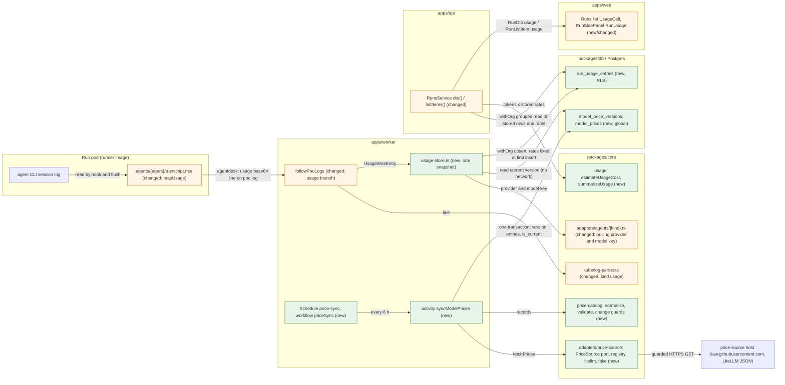
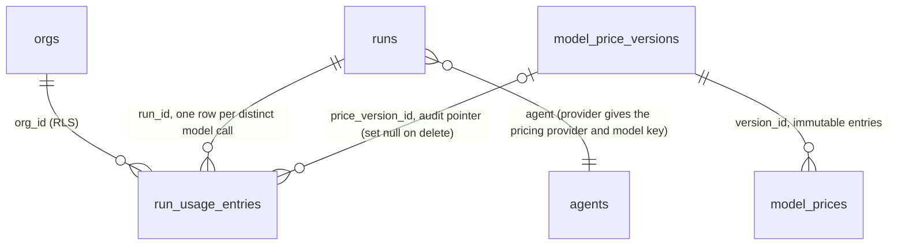

<!-- dev-plan: kind=spec id=run-token-usage-cost rev=4 hash=3394b2febab7 source=issue#248 -->
# Run token usage, models and estimated cost design

Status: draft. Sensitive paths: run Job/runner (runner agent adapter `transcript.mjs` and pod-log parsing), RLS/`withOrg` (new org-scoped table `run_usage_entries`, and two new org-less global price tables as a documented exception), migrations (new migration). It also adds a new outbound fetch of untrusted data (the worker's scheduled price sync through the guarded transport).
Source: issue #248

## Summary

Today the Runs list and the run detail show nothing about the tokens a run used, the models it called or what that cost.
This adds a compact Usage cell (total tokens and estimated cost) to each Runs list row, and a collapsible Usage section on run detail with the total, its split (uncached input, cache read, cache write, output), each model with its tokens and cost, the estimated cost in USD and the date of the prices behind it.
Prices are fetched live on a schedule from one configured price source (a replaceable adapter, URL from env); each model call is priced once, when it is recorded, so a later price change never changes an old run's cost.
Every reader of a run (owner, admin, member, viewer) sees it; costs are labelled estimates at public API rates for every run, and missing usage or prices never show as a fake number. The design is agent-neutral, so Codex, Cursor and other agents can be added later.

## Business rules

Confirmed by the human at planning time.

### Goal

A reader of the Runs list sees, per run, total tokens (all tokens processed) and an estimated cost; on run detail sees the total with its split (uncached input, cache read, cache write, output), each model used with its tokens, and the estimated cost (per model where known). Costs are labelled estimates; missing data never shows as a fake number. A run's cost is fixed when each model call is recorded, with the prices in force then; a later price change applies only to usage recorded after it.

In scope, from the requirement: run list summary, run detail breakdown, aggregation across all model calls of the run including retries and several models, no double counting, estimate labelling, graceful missing data, compact list.

### Actors

| Actor | May do |
| ----- | ------ |
| Owner, admin, member, viewer on the run's project (anyone holding `run:read` there) | See the run's usage and estimated cost on the Runs list and on run detail. |
| The run's agent session (worker side, no person) | Records usage as the agent works; no person triggers it. |
| Operator (whoever deploys the platform) | Chooses the price source and its address, or turns prices off, through environment settings; no screen. |
| Ticket source, SCM webhook sender | No part in this feature. |

No new permission and no role change (see Agent calls).

### Rules

Surface: UI (the Runs list row and the run detail Usage section are the outermost thing a person sees; the data rides on the existing run reads, with no new route).

| Id    | Category            | Rule |
| ----- | ------------------- | ---- |
| BR-1  | calculation         | When a reader opens a project's Runs list and a run has recorded usage, they see on its row the run's total tokens (all tokens processed) and its estimated cost in USD, and no per-model or split detail. |
| BR-2  | calculation         | When a reader opens a run's detail and it has usage, they see the total tokens and its split lines (uncached input, cache read, cache write, output); the four lines add up to the total. |
| BR-3  | conditional-display | When a run used one or more models, the detail lists each model by name with its own total tokens and its own estimated cost, also when there is only one model. |
| BR-4  | calculation         | When usage and cost show anywhere (list row, detail total, per-model row), the cost is in USD and marked as an estimate at public API list rates (it starts with `~`, also below one cent: `~<$0.01`); the list row has no note, only the `~` and a hover title saying it is an estimate; run detail shows one note saying that the provider bill may differ and that costs are fixed when recorded. |
| BR-5  | feedback-state      | When a run has no recorded usage (queued, no model call yet, a run from before this change, an agent that reports none), the list row and the detail show "no usage data", never 0 tokens or $0. |
| BR-6  | feedback-state      | When a model had no known price when its calls were recorded (no price fetched yet, prices turned off, or no entry for that model), the detail shows its tokens and "price unavailable" as its cost, and the total cost is marked as a lower bound ("at least"); when no model has a price, the total cost reads unavailable instead of a number. It stays that way if the model is priced later. |
| BR-7  | calculation         | When the same model call is seen more than once (a retry, a reconnect, a resumed pod re-sending, a repeated log line), the totals count it once; separate calls and calls to different models each count. |
| BR-8  | persistence         | When a run is paused, stopped, auto-resumed, resumed or reopened after success, the totals carry on from before and are not reset; after a reload they are the same. |
| BR-9  | state-transition    | When a run is queued or running, the reader sees usage so far (a later reload or refetch shows more); when it ends as succeeded, failed, cancelled or timed out, it keeps the usage it used. |
| BR-10 | permission          | When a person can read a run (owner, admin, member or viewer on that project), they see its usage and cost; when they cannot (another org, or a project they have no grant on), they get the same "not found" as for the run. |
| BR-11 | calculation         | When a run has usage, the cost the reader sees is each bucket (uncached input, cache read, cache write, output) times its own rate in force when the usage was recorded, summed; a cache bucket with no tokens shows 0, and no token is counted in two lines. |
| BR-12 | conditional-display | When the list shows many runs, each row carries one short usage cell; the per-model rows and the split appear only on the run's detail. |
| BR-13 | persistence         | When a reader reloads the list or a run, or opens it later from another browser, they see the same usage and the same cost as before (plus only what was recorded since), including after a price change. |
| BR-14 | calculation         | When a run used a subscription (OAuth) credential or an API key, the reader sees the same estimate at public API rates, labelled as an estimate. |
| BR-15 | feedback-state      | When a run reaches the per-run cap of recorded model calls, the totals are marked partial (a lower bound), not silently cut off. |
| BR-17 | conditional-display | When a model name is long or has odd characters, the reader sees it as plain text, shortened to fit, and the page still works. |
| BR-18 | persistence         | When prices change after a run's usage was recorded, the reader still sees that run's cost and per-model costs exactly as before; only usage recorded after the change uses the new prices. |
| BR-19 | calculation         | When a run records usage both before and after a price change (a long run or a resume), the reader sees a cost equal to the earlier calls at the old prices plus the later calls at the new prices. |
| BR-20 | conditional-display | When a run's detail shows a cost, the reader sees how fresh the prices behind it are: "Prices as of <date>", with the earliest and the latest date when the run's calls were priced on different dates. Not shown where there is no cost. |
| BR-21 | feedback-state      | When the live price source is unreachable or returns something the platform rejects, the reader sees nothing different: new usage is priced with the last known prices, and the costs already shown do not change. When prices are turned off or none was ever fetched, runs recorded then show tokens and "price unavailable" and the run total marked "at least" or unavailable. |

BR-16 (a separate breakdown load error) was dropped because usage is part of the run payload: a failed load is the run's own error state as today. Its id is not reused.

### Not observable

- "Of which reasoning" under output: shown only when an agent reports reasoning apart, and never added again or priced twice. No current agent reports it, so no real run shows it yet; the decision stays so the first agent that reports it shows it as an "of which" line. BR-2 holds without it.
- How rates are fixed at record time (stored with each usage entry), how and when prices are fetched (a scheduled job calling a replaceable price-source adapter, URL from an environment setting, a guarded fetch with checks on what comes back) and the global price tables: architecture's mechanism; the effect is BR-4, BR-6, BR-11, BR-13, BR-18, BR-19, BR-21. A schedule's run or a rejected fetch is not shown to any reader.
- That the price source is replaceable by adding an adapter and changing a setting: no person sees it; contract tests over every adapter prove it.
- How the log is read (runner adapter, wire line, store): its effect is BR-7.
- Each agent's own counting (cached tokens inside or apart from input) and its conversion into the four buckets: its effect is BR-2 and BR-11.
- The dedupe key and keeping the highest count of a repeated call: its effect is BR-7. A repeat of a call that raises its tokens (a streaming placeholder) gives one price for the final count, not two.
- Adapters are separate per agent kind: no second agent exists yet, so no person sees it; its effect is BR-5.
- The existing `costUsd` field stays unused: no person sees it.

### States

No run status move changes. A running run shows usage so far; it updates on the existing run refresh and is final when the run ends. Failed, cancelled and timed-out runs keep the usage they used. Usage belongs to the whole run session: the first pod, resumed pods and a reopened session all add to the same run. Each model call is priced once, when it is first recorded; its cost never changes afterwards (a later price change, a later price for a model that had none, or a model dropped from the price source leave it as recorded).

### Limits and validation

No user input: the feature is read-only display. Token counts are non-negative integers, each at most 100,000,000; a missing field counts as unavailable, not zero. Model names come from the agent's session log and are shown as plain text; they are capped at 128 characters of `[A-Za-z0-9._:/@-]` on the wire. No new quota or rate limit. A run records at most 20,000 distinct model calls (BR-15). Stored rates keep more decimals than the screen shows; the UI rounds for display (`~<$0.01` below one cent). The price source and its address are operator settings (`MODEL_PRICES_SOURCE`, `MODEL_PRICES_URL`, validated as in Architecture, Configuration), never editable by an org user or platform admin on screen.

### Edge cases

- No usage yet or an older run: "no usage data" (list and detail).
- Resume, pod crash and auto-resume: totals continue from before; nothing is double counted.
- Run reopened after success: usage keeps adding; the result stays succeeded (ADR 0032).
- Cancelled or killed mid-turn: usage up to the last recorded call stays; the in-flight call may be missing (the estimate says so).
- Agent deleted or model removed from the agent later: the run still shows the models it used and their costs as recorded, taken from the usage record, not the agent config. Calls recorded after the agent was deleted are unpriced.
- Several models in one run: one row each; an unpriced model follows BR-6.
- Custom API address or gateway: handled like any model; a gateway's own model names usually have no price, so they fall under "price unavailable".
- Price change during a run (long run or resume): earlier calls keep the old price, later calls use the new one; the cost is their sum (BR-19) and the detail shows the earliest and latest price dates (BR-20).
- Model unpriced when recorded and priced later: those calls stay "price unavailable" and the run stays "at least" (BR-6).
- Price source down, slow or returning something rejected: recording and pricing go on with the last prices successfully fetched; nothing changes for readers except that the "Prices as of" date of new usage stops moving (BR-21).
- Prices turned off, or a new install before its first fetch: calls recorded then show tokens and "price unavailable" and stay so (BR-21).
- A wrong price at the source: corrected going forward only; earlier runs are not backfilled, priced or recomputed.
- Usage is written by the agent's own session, which shares the container (ADR 0020/0027): the numbers can be forged inside that run. Accepted: this is an estimate, not billing, the impact stays in that run, bounded by the per-run cap, and a forged line can never set rates.

### Tenancy and permission

Read: `run:read`, project level, `any` (no `own` branch), through the existing run routes and their `routeAccess` entries and `checkTenantAccess` (no new route), via `withOrg` plus the project filter (rules 4 and 7). Another org: 404; another project without a grant: 404. A viewer sees usage and cost like everything else on the run. The write path is internal (worker); the tenant comes from the run row, never a request body. The price tables are global public price data, hold nothing of any tenant and are never read by a request. No role or permission change.

### Lifecycle, compatibility and side effects

- Usage is created while the run runs, changes until the run's session ends, and is deleted with the run (cascade). Each usage entry keeps the rates and price date it was first recorded with. No archive, no separate retention, no audit entry (derived, read-only data).
- Price versions are kept (not pruned): a new version is added only when rates change or the source changes.
- Existing runs: no backfill; they show "no usage data" because no usage was kept for them.
- `RunDto.costUsd` and `runs.cost_usd` stay as they are (always null, unused); `usage.estimatedCostUsd` is the only cost source and the UI reads `usage`. Dropping the column is a follow-up flagged in the PR (it needs an expand/contract migration).
- Mocks, the MSW dto and the Setup step 2 copy ("Usage cost shows on each run.") already assume a cost on each run.
- Existing API clients: the new `usage` field is additive.
- No ticket comments, status changes or notifications. The Runs list and run detail refresh through the existing run refetch; no new stream. Price syncs produce no event.

### Out of scope

- Integrating with NeverPayTwice (human note at intake); its approach may be researched for ideas only.

## Architecture

Confirmed by the human at planning time.

### Overview

Layering follows `apps → core → db → contracts` and `web → contracts` only; no app imports another app.

- Runner image, per agent: `images/runner/agents/<agent>/transcript.mjs` also prints the agent-neutral `agentdesk: usage <base64>` line in the same read pass as its transcript lines (Claude first; Codex, Cursor and others later add theirs the same way). The run pod makes no price call.
- `packages/contracts`: new `packages/contracts/src/schemas/usage.ts` (`UsageWireEntry`, usage DTOs) and `RunDto.usage`. No new route.
- `packages/db`: new tables `run_usage_entries`, `model_price_versions`, `model_prices` and their migration.
- `packages/core`: log parser kind `usage`; optional `AgentAdapter.pricing` (provider and model key only, no prices); `adapters/price-source/` (the `PriceSource` port, a `litellm` adapter, a `fake` adapter and `createPriceSourceRegistry(config)`); `price-catalog/` (the source-agnostic sync rules: model-key normaliser, bounds validation of the adapter's output, change guards); pure `estimateUsageCost` and `summarizeUsage` helpers in `packages/core/src/usage/`; the new Temporal ids next to the existing ones in `packages/core/src/temporal-names.ts`.
- `apps/worker`: `usage-store.ts` sink beside `transcript-store.ts`; a `usage` branch in `followPodLogs`; the `price-sync` Schedule, the `priceSync` workflow and the `syncModelPrices` activity; a shared `PriceSourceModule` providing the registry (a new external dependency in the backend.md §2 sense). The sink and the activity see only the `PriceSource` port.
- `apps/api`: `RunsService` aggregates the stored rows when building run DTOs (`dto()` and `listItems()`, which every API producer of `RunDto` and `RunListItem` goes through). It never reads the price tables. No new controller route.
- `apps/web`: shows it; reads contracts types only.

The transcript pipeline already moves the agent's session log out of the pod (runner `transcript.mjs` hook and flush with offsets in `$HOME/.agentdesk/`, parsed in `packages/core/src/kube/log-parser.ts`, stored by `apps/worker/src/activities/transcript-store.ts` through `withOrg`, wired in `followPodLogs`). Usage reuses that channel. Agents without a `transcript.mjs` are already skipped by the hook and the entrypoint flush (ADR 0027), so they report no usage. The fake pod uses the real Claude `transcript.mjs` with a Claude-shaped log built by `packages/core/src/kube/fake-claude-log.mjs`, so local e2e needs no new channel.

The price source copies the repo's adapter shape: `createAdapterRegistry(config, clock, opts)` (`packages/core/src/adapters/registry.ts`) builds the board and code-host adapters from config values; `agentAdapterFor(kind)` is a switch over a kind with an injectable `http`; a `fake` adapter sits beside the real one and is rejected in production by `ConfigSchema`; `AGENT_MODELS_SOURCE` selects live vs builtin (ADR 0026). Existing seams reused: `guardedGetJson` (`packages/core/src/net/guarded-http.ts`: https only, no private ranges, no redirects, connect-time address check, `timeoutMs` and `maxBytes` options) and Temporal Schedules (`apps/worker/src/schedules.ts`, `ensureSchedules`).

Rejected usage sources: agent telemetry exporters (need a collector service), one-shot JSON output cost (runs are interactive tmux, ADR 0011), statusline JSON (not reachable by hooks), scraping the terminal. Price sources considered: OpenRouter, models.dev and a static list in code; the human chose one live source (LiteLLM public JSON) synced on a schedule.

#### Contracts

New `packages/contracts/src/schemas/usage.ts`, additive only. Names are agent-neutral; the counters are disjoint (no token is in two of them).

- `UsageWireEntry` (the wire line body):
  - `id`: 1..128 chars of `[A-Za-z0-9._:-]`, the adapter's stable id of one model call (Claude: `<message.id>:<requestId>`, or `message.id` alone when the log has no request id).
  - `model`: 1..128 chars of `[A-Za-z0-9._:/@-]`, the real model id the agent reports.
  - `inputTokens`: uncached input only. `outputTokens`: all output, reasoning included.
  - `cacheReadTokens`, `cacheWriteTokens`, `cacheWriteLongTokens`: optional, default 0. `cacheWriteTokens` is the standard-lifetime cache write, `cacheWriteLongTokens` the extended-lifetime one (Claude 5 minutes vs 1 hour); an agent with one cache-write kind uses only the first.
  - `reasoningTokens`: optional, an informational subset of `outputTokens` (must be at most output); never summed into the total and never priced separately.
  - Every count is a non-negative integer, at most 100,000,000. Unknown keys are rejected (so a line can never carry a price).
  - Base64 body limit `USAGE_WIRE_MAX_BASE64 = 1000`; per-run cap `USAGE_ENTRY_CAP = 20000` distinct ids.
  - Each adapter normalises to these disjoint buckets (fixed in the ADR). Claude maps directly (`input_tokens`, `output_tokens`, `cache_read_input_tokens`, `cache_creation.ephemeral_5m_input_tokens` / `ephemeral_1h_input_tokens`, falling back to `cache_creation_input_tokens` as standard when the split is missing). An OpenAI/Codex-style adapter subtracts cached and cache-write tokens from the reported input, uses the per-turn usage (not the running session total), and reports reasoning as the subset of output. A Cursor adapter declares which way its export counts.
- `ModelUsageDto`: `model`, `inputTokens`, `cacheReadTokens`, `cacheWriteTokens` (standard + long), `outputTokens`, `reasoningTokens: number | null` (null when not reported), `totalTokens`, `estimatedCostUsd: number | null` (sum of this model's entries that had a price when recorded; null when none had), `costPartial: boolean` (some of this model's entries had no price, so the cost is a lower bound or absent).
- `RunUsageSummary`: the same counters summed, `reasoningTokens: number | null` (null when not reported), `totalInputTokens` (derived: input + cache read + cache write, for a UI that shows cache as "of which" under input; the web does not show it), `totalTokens` = `inputTokens + cacheReadTokens + cacheWriteTokens + outputTokens` (all tokens processed; the split lines add up to it; reasoning is not added), `modelCount`, `estimatedCostUsd: number | null` (sum of the recorded entry costs; null when no entry had a price), `partial: boolean` (an entry had no price when recorded, or the per-run cap was reached: tokens or cost understate).
- `RunUsageDetail` = `RunUsageSummary` + `{ models: ModelUsageDto[]` (sorted by `totalTokens` desc, then `model`), `priceAsOfEarliest: Timestamp | null, priceAsOfLatest: Timestamp | null, priceSource: string | null }`. The two values are the earliest and the latest `price_as_of` (ISO 8601 instants with offset, like every other timestamp in the contracts) among the run's priced entries (null when none is priced; equal when all entries share one), so the web can convert them to the viewer's local time. They are instants, not calendar days, because a day cannot be converted to local time (human answer). `priceSource` is the source name of the newest priced entry (today always the one source). There is no separate `priceListAsOf`.
- `RunDto.usage: RunUsageDetail | null` on the single-run reads (`GET /api/projects/:projectId/runs/:number` and `GET /api/runs/:runId`). `RunListItem` is `RunDto` without the prompts and with `usage` narrowed to `RunUsageSummary | null` (no `models`, no dates, no source), so the list and stats stay compact.
- `usage: null` means nothing was reported (older run, an agent with no adapter, a pod image without usage lines, no call yet): never a zero.
- No new route and no new `routes` entry, so no new rows in the `route-access`, `role-matrix`, `authz.int` and `scope.int` tables; the existing run reads carry the data.
- `RunDto.costUsd` and `runs.cost_usd` are left as they are (always null, unused); `usage.estimatedCostUsd` is the single cost source.

### Data model

Migration: one new migration (the next free number at write time; `0045` today, after `0044_project_env_vars.sql`), generated by drizzle-kit, with hand-written RLS and grant lines as in migration 0019. No applied migration is edited (rule 8). No backfill: no saved source exists for earlier runs, so they read `usage: null`. `docs/conventions/database.md` §2's list of org-less tables gains `model_price_versions` and `model_prices` in the same PR.

#### run_usage_entries (new; scope: org, read for runs already loaded under project scope)

| Field | Type | Null | Default | Key / index | Change | Notes |
| ----- | ---- | ---- | ------- | ----------- | ------ | ----- |
| org_id | uuid | not null | none | index `run_usage_entries_org_idx (org_id)` | added | Tenant; RLS key. |
| run_id | uuid | not null | none | PK part 1; FK `runs.id` ON DELETE cascade | added | PK prefix serves the per-run read and the page-of-runs grouped read. |
| source_id | text | not null | none | PK part 2: PK `(run_id, source_id)` | added | Adapter's stable call id (wire `id`); idempotency key. |
| model | text | not null | none | | added | Real model id from the wire; not updated after the first insert. |
| input_tokens | integer | not null | 0 | CHECK `>= 0` | added | Uncached input. |
| output_tokens | integer | not null | 0 | CHECK `>= 0` | added | All output, reasoning included. |
| cache_read_tokens | integer | not null | 0 | CHECK `>= 0` | added | |
| cache_write_tokens | integer | not null | 0 | CHECK `>= 0` | added | Standard-lifetime cache write. |
| cache_write_long_tokens | integer | not null | 0 | CHECK `>= 0` | added | Extended-lifetime cache write. |
| reasoning_tokens | integer | null | null | CHECK `>= 0`, `reasoning_tokens <= output_tokens` | added | Null when the agent reports none. |
| price_input | numeric(12,6) | null | null | CHECK `>= 0` | added | Snapshot at first insert; USD per million tokens. |
| price_output | numeric(12,6) | null | null | CHECK `>= 0` | added | Snapshot at first insert. |
| price_cache_read | numeric(12,6) | null | null | CHECK `>= 0` | added | Snapshot at first insert. |
| price_cache_write | numeric(12,6) | null | null | CHECK `>= 0` | added | Snapshot at first insert. |
| price_cache_write_long | numeric(12,6) | null | null | CHECK `>= 0` | added | Snapshot at first insert (effective rate). |
| price_as_of | timestamptz | null | null | | added | The instant the price source last confirmed those rates: the `checked_at` of the price version used (not its `fetched_at`). |
| price_source | text | null | null | | added | Price-source adapter kind, for example `litellm`. |
| price_version_id | uuid | null | null | FK `model_price_versions.id` ON DELETE set null | added | Audit pointer. |

A CHECK makes the five rate columns plus `price_as_of` and `price_source` all null or all non-null; all are null when the model had no price at that time. `price_as_of` is the version's last confirmation, so it answers "how fresh is this price" and ages visibly when the source is down; because the sink caches the current version for 5 minutes, it can lag a recent sync by up to that time (accepted). The API sends the instant and does no time-zone work; the web shows it in the viewer's local time.

RLS: `org_isolation` policy as on `run_transcript_entries`, `ENABLE` + `FORCE`; grants SELECT, INSERT, UPDATE, DELETE to `agentdesk_app`. Every access goes through `withOrg`; reads filter by `run_id` for a run the caller already loaded under project scope (rule 4).

Idempotent write: `INSERT ... ON CONFLICT (run_id, source_id) DO UPDATE SET` each token counter `= GREATEST(existing, excluded)`; `model` and every price column are not in the update list. The first write fixes the rates for that call; a later row that raises a counter (Claude's streaming rows of one response share `(message.id, requestId)` and early rows can hold a placeholder output count) re-prices only the larger counter at the original rates. A replay, reconnect, resume or out-of-order row cannot double count or change the rates ("last row wins" equals greatest for these counts). Distinct ids (retries, other models) each count once. An agent that only reports running session totals must send per-event increments under the event's id.

A model with no price when recorded (no catalog entry, catalog empty, `MODEL_PRICES_SOURCE=off`, no adapter mapping, deleted agent): the row is stored with null price columns and counts as tokens only; it is never re-priced later, not even when a later sync adds that model. The run shows `partial`.

#### model_price_versions (new; scope: global, not org-scoped)

| Field | Type | Null | Default | Key / index | Change | Notes |
| ----- | ---- | ---- | ------- | ----------- | ------ | ----- |
| id | uuid | not null | `gen_random_uuid()` | PK | added | |
| source | text | not null | none | | added | Price-source adapter kind, for example `litellm`. |
| fetched_at | timestamptz | not null | none | | added | When this price set was first fetched. |
| checked_at | timestamptz | not null | none | | added | Last sync that found the same rates. |
| entry_count | integer | not null | none | | added | Number of entries in the version. |
| is_current | boolean | not null | false | unique partial index `model_price_versions_current_key` on `(is_current) where is_current` | added | At most one current version overall, whatever the source. |

A sync that finds the same rates (same source) only updates `checked_at` of the current version; a sync with changed rates, or one from a different source than the current version, inserts a new version and flips `is_current` in one transaction.

RLS: none (documented exception, like `role_templates` and `platform_admins`). Grants to `agentdesk_app`: SELECT, INSERT, UPDATE. Only the worker touches it; the API never reads it.

#### model_prices (new; scope: global, not org-scoped; immutable)

| Field | Type | Null | Default | Key / index | Change | Notes |
| ----- | ---- | ---- | ------- | ----------- | ------ | ----- |
| version_id | uuid | not null | none | PK part 1; FK `model_price_versions.id` ON DELETE cascade | added | |
| provider | text | not null | none | PK part 2 | added | Neutral vendor slug (for example `anthropic`). |
| model_key | text | not null | none | PK part 3: PK `(version_id, provider, model_key)` | added | Normalised, charset `[a-z0-9._:/@-]`, 1..128. Lookups ride the PK. |
| price_input | numeric(12,6) | not null | none | CHECK 0..1000 | added | USD per million tokens. |
| price_output | numeric(12,6) | not null | none | CHECK 0..1000 | added | |
| price_cache_read | numeric(12,6) | not null | none | CHECK 0..1000 | added | |
| price_cache_write | numeric(12,6) | not null | none | CHECK 0..1000 | added | |
| price_cache_write_long | numeric(12,6) | not null | none | CHECK 0..1000 | added | |

RLS: none (documented exception). Grants to `agentdesk_app`: SELECT, INSERT only (no UPDATE or DELETE). Old versions are kept; they are small because a version is created only when rates change. The migrate test asserts the grants and that neither global table has an `org_id` column.

### API

No new endpoint. Permission, level and guard order of every route stay as today (ADR-0036: org membership, permission 403, run and project scope 404, no `own` branch). Usage is read under `run:read`, project level, `any`.

| Method | Path | Who may call it | Request | Response | Contract |
| ------ | ---- | --------------- | ------- | -------- | -------- |
| GET | `/api/projects/:projectId/runs` | `run:read`, project level, any (owner, admin, member, viewer) | unchanged | each `RunListItem` gains `usage: RunUsageSummary \| null` (changed) | `runs.list`; `packages/contracts/src/schemas/runs.ts`, `usage.ts` |
| GET | `/api/projects/:projectId/runs/stats` | `run:read`, project level, any | unchanged | `idleRun` gains `usage: RunUsageSummary \| null` (changed) | `runs.stats`; same files |
| GET | `/api/projects/:projectId/runs/:number` | `run:read`, project level, any | unchanged | `RunDto` gains `usage: RunUsageDetail \| null` with `models[]`, `priceAsOfEarliest`, `priceAsOfLatest`, `priceSource` (changed) | `runs.byNumber`; same files |
| GET | `/api/runs/:runId` | `run:read`, project level, any | unchanged | `RunDto` gains `usage: RunUsageDetail \| null` with `models[]`, `priceAsOfEarliest`, `priceAsOfLatest`, `priceSource` (changed) | `runs.get`; same files |

- Read path (no pricing from a table at read time, no price-table read): one grouped query for the page's runs, `group by run_id, model` plus the five rate columns (not `price_as_of`), summing the token counters and taking `min` and `max` of `price_as_of` and the newest `price_source` per group. The API multiplies each group's sums by that group's own stored rates with the core `estimateUsageCost` (one formula, no SQL copy), then sums per model and per run in memory. Groups per run are few (models x distinct rate sets; a sync that finds the same rates adds no group), so the query is small and has no N+1 (database.md §8). Rows with null prices add their tokens and set the partial flags. The single-run reads run the same query for one run and keep the model rows.
- Because the rates come from the rows, a later price change at the source or a sync changes nothing for recorded entries: the same run returns the same cost today and next year.
- A usage failure is the run read failing; there is no usage-specific error.
- Tenant data touched: `run_usage_entries` (org, run) and `runs`. The global price tables are not touched by any request.
- No WebSocket, webhook or SSE change.

### Third-party libraries

| Library | New or existing | Used for | Approval |
| ------- | --------------- | -------- | -------- |
| zod | existing | `UsageWireEntry`, usage DTOs, price-source record parsing, config validation | existing |
| drizzle-orm (and drizzle-kit) | existing | the three tables, migration, upsert, grouped read, sync transaction | existing |
| Temporal SDK | existing | `price-sync` Schedule, `priceSync` workflow, `syncModelPrices` activity | existing |
| `guardedGetJson` (repo's own `packages/core/src/net/guarded-http.ts`) | existing | the price-source fetch | existing |
| vitest | existing | tests | existing |
| `node:*` built-ins | existing | runner adapter `mapUsage` | existing |

No pricing or tokenizer library: counts come from the agent's own log, and the price file is plain JSON parsed with the libraries above.

### Services and integrations

| Service | New or existing | How it is used |
| ------- | --------------- | -------------- |
| Postgres | existing | Three new tables: `run_usage_entries` (RLS), global `model_price_versions` and `model_prices`. |
| Temporal | existing | New Schedule `price-sync`, workflow `priceSync` and activity `syncModelPrices`; the changed `followPodLogs` activity. |
| Kubernetes / KubeGateway | existing | Existing pod log stream only. The run pod's NetworkPolicy is untouched. |
| `raw.githubusercontent.com` (LiteLLM price JSON) | new (approved by the human) | The `litellm` adapter's default source: one guarded HTTPS GET of about 5 MB every 6 hours, by the worker only. If the cluster restricts worker egress, this host (port 443) is allowed in the worker's policy. Any other source is a later adapter with its own approval. |
| SecretStore, provider and code-host APIs | existing | Untouched. |
| NeverPayTwice | not used | Not integrated (human note). |

### Configuration

| Name | Kind | Added or changed | Where it is set | Default | Used by | Purpose |
| ---- | ---- | ---------------- | --------------- | ------- | ------- | ------- |
| `MODEL_PRICES_SOURCE` | env var | added | `packages/core/src/config.ts` (`ConfigSchema`), `.env.example` (`fake` for local), process-compose and the e2e setup (`fake`), Helm values / deployment env | `litellm` | worker (`createPriceSourceRegistry`, `syncModelPrices`, usage sink) | Selects the price-source adapter: `litellm` \| `fake` \| `off`. `fake` is for the local stack, local e2e and tests and is rejected when `NODE_ENV=production`, like `ENABLE_FAKE_PROVIDER`. `off` (air-gapped or no outbound): no sync, nothing is priced, every entry reads "price unavailable". |
| `MODEL_PRICES_URL` | env var | added | `packages/core/src/config.ts` (`ConfigSchema`), `.env.example`, Helm values / deployment env | unset (the selected adapter's own default; for `litellm`: `https://raw.githubusercontent.com/BerriAI/litellm/main/model_prices_and_context_window.json`, kept in the adapter module) | the selected price-source adapter | Replaces the adapter's default URL. Validation: a valid URL, protocol `https:` only, no username or password, no fragment, at most 2048 characters; ignored by `fake` and `off`. Not a secret. |

Both are operator-controlled deployment settings, read only through the config (backend.md §8), never from a request, a tenant record, a ticket or a repo, and no screen edits them. The guarded transport still applies to whatever URL is set (https, no redirects, no private or loopback addresses, connect-time address check, size and time limits), and the adapter asserts that its request host is exactly the host of the effective URL, so the allowlist is derived from config and nothing else can be reached. Thresholds, size cap and timeout stay constants in code with tests; no per-org setting. No secret.

### Other decisions

**Worker: usage sink.** `followPodLogs` (already long-running, heartbeating, idempotent) gets a `usage` branch calling `usageSink.store(entry)`. No run workflow code changes, so no run replay test beyond the existing ones. `usage-store.ts` exposes `createUsageSink({ db, orgId, runId, agentKind, warn })`, like `createTranscriptSink`. It takes the run's agent kind once per attempt (through `withOrg` from `runs.agent_id` -> `agents.provider`; none when the agent was deleted). For each entry it asks the agent adapter for `{ provider, modelKey }` and looks the rates up in the current version of `model_prices` (a database read, never a network call; the current version id and its entries are cached in memory for 5 minutes per attempt, on the injected `Clock`). A match writes the five rates, the version's `checked_at` instant as `price_as_of`, the source and the version id with the counters, all from one version; no `pricing`, a deleted agent, no current version or no entry writes null price columns. It counts rows once per attempt, enforces `USAGE_ENTRY_CAP` (past it an unknown id is dropped, a known id still upserts counters, never rates), retries an insert 3 times, and logs only counts, never the entry. Usage is not written to `run_events`, SSE or workflow history. No run row lock is needed (no seq). A line lost between the runner's print and the store is re-sent by the next hook only if the offset did not advance; otherwise it is missed, as ADR 0027 accepts for the transcript. After a hard kill, the existing end-of-session flush and the resume's start flush send what is new.

**Worker: price sync.**
- Workflow `priceSync` input: optional `{ maxAttempts?: number }` (1..5, default 5): the activity's retry limit (`maximumAttempts`), so a test can fail fast; not tenant data, nothing secret; the Schedule starts it with no input. This input is the only change to the workflow signature and is covered by a replay test of the new workflow.
- Schedule `price-sync` in `scheduleDefinitions()`, every 6 hours, overlap SKIP, created with `triggerImmediately` so the first version exists soon after the first start; it starts workflow `priceSync` (deterministic: one activity call, nothing else). The ids and constants (`WORKFLOW.priceSync`, `PRICE_SYNC_SCHEDULE_ID`) go in core next to the existing ones and in the ADR (backend.md §6; backend.md §7: a Temporal Schedule, no timer loop).
- Activity `syncModelPrices` (start-to-close 120 s, retry up to `maxAttempts`, default 5): asks the registry for the configured `PriceSource`, calls `fetchPrices({ providers })` with the union of the registered agent adapters' `pricing.provider` values, then applies the source-agnostic rules in core (normalise model keys, validate the records, compare with the current version) and writes in one transaction. Idempotent (a retry or an overlap repeats the same compare and write); never deletes. When the source is `off` it returns at once.
- No tenant context: it uses the pool directly on the two global tables, the documented exception to `withOrg`.
- Failure half-way: the write is one transaction (version row, entries, `is_current` flip), so a crash leaves the old current version intact.

**Runner and Kubernetes.** No Job spec, KubeGateway, env or image-layout change; `transcript.mjs` is already copied into the image and called by the hook and the entrypoint flush.
- Agent-neutral contract (in the ADR): an agent adapter's `transcript.mjs` may print `agentdesk: usage <base64>` lines in the same read pass as its transcript lines; it owns the agent's log format, the id, the model and the token mapping. It must normalise to the disjoint buckets of the wire schema and print one line per call; an agent with no `transcript.mjs` or no usage in its log prints none (`usage: null`).
- Claude's adapter extends `transcript.mjs` with a new export `mapUsage(entry)`: for an `assistant` entry with `message.id`, a `message.model` other than `<synthetic>`, and numeric `message.usage`, it returns the id `<message.id>:<requestId>` (message id alone when there is no request id), the model and the disjoint counters. Claude's `input_tokens` is already uncached, so it maps directly; cache creation splits by `cache_creation.ephemeral_5m_input_tokens` and `ephemeral_1h_input_tokens` (the whole `cache_creation_input_tokens` as standard when the split is missing). Sidechain (subagent) entries count too.
- State-file version marker: a state file from the old adapter has no marker, so the first run of the new adapter reads each tracked file from offset 0 once. Re-sent transcript entries dedupe on `source_id`, usage rows on `(run_id, source_id)`.
- Verify at build (a fact, not a human question): where Claude Code 2.1.323 logs subagent calls (same file with `isSidechain`, or a separate file under the session directory). If separate, the adapter also tracks that directory. A fixture from a real, scrubbed log is required for repeated lines, a retry, two models, cache fields, a sidechain entry and an entry with no usage.
- Rule 6: the log is untrusted; it is parsed as JSON and forwarded as data; `model` and `id` are charset-limited by the wire schema; nothing reaches a shell, k8s spec or SQL (Drizzle parameters).
- The agent shares the container and can print a forged usage line into its own run. Accepted, as ADR 0020/0027 accept forged status and transcript lines: the impact stays in its own run, bounded by the cap, the figure is labelled an estimate, and a line cannot carry a rate.

**Agent adapters.** Agent-specific code lives only in adapters: runner `agents/<agent>/transcript.mjs` and core `adapters/agents/<kind>.ts`. Tables, DTOs, parser kind, sink and API are agent-neutral (rule 3, ADR 0005). Agent adapters hold no prices.
- `AgentAdapter` gains optional `pricing?: { provider: string; modelKey?(model: string): string }`: the neutral vendor slug of its models (Claude: `anthropic`) and, only when the default does not fit, its own key function. The default `normalizeModelKey` lives once in core `price-catalog/`: lowercase, strip a vendor prefix (`anthropic/`) and a `:suffix`, `.` equals `-`. The sync normalises the keys of the records a source returns the same way, so lookup is an exact match on `(provider, normalised key)`; no fuzzy or prefix matching; no match means "price unavailable". The alias on `runs.model` is not used.
- Adding Codex or Cursor: one runner `transcript.mjs` mapping, one core agent adapter with `pricing.provider`, fixtures; if the configured price source lists their models, they price with no other change.

**Price source adapter.** In the same style as the board, code-host and agent adapters:
- Port, `packages/core/src/adapters/price-source/types.ts`:
  - `PriceSource { readonly kind: string; fetchPrices(input: { providers: readonly string[] }): Promise<PriceSourceResult> }`.
  - `PriceSourceResult = { records: SourceRateRecord[]; seen: number; skipped: number }`.
  - `SourceRateRecord = { provider, modelId, inputPerMTokUsd, outputPerMTokUsd, cacheReadPerMTokUsd, cacheWritePerMTokUsd, cacheWriteLongPerMTokUsd }`: USD per million tokens, agent-neutral, `provider` already mapped to the neutral vendor slug the agent adapters use. Failures throw a typed `PriceSourceError(kind)` (`unreachable`, `too_large`, `bad_shape`, `rejected`) whose message never carries a body.
  - The adapter owns everything source-specific: the request, the response shape, its own validation of that shape, the field names, the unit conversion to USD per million tokens, the mapping of the source's provider label to the neutral slug, and the choice of which entries to keep for the requested providers. A source that already quotes per million (models.dev) or per token as strings (OpenRouter) converts in its own module with its own unit test.
- Registry, `adapters/price-source/registry.ts`: `createPriceSourceRegistry(config, opts?: { http?: GuardedGet })` returns `{ source(): PriceSource | undefined }`, picking by `config.MODEL_PRICES_SOURCE` (`litellm` | `fake` | `off`), exactly as `createAdapterRegistry` picks by config values and `agentAdapterFor` by kind; an unknown value cannot get past `ConfigSchema`. `http` is injectable for tests.
- Adapter `litellm` (first implementation): requests with `guardedGetJson` to the configured URL with `maxBytes` 15,000,000 and `timeoutMs` 30,000 (adapter constants), asserting that the request host equals the host of the configured URL (a redirect or rewritten URL cannot leave it). It reads the JSON object, keeps entries whose `litellm_provider` maps to one of the requested providers, parses each with Zod (only `input_cost_per_token`, `output_cost_per_token`, `cache_read_input_token_cost`, `cache_creation_input_token_cost`, `cache_creation_input_token_cost_above_1hr`; numbers coerced; NaN, infinite and negative rejected), and converts per token to USD per million tokens with its one `perTokenToPerMTokUsd(x) = round(x * 1e6, 6)` (3e-06 -> 3, 1.5000000000000002e-05 -> 15). Input and output are required; a missing cache read or cache write rate skips the entry (never guessed); a missing 1 h rate falls back to the standard cache write rate; tiered (above 200k tokens) and batch rates are ignored (named limits of an estimate).
- Adapter `fake`: returns a fixed in-code set for the fake pod's model ids with a fixed `kind`. Dev and test only; rejected in production by `ConfigSchema`. It can simulate a failed or odd fetch through an override file `<FAKE_STATE_DIR>/price-source.json` (the same fake state directory the fake provider and fake cluster already use, read on every fetch, so a test needs no restart): `{ "mode": "ok" }` (default when the file is absent), `{ "mode": "outage" }` (throws `PriceSourceError('unreachable')`), `{ "mode": "bad_shape" }` (throws `bad_shape`), or `{ "records": [...] }` (replaces the fixed set, for example to change a price). The file holds no secret and is read only when `MODEL_PRICES_SOURCE=fake`.
- Adding OpenRouter, models.dev or an internal service later: one adapter file, one registry case, one enum value, fixtures. The worker sink, the sync activity, the DB tables, the API and the web do not change. Limit: the guarded transport refuses private and loopback addresses, so a source on a private network needs a deliberate, security-reviewed change to the guard, not only an adapter.
- Source-agnostic rules (core `price-catalog/`, every source, run in the sync after the adapter returns): re-validate each record with Zod (provider slug and model key charset, 1..128; every rate finite, between 0 and 1000 USD per million tokens); normalise model keys; drop duplicates (last wins) and count them. Change guards against a bad or poisoned file (skipped for the very first version and once after a source change): reject the whole sync, keep the current version and log at `error` level (the activity fails so it shows in Temporal) when (a) more than 5 percent of entries present in both versions moved by more than 5x in any rate, (b) the number of records drops more than 20 percent, or (c) zero records match. Thresholds are constants with tests. A rejected result writes nothing. Nothing from the source reaches a shell, k8s spec or SQL text; Drizzle parameters only.
- Replacing the source (changing `MODEL_PRICES_SOURCE`) changes nothing in the schema: the new adapter's first sync creates a version with its own `source` and becomes current; the change guards that compare with the previous version are skipped once for a source change; bounds and the zero-match rule still apply and a `warn` records the switch. Usage rows already recorded keep their `price_source`.
- Failure behaviour: source down, timeout, too large, bad shape or a guard rejection: the activity fails (Temporal retries 5 times; the next tick tries again); one log line with the error kind and counts, never the body (a guard rejection at `error`, a plain fetch failure at `warn`). `model_prices` keeps its current version and `checked_at` stays old, so the displayed "as of" honestly ages. Recording never waits on the network.

**Cost.** Generic `estimateUsageCost(usage, price)` in core (used by the API on stored rates, and by tests): `(input*in + cacheRead*cr + cacheWrite*cw + cacheWriteLong*cwl + output*out) / 1e6`; reasoning tokens are not priced (they are inside output). No Claude name in it and no credential parameter: every run is priced at public API rates whatever its credential type (`agents.credential_type` is not read). A gateway's own model names normally fall to "price unavailable".

**Secrets.** No secret involved. The usage wire line holds a model id, an id and integers; no free text, so `redact` has nothing to mask. The price source needs no key and its URL must not carry credentials; a source that needed a key would take it from SecretStore (security.md §1), never env or Postgres. Logs carry counts and error kinds only.

**Events and live updates.** No new SSE event. A running run shows usage so far; the web gets fresh totals on the existing run refetch (staleTime 30 s) and on a reload. A client that reconnects reads the current aggregate; no replay or ordering. Payloads are totals plus a few models. Price syncs produce no event.

**Failure, observability, scale.**
- No usage data (old pod image, agent without an adapter, nothing flushed yet): `usage: null`, shown as "no data", never 0.
- Model with no price when recorded (not in the catalog, catalog empty, source `off`, no adapter mapping): tokens shown, no cost for those entries, `partial: true` (per model `costPartial: true`); it stays so.
- Price source unavailable, rejected or stale: recording and the UI are unaffected; prices stop refreshing and `priceAsOf*` ages.
- Cap reached (20,000 distinct calls): later new ids are dropped, `partial: true`; one `warn` with counts only.
- Store failure after 3 tries: dropped with a count log; the same entry is idempotent if sent again later.
- Scale: the sync is one GET (about 5 MB for the LiteLLM file) every 6 hours from one worker schedule (not per run or per org), keeping a few hundred rows per version; usage rows about 100 bytes; the list read is one grouped query over at most 100 runs, PK-backed; RLS plus the `org_id` index. No new metric.

**Sensitive paths.** Run Job/runner (adapter and pod-log parsing), RLS/`withOrg` (a new org table, and two new org-less tables with a documented exception), migrations, and a new outbound fetch of untrusted data (guarded transport with a larger body limit). Needs `review:sensitive` and a high-effort security review. No permission or role change (`access.ts` untouched).

**ADR.** Needed: "Agent-neutral usage wire line, a pluggable price-source adapter and a price snapshot per usage entry" (next free number; the repo already has two 0038 files). It amends ADR 0027 (a second line kind from the same adapter) and extends ADR 0026 (the agent adapter names its price provider and model key; no prices in adapters). It records: the disjoint bucket meanings and the total; the rule that rates are snapshotted on each usage row when first recorded and never re-applied; the `PriceSource` port, its registry and the first adapter `litellm` (alternatives considered: OpenRouter, models.dev, a static list); the source-agnostic validation and change guards; the `price-sync` schedule and workflow ids; the org-less price tables (database.md §2 exception list updated in the same PR); `MODEL_PRICES_SOURCE` and `MODEL_PRICES_URL` and their validation.

## UI and Storybook

Screens and components this changes:

- Runs list (`o.$org.p.$project.runs.index`, `screens/Runs.tsx`, `components/RunRow.tsx`): a new "Usage" column after Duration (the last column), rendered by the new `components/UsageCell.tsx`; full-width group rows span one more column. UsageCell states: value (`48.2k · ~$0.42`), partial (`61.2k · ~$0.42+`), no cost (`12.8k · —`), below one cent (`2.1k · ~<$0.01`), none (`—`), and the paged-loading list keeps the column (board `RunsPageLoadingUsage`). Empty and error are the existing list states.
- Run detail side panel (`o.$org.p.$project.runs.$run`, `screens/RunSidePanel.tsx`): a new "Usage" section placed directly before "Chain on this ticket" (after "Time" on a running run, after "Prompt" on a succeeded run), rendered by the new `components/RunUsage.tsx` (headline, split rows, cost, notes, "Models" sub-section with its table). The side panel scrolls on its own (`overflow-y: auto`).
- Collapsible sections (human request at prototype review: "in run detail, Usage and Model should collapsible"): the "Usage" section header and the "Models" sub-header each carry a ghost small button, "Hide" when open and "Show" when closed, with a chevron, the same pattern as `RunPromptSection`, with `aria-expanded` and `aria-controls` (the Usage body is a `role="region"` labelled "Usage"; the Models control points at the models table). Both start open. Collapsed Usage shows only its header (the Models sub-section is inside the body and hides with it). Collapsed Models hides only the models table. The open or closed state is not remembered (a reload or another run starts open again). With no usage data there is no toggle.
- RunUsage states: single model (`RunSucceededUsage`); multi model (`RunSucceededUsageMultiModel`); unpriced model with a long model name (`RunSucceededUsageUnpriced`); partial because the call cap was reached (`RunSucceededUsagePartial`); no priced model (`RunSucceededUsageNonePriced`, no date sentence); reasoning reported, with the "of which reasoning" line (`RunSucceededUsageReasoning`); no reasoning reported (line absent, every other board); zero (`RunSucceededUsageZero`: all counts `0`, cost `~$0.00`, never `—`, with the note and its "Prices as of" date); none (`RunSucceededUsageNone`: header without toggle and "No usage data for this run."); Usage collapsed (`RunSucceededUsageCollapsed`); Models collapsed (`RunSucceededUsageModelsCollapsed`); single price date (every priced board); price date range, a run that spans a price change (`RunSucceededUsagePriceRange`: two models, priced, not partial, both sections open); active, usage so far (`RunRunningUsage`); reconnecting, the cached value stays (`RunRunningUsageReconnecting`). Loading is the existing panel loading. Disabled: none (read only). Permission denied: the whole run 403/404 as today. `usage: null` never renders `0`.
- No usage-specific loading or error state and no new query: usage is in the run payload, so a failed load is the existing run error state.
- Reused: `Section`, `KeyValue`, `Note`, `Skeleton`, and the `RunPromptSection` show/hide pattern. No ds primitive change.
- New pure formatters `features/runs/usageFormat.ts` (`formatTokens`: `1,234` / `48.2k` / `1.2M`; `formatUsd`: `~$0.42`, `~$12.30`, `~$0.00`, below a cent `~<$0.01`; every estimate starts with `~`) and mapper `features/runs/usage.map.ts` used by `map.ts`, unit-tested. No web arithmetic on totals: the headline and the cell use the contract's `totalTokens`; the mapper does not recompute it and passes the split rows through as given. The mapper turns the two ISO instants into `D Mon YYYY` in the viewer's local time zone, collapses them to one date when they fall on the same local day after that conversion, and returns no date sentence when either is null. The formatter takes an optional `timeZone` (default: the viewer's) so unit tests can pin zones.
- The web only displays the cost it is given: nothing in the UI recomputes, refreshes or compares prices, and the price source and its URL are backend config, not UI. An unpriced model stays unpriced (cost `—`, partial) on reload. `priceSource` is never shown.
- Changed view types `RunSummary` / `RunDetailData` in `mocks/types.ts` (display-ready strings). `components/` and `screens/` import no contracts types.
- Data: the list reads `RunListItem.usage: RunUsageSummary | null` (totals, `modelCount`, `estimatedCostUsd`, `partial`; no model rows, no dates); the detail reads `RunDto.usage: RunUsageDetail | null` (summary plus `models[]`, `priceAsOfEarliest`, `priceAsOfLatest`, `priceSource`) from the existing run reads (`runs.get` / `runs.byNumber`). Queries stay in `features/runs`, pure mappers in `map.ts`, keys start `['org', org]`. No mutation, no optimistic update.
- Agent-agnostic: no agent or provider name in any prop, story, class or copy; a model is a string shown as text (ellipsis, `title`).
- Role-based UI: anyone with `run:read` on the project (owner, admin, member, viewer) sees usage; there is no control to hide or disable it for a role and no cost-specific permission. The Hide/Show buttons are display toggles for every reader.
- Visual system: design tokens only (`--muted`, `--faint`, `--text`, `--mono`, `--fs-12_5`, `--fs-13`); numbers use the tabular style of Duration and `Stat`; "at least", the unpriced `—` and the "of which reasoning" line use the muted or faint text tokens; no new color, font or radius.
- Layout: list Usage column nowrap and tabular, no narrow-width hiding (no other column hides), the table scrolls inside its section as today. Detail: the 344px side panel scrolls on its own; the model column truncates with an ellipsis, the Tokens and Est. cost columns have fixed width. Collapsed rail: no usage icon.
- Accessibility: the list column is a real column with `th scope=col`; the visible text is complete without hover; an `.sr-only` suffix gives the meaning; the cell `title` is hover-only (the cell is not focusable). Detail split rows are a `dl` (KeyValue); the "of which reasoning" row is a faint `dd` under Output with its text, not an icon. Models are a real `<table>` with `<caption class="sr-only">Usage by model</caption>`, `th scope="col"` headers and the model name as `th scope="row"`. Estimate and partial are shown by `~`, `+`, "at least" and written notes, never by color alone. A long or hostile model name is plain text (React escapes), truncated with `title`. The two Hide/Show buttons are the only new interactive controls; they sit in reading order in their headers.

User flows:

1. List: the reader opens Runs; each row shows `48.2k · ~$0.42` (total of all tokens, estimated cost); hovering the cell shows its title with the exact numbers and the model count; clicking Run N opens the detail.
2. Detail: the side panel "Usage" section shows the headline "Total tokens" (all tokens), the split rows that add up to it (Input (uncached), Cache read, Cache write, Output, with "of which reasoning" under Output only when reported), Est. cost, the estimate note with its "Prices as of" date, then the "Models" table (one row per model, even when there is only one).
3. Collapse: the reader presses "Hide" on Usage: only the Usage header stays, the button reads "Show" and `aria-expanded` turns false; "Show" opens it again. "Hide" on Models hides only the models table the same way. Opening another run or reloading starts both open.
4. No usage (`usage: null`: older run, an agent that reports none, no call yet): the list shows `—`, the detail shows the Usage header with no toggle and "No usage data for this run."
5. Partial (`partial: true`: a model had no price when recorded, or the per-run cap was reached): the cost reads `~$0.42+` in the list and "at least ~$0.42" in the detail; an unpriced model's own cost is `—`; the partial note explains. No priced model (`estimatedCostUsd: null`): the cost is `—` in the list and the detail, the tokens still show, the partial note shows, and there is no date sentence.
6. Price change: a run recorded before a price change shows the same cost and date after it; a run that spans a change shows "Prices as of <earliest> to <latest>."
7. Subscription (OAuth) run: identical display and note.
8. Active run: shows usage so far, refreshed on the existing run refetch (staleTime 30 s, refetch on focus for runs) and status frames; final when it ends. While the terminal reconnects, the cached usage stays.

Copy:

- List header "Usage". Cells: `48.2k · ~$0.42`; partial `61.2k · ~$0.42+`; no cost `12.8k · —`; below a cent `2.1k · ~<$0.01`; none `—`.
- List cell `title` (hover only), the approved `RunsUsage` board's wording, form "<n> tokens in total, estimated cost <$x>, <m> model(s)" (singular "1 model"): "48,213 tokens in total, estimated cost $0.42, 1 model"; partial "61,173 tokens in total, estimated cost at least $0.42, 2 models"; no cost "12,840 tokens in total, no estimated cost, 1 model"; below a cent "2,104 tokens in total, estimated cost under $0.01, 1 model"; none "No usage data".
- List `.sr-only` suffix: " tokens, estimated cost"; partial " tokens, estimated cost, at least"; no cost " tokens, no estimated cost"; none "No usage data".
- Detail section "Usage". Headline row "Total tokens" with a faint hint "all tokens processed". Split rows "Input (uncached)", "Cache read", "Cache write", "Output", and under Output, only when reported, a faint "of which reasoning". Then "Est. cost"; partial "at least ~$0.42" with "at least" muted; no priced model `—`. Sub-heading "Models"; table headers "Model", "Tokens", "Est. cost". Toggle labels "Hide" and "Show". The detail shows exact numbers with thousands separators; the list shows compact numbers.
- Cache read and cache write rows are always shown (zeros as `0`).
- Note under the cost, in run detail only: "Estimate at public API rates, whatever credential the run used. Costs are fixed when recorded, so later price changes do not change them. Prices as of <date>. Your provider bill may differ." One date (earliest equals latest): "Prices as of 21 Nov 2026." Range (a run that spans a price change): "Prices as of 18 Nov 2026 to 21 Nov 2026." The sentences come in this order: the estimate sentence, the cost-fixed sentence, the date sentence, then "Your provider bill may differ." last. Dates are ISO instants from the API, shown as `D Mon YYYY` in the viewer's local time zone. The date sentence is hidden whenever either date is null (no cost, so no date); the rest of the note stays when there is a cost line. The list has no note: it shows `~` and the hover `title` above.
- Partial note (partial or no priced model), under the estimate note: "Some usage is missing or had no price when recorded, so tokens or cost may be low." Unpriced model cost `—` with title "No price when this was recorded" None: "No usage data for this run."
- Models table "Usage by model" (sr-only caption).
- Cost formats: `~$0.42`, `~$12.30`, zero `~$0.00`; below a cent `~<$0.01`. Every estimate starts with `~`.

Prototype: approved by the human at planning time, as drawn (all in `design/prototype/project/`, new; no existing board was edited). Every detail board with a cost shows the final note, in order, with "Prices as of 21 Nov 2026." (the range board "Prices as of 18 Nov 2026 to 21 Nov 2026."); the no-priced-model board shows the note without the date sentence; the partial and unpriced boards show "Some usage is missing or had no price when recorded, so tokens or cost may be low." and the unpriced title "No price when this was recorded":

- `design/prototype/project/RunsUsage.dc.html`: Runs list with the Usage column (value, partial, no cost, below a cent, none). No note.
- `design/prototype/project/RunsPageLoadingUsage.dc.html`: Runs list loading a page, with the Usage column. No note.
- `design/prototype/project/RunSucceededUsage.dc.html`: detail, usage with one model.
- `design/prototype/project/RunSucceededUsageCollapsed.dc.html`: detail, Usage section collapsed.
- `design/prototype/project/RunSucceededUsageModelsCollapsed.dc.html`: detail, Usage open, Models collapsed.
- `design/prototype/project/RunSucceededUsageMultiModel.dc.html`: detail, two models.
- `design/prototype/project/RunSucceededUsageUnpriced.dc.html`: detail, an unpriced model with a long model name.
- `design/prototype/project/RunSucceededUsagePartial.dc.html`: detail, partial (call cap reached).
- `design/prototype/project/RunSucceededUsageNonePriced.dc.html`: detail, no priced model (no date sentence).
- `design/prototype/project/RunSucceededUsageReasoning.dc.html`: detail, reasoning reported.
- `design/prototype/project/RunSucceededUsageZero.dc.html`: detail, zero usage (all counts `0`, cost `~$0.00`, the note with "Prices as of 21 Nov 2026.").
- `design/prototype/project/RunSucceededUsageNone.dc.html`: detail, no usage data (header without toggle, "No usage data for this run.", no note).
- `design/prototype/project/RunRunningUsage.dc.html`: running run, usage so far.
- `design/prototype/project/RunRunningUsageReconnecting.dc.html`: running run, reconnecting, cached usage stays.
- `design/prototype/project/RunSucceededUsagePriceRange.dc.html`: detail, a run that spans a price change: the two-model data (total 58,087, Est. cost `~$0.45`, model-a and model-b), priced and not partial, both sections open, with "Prices as of 18 Nov 2026 to 21 Nov 2026."

Interactive prototype: `design/prototype/interactive/index.html` (337 boards, including the 15 above).

**Blocker: Storybook first.** Before any task that implements this UI in `apps/web/src/{app,features}` or wires it to data starts, the related Storybook stories are added or updated and reviewed: every changed or new `ds/`, `components/` and `screens/` piece has a story for each state above (default, loading, empty, error, and the others the spec names), fed from `@/mocks` fixtures, matching the approved prototype boards, with each new board registered in `canvas.json`, `screens/storyIds.ts` and `scripts/parity.mjs` together. No UI implementation work begins until that is done.

Stories (fixtures from `@/mocks`, generic model names such as `model-a`, `model-b`):

- `Components/UsageCell`: Value, Partial, NoCost, None.
- `Components/RunUsage`: SingleModel, MultiModel, Partial, UnpricedModel, WithReasoning, NoUsage, Zero, LongModelName, HostileModelName, Collapsed, ModelsCollapsed, SinglePriceDate, PriceDateRange. Each story also has a component test case of the same name.
- `Components/RunRow`: usage variants.
- `Screens/Runs`: new board stories `RunsUsage` and `RunsPageLoadingUsage`.
- `Screens/RunDetail`: new board stories `RunSucceededUsage`, `RunSucceededUsageCollapsed`, `RunSucceededUsageModelsCollapsed`, `RunSucceededUsageMultiModel`, `RunSucceededUsageUnpriced`, `RunSucceededUsagePartial`, `RunSucceededUsageNonePriced`, `RunSucceededUsageReasoning`, `RunSucceededUsageZero`, `RunSucceededUsageNone`, `RunSucceededUsagePriceRange`, `RunRunningUsage`, `RunRunningUsageReconnecting`.
- Parity of the old boards (human answer at planning time): `Runs`, `RunsPageLoading`, `RunRunning` and `RunSucceeded` are left as drawn, without usage; their stories now render the Usage column or section, so the Storybook task adds an entry to `design/parity-notes.md` recording that difference and its reason (the usage design lives on the new boards). No old board is redrawn.
- Board registration: the 15 new boards are added together to `design/prototype/project/canvas.json` (`boards` and `order`), `boardStories` in `apps/web/src/screens/storyIds.ts` and `apps/web/scripts/parity.mjs`, and `apps/web/src/test/coverage.test.ts` changes "lists exactly the 322 boards of canvas.json" and `toHaveLength(322)` to 337.

## Testing

Confirmed by the human at planning time.

Agent-neutral tests (AGENTS.md rule 3 and the human directive): Claude-shaped data lives only in `images/runner/test/claude-usage.test.ts` and its fixtures, the Claude adapter's own mapping test (`packages/core/test/adapters/agents.test.ts`: `pricing.provider` and model key) and the local e2e (the fake pod runs the real Claude adapter by design). Contracts, log parser, worker, db, api, price-source and web tests use neutral wire entries, neutral model ids (for example `vendor-a/model-1@2`, `model-b`) and neutral provider slugs (`vendor-a`). The LiteLLM fixture is source-specific by nature and lives only with the `litellm` adapter test. Each test sits at the lowest layer that proves it (testing.md §1). This is a feature, not a bug fix; each plan task still starts red (testing.md §6). `costUsd` stays null and is not tested as a source. No test reaches `raw.githubusercontent.com` or any host.

E2E env names the environment of the rule's e2e; `—` means the row has no e2e and the rule or behaviour is listed under "Not provable by e2e". P1 to P8 are the price-stability invariants.

| Rule | Behaviour | Layer | Where the test lives | E2E env |
| ---- | --------- | ----- | -------------------- | ------- |
| BR-1 | List row: Usage column, `48.2k · ~$0.42`-style total and cost, `~<$0.01` under one cent, partial adds `+`; the hover title reads "48,213 tokens in total, estimated cost $0.42, 1 model" (and "... 2 models"), says it is an estimate and carries no "provider bill" note; no per-model or split in the row | e2e | `apps/web/e2e/mock/runs-board.spec.ts` (new cases) | mock |
| BR-1 | List items and `idleRun` carry the summary only (no `models`, no dates, no source) | integration | `apps/api/test/runs.int.test.ts` on `runs.list`, `runs.stats` (like the prompt-omit test ~l.401) | mock |
| BR-1 | Cell value, compact number and cost format | unit, component/story | `features/runs/usageFormat.test.ts`, `map.test.ts`, `UsageCell.test.tsx`, `runs.test.tsx` | mock |
| BR-2 | Detail shows "Total tokens", then "Input (uncached)", "Cache read", "Cache write", "Output" as exact numbers whose sum equals the total (the spec parses and adds them; cache write long folds into the cache write line; a reasoning fixture shows an "of which reasoning" line and the sum still holds); label "Est. cost" | e2e | `apps/web/e2e/mock/run.spec.ts` (new cases) | mock |
| BR-2 | The split sums to the total in the response | integration | `apps/api/test/runs.int.test.ts` on `runs.byNumber`, `runs.get` | mock |
| BR-2 | Same counters from the real Claude `mapUsage` (input 2048, cache read 1800, cache creation 248, output 500) and the test-only OpenAI-style mapper (input 4096 with cached 1800 and cache write 248 inside, output 500 with reasoning 300 inside): input 2048, cache read 1800, cache write 248, output 500, total 4596 (never 4896) | unit | `images/runner/test/usage-conformance.test.ts` with `expectConformingUsageMapper(mapper)` | mock |
| BR-2 | Displayed split sums to the displayed total; split rows passed through as given | unit, component/story | `detail.map.test.ts`, `RunUsage.test.tsx`, `runDetail.test.tsx` | mock |
| BR-2 | Usage section collapse: starts open; "Hide" leaves only the header (Models hides with the body), the button reads "Show" with `aria-expanded=false` and `aria-controls` naming the body region; "Show" reopens it; a remount starts open (not remembered); no toggle when usage is null | component/story | `RunUsage.test.tsx` (stories `Collapsed`, `NoUsage`) | mock |
| BR-2, BR-3 | Hide/Show on Usage and on Models in run detail; a reload starts both open; a run without usage has no toggle | e2e | `apps/web/e2e/mock/run.spec.ts` (new cases) | mock |
| BR-3 | Each model row (also a single model) with its own total and cost under heading "Models" | e2e | `apps/web/e2e/mock/run.spec.ts` | mock |
| BR-3 | `RunDto.usage.models[]` sorted by total tokens desc then model (pinned with a tie), per-model `costPartial` | integration | `apps/api/test/runs.int.test.ts` on `runs.byNumber`, `runs.get` | mock |
| BR-3 | Per-model table sr-only caption "Usage by model", headers "Model", "Tokens", "Est. cost", model name as row header | component/story | `RunUsage.test.tsx` | mock |
| BR-3 | Models collapse: starts open; "Hide" hides only the models table (totals, cost and notes stay), the button reads "Show" with `aria-expanded=false` and `aria-controls` naming the table; "Show" reopens it; a remount starts open | component/story | `RunUsage.test.tsx` (story `ModelsCollapsed`) | mock |
| BR-4 | List: cost starts with `~`, the cell and its title carry no "provider bill" note; detail: total and per-model costs start with `~` and the one note appears once with the note text in Copy, in order, with "Your provider bill may differ." as the last sentence | e2e | `apps/web/e2e/mock/runs-board.spec.ts`, `run.spec.ts` | mock |
| BR-4 | `formatUsd` gives `~$0.42`, `~$12.30`, `~<$0.01`, `—` (every estimate starts with `~`); `~` in visible text; sr-only suffix " tokens, estimated cost"; the list cell and its title carry no "provider bill" note; the detail note appears once | unit, component/story | `usageFormat.test.ts`, `UsageCell.test.tsx`, `RunUsage.test.tsx`, `runDetail.test.tsx` | mock |
| BR-5 | A run without usage shows `—` in the list and "No usage data for this run." in the detail; zero usage (a priced entry with all counters 0) shows 0 tokens and `~$0.00` with the dated note ("Prices as of 21 Nov 2026."), because the date shows wherever a cost shows | e2e | `apps/web/e2e/mock/runs-board.spec.ts`, `run.spec.ts` | mock |
| BR-5 | `usage` is null for a run with no rows; zero counters give 0 | integration | `apps/api/test/runs.int.test.ts` | mock |
| BR-5 | Null vs zero in view strings (`—` vs `0` and `~$0.00`) | unit | `usageFormat.test.ts`, `map.test.ts`, `detail.map.test.ts` | mock |
| BR-6 | Unpriced model: cost `—` with title "No price when this was recorded" and the partial note "Some usage is missing or had no price when recorded, so tokens or cost may be low."; total "at least"; none priced: `—` and no "Prices as of" sentence | e2e | `apps/web/e2e/mock/run.spec.ts` | mock |
| BR-6 | An unpriced entry gives `partial` and per-model `costPartial`; none priced gives null cost and null dates | integration | `apps/api/test/runs.int.test.ts` | mock |
| BR-6 | `estimateUsageCost` and `summarizeUsage` with null rates, some priced, none priced | unit | `packages/core/test/usage/estimate.test.ts` | mock |
| BR-6 | P4: a model unpriced when recorded stays unpriced and `partial` after a sync adds it; a model priced when recorded keeps its price after a sync drops it | integration | `apps/worker/test/usage-store.int.test.ts` and an api read in `runs.int.test.ts` | mock |
| BR-7 | A fake-pod run whose Claude-shaped log has two models, a message with several rows (placeholder then final) and a retry: totals are the deduplicated sum and a cost is present (the fake source covers the fake pod's models) | e2e | new `apps/web/e2e/local/run-usage.spec.ts` (stack started with `MODEL_PRICES_SOURCE=fake`) | local |
| BR-7 | Repeated rows of one `(message.id, requestId)` with a placeholder output first: the last row wins in file order and when a later flush sees it; retry gives new ids; two models; sidechain; `<synthetic>` skipped; entry without usage; id `<message.id>:<requestId>` or message id alone; an old state file; the printed line carries no price field | unit | new `images/runner/test/claude-usage.test.ts`, fixtures `fixtures/claude-usage/*.jsonl` | local |
| BR-7 | Idempotent repeat; GREATEST in both orders; placeholder first then final; a replayed lower row does not lower it | integration | new `apps/worker/test/usage-store.int.test.ts` | local |
| BR-7 | Wire limits; id charset incl. `<message.id>:<requestId>`; unknown keys incl. any price field rejected | contract | `packages/contracts/src/schemas/usage.test.ts` | local |
| BR-8 | Resume re-flush changes nothing; replies after Resume add to the same totals; a reopened session adds to the same run; reload shows the same | e2e | `apps/web/e2e/local/run-usage.spec.ts` | local |
| BR-8 | Resumed pod re-send adds nothing; a reopened session's rows add to the same run | integration | `apps/worker/test/usage-store.int.test.ts` | local |
| BR-9 | `expect.poll` on `GET /api/runs/:runId` sees the total grow while the run is active (no sleeps); Finish or cancel keeps the numbers | e2e | `apps/web/e2e/local/run-usage.spec.ts` | local |
| BR-9 | Refetch brings new usage on an active run (fake timers); usage comes with the run, so a failed load is the run's own error and there is no usage-specific error or Retry | component/story | `detail.route.test.tsx`, `runs.route.test.tsx` | local |
| BR-10 | A viewer sees the same usage | e2e | `apps/web/e2e/mock/run.spec.ts` | mock |
| BR-10 | Role case (`buildCast`): admin of P1 only gets 404 on the P2 run and no P2 usage in his list; the org viewer reads usage on P1; another org gets 404 | e2e | `apps/web/e2e/local/run-usage.spec.ts` | local |
| BR-10 | Allowed, 403 without `run:read`, 404 out-of-scope project, cross-org 404, project scope, with usage-bearing runs, through the real guard and `withOrg` | integration | `apps/api/test/runs.int.test.ts`, `scope.int.test.ts` (~l.210), `authz.int.test.ts` | local |
| BR-11 | Cache lines show 0 when empty; the split adds up | e2e | `apps/web/e2e/mock/run.spec.ts` | mock |
| BR-11 | `estimateUsageCost(tokens, rates)` takes rates as arguments and has no table state; one distinct rate per bucket (incl. cache write long) so a swapped rate fails; `it.each` edge values 0, 1 token, 100,000,000, cache-only; expected costs written out as bucket x rate in the test; `summarizeUsage` sums each entry at its own rates (two rate sets) | unit | `packages/core/test/usage/estimate.test.ts` | mock |
| BR-11 | Equal cost at equal rates for the Claude-style and subset-style reports of the same call | unit | `images/runner/test/usage-conformance.test.ts` | mock |
| BR-11 | 5-minute / 1-hour split (`ephemeral_5m` to `cacheWriteTokens`, `ephemeral_1h` to `cacheWriteLongTokens`) and the fallback when the split is missing | unit | `images/runner/test/claude-usage.test.ts` | mock |
| BR-11 | A run with entries under two rate sets sums each at its own rates | integration | `apps/api/test/runs.int.test.ts` | mock |
| BR-12 | Narrow viewport keeps the table scrolling in its section; one short cell per row | e2e | `apps/web/e2e/mock/runs-board.spec.ts` | mock |
| BR-12 | Summary only in list and stats; detail only in single-run reads | contract | `packages/contracts/src/schemas/runs.test.ts` (`RunListItem.usage` summary without `models`, dates or source, nullable; `RunDto.usage` detail with `models[]` and the three price fields, nullable; additive) | mock |
| BR-13 | Reload shows the same usage plus anything added | e2e | `apps/web/e2e/local/run-usage.spec.ts` | local |
| BR-13 | `run_usage_entries` with price columns in the RLS insert map; rows persist and read back under `withOrg` | integration | `packages/db/test/rls.int.test.ts`, `migrate.int.test.ts` | local |
| BR-14 | The same rows on an OAuth-credential agent and an API-key agent give the same estimate | integration | `apps/api/test/runs.int.test.ts` | — |
| BR-14 | `estimateUsageCost` and `summarizeUsage` take no credential parameter | unit | `packages/core/test/usage/estimate.test.ts` | — |
| BR-15 | Cap-partial marker | e2e | `apps/web/e2e/mock/run.spec.ts` | mock |
| BR-15 | Cap gives `partial` | integration | `apps/api/test/runs.int.test.ts` | mock |
| BR-15 | Cap: the 20,001st distinct id dropped; a stored id still upserts counters, never rates, at the cap | integration | `apps/worker/test/usage-store.int.test.ts` | mock |
| BR-17 | Long odd model name shortened and the page still works | e2e | `apps/web/e2e/mock/run.spec.ts` | mock |
| BR-17 | Long and hostile model name rendered as text with `title` | component/story | `RunUsage.test.tsx`, `runDetail.test.tsx` | mock |
| BR-17 | Hostile model strings (shell characters, SQL quote, 10 KB, non-charset) rejected by the wire schema | contract | `packages/contracts/src/schemas/usage.test.ts` | mock |
| BR-18 | Two runs recorded under different price instants (fixtures): each detail shows its own cost; the older run's cost, per-model costs and its "Prices as of <its date>." are the same text next to the newer run (which has its own date); no recompute in the UI | e2e | `apps/web/e2e/mock/run.spec.ts` (mock id `mixed-price-dates` and the two dated runs) | mock |
| BR-18 | Record run A at the fake source's rates; write `{ "records": [...] }` to `<FAKE_STATE_DIR>/price-source.json` with rates changed by at most 2x so the change guards pass; start the `priceSync` workflow with the Temporal client the script already has (a unique workflow id) and await `handle.result()`; read run A again through the API: cost, per-model costs and `priceAsOfEarliest` / `priceAsOfLatest` unchanged; record run B with the same fake log: its cost uses the new rates; delete the file and run `priceSync` again to restore (in `finally`). All checks go through the API; the date text is not checked here (visual date checks stay in the mock Playwright specs). Runs after the Playwright suite, never in parallel with it, because the sync is global | e2e | new scenario in `scripts/e2e-local.ts` | local |
| BR-18 | P1: seed version v1, record entries through the sink, run the real sync activity with a scripted source returning changed rates (v2 becomes current), read `runs.byNumber`, `runs.get`, `runs.list`: costs and dates are exactly the v1 values | integration | `apps/api/test/runs.int.test.ts` | local |
| BR-18 | P3: a repeated or growing id keeps its first rates: placeholder at v1, sync to v2, final row of the same id: counters final, rates v1; also the reverse arrival order; the test is on the upsert statement only | integration | `apps/worker/test/usage-store.int.test.ts` | local |
| BR-18 | P5: reading never uses the price tables or the network: after recording, `TRUNCATE model_prices, model_price_versions` (test owner connection) and delete the agent, then read: same cost and dates; the scripted source's call count is 0 during reads | integration, unit | `apps/api/test/runs.int.test.ts`, `estimate.test.ts` (no table state) | local |
| BR-19 | The mixed run's note reads "Prices as of 18 Nov 2026 to 21 Nov 2026." (earliest to latest, both dates from the fixture) and it shows its single cost | e2e | `apps/web/e2e/mock/run.spec.ts` | mock |
| BR-19 | In the same `scripts/e2e-local.ts` scenario: resume run A and add a reply after the price change: the added call is priced at the new rates, A's earlier calls are not, and the API's earliest and latest price dates differ | e2e | `scripts/e2e-local.ts` | local |
| BR-19 | P2: record id 1 at v1, sync to v2, record id 2: rows carry v1 and v2 rates, `price_version_id` and dates; api read: cost = id 1 at v1 + id 2 at v2 (expected written out as bucket x rate), earliest = v1 day, latest = v2 day | integration | `apps/worker/test/usage-store.int.test.ts`, `apps/api/test/runs.int.test.ts` | local |
| BR-20 | Single date: "Prices as of 21 Nov 2026." where earliest and latest are the same instant, and where they are two instants on one local day | e2e | `apps/web/e2e/mock/run.spec.ts` (own rows) | mock |
| BR-20 | Range: "Prices as of 18 Nov 2026 to 21 Nov 2026." | e2e | `apps/web/e2e/mock/run.spec.ts` | mock |
| BR-20 | No date: only a run with no usage and a run whose entries are all unpriced (none-priced, cost `—`) show no "Prices as of" sentence | e2e | `apps/web/e2e/mock/run.spec.ts` | mock |
| BR-20 | Zero usage with a priced entry: cost `~$0.00` and the note with "Prices as of 21 Nov 2026." (the date shows wherever a cost shows) | e2e | `apps/web/e2e/mock/run.spec.ts` (mock id `zero-usage`) | mock |
| BR-20 | Near midnight: the instant `2026-11-21T03:30:00Z` shows "20 Nov 2026" under the pinned `America/Los_Angeles` browser zone (Playwright `use.timezoneId`) | e2e | `apps/web/e2e/mock/run.spec.ts` | mock |
| BR-20 | Order: "Prices as of" comes before, and "Your provider bill may differ." is the last sentence; the list row and its title show no date | e2e | `apps/web/e2e/mock/run.spec.ts`, `runs-board.spec.ts` | mock |
| BR-20 | The date sentence: one date, a range, none when there is no cost or no priced entry, none when either date is null; `priceSource` never rendered; `it.each` over zones west and east of UTC for the same instant (with an explicit `timeZone`); the near-midnight instant `2026-11-21T03:30:00Z` is 20 Nov in `America/Los_Angeles`, 21 Nov in `UTC` and in `Asia/Ho_Chi_Minh`; a range whose two instants fall on one local day in one zone and on two days in another; one test with no `timeZone` argument relying on the web test script's pinned `TZ` | unit | `detail.map.test.ts`, `usageFormat.test.ts` | mock |
| BR-20 | P7: the detail carries `priceAsOfEarliest`, `priceAsOfLatest`, `priceSource` (null when nothing is priced; earliest and latest for two rate sets); list items carry none of them; the contract test parses the two fields as ISO instants (`z.string().datetime()`) | integration, contract | `apps/api/test/runs.int.test.ts`, `packages/contracts/src/schemas/runs.test.ts` | mock |
| BR-20 | Stories `SinglePriceDate` and `PriceDateRange` and their component test cases | component/story | `RunUsage.test.tsx`, `stories.smoke.test.tsx` | mock |
| BR-21 | A failing source (each `PriceSourceError` kind) or a guard rejection writes nothing: the current version and its `checked_at` stay, and the activity fails | integration | `apps/worker/test/price-sync.int.test.ts` | — |
| BR-21 | After a failed sync the sink still prices new entries from the current version; with no current version or `MODEL_PRICES_SOURCE=off` it writes all price columns null | integration | `apps/worker/test/usage-store.int.test.ts` | — |
| BR-21 | An empty catalog or `off`: the run reads `partial` with tokens and no cost | integration | `apps/api/test/runs.int.test.ts` | — |
| BR-21 | P9: an unreachable or rejected source changes nothing: the scripted source throws each `PriceSourceError` kind, the sync activity fails with a typed error and writes nothing, the current version and its `checked_at` stay, then a record is priced with the last known rates and earlier rows and run reads are unchanged | integration | `apps/worker/test/price-sync.int.test.ts`, `usage-store.int.test.ts` | local |
| BR-21 | Outage on the local stack: record run A at the working fake rates; write `{ "mode": "outage" }` to `<FAKE_STATE_DIR>/price-source.json`; start `priceSync` with the Temporal client and input `{ maxAttempts: 1 }` (a fresh workflow id) and await `handle.result()`, which rejects at once with the expected `unreachable` failure (the script asserts the kind; the fake adapter throws with no waiting, so it fails in well under a second; a 90 s timeout is only a safety net); through the API (`GET /api/runs/:runId` and the list): run A keeps its cost unchanged and reads still succeed; a run B recorded during the outage is priced at the last good version's rates and carries the last good `priceAsOf*` (not newer); then `{ "mode": "bad_shape" }` and a second `priceSync` with `{ maxAttempts: 1 }`, which also fails and leaves everything unchanged (the rejected case); then `{ "mode": "ok" }` (or delete the file), start and await another sync, and the as-of of a new run moves forward while run A's cost does not change (restore in `finally`). Retries and back-off are proved by P9 and the workflow test, not waited for here. Runs serially after the Playwright suite | e2e | new BR-21 scenario in `scripts/e2e-local.ts` | local |
| — | P6 and migrations: applies over a database that already has runs (they read no usage, no existing row rewritten); `run_usage_entries` CHECKs (counters >= 0, reasoning <= output, rates >= 0, price columns all null or all set), FK cascade from `runs`, `price_version_id` sets null when a version is deleted, grants; `model_price_versions` and `model_prices` have no `org_id`; `agentdesk_app` has SELECT, INSERT, UPDATE on versions and only SELECT, INSERT on prices (UPDATE and DELETE refused); at most one `is_current` row; rates bounded 0..1000 and six decimals kept; PK `(version_id, provider, model_key)`; deleting a version cascades its entries | integration | `packages/db/test/migrate.int.test.ts` | — |
| — | `run_usage_entries` joins the RLS leak map (org A cannot read or write org B); the two global tables join the test's list of intentionally org-less tables (like `role_templates` and `platform_admins`) if it keeps one | integration | `packages/db/test/rls.int.test.ts` | — |
| — | P8: the record path makes no network call (the registry gets a transport that throws if called; the scripted source's call count stays 0 while recording many entries) | integration | `apps/worker/test/usage-store.int.test.ts` | — |
| — | Sink snapshot: the first insert writes five rates, `price_as_of` (an instant: the version's `checked_at`), `price_source` and `price_version_id` from one version; a version flip inside the 5-minute cache window never rewrites stored rows (injected `Clock`) | integration | `apps/worker/test/usage-store.int.test.ts` | — |
| — | Sync write: one transaction (version, entries, `is_current` flip); first version; same rates only bump `checked_at`; changed rates or a different source make a new current version (guards skipped once for a source change); entries immutable; idempotent on retry and overlap; never deletes; `off` returns at once | integration | `apps/worker/test/price-sync.int.test.ts` (real Postgres, scripted fake `PriceSource`) | — |
| — | Schedule and workflow: `price-sync` definition (6 hours, overlap SKIP, `triggerImmediately`, id constants) and `ensureSchedules` idempotent for it; workflow `priceSync` runs the activity once, retries up to the default 5 attempts with no input and exactly once with `{ maxAttempts: 1 }`, rejects `maxAttempts` outside 1..5, no real sleeps; a replay test of a recorded `priceSync` history including the input | integration | `apps/worker/test/schedules.test.ts`, `apps/worker/test/price-sync.workflow.test.ts` (time-skipping environment) | — |
| — | Price source port over every registered adapter (`fake`, and `litellm` with the injected `GuardedGet` serving the fixture): neutral provider slug, rates finite and 0..1000 USD per million, only requested providers, `kind` equals the configured value, a failing transport throws `PriceSourceError` with an allowed kind and a message without the body; registry selects by `MODEL_PRICES_SOURCE`, `off` gives no source, `http` injectable | contract, unit | `packages/core/test/adapters/price-source/contract.test.ts`, `registry.test.ts` | — |
| — | `litellm` adapter: a good entry; `perTokenToPerMTokUsd` (`3e-06` to 3, `1.5000000000000002e-05` to 15); missing cache read or cache write rate skips the entry; missing 1 h rate falls back to the standard write rate; negative, NaN, infinite, huge, a string number; non-object body; unknown provider label ignored; hostile key (`x'; drop table`) rejected; tiered and batch rates ignored; `maxBytes` 15,000,000 and `timeoutMs` 30,000; request host must equal the configured URL's host (a mismatch is `rejected`); a redirect, `too_large` and a timeout map to typed errors; the default URL string asserted once | unit | `packages/core/test/adapters/price-source/litellm.test.ts`, fixtures `packages/core/test/fixtures/price-source/litellm-*.json` | — |
| — | `fake` adapter: its fixed records cover the fake pod's model ids; `price-source.json` modes `ok` (and absent file), `outage` (throws `unreachable`), `bad_shape` (throws `bad_shape`) and `records` (replaces the set, validated like any source output); read on every fetch, only when `MODEL_PRICES_SOURCE=fake`. | unit | `packages/core/test/adapters/price-source/fake.test.ts` | — |
| — | Catalog rules: `normalizeModelKey` (lowercase, strip vendor prefix and `:suffix`, `.` equals `-`, hostile input); record bounds (-1, 0, 1000, 1000.01, NaN); duplicates last wins and counted; guard thresholds at their boundary each side (5 percent and 5x, 20 percent drop, zero matches); skipped for the first version and once after a source change | unit | `packages/core/test/price-catalog/*.test.ts` | — |
| — | Config: `MODEL_PRICES_SOURCE` accepts `litellm`, `fake`, `off`, default `litellm`, rejects others; `fake` rejected when `NODE_ENV=production`; `MODEL_PRICES_URL` optional, valid URL, `https:` only (rejects `http:`, `file:`, `ftp:`), no username or password, no fragment, at most 2048 chars, ignored by `fake` and `off`; unset uses the adapter default; `.env.example` and the process-compose/e2e setup list both variables (an existing-style check if one exists, else a one-line assertion reading `.env.example`) | unit | `packages/core/test/config.test.ts` | — |
| — | Claude adapter mapping: `pricing.provider`, default key function, optional `modelKey`; no price data in adapters | unit | `packages/core/test/adapters/agents.test.ts` | — |
| — | Reasoning carried as an informational subset of output (at most output; the stub's 300 of 500), not in the total (stays 4596) and not priced; null when not reported; greater than output rejected | unit, contract | `usage-conformance.test.ts`, `estimate.test.ts`, `usage.test.ts` | — |
| — | Wire limits and untrusted text: base64 at most 1000, model and id charset and length, integer 0..100,000,000, unknown keys rejected, malformed lines stay ordinary text | contract, unit | `usage.test.ts`, `packages/core/test/kube/log-parser.test.ts` | — |
| — | Sink failure: 3 retries, counts-only log, a later flush heals idempotently | integration | `apps/worker/test/usage-store.int.test.ts` | — |
| — | `followPodLogs` routes `usage` to the sink and not to `run_events` | integration | `run.activities.int.test.ts` (extended) | — |
| — | Agent with no `pricing`, no runner adapter, an old pod image or a deleted agent: `usage: null` or unpriced entries, no crash | unit, integration | `estimate.test.ts`, `usage-store.int.test.ts`, `runs.int.test.ts` | — |
| — | Split and per-model rows add up to the run total at every layer that computes a total (`totalTokens` = input + cacheRead + cacheWrite + cacheWriteLong + output, unchanged by reasoning) | unit, integration | `estimate.test.ts`, `runs.int.test.ts`, BR-2 mock e2e | — |
| — | The page read is grouped: query count does not grow with the page size | integration | `apps/api/test/runs.int.test.ts` | — |
| — | Fake-pod flags `--fake-usage` and `--fake-usage-unpriced` | unit | `packages/core/test/kube/fake-pod.test.ts` | — |
| — | `routes.test.ts` unchanged: no new route key | contract | `packages/contracts/src/routes.test.ts` | — |
| — | Mock fixtures (with `priceAsOfEarliest`, `priceAsOfLatest`, `priceSource`) parse with the contracts schema | contract | `apps/web/src/mocks/msw/contract.test.ts` | — |
| — | Stories smoke and axe: `Components/UsageCell`, `Components/RunUsage` (all thirteen stories), `RunRow` variants, the 15 new board stories | component/story | `stories.smoke.test.tsx` | — |
| — | Every board of `canvas.json` has a story: 337 boards, the 15 new ones registered in `boardStories` | component/story | `apps/web/src/test/coverage.test.ts` | — |

All api integration tests go through `expectContract`. The local Playwright e2e is one new spec, `run-usage.spec.ts`; the price-change (BR-18, BR-19) and outage (BR-21) scenarios are two new scenarios in `scripts/e2e-local.ts` (it already has the Temporal client; the Playwright package must not gain `@temporalio/client`); they control the fake source through `<FAKE_STATE_DIR>/price-source.json`, start `priceSync` with that Temporal client and await `handle.result()` (with a timeout), never a sleep and never a schedule tick; there is no dev route and every check goes through the API. The mock e2e are new cases in the existing `runs-board.spec.ts` and `run.spec.ts`. Mock e2e ids in `e2e/mock/mock.ts`: one-model, two-model, no-usage, zero-usage, unpriced, none-priced, cap-partial, long-model-name, mixed-price-dates.

Worker and time: the run workflow is unchanged (a new branch in `followPodLogs` only), so no new replay test for it; the existing `run.workflow.*` and `workflows-in-process.test.ts` stay green and the plan says so. The new `priceSync` workflow and Schedule are new Temporal code and get the time-skipping and replay tests above (testing.md §1). The sync uses an injected `Clock`; tests use fixed instants, never the current time; the sink's catalog cache uses the same clock. No real sleeps.

Determinism: repeated and retried calls use message and request ids chosen by the test, with no generated UUID assertions; fixtures put the placeholder row before the final one and the reverse, and the store test runs both orders; per-model rows are sorted by total tokens desc then model, pinned with a tie; numbers are exact decimals, never float equality, expected costs are written out as bucket x rate, and the six-decimal rates are compared as strings from the database; global price tables are shared state, so db-backed suites that seed them reset them in `beforeEach`, do not share a database with each other and never run against the dev database; the local price scenarios run after the Playwright suite, serially, await each `priceSync` result instead of sleeping, and restore the fake source in `finally`; price instants are fixed (for example `2026-01-01T12:00:00Z`, `2026-06-01T12:00:00Z`, `2026-11-21T03:30:00Z`), the formatter takes an explicit `timeZone` in unit tests, and the one default-zone test and the Playwright browser zone are pinned, so no test depends on the machine's zone; active-run growth uses `expect.poll` with a timeout, and the web refetch uses fake timers restored in `afterEach`; the local e2e shares one stack with a fresh org and project per case and cancels runs in `afterEach`.

### Not provable by e2e

- BR-14: the estimate has no credential input; proved by the core unit test (signature) and the api integration test (OAuth and API-key agents, same rows). A local e2e would only repeat BR-2 with another env var.
- BR-21 with prices `off` or never fetched: the source is fixed by config at stack start; proved by the registry test (`off` yields no source), `price-sync.int.test.ts` (`off` returns at once, writes nothing), `usage-store.int.test.ts` (no current version writes all-null price columns) and the api read (tokens, cost `—`, run total partial or unavailable); the mock e2e unpriced and none-priced cases show what the reader sees. The unreachable source itself is proved by the local BR-21 scenario.
- The change guards and a source change between two syncs: the stack's config is fixed at start and no per-test config exists; proved by `price-sync.int.test.ts` and the catalog unit tests.
- `litellm` against the real host: no network in tests (testing.md §4); proved by the fixture-based adapter tests, with the host and URL checked by config and adapter tests. A real fetch is an operator check, listed as a manual smoke note in the PR, not a CI test.
- Dedupe and upsert internals, cost arithmetic, normalisation conformance, reasoning subset handling, wire limits, runner `mapUsage` and the state-file marker, sink snapshot and failure, the record path's lack of network, the price-source port and adapters, the catalog rules, the sync write, schedule and workflow, config, migrations and RLS, missing adapter or pricing, and the add-up property: nothing a person sees directly; each is proved at the layer in its row above (the add-up property also shows in the BR-2 mock e2e).
- Live push: out of scope (no SSE event); BR-9 is proved by the web refetch test and the local poll.

### Fakes and fixtures

- Existing, reused: fake pod, `fake-claude-log.mjs`, `FakeKubeGateway`, `MemorySecretStore`, `FakeTemporalClient`, MSW (`onUnhandledRequest: 'error'`), the `GuardedGet` injection point of `guardedGetJson`. No network in tests (testing.md §4).
- New: `usageEntry({ messageId, requestId, model, input, output, cacheRead, cacheCreation5m, cacheCreation1h })` in `fake-claude-log.mjs` (explicit ids so a test can repeat rows); fake-pod flags `--fake-usage` (two models, a multi-row message with placeholder then final, a retry) and `--fake-usage-unpriced` (a model the fake source does not list).
- New: the `fake` PriceSource adapter (product code, dev and test only, rejected in production): a fixed in-code set covering the fake pod's model ids, plus the override file `<FAKE_STATE_DIR>/price-source.json` (modes `ok`, `outage`, `bad_shape`, or `records`).
- New: `packages/core/test/helpers/scripted-price-source.ts` (records or a typed error per call, call counter) and `seedPriceVersion({ source, checkedAt, rates })`, which inserts through the same write function the sync uses (never hand-built rows).
- New: litellm fixtures `packages/core/test/fixtures/price-source/litellm-*.json` (scrubbed, small).
- New: `packages/core/test/helpers/stub-agent.ts`, a second `AgentAdapter` with `pricing: { provider: 'vendor-a' }`, a variant with its own `modelKey` and one with no `pricing`; no price table.
- New: `images/runner/test/stubs/subset-usage-agent.mjs` (test-only OpenAI-style mapper: cached counted inside input, reasoning inside output) and the reusable `expectConformingUsageMapper(mapper)` helper that the first real second adapter must also pass.
- New: runner fixtures `fixtures/claude-usage/*.jsonl` recorded from the pinned CLI version and scrubbed; this also settles the build check on where subagent calls are logged.
- New: web usage added to `apps/web/src/mocks/dto/runs.ts` and `mocks/msw/e2eLists.ts` with neutral model ids, in both detail and summary shapes, with `priceAsOfEarliest`, `priceAsOfLatest`, `priceSource`, parsed by the contracts schema; no usage-route handler (no route).
- New: backend `makeUsageEntry` factory, parsed with the wire schema or the Drizzle schema; a fresh org per test.
- Local e2e: no seed data; the fake pod flags and the fake source make it.

### Security tests

- Cross-org: org B gets 404 on org A's run read, and `usage` never appears in B's list (`runs.int.test.ts`, `rls.int.test.ts` as `agentdesk_app`: org A cannot read or write org B's rows).
- Project scope: an admin on P1 gets 404 on a P2 run and no P2 usage in his list; usage-bearing runs are added to the existing cases in `scope.int.test.ts` and `authz.int.test.ts` (existing route keys only).
- No route is added, so there is no new `routeAccess`, `role-matrix` or `authz` row; the changed responses of `runs.list`, `runs.stats`, `runs.byNumber` and `runs.get` keep their allowed / 403 / 404 / cross-tenant / project-scope tests, now with usage in the fixtures, through the real guard and `withOrg`.
- `own` vs someone else's: not applicable (`run:read` is project-level `any`).
- Permission level: a project grant shows usage of that project only.
- Role-based e2e: the `run-usage.spec.ts` role case (BR-10).
- Global price tables are not tenant data: tests assert no request reads them (P5), the API response carries no price-table content beyond the run's own stored rates and the three detail fields, and `model_prices` is insert-only for the app role (UPDATE and DELETE are denied).
- Untrusted text (rule 6): hostile model or id strings are rejected by the wire schema; a hostile key in a price source is rejected by the adapter and the catalog rules and never reaches SQL text (Drizzle parameters; a test passes a quote and semicolon key and asserts the table still exists and holds nothing for it); the web renders model text as plain text.
- Outbound fetch: `guardedGetJson` refuses `http:`, redirects, private and loopback addresses (its existing tests stay); the adapter test asserts it calls the guard with `maxBytes` and `timeoutMs` and pins the host to the configured URL; `MODEL_PRICES_URL` validation rejects credentials and non-https; an error never logs or throws the response body.
- Forged lines: oversized, negative, fractional, above 100,000,000, extra keys (including any price), `reasoningTokens` above output, the 20,001st distinct id: bounded, and never crash the follower; a forged line can never set rates (rates come only from the catalog).
- Secrets (rule 5): the wire line has only model, id and integers; the price source needs no key and the URL carries none; a failed insert or sync logs counts and error kinds only; nothing goes to `run_events`.
- Webhooks: not touched.

### Coverage risks

- No threshold change, ignore comment or wider exclude (testing.md §10).
- Sensitive groups touched: tenancy (new RLS table, the global-table exception, `withOrg`), run-sandbox (runner adapter, pod-log parsing), migrations, and the new outbound fetch of untrusted data. The tests above hold them at their floors; the sync activity, sink snapshot, guards and every adapter branch have a test (priced, unpriced, price added later, price removed, repeated id, deleted agent, each guard, each `PriceSourceError` kind, `off`).
- `images/runner` is not gated; it is tested to the same bar.
- Web branches (null, zero, partial, none-priced, single, multi, cap, reasoning, sub-cent, single date, date range, no date, collapsed, models collapsed) are covered by `it.each` in mapper and component tests.
- 80% changed lines: `mapUsage`, `estimateUsageCost`, `summarizeUsage`, `createUsageSink`, the registry, the `litellm` and `fake` adapters, the catalog rules, the sync activity and workflow, the API aggregate and the formatters each have a test at their own layer.
- The `coverage.test.ts` board count, `canvas.json`, `storyIds` and `scripts/parity.mjs` change together; the new total is 337 boards (322 + the 15 new usage boards).
- `coverage-baseline.json` is raised with `--update` if coverage rose.

## Needs approval

- Outbound host `raw.githubusercontent.com` (port 443): the `litellm` price-source adapter's default URL for the LiteLLM public price JSON, fetched by the worker only every 6 hours. Approved by the human in writing: "approve it, we need design as an adapter similar as other adapter so that we easily replace it later, the url should confiruaable from env" (recorded as "Dependency raw.githubusercontent.com (LiteLLM price JSON): approved").

## Agent calls

- Agent call: no new permission and no role change (business: the requirement states none and AGENTS.md forbids ad hoc grants).
- Agent call: the run's total tokens are all tokens processed (uncached input + cache read + cache write + output), the four split lines add up to it, cost is each bucket times its own rate, buckets never overlap with each adapter converting its own counts, and reasoning is an "of which" line under output that is never added again or priced twice; an agent with no cache reports 0 for cache read and write (business: revised from the human's token-counting answer T1).
- Agent call: prices are fetched live on a schedule from one configured price source, not kept in code; the source is a replaceable adapter whose address comes from the operator's settings; an unknown model has no price (business: the human's "live price fetch no static" and adapter request).
- Agent call: a run with no usage reported shows "no usage data", never 0 (business: missing data never shows as a fake number).
- Agent call: a model with usage but no price shows its tokens and "price unavailable"; the run total is then marked partial ("at least"), or unavailable when no model is priced (business: a lower bound is true, a plain total would mislead).
- Agent call: a running run shows usage so far, updated on the existing run refresh and final when it ends (business: no new stream is required by the requirement).
- Agent call: model names are length-capped in the same style as other agent-reported text, at 128 characters on the wire (business: cap style; architecture: wire schema limit).
- Agent call: a custom API address or gateway is handled like any model, so its own model names usually fall under "price unavailable" (business: a gateway's own model names usually have no price).
- Agent call: each model call is priced once, when first recorded, with the prices the platform knew then; its cost never changes; a model's cost is the sum of its calls, the run's the sum over its models (business: the human does not want a later price change to rewrite old runs).
- Agent call: a call recorded before a price change keeps its old price and a call recorded after uses the new one; a run spanning a change sums both (business: follows from pricing at record time).
- Agent call: a model with no price when its calls were recorded stays "price unavailable" for those calls even if priced later, and its run stays "at least" (business: pricing it later would change an old run's cost).
- Agent call: when the price source is unreachable, slow or rejected, usage keeps being priced with the last prices successfully fetched; prices off, never fetched or no entry give "price unavailable" and stay so (business: recording never waits on the network, and the human rule forbids repricing later).
- Agent call: earlier runs are not backfilled, priced or recomputed; a wrong price is corrected going forward only (business: recorded costs never change).
- Agent call: stored rates keep more decimals than the screen shows and the UI rounds for display (business: display rounding only).
- Agent call: the price source address and the choice of source are operator environment settings, never editable on screen, and no screen is added for them (business: a screen was not stated).
- Agent call: contracts change additively only (architecture: backend.md §3).
- Agent call: no separate `priceListAsOf`; `priceAsOfLatest` is the same value (architecture: avoids two fields for one value).
- Agent call: `RunDto.costUsd` and `runs.cost_usd` are left as they are (always null, unused) and `usage.estimatedCostUsd` is the single cost source (architecture: dropping the column needs an expand/contract migration out of scope; flagged in the PR as a follow-up).
- Agent call: the rates, not the computed cost, are snapshotted on each usage row (architecture: counters can still grow after the first write, counters x the row's own rates stays exact, and storing only a cost would need the rates anyway).
- Agent call: an entry unpriced when recorded is never re-priced, not even when a later sync adds that model (architecture: the human's rule that a price change never alters recorded runs).
- Agent call: raw adapter counts are not stored next to the normalised ones (architecture: the buckets and rates are all the totals and cost need; raw shapes are agent-specific and would store untrusted text; mapping tests and fixtures are the audit trail).
- Agent call: no `org_id` and no RLS on `model_price_versions` and `model_prices`, a documented exception like `role_templates` and `platform_admins` (architecture: they hold public price data and nothing of any tenant, and a per-org copy would repeat the same fetch and rows).
- Agent call: replacing the source creates a new version with its own `source`; the change guards against the previous version are skipped once for a source change, while bounds and the zero-match rule still apply (architecture: the guards would compare two different catalogs).
- Agent call: the price version history is kept, not pruned (architecture: it is the audit trail behind a usage row's `price_version_id`, and it grows only when a price changes).
- Agent call: Claude's adapter extends `transcript.mjs` instead of adding a second `usage.mjs` (architecture: one read pass, one offset file, one lock, one flush path).
- Agent call: a state-file version marker makes the new adapter re-read each tracked file from offset 0 once (architecture: without it a run resumed across the upgrade would silently miss earlier calls).
- Agent call: `AgentAdapter.pricing` holds only `{ provider, modelKey? }`, with one default `normalizeModelKey` in core and exact matching on provider and normalised key (architecture: agent adapters hold no prices; no fuzzy or prefix match, so a missing match means "price unavailable").
- Agent call: the price source is an adapter (port, registry selected by `MODEL_PRICES_SOURCE`, `litellm` and `fake` implementations) in the same style as the board, code-host and agent adapters (architecture: the human asked for "an adapter similar as other adapter so that we easily replace it later").
- Agent call: no new SSE event, and price syncs produce no event (architecture: a new `run_events` type needs a `run_events_type_check` change and fan-out for little value, and the UI works without a push).
- Agent call: `MODEL_PRICES_SOURCE` defaults to `litellm` (architecture: the host is approved, and a deployed environment should show costs without extra setup).
- Agent call: `MODEL_PRICES_URL` is optional; when unset the selected adapter uses its own default URL kept in the adapter module, and when set it replaces that URL for the selected source (architecture: the human asked for the URL to be configurable from env).
- Agent call: `MODEL_PRICES_URL` is not a secret, so it may sit in plain config (architecture: it carries no credential, which the validation enforces).
- Agent call: reuse `Section`, `KeyValue`, `Note`, `Skeleton` and add only `UsageCell` and `RunUsage` (ui-ux: closest existing components; no ds primitive change).
- Agent call: the copy in "UI and Storybook" (ui-ux: sentence case, short and agent-neutral).
- Agent call: cache read and cache write rows are always shown, zeros as `0` (ui-ux: so the split visibly adds up to the total).
- Agent call: no query-default override; usage refreshes on the existing run refetch and status frames (ui-ux: as architecture decided, no push).
- Agent call: one new local Playwright spec `run-usage.spec.ts` and new `scripts/e2e-local.ts` scenarios (price change; outage), plus new cases in existing mock specs (testing: keeps transcript TC ids untouched and adds no dependency).
- Agent call: the local price scenarios live in `scripts/e2e-local.ts` and start `priceSync` with the Temporal client it already has, awaiting the result; no dev route; checks go through the API; visual date checks stay in the mock Playwright specs (testing: the human's answer; a Playwright spec would need a new dependency).
- Agent call: the `priceSync` workflow takes an optional `{ maxAttempts?: number }` input (1..5, default 5; the Schedule passes none) and the outage scenario passes `{ maxAttempts: 1 }` (architecture: keeps the outage run bounded so it fails in well under a second; retries are proved in the worker tests).
- Agent call: the outage scenario has a 90 s timeout on the workflow result as a safety net only (testing: a hung run fails the scenario instead of blocking it).
- Agent call: the `fake` price adapter reads `<FAKE_STATE_DIR>/price-source.json` on every fetch (`ok`, `outage`, `bad_shape`, or `records`) so the local e2e can change prices and simulate an outage without a restart; it is dev and test only, rejected in production, holds no secret, and its tests pin it (architecture; testing: lets BR-18, BR-19 and BR-21 be proved end to end without a config change or a new dependency).
- Agent call: `price_as_of` is the price version's `checked_at` (last confirmation), not `fetched_at` (architecture: it answers "how fresh is this price" and ages visibly when the source is down; `fetched_at` would make an unchanged price look months old).
- Agent call: "one date" in the note is decided on the formatted local days, not the instants (testing: "18 Nov 2026 to 18 Nov 2026" would be wrong to read).
- Agent call: the Playwright config pins the browser zone to `America/Los_Angeles` (testing: so the near-midnight fixture proves local conversion).
- Agent call: no real-host test in CI; a manual smoke against the configured URL is a PR note (testing: no network in tests).
- Agent call: "Prices as of" in the detail note is final: one date, or earliest to latest for a run spanning a price change, no date when there is no cost; shown in the viewer's local time from an ISO instant; "Your provider bill may differ." stays last; stories `SinglePriceDate` and `PriceDateRange` are added to `Components/RunUsage` and tested (testing: the human's answers).
- Agent call: the global price tables join the RLS test's org-less list rather than weakening the "every table is isolated" check (testing: architecture and database.md §2 make them a documented exception).
- Agent call: if `RunsService` cannot take an injected adapter lookup, the plan adds the smallest seam (a Nest provider the test overrides), not a second `AgentKind` value (testing: a new agent kind is outside this change).
- Agent call: Claude's source id is `<message.id>:<requestId>`, or the message id alone when the log has no request id; tests pin both (testing: fits the 128-char `[A-Za-z0-9._:-]` id rule).
- Agent call: the detail shows exact numbers (thousands separators), the list compact numbers (testing: so the e2e can add the split and compare it to the total).
- Agent call: the OpenAI-style mapper is a test-only mapper plus a reusable conformance helper, not production code, until a real second adapter exists (testing: only one agent kind, `claude`, exists today).
- Agent call: reasoning is an optional informational wire field that no current agent reports; the stub reports 300 inside output and the test proves it is carried, never added (total stays 4596) and never priced; a mock fixture covers the "of which reasoning" line (testing: the field is on the wire per architecture, while business says no current agent reports it).

## Open questions

- None.

## E2E requirements

These rules are requirements. Each is what a user can see at the UI (the Runs list row and the run detail Usage section; the data rides on the existing run reads, with no new route); the feature is done when every case below passes as an e2e spec. Derived from this spec's business rules, not from the code.

### Rules

| Id    | Category            | Rule | Source |
| ----- | ------------------- | ---- | ------ |
| BR-1  | calculation         | When a reader opens a project's Runs list and a run has recorded usage, they see on its row the run's total tokens (all tokens processed) and its estimated cost in USD, and no per-model or split detail. | spec Business rules > Rules |
| BR-2  | calculation         | When a reader opens a run's detail and it has usage, they see the total tokens and its split lines (uncached input, cache read, cache write, output); the four lines add up to the total. | spec Business rules > Rules |
| BR-3  | conditional-display | When a run used one or more models, the detail lists each model by name with its own total tokens and its own estimated cost, also when there is only one model. | spec Business rules > Rules |
| BR-4  | calculation         | When usage and cost show anywhere (list row, detail total, per-model row), the cost is in USD and marked as an estimate at public API list rates (it starts with `~`, also below one cent: `~<$0.01`); the list row has no note, only the `~` and a hover title saying it is an estimate; run detail shows one note saying that the provider bill may differ and that costs are fixed when recorded. | spec Business rules > Rules |
| BR-5  | feedback-state      | When a run has no recorded usage (queued, no model call yet, a run from before this change, an agent that reports none), the list row and the detail show "no usage data", never 0 tokens or $0. | spec Business rules > Rules |
| BR-6  | feedback-state      | When a model had no known price when its calls were recorded (no price fetched yet, prices turned off, or no entry for that model), the detail shows its tokens and "price unavailable" as its cost, and the total cost is marked as a lower bound ("at least"); when no model has a price, the total cost reads unavailable instead of a number. It stays that way if the model is priced later. | spec Business rules > Rules |
| BR-7  | calculation         | When the same model call is seen more than once (a retry, a reconnect, a resumed pod re-sending, a repeated log line), the totals count it once; separate calls and calls to different models each count. | spec Business rules > Rules |
| BR-8  | persistence         | When a run is paused, stopped, auto-resumed, resumed or reopened after success, the totals carry on from before and are not reset; after a reload they are the same. | spec Business rules > Rules |
| BR-9  | state-transition    | When a run is queued or running, the reader sees usage so far (a later reload or refetch shows more); when it ends as succeeded, failed, cancelled or timed out, it keeps the usage it used. | spec Business rules > Rules |
| BR-10 | permission          | When a person can read a run (owner, admin, member or viewer on that project), they see its usage and cost; when they cannot (another org, or a project they have no grant on), they get the same "not found" as for the run. | spec Business rules > Rules |
| BR-11 | calculation         | When a run has usage, the cost the reader sees is each bucket (uncached input, cache read, cache write, output) times its own rate in force when the usage was recorded, summed; a cache bucket with no tokens shows 0, and no token is counted in two lines. | spec Business rules > Rules |
| BR-12 | conditional-display | When the list shows many runs, each row carries one short usage cell; the per-model rows and the split appear only on the run's detail. | spec Business rules > Rules |
| BR-13 | persistence         | When a reader reloads the list or a run, or opens it later from another browser, they see the same usage and the same cost as before (plus only what was recorded since), including after a price change. | spec Business rules > Rules |
| BR-14 | calculation         | When a run used a subscription (OAuth) credential or an API key, the reader sees the same estimate at public API rates, labelled as an estimate. | spec Business rules > Rules |
| BR-15 | feedback-state      | When a run reaches the per-run cap of recorded model calls, the totals are marked partial (a lower bound), not silently cut off. | spec Business rules > Rules |
| BR-17 | conditional-display | When a model name is long or has odd characters, the reader sees it as plain text, shortened to fit, and the page still works. | spec Business rules > Rules |
| BR-18 | persistence         | When prices change after a run's usage was recorded, the reader still sees that run's cost and per-model costs exactly as before; only usage recorded after the change uses the new prices. | spec Business rules > Rules |
| BR-19 | calculation         | When a run records usage both before and after a price change (a long run or a resume), the reader sees a cost equal to the earlier calls at the old prices plus the later calls at the new prices. | spec Business rules > Rules |
| BR-20 | conditional-display | When a run's detail shows a cost, the reader sees how fresh the prices behind it are: "Prices as of <date>", with the earliest and the latest date when the run's calls were priced on different dates. Not shown where there is no cost. | spec Business rules > Rules |
| BR-21 | feedback-state      | When the live price source is unreachable or returns something the platform rejects, the reader sees nothing different: new usage is priced with the last known prices, and the costs already shown do not change. When prices are turned off or none was ever fetched, runs recorded then show tokens and "price unavailable" and the run total marked "at least" or unavailable. | spec Business rules > Rules |

### Test cases

Mock fixture ids (from spec ## Testing): one-model, two-model, no-usage, zero-usage, unpriced, none-priced, cap-partial, long-model-name, mixed-price-dates. Local cases run on the local stack started with `MODEL_PRICES_SOURCE=fake`, with runs produced by the fake pod flags `--fake-usage` and `--fake-usage-unpriced`.

#### BR-1: Usage cell on the Runs list row

| Case   | Type     | Env  | Given | Steps | Expected |
| ------ | -------- | ---- | ----- | ----- | -------- |
| TC-1.1 | positive | mock | Signed in as a member of a project whose Runs list has a one-model run with 48,213 tokens and an estimated cost of $0.42 | 1. Open the project's Runs list. | The table has a "Usage" column after Duration (the last column). The run's row shows `48.2k · ~$0.42`. The row shows no model name and no input, cache or output split. |
| TC-1.2 | boundary | mock | The list has a run with 2,104 tokens and a cost under one cent | 1. Open the Runs list. | The run's usage cell shows `2.1k · ~<$0.01`. |
| TC-1.3 | state    | mock | The list has a run with 61,173 tokens, an estimated cost of $0.42 and a model with no price when recorded (partial) | 1. Open the Runs list. | The run's usage cell shows `61.2k · ~$0.42+`. |
| TC-1.4 | state    | mock | The list has a run with 12,840 tokens and no priced model | 1. Open the Runs list. | The run's usage cell shows `12.8k · —`. |
| TC-1.5 | positive | mock | The list has the one-model run (48,213 tokens, $0.42) and a two-model partial run (61,173 tokens, at least $0.42) | 1. Open the Runs list. 2. Hover the usage cell of the one-model run. 3. Hover the usage cell of the two-model run. | Step 2 shows the title "48,213 tokens in total, estimated cost $0.42, 1 model". Step 3 shows the title "61,173 tokens in total, estimated cost at least $0.42, 2 models". |

#### BR-2: Total and split on run detail

| Case   | Type     | Env  | Given | Steps | Expected |
| ------ | -------- | ---- | ----- | ----- | -------- |
| TC-2.1 | positive | mock | Signed in as a member; a succeeded run (fixture one-model) with usage | 1. Open the run's detail. | The side panel has a "Usage" section with the headline "Total tokens" and the hint "all tokens processed". Below it are the rows "Input (uncached)", "Cache read", "Cache write" and "Output", each as an exact number with thousands separators. The four numbers add up to the "Total tokens" number. The section also shows "Est. cost". |
| TC-2.2 | positive | mock | A run whose usage reports reasoning tokens | 1. Open the run's detail. | A faint "of which reasoning" line shows under Output. The four split rows still add up to "Total tokens" (the reasoning number is not added). A run that reports no reasoning shows no "of which reasoning" line. |
| TC-2.3 | state    | mock | A run with usage; Usage section open | 1. Open the run's detail. 2. Press "Hide" on the Usage header. 3. Press "Show". 4. Press "Hide" again, reload the page. | After step 1 the section is open and its toggle reads "Hide". After step 2 only the Usage header stays (no total, split, cost, notes or Models), the toggle reads "Show" and is marked collapsed. After step 3 the section is open again. After step 4 the section is open again (the state is not remembered). |
| TC-2.4 | negative | mock | A run with no usage (fixture no-usage) | 1. Open the run's detail. | The Usage header shows no "Hide" or "Show" control. |

#### BR-3: Models on run detail

| Case   | Type       | Env  | Given | Steps | Expected |
| ------ | ---------- | ---- | ----- | ----- | -------- |
| TC-3.1 | positive   | mock | A run that used one model (fixture one-model) | 1. Open the run's detail. | Under the sub-heading "Models" a table with headers "Model", "Tokens" and "Est. cost" has exactly one row: the model's name, its total tokens and its estimated cost. |
| TC-3.2 | positive   | mock | A run that used two models (fixture two-model) | 1. Open the run's detail. | The Models table has two rows, each with its own name, its own tokens and its own estimated cost. The row with more tokens is first. |
| TC-3.3 | state      | mock | A run with usage and models; both sections open | 1. Open the run's detail. 2. Press "Hide" on the Models sub-header. 3. Press "Show" on it. 4. Press "Hide" again and reload the page. | After step 2 the models table is hidden; "Total tokens", the split, "Est. cost" and the notes stay; the toggle reads "Show". After step 3 the table shows again. After step 4 the Models table is shown again. |

#### BR-4: Estimate marking and notes

| Case   | Type     | Env  | Given | Steps | Expected |
| ------ | -------- | ---- | ----- | ----- | -------- |
| TC-4.1 | positive | mock | The list has a one-model run with a cost of $0.42 | 1. Open the Runs list. 2. Hover the run's usage cell. | The cost in the cell starts with `~`. The cell and its title show no note about the provider bill. The title says the cost is an estimate. |
| TC-4.2 | positive | mock | A priced run with a single price date (fixture two-model) | 1. Open the run's detail. | "Est. cost" in the headline and each "Est. cost" cell in the Models table starts with `~`. One note shows under the cost, once, reading "Estimate at public API rates, whatever credential the run used. Costs are fixed when recorded, so later price changes do not change them. Prices as of 21 Nov 2026. Your provider bill may differ." with "Your provider bill may differ." as the last sentence. |
| TC-4.3 | boundary | mock | The list has a run with 2,104 tokens and a cost under one cent | 1. Open the Runs list. 2. Hover the run's usage cell. | The cell shows `~<$0.01`. The title reads "2,104 tokens in total, estimated cost under $0.01, 1 model". |

#### BR-5: No usage data and zero usage

| Case   | Type     | Env  | Given | Steps | Expected |
| ------ | -------- | ---- | ----- | ----- | -------- |
| TC-5.1 | negative | mock | The list has a run with no recorded usage (fixture no-usage) | 1. Open the Runs list. 2. Hover the run's usage cell. | The cell shows `—`, not 0 tokens and not $0. The title reads "No usage data". |
| TC-5.2 | negative | mock | A run with no recorded usage | 1. Open the run's detail. | The Usage header shows and the section reads "No usage data for this run.". No "0", no "$0.00", no cost note and no "Models" table shows. |
| TC-5.3 | boundary | mock | A run with a priced usage entry whose counts are all 0 (fixture zero-usage) | 1. Open the Runs list. 2. Open the run's detail. | The list cell shows 0 tokens with `~$0.00`, not `—`. The detail shows all counts as `0`, "Est. cost" `~$0.00`, and the note with "Prices as of 21 Nov 2026.". |

#### BR-6: Unpriced models

| Case   | Type     | Env  | Given | Steps | Expected |
| ------ | -------- | ---- | ----- | ----- | -------- |
| TC-6.1 | state    | mock | A run with two models, one of them with no price when recorded (fixture unpriced) | 1. Open the run's detail. 2. Hover the unpriced model's cost cell. | The unpriced model's row shows its tokens and `—` as its cost; the hover title is "No price when this was recorded". The total "Est. cost" reads "at least" followed by the priced model's cost with `~`. The note "Some usage is missing or had no price when recorded, so tokens or cost may be low." shows under the estimate note. |
| TC-6.2 | state    | mock | A run whose models all have no price (fixture none-priced) | 1. Open the run's detail. | The total "Est. cost" reads `—`. Tokens (total, split and per model) still show. Each model's cost reads `—`. The partial note shows. No "Prices as of" sentence shows. |

#### BR-7: Repeated and separate model calls

| Case   | Type     | Env   | Given | Steps | Expected |
| ------ | -------- | ----- | ----- | ----- | -------- |
| TC-7.1 | positive | local | Stack up with `MODEL_PRICES_SOURCE=fake`; a run started with the fake pod flag `--fake-usage` whose log has one message written as several rows (a placeholder row, then the final row) | 1. Create the run in a project and wait until it ends. 2. Open its detail. | "Total tokens" counts that message once at its final counts (the placeholder row adds nothing). A cost is shown. |
| TC-7.2 | positive | local | Same run as TC-7.1 (two models and a retry in the log) | 1. Open the run's detail. | The Models table has one row per model (two rows). The retry's tokens are counted as a separate call. "Total tokens" equals the sum of the distinct calls and the per-model tokens add up to it. |

#### BR-8: Totals carry on across pause, stop, resume and reopen

| Case   | Type        | Env   | Given | Steps | Expected |
| ------ | ----------- | ----- | ----- | ----- | -------- |
| TC-8.1 | persistence | local | A running run with `--fake-usage` that has recorded usage (total T1 on its detail) | 1. Stop the run. 2. Resume it without a new reply and wait for the pod to be running. 3. Read `GET /api/runs/:runId` and open the detail. | The total is still T1 after the resume (not reset to 0, not doubled). The detail shows T1. |
| TC-8.2 | persistence | local | A succeeded run with usage total T1 | 1. Reply to the run to reopen it and wait until it ends. 2. Open the detail. | The status is succeeded. The total is T1 plus only the tokens of the new reply's calls; the earlier calls are not counted again. |
| TC-8.3 | persistence | local | The run of TC-8.2 after it ended | 1. Reload the run's detail page. 2. Read `GET /api/runs/:runId`. | The detail shows the same total, split and cost as before the reload. |

#### BR-9: Usage while active and after the run ends

| Case   | Type             | Env   | Given | Steps | Expected |
| ------ | ---------------- | ----- | ----- | ----- | -------- |
| TC-9.1 | state            | local | A running run whose fake pod keeps producing model calls | 1. Open the run's detail and note "Total tokens". 2. Wait (poll) until the run's total grows. | The total shown is a number so far and later shows a larger number (on the existing run refresh); a reload also shows the larger number. |
| TC-9.2 | state            | local | A running run with recorded usage total T | 1. Finish the run so it ends as succeeded. 2. Open the detail. | The run's status is succeeded and the usage is still shown (total at least T, not "No usage data for this run."). |
| TC-9.3 | state            | local | A running run with recorded usage total T | 1. Cancel the run. 2. Open the detail and the Runs list. | The run's status is cancelled; the detail and the list row still show the usage it used. (Failed and timed-out endings are not produced by the local stack; see Q2.) |

#### BR-10: Who can see usage

| Case    | Type       | Env   | Given | Steps | Expected |
| ------- | ---------- | ----- | ----- | ----- | -------- |
| TC-10.1 | permission | mock  | Signed in as a viewer on the project; a run with usage | 1. Open the project's Runs list. 2. Open the run's detail. | The list row shows the usage cell and the detail shows the Usage section with the same numbers as for a member. |
| TC-10.2 | permission | local | Org viewer on project P1; a run with usage in P1 | 1. Open P1's Runs list. 2. Open the run's detail. | The viewer sees the usage cell and the Usage section. |
| TC-10.3 | permission | local | Owner, admin and member of the project; a run with usage | 1. As each of the three, open the run's detail. | Each sees the same usage and cost. |
| TC-10.4 | permission | local | An admin on project P1 only; a run with usage in P2 of the same org | 1. Open the P2 run's URL. 2. Open P1's Runs list. | Step 1 gives the same "not found" as for a run that does not exist. Step 2 shows no run or usage from P2. |
| TC-10.5 | permission | local | A user of org B; a run with usage in org A | 1. Open org A's run URL as the org B user. | The user gets the same "not found" as for a run that does not exist. No usage from org A shows anywhere in org B's Runs lists. |

#### BR-11: Cost per bucket

| Case    | Type     | Env  | Given | Steps | Expected |
| ------- | -------- | ---- | ----- | ----- | -------- |
| TC-11.1 | boundary | mock | A priced run whose usage has no cache tokens | 1. Open the run's detail. | "Cache read" and "Cache write" show `0`, they are not hidden or `—`. "Est. cost" shows a cost with `~`. |
| TC-11.2 | positive | mock | A priced run with tokens in all four buckets | 1. Open the run's detail. | The four split rows add up to "Total tokens", so no token shows in two rows. Cost arithmetic itself is proved at the unit layer (spec ## Testing), not here. |

#### BR-12: One short cell per row, detail only on detail

| Case    | Type     | Env  | Given | Steps | Expected |
| ------- | -------- | ---- | ----- | ----- | -------- |
| TC-12.1 | positive | mock | A Runs list with many runs, with and without usage | 1. Open the Runs list. | Each row has exactly one usage cell in one column, on one line. No row shows model names, split lines, a note or a "Prices as of" date. |
| TC-12.2 | boundary | mock | The same list; a narrow browser viewport | 1. Resize to a narrow viewport. 2. Open the Runs list. | The table scrolls inside its section; the Usage cell stays on one line and the page itself has no extra horizontal scrolling. |

#### BR-13: Same usage after reload or from another browser

| Case    | Type        | Env   | Given | Steps | Expected |
| ------- | ----------- | ----- | ----- | ----- | -------- |
| TC-13.1 | persistence | local | A finished `--fake-usage` run | 1. Note the usage cell on the Runs list and the detail numbers. 2. Reload the list. 3. Reload the detail. | After each reload the list cell and the detail show the same usage and cost. |
| TC-13.2 | persistence | local | The same run | 1. In a new, separate browser session signed in as the same user, open the Runs list and the run's detail. | The numbers and cost equal what the first session showed. |

#### BR-14: Credential type

Not e2e: the estimate has no credential input, and a local e2e would only repeat BR-2 with another env var; proved by the core unit test (signature) and the api integration test (OAuth and API-key agents, same rows) (spec ## Testing).

#### BR-15: Per-run cap marked partial

| Case    | Type  | Env  | Given | Steps | Expected |
| ------- | ----- | ---- | ----- | ----- | -------- |
| TC-15.1 | state | mock | A run that reached the per-run cap of recorded calls (fixture cap-partial) | 1. Open the run's detail. | The cost reads "at least" with the number, and the partial note "Some usage is missing or had no price when recorded, so tokens or cost may be low." shows. |
| TC-15.2 | state | mock | The same run | 1. Open the Runs list. | The run's usage cell carries the `+` after the cost. |

#### BR-17: Long or odd model names

| Case    | Type     | Env  | Given | Steps | Expected |
| ------- | -------- | ---- | ----- | ----- | -------- |
| TC-17.1 | boundary | mock | A run with a model name of 128 characters using characters such as `. : / @ -` (fixture long-model-name) | 1. Open the run's detail. 2. Hover the model name. | The name shows as plain text, shortened with an ellipsis to fit its column; the hover title carries the full name. |
| TC-17.2 | state    | mock | The same run | 1. Open the run's detail. 2. Press "Hide" and "Show" on the Models header. | The side panel has no horizontal overflow, the other columns (Tokens, Est. cost) stay readable and the toggles work. |

#### BR-18: Price changes do not change recorded runs

| Case    | Type        | Env   | Given | Steps | Expected |
| ------- | ----------- | ----- | ----- | ----- | -------- |
| TC-18.1 | persistence | mock  | Two runs recorded under different price dates (an older and a newer one, with their own dates) | 1. Open the older run's detail; note its cost, per-model costs and note. 2. Open the newer run's detail. 3. Open the older run again. | The older run shows the same cost, per-model costs and "Prices as of <its date>." text in step 3 as in step 1. The newer run shows its own cost and its own date. |
| TC-18.2 | persistence | local | Run A recorded at the fake source's rates (its detail via `GET /api/runs/:runId` and the list noted) | 1. Write `{ "records": [...] }` with rates changed by at most 2x to `<FAKE_STATE_DIR>/price-source.json`. 2. Start the `priceSync` workflow and await its result. 3. Request `GET /api/runs/:runId` for A and `GET /api/projects/:projectId/runs`. | A's total cost, per-model costs and price dates are exactly as before step 1, in both the run read and the list item. |
| TC-18.3 | positive    | local | The state after TC-18.2 | 1. Record a new run B with the same fake log. 2. Request `GET /api/runs/:runId` for B. | B's cost uses the new rates (different from A's for the same tokens). The fake source file is deleted and `priceSync` run again at the end to restore. |

#### BR-19: Run that spans a price change

| Case    | Type  | Env   | Given | Steps | Expected |
| ------- | ----- | ----- | ----- | ----- | -------- |
| TC-19.1 | state | mock  | A run that spans a price change: two models, total 58,087 tokens (fixture mixed-price-dates) | 1. Open the run's detail. | The headline shows one cost, `~$0.45`. The note reads "Prices as of 18 Nov 2026 to 21 Nov 2026.". |
| TC-19.2 | state | local | Run A recorded before a price change (see TC-18.2) | 1. Change the fake rates and run `priceSync`. 2. Resume run A and send a reply so it makes new calls; wait until it ends. 3. Request `GET /api/runs/:runId` for A. | A's cost equals its earlier calls at the old rates plus the added calls at the new rates. `priceAsOfEarliest` and `priceAsOfLatest` are different instants. |

#### BR-20: Price freshness date

| Case    | Type        | Env  | Given | Steps | Expected |
| ------- | ----------- | ---- | ----- | ----- | -------- |
| TC-20.1 | positive    | mock | A priced run whose earliest and latest price instants are the same | 1. Open the run's detail. | The note shows "Prices as of 21 Nov 2026.". |
| TC-20.2 | boundary    | mock | A priced run whose two price instants are different but fall on the same local day | 1. Open the run's detail. | One date shows, "Prices as of 21 Nov 2026.", not a range. |
| TC-20.3 | positive    | mock | A priced run whose price instants fall on 18 Nov 2026 and 21 Nov 2026 | 1. Open the run's detail. | The note shows "Prices as of 18 Nov 2026 to 21 Nov 2026.". |
| TC-20.4 | negative    | mock | A run with no usage and a run whose models are all unpriced (fixture none-priced) | 1. Open each run's detail. | Neither shows a "Prices as of" sentence; the unpriced run shows its cost as `—`. |
| TC-20.5 | boundary    | mock | A zero-usage run with a priced entry (fixture zero-usage) | 1. Open the run's detail. | "Est. cost" is `~$0.00` and the note shows "Prices as of 21 Nov 2026.". |
| TC-20.6 | boundary    | mock | Browser time zone `America/Los_Angeles`; a run whose price instant is `2026-11-21T03:30:00Z` | 1. Open the run's detail. | The note shows "Prices as of 20 Nov 2026.". |
| TC-20.7 | positive    | mock | A priced run | 1. Open the Runs list. 2. Hover its usage cell. 3. Open the run's detail. | The list cell and its title show no date. The detail note shows "Prices as of <date>." before the last sentence "Your provider bill may differ.". |

#### BR-21: Unreachable or rejected price source

Prices turned off or never fetched is not e2e (the source is fixed by config at stack start; proved by registry, sync, sink and api integration tests; the mock cases TC-6.1 and TC-6.2 show what the reader sees). The cases below cover the unreachable and rejected source.

| Case    | Type     | Env   | Given | Steps | Expected |
| ------- | -------- | ----- | ----- | ----- | -------- |
| TC-21.1 | negative | local | Run A recorded at the working fake rates (its cost and price dates noted) | 1. Write `{ "mode": "outage" }` to `<FAKE_STATE_DIR>/price-source.json`. 2. Start `priceSync` with input `{ maxAttempts: 1 }` and await it. 3. Request `GET /api/runs/:runId` for A and the project's Runs list. 4. Record run B, then request it. | Step 2 ends at once with an unreachable failure. In step 3 A's cost is unchanged and the reads succeed. B is priced at the last good rates and carries the last good price date (not a newer one). |
| TC-21.2 | negative | local | The state after TC-21.1 | 1. Write `{ "mode": "bad_shape" }` to the file. 2. Start `priceSync` with `{ maxAttempts: 1 }` and await it. 3. Request A and B through the API. | The sync fails (rejected). A's and B's costs and dates are unchanged. |
| TC-21.3 | positive | local | The state after TC-21.2 | 1. Write `{ "mode": "ok" }` (or delete the file) and run `priceSync` again. 2. Record run C. 3. Request A and C. | C's price date is later than B's. A's cost is unchanged. The fake source is restored. |

### Open questions

- Q1 (BR-7, TC-7.1, TC-7.2): the exact token totals the fake pod flag `--fake-usage` produces are not stated in the spec. Until answered, the cases assert the dedupe relation (each distinct call counted once at its final counts), not fixed numbers.
- Q2 (BR-9, TC-9.3): the spec gives no way to end a local run as failed or timed out, so only succeeded and cancelled are asserted. Until answered, failed and timed-out keeping usage is proved at the lower layers.
- Q3 (BR-10, TC-10.4, TC-10.5): no source states the wording of the "not found" page. Until answered, the cases assert it is the same as for a run that does not exist.
- Q4 (BR-8, TC-8.1, TC-8.2): no source in the spec names the labels of the controls that stop, resume or reopen a run. Until answered, the steps name them by purpose.
