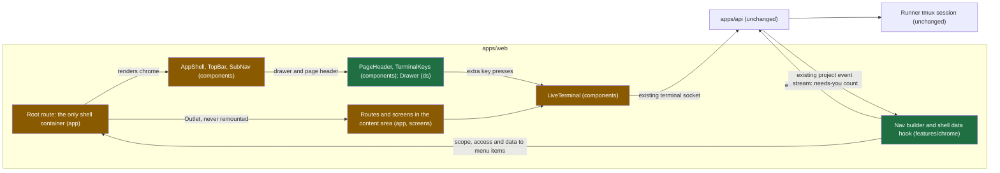

<!-- dev-plan: kind=spec id=sidebar-navigation-shell rev=6 hash=2adc266b2df5 source=issue#289 -->
# Sidebar navigation shell design

Status: draft. Sensitive paths: terminal (web side only: the run page that hosts terminal attach, and the extra-key input to the live terminal); access and tenant isolation in the web app (menu filtering, shell data wiring, project switcher). No sensitive server path.
Source: issue #289

## Summary

Navigation moves, changes shape or disappears from page to page, and it breaks on narrow screens.
Every signed-in page gets one slim top bar (where am I, which org or project) and at most one side menu (which page), from one shell.
The org and project switchers stay and only change scope. Below 1024px the menu is a drawer, and pages are designed for phones down to 390px.
Six smaller text, link and layout fixes ship with it. No API, permission, role or database change. It is designed on top of the multi-agent spec (`2026-11-24-multi-agent-configs-design.md`), which is not built yet and whose web work is built first.

## Business rules

Confirmed by the human at planning time.

### Goal

Today navigation moves, changes shape or disappears between pages. This is solved when every signed-in page has one slim top bar (where am I, which org or project) and at most one side menu (which page), the same on desktop and usable on phones.

### Actors

Items are gated by permission, not by role name, so combined or custom grants work (ADR-0036: assignments add up). The roles are the seeded ones (`docs/superpowers/specs/2026-11-22-desk-access-matrix.md`, `packages/db/migrations/0026`, `0032`, `0035`, `0036`).

| Actor | May do |
| ----- | ------ |
| Owner, org admin | All org menu items; all project menu items on every project. |
| Project admin only (admin on a project) | Org menu: Projects and Invitations (the invite right counts from a project grant: `canInvite`, holding `assignment:create` anywhere). Full project menu on their own projects only. |
| Member, viewer (org or project scope) | Org menu: Projects. Project menu: Runs and the repository block. |
| Member with no role | Sees only what their permissions give (Projects is forbidden for them today). |
| Platform admin | Additionally: Platform in the org switcher, Create organization, and "Manage in Platform" in orgs they belong to. Project and org items follow their tenant roles only. |
| Signed-in user with no org | `/invitations`. |
| Ticket source or SCM webhook sender | Not affected (web only). |

### Rules

Surface: UI (every change is something a person sees or presses).

| Id | Category | Rule |
| -- | -------- | ---- |
| BR-1 | conditional-display | When a signed-in person opens any platform, org, project, run or personal page, they see a top bar holding only the logo, switchers and breadcrumb, bell and account menu, with no section links. |
| BR-2 | conditional-display | When a person is on the sign-in page, they see no top bar and no side menu. |
| BR-3 | conditional-display | When a person moves from one scope's page into a deeper scope (org to project, platform to one org), they see the menu replaced by the deeper scope's menu, never two side menus. |
| BR-4 | navigation | When a person in a project menu clicks "← All projects", they see that org's Projects page. |
| BR-5 | navigation | When a platform admin in a platform org menu clicks "← Organizations", they see the Organizations directory. |
| BR-6 | conditional-display | When a person scrolls a long page at 1024px or wider, they see the side menu stay in place at full height; a menu taller than the window scrolls on its own. |
| BR-7 | conditional-display | When a person is on any page with a side menu, they see its item for the current page marked current (a run page marks Runs). |
| BR-8 | conditional-display | When a person opens any page with a side menu, they see one page header: one h1 at the same position and size, with page actions on its right (Skills and Workspace setup included). Exceptions: the new-project wizard's title may sit lower; a page that is loading or shows a load error (the error with Retry, an invitation page's own load error included) may show no title. |
| BR-9 | conditional-display | When a page has a warning banner (for example the setup warning), the person sees it below the page title, so the title does not move. |
| BR-10 | conditional-display | When a person is on an org settings or project configuration page, they see no "Org settings", "Project settings" or "Desk" crumb, tab or menu heading; the document title stays `"<page> · <scope> · Agent Desk"` and never holds ticket text. `<scope>` keeps today's names: "Platform" on platform pages, the organization name on organization pages, and the project name on project and run pages. |
| BR-11 | feedback-state | When a page is loading, the person sees the top bar and the side menu stay on screen while the loading state shows in the content area. |
| BR-12 | feedback-state | When a page ends in 403, 404, 5xx or a crash, the person sees the message in the content area (the page's main, so the skip link works), the switcher (or the plain org name, BR-47) stays, and the menu is that of the deepest scope in the URL they can open; when the URL names no org, project or platform area they can open, they see no menu. (An invitation page's own in-page load error is covered by BR-56 instead.) |
| BR-13 | permission | When a person opens a URL of an org or project they cannot access, they see its name nowhere (bar, menu, breadcrumb, title). |
| BR-14 | conditional-display | When a screen-reader user reads any signed-in page with a menu, they find one banner, one side navigation named for its scope, one main, and menu groups announced by their headings. |
| BR-15 | feedback-state | When the data that decides the menu fails to load, the person sees an error with Retry in the menu and no permission-gated item. Exception: when only the platform admin check fails, the menu shows no error and no Retry, and the platform links are just hidden; platform pages handle that failure through the page itself. |
| BR-16 | navigation | When a person presses "Go to projects" on an error page (non-member org slug included), they land on a page that opens, not on Not found again. |
| BR-17 | conditional-display | When an owner or org admin is on an org page, they see Projects, then a Settings group with Members, Invitations, Audit log, General in that order; each opens its page in one click. |
| BR-18 | permission | When a member or viewer is on an org page, they see Projects only and no Settings group. |
| BR-19 | permission | When an admin of projects only is on an org page, they see Projects and Invitations, no Members, Audit log or General. |
| BR-20 | navigation | When a platform admin on an org page presses "Manage in Platform" at the bottom of the menu, that org opens in the platform area; a person who is not a platform admin never sees the item. |
| BR-21 | navigation | When a person opens `/o/<org>/settings`, they land on the first page they may open in the order Members, Invitations, Audit log, General; with none they see the no-access state with the org menu. |
| BR-22 | conditional-display | When an owner, org admin or admin of this project is on a project page, they see "← All projects", Runs, Configure (Routing rules, Skills, Workspace setup, Agent & settings), Access (Members, Audit log) and the repository block. |
| BR-23 | permission | When a member or viewer is on a project page, they see Runs and the repository block only, with no empty group heading, on Runs and run pages alike. |
| BR-24 | permission | When an admin of project P1 only is on project P2 (as member or viewer there), they see no Configure or Access item; an org admin of org A who is a member of org B sees none in B's projects and only Projects in B's org menu. |
| BR-25 | calculation | When runs of the project need a person, the Runs menu item shows their count as "needs you", it updates without a reload, and no badge shows at zero. |
| BR-26 | conditional-display | When a person is on a project page, the repository block shows the repository, the project's own default branch (no branch line when none is recorded) and the connection status: OK, warning or error. |
| BR-27 | navigation | When a person presses "Open repository" in that block, the repository opens in a new tab; the top bar has no repository button. |
| BR-28 | navigation | When a person who may read a project's agent settings uses the row action "Agent & settings" on the Projects list, they land on that page, on its Agents tab; no row action is called "Settings". |
| BR-29 | navigation | When a person opens the bare project URL, they land on its Runs page; an unknown or out-of-scope project shows Not found. |
| BR-30 | navigation | When a person opens the old needs-you URL, they see Page not found. |
| BR-31 | conditional-display | When a platform admin is on Organizations, create organization, Platform admins or platform Audit log, the side menu shows Organizations, Platform admins, Audit log with the matching one current. |
| BR-32 | conditional-display | When a platform admin is inside one org, the menu shows "← Organizations", the org's name and status (Active or Suspended), and Overview, Projects, Members, Invitations. |
| BR-33 | navigation | When a platform admin opens the org header's More actions, "View audit log" and "Open organization" work as before ("Open organization" only for members). |
| BR-34 | permission | When a person who is not a platform admin opens a /platform URL, they see the forbidden state with no side menu and no platform data. |
| BR-35 | feedback-state | When a platform org is loading, fails or does not exist, the admin sees respectively a placeholder menu, the org menu labelled "Organization" with its links, or the top-level platform menu with Not found. |
| BR-36 | conditional-display | When a person is in the new-project wizard, they see the stepper where the side menu would be, and no section menu or tabs; at 1024px and up it stays open with no collapse control, and a collapse choice made on other pages neither applies to it nor is changed by the wizard. |
| BR-37 | navigation | When a person presses "Exit setup", they land on the org's Projects page and the progress saved so far is kept. (Below 1024px "Exit setup" sits with "Step N of M" at the top of the page; the last "Ready" step has no step count.) |
| BR-38 | conditional-display | When a person opens a run page at 1024px or wider, the project menu starts collapsed to a thin strip with an expand button. |
| BR-39 | state-transition | When a person collapses or expands the menu on any page that has a side menu (not the wizard stepper), it changes to the thin strip or the full menu with the same items. |
| BR-40 | persistence | When a person has collapsed or expanded the menu and moves to another non-run page without reloading, it stays as chosen (what they did on a run page does not change it); after a reload non-run pages start expanded, and each newly opened run page starts collapsed. |
| BR-41 | conditional-display | When a person is on a run page, they see run status, ticket and run actions in the page header and the same top bar as on other pages. |
| BR-42 | permission | When a viewer, or a member on someone else's run, opens a run page, the header shows no run action they were not allowed before (member keeps actions on own runs). |
| BR-43 | conditional-display | When a signed-in person sees the bell on any page, it is disabled and labelled "coming soon", never "Notifications on". |
| BR-44 | conditional-display | When a person opens a run page, a skill, or Agent & settings (its "GitHub connection" tab included), they see no "Full screen", "Send test ping" or "Manage installation" control, and a skill shows "History" only as a working link to its file in the connected repository (none when that link is not available, never a disabled button); "Check now" stays where that tab offers it. |
| BR-45 | conditional-display | When a person opens the org switcher, it shows only scope choices: Platform (platform admins), their organizations with the current one checked and suspended ones labelled, and Create organization (platform admins); no Projects, Org settings or "Manage this org in Platform". |
| BR-46 | navigation | When a person picks an entry in the org switcher, they land on that org's Projects page, the platform Organizations directory, or the create organization form. |
| BR-47 | conditional-display | When the org list has loaded and a person has one org or none and no platform role, the org name (or "No organization") is plain text with no menu; if the switcher is open or focused at the moment the list arrives, it stays a button until the person has closed it and moved focus away, then becomes plain text. |
| BR-48 | conditional-display | When a person opens the project switcher, they see the title "Switch project", only projects they can see, the current one checked, counts labelled "needs you", and "All projects". |
| BR-49 | permission | When a person without org-level project:create opens the project switcher, they see no "New project"; one who has it sees it and it opens the wizard. |
| BR-50 | navigation | When a person picks "All projects" in the project switcher, the org's Projects page opens. |
| BR-51 | navigation | When a person on a project page picks another project, the same page of that project opens if they may open it there, else its Runs page. |
| BR-52 | navigation | When a person on a run page picks a project in the switcher, that project's Runs page opens. |
| BR-53 | navigation | When a keyboard user opens the org or project switcher while its list is loading, the arrow keys move through the entries once they show, and Escape closes it. |
| BR-54 | feedback-state | When the project switcher's list is loading or fails, the person sees the loading state, or the error with Retry. |
| BR-55 | navigation | When a signed-in person chooses "My invitations" in the account menu on any page, /invitations opens (no pending count in the menu). |
| BR-56 | conditional-display | When a person is on an invitations page, including when that page shows its own load error or "not available" message, they see their active org's menu with no current item, or no menu when they have no active org or it is suspended; the menu and top bar never name the invitation's org unless the person is a member of it. |
| BR-57 | feedback-state | When a person who belongs to an org has no pending invitation, /invitations shows "No pending invitations" and `"No invitations for <email>."`, never that they are not a member; a person with no org keeps the current welcome text. |
| BR-58 | permission | When a member who has another org or a platform role opens a suspended org, they see the suspended message with no side menu and can leave by the switcher. |
| BR-59 | conditional-display | When the window is narrower than 1024px, a person sees no fixed side menu but a menu button in the top bar on every page that has a side menu (the wizard included: its drawer holds the stepper). |
| BR-60 | permission | When a person who may use a run's terminal opens a live run on a phone, they can watch the terminal, type into it with the phone keyboard and use the same run actions as on desktop. |
| BR-61 | state-transition | When a person presses the menu button, a drawer opens with the same items, gating and badge as that page's desktop menu; picking an item opens the page and closes the drawer. |
| BR-62 | state-transition | When the drawer is open and the person presses Escape or outside it, it closes with the page unchanged. (Agent call: same dismissal as the app's popovers and dialogs.) |
| BR-63 | conditional-display | When a person views any top bar at 390px to 1024px, nothing overlaps and no switcher is empty: each shows a readable (possibly shortened) name. |
| BR-64 | conditional-display | When a person opens a switcher or account popover at 390px, it stays fully on screen. |
| BR-65 | conditional-display | When a person opens any page at 390px (sign-in, wizard, Runs, run, Workspace setup, Skills, platform pages included), all content and actions available on desktop are visible and usable, with nothing overlapped or zero width (run terminal: BR-60, BR-66, BR-67, BR-69). |
| BR-66 | conditional-display | When the terminal accepts typing and the window is narrower than 1024px, the person sees a row of extra keys in this order: Esc, Tab, Left, Up, Down, Right, Ctrl-C, Enter. (Agent call: shown below 1024px, the same width where the run page takes its small-screen layout; tablets lack these keys too.) |
| BR-67 | side-effect | When the person presses one of those extra keys, the run's terminal receives that key once, as from a hardware keyboard. |
| BR-68 | persistence | When a person switches project while a page holds unsaved input or an open dialog, the new project's page shows only the new project's saved values, with nothing typed or opened for the old project. |
| BR-69 | permission | When the person may not use the run's terminal (viewer, member on someone else's run) or it is not live (paused, ended, transcript, not connected), they see no extra keys and cannot type into it. |
| BR-70 | conditional-display | When a person opens an invitation link, the invitation card shows its content with space inside the card, not touching its edges. |
| BR-71 | conditional-display | When a platform admin opens an org's Projects tab, each project shows its name first, then its id. |
| BR-72 | navigation | When a person on the wizard's rules step presses "Change" or "Runs, Ignored" in the rule guards, they land on that project's Agent & settings with the "Limits" tab selected, or on its Runs with the Ignored filter ("Change" shows only to a person who may read the agent settings). |
| BR-73 | navigation | When a person on Routing rules presses "Runs, Ignored", the project's Runs opens with the Ignored filter selected. |
| BR-74 | navigation | When a person presses "Preview" on a skill template on the wizard's skills step, a dialog shows that template's SKILL.md; closing it leaves them on the step with their picks unchanged. |
| BR-75 | conditional-display | When a person views the Projects list, its intro reads "After sign-in you land on this list. It is one click away on the logo." and says nothing about the last used project's runs. |
| BR-76 | conditional-display | When a person views the sign-in page, it reads "Proof of concept." and says nothing about a single user per project. |
| BR-77 | permission | When a person views the Projects list, a project whose setup is not finished shows "Resume setup" only if they have org-level project:create; finished projects never show it, and members, viewers and project-only admins never see it. |
| BR-78 | navigation | When a person presses "Resume setup" on a project (for example after "Exit setup"), the wizard opens for that project at its first unfinished step. |
| BR-79 | permission | When a member's only org is suspended and they have no platform role, they see the suspended message with no side menu and the org name as plain text (no switcher), and can leave by the account menu: "My invitations" or sign out ("Logout"). |
| BR-80 | feedback-state | When the org list is loading or has failed, a person who opens the org switcher sees the loading state, or an error with Retry; until the list has loaded it shows no org entry, takes no org name from the address, and never shows "No organization" or the plain-text form. ("Platform" and "Create organization" still show once the person is known to be a platform admin.) On an org or project page, the content behind it waits or shows an error, and the side menu keeps only the item everyone can see (Projects or Runs), with no org or project name and no permission-gated item (no "Manage in Platform"), plus an error with Retry if loading failed. |
| BR-81 | navigation | When a keyboard user is on the run terminal's view tabs and presses Left, Right, Home or End, focus and selection move to the previous, next, first or last tab, wrapping at the ends; with only one tab, as the app shows today, focus stays on it and the view does not change. |
| BR-82 | navigation | When a person opens a project's bare /desk URL, they land on that project's Runs page, and Back does not bounce them forward again; an unknown or out-of-scope project shows Not found. |
| BR-83 | conditional-display | When a person views the Routing rules list on a phone, each rule shows the same run line as on desktop: its run count and last run, or "Never ran". |

### Not observable

- Both switchers share one layout and style: look only, checked on the redrawn boards. Behaviour is in BR-45, BR-48, BR-53 and BR-64.
- URLs are kept and `desk/` is not renamed: covered by BR-21 and BR-29.
- No API, permission, role, `routeAccess`, RLS or migration change, and the API stays the authority: covered by BR-18, BR-23, BR-34 and BR-42.
- There is one shell component, however it is wired, and the old components are deleted: covered by BR-1 and BR-3.
- Members, Invitations and Audit log pages are not merged across scopes: covered by BR-17, BR-22 and BR-32.
- Code uses provider-neutral names; the visible label is covered by BR-27.
- Affected design boards are redrawn before building, no design drift stays unrecorded, and a final parity check records what remains (parity is a manual check; the board-count test stays): design process, no rule. The board for the early invitations fix (BR-57) comes afterwards.
- The integration branch: process.
- PRs of about 800 lines or fewer, with phone layouts done per page and split into several PRs: delivery process; the effect is BR-59 to BR-66 and BR-69.
- All Desk menu items are filtered by permission before the project menu shows on non-Desk pages: delivery order (a step 0 bug fix with a failing test first); the effect is BR-22, BR-23 and BR-24.
- Of finding M9, menu groups being announced is in BR-14, error pages having a `main` is in BR-12, and arrow keys on the run terminal tabs are BR-81.
- The one full e2e run before merge and the side menu component's name (`SubNav`): process and naming only.
- The invitations empty-message fix (BR-57) ships before the boards show its wording: delivery order only; the effect is BR-57.

### States

No ticket, run, session or connection state machine changes. UI states only:

- Side menu (1024px and up): expanded or collapsed. Only the person moves it, except that a run page opens collapsed. The wizard stepper stays open, with no collapse control.
- Drawer (below 1024px): closed or open.
- Invariants: at most one side menu; the top bar has no section links; a menu, bar or title never shows the name of an org or project the person cannot access.
- Run actions keep today's permission and status rules (desk access matrix, "Run actions"); only their place moves.
- The collapsed choice is not saved. It lasts while the person moves around non-run pages without a reload. Every time a run page is opened the menu starts collapsed, and expanding or collapsing there does not change the choice on other pages. Opening a run page does not change the choice for other pages.
- On an error page, "the menu of the last scope the user can access" means the deepest scope in the page's own URL that they can open. When the URL names none they can open, there is no menu, with no fallback to the active org. This works on a fresh deep link. Examples: a member on `/o/A/p/P1/desk/rules` (403) sees the project menu; an admin of P1 on P2's URL (404) sees the org menu of A; a non-member org slug shows none; a person who is not a platform admin on `/platform` sees none (this replaces today's forbidden org bar in `app/boundaries.tsx`).
- `/invitations` pages are not error pages: BR-56 (the active org's menu) applies, including when the page shows its own load error or "not available" message.

### Limits and validation

- No new form input.
- Widths: below 1024px the menu is a drawer (at 1024px itself the side menu shows). 390px is the smallest width designed and tested.
- The "needs you" count is hidden at zero in the menu badge (`ds/CountBadge.tsx`, existing).
- Untrusted text: org, project, repository and branch names show in the menu, bar and titles as plain text. Ticket title and comment text moves with the run header: it is data only, never HTML, and never in `document.title` (run pages use "Run N").

### Edge cases

- One org and no platform role: the org name is plain text. On a not-found page the way back is the logo and "Go to projects".
- No org and no platform role: plain "No organization".
- Platform admin with no membership: the logo goes to Platform > Organizations.
- Non-member org slug: "Go to projects" must not loop back to Not found.
- Grants or project data still loading: gated items are not shown and the menu shows a placeholder. Failed: an error and Retry in the menu, and gated items stay hidden (fail closed). While the org list is loading or has failed on an org or project page, BR-80 applies instead.
- Role removed while on a page: the next load follows the new grants (org tenant admin spec BR-36, unchanged).
- Project deleted: Not found with the org menu. A connection warning shows in the repository block.
- Platform org loading, failed or not found: placeholder, "Organization" with its links, or the top-level platform menu.
- Active org suspended, on `/invitations`: no menu.
- Only org suspended and no platform role: the logo still leads to that org's suspended page, and the account menu is the way out. Their `/invitations` has no menu and the same plain org name (BR-56, BR-79).
- A person with one org and no platform role while the org list loads or fails: the switcher can be opened (loading, or error with Retry); once the list has loaded it becomes plain text; if it is open or focused at that moment, only after it has been closed and focus has moved away (BR-80, BR-47). On an org or project page, the content waits or shows an error too, because it reads the same list (BR-80).
- The same hold applies when the list arrives empty (no org and no platform role): the open menu then shows "No organization" as a line that cannot be picked.
- Org list loading or failed on an org or project page: BR-80 holds even though the content may show an error page; in this case it takes the place of the BR-12 menu choice.
- Forbidden, not-found and crash pages keep their title; the BR-8 title exception is only for loading and load errors.
- The invitation read fails inside the page: the menu stays as in BR-56. If the invitation route itself crashes or its loader fails, that is the app error page with no menu (BR-12). If the menu's own access data fails: BR-15.
- Switching project from a Desk page with `?page`, `?skill` or `?rule`: the query is dropped.
- Switching to a project where the same page is not allowed: Runs.
- Old `/needs-you` link: Not found. The Runs "Needs you" filter covers the list; Resume stays on the run page.
- Leaving the wizard by "Exit setup": no confirm; saved steps are kept.
- A switcher opened while its list loads: the arrow keys work once the list shows. This is a bug fix for the project switcher, so the failing test comes first.
- Switching project while a page holds unsaved input or an open dialog: nothing of the old project shows or can be saved into the new one. The input is dropped without a confirm (today, leaving a page asks none). See BR-68.
- Phone terminal not live (paused, ended, transcript, connecting, lost, closed for inactivity) or not allowed: no extra keys and nothing can be typed. See BR-69.
- Ctrl-C on the key row asks no confirm.
- A phone attach resizes the shared terminal as any narrow window does today, so other viewers of the same run may see the narrow size.
- "Runs, Ignored" opens Runs on the Ignored filter; the Runs page then remembers that view as it does today.
- Unsaved input on the wizard rules step is lost when following "Change" or "Runs, Ignored", as with any way of leaving.
- "Resume setup": a project's saved step only moves forward (`features/setup/mutations.ts`), and once setup is finished the link is gone. Any project not marked finished shows it, including ones created before this change.
- Resizing across 1024px with the drawer open: no business rule; the drawer closes when the window grows to 1024px (see UI and Storybook).
- The run terminal tabs: every tab bar in the app shows one tab today (`screens/RunTerminalArea.tsx` `views`: Terminal, Final or Saved scrollback, Transcript; `screens/DeskSetup.tsx`: Log), so in the app the keys leave focus on that tab. Moving between tabs can only be shown on the component. The phone "Terminal | Details" switch is a separate control.
- The step 0 Desk menu fix on today's pages: a person with none of the Desk read rights on a Desk page sees no items and no empty group heading (BR-23); the repository block stays.
- Bare `/desk` under a project: every person who can open the project, member and viewer included, reaches Runs, with no 403 on the way. The redirect replaces the history entry, so Back is not trapped.
- Multi-agent overlaps: any Agent & settings tab marks that menu item; switching project there opens the new project's Agents tab with no pane; at 390px both the phone fit and the page fit hold; after "Resume setup" the saved Agent step is reached with Back.

### Tenancy and permission

The web app only shows or hides; the API stays the authority. No permission, role or `routeAccess` change, and `packages/contracts/src/access.ts` is not touched. All tenant permissions below are `any` unless said.

Org menu, on `/o/:org/*`:

| Item or screen | Shown when (permission, level) | Tenant data on the page |
| -------------- | ------------------------------ | ----------------------- |
| Projects | always, for members; the list is limited to visible projects (API `project:read`) | visible projects |
| Members | `member:read` (org) | org members, roles |
| Invitations | holds the invite right (`assignment:create` anywhere), as today | org invitations |
| Audit log | `audit:read` (org) | org audit events |
| General | `org:update` (org) | org name, slug |
| Manage in Platform | platform admin flag | none; the target keeps `platform-org:read` |

The "Settings" group is hidden when it has no items.

Project menu, on `/o/:org/p/:project/*` (all at project level):

| Item or screen | Shown when | Tenant data on the page |
| -------------- | ---------- | ----------------------- |
| Runs | always (API `project:read`, `run:read`) | runs, tickets, counts |
| Routing rules | `rule:read` | rules |
| Skills | `skill:read` | skills |
| Workspace setup | `setup:read` | setup script, variables, secret names |
| Agent & settings | `agent:read` | agent and connection settings; all tabs of the multi-agent spec (its Danger zone, inside the page, needs org `project:delete`) |
| Members | `assignment:read` | project members |
| Audit log | `project-audit:read` | project audit events |
| Repository block | members and viewers see it (reads `projects.get` and `projects.connection`, both `project:read`) | repository, default branch, connection status |

Empty groups are hidden.

Platform menu, on `/platform/*` (platform level; the UI gate for every item is the platform admin flag):

| Item or screen | API permission | Data |
| -------------- | -------------- | ---- |
| Organizations | `platform-org:read` | org metadata |
| Platform admins | `platform-admin:read` | admin list |
| Audit log | `platform-audit:read` | platform events |
| Overview | `platform-org:read` | org metadata |
| Projects | `platform-project:read` | project names |
| Members | `platform-member:read` | names, emails, roles |
| Invitations | `platform-invitation:read` | invitations |

Other controls:

| Control | Permission (level) | Tenant data touched |
| ------- | ------------------ | ------------------- |
| Project switcher list | visible projects only | project names, "needs you" counts |
| "New project" | `project:create` (org) | none new |
| "Platform" and "Create organization" in the org switcher | platform admin flag (they show once it is known to be true) | none new |
| Org switcher list, with its loading and error states | the person's own memberships (the existing session org list); no new permission | org names |
| Run actions in the run header | same gating as today, only moved (`run:update`, `run:cancel`, `any` or `own`) | the run |
| Run terminal and extra keys | `terminal:attach` (project; `any`, or `own` for a member), unchanged and checked by the API on attach | the run's terminal |
| "Resume setup" | `project:create` (org), the wizard guard | the project's setup step, already in the visible project list |
| Wizard "Change" | `agent:read` (project) | none new |
| Wizard "Runs, Ignored" | run read, as the Runs page | none new |
| Skill template "Preview" | nothing beyond the wizard guard | bundled text, no tenant data |
| Run terminal view tabs, arrow keys | none of their own; they are on the run page and the Workspace setup log bar, which keep their guards | none new |
| Bare `/desk` redirect (project) | no permission of its own, so no Desk permission guard; Runs keeps today's project-level read checks | none of its own |

- Never: another org's or an out-of-scope project's name or counts in a menu, switcher, breadcrumb or title. An admin of P1 sees no Configure or Access items on P2. An org admin of A who is a member of B sees only Projects in B.
- Screen size never changes what a role may do.
- Role cases are required in mock and local e2e, and existing access assertions are not loosened.
- Access-dependent UI and the run page (which hosts terminal attach) need sensitive-path care in review.

### Lifecycle, compatibility and side effects

- No data is created, changed or deleted. No audit entries. The collapse state is not stored. No user data migrates.
- No comments, notifications or status changes. The bell is disabled, "coming soon". The live "needs you" count on the Runs menu item updates from the existing project event stream (`useProjectEvents`).
- All URLs are kept. Removed: `/o/:org/p/:project/needs-you`. Added redirects: the bare project URL to Runs, and a project's bare `/desk` address, which has no page today, to its Runs page. Legacy redirects stay.
- On today's Desk pages, the step 0 fix hides Routing rules, Skills, Workspace setup and Agent & settings from people who may not read them.
- The phone rules list keeps each rule's run line; nothing a desktop user sees on a rule is dropped on phones.
- This change sits on top of the multi-agent spec: its tab strip, tab links, wizard Agent step and page fit are kept. Its "Send test ping" and "Manage installation" text and its "No responsive redesign" text are superseded here.
- `/o/:org/settings` now opens Members first (order Members, Invitations, Audit log, General) instead of General.
- The org switcher loses Projects, Org settings and "Manage this org in Platform" (the last moves to the bottom of the org menu). Its "Platform admin" entry becomes the scope "Platform".
- Users with one org and no platform role lose the org dropdown.
- A member whose only org is suspended, with no platform role, has no switcher menu and leaves by the account menu.
- The invitations empty-message fix (BR-57) ships first, in today's page frame; until the page is renamed "My invitations", "No pending invitations" is its only h1.
- "Org settings", "Project settings" and "Desk" wording and crumbs disappear. The project row's "Settings" action becomes "Agent & settings".
- The account menu gains "My invitations", as an item only, with no pending count. Note: org tenant admin BR-45 and PR #230 removed "My invitations" and its count from the account menu; the newer requirement wins for the item.
- The Projects list gains "Resume setup" on unfinished projects (existing ones too) and new intro text. The sign-in footer text changes.
- Platform org Projects shows the name column before the id (platform dashboard BR-25, id and name only with no link, still holds). The repository block shows the project's real default branch instead of a fixed "main".
- Pages are designed for phones for the first time. Phone support covers every page and every dialog, not only the ones listed as broken.
- Code uses neutral names for the repository block (repository, connection); the label is "Open repository".

Existing decisions:

- `2026-11-24-admin-navigation-consistency-design.md` is superseded: tabs plus a per-section side menu, "no global side bar" and "no responsive redesign". Kept from it: the breadcrumb pattern, the title format `<page> · <scope> · Agent Desk`, the skip link, create org in the platform shell, "Open organization" for members only, the logo target for a platform admin without an org, and the bell on every bar (now disabled).
- `2026-11-22-org-tenant-admin-design.md`: navigation Option A, BR-13, BR-43, BR-44, BR-47 and BR-49 (the tab and org-menu parts) are superseded. BR-49's "no Settings or Invitations button on the Projects header" still holds. Its agent call that kept the old Projects intro sentence is replaced (BR-75).
- `2026-11-12-frontend-design.md`: "mobile layouts beyond what exists" being out of scope is reversed, and the `needs-you` row of its route table is removed.
- `2026-11-23-platform-admin-dashboard-design.md` BR-1 and BR-2 (Platform entry in the org menu), BR-48 and BR-51 (suspended orgs in the switcher; the platform stays reachable) are kept.
- `2026-11-23-rbac-project-admin-space-design.md` BR-1: the Members and Audit log items are kept; the "Settings" wrapper is gone.
- `2026-11-21-org-onboarding-design.md` BR-37 (welcome text for a user with no org) is kept. BR-43 (sign-in lands on the org's projects page) is kept: the old Projects intro text was wrong, not the behaviour.
- The issue #122 human ruling noted in `apps/web/e2e/local/rule-model.spec.ts` (resuming from the project list is not product behaviour) is replaced: the human chose to add "Resume setup", and was told it replaces that ruling.
- ADR-0036 is unchanged.

### Multi-agent spec: what this spec keeps, changes and supersedes

`2026-11-24-multi-agent-configs-design.md` ("MA"; its rules and cases are written "MA BR-n" and "MA TC-n.m" because both specs number from 1) is the base of this design. It is merged to `main` as documents and boards only (PR #288) and is not built. Neither it nor its plan is edited; this section is the record of what changes.

Kept as the base:

- Roles: only an owner and an admin open Agent & settings (MA BR-46, BR-47, BR-57); no new permission, and the menus do not change (BR-22 to BR-24). A project admin sees three tabs, with no Danger zone.
- The tab strip is page content, not a side menu or top bar link (BR-1, BR-3). Any tab marks "Agent & settings" as current (BR-7). The h1 is "Agent & settings" with the strip under it (BR-8); "Add agent" is a section action. A tab's load error keeps the h1 and strip (MA BR-59), and BR-8 requires nothing more there.
- The wizard's Agent step and its copy stand inside this design's wizard frame (BR-36, BR-37, BR-59). MA's line "You can leave setup and come back" is made true by "Resume setup" (BR-77).
- MA's tab links (MA BR-60) stand.
- Page fit (MA BR-61, "at any window size", on all Agent & settings tabs, and on Routing rules) holds together with the phone layouts: both apply at 390px.
- MA's convention line "A Desk page ..." and its strip name "Agent and project settings" are not a "Desk" or "Project settings" crumb, tab label or menu heading (BR-10).

Changed or superseded by this spec (flagged under the "newer accepted doc wins" rule):

- **Superseded:** MA's GitHub connection tab text and board `DeskAgentGitHub` show "Manage installation" and "Send test ping". The requirement's human decision to hide controls until they work wins, and MA gives neither control any behaviour. Both are hidden; "Check now" stays in polling mode; with webhooks there is no button, so no action row (BR-44).
- **Superseded:** MA's "No responsive redesign (not asked; the app has none)", in its UI text and in its agent call, was that change's scope. This design's full-mobile decision also covers MA's new screens: the tab strip, agent rows, add and edit pane, row menu, delete dialog, the rule form's agent selector and the wizard's agent picker.
- **Changed:** MA BR-60 names a "nav link" and a "project Settings link". Here they are the side menu item (BR-22) and the project row action "Agent & settings" (BR-28); both open Agents, and the old top "Settings" tab is gone. MA TC-60.7 keeps its expected result through these two.
- **Changed:** the wizard's "Change" is the runs-per-ticket guard, which MA moves to Limits. It opens `?tab=limits` (BR-72).
- **Changed:** MA TC-65.1 and TC-65.2 reach the project by "Resume setup", which opens the first unfinished step, and then use Back when that step is later than Agent (BR-78). Their expected results stay (MA BR-65).
- **Changed:** MA's screens render inside this shell: the route's fill setting replaces its `height="viewport"` prop, and `DeskAgent` and `DeskRules` lose their `DeskFrame` chrome.
- **Changed:** MA's boards are redrawn in the new shell, and its board and story file counts are stale (see "UI and Storybook" and "Testing").

### Out of scope

As stated by the requirement:

- Any API, permission, role, `routeAccess`, RLS or migration change.
- Renaming `desk/` (can be a later, separate change).
- Merging the Members, Invitations and Audit log pages.
- A new dependency (none is proposed).

## Architecture

Confirmed by the human at planning time, then updated for the multi-agent spec and confirmed again, build order included.

### Overview

Green is new, amber is changed.

All code is in `apps/web`. There is no change to `packages/contracts`, `packages/db`, `packages/core`, `apps/api`, `apps/worker` or the runner. `ds/`, `components/` and `screens/` stay presentational (no router, Query or contracts); data wiring is in `features/`, and features render no markup.

Today there is no shell: `TopBar` is rendered at 17 sites in 15 files (`test/topBarCallSites.test.ts`), and `app/root.tsx` renders only `SkipLink` and `Outlet`. Side menus come from `components/{DeskLayout,OrgSettingsLayout,PlatformLayout}.tsx`, and the wizard has its own in `components/SetupLayout.tsx`. Chrome data comes from `features/chrome/appBar.ts` (`useAppBar`, which suspends on session and orgs) and `features/desk/frame.ts` (`useDeskFrame`, which suspends on the project). `document.title` is set inside `TopBar` and again in `app/boundaries.tsx`. The `/o/$org` `beforeLoad` switches the server's active org and removes the `['org']` cache (`features/auth/session.ts:setActiveOrganization`), and every request takes its org header from the latest URL (`features/api.ts`, `features/auth/orgResync.ts:urlOrgId`).

Where each piece lives:

- `components/`: `AppShell` (rewritten: banner; menu slot that is full, collapsed, drawer, wizard stepper or none; content), `TopBar` (shrunk: logo, breadcrumb and switchers, bell, account, menu button), `SubNav` (name kept, extended: groups as lists, badge, back link, header, footer, loading, error), new `PageHeader`, new `TerminalKeys`.
- `ds/`: new `Drawer` (modal panel on the existing `useFocusTrap`; our own code, not a dependency), a `menu` icon in `icons.tsx`, and the `Dialog` overlay fixed to the viewport.
- `features/chrome/`: a pure `nav` builder (scope, access and data in; items, back link and footer out) and a non-suspending shell data hook. It reuses `orgSettingsTabs` and `deskRightsOf`, so each permission is mapped once.
- `app/`: the root route component is the only shell container.
- Deleted: `OrgNav`, `ProjectNav` (with `ProjectStrip`), `PlatformNav`, `DeskLayout`, `OrgSettingsLayout`, `PlatformLayout`.

The shell is rendered once in `app/root.tsx`, not in a pathless layout route. This keeps it mounted around child errors, not-found and pending states.

Each route declares its chrome with the router's typed `staticData`: menu item key, crumb, mode (`standard`, `wizard` or `none`) and `fill` for full-height pages (run detail; Desk rules, skills and setup; and Agent & settings, per "Multi-agent configs overlay"). The Agent & settings menu item, crumb and title do not change with its tab, and the current menu item comes from `staticData`, not from matching links on search params. Dynamic names (org, project, run number) come from cached queries. One crumb source feeds both the breadcrumb and the title. `features/platform/crumbs.ts` is the precedent for a pure crumb function and may stay as the platform resolver. This replaces per-screen props and the path regexes in `platform.tsx` and `o.$org.settings.tsx`. The title is `<page> · <scope> · Agent Desk`, and `<scope>` keeps today's names: "Platform" on platform pages, the organization name on organization pages, and the project name on project and run pages.

The shell is the one owner of `document.title`. `NotFound`, `Forbidden` and similar report `notFound` or `forbidden` to the shell through a small context, because pages that throw during render (for example `o.$org.p.$project.desk.members.tsx` throwing `list.error`, or the settings layout with no tabs) do not show up in the router's match status.

The wizard stepper goes into the shell's menu slot through a slot the shell exposes (a context with a target element). `SetupLayout` renders its stepper there with `createPortal` from the existing `react-dom`; with no provider, as in tests of the component alone, it renders in place. Below 1024px the same slot sits in the drawer. When the portal target is missing (drawer closed), nothing is rendered.

Screens keep their own `<main>`; error and pending states gain one. The shell renders no `main`.

Stories keep drawing chrome through one stories-only frame built from the same `AppShell`, `TopBar` and `SubNav`. It replaces `screens/orgSettingsFrame.tsx` and `platformFrame.tsx`. The "only the shell renders chrome" test lists the shell and that frame only.

### Data model

Migration: No schema change. No RLS or backfill change.

### API

No new or changed endpoint, SSE stream or WebSocket. Webhooks are untouched. `packages/contracts` (schemas, `routes.ts`, `access.ts`) is not touched. No server code links to `/needs-you` (`apps/api` and `packages` were searched).

The menu uses only existing permissions, all `any`: at org level (org grants only, through `can()`) `member:read`, the invite right (`assignment:create` anywhere), `audit:read` and `org:update`; at project level `rule:read`, `skill:read`, `setup:read`, `agent:read`, `assignment:read` and `project-audit:read`; `project:create` (org) for "New project"; and the platform admin flag for platform items. The footer branch is the existing `ProjectDto.defaultBranch` (`packages/contracts/src/schemas/projects.ts`).

Client routes (not API):

- New `o.$org.p.$project.index.tsx`: a replace redirect to `runs`. The runs route and the project loader keep 404 for another org's or an unreachable project.
- New `o.$org.p.$project.desk.index.tsx`: bare `/o/:org/p/:project/desk` redirects (replace) to `runs`. Today there is no `desk` layout or index route (only the six leaf files). It has no Desk permission guard, so members and viewers land on Runs too. Access: no permission and no tenant data of its own; Runs keeps today's project-level read checks. The parents' `beforeLoad`s run first (org membership, project id format). The child redirect runs before the `$project` loader, so any well-formed id redirects the same way (nothing about existence is revealed), and an unknown, other-org or out-of-scope project ends on Not found at the target.
- Route tests for both bare redirects (project URL and `/desk`) cover: allowed (lowest role), out of scope, other org.
- Removed: `o.$org.p.$project.needs-you.tsx`, `screens/NeedsYou*`, `ProjectStrip`, `projectPaths.needsYou`. `screens/Overview.tsx` does not use `ProjectStrip`, so it stays. `/needs-you` gets no redirect and becomes not-found.
- `routeTree.gen.ts` is regenerated, never hand edited.
- All other URLs and every `beforeLoad` guard stay.
- The `/o/$org/settings` redirect order becomes members, invitations, audit, general (`TAB_ORDER` in `appBar.ts`).
- `projectsQueries.all` is still used by the switcher.

The Resume gate tests for the needs-you page (`features/runs/runActions.route.test.tsx`: viewer, member on own run, member on another's run, admin) are access tests: they move to the run detail page with the same four cases and are not dropped. The same applies to any role assertion in `top-bar*`, `lists-paging`, `runs.route.test.tsx` and any other test that opens `/needs-you`.

### Third-party libraries

| Library | New or existing | Used for | Approval |
| ------- | --------------- | -------- | -------- |
| TanStack Router | existing | `staticData`, the redirect | existing |
| TanStack Query | existing | shell reads | existing |
| `react-dom` | existing | `createPortal` for the wizard stepper | existing |
| `@xterm/xterm` | existing | `terminal.input()` for the extra keys; `terminal.modes.applicationCursorKeysMode` | existing |

Also used, all already in the repo: `Popover`, `useFocusTrap`, `useMenuNav` (both switchers, including the project switcher keyboard fix), inline SVG icons, CSS media queries for the 1024px breakpoint, and Playwright viewport sizing for 390px. No new dependency.

### Services and integrations

No new service, integration or endpoint call. The shell reads the session, orgs, platform flag, org access, project detail and connection, and platform org; all exist and are cached. The project switcher list stays lazy (it loads on first open).

### Configuration

No config change: no env var, setting or feature flag. Half-migrated navigation is held back by one integration branch, not by a flag.

### Other decisions

#### Shell data rules

The shell sits above `/o/$org`, so it stays mounted while the org changes. Today's bars are drawn by screens below the org guard. If a shell observer of org A's keys refetched while the URL already named org B, the request would carry B's org header (`urlOrgId` reads the latest location) and B's data could be cached under A's key. This is the main new risk.

- Scope comes from the router's current matches. An org or project query is enabled only when that org is (a) in `orgsQuery`, (b) not suspended, (c) the session's active org, and (d) the org of the latest URL. Otherwise the menu shows its skeleton, except while the org list itself is loading or failed (see "Org switcher states").
- Personal pages use `sessionAccessQuery` (`['session','access']`), as `useAppBar(null)` does now. Platform pages send no tenant query.
- The shell uses `useQuery` only; it never suspends or throws. A 401 still goes through the existing sign-out path.
- Needs a test: switch org A to B with the shell mounted; no A-keyed request carries B's header and no A name shows afterwards.

#### Never name what the user cannot access

- Org name: only from `orgsQuery` memberships (platform pages: `platformOrgQuery`, as today).
- Project name, repository and menu: only while `projectsQueries.detail` is successful. A 403 or 404 on it counts as not accessible even if older data is still cached.
- An error page shows the menu of the deepest scope named in its own URL that the person can access; if there is none, no menu (the top bar and switcher, or plain org name, stay). There is no active-org fallback and no navigation history.
  - Non-member org slug, unknown path outside any scope, or a non-admin on `/platform/*`: no menu.
  - Project 403 or 404 in an org the person is a member of: that org's menu. A 403 on a page inside an accessible project: the project menu.
  - Platform admin on a missing platform org or an unknown platform path: the platform top menu.
  - Suspended org: top bar and switcher (the plain org name when it is the person's only org and they have no platform role, BR-79), no menu, no org query.
  - "Go to projects" (`boundaries.tsx`, `ProjectsLink`) goes to the org of the shown menu, else `/` (`landingOrg` opens the active org's projects or `/invitations`). It never uses an unchecked URL slug.
- `/invitations` pages keep the active org menu, also when the page shows its own load error (the `InvitationAccept` states `error` and `notAvailable` in `app/routes/invitations.$invitation.tsx`, and the list error on `/invitations`). So the menu of a personal route comes from its `staticData` and the session's active org, never from the outcome of the invitation read, and these in-page states do not report `notFound` or `forbidden` to the shell. With no active org, or a suspended one, there is still no menu. If the menu's own grant read (`sessionAccessQuery`) fails, the usual menu error with Retry shows.
- If the invitation route itself crashes or its loader fails, that is the app's error page, and its address names no org, so there is no menu.
- A project query that fails with a network or 5xx error and has no earlier data means access is unknown, so it is not the "inaccessible" case: the project menu shows with the always-shown Runs item, no project name, and an error with Retry. The same applies to a failed org access query (Projects only).

#### Org switcher states

The org switcher has loading, and error with Retry, like the project switcher. Web only, with no new request.

- The data is the existing `orgsQuery` (`['session','orgs']`, `features/auth/session.ts`). The shell reads it with `useQuery` (today `useAppBar` uses `useSuspenseQuery`). Retry is its `refetch`.
- It is passed to `OrgSwitch` in the shape `ProjectSwitch` already takes (`loading`; `error` with `onRetry`; `ready` with items), mapped in `features/orgs/orgSwitch.ts`. `components/` stays free of Query.
- The error state shows only when there is no list at all; a failed background refetch keeps the last good list (the person's own memberships).
- Until the list has loaded, it never shows "No organization" or the plain-text form, and shows no org name (unknown is not empty). The control stays openable so the states can be seen. Look and label: UI and Storybook.
- "Platform" and "Create organization" come from the separate platform admin read, so they can stay in every list state; a failed flag still hides them.
- While membership is unknown the shell runs no tenant query (condition (a) of the shell data rules), so it fails closed. On an org or project page the content waits or shows an error, and the menu keeps only the item everyone can see (Projects or Runs), under the "access unknown" rule: while the list is loading there is nothing else (no skeleton rows, no Retry); if loading failed, the menu error with Retry is added. No gated item and no "Manage in Platform" shows, and no org or project name shows in the menu, top bar or content. This differs from ordinary menu-data loading (skeleton rows, no items), which is unchanged.
- The `o.$org`, platform and invitation loaders also read this list (`ensureQueryData`). If it fails there, the content shows the route's error page and the switcher shows its own error. The switcher's Retry refetches only the list; the page's existing Retry re-runs the loaders (`app/boundaries.tsx`). Retry in the menu or the switcher gets the list, and the items for the person's role then appear; a page still in error recovers with its own Retry.
- Keyboard: arrow keys and focus work when the list arrives after opening, the same as the project switcher fix, and Retry is reachable by keyboard. Both switchers use `useMenuNav`.
- Tests needed: loading, error, Retry to ready, and no "No organization" before the load.

#### Menu while grants load or fail

Guards fail closed (`features/access/guards.ts`). Permissioned items are hidden until grants are known (a skeleton at fixed height), with retry on error. Hiding is convenience only; route `beforeLoad` guards are unchanged. The one exception to the skeleton is the org list loading on an org or project page (see "Org switcher states"). A failed platform admin check alone only hides the platform links, with no menu error or Retry (BR-15 exception).

#### Switching project keeps the page

Today the switcher always opens Runs, so a Desk page never stays mounted across projects. If it keeps the page, TanStack Router keeps the component when only the `project` param changes, so local state survives: the setup draft and base version (`desk.setup.tsx`), the skills base sha and submission (`desk.skills.tsx`), member dialogs (`desk.members.tsx`) and the agent trigger pick (`desk.agent.tsx`). Project A's draft or dialog could be saved into project B.

- The `$project` layout's `Outlet` is keyed by project id, so every project page remounts (org pages already use `key={org}`). It needs a failing-first test. With the multi-agent screens, the key is the project id only, never the search, so a tab change does not remount the shell or more of the page than the multi-agent spec says.
- The target path is a pure function in `features/projects` of the current section and `deskRightsOf(access, targetId)`: the same section if allowed, else Runs. Run detail goes to Runs. Unknown grants go to Runs. Search params (page, filter, selected rule or skill) are dropped. Route guards on the target still apply. From any Agent & settings tab this lands on Agents (no `tab` means Agents). That is needed because `?agent=<id>` names the old project's record and its pane can hold a typed secret; the project key drops the pane too.

#### Worker, runner, Kubernetes and secrets

No change to workflows, activities, the runner or Kubernetes. No secret is touched. Ticket text stays out of titles and crumbs (run pages use "Run N").

#### Terminal (web side only)

- No protocol or authz change; the API checks `terminal:attach` on attach.
- The content part of the shell's element tree is the same in every state (loading, ready, collapsed, drawer, no menu, either side of 1024px; the drawer never wraps the content), so `Outlet` never remounts. A remount would drop and reattach the terminal socket in `app/routes/o.$org.p.$project.runs.$run.tsx`. Needs a test.
- Collapsing the menu or rotating a phone resizes the terminal: `LiveTerminal` has a `ResizeObserver` and `useTerminal` debounces the resize frame. No new code is needed for this.
- A phone attach sends its narrow column count to the shared tmux session (today's behaviour for any narrow window: one session `agent`, each socket's resize forwarded). It is not changed, since a change would touch the runner, outside web chrome. See Risks.

#### Phone terminal

People can watch, type and use run actions, with extra keys Esc, Tab, arrows, Ctrl-C and Enter.

- The extra keys go through xterm, not the socket: `LiveTerminalHandle` gains a send-key method that calls xterm's `terminal.input()`. It fires the same `onData`, `useTerminal.onData`, socket path, so the read-only guard and "drop unless open" stay in one place. There is no second write path and no protocol, API or authz change.
- Bytes: Esc `\x1b`, Tab `\t`, Enter `\r`, Ctrl-C `\x03`, arrows `ESC [ A-D`, or `ESC O A-D` when `terminal.modes.applicationCursorKeysMode` is on. It is a fixed key table, unit tested, with no user or ticket text.
- The key row is a presentational component in `components/`, shown only below 1024px and only while the terminal is live and attached (socket `open`), never on stored, final, paused, forbidden or closed terminals. A tap on it counts as page use for the 4-hour unused watch (`unusedWatch.ts` listens to `pointerdown` and `touchstart` on the document).
- The "Terminal | Details" switch hides the terminal without unmounting it, because a remount loses the screen buffer. `refit` in `LiveTerminal.tsx` must also skip while its host has no size: the fit addon reads computed CSS sizes, and on a hidden element it can compute a tiny size and send it to the shared session (from reading the code; not run). Needs a test.
- The phone run view is sized with the browser's `window.visualViewport`, so the on-screen keyboard does not cover the key row or the input line (`100dvh` does not shrink for the keyboard on iOS). Desktop Chromium emulation cannot prove this: it needs one real-phone check, which also covers xterm typing with phone keyboards.

#### Terminal tab keys

`components/TerminalBar.tsx` has `role="tablist"` and `role="tab"` buttons with no key handler and no roving tab stop. It is used by `screens/RunTerminalArea.tsx` (run page) and `screens/DeskSetup.tsx` (test log). Both pass exactly one view; only stories pass two.

- Left, Right, Home and End work on the tab list, with one tab stop on the active tab, and wrap around.
- The behaviour is that of the existing `ds/Tabs.tsx` (selection follows focus), done inside `TerminalBar` because it has icons and disabled "soon" tabs that `ds/Tabs` lacks. Disabled tabs are skipped.
- The key handler sits on the tab list only, never on the document or the pane, so keys typed in the terminal still go to the terminal. No socket or authz effect.
- No new tab is added. The phone "Terminal | Details" switch stays its own `SegmentedControl` (it already has arrow keys).
- Proof: with one view, nothing moves in the real app. Moving between tabs is proved by a component test with several views (failing first; see Testing). e2e can only show that the one tab takes focus and keeps it on arrow keys, and that terminal typing is unaffected.

#### Provider-neutral repository link

No adapter change. The repository link moves into the menu footer. The web keeps deriving the URL, using the single existing helper `repoUrlOf` (`features/runs/map.ts`) instead of the copies in `DeskFrame.tsx` and `RunsPage.tsx`. New prop, type and label names are neutral (`repoUrl`, "Open repository"). Existing debt, to flag in the PR and not fix: `repoUrlOf` hard-codes `github.com`. The footer shows `defaultBranch` and omits the branch line when it is null (today `screens/DeskFrame.tsx` hard-codes "main"). The footer keeps today's status line, OK, warning or error (`components/DeskLayout.tsx`, data from `toConnectionStatus`), with no new request.

#### Events and live updates

No stream change. `useProjectEvents` stays mounted in the `$project` layout; its patches to the `projectsQueries.detail` counts drive the Runs badge in the menu. Run detail's `useRunEvents` and reconnect behaviour are unchanged.

#### Collapse state and breakpoint

Menu collapse is shell memory only, not saved to the browser. Run detail starts collapsed on each entry; other pages share one state. In `wizard` mode the shell offers no collapse control: the stepper is always open at 1024px and up and sits in the drawer below. The wizard neither reads nor changes the shared collapse state, so a menu collapsed before entering is still collapsed after "Exit setup", and the content tree keeps the same shape. The layout below 1024px is CSS. A small `window.matchMedia` hook only decides where the one `SubNav` copy renders (inline or drawer), closes the drawer on widening and shows the key row.

#### Failure, observability and scale

- A failed shell query shows a skeleton, or an error with Retry, inside the menu; page content is independent, except for the org list, which the page's loaders also read (see "Org switcher states"). Page errors render in the content area with the shell kept. `RootErrorBoundary` stays for root-level crashes (there is no shell if the shell itself crashes). A failed platform admin check, when it is the only failure, is the exception: the menu shows no error or Retry (see BR-15).
- Org-mismatch (409) and org-suspended handling are unchanged (`orgResync.ts`, `orgSuspended.ts`). The shell queries follow the shell data rules, so a suspended org cannot cause a refetch loop.
- No server log or metric change.
- No per-project request is added to the shell. The switcher reads one page of up to 100 projects (existing `projectsQueries.all`).

#### Multi-agent configs overlay (PR #288)

Documents: `docs/superpowers/specs/2026-11-24-multi-agent-configs-design.md` (MA spec), `docs/superpowers/plans/2026-11-25-multi-agent-configs.md` (MA plan) and their boards. Nothing of it is built: no file under `apps`, `packages`, `images`, `scripts`, `.github` or `e2e` changed with it, so the current-state facts in this spec still hold. Its status line reads "draft"; the human approved its boards and parts of it.

Build order (confirmed by the human):

- MA's web work merges to `main` before this change's shell cut-over: the shell wraps its screens, tabs and boards.
- Can start now, because they share no file with MA's file lists: the invitations empty-message fix, the project switcher keyboard fix, the Desk menu filtering fix (the MA plan names neither `features/desk/frame.ts` nor `ProjectSwitch`), and the new standalone pieces (`ds/Drawer`, `PageHeader`, the `SubNav` extension, the nav builder).
- Waits for MA Tasks 25 to 31 and their changed e2e (Tasks 32, 34 and 35): the shell cut-over, Agent & settings, Routing rules, the wizard, the projects list, run links, and their phone layouts and boards.
- The cost: if MA stalls, so does the cut-over.

Files both changes edit (from the MA plan's file lists):

- Routes `desk.agent.tsx`, `desk.rules.tsx`, `o.$org.projects.new.$step.tsx` and `o.$org.projects.index.tsx`.
- `features/runs/{map,detail.map}.ts`; `features/setup/{mutations,map,queries}.ts` and `setup.route.test.tsx`.
- `screens/{DeskAgent,DeskRules,Setup2,Setup4,ProjectsEmpty,Overview}.tsx`, `Screens.module.css`, `desk.stories.tsx`, `storyIds.ts`, `components/index.ts` and `mocks/{connection,runDetail,setup}`.
- `canvas.json`, `parity.mjs`, `coverage.test.ts`, `parity-notes.md`, `frontend.md` and `design/prototype/interactive/`.
- E2E `rules-layout`, `desk-access`, `setup*`, `helpers.ts` and `rule-model.spec.ts`.
- `DeskAgent`, `DeskRules` and `Setup2` also use `DeskFrame` or `SetupLayout`, which this change alters or whose chrome it removes.

Tabs and search params (`?tab=github|limits|danger`, `?agent=new|<id>`, `?page=`):

- The menu link has no search, so it opens Agents (MA BR-60).
- Content is keyed by project id only, and a project switch drops all search params (see "Switching project keeps the page").
- The run page links MA changes must survive this change's move of the run header: "Connection details" and "Switch to polling" to `?tab=github`, "Change time limit" to `?tab=limits`, "Replace credential" to `?agent=<id>`.
- The wizard's guard "Change" targets `desk/agent?tab=limits`, as MA BR-60 does for the same link on Routing rules (the MA text names only Routing rules). It is still offered only with `agent:read`. `desk.rules.tsx` `guardLinks` gets both `change` with `?tab=limits` (MA) and `ignored` with `?filter=ignored` (this change).

Page fit inside the shell (MA BR-61):

- Today `screens/DeskRules.tsx` wraps `DeskFrame` in `<AppShell height="viewport" topBar={null}>`, and MA adds the same `height` to `DeskAgent`. In the new shell no screen renders `AppShell`: `fill` in `staticData` replaces the route's `height` prop, and stories (MA's `*FitsViewport` included) use the stories frame with fill.
- In fill mode the page does not scroll (`scrollHeight === innerHeight`), the top bar takes its own height (two rows below 640px, with no hard-coded 52px in screens), and the content area is flex 1 with `min-height: 0`.
- The fill pages are run detail, Routing rules, Skills, Workspace setup and Agent & settings (all four tabs), at every width, with MA's 120px minimum for short windows. MA's e2e `agent-layout` and `rules-layout` stay green.
- The screen renders `PageHeader` inside its main column, so MA's side pane can span the full height beside the h1 and tab strip; the tab strip sits directly under it and is pinned.

Wizard:

- MA changes `Setup2` content (the provider picker), the stepper label and copy. The stepper slot, "Exit setup" and the no-collapse rule are unchanged.
- "Resume setup" is how MA BR-65 ("resumes setup from the project list") is met; today the row only opens Runs (`features/projects/map.ts`). The MA spec says the project resumes from its saved step, so after the Agent step the link opens step 3, and the existing Back button reaches the Agent step.

Documents and boards that are now stale:

- The MA spec and board `DeskAgentGitHub` show the two dead controls, and the MA spec says there is no responsive redesign. What replaces them is listed under Business rules, "Multi-agent spec".
- The MA spec says `canvas.json` goes from 322 to 362 boards with 10 screen story files. `main` has 347 boards (all 14 that MA retires are still listed) and the coverage test says 11 files, so MA's net +40 gives 387 before this change. Whoever lands second recounts.
- The stamped MA spec and plan are not edited, because an edit breaks the approved hash (the MA plan treats stamped documents the same way); this spec lists what it amends.
- MA's boards draw the old chrome ("Repo on GitHub", "Notifications on") and need side-menu and phone versions from this change. This change's earlier boards of the old Agent & settings and old Routing rules drew pages MA retires; they were redrawn from `DeskAgentList` and `DeskRulesAgent`. Its setup boards now carry MA's step 2 label and copy, and `Setup2Phone` follows `Setup2DefaultAgent` (the old `Setup2` is retired). Changes to MA's existing boards do not reach `main` before MA's web tasks have run parity against them.

What this overlay does not change: this change still has no API, contract, database, worker or dependency change. MA's API, migrations 0047 to 0049, ADR 0041, runner and CLIs do not touch the shell. The menu still gates Agent & settings by `agent:read`; the Danger zone (org `project:delete`) is inside the page. The local terminal key test reads the file written by `fake-gateway.ts`; MA changes `fake-pod.mjs`, not that file.

#### Smaller items (issue §11)

All six are web only, with no contract or API change.

- Invitation detail card padding: CSS (`screens/InvitationAccept.tsx`, `SurfaceCard`).
- Platform org Projects, name first: swap the column order in `components/PlatformProjectRow.tsx` (`platformProjectColumns` and cells). The DTO already has `id` and `name`.
- Wizard rule-guard links point to `#`: the rules step in `app/routes/o.$org.projects.new.$step.tsx` never passes `agentSettingsHref` or `ignoredHref` (`Setup4.tsx`). Pass the project's agent settings path with `?tab=limits` (see "Multi-agent configs overlay") and Runs with `?filter=ignored`, each only when `deskRightsOf` or Runs access allows (`GuardsCard` already hides the link or shows plain text without an href).
- Wizard skill "Preview" points to `#` (`Setup3.tsx`; the route passes nothing): it opens a dialog with the template's SKILL.md, using the existing lazy `SkillPreviewPane` (strict sanitised Markdown) in the existing `Dialog`. The text is already in the bundle (`features/setup/templates.ts`, `body`), so there is no request and the wizard is not left. `SkillTemplateCard` takes an `onPreview` callback instead of `previewHref`.
- "Runs, Ignored" on Routing rules drops the filter (`guardLinks.ignored` is plain `paths.runs` in `desk.rules.tsx`): add `?filter=ignored` (an explicit filter beats the saved view in the runs `beforeLoad`). Bug fix: failing test first.
- Projects intro copy (`screens/Projects.tsx`) and sign-in text (`screens/SignIn.tsx`): text only; the `/` behaviour does not change.
- The wizard says you can resume from the project list, but there is no resume link: add "Resume setup". Web only: the list's `ProjectDto` already has `setupStep`, and every wizard step save already invalidates the project list (`features/setup/mutations.ts`), so the row is current. It shows when `setupStep !== 'ready'` and the caller has org `project:create` (the wizard's `beforeLoad` guard, which stays the gate together with the API). The link is `/o/<org>/projects/new/<setupStep>?project=<id>`; `resolveStep` already handles a stale step. The route computes `resumeHref` per row, as it does `settingsHref`; `ProjectRow` stays presentational. The wizard sentence stays. The stale ruling comment in `apps/web/e2e/local/rule-model.spec.ts` and its "resumed through the setup URL" wording are fixed in the same PR. With the multi-agent wizard, the link opens the first unfinished step and the existing Back button reaches the saved Agent step.

#### Independent fixes (rollout step 0)

- Invitations empty message: web only; the `MyInvitations` empty state needs to know whether `orgsQuery` has memberships.
- Project switcher keyboard: `ProjectSwitch` has its own keyboard code; move it to `useMenuNav` and focus the first item once the list is ready. Failing test first.
- Desk menu gating: `useDeskFrame` and `DeskLayout` always pass the rules, skills and agent links; filter all of them by `deskRightsOf`.
  - Hard ordering: this fix (failing test first) is merged, and present on the integration branch, before any PR that shows the project menu on Runs or run pages. The new nav builder keeps the same filtering, and the fix's tests move with it when `useDeskFrame` and `DeskLayout` are deleted; they are not dropped. Its PR is `review:sensitive`.

#### Delivery, sensitive paths and ADR

- The shell wiring for platform and org, the project, Desk and run pages and the wizard, and the scope-only switchers with the removal of the old tab components and `needs-you` (issue §9 steps 3 to 5) ship through one integration branch, so users never see half-old, half-new navigation. The shell cut-over waits for the multi-agent web work (see "Multi-agent configs overlay").
- The invitations empty-message fix (BR-57) ships early, in today's page frame; the boards show its wording afterwards.
- No sensitive server path is touched: no run Job or runner, webhook, secret, RLS or `withOrg`, migration or contract change.
- Access and isolation changes are a sensitive path: the PRs for Desk menu filtering, the shell data wiring, the project switcher and the run page (it hosts terminal attach and now the extra-key input to the live terminal) get `review:sensitive` and a high-effort security review. The key row writes to the live terminal, so its PR, which also holds the phone run page layout, is a terminal sensitive path, with the same send path and server checks.
- No ADR: this is web-only structure; ADR-0036 and ADR-0003 are unchanged. This spec records it. It supersedes the 2026-11-24 navigation spec, the navigation option of the 2026-11-22 org tenant admin spec, and the "mobile out of scope" line of the 2026-11-12 frontend spec.
- New design boards change `canvas.json`, `screens/storyIds.ts` and `scripts/parity.mjs` together. `test/coverage.test.ts` pins 347 canvas boards today; the multi-agent work makes that 387 first, and whoever lands second recounts (see "Multi-agent configs overlay"). Removing the Needs-you boards (`NeedsYou`, `NeedsYouPaged`, `NeedsYouEmpty` and the `NeedsYouPaused` state story) changes that count, and the interactive prototype is regenerated.

#### Design parity

Unrecorded design drift is not allowed, and a final parity check records what remains. No new tool or library.

- Each PR that touches a board or its screen runs parity for those boards (`devbox run parity`), compares the pairs, and fixes each difference or records it, with a reason, in `design/parity-notes.md`.
- The final check runs on the integration branch, after the last PR (all desktop and phone layouts in) and before the PR to `main`; it is the last design step. It builds Storybook, runs `scripts/parity.mjs` over every board in `canvas.json`, the 390x844 ones included, reviews the pairs and records all remaining drift in `design/parity-notes.md` with a reason. It is manual, not CI, and needs Chromium (the existing Playwright) and network access for fonts. It includes the multi-agent boards (that change's own parity covers only its new ones): they draw the old top bar, and `DeskAgentGitHub` the two hidden controls, so each is redrawn or recorded with its reason.
- No board is called matching unless it was compared. If parity cannot run (no Chromium, or no network for fonts), the unchecked boards are listed as unchecked and the final check is reported as not done.
- A new board is compared only once it is listed in `canvas.json`; the final check also confirms that no new board of this work is left unlisted.
- Phone boards need no sizing change in the script: the viewport comes from each board's `w` and `h` in `canvas.json`. Parity screenshots only load a story, so the `AppShell` and `Drawer` states (drawer open, collapsed, loading, error) can be set by props.
- Notes about deleted boards (for example NeedsYou) are removed or marked obsolete in the same change.
- Redrawn boards merge into the integration branch, not straight to `main`, so `main` never holds boards that differ from the app without a record. Redrawn multi-agent boards reach `main` only after that change's web tasks have checked parity against its own versions.

#### PR split

PRs are about 800 changed lines or fewer (the soft cap in the git workflow conventions §3), one concern each; a PR that cannot be split says why.

- Each part of the navigation work is its own PR into the integration branch, not a direct unit merge (which would leave only one huge PR). `.github/workflows/ci.yml` runs on every `pull_request` with no branch filter, so each gets CI. Each must pass alone, with its own tests, new or changed e2e, stories and parity results.
- Phone layouts are several PRs, split by page group. The shared pieces come first (breakpoint hook, `Drawer`, viewport-fixed `Dialog`, table-to-card pattern), and the drawer and phone top bar come before the page groups. Suggested groups: (1) shared card-table behaviour below 640px; (2) sign-in, invitations, create organization, error and suspended pages; (3) Projects and the wizard; (4) the Runs list; (5) the phone run page layout together with its extra terminal keys; (6) Routing rules and Skills; (7a) Agent & settings with its tabs, panes and delete dialog; (7b) Workspace setup and General; (8) member, invitation and audit lists, org and project; (9) platform pages. A group over the limit is split again by page.
- The phone run page layout and its terminal keys are one `review:sensitive` PR, with a high-effort security review, still about 800 changed lines or fewer; the two are not split apart. The Runs list layout and any other page stay out of it.
- The final PR from the integration branch to `main` is necessarily over the cap, because users must not see half-new navigation; it holds only already reviewed PRs and says so.
- Board redraws come first and are split by area, each PR with its regenerated `interactive/` output (`build-boards.mjs` reads every `*.dc.html`): about 340 boards of about 240 lines each (about 84,000 lines in all) cannot go in one PR. Redrawing the shared bar and menu may not fit about 800 lines even per area; such a PR holds only board changes and says why it cannot be split further. Boards of the pages that wait for the multi-agent web work wait with them.
- `test/coverage.test.ts` limits the order: a board listed in `canvas.json` needs an existing story export, and every screen story export must be listed. So a new board file can be drawn first (precedent: 356 files, 347 listed), and its `canvas.json`, `screens/storyIds.ts` and `scripts/parity.mjs` entries go in the PR that adds its story. The removed Needs-you boards leave the lists in the same PR as their stories. Redraws of existing boards can come before the code.

#### Risks

- Others watching the same run may see the terminal reshape to a phone's narrow width (same as a narrow desktop window today). No change to shared-screen sizing.

## UI and Storybook

Screens and components this changes:

Screens and routes:

- Every route except `/sign-in` renders in the one shell. The site map, existing URLs and route file names are kept.
- Bare `/o/:org/p/:project` redirects (replace) to `runs`.
- Bare `/o/:org/p/:project/desk` redirects (replace) to that project's `runs`, for every role; an unknown or out-of-scope project shows Not found, as for the bare project URL. It has no screen, board or copy of its own. This is the project address (the only `desk/` routes are under a project); a top-level `/desk` names no project and stays Not found.
- `/needs-you` is removed (route, `screens/NeedsYou*`, `ProjectStrip`); there is no redirect, and it shows Not found in the project menu. `screens/Overview.tsx` stays.
- `/o/:org/settings` opens the first allowed of Members, Invitations, Audit log, General.
- `/invitations` is reached from the account menu item "My invitations".
- The smaller items touch the invitation link page, platform org Projects, wizard steps 3 and 4, Routing rules, the Projects list and sign-in.

Side menus:

| Scope | Menu, top to bottom |
| ----- | ------------------- |
| Org | Projects; group "Settings": Members, Invitations, Audit log, General; footer "Manage in Platform" (platform admins) |
| Project | back link "All projects"; Runs with the "needs you" badge; group "Configure": Routing rules, Skills, Workspace setup, Agent & settings; group "Access": Members, Audit log; footer: repository block |
| Platform | Organizations, Platform admins, Audit log |
| Platform, one org (replaces the platform menu) | back link "Organizations"; org name and status; Overview, Projects, Members, Invitations |
| New-project wizard | the stepper takes the menu's place, with no collapse control; no section menu |

| Page | Side menu | Active item |
| ---- | --------- | ----------- |
| Org Projects and its empty states | Org | Projects |
| `settings/*` | Org | that page |
| New-project wizard | stepper | none |
| Runs | Project | Runs |
| Run detail | Project, starts collapsed | Runs (as parent, `aria-current="true"`) |
| `desk/*` | Project | that page (the Skills list and Setup panels stay as in-page columns) |
| `/platform/{orgs,orgs/new,admins,audit}` | Platform | matching section |
| `/platform/orgs/:id/*` | Platform, one org | that page |
| `/invitations`, `/invitations/:id`, also when the page shows its own load error | active org menu if there is one, else none | none |
| Suspended org | none (switcher kept when it has something to choose; else the plain org name) | none |
| 403, 404, 5xx, crash (not an invitation page's own load error) | deepest scope in the URL the person can open, else none (switcher or plain org name stays) | 403 and 404: none (a missing platform org: Organizations in the platform top menu); 5xx and crash: the page's own item |
| Sign-in | no shell | none |

"View audit log" and "Open organization" stay in the platform org header's More actions menu.

Components:

- Reused: `OrgSwitch`, `ProjectSwitch`, `Breadcrumb`, `AccountMenu`, `Brand`, `SkipLink`. Extended: `SubNav` (name kept). Rewritten: `AppShell`. Shrunk: `TopBar`. Deleted: `OrgNav`, `ProjectNav`, `PlatformNav`, `DeskLayout`, `OrgSettingsLayout`, `PlatformLayout`.
- `SubNav` adds: groups as `ul` lists labelled by their heading, an item badge (`CountBadge`), a back link, a header (platform org name and `OrgStatus`), a footer (repository block, or "Manage in Platform"), and loading and error states.
- `AppShell`: top bar, menu slot (full, collapsed, drawer, none, wizard stepper) and content, with the same element tree in all states so the terminal never remounts.
- `TopBar`: menu button (below 1024px), logo, breadcrumb with switchers, disabled bell, account. No tabs, run actions or repository button. The shell owns `document.title`.
- New: `ds/Drawer` (modal side panel with a scrim, `useFocusTrap`); `components/PageHeader` (one h1, meta, actions, and a banner slot under it), with `PlatformOrgHeader` using the same layout; `components/TerminalKeys` (presentational, `onKey(key)`, built from the ds Button and the existing chevron icons).
- `ds/icons.tsx`: add `menu`.
- `TerminalBar` (changed): keyboard support on its "Run view" tabs, with no new tab, look or copy, in the same pattern as `ds/Tabs`; it keeps its own markup. This also applies to the Workspace setup log bar, which uses the same component.
- `OrgSwitch`: remove Projects, Org settings and "Manage this org"; plain text with one org or none and no platform role (also on that org's suspended page; see States for a switcher that is open or focused when the list arrives). It gains loading and error-with-Retry states, using the shared `ds/Skeleton` and `ds/Button` as `ProjectSwitch` does.
- `ProjectSwitch`: title "Switch project", "All projects", "New project", labelled counts.
- The two switchers use the same layout and styles, stay on screen at narrow widths, and work by keyboard while loading. They only change scope.
- `AccountMenu`: "My invitations" menu item link.
- `SetupLayout`: no `TopBar` of its own; the stepper goes in the menu slot, with no collapse button; adds "Exit setup" and, below 1024px, a header row.
- `RunDetail`: status, command, ticket, elapsed time, pending note and actions move to `PageHeader`. The cancel and stop confirm popovers are re-anchored to the header buttons.
- `DeskFrame`: the setup warning goes under the header. On Agent & settings (every tab) and Routing rules it is instead the first item of the scroll area, below the pinned header.
- `SkillTemplateCard`: `previewHref` becomes `onPreview`; the preview uses the existing `ds/Dialog` and the lazy `components/SkillPreviewPane` with the bundled body in `features/setup/templates.ts` (no request).
- `ProjectRow` gains `resumeHref`. `PlatformProjectRow` and its columns put Name first. `InvitationAccept` gets card padding. `GuardsCard` is unchanged (callers pass real hrefs).
- Hidden until they work: run "Full screen", "Send test ping" and "Manage installation". Skill "History" shows only as a working link (when the repository file URL is known) and is not drawn otherwise, never as a disabled button. An action row left with no button is not drawn. The bell is always disabled. On the multi-agent GitHub connection tab, "Send test ping" and "Manage installation" are hidden; "Check now" stays in polling mode.

States:

- Loading, empty and error states are required. The menu stays on screen during loading and errors and never names an inaccessible org or project. The shell uses `useQuery`, never suspends or throws, and uses fixed heights.
- `SubNav`: default, collapsed, loading (fixed-height skeleton rows), error, partial. When menu data fails, the always-shown items stay (Projects or Runs), gated ones are hidden, and "Could not load the menu." with Retry shows. When only the platform admin check fails, the platform links are just hidden, with no menu error or Retry (the BR-15 exception); platform pages handle the failure through the page itself. The org list loading or failed is a separate case (see "Org list loading or failed" below).
- Platform org menu: loading placeholder; failed: "Organization" with its links; not found: the platform top menu.
- Collapsed: a thin strip with an expand button, not an icon rail. Not saved; non-run pages share one choice kept in shell memory; each opening of a run page starts collapsed, and expanding there does not change other pages.
- Drawer: closed or open.
- `PageHeader`: default; skeleton while a name loads.
- Wizard stepper: at 1024px and up always open, with no collapse control, and the collapse choice from other pages does not apply; below 1024px it is in the drawer.
- `OrgSwitch`: loading (skeleton lines, spoken "Loading organizations"), error ("Could not load your organizations." with Retry), ready.
  - Until the list has loaded, the trigger reads "Organization" ("Platform" in the platform area), is a menu button named "Switch scope", never takes a name from the address and never says "No organization". "Platform" and "Create organization" show in every state once the admin flag is known to be true; a pending or failed flag hides them (as `useAppBar` does today).
  - Plain text is decided only once the list has loaded. If the popover is open or the button has focus at that moment, it stays a button (listing the one org, checked) until closed and left, then becomes plain text, so keyboard focus is never lost. The same hold applies to an empty list: there is no org entry, and the open menu shows "No organization" as a line that cannot be picked.
- Content: loading skeleton, 403, 404, 5xx banner with Retry, crash with request id; each has one `main`. A loading page or a load error (the error with Retry, an invitation page's own load error included) may show no title; forbidden, not-found and crash pages keep their titles.
- Title exception: `RouteLoadingSideMenu`, `RouteErrorSideMenu`, `RouteErrorPhone` and `InvitationAcceptErrorSideMenu` have no h1, with or without a side menu; loading and error boards that already show a title (for example `RunsSideMenuLoading` and `RunsSideMenuError`) keep it.
- Org list loading or failed (the whole page, not only the switcher), on an org or project page: the content waits (skeleton) or shows the load error with Retry. The menu holds only the always-shown item (Projects or Runs): while loading, nothing else (no skeleton rows, no Retry); if loading failed, plus "Could not load the menu." and Retry. There is no gated item, no "Manage in Platform" and no org or project name in the menu, top bar or content. Ordinary menu-data loading (skeleton rows) is unchanged, and a failed background refetch keeps the last good list.
- `ProjectSwitch`: loading, error with Retry, "No projects yet."; footer links in all states.
- Empty menu groups are hidden.
- `TerminalKeys`: shown only below 1024px while the live terminal socket is open and writable; otherwise not drawn (there is no disabled state).
- Repository block: repository, default branch (line omitted when null), today's connection status line (OK, warning or error, as `DeskLayout` draws it), "Open repository".
- My invitations empty: a member variant and a no-org variant.
- Skill preview dialog: shows bundled text, so it has no loading or empty state; diagram and render states are those `SkillPreview` has.
- `ProjectRow`: "Resume setup" only when `setupStep` is not `ready` and the viewer holds `project:create`.

Layout (two width steps only; 390px is the smallest):

- 1024px and up: the menu is 220px, full height, sticky under the 52px bar, with its own scroll. The window scrolls ordinary pages; run, Routing rules, Skills, Setup and Agent & settings fill the viewport with inner scroll. The collapsed strip is 48px.
- Below 1024px: the menu is a drawer; side-by-side columns and panes stack; the run page has "Terminal | Details"; the terminal key row shows. The key row starts below 1024px, not 640px, so a phone turned sideways still has the keys; it also shows in a narrow desktop window.
- Below 640px: tables become cards. The top bar has two rows: row 1 is the menu button, logo mark, bell and account; row 2 is the org and project switchers sharing the width with an ellipsis, never empty. Page crumbs are hidden (the h1 names the page). The bar has the same height on every phone page.
- Below 640px: popovers span the viewport minus 16px gutters and scroll inside; dialogs and `SidePane` are full width; the `Dialog` overlay is fixed to the viewport.
- No horizontal page scroll at 390px; code, terminal and diff scroll in their own box.
- Every desktop action stays available on a phone.

Phone run page:

- Header: h1, status, command and ticket, elapsed time; actions on their own wrapping row. The header and the Details view keep the multi-agent agent name (MA BR-54) and the links "Connection details", "Switch to polling", "Change time limit" and "Replace credential" with that spec's targets.
- "Terminal | Details" (`SegmentedControl`). Switching only hides and shows; the terminal stays mounted and connected.
- The terminal fills the remaining height. The terminal bar wraps; connection, size, Find and Copy all stay.
- The key row sits directly under the terminal and wraps to a second line rather than scrolling off or shrinking labels: Esc, Tab, Left, Up, Down, Right, Ctrl-C, Enter. It must stay visible above the on-screen keyboard (checked on a real phone; browser tests cannot prove it).
- The phone terminal is fitted to the phone width and sends its size as today.
- Confirm popovers (cancel, stop) are full width.

Wizard frame:

- The wizard is the one exception to the shared title position: its title may sit lower. It still has one h1.
- At 1024px and up: the stepper column is always open. "Exit setup" sits in that column; "Step N of M" stays above the title as today.
- Below 1024px: a header row at the top of the content holds "Step N of M" and "Exit setup"; the stepper is in the drawer; the aside is below the main column.
  - The row reuses the existing step label (", optional" kept), so it is not repeated above the title; "Exit setup" is not repeated in the drawer; the final Ready step has no step count, so its row holds only "Exit setup". The "Progress is saved..." note stays with the stepper.

Other phone layouts (reviewed on boards):

- Sign in: one column, "One ticket, two runs" below.
- Projects: cards (name, repository, connection, counts, last run, Resume setup, More).
- Wizard: radio cards stack; the footer wraps; the preview dialog is full width (the frame below 1024px is above).
- Runs: the header wraps, search is full width, chips scroll in their row, rows become cards.
- Routing rules (fits the window): one column; the rule pane is full width and takes the place of the list. Each rule keeps its desktop run line (run count and last run, or "Never ran"), under the rule's other text, where it wraps; it uses the same data and the app's existing wording (`ruleStats` in `features/desk/map.ts`), with no new copy or request. The example run-line text drawn on the rules boards, "Turned off 3 Nov" on the disabled rule included, does not set the wording: the app's wording and behaviour stay as they are.
- Skills: the list sits above the editor with a capped height and its own scroll; editor, preview and diff are full width; the commit bar wraps.
- Workspace setup: the editor is full width with a usable minimum height; versions and phases below; Environment keeps its 640 layout.
- Agent & settings (fits the window): one column with a tab strip (see "Multi-agent overlay").
- General: one column.
- All members, invitations, audit and platform lists: cards; filters wrap, except that status filter chips scroll in their own row; the row menu and pagination are kept.
- Platform org Overview: keys and values stack; header actions wrap.
- Create organization, invitations, errors, suspended: one column with 16px gutters.

### Multi-agent overlay

Source: the multi-agent spec ("MA"), its plan and its boards. Its web work is built first; this change then wraps its screens.

Kept from MA, inside this shell:

- Agent & settings: the menu item and h1 "Agent & settings"; the tab strip Agents, GitHub connection, Limits, Danger zone (strip name "Agent and project settings"); no Danger zone for a project admin; per-tab loading and errors; the add and edit pane; the delete dialog; every MA state and copy. Any tab marks the one menu item, and the title and breadcrumb do not change by tab. The project list row action and the menu item open Agents. MA's tab links stand, the run "Replace credential" link with its agent pane included.
- The wizard's "Change" (the runs-per-ticket guard) opens `?tab=limits`; a link to a setting carries its tab, and it still needs `agent:read`.
- A project switch from any tab lands on Agents, so an old agent pane or Danger zone is never carried to another project; the project-keyed outlet also drops a typed secret.
- Routing rules: agent names or "with the project default agent" on rows, the no-credential row warning, the "With agent" select with "Project default (<name>)", and all MA pane states. Each row keeps its run line.
- Wizard Agent step: MA's picker, copy and states inside this wizard frame; the stepper label is "Add agent" and its detail "<provider label>, <model>". "Resume setup" opens the first unfinished step, and Back reaches the Agent step, which shows the saved provider read-only (MA BR-65).

Header, setup warning and page fit:

- Agent & settings (all four tabs) and Routing rules fit the window at every width, phones included. The page never scrolls; below MA's 120px minimum the column scrolls. The route's fill setting replaces MA's `height="viewport"` prop, and MA's FitsViewport stories use the stories frame. There is no hard-coded 52px, because the phone top bar has two rows.
- `PageHeader` sits inside the main column, so at 1024px and up the pane spans the full height beside the title and tab strip. Pinned: on Agents the h1 and strip, with the pager at the bottom; on Limits the h1 and strip, with the "Save limits" bar and its error banner; on GitHub connection and Danger zone the h1 and strip; on Routing rules the h1, help line, "New rule" and pager.
- The setup warning is the first item of the scroll area, below the pinned header, on every Agent & settings tab and on Routing rules. It is still below the title, and no pinned band is added.
- At 1024px to 1439px with the menu open, the list column beside the 560px pane is narrow (about 244px at 1024px). MA's two columns are kept from 1024px, and rows truncate and wrap (MA's rule); the menu can be collapsed. A 1024px check is drawn only if parity or e2e geometry shows zero width; there is no extra board.
- Skills and Workspace setup keep their stacked phone layouts; where the shell marks them fill, the content area scrolls instead of the document.

Phone and below 1024px:

- Tab strip: one row that scrolls sideways inside itself, with the selected tab scrolled into view; it never wraps or widens the page. Arrow keys, Home and End work as in MA.
- Agent rows: stacked below 640px (logo, name, Default chip; subline; model; status; Edit and the row menu); nothing is hidden. The row menu popover and the toast stay on screen.
- The add, edit and view pane below 1024px takes the full content width in place of the list and pager, under the pinned h1 and strip. The pane title and footer are pinned, the body scrolls, and footer buttons wrap. The list is hidden, not removed, so focus returns to the opener. The rule pane does the same under the Routing rules header.
- The delete dialog is full width. Provider cards and credential radio cards stack; Coming soon chips wrap; the authentication segmented control fits or wraps. Limits is one column with its unit controls wrapping; GitHub connection key and value rows stack; Danger zone is one column.
- Wizard Agent step: the wizard frame above; its footer ("Back", "Continue", "Continue anyway") wraps.

Dead controls: MA's UI text and board `DeskAgentGitHub` show "Manage installation on GitHub" and "Send test ping". Both stay hidden until they work (the requirement's human decision, BR-44), and MA gives neither any behaviour. "Check now" (polling) stays; with webhooks there is no button, so there is no action row.

Components and stories: MA's `AgentList`, `AgentRow`, `AgentPane`, `ProviderPicker`, `DeleteAgentDialog`, `SecretField`, `RuleForm`, `RuleRow`, `Setup2` and `DeskAgent` are reused. This change only adds their narrow-width layouts (with 390px stories for those whose layout changes), removes the two dead controls from the GitHub connection panel, and removes the `DeskFrame` chrome from `DeskAgent` and `DeskRules`. MA's provider logos and their pending human confirmation are not touched.

MA's own boards:

- Its 54 new and 9 redrawn boards draw the old top bar and "Desk" menu. All are redrawn in the new shell (1440x900 for the agent and rules boards), and the `DeskAgentGitHub*` boards also lose the two dead controls. The 14 boards MA retires are not redrawn. The 9 overlap the redraw already planned, and every redraw starts from MA's version (the `ProjectsEmpty` text "Add an agent"; the stepper text on `Setup3`, `Setup4` and `SetupReady`).
- Counts: MA's "322 to 362" and "10 story files" are stale. Today there are 347 boards and 11 files; after MA, 387 boards. This change then removes the 3 Needs-you boards and registers its own (the 117 listed below). Whoever lands second recounts, and the test is never weakened.
- Redrawn MA boards reach `main` only after MA's web tasks have checked parity against its own versions (integration branch).

Visual system: tokens only, dark only, spacing copied from boards; no new colour, font or scale. The drawer is 280px wide on the boards and uses `--scrim`, `--panel` and `--shadow-dialog`. The menu uses the `.subnav` styles at 220px; the collapsed strip is 48px like `SideRail`. The key row uses Button styles, `--term-bar` and `--term-bar-line`. `PageHeader` has a 22px h1 at the same offset on all pages (the wizard title may sit lower), with exact padding set on the boards. External-looking arrows use the existing `external` icon. The invitation detail card padding is 16px, copied from the `InvitationCard` `.card` style. The closest existing boards are the Shell boards, `Setup1`-`Setup4`, `Run*`, `MyInvitations*`, `InvitationAccept*`, `PlatformOrgProjects*`, `OrgSuspended*`, `RouteError` and `RouteLoading`.

Accessibility (frontend conventions §10):

- One banner and one main on every page, error and loading states included, and one named side nav on every page with a menu; screens keep their own main. Loading and load-error states may have no h1; the main and the skip link still work there.
- Menu groups are lists labelled by headings. The active item has `aria-current="page"`; Runs on run detail has `aria-current="true"`.
- Tab order: skip link, top bar, side menu, main. The disabled bell is not focusable.
- The collapse button has `aria-expanded` and keeps focus; collapsed links are out of the tab order.
- Drawer: modal, focus trapped, Escape closes, focus returns to the menu button; after picking a page, focus moves to main. It closes if the window grows to 1024px. The close button, Escape or the scrim close it without navigating.
- Both switchers work by keyboard while loading: arrow keys work on the whole popover, and focus moves to the first item when the list arrives if focus is still in the popover. Failing test first.
- Terminal view tabs: one Tab stop (the selected tab). Left and Right move to the previous or next usable tab and wrap; Home and End go to the first or last; moving selects, as in `ds/Tabs`; unavailable tabs are skipped. With one usable tab, as in every run view today, focus and selection stay on it. The keys act only while a tab has focus, never inside the terminal. The phone "Terminal | Details" switch is a separate control and keeps its `SegmentedControl` behaviour. Failing test first.
- `TerminalKeys`: `role="group"` named "Terminal keys", real buttons with names, reachable and operable by keyboard.
- Phone card tables keep value labels as text, and headers stay readable to screen readers.
- Preview dialog: the existing `Dialog` focus trap; focus returns to the Preview button.
- "Resume setup" has a per-project accessible name.

Forms and terminal keys: no new form or validation; existing forms keep their input behaviour. Wizard step 4 "Change" and "Runs, Ignored" are ordinary in-app links, like on Routing rules. Each terminal key sends exactly what the physical key sends in the current terminal mode (arrows respect application cursor mode); Ctrl-C interrupts even with text selected; Enter submits. Tapping a key keeps focus in the terminal and does not close the phone keyboard; tapping a key does not open it either.

As drawn on the approved boards (see Prototype below):

- Top bar crumbs: org pages show the org switcher and the page; project pages the org and project switchers and the page; a run page adds a "Runs" link before "Run {n}"; platform pages show the "Platform" switcher, then "Organizations" and, inside one org, the org name and the page. The wizard shows the org switcher and "New project"; invitation pages the org switcher (or the plain "No organization") and "My invitations"; create organization "Platform", "Organizations", "Create organization". A forbidden page keeps its page crumb; a not-found page for the removed `/needs-you` address or an out-of-scope project, and the suspended page, have none.
- A not-found page with no menu, for a person who has organizations, shows the org switcher reading "Organization". The suspended page with a switcher, the forbidden platform page with no menu and the 5xx page with no menu show the org name in it.
- Side menu: "Collapse menu" is a button at the top of the menu, on the same row as the back link where there is one. The collapsed strip holds only "Expand menu" and keeps the menu's accessible name. "Manage in Platform" is last in the org menu.
- Repository block: the heading "Repository", the owner and repository name, the branch line, the connection status line (for example "Connected", "No webhooks for 2 days" or "Polling failed: rate limited, retry in 5 min") and "Open repository".
- Menu loading (ordinary menu data, not the org list): skeleton rows with the status name "Loading menu" and no items; the project menu keeps its back link, and a menu that can collapse keeps that button. Menu error (never for a failed platform admin check alone, BR-15): the always-shown item, then "Could not load the menu." with Retry. While the project's data is loading or has failed, the project place in the breadcrumb is a placeholder named "Loading project", with no project name and no project switcher.
- Platform one-org menu, top to bottom: "Organizations" back link, the org name with "Active" or "Suspended", Overview, Projects, Members, Invitations. Loading: the back link, then placeholders named "Loading organization" and "Loading menu". Failed: the name reads "Organization", with no status, above the links. Not found: the platform top menu with Organizations current, and "Page not found", "This organization does not exist.", "Back to organizations".
- Org switcher popover, top to bottom: "Platform", a separator, the organizations (the current one checked, suspended ones labelled "Suspended"), a separator, "Create organization". While loading or failed, the loading placeholder or the error with Retry takes the organizations' place. The held one-org and no-org popovers hold only the one entry or the "No organization" line.
- Behind the open switcher while the org list loads (`ProjectsSideSwitcherLoading`): the trigger reads "Organization", the menu holds only Projects, and the content is the loading skeleton with no title. When it has failed (`ProjectsSideSwitcherError`): the menu holds Projects, "Could not load the menu." and Retry, and the content is the error banner with Retry, with no title. Neither shows an org name or "Manage in Platform"; the open switcher keeps its own loading or error with Retry, with "Platform" and "Create organization" for a known platform admin.
- Project switcher popover: the title "Switch project"; the projects, the current one checked, with "{n} needs you" where there is a count; a separator; "All projects" and, with the permission, "New project". Loading ("Loading projects"), error ("Could not load your projects." with Retry) and "No projects yet." keep the footer links.
- Account menu: the person's name and email, a separator, "My invitations", "Logout".
- Page header on a loaded page: the title, a line of page facts or intro under it where the page has one, and actions on the right; the setup warning sits under it (on Agent & settings and Routing rules, see "Multi-agent overlay"). Examples: Runs (slots and today's counts; search and "Grouped by ticket"; the status chips below the header), Skills (".claude/skills/ on main"; "New skill"), Workspace setup (version line; "Test setup"). A platform org page has the org name as its h1, with the slug and status, "Edit organization" and "More actions", and the tab name as an h2.
- Run page header: "Run {n}", status, command and ticket, elapsed time, then the run actions its status and the person's permissions allow ("Finish run" or a disabled "Finish", "Stop session", "Cancel run", "View PR" when paused) and, at 1024px and up, the existing "Collapse context panel (])" button. The cancel and stop confirms keep their current text ("Cancel run {n}?" and "Stop the session?", each with "Keep running").
- Phone run: the "Terminal | Details" switch sits under the header. "Details" shows the run context in place of the terminal. A reconnecting terminal shows the existing "Connection to the terminal lost" overlay with "Reconnect now" and no key row. A paused run shows its read-only transcript in the Terminal view, with the existing paused notice and its actions, and no key row.
- Wizard at 1024px and up: the stepper column shows "New project" and the project name, the steps, the "Progress is saved..." note and then "Exit setup". The drawer holds the same without "Exit setup". The Ready step below 1024px has only "Exit setup" above "Project ready".
- Pages with no menu: the suspended page and the "not available" and no-org invitation pages are centred.
- A loaded invitation link page keeps its h1 "Join {org}" under the "My invitations" crumb. Its own load error is the error banner with the request id and Retry, in the content area, with no title.
- Projects: "Resume setup" is a button beside the row's "More" button, and on a phone card it comes before "More".
- Phone: the first top bar row is the menu button (only where the page has a menu), logo, bell and account; the second holds the switchers or the plain org name. The page header stacks the title, facts and actions. The drawer lies over a scrim, with "Close menu" in the place of "Collapse menu". Status filter chips stay in one row that scrolls.
- Agent & settings, Agents tab (desktop and phone): the h1, the tab strip with all four tabs, then the section "Agents" with "Configure the agent runtimes and accounts available to this project.", "The default agent runs a command when its routing rule does not pick an agent." and "Add agent". Each agent row has the name (with the "Default" chip on the default), a line with the provider, account label and sign-in type, the model, a status, "Edit" and a row menu. Statuses drawn: "Ready", "Not tested", "Not checkable", "Needs credential", "Credential rejected" and "Can't verify". On a phone the rows stack; the pager sits under the list.
- Agent row menu (phone): "Test connection", "Set as default", "Delete". Delete dialog (phone, full width): "Delete agent {name}?", "Rules and runs stop using it. Run history keeps its name.", "Keep agent", "Delete agent".
- Add agent pane (phone): under the h1 and tab strip, in place of the list: the title "Add agent" with a close button; a scrolling form with "Provider" (three cards and the "Coming soon" chips), "Name", "Account label" (optional), "Authentication" ("Subscription token" or "API key"), the credential field, "API address", "Default model" and "Use as the project default"; the footer "Cancel", "Save agent" and "Saving does not change runs that already started."
- Edit agent pane (phone): the title "Edit agent"; the provider shown as "Fixed after creation"; "Name", "Account label", "API address"; "Credential" with when and by whom it was set, its status and "Replace"; "Default model"; "Max turns" (optional); "Use as the project default", checked and disabled on the default agent, with "Set another agent as default to change this."; "Connection" with its status and "Test connection"; the same footer.
- GitHub connection tab (phone, webhook): "GitHub connection", "Where commands come from and where agents write.", then App installation, Repository, "Trigger mode" ("Webhook" or "Polling", with its help text), Last event and Default branch. There is no "Send test ping", "Manage installation" or action row.
- Limits tab (phone): "Limits" with the "Project-wide" chip, "Applies to every agent in this project.", the fields "Run time limit", "Keep a paused run for", "Keep a finished run's session for", "End idle runs after", "Concurrent runs", "Runs per ticket" and "Automatic resumes after a crash" with their help texts, and "Save limits" pinned under the scrolling fields.
- Routing rules with agents: rows read "with the project default agent" or "with {agent name}", an agent with no usable credential adds "{name} has no working credential. Runs from this rule will fail.", and the guards end the list. On desktop a pager is pinned under the list and the "Edit rule" pane sits beside it. The pane has "With agent" ("Project default ({name})" first, then the agents), "Runs use the project default when this stays on Project default." and the model help "Default model of {agent} is {model}, set on Agent & settings." On a phone the pane takes the place of the list under the h1, help line and "New rule". With the setup warning, its banner ("The setup script has not passed a test yet", "Runs use the saved script as it is. Test it in Workspace setup to be sure it works.", "Open workspace setup") is the first item of the scrolling list.
- Wizard Agent step (phone): the row "Step 2 of 4" and "Exit setup"; the h1 "Add your agent"; "Pick the agent you work with. Runs use it unless a rule picks another agent. You can add more agents later."; "Agent" with three cards, none picked at first; "Coming soon" with ten chips; "Back" and "Continue"; "Not ready yet? You can leave setup and come back; the project keeps your progress." With OpenCode picked it adds "Credential type" ("Credentials file" or "API endpoint and key"), "OpenCode works without signing in. Leave the credential empty to use it that way, or add one of these.", "API endpoint", "API key" with a show button, "Default model" (required) with a model name field, and "Concurrent runs". After a rejected test it shows the "Credential rejected" error banner ("The provider refused the saved credential. Replace it, then test again.") and "Continue anyway" beside "Continue".
- Wizard with the multi-agent steps: stepper step 2 reads "Add agent" with the provider and model under it. On the rule step "With agent" is a disabled select reading "Project default (Claude)", with "Runs use the project default agent."
- Sample drawing: pager numbers, agent names and rows, shortened chip names (for example "Antigravity" for the multi-agent spec's Google Antigravity), run-line text, partly scrolled drawings and spacing are examples. Where they differ from the multi-agent spec's behaviour or wording, that spec wins, and drawn example text does not set the app's wording. Pagers follow its behaviour at every width, whether or not a board's sample draws one.

Role-based UI: show and hide only; the API is the authority; the permissions are those under "Tenancy and permission". Terminal keys need no new permission and show only where the viewer's live terminal accepts typing; a forbidden attach shows no keys.

Data on screen: no new endpoint, mutation or optimistic update. The org menu reads `orgAccessQuery(org)` (`sessionAccessQuery` on personal pages) and `platformAdminQuery`, enabled under the shell data rules. The project menu reads `projectsQueries.detail`, the connection and `deskRightsOf`; the badge is `counts.needsYou`, live through `useProjectEvents`. The platform one-org menu reads `platformOrgQuery`. The org switcher reads the existing `orgsQuery`, with no new request. The project switcher reads `projectsQueries.all`, lazily on open, with visible projects only. Terminal keys send through the same path as typing, with nothing cached or logged. "Resume setup" uses `ProjectDto.setupStep` from the list response. Preview uses the bundled template text.

User flows:

- Org page to page: one click in the menu.
- Project, then "All projects": the org's Projects page. On a run page the menu starts collapsed, and expand opens it.
- Platform: Organizations, then an org (the menu is replaced; back link "Organizations").
- Org to platform: the org switcher entry "Platform", or the menu footer "Manage in Platform" (platform admins).
- Project switch: the same page in the new project if allowed, else Runs; from a run page, Runs; search params dropped; unknown grants go to Runs.
- Wizard: Projects, then the wizard (the stepper replaces the menu), then "Exit setup" (no confirm), then Projects, then the row's "Resume setup", then the wizard at the saved step.
- Below 1024px: menu button, drawer, pick a page, the drawer closes. Escape, the close button or the scrim close it without navigating.
- Phone run: in the Terminal view, tap the terminal to type with the phone keyboard; the extra keys send Esc, Tab, arrows, Ctrl-C and Enter; "Details" shows the run facts; back to "Terminal" with the same connection. Run actions are in the header.
- Terminal not connected (connecting, retrying, gave up, inactive), paused, ended, transcript or forbidden: no keys; existing overlays and Reconnect are unchanged.
- Error pages (403, 404, 5xx, crash): the message is in the content area; the top bar and switchers (or the plain org name) stay; the menu follows the deepest-scope rule (project, then org, then platform for a platform admin, else none). "Go to projects" links to the shown menu's org, else `/`.
- Invitation pages (not error pages): the active org's menu, else none; none if that org is suspended. An error shown inside an invitation page keeps that same menu.
- Suspended org: no menu. The switcher is kept when it has something to choose. With only that org and no platform role, the org name is plain text and the way out is the account menu: "My invitations" or the existing "Logout" item. Their `/invitations` then has no menu and the same plain name.
- Early fix, ahead of the boards: a member with no pending invites sees "No pending invitations" and "No invitations for {email}." with no buttons, in today's page frame (the top bar keeps the org switcher and account menu). The failing test comes first and its story ships with it. Until the rename to "My invitations" arrives, "No pending invitations" is the page's only h1.
- Early fix, step 0: all Desk menu links are filtered by permission in today's menu (Routing rules `rule:read`, Skills `skill:read`, Workspace setup `setup:read`, Agent & settings `agent:read`, as Members and Audit log already are); a link without its permission is not drawn, and an empty group has no heading. It lands before any change that shows the project menu on Runs or run pages, and that change depends on it. No new look or copy. Failing test first.
- An old or typed `/o/:org/p/:project/desk` goes to Runs; Back does not return to the redirecting address.
- Wizard step 3 "Preview": a dialog with the template's SKILL.md; Close returns focus to Preview. Wizard step 4 "Change": Agent & settings with the Limits tab selected (`?tab=limits`), in the same browser tab, wired like Routing rules. "Runs, Ignored" (wizard and Routing rules): Runs with `?filter=ignored`.

Copy (sentence case; copy changes are drawn on the redrawn boards first, except the early invitations fix):

- Switchers: "Switch project", "All projects", "New project", "needs you" (count label), "Platform", "Create organization".
- Menus: "All projects" and "Organizations" back links, "Manage in Platform", the headings "Settings", "Configure" and "Access" (existing `.grpH` style), and the item names in the tables above. The project row action is "Agent & settings". The repository link is "Open repository".
- Menu controls: "Open menu", "Close menu", "Collapse menu", "Expand menu". Nav names: "Organization menu", "Project menu", "Platform menu"; the wizard keeps "Setup progress".
- Menu error: "Could not load the menu." and "Retry".
- Org switcher: "Could not load your organizations." (matches "Could not load your projects."), "Retry", spoken "Loading organizations", placeholder "Organization" ("Platform" in the platform area), button name "Switch scope".
- Suspended page: no new text. The account menu items are "My invitations" and "Logout" (existing label, unchanged).
- Bell: name and tooltip "Notifications (coming soon)".
- Account menu and wizard: "My invitations", "Exit setup".
- Placeholder status names: "Loading menu", "Loading project", "Loading organization", "Loading projects" (existing). The repository block heading is "Repository".
- Run view switch: "Terminal", "Details", group name "Run view switch". Key row group name "Terminal keys"; keys "Esc", "Tab", "Ctrl-C", "Enter"; arrow keys are chevron icons named "Up arrow", "Down arrow", "Left arrow", "Right arrow".
- My invitations: page h1, crumb and title "My invitations". A member with no pending invites sees "No pending invitations" (the empty state's h2) and "No invitations for {email}.", with no buttons. With pending invites, and for a member with none, the h1 is "My invitations". The no-org welcome stays as today, its own sentence being the only h1.
- The crumbs "Org settings" and "Project settings" are dropped. Skills and Workspace setup get the h1 "Skills" and "Workspace setup".
- Projects intro: "After sign-in you land on this list. It is one click away on the logo."
- Wizard note, kept: "Progress is saved. You can leave and resume from the project list." The row button is "Resume setup", with the accessible name "Resume setup for {project}".
- Preview dialog title "{template name} SKILL.md", button "Close".
- Platform org Projects columns: "Name", "Id".
- Sign-in footer: "Proof of concept." ("Single user per project." is dropped).

Stories and boards:

- Stories: `OrgSwitch` loading, error and plain text; the `SetupLayout` header below 1024px; `ds/Drawer` (new), `ds/Icon` (menu), `SubNav` (groups, badge, back link, header, footer, loading, error, collapsed), `AppShell` (each menu mode), `TopBar`, `PageHeader` (new), `TerminalKeys` (new: default and wrapped narrow), `OrgSwitch`, `ProjectSwitch`, `AccountMenu`, `SetupLayout`, `SkillTemplateCard` (`onPreview`), the template preview dialog, `ProjectRow` (with and without resume), the repository block (OK, warning, error, no branch), `PlatformProjectRow` (long id and name), `GuardsCard`, `RouteStates`, `MyInvitations` member-empty, and `TerminalBar` with two usable tabs (today's views have one usable tab, so the story is where the arrow keys can be seen and tested). The stories of the six removed components are deleted, and one stories-only shell frame replaces `platformFrame` and `orgSettingsFrame`.
- `screens/viewports.ts`: add 390x844.
- Boards follow the parity rules and the delivery order under Architecture, "Design parity" and "PR split": each UI PR leaves no unrecorded drift, and a final parity check over every board runs on the integration branch.
- The affected design boards are redrawn before building, phone layouts and the run terminal on a phone included. The only exception is the early invitations fix: it ships first, in today's page frame, and its story ships with it; its board comes afterwards with the shipped wording. The prototype's `MyInvitationsEmptyMember` draws that wording in the new shell, and is registered after the fix has shipped (see Testing).
- Boards to redraw: every affected board (about 340); delete `NeedsYou`, `NeedsYouEmpty` and `NeedsYouPaged`. `canvas.json`, `screens/storyIds.ts`, `scripts/parity.mjs` and `screens/viewports.ts` change together (in the order given under "PR split"), the interactive prototype is regenerated, and the count pinned in `test/coverage.test.ts` (347 now) is updated. The multi-agent boards are included (see "Multi-agent overlay").
- New desktop boards, drawn in the prototype listed below: org menu per role; project menu full and member; platform and platform-org menus; run collapsed and expanded with header; menu loading and error; org switcher loading and error; suspended with a plain org name; 403, 404 and 5xx in the shell with and without a menu; suspended; switcher popovers including loading; account menu; member-empty invitations; wizard with Exit setup; skill preview dialog; a Projects row with Resume setup; the run page at 1024px.
- New 390px boards, also in the prototype: one per page in the phone layouts; run page Terminal (with keys), run Terminal reconnecting (no keys), run Details, run paused (no keys); drawer open; switcher popover. The multi-agent update adds the 8 listed below under "New boards for the multi-agent update".
- Smaller-item edits on existing boards: `SignIn`, `Projects*`, `Setup3`, `Setup4`, `InvitationAccept*`, `PlatformOrgProjects*`.

Boards redrawn for the multi-agent update (13):

- `DeskAgentSideMenu`: redrawn from `DeskAgentList` in this shell, fitting 1440x900: Agents tab selected, agent rows with Default, "Add agent"; no old single-page agent form and no Danger zone footer.
- `DeskAgentPhone`: fitting 390x844: h1, scrolling tab strip with Agents selected, stacked agent rows, "Add agent", pager area; the same removals.
- `DeskRulesSideMenu`: from `DeskRulesAgent`: agent names or the project default on rows, the no-credential warning, the run line, the "Change" guard, pinned header and pager; a pane with "With agent" and "Project default (<name>)", the help "Runs use the project default when this stays on Project default." and MA's model help. "One agent per project in the PoC." and the "with Claude" rows are removed.
- `DeskRulesSideMenuSetupWarning`: the same, with the setup warning first in the scroll area.
- `DeskRulesPhone`: the same row content, each row with its run line; pinned header, and a scrolling list that ends in the guards.
- `DeskRulesPromptPhone`: the pane in place of the list under the pinned header, its title and footer pinned, with the new "With agent" select, help and model help.
- `Setup2Phone`: now the phone form of `Setup2DefaultAgent`: "Add your agent", MA's intro, the "Agent" legend, three stacked provider cards, ten Coming soon chips, nothing picked, no fields, "Back", "Continue" and the leave-and-return line; it keeps "Step N of M" and "Exit setup".
- `Setup3ExitSetup`, `Setup3PreviewDialog`, `Setup3PhoneDrawer` and `SetupReadyExitSetup`: stepper step 2 reads "Add agent" with the detail "Claude Code, opus" (was "Add Claude credential" and "Claude Code token, opus").
- `Setup4ExitSetup`: the same stepper text, and "With agent" shows "Project default (Claude)" with "Runs use the project default agent." ("One agent per project in the PoC." is removed).
- `Setup4Phone`: the same "With agent" change.

New boards for the multi-agent update (8, all 390x844, each with its story): `DeskAgentAddPhone` (from `DeskAgentAddForm`), `DeskAgentEditPhone`, `DeskAgentRowMenuPhone`, `DeskAgentDeletePhone`, `DeskAgentGitHubPhone` (no dead controls, the strip scrolled to the tab), `DeskAgentLimitsPhone` (pinned "Save limits"), `Setup2AgentPickedPhone` (OpenCode with endpoint and key, the longest form) and `Setup2AgentRejectedPhone` (the "Continue anyway" footer). There is no Danger zone board (MA draws none; the 390px e2e case covers it) and no new desktop board.

The other 96 boards from before are unchanged, among them `Setup1Phone`, `Setup3Phone`, `Setup3PreviewDialogPhone`, `SetupReadyPhone`, `DeskRulesForbiddenSideMenu` and the boards whose only link is the menu item "Agent & settings" or "Switch to polling" (same look). That they stay valid for the multi-agent update was checked by text search and by reading the affected boards, not by pixel comparison. Boards keep their drawn run-line wording; the app keeps its own.

Prototype: approved by the human at planning time. The human first asked for two changes (the phone rules list keeps each rule's run line, and the two org switcher loading and error boards match the page behaviour decided in this spec); those four boards were redrawn and approved, giving 109 boards. After the design was updated for the multi-agent spec, 13 of them were redrawn and 8 new boards were drawn, and the human approved these with no changes asked; the other 96 are unchanged from the earlier approval. The 13 redrawn and the 8 new boards are named above. The 117 boards:

- `design/prototype/project/CreateOrgPhone.dc.html`
- `design/prototype/project/CreateOrgSideMenu.dc.html`
- `design/prototype/project/DeskAgentAddPhone.dc.html`
- `design/prototype/project/DeskAgentDeletePhone.dc.html`
- `design/prototype/project/DeskAgentEditPhone.dc.html`
- `design/prototype/project/DeskAgentGitHubPhone.dc.html`
- `design/prototype/project/DeskAgentLimitsPhone.dc.html`
- `design/prototype/project/DeskAgentPhone.dc.html`
- `design/prototype/project/DeskAgentRowMenuPhone.dc.html`
- `design/prototype/project/DeskAgentSideMenu.dc.html`
- `design/prototype/project/DeskAuditPhone.dc.html`
- `design/prototype/project/DeskMembersPhone.dc.html`
- `design/prototype/project/DeskRulesForbiddenSideMenu.dc.html`
- `design/prototype/project/DeskRulesPhone.dc.html`
- `design/prototype/project/DeskRulesPromptPhone.dc.html`
- `design/prototype/project/DeskRulesSideMenu.dc.html`
- `design/prototype/project/DeskRulesSideMenuSetupWarning.dc.html`
- `design/prototype/project/DeskSetupPhone.dc.html`
- `design/prototype/project/DeskSetupSideMenu.dc.html`
- `design/prototype/project/DeskSkillsPhone.dc.html`
- `design/prototype/project/DeskSkillsSideMenu.dc.html`
- `design/prototype/project/InvitationAcceptErrorSideMenu.dc.html`
- `design/prototype/project/InvitationAcceptNotAvailableNoMenu.dc.html`
- `design/prototype/project/InvitationAcceptPhone.dc.html`
- `design/prototype/project/InvitationAcceptSideMenu.dc.html`
- `design/prototype/project/MyInvitationsEmptyMember.dc.html`
- `design/prototype/project/MyInvitationsEmptyNoOrg.dc.html`
- `design/prototype/project/MyInvitationsEmptySideSwitcherHeld.dc.html`
- `design/prototype/project/MyInvitationsPhone.dc.html`
- `design/prototype/project/MyInvitationsSideMenu.dc.html`
- `design/prototype/project/OrgAuditForbiddenSideMenu.dc.html`
- `design/prototype/project/OrgAuditPhone.dc.html`
- `design/prototype/project/OrgGeneralPhone.dc.html`
- `design/prototype/project/OrgInvitationsSettingsPhone.dc.html`
- `design/prototype/project/OrgInvitationsSettingsSideMenuProjectAdmin.dc.html`
- `design/prototype/project/OrgMembersPhone.dc.html`
- `design/prototype/project/OrgMembersSideMenu.dc.html`
- `design/prototype/project/OrgMembersSideMenuCollapsed.dc.html`
- `design/prototype/project/OrgMembersSideMenuError.dc.html`
- `design/prototype/project/OrgMembersSideMenuLoading.dc.html`
- `design/prototype/project/OrgSuspendedNoMenu.dc.html`
- `design/prototype/project/OrgSuspendedPhone.dc.html`
- `design/prototype/project/OrgSuspendedPlainName.dc.html`
- `design/prototype/project/PlatformAdminsForbiddenNoMenu.dc.html`
- `design/prototype/project/PlatformAdminsPhone.dc.html`
- `design/prototype/project/PlatformAuditPhone.dc.html`
- `design/prototype/project/PlatformOrgInvitationsPhone.dc.html`
- `design/prototype/project/PlatformOrgMembersPhone.dc.html`
- `design/prototype/project/PlatformOrgMembersSideMenuError.dc.html`
- `design/prototype/project/PlatformOrgMembersSideMenuLoading.dc.html`
- `design/prototype/project/PlatformOrgOverviewPhone.dc.html`
- `design/prototype/project/PlatformOrgOverviewSideMenuNotFound.dc.html`
- `design/prototype/project/PlatformOrgOverviewSideMenuSuspended.dc.html`
- `design/prototype/project/PlatformOrgProjectsPhone.dc.html`
- `design/prototype/project/PlatformOrgProjectsSideMenu.dc.html`
- `design/prototype/project/PlatformOrgsPhone.dc.html`
- `design/prototype/project/PlatformOrgsSideMenu.dc.html`
- `design/prototype/project/ProjectsMemberSideMenu.dc.html`
- `design/prototype/project/ProjectsPhone.dc.html`
- `design/prototype/project/ProjectsPhoneDrawer.dc.html`
- `design/prototype/project/ProjectsPhoneSwitcher.dc.html`
- `design/prototype/project/ProjectsResumeSetup.dc.html`
- `design/prototype/project/ProjectsSideAccountMenu.dc.html`
- `design/prototype/project/ProjectsSideMenu.dc.html`
- `design/prototype/project/ProjectsSideMenuPlatformAdmin.dc.html`
- `design/prototype/project/ProjectsSideOneOrg.dc.html`
- `design/prototype/project/ProjectsSideSwitcherError.dc.html`
- `design/prototype/project/ProjectsSideSwitcherLoading.dc.html`
- `design/prototype/project/ProjectsSideSwitcherOneOrgHeld.dc.html`
- `design/prototype/project/ProjectsSideSwitcherOpen.dc.html`
- `design/prototype/project/RouteErrorCrashSideMenu.dc.html`
- `design/prototype/project/RouteErrorNoMenu.dc.html`
- `design/prototype/project/RouteErrorNotFoundNoMenu.dc.html`
- `design/prototype/project/RouteErrorPhone.dc.html`
- `design/prototype/project/RouteErrorSideMenu.dc.html`
- `design/prototype/project/RouteLoadingSideMenu.dc.html`
- `design/prototype/project/RunIdle1024.dc.html`
- `design/prototype/project/RunIdlePhone.dc.html`
- `design/prototype/project/RunIdlePhoneDetails.dc.html`
- `design/prototype/project/RunIdleSideCollapsed.dc.html`
- `design/prototype/project/RunIdleSideExpanded.dc.html`
- `design/prototype/project/RunReconnectPhone.dc.html`
- `design/prototype/project/RunRunningPhoneCancelConfirm.dc.html`
- `design/prototype/project/RunRunningSideMenu.dc.html`
- `design/prototype/project/RunRunningStopSideMenu.dc.html`
- `design/prototype/project/RunStoppedPhone.dc.html`
- `design/prototype/project/RunsNeedsYouNotFound.dc.html`
- `design/prototype/project/RunsNotFoundSideMenu.dc.html`
- `design/prototype/project/RunsPhone.dc.html`
- `design/prototype/project/RunsPhoneDrawer.dc.html`
- `design/prototype/project/RunsSideMenu.dc.html`
- `design/prototype/project/RunsSideMenuError.dc.html`
- `design/prototype/project/RunsSideMenuLoading.dc.html`
- `design/prototype/project/RunsSideMenuMember.dc.html`
- `design/prototype/project/RunsSideMenuRepoError.dc.html`
- `design/prototype/project/RunsSideMenuRepoNoBranch.dc.html`
- `design/prototype/project/RunsSideMenuRepoWarning.dc.html`
- `design/prototype/project/RunsSideProjectSwitcher.dc.html`
- `design/prototype/project/RunsSideProjectSwitcherEmpty.dc.html`
- `design/prototype/project/RunsSideProjectSwitcherError.dc.html`
- `design/prototype/project/RunsSideProjectSwitcherLoading.dc.html`
- `design/prototype/project/RunsSideProjectSwitcherNoCreate.dc.html`
- `design/prototype/project/Setup1Phone.dc.html`
- `design/prototype/project/Setup2AgentPickedPhone.dc.html`
- `design/prototype/project/Setup2AgentRejectedPhone.dc.html`
- `design/prototype/project/Setup2Phone.dc.html`
- `design/prototype/project/Setup3ExitSetup.dc.html`
- `design/prototype/project/Setup3Phone.dc.html`
- `design/prototype/project/Setup3PhoneDrawer.dc.html`
- `design/prototype/project/Setup3PreviewDialog.dc.html`
- `design/prototype/project/Setup3PreviewDialogPhone.dc.html`
- `design/prototype/project/Setup4ExitSetup.dc.html`
- `design/prototype/project/Setup4Phone.dc.html`
- `design/prototype/project/SetupReadyExitSetup.dc.html`
- `design/prototype/project/SetupReadyPhone.dc.html`
- `design/prototype/project/SignInPhone.dc.html`
- `design/prototype/project/SignInProofOfConcept.dc.html`

**Blocker: Storybook first.** Before any task that implements this UI in `apps/web/src/{app,features}` or wires it to data starts, the related Storybook stories are added or updated and reviewed: every changed or new `ds/`, `components/` and `screens/` piece has a story for each state above (default, loading, empty, error, and the others the spec names), fed from `@/mocks` fixtures, matching the approved prototype boards, with each new board registered in `canvas.json`, `screens/storyIds.ts` and `scripts/parity.mjs` together. No UI implementation work begins until that is done.

## Testing

Confirmed by the human at planning time.

Layers: "integration" is a route test (`renderRoute` with MSW); "e2e" is Playwright, mock or local. Paths in the table are under `apps/web/`.

| Rule | Behaviour | Layer | Where the test lives | E2E env |
| ---- | --------- | ----- | -------------------- | ------- |
| BR-1 | top bar has no section links | component/story, e2e | `src/components`, source scan `src/test/topBarCallSites.test.ts`; `e2e/mock` | mock |
| BR-2 | sign-in has no shell | integration, e2e | `src/features/<area>/*.route.test.tsx`, `src/app`; `e2e/mock` | mock |
| BR-3 | one menu; a deeper scope replaces it | integration, e2e | `src/features/<area>/*.route.test.tsx`, `src/app`; `e2e/mock` | mock |
| BR-4 | "All projects" goes back | integration, e2e | `src/features/<area>/*.route.test.tsx`, `src/app`; `e2e/mock` | mock |
| BR-5 | "Organizations" goes back | integration, e2e | `src/features/<area>/*.route.test.tsx`, `src/app`; `e2e/mock` | mock |
| BR-6 | menu sticky with its own scroll (layout only) | e2e | `e2e/mock` | mock |
| BR-7 | current item marked; every Agent & settings tab and open pane marks "Agent & settings" | unit, integration, e2e | `src/features`; `src/features/<area>/*.route.test.tsx`, `src/app`; `e2e/mock` | mock |
| BR-8 | one header, same position and size on loaded pages, Agent & settings with a pane open included (geometry); one h1 on loaded, wizard, 403, 404 and crash pages; the wizard is excepted from the position; loading and load-error pages may have no title | integration, e2e | `src/features/<area>/*.route.test.tsx`, `src/app`; `e2e/mock` | mock |
| BR-9 | banner below the title (geometry) | component/story, e2e | `src/components`, `src/ds`; `e2e/mock` | mock |
| BR-10 | no old crumbs; title format, with the scope name for platform, organization, project and run pages | unit, integration, e2e | `src/features`; `src/features/<area>/*.route.test.tsx`, `src/app`; `e2e/mock` | mock |
| BR-11 | chrome stays while loading (delayed read) | integration, e2e | `src/features/<area>/*.route.test.tsx`, `src/app`; `e2e/mock` | mock |
| BR-12 | 403, 404, 5xx, crash in main; menu by URL scope | unit, integration, e2e | `src/features`; `src/app/shell.test.tsx`; `e2e/mock`; `e2e/local` (real 403 and 404) | mock, local |
| BR-13 | inaccessible name shown nowhere | integration, e2e | `src/features/<area>/*.route.test.tsx`, `src/app`; `e2e/mock`; `e2e/local` (cross-org, cross-project) | mock, local |
| BR-14 | landmarks and menu groups (with axe) | component/story, integration, e2e | `src/components`, `src/ds`; `src/features/<area>/*.route.test.tsx`, `src/app`; `e2e/mock` | mock |
| BR-15 | menu load failure fails closed (failing read, Retry); exception: when only the platform admin check fails, the platform links are hidden and the menu has no error or Retry | integration, e2e | `src/features/<area>/*.route.test.tsx`, `src/app`; `e2e/mock` | mock |
| BR-16 | "Go to projects" opens a page | integration, e2e | `src/app/shell.test.tsx`; `e2e/mock`; `e2e/local` (non-member slug) | mock, local |
| BR-17 | owner and admin org menu | unit, integration, e2e | `src/features`; `src/features/<area>/*.route.test.tsx`, `src/app`; `e2e/mock`; `e2e/local` | mock, local |
| BR-18 | member and viewer org menu | unit, integration, e2e | `src/features`; `src/features/<area>/*.route.test.tsx`, `src/app`; `e2e/mock`; `e2e/local` | mock, local |
| BR-19 | project admin org menu | unit, integration, e2e | `src/features`; `src/features/<area>/*.route.test.tsx`, `src/app`; `e2e/mock`; `e2e/local` | mock, local |
| BR-20 | "Manage in Platform" | unit, integration, e2e | `src/features`; `src/features/<area>/*.route.test.tsx`, `src/app`; `e2e/mock`; `e2e/local` (admin and non-admin) | mock, local |
| BR-21 | settings redirect order | integration, e2e | `src/features/<area>/*.route.test.tsx`, `src/app`; `e2e/mock`; `e2e/local/org-settings.spec.ts` | mock, local |
| BR-22 | full project menu | unit, integration, e2e | `src/features`; `src/features/<area>/*.route.test.tsx`, `src/app`; `e2e/mock`; `e2e/local` | mock, local |
| BR-23 | member and viewer project menu (with request tracking) | unit, integration, e2e | `src/features/desk/frame.test.ts`; `src/features/<area>/*.route.test.tsx`, `src/app`; `e2e/mock`; `e2e/local` | mock, local |
| BR-24 | P1 admin on P2; org A admin in org B | unit, integration, e2e | `src/features`; `src/features/<area>/*.route.test.tsx`, `src/app`; `e2e/mock`; `e2e/local` | mock, local |
| BR-25 | needs-you badge: live without reload, none at zero | unit, integration, e2e | `src/features`; route test with `FakeEventSource`; `e2e/mock` (zero); `e2e/local` (count changes with no reload) | mock, local |
| BR-26 | repository block with OK, warning or error status; no branch line when null | component/story, integration, e2e | `src/components`, `src/ds`; `src/features/<area>/*.route.test.tsx`, `src/app`; `e2e/mock` (OK and one problem state) | mock |
| BR-27 | "Open repository" | component/story, e2e | `src/components`, `src/ds`; `e2e/mock/external-links.spec.ts` | mock |
| BR-28 | row action "Agent & settings" opens the Agents tab, with no `tab` in the URL | integration, e2e | `src/features/<area>/*.route.test.tsx`, `src/app`; `e2e/mock` | mock |
| BR-29 | bare project URL | integration, e2e | `src/features/<area>/*.route.test.tsx`, `src/app`; `e2e/mock`; `e2e/local` (out-of-scope 404) | mock, local |
| BR-30 | needs-you is not found | integration, e2e | `src/features/<area>/*.route.test.tsx`, `src/app`; `e2e/mock` | mock |
| BR-31 | platform menu | unit, integration, e2e | `src/features`; `src/features/<area>/*.route.test.tsx`, `src/app`; `e2e/mock`; `e2e/local` | mock, local |
| BR-32 | one platform org menu | component/story, integration, e2e | `src/components`, `src/ds`; `src/features/<area>/*.route.test.tsx`, `src/app`; `e2e/mock`; `e2e/local/platform-org-detail.spec.ts` | mock, local |
| BR-33 | More actions unchanged | component/story, e2e | `src/components` (existing); existing platform specs | mock |
| BR-34 | non-admin on /platform: no menu, no data (request tracking) | integration, e2e | `src/features/<area>/*.route.test.tsx`, `src/app`; `e2e/mock`; `e2e/local/platform-access.spec.ts` | mock, local |
| BR-35 | platform org loading, failed, missing | integration, e2e | `src/features/<area>/*.route.test.tsx`, `src/app`; `e2e/mock` | mock |
| BR-36 | wizard stepper replaces the menu; never collapsible at 1024 and up | component/story, integration, e2e | `src/components`, `src/ds`; `src/features/<area>/*.route.test.tsx`, `src/app`; `e2e/mock` (1024 and 1440) | mock |
| BR-37 | "Exit setup"; header with "Step N of M" and "Exit setup" only below 1024 | component/story, integration, e2e | `src/components`, `src/ds`; `src/features/<area>/*.route.test.tsx`, `src/app`; `e2e/mock` (shown at 390 and 1023, not at 1024) | mock |
| BR-38 | run page starts collapsed | component/story, integration, e2e | `src/components`, `src/ds`; `src/features/<area>/*.route.test.tsx`, `src/app`; `e2e/mock` | mock |
| BR-39 | collapse and expand keep the same terminal socket | component/story, integration, e2e | `src/components`, `src/ds`; route test (one `FakeWebSocket`); `e2e/mock`; `e2e/local` (same terminal socket) | mock, local |
| BR-40 | choice kept until reload | integration, e2e | `src/features/<area>/*.route.test.tsx`, `src/app`; `e2e/mock` | mock |
| BR-41 | run header; it keeps the agent name and the multi-agent tab links | integration, e2e | `src/features/<area>/*.route.test.tsx`, `src/app`; `e2e/mock`; `e2e/local` | mock, local |
| BR-42 | run actions by permission | integration, e2e | `src/features/runs/runActions.route.test.tsx`; `e2e/mock`; `e2e/local` (rbac cast: own against another's) | mock, local |
| BR-43 | bell disabled | component/story, e2e | `src/components`, `src/ds`; `e2e/mock` | mock |
| BR-44 | dead controls hidden, the GitHub connection tab included; "Check now" stays | component/story, integration, e2e | `src/components`, `src/ds`; `src/features/<area>/*.route.test.tsx`, `src/app`; `e2e/mock` | mock |
| BR-45 | org switcher is scope-only | component/story, integration, e2e | `src/components`, `src/ds`; `src/features/<area>/*.route.test.tsx`, `src/app`; `e2e/mock` | mock |
| BR-46 | org switcher destinations | integration, e2e | `src/features/<area>/*.route.test.tsx`, `src/app`; `e2e/mock`; `e2e/local/org-switch.spec.ts` | mock, local |
| BR-47 | plain-text org name; open or focused when the list arrives: a button until closed and left, then plain text | component/story, integration, e2e | `src/components`, `src/ds`; `src/features/<area>/*.route.test.tsx`, `src/app`; `e2e/mock` (held org list) | mock |
| BR-48 | project switcher content, visible projects only | component/story, integration, e2e | `src/components`, `src/ds`; `src/features/<area>/*.route.test.tsx`, `src/app`; `e2e/mock`; `e2e/local` | mock, local |
| BR-49 | "New project" gate | integration, e2e | `src/features/<area>/*.route.test.tsx`, `src/app`; `e2e/mock`; `e2e/local` | mock, local |
| BR-50 | "All projects" in the switcher | component/story, e2e | `src/components`, `src/ds`; `e2e/mock` | mock |
| BR-51 | same page else Runs, draft not carried; from Agent & settings it lands on Agents with all search params dropped | unit, integration, e2e | switch target in `src/features/projects`; `src/features/<area>/*.route.test.tsx`, `src/app`; `e2e/mock`; `e2e/local` | mock, local |
| BR-52 | from a run page to Runs | unit, integration, e2e | `src/features`; `src/features/<area>/*.route.test.tsx`, `src/app`; `e2e/mock` | mock |
| BR-53 | arrow keys while the org or project switcher loads (project: failing first) | component/story, e2e | `src/components/ProjectSwitch.test.tsx`, `OrgSwitch` tests; `e2e/mock` (delayed project list and org list) | mock |
| BR-54 | project switcher loading and error with Retry | component/story, integration, e2e | `src/components`, `src/ds`; `src/features/<area>/*.route.test.tsx`, `src/app`; `e2e/mock` | mock |
| BR-55 | "My invitations" account item | component/story, integration, e2e | `src/components`, `src/ds`; `src/features/<area>/*.route.test.tsx`, `src/app`; `e2e/mock` | mock |
| BR-56 | menu on invitation pages, kept on the page's own load error (none with no active or a suspended active org) | unit, integration, e2e | `src/features`; `src/features/<area>/*.route.test.tsx`, `src/app`; `e2e/mock` | mock |
| BR-57 | no-pending-invitations text (failing first; ships early) | integration, e2e | `src/features/invitations/welcome.route.test.tsx`; `e2e/mock` | mock |
| BR-58 | suspended org: leave by the switcher when there is one | integration, e2e | `src/features/<area>/*.route.test.tsx`, `src/app`; `e2e/mock`; `e2e/local/platform-suspend.spec.ts` | mock, local |
| BR-59 | menu button below 1024; wizard drawer holds the stepper | component/story, e2e | `src/components`, `src/ds`; `e2e/mock` (including the wizard) | mock |
| BR-60 | phone: watch, type, run actions | integration, e2e | `src/features/<area>/*.route.test.tsx`, `src/app`; mock `phone-terminal` spec (390, touch); `e2e/local/phone-terminal.spec.ts` | mock, local |
| BR-61 | drawer content | component/story, integration, e2e | `src/components`, `src/ds`; `src/features/<area>/*.route.test.tsx`, `src/app`; `e2e/mock` | mock |
| BR-62 | drawer dismiss | component/story, e2e | `src/components`, `src/ds`; `e2e/mock` | mock |
| BR-63 | top bar from 390 to 1023 (layout only) | e2e | `e2e/mock` | mock |
| BR-64 | popovers on screen (layout only) | e2e | `e2e/mock` | mock |
| BR-65 | every page at 390, one case per page, the multi-agent screens included (layout only) | e2e | mock `phone-pages` spec | mock |
| BR-66 | key row below 1024 while typing is accepted, in the BR-66 order | component/story, integration, e2e | `src/components`, `src/ds` (exact order); `src/features/<area>/*.route.test.tsx`, `src/app`; mock `phone-terminal` spec (shown at 390 and 1023, absent at 1024; order) | mock |
| BR-67 | each key reaches the terminal once | unit, component/story, integration, e2e | key byte table; `src/components`, `src/ds`; route test (sent frames); mock `phone-terminal` spec; `e2e/local/phone-terminal.spec.ts` (pod input file) | mock, local |
| BR-68 | project switch drops drafts and dialogs, also the keyed project outlet (failing first) | integration, e2e | `src/features/<area>/*.route.test.tsx`, `src/app`; `e2e/mock`; `e2e/local` | mock, local |
| BR-69 | no keys and no typing when refused or not live | component/story, integration, e2e | `src/components`, `src/ds`; `src/features/<area>/*.route.test.tsx`, `src/app`; mock `phone-terminal` spec (paused, ended, transcript); `e2e/local/phone-terminal.spec.ts` (viewer, member on another's run) | mock, local |
| BR-70 | invitation card padding (CSS only; geometry; failing first) | e2e | `e2e/mock/invitations.spec.ts` | mock |
| BR-71 | platform project name first (failing first) | component/story, e2e | `src/components/PlatformProjectRow.test.tsx`; `e2e/mock`; `e2e/local/platform-org-detail.spec.ts` (TC-25.2) | mock, local |
| BR-72 | wizard "Change" opens the Limits tab; "Runs, Ignored" opens the Ignored filter (failing first) | integration, e2e | `src/features/setup/setup.route.test.tsx`; `e2e/mock` | mock |
| BR-73 | Routing rules "Runs, Ignored" filter (failing first) | integration, e2e | `src/features/desk/rules.route.test.tsx`; `e2e/mock` | mock |
| BR-74 | skill "Preview" dialog with the template SKILL.md (failing first) | component/story, integration, e2e | `src/components` (`SkillTemplateCard`); `src/features/setup/setup.route.test.tsx`; `e2e/mock` (also at 390) | mock |
| BR-75 | Projects intro text (failing first) | integration, e2e | `src/features/projects/projects.route.test.tsx`; `e2e/mock` | mock |
| BR-76 | sign-in text (failing first) | integration, e2e | `src/features/auth/auth.test.tsx`; `e2e/mock` | mock |
| BR-77 | "Resume setup" only on unfinished projects, only with org project:create (failing first) | integration, e2e | `src/features/projects/projects.route.test.tsx`; `e2e/mock`; `e2e/local` (member and viewer see none) | mock, local |
| BR-78 | "Resume setup" opens the wizard at the first unfinished step; Back reaches the saved Agent step | integration, e2e | `src/features/projects/projects.route.test.tsx`; `e2e/mock`; `e2e/local` (also `rule-model.spec.ts`) | mock, local |
| BR-79 | suspended only org with no platform role: plain name, leave by the account menu | integration, e2e | `src/features/<area>/*.route.test.tsx`, `src/app`; `e2e/mock`; `e2e/local/platform-suspend.spec.ts` (new case, one-org owner) | mock, local |
| BR-80 | org switcher loading and error with Retry; no org entry or name and no plain text before the list loads; the page behind waits or errors, and the menu keeps only the item everyone can see (plus Retry if loading failed) | component/story, integration, e2e | `src/components`, `src/ds`; `src/features/<area>/*.route.test.tsx`, `src/app`; `e2e/mock` | mock |
| BR-81 | arrow, Home and End keys on the run terminal view tabs, wrapping (failing first) | component/story, e2e (one-tab clause only, see Not provable by e2e) | `src/components/TerminalBar.test.tsx` (new); `e2e/mock` | mock |
| BR-82 | bare `/desk` goes to Runs; Back does not bounce; unknown or out of scope: Not found (failing first) | integration, e2e | `src/features/desk` route test; `e2e/mock`; `e2e/local` | mock, local |
| BR-83 | the phone Routing rules list keeps each rule's run line (CSS only; the existing `ruleStats` unit test covers the text) | unit, e2e | existing `ruleStats` unit test; mock `phone-pages` Routing rules case at 390 | mock |
| — | shell element tree stable in every state, so the outlet and terminal never remount | unit, integration, e2e | `src/app`, `src/components`; the collapse case runs with BR-39 | local |
| — | org switch A to B with the shell mounted: no A-keyed request carries B's org header, no A name shows afterwards | integration | route test with MSW header capture | — |
| — | the shell is the only renderer of chrome and the only owner of `document.title` | unit | `src/test/topBarCallSites.test.ts`, route tests | — |
| — | the shell uses `useQuery` only, never suspends or throws; no tenant query on platform pages or for a suspended org (no refetch loop) | integration | route tests | — |
| — | no per-project request added; the switcher list stays lazy | integration | `src/features/projects/switcher.route.test.tsx` (existing) | — |
| — | provider-neutral names (`repoUrl`, "Open repository") | unit | typecheck and review | — |
| — | design boards redrawn | unit | `src/test/coverage.test.ts`, manual parity | — |

### Not provable by e2e

No rule is left without e2e. Only parts of BR-60, BR-67 and BR-81, behaviour no user sees, and delivery process are not provable by e2e.

- BR-60, the on-screen keyboard (typing with phone keyboards; the keyboard must not cover the key row or input line): desktop Chromium emulation has none. Lowest proof: a unit test of the `visualViewport` sizing with a fake, a component focus test and mock touch typing, plus one manual real-phone check. The PR records the result, or says it was not done.
- BR-67, application-cursor arrow bytes: unit and component tests (the mode depends on the program in the terminal). The local e2e asserts the bytes of whatever mode the page's xterm has.
- BR-81, moving between tabs: the app shows one tab per view, so e2e has nowhere to move; a component test with three views proves it.
- Delivery order (Desk menu filtering before the project menu shows off Desk pages): see Delivery order.
- Design drift: a manual screenshot review; see Final parity check.
- PR size and the phone split: delivery process, not app behaviour; checked on each PR's changed-line count.
- Org-switch header race: it cannot be forced reliably in a browser; a route test captures headers with MSW.
- Chrome rendered only by the shell, `useQuery` only with no extra tenant query, no added per-project request, and provider-neutral names: source scan, route tests, typecheck and review.
- Design boards redrawn: `src/test/coverage.test.ts` and manual parity (not app behaviour).
- Multi-agent build order and the board recount: delivery process; a wrong count fails `coverage.test.ts`. What the multi-agent change itself cannot prove by e2e stays as its spec says.

### Fakes and fixtures

No network in tests. No new dependency.

- Existing: MSW (`onUnhandledRequest` is an error), `FakeEventSource`, `FakeWebSocket`, `FakeXterm` and `FakeFitAddon`, `FakeMermaid`; the mock-mode fake terminal (`mocks/msw/fakeTerminal.ts`); the local fake provider with `KUBE_MODE=fake`; `tenantAccessFixtures`; `seedOnboarding`, `seedProjectSpace`, `seedTenantAdmin`, `seedPlatform`, `seedLists` in `e2e/mock/mock.ts`; `mocks/msw/scenarios.ts`; local `helpers.ts`, `rbac-cast.ts` (`buildCast`, `secondOrg`) and `project-admin.ts`.
- Extended: `FakeXterm` gets `input()` (it drops data when `disableStdin`, like xterm; the local e2e covers the real one), `modes.applicationCursorKeysMode` and a recording `focus()`; `FakeFitAddon` can report a host with no size.
- New: a `matchMedia` fake in `src/test/setup.ts` (drawer or inline, close on widening, key row); a `visualViewport` fake in the tests that need it.
- New only where none fits, parsed with contracts schemas: a caller who is admin of P1 and viewer or member on P2 (BR-24, BR-51) and an org A admin who is an org B member (BR-24); an org member with no pending invitations, as a browser scenario (BR-57); a member whose only org is suspended, with no platform role (BR-79); a failing invitation read (BR-56); a browser-mock delay, failure and hold-until-released of the org list (BR-80, BR-47); a project with unfinished setup in the mock store if none exists (BR-77); a repository connection in warning and in error state if no seeder gives one (BR-26); a browser-mock switch to delay or fail the access and project reads (BR-11, BR-15, BR-35); one org with no platform role (BR-47), reusing an existing scenario if one fits.
- An e2e helper that opens the side menu (drawer or expand) in mock and local; a local `podInput(runId)` helper in `e2e/local/helpers.ts`. No change to the fake pod.
- Stories: those listed under UI and Storybook, including `OrgSwitch` loading and error.
- Multi-agent: reuse its fixtures, mock scenarios (`manyAgents`, `agentsEmpty`, list 500, rejected test, blocked delete) and local agent helpers, with no second set. Add only if missing: P1 and P2 with different agents, limits and trigger mode (BR-68), a 256-character agent name (390px), a rule row with a warning (BR-83), and a project saved on the Agent step and one saved later (BR-78). Fake tokens are obvious fakes.

### Security tests

The API, `routeAccess` and `access.ts` are unchanged, so no API or RLS test changes. No access test is weakened or deleted.

- Allowed and denied: menu items per role (unit, integration, mock and local e2e). Forbidden pages still request no gated data: keep the `DESK_DATA` tracking in `features/access/deskAccess.route.test.tsx` and extend it to Runs and org pages, which now carry menus.
- Role cases: member, viewer, project admin and platform admin side menus, in mock and local e2e, with cross-org and cross-project cases.
- Out of scope (404), unknown or other-org project: only the menu of a scope in the URL the caller can access, else none; the target's name appears nowhere, also when older cached project data exists.
- Cross-tenant: an org A user on org B URLs sees nothing of B in the menu, bar, switcher or title, and the active org A menu is not shown. Includes the org-switch header-race test.
- Project scope: a P1 admin gets nothing on P2, including the switcher's kept-page target; unknown grants go to Runs. Nothing typed for project A can be saved into B (BR-68).
- BR-77: the link is gated on org `project:create`; member, viewer and project admin see none (integration, mock and local). It is built only from the current org's visible project list. The wizard route guard stays; hiding the link is not the authorization.
- BR-82: bare `/desk` gives no more access than Runs: out of scope and cross-org end in Not found (integration and local e2e) without naming the project; a member or viewer reaches Runs and triggers no gated Desk request. The route tests for both bare redirects cover allowed (lowest role), out of scope and other org.
- The Desk menu filtering cases are never dropped in the move to the new menu builder.
- BR-74: bundled text only, no request, rendered through the existing sanitising pane.
- Multi-agent surfaces: its access and tenant tests stay at full strength through this change's rewrites (see "Multi-agent overlay" below). New from this change: a project switch drops a typed credential and P1's agent id (BR-68). A failing multi-agent access test after the shell change means the shell is wrong: stop and ask.
- BR-79: no query for the suspended org, from its page or from `/invitations`; its pages stay refused.
- BR-56: the kept menu is only the caller's own active org; the failed invitation adds no org name.
- BR-80: with no list yet, no org name or entry shows and no org or project query is sent; only the caller's own last good list may stay after a failed refetch.
- BR-80, page behind: the page and menu show no gated item, no "Manage in Platform" and no org or project name.
- Own against another's: run header actions (integration and local). Terminal key row: a member on another's run and a viewer get 4403, no key row and no frame sent (`terminal:attach` is `own`); in local e2e the pod `input` file stays unchanged for the refused caller. The 4403 refusal assertions in the rbac specs stay unchanged.
- Platform: a non-admin sends no `/api/platform` request and sees no platform menu.
- Fail closed: loading or failed access shows no gated item.
- Untrusted text: names and ticket titles in the header and menu render as text; ticket text is never in `document.title`.
- No secret is touched; the key row sends fixed bytes and logs nothing. Webhooks are not touched.
- BR-12 changes an existing expectation: `platform-shell` TC-3.1 expects the org top bar with a Projects link on a forbidden `/platform`. It now expects no menu and no section links, keeping "no `/api/platform` request" and "Go to projects".
- Trap 1: "link is absent" checks on removed names would pass for nothing. Each is rewritten against the new menu, with a positive check that the menu is there. The plan carries an old-to-new table and the PR lists it.
- Trap 2: the four Resume gate cases in the `needs-you page` block of `features/runs/runActions.route.test.tsx` move to run detail before deletion. Viewer and member-own exist there; add member on another's run and admin on another's run. Other `/needs-you` users: `top-bar` TC-43.7, a `top-bar-sticky` row, `lists-paging` TC-11.3, TC-27.x and TC-32.4 (move the paging cases to the Runs filter if `runs-paging` does not already cover them).
- `review:sensitive` for the menu filtering, shell data wiring, project switcher and run page PRs, including the one PR that holds the phone run page layout and its key row.

### Coverage risks

The web floor is 60 lines; the baseline is 95.4 lines and 88.1 branches with a 0.5 tolerance (`scripts/coverage-ratchet.ts`), and changed lines need 80%. No sensitive-path glob covers `apps/web`.

- Deleting tested old navigation, layouts, NeedsYou and their tests.
- Many new shell branches (each scope times loading, error, retry, collapsed and drawer).
- Key row mode and state branches.
- `matchMedia` branches that cannot be reached without a fake.
- PRs that are mostly CSS with a little logic can miss patch coverage on that logic; e2e is not measured.

Each PR ships its Vitest tests. No threshold, exclude or ignore change. The contracts, db, api, worker, Temporal and migration tests are not touched. Multi-agent: read the coverage baseline from the merged `main` (its PRs may raise it). It splits `DeskAgent` into tab panels and adds many screen and route tests; removing per-screen shells and top bars moves those tests to the shell-aware render, and each assertion moves with them.

### Approach

- Each behaviour is proved at the lowest layer that can prove it. Menu rules are pure functions (the nav builder in `features/chrome`, the switcher target in `features/projects`, scope resolution for error pages), tested as units with `it.each` over the `mocks/dto/access.ts` `tenantAccessFixtures`.
- jsdom has no layout and CSS is not applied, so widths, padding, CSS drawers, overflow and sticky are proved only in Playwright.
- CI runs no Playwright. Each PR runs its own new or changed specs while building. Docker and devbox are on this machine.
- Widths: 390, 639, 640, 1023, 1024 and 1440.
- Phone layouts are asserted by geometry (`scrollWidth <= clientWidth`; controls and popovers inside the viewport; editor and terminal width above 0; top bar boxes not overlapping; nothing overlapped), not by screenshots. Every page in the phone layouts gets its own 390 case that also uses the page's main action. The look is checked by hand with parity.
- Chromium only (the existing `playwright.config.ts`); phone cases use `setViewportSize` with `hasTouch`.

Behaviour with no rule of its own, proved with the nearest rule:

- The drawer traps focus; focus returns to the button on close and goes to main after picking (BR-61, BR-62); the drawer closes when the window grows to 1024.
- The collapse button has `aria-expanded` and hidden links are not tabbable (BR-39). The disabled bell is not focusable (BR-43).
- "Terminal | Details" below 1024, and tables becoming cards below 640 with labels kept (BR-65). `LiveTerminal` skips refit while its host has no size, so a hidden view sends no tiny resize frame.
- The phone run view is sized with `window.visualViewport` (BR-60).
- A key tap counts as page use for the unused-socket close; after that close the key row sends nothing (`inactive` state).
- The wizard stepper is portalled into the shell menu slot and renders in place without a provider (BR-36).

### Phone terminal (BR-60, BR-66, BR-67, BR-69)

- Unit: the fixed key table. Esc `\x1b`; Tab `\t`; Up, Down, Right, Left `ESC [ A`, `B`, `C`, `D`, or `ESC O A` to `D` when `terminal.modes.applicationCursorKeysMode` is on; Ctrl-C `\x03`; Enter `\r`.
- Component: keys go through `LiveTerminalHandle` to xterm `input()`; one press is one `onData`; read-only sends nothing; Ctrl-C sends the interrupt with text selected; a tap keeps terminal focus when it had it and does not focus it when it did not; the group "Terminal keys" has named buttons operable by keyboard.
- Order: Esc, Tab, Left, Up, Down, Right, Ctrl-C, Enter. The component test asserts the exact button order (reading and tab order); the mock e2e asserts the same order on screen, also when the row wraps.
- Integration: `FakeWebSocket` gets exactly one binary frame per press; there is no row before open, while retrying, gave up, inactive, forbidden, paused, ended or transcript; the "Terminal | Details" switch keeps one socket and sends no tiny resize frame.
- Mock e2e: at 390 with touch, the terminal width is above 0, the banner is readable, typing text and pressing the Enter key shows a new prompt (the mock terminal does not echo arrows or Ctrl keys), the row is inside the viewport and header Stop or Finish is usable; the row is absent at 1024.
- Local e2e: press every key in the BR-66 order on a live run; the bytes appended to `<FAKE_STATE_DIR>/kube/run-<id>/input` equal the expected string exactly (this proves "once"; in normal cursor mode `\x1b \t ESC[D ESC[A ESC[B ESC[C \x03 \r`, with no separators; the e2e asserts the bytes of the mode the page's xterm has); type text; use a run action at 390. The file is written by `attachSession` in `packages/core/src/kube/fake-gateway.ts`.

### Suspended org, invitation error, wizard and org switcher detail

- Suspended only org (BR-79), integration and mock: for a member whose only org is suspended, the org name is plain text (no "Switch scope" button), the account menu "My invitations" opens `/invitations` (it stays there, with no menu and no org query for the suspended org), and "Logout" ends the session. With a second org or a platform role the switcher is there (BR-58). Local: a new case in `platform-suspend.spec.ts` (one-org owner). The existing TC-37.3, TC-37.4, TC-48.1 and TC-51.x keep leaving by the switcher; "Platform admin" becomes "Platform" in them.
- Invitation load error (BR-56), integration and mock: when the invitation read fails, the error shows inside the page with the active org's menu and no current item; there is no menu with no active org or a suspended one; the invitation's org is not named in the menu or bar unless the user is a member. This is the one exception to the "error with no org in the address: no menu" cases; those stay as they are. If the invitation route itself crashes or its loader fails, that is the app error page with no menu; one route case keeps the two apart.
- Wizard collapse (BR-36), component and mock: there is no collapse or expand button on the wizard at 1024 and 1440; a menu collapsed on Projects does not collapse the stepper, and that choice is still there after "Exit setup". Below 1024 the stepper is in the drawer.
- Org switcher states (BR-80, BR-53):
  - Component: loading, error with Retry, ready; stories for loading and error.
  - Integration and mock: delay, then fail, the org list (`/auth/organization/list` in MSW); Retry shows the entries; no org entry is offered while there is no list; arrow keys work once it arrives. Route guards read the same list, so the page content waits or errors too; assert the switcher in the top bar.
  - Until the list has loaded: the switcher can be opened, shows no org name, never "No organization" and never the plain-text form. The trigger reads "Organization" ("Platform" in the platform area), a button named "Switch scope", with no name taken from the address. The error text is "Could not load your organizations."
  - "Platform" and "Create organization" show in every list state when the admin flag is true, and never when it is pending or failed.
- Org switcher after the list arrives (BR-47; one org or none, no platform role):
  - Neither open nor focused: plain text at once.
  - Open: it stays a button listing the one org, checked (with none: no org entry). Focus moving from the button into the entries is not moving away. Escape closes it and returns focus, and it is still a button. Tab away: plain text.
  - Focused but closed: it stays a button; moving focus away gives plain text.
  - Closed by an outside press that also moves focus away: plain text.
  - After the swap, focus is on the control the person moved to, not lost to the page.
  - The component test drives these by changing props. The mock e2e, with the held list, opens the switcher, releases the list and finds it still a button; after Escape and Tab there is no "Switch scope" button and the name still shows. The BR-79 cases load without touching the switcher.
  - A failed background refetch keeps the last good list; Retry is reachable by keyboard. While membership is unknown no org or project query is sent.
- Wizard header (BR-37), integration with the `matchMedia` fake, and mock: at 390 and 1023 the top of the wizard shows "Step N of M" with the right numbers per step, and "Exit setup", which works. Below 1024 the label is not repeated above the title and "Exit setup" is not repeated in the drawer; the final Ready step's row has only "Exit setup". At 1024 there is no header row: the label stays above the title and "Exit setup" is in the stepper column. At both widths each appears once.

### Run terminal tabs and bare /desk (BR-81, BR-82)

- BR-81, component, new `components/TerminalBar.test.tsx` with three views (the app never passes more than one): Right and Left move focus and selection and wrap; Home and End go to the first and last; the view change is reported; the page default is prevented; only the selected tab is in the Tab order; a disabled tab is skipped; with one view, focus stays and the view does not change. Key handling is on the tab list only, so arrows pressed in the terminal or on the extra keys are not taken (a keydown outside the list changes nothing). The behaviour is that of the existing `ds/Tabs`.
- BR-81, mock e2e: on a run page and a transcript, reach the tab by keyboard and press Left, Right, Home and End: focus stays, the tab stays selected, the view does not change. This also passes today, so it guards the app and is not the proof of the new support.
- BR-82, integration: `/o/<org>/p/<project>/desk`, with and without a trailing slash, replaces itself with Runs for owner, admin, project admin, member and viewer; the redirect itself asks for no Desk data; Back returns to the page before. An unknown, other-org or out-of-scope project shows Not found, with the menu as in BR-12 and the project not named. Trap: each of the six `/desk/<page>` routes still opens its own page (a redirect on the parent route would catch them all), and an unknown `/desk/<x>` stays Not found.
- BR-82, e2e: in mock, open `/desk`, land on Runs, press Back and stay on the earlier page; in local, a member lands on Runs, and an out-of-scope project (real API 404) and a cross-org one show Not found.

### Titles, page behind the org switcher and phone rules (BR-8, BR-80, BR-83)

- BR-8: the one-title and position checks run on loaded pages, and one title is also required on forbidden, not-found and crash pages. They do not run on loading or load-error pages (route loading, the error with Retry, an invitation page's own load error). Those still must have one `main`, a working skip link and the right menu (BR-11, BR-12, BR-56). After the load finishes or Retry succeeds, the loaded page has its one title at the standard position, so the exception does not spread. The tests neither require nor forbid a title on those states; matching the four title-less boards is checked by the story and parity review.
- BR-80, page behind, integration and mock, on an org page and on a project page, with the org list held and then failed: the content shows loading, then an error, never the loaded page. The side menu has only "Projects" (org) or "Runs" (project), which differs from the general menu-loading look (skeleton rows, no items), with no gated item, no "Manage in Platform" even for a platform admin, and no org or project name in the menu, top bar or content. "Could not load the menu." and Retry are in the menu only after the failure. The switcher still offers "Platform" and "Create organization" to a known platform admin. Retry in the menu or switcher gets the list, and the role's items appear; a page still in error recovers with its own Retry. No org or project query is sent while membership is unknown.
- BR-83, mock `phone-pages` Routing rules case at 390: every rule row shows its run line, with at least one rule that has runs and one "Never ran" (both in `mocks/dto/rules.ts`; fixed clock). Each line equals the line at 1440, is inside the viewport, is not cut off and does not overlap the rule text or its controls.

### Multi-agent overlay

The tests for Agent & settings, Routing rules, the wizard, the project row and run links are written against the multi-agent UI as merged on `main`, after it lands. The invitations, project switcher keyboard and Desk menu fixes do not wait. "MA BR-n" and "MA TC-n.m" are the multi-agent spec's ids.

- BR-7 and BR-10, unit, integration and mock: with no `tab`, with `github`, `limits` and `danger`, and with `?agent=new` and `?agent=<id>`, the one current item is "Agent & settings", and the title and crumb are the same.
- BR-8, mock: title position and size match other side-menu pages, also with the add or edit pane open. A tab's load error keeps the h1 and strip (proved by the MA BR-59 tests).
- BR-28, mock, from the phone card too: it lands with "Agents" selected. MA TC-60.7's "project Settings link" step uses this row action and its "navigation link" step the side menu item, with the same expected result. MA TC-60.3 (switch to polling) still lands on "GitHub connection", also from the card at 390px.
- BR-41 and BR-65, run page: the moved header and the Details view keep the agent name (MA BR-54) and the links "Connection details", "Switch to polling", "Change time limit" and "Replace credential" with MA's targets (integration asserts the rendered hrefs; MA TC-60.1, 60.2, 60.4 and 60.6 keep their results).
- BR-44, integration and mock: open `?tab=github`, wait for "Trigger mode", then assert no "Send test ping", no "Manage installation" and no empty action row; in polling mode "Check now" is there. The default Agents tab never holds these controls, so a check there would pass for nothing. An assertion that expects "Send test ping" (today in `screens/desk.test.tsx`, or wherever MA moves it) flips to absent, and MA boards and stories that draw these controls follow.
- BR-51 and BR-68, unit: the switcher target from any tab or pane has no `tab`, `agent` or `page`; without `agent:read` on the target it is Runs. Integration and mock, from Agent & settings on P1, with an add pane holding a typed fake token, an edit pane (`?agent=<P1 id>`), an unsaved Limits value and an unsaved trigger pick on GitHub connection: on P2 the Agents tab shows with no pane; opening the pane and tab again shows only P2's saved values (the trigger choice is read on "GitHub connection"); the fake token is in no DOM node or cache entry, and no later request carries it or P1's agent id. An unsaved agent pick in the rule pane is not carried either. A blocking pop-up (the MA delete dialog or a member dialog) is tested by switching with browser Back and Forward.
- Drawer and width changes, integration and mock: the open add pane and its typed values survive opening and closing the drawer and crossing 1024px.
- BR-72, integration and mock: the wizard's "Change" goes to `/o/<org>/p/<project>/desk/agent?tab=limits`, and mock sees "Limits" selected; without `agent:read` it is not a link. The red test runs on the merged multi-agent base (its plan, as searched, wires neither wizard link). If it is already green there, it is kept as a regression test and the PR says so. The Routing rules "Change" (MA TC-60.5) and "Runs, Ignored" (BR-73) are both asserted on the same card, so neither wiring drops the other.
- BR-77 and BR-78 with MA BR-65: MA TC-65.1 (mock `setup-agent.spec.ts`) and TC-65.2 (local `setup-agent-wizard.spec.ts`) reach the project by "Resume setup", then Back when the saved step is later than Agent. Their expected results stay: provider read-only, name, model, credential shown as set, and still one agent. A project left on the Agent step opens there (integration and mock).
- BR-82: `/desk/agent?tab=limits` keeps its search and opens Limits.
- BR-83, mock: the MA rows ("with <agent name>" and "with the project default agent"), one with the no-credential warning included; the warning and the run line both stay readable and do not overlap at 390px.
- BR-36 and BR-37: the wizard step 2 text is MA's ("Add your agent", stepper "Add agent").
- BR-65 at 390px, new screens. Each is a case, or a step in a `phone-pages` case, that uses its main action and keeps the fit (no sideways page scroll, nothing outside the viewport or overlapped): all four tabs, each reached from the strip (four for the owner, three for a project admin; save on Limits and reach "Delete project" on Danger zone); agent rows with a 256-character name, the row menu popover, and the delete dialog with its footer buttons; the add and edit pane with every field and footer button reachable (OpenCode "API endpoint and key" is the tallest form); the rule pane's agent selector; and wizard step 2 with three provider cards, the Coming soon chips, one pick per provider's fields and "Continue anyway" after a rejected test. On these fill pages at 390x844 the page itself does not scroll; the tab panel or pane body does. A fill page cannot show a sideways overflow on the document, so the fit check also reads the scroll area and the pane body (`scrollWidth <= clientWidth`); the same applies to Skills and Workspace setup where they fill.
- Layout, mock: at 390px the tab strip scrolls sideways inside itself, and a `?tab=danger` deep link shows the selected tab in view; at 390px and 1023px the open add, edit or rule pane replaces the list at full width, its footer is reachable, and Cancel returns focus to the opener; at 1024px with the menu and pane open the list column has width and its rows do not overlap. With the setup warning showing, it is the first item of the scroll area and MA's fit rules still hold.
- Page fit with the shell (BR-6, BR-9, MA BR-61): MA `agent-layout.spec.ts` and `rules-layout.spec.ts` keep every assertion. The shell cut-over PR adds a side menu check to both (at 1280x420 and at MA's 240px height: the page does not scroll, scrolling the menu moves no header, tab strip, pager or footer, and the 120px scroll area holds), so they are changed specs and run in that PR. If an old assertion fails, the shell is fixed.

Spec files that both changes edit (this change's edit starts from the merged multi-agent version, and a conflict is never resolved by keeping an older copy of a spec):

- Mock: `desk-access`, `agent-model` (it walks "Project sections" and "Project settings"), `agent-limits`, `auto-resume`, `setup-agent`, `setup`, `rules-layout`, `checklist` if it names old navigation, and MA's new `agent-tabs`, `agent-layout`, `agents-list`, `agents-editor`, `agents-delete` and `rule-agent` wherever they use old navigation or the top bar.
- Local: `helpers.ts` (additive: MA's `openAgent` tab argument and agent helpers, this change's `podInput` and menu opener; no signature change), `rule-model`, `auto-resume`, `rbac-project-admin-desk`, and MA's new `agents-multi`, `agents-runs`, `rbac-agents` and `setup-agent-wizard` wherever they use old navigation or read run status in `banner`.
- An MA spec that reaches `main` after the shell cut-over is brought to the new navigation when `main` is merged into the integration branch, in that merge's PR: the incoming specs are searched for old navigation names and `banner`, and the changed specs are run.
- In a spec file that holds MA cases, a case added by this change says "sidebar TC-n.m" in its title, and `-g` runs name the file.

Access tests from MA (MA TC-46.x, TC-47.x, TC-57.2 and TC-57.4; `rbac-agents`; `rbac-project-admin-desk` TC-21.4 as MA rewrites it): only locators and navigation steps change; every allowed, 403, 404 and absent result stays. Where MA TC-46.1 and TC-46.2 look at the Desk navigation, they read the side menu: wait for its "Runs" item, then assert no "Agent & settings". TC-57.2 asserts exactly three tabs.

Two checks that could pass or match wrongly: a page-wide, case-blind search for "Project settings" also matches MA's tab list name "Agent and project settings", so old-name checks use exact names scoped to the menu, breadcrumb or row menu; and `/^Runs/` also matches the "Runs, Ignored" link, so menu locators are scoped to the menu landmark.

Boards and counts: both changes edit `canvas.json`, `storyIds.ts`, `parity.mjs` and `coverage.test.ts`. The PR that lands second recounts from the real list and takes neither side's number from a conflict, and no `coverage.test.ts` check is removed. This change's screen stories go into the existing screen story files. Its earlier boards of the old one-page Agent & settings and old Routing rules are redrawn from MA's, and no board or story keeps a name MA retires.

### E2E spec files

- Mock: new `side-nav`, `drawer`, `phone-pages` and `phone-terminal` specs; rewrite `top-bar`, `top-bar-sticky`, `nav-shell`, `platform-shell`, `desk-access`, `project-menu`, `org-switch`, `org-settings` and each other spec that names the old navigation.
- Local: new `e2e/local/side-nav-access.spec.ts` (rbac cast: owner, admin D, project admin A of P1, members B and C, viewer V; `secondOrg` for cross-org) and `phone-terminal.spec.ts`; edit the `run`, `stop-session`, `transcript`, `run-model`, `run-usage`, `reopen-close`, `auto-resume` and `pr-state` specs (they read the status in `banner`, which moves to the page header), and `org-members`, `org-owners`, `org-settings`, `rbac-project-admin*`, `platform-*`, `org-switch` and `onboarding-*`.
- Also: `test/topBarCallSites.test.ts` becomes "only the shell renders chrome" (it lists the shell and the one stories frame only); `Chrome.test.tsx` and several route tests change.

### Bug fixes: failing test first

These were found by reading the code and have not been run. Other redesign findings use normal red-first TDD.

- Invitations empty message (BR-57), `features/invitations/welcome.route.test.tsx`: an org member with `mockDb.state.invitations = []` must not read "You're not a member of any organization". The fix ships early, on today's pages, before the boards, and that PR carries its own failing-first route test and a mock e2e case. The e2e case asserts only the two sentences and the absent claim, not the top bar, menu or heading level (the sentence is the h1 in the early fix and an h2 under "My invitations" later), so it survives the new shell. `src/test/coverage.test.ts` fails on a screen story with no board unless it is listed in `stateStories`, so the early PR lists the new member-empty story there against the existing `MyInvitationsEmpty` board. When the new member-empty board is registered in `canvas.json`, the story moves to `boardStories` and the pinned board count goes up. The check itself is not changed. The full run includes the case again on the integration branch after `main` is merged in.
- Project switcher keyboard (BR-53), `components/ProjectSwitch.test.tsx`: open while loading, rerender ready; the first project gets focus and ArrowDown moves to the second. Cause: `ds/useFocusTrap.ts` focuses the Popover root, and the arrow handler is on a child. The same case goes in the `components/OrgSwitch` tests; the org switcher has no loading state today, so that case comes with the new state and is not claimed as an existing bug.
- Desk menu gating (BR-23), `features/desk/frame.test.ts`: a caller without rule, skill, setup or agent read gets no Configure links. Built-in roles cannot see this today (403 on Desk pages), so the test uses a member access fixture against the menu data.
- Run terminal tab keys (BR-81), `components/TerminalBar.test.tsx` (new): ArrowRight moves to the next view (the bar has no key handling today).
- Bare `/desk` (BR-82), a `features/desk` route test: bare `/desk` lands on Runs (today Not found).
- Error page landmark (BR-12), `app/shell.test.tsx`: an unknown path has a `main` and the skip link focuses it.
- "Go to projects" loop (BR-16), `app/shell.test.tsx`: for a non-member slug the link does not point back at that slug.
- Project switch draft (BR-68, a new risk from BR-51): an unsaved setup draft on A, switch to B, and B shows B's script; the same for an open member dialog. Written before the switcher keeps the page.
- BR-70, `e2e/mock/invitations.spec.ts`: the text is inset from the card edge on `/invitations/:id` (jsdom cannot see it).
- BR-71, `components/PlatformProjectRow.test.tsx`: columns are Name then Id. `platform-org-detail` TC-25.2 and the mock BR-25 case assert headers `['Id','Name']`; reorder them and keep the exact list.
- BR-72, `features/setup/setup.route.test.tsx`: the rules step "Change" and "Runs, Ignored" are not `#`; "Change" targets `?tab=limits` and is no link without `agent:read`. The red test runs on the merged multi-agent base (see "Multi-agent overlay").
- BR-73, `features/desk/rules.route.test.tsx`: "Runs, Ignored" ends in `runs?filter=ignored`.
- BR-74, the same setup test file: "Preview" opens a dialog titled "{template name} SKILL.md" with the text of the template pressed (not another one); pressing it does not tick or untick the card; Close returns focus to Preview; the text renders through the sanitising `SkillPreviewPane` (lazy; its loading and retry states come with the pane). The `SkillTemplateCard` test and story move from `previewHref` to `onPreview`.
- BR-75, `features/projects/projects.route.test.tsx`: the intro reads the new sentence.
- BR-76, `features/auth/auth.test.tsx`: no "Single user per project".
- BR-77 and BR-78, `features/projects/projects.route.test.tsx`: an unfinished project row has "Resume setup for {project}" pointing to `/o/<org>/projects/new/<setupStep>?project=<id>`; none when `setupStep` is `ready`; none without org `project:create` (member, viewer, and a project admin even on that unfinished project). Local: leave with Exit setup (in the app, no reload, so a stale cached step would show), resume from the list on the real API, and land on the first unfinished step. `continueLeaveAndResume` in `e2e/local/rule-model.spec.ts`, taken as the multi-agent change leaves it, resumes through the new link (then goes Back to the Agent step) instead of opening the URL; "stand-in: resumed through the setup URL" and the old ruling comment about resuming and what the step shows are dropped. Every credential and model check in the file at that time stays, and none is weakened.

### Delivery order

- The Desk menu filtering fix, with its failing-first test, merges before any PR that shows the project menu on Runs or run pages. With the built-in roles it changes nothing a person can see on today's Desk pages (people without the read rights get 403 there), so its proof is the unit test with a limited access fixture. The visible effect (BR-23 on Runs and run pages: integration, mock and local e2e) ships in the PR that first shows the menu there, which is ordered after the fix.
- Its cases are access tests: when the new menu builder replaces `features/desk/frame.ts`, they move to the builder's tests in the same PR and are not dropped.
- The multi-agent web work comes first for the screens it changes (Architecture, "Multi-agent configs overlay"): a test for its UI cannot be red or green before that UI is on `main`. The invitations, project switcher keyboard and Desk menu fixes do not wait.

### Final parity check

- Each UI PR compares the boards it touched, and fixes drift or records it with a reason in `design/parity-notes.md`.
- The final check runs on the integration branch after the last phone PR: `pnpm --filter @agentdesk/web build-storybook`, then `devbox run parity` (all boards, desktop and 390; no new tool). The script fails on a board with no story in its own list. Every pair is reviewed, not only those of touched boards. Every remaining difference is fixed, or recorded in `design/parity-notes.md` with its board and reason, and the notes say how many pairs were reviewed. Screenshots are never committed. It is manual, needs network access for fonts and is not part of `pnpm test`. If it cannot run, that is said; it is not reported as passed. It includes the multi-agent boards, which draw the old top bar (and `DeskAgentGitHub` the two hidden controls): each is redrawn or recorded with its reason.
- It runs before the full e2e run, so that run covers any fixes it causes.

### PR size and tests

- Each PR carries the tests for what it changes, including rewrites of old specs it breaks; tests are not pushed to a later PR to fit the size. If rewrites alone make a PR too big, the plan slices the behaviour smaller (many local specs use old names).
- Phone layouts are several PRs by page group; each carries its pages' 390 cases and runs only its new or changed specs.
- Each PR meets the coverage gate on its own. CI runs on every pull request, whatever its base, so PRs into the integration branch are gated too (without Playwright).

### Full run before merge

One full mock and local run happens on the integration branch, after the last navigation PR is merged into it and `main` is merged in, and before it goes to `main`. It is the plan's last task. It does not replace running each PR's own new or changed specs while building. Commands: `docs/runbooks/tests-and-e2e.md` §3a and §4. "Full" means every spec case once:

1. `pnpm --filter @agentdesk/web test:e2e:mock`.
2. Default stack (`devbox run dev-bg`): `devbox run e2e-local` (`scripts/e2e-local.ts` and all of `e2e/local`).
   Passes 1 and 2 include every multi-agent spec on `main`. Passes 3 and 4 list today's cases; when the plan runs them, it takes the list from the merged runbook and from what pass 2 skipped or could not run without short timers. The MA plan adds `agents-runs` TC-38.1 and TC-45.1 and its `auto-resume` cases to the short-idle stack.
3. Short-timer stack: `RUN_IDLE_END_SECONDS=5 RUN_LEASE_TTL_SECONDS=4 TERMINAL_LEASE_INTERVAL_MS=1000 RUN_ENDING_DEADLINE_SECONDS=10`, with `E2E_IDLE_END_SECONDS=5 E2E_ENDING_DEADLINE_SECONDS=10`: run the cases pass 2 skipped (`run.spec` pause cases, `stop-session` TC-12, TC-15.2 and TC-16.1, `transcript` TC-37.2).
4. A separate stack with `RUN_RECONNECT_WINDOW_SECONDS=20` and `E2E_RECONNECT_WINDOW_SECONDS=20`: `run.spec -g "cluster outage"`.

Report passed, failed and skipped per pass, with a reason for each remaining skip. Fix failures and rerun the failed specs. A failing access assertion means the code is wrong: stop and ask. A failure claimed as old must also fail on `main`. If the stack cannot start, say so and list what was not run.

### Determinism

- Set the viewport before `goto`; wait for the landmark and fonts (`document.fonts.ready`; `index.html` loads Google Fonts); use inequalities with 1px slack; expect the end state of drawer transitions, with no sleeps.
- Layout specs use static runs (`IDLE_RUN`, `PAUSED_RUN`) and a fixed clock (`SESSION_MOCK_NOW`) for time text.
- The mock fake terminal opens after 150 ms: wait for its banner before pressing keys.
- Local key bytes: wait for the terminal to open, press in order, and poll the pod `input` file until it ends with the expected bytes.
- Local badge and run-status cases use `expect.poll` on state, as `run.spec.ts` does, with no added retries.
- Resize frames are debounced (100 ms): assert them with fake timers in Vitest. Other web timers (`useNow`, the unused-socket close, back-off) keep fake-timer tests, plus: a key tap restarts the unused timer.
- The collapse state is not stored (BR-40), so nothing carries across tests.
- The loading org switcher's button name also starts with "Switch scope": specs and helpers wait for the loaded org name before asserting its entries. Org-list loading and error cases hold the response in the test, not with a timed delay.
- The after-arrival cases of BR-47 are tested by changing props in the component test, and in mock e2e with a mock switch that holds the org list until the spec releases it, then keys (Escape, Tab) to close and leave.
- Agent & settings cases wait for the selected tab's own content before any absent check. Mock tab changes are clicks, because a reload reseeds the store (as in the multi-agent specs).
- A title means "loaded" only: loading and load-error cases wait for the loading status, or for the error and Retry, never for a title.
- BR-8 geometry compares title position and size on loaded side-menu pages other than the wizard; the wizard case asserts one h1 of the same size and nothing about its position.

## Agent calls

The issue says its own `Agent call:` items are open to review in this spec; they are listed first.

From the issue's reviewer:

- Agent call: keep all existing URLs; renaming `desk/` to `settings/` with redirects can be a later, separate change (issue: limits risk and e2e churn).
- Agent call: do not merge the three Members, Invitations and Audit log pages (issue: their actions and permissions differ, and the scope switcher and menu make clear which one you are in).
- Agent call: drop the "Org settings" and "Project settings" crumbs; page titles keep using the crumb list (issue: they are no longer places you can open).
- Agent call: "Org settings" stops being a destination, and `/o/:org/settings` keeps redirecting to the first allowed page (issue: its pages become one click instead of two).
- Agent call: order the org settings items Members first, General last, which also changes which page the redirect opens first (issue: ordered by how often pages are used).
- Agent call: rename the project row action "Settings" to "Agent & settings" (issue: label and destination match).
- Agent call: the collapsed menu is a thin strip with an expand button, not an icon rail (issue: an icon rail would need tooltips we don't have).
- Agent call: in the wizard the stepper replaces the menu, with an explicit "Exit setup" link back to Projects (issue: a focused flow).
- Agent call: with one org and no platform role, show the org name as plain text (issue: there is nothing to switch to).
- Agent call: 390px is the smallest width designed and tested (issue: the walkthrough used it).
- Agent call: the shell wiring steps (issue §9 steps 3 to 5) ship through one integration branch (issue: users never see half-old, half-new navigation).

From the area findings:

- Agent call: treat the issue's proposals (site map, menus, rules) and its reviewer's `Agent call:` items as what to build, and list the reviewer's agent calls here (business: the issue says they are open to review in the spec).
- Agent call: the bare `/desk` redirect replaces the history entry (business: like any redirect that must not trap Back).
- Agent call: "bare `/desk`" means the project address, and a top-level `/desk` names no project and stays Not found (ui-ux: the only `desk/` routes are under a project).
- Agent call: the collapsed choice is not saved to the browser; run pages start collapsed on each entry, other pages share one choice, and what is done on a run page does not change it (business, architecture, ui-ux: no requirement asks to remember it).
- Agent call: switching project drops the query (business: it names the old project's items).
- Agent call: the same hold applies when the org list arrives empty, and the open menu then shows "No organization" as a line that cannot be picked (business: it is the existing copy, and BR-47 treats one org and none alike).
- Agent call: "Exit setup" asks no confirm (business: today's tabs leave with no confirm, and saved steps are kept).
- Agent call: Ctrl-C on the key row asks no confirm (business: a hardware Ctrl-C asks none).
- Agent call: no change to shared-screen sizing; a phone attach resizes the shared terminal as any narrow window does today, so other viewers may see the narrow size (business, ui-ux: no protocol change, and nothing asks otherwise).
- Agent call: Projects intro copy "After sign-in you land on this list. It is one click away on the logo." (business: sign-in lands on the org's projects page, so the old text is wrong and the behaviour stays; it replaces the org tenant admin call that kept the old sentence).
- Agent call: sign-in copy "Proof of concept." (business: the app has members and roles under ADR-0036).
- Agent call: a member with no pending invitations sees "No pending invitations" and "No invitations for {email}.", with no buttons (business, ui-ux: no source states copy for this case; it reuses the org Invitations empty-state heading and the first sentence of onboarding BR-37 without the "not a member" claim; the shell has the switcher and account menu).
- Agent call: the drawer closes on Escape or a press outside it (business: same dismissal as the app's popovers and dialogs).
- Agent call: the key row shows below 1024px, not 640px (business, ui-ux: the same width where the run page takes its small-screen layout, so a phone turned sideways still has the keys; tablets lack these keys without it, and it also shows in a narrow desktop window).
- Agent call: render the shell once in `app/root.tsx`, not in a pathless layout route (architecture, and the issue reviewer's own call to render it from the root with no route files renamed: a pathless layout renames about 30 route files against the flat naming convention; `rootRouteOptions` is shared with the test route helper; the root keeps the shell mounted around child errors, not-found and pending).
- Agent call: each route declares its chrome with the router's typed `staticData`, with one crumb source for breadcrumb and title, and with Agent & settings among the full-height pages (architecture: the router already has it, and it replaces per-screen props and path regexes).
- Agent call: the shell is the one owner of `document.title`, and not-found and forbidden states report to it through a context (architecture: pages that throw during render do not show in router match status).
- Agent call: the wizard stepper is portalled into a slot the shell exposes (architecture: the stepper uses screen state and the wizard's own reads, which the shell would otherwise duplicate).
- Agent call: screens keep their own `main`, error and pending states gain one, and the shell renders none (architecture: the smallest change that still gives one `main` per page).
- Agent call: stories draw chrome through one stories-only frame built from the real shell parts (architecture: it replaces the two story frames; no separate reason given).
- Agent call: no redirect for `/needs-you`; it becomes not-found, shown in the project menu (architecture, ui-ux: the issue says remove).
- Agent call: the content part of the shell's element tree is the same in every state (architecture: a remount would drop and reattach the terminal socket).
- Agent call: extra keys go through xterm's `input()`, not the socket (architecture: the read-only guard and "drop unless open" stay in one place, with no second write path).
- Agent call: "Terminal | Details" hides the terminal without unmounting it, and `refit` skips a host with no size (architecture: a remount loses the screen buffer, and a hidden element can send a tiny size to the shared session).
- Agent call: size the phone run view with `window.visualViewport` (architecture: `100dvh` does not shrink for the iOS keyboard).
- Agent call: the repository block shows `defaultBranch` and omits the line when null (architecture: the hard-coded "main" is wrong for other repositories).
- Agent call: key the `$project` layout's `Outlet` by project id (architecture: otherwise one project's draft or dialog could be saved into another).
- Agent call: the switch target is a pure function: the same section if allowed, else Runs; run detail and unknown grants go to Runs; search params are dropped (architecture: search params point at the old project's records, and route guards on the target still apply).
- Agent call: no ADR (architecture: web-only structure; ADR-0036 and ADR-0003 unchanged).
- Agent call: the wizard Preview reuses the lazy `SkillPreviewPane` in the existing `Dialog` (architecture: the text is already bundled, so there is no request and the wizard is not left).
- Agent call: the org list is passed to `OrgSwitch` in the shape `ProjectSwitch` already takes (architecture: `components/` stays free of Query).
- Agent call: the org switcher's error state shows only when there is no list at all; a failed background refetch keeps the last good list (architecture: it is the person's own memberships).
- Agent call: until the org list has loaded, the openable trigger reads "Organization" ("Platform" in the platform area), is named "Switch scope", and shows no org name, "No organization" or plain text; "Platform" and "Create organization" show only once the admin flag is known to be true (architecture, ui-ux: unknown is not empty, and the one-org rule needs a known list; the flag is treated as `useAppBar` does today).
- Agent call: new `ds/Drawer`, a modal side panel with a scrim on `useFocusTrap` (ui-ux: no separate reason given; the architecture findings note it is our own code, not a dependency).
- Agent call: new `components/PageHeader` (ui-ux: one title position).
- Agent call: new presentational `components/TerminalKeys` (ui-ux: it draws the extra-keys row the human chose).
- Agent call: when menu data fails, keep the always-shown items, hide gated ones, and show "Could not load the menu." with Retry, except that a failure of only the platform admin check hides the platform links with no error or Retry (ui-ux: matches BR-15, which fails closed).
- Agent call: the new labels are "Settings", "Configure", "Access" headings; bell "Notifications (coming soon)"; "Open menu", "Close menu", "Collapse menu", "Expand menu"; "Organization menu", "Project menu", "Platform menu"; "Could not load the menu." and "Retry"; "Terminal" and "Details"; "Terminal keys" and the four arrow names; page "My invitations"; no "Org settings" or "Project settings" crumb; h1 "Skills" and "Workspace setup"; preview title "{template name} SKILL.md" and "Close"; columns "Name" and "Id" (ui-ux: sentence case).
- Agent call: the accessible name is "Resume setup for {project}" (ui-ux: each row's button needs its own name).
- Agent call: a one-org switcher that is open or focused when its list arrives stays a button until closed and left, then becomes plain text (ui-ux: keyboard focus is never lost).
- Agent call: at 1024px and up "Exit setup" sits in the stepper column, and "Step N of M" stays above the title (ui-ux: the label stays as today; no separate reason given for the link).
- Agent call: the wizard header row below 1024px reuses the step label, does not repeat it or "Exit setup" elsewhere, holds only "Exit setup" on the Ready step, and leaves the "Progress is saved..." note with the stepper (ui-ux: nothing shows twice).
- Agent call: the org switcher copy is "Could not load your organizations.", "Retry", "Loading organizations" and the placeholder "Organization" (ui-ux: the error matches "Could not load your projects.").
- Agent call: the h1 is "My invitations" with or without pending invites for a member, "No pending invitations" is an h2, and the no-org welcome sentence stays the only h1 (ui-ux: heading levels, so each page has one h1).
- Agent call: only two width steps, 1024px and 640px (ui-ux: no separate reason given).
- Agent call: below 640px the top bar has two rows and hides page crumbs (ui-ux: switchers share the width and are never empty, and the h1 names the page).
- Agent call: below 640px popovers span the viewport minus 16px gutters, dialogs and `SidePane` are full width, and the `Dialog` overlay is fixed to the viewport (ui-ux: today's overlay can centre off screen on a long phone page).
- Agent call: the per-page phone layouts listed under UI and Storybook, reviewed on boards (ui-ux: the issue leaves them undesigned and asks the spec to define them).
- Agent call: add a 390x844 viewport (ui-ux: a common height at 390).
- Agent call: test widths 390, 639, 640, 1023, 1024 and 1440 (testing: 390 is the smallest, 1024 is the drawer step and 640 the second step).
- Agent call: assert phone layouts by geometry, not screenshots (testing: the repo has none, and they are flaky across machines).
- Agent call: Chromium only, with phone cases set by viewport size and touch (testing: the existing Playwright config).
- Agent call: the full run means every spec case once, in four passes (testing: short-timer cases skip on a default stack).
- Agent call: `continueLeaveAndResume`, taken as the multi-agent change leaves it, resumes through the new link and then goes Back to the Agent step, and the stand-in note and old resume ruling are dropped (testing: the human's resume answer replaces the first part of the ruling and MA BR-65, which is newer, the second).
- Agent call: the early invitations fix's e2e case asserts only the two sentences and the absent claim (testing: so it survives the new shell).
- Agent call: the terminal view tabs take the same keys as the app's other tabs, wrapping, with selection following focus and disabled tabs skipped, done inside `TerminalBar` in the pattern of `ds/Tabs` (business, architecture, ui-ux: `TerminalBar` has icons and disabled or unavailable tabs that `ds/Tabs` lacks).
- Agent call: no tab is added, and the phone "Terminal | Details" switch stays its own `SegmentedControl` (business, architecture: the switch already has arrow keys; no separate reason given for adding no tab).
- Agent call: the final parity check reviews every board in `canvas.json`, the 390x844 ones included, not only touched boards (ui-ux, testing: the shell changes nearly all of them, and nearly every board holds the old top bar).
- Agent call: the final parity check runs before the full e2e run (testing: the full run then covers any fixes it causes).
- Agent call: notes about deleted boards, for example NeedsYou, are removed or marked obsolete in the same change (ui-ux: no separate reason given).
- Agent call: redrawn boards merge into the integration branch, not straight to `main` (ui-ux: `main` then never holds boards that differ from the app without a record).
- Agent call: the suggested phone PR groups listed under Architecture, "PR split" (ui-ux: phone layouts are split by page group).
- Agent call: the Runs list layout and any other page stay out of the phone run page PR (ui-ux: it then fits the size limit, and the sensitive review covers only the run page).
- Agent call: board redraws are also split by area, and a board-only PR that still does not fit says why (ui-ux: the boards are self-contained HTML files, about 84,000 lines in all).
- Agent call: on the phone rules list the run line sits under the rule's other text and wraps, with the same data and the app's existing wording, and no new copy or request (ui-ux: it keeps what desktop shows, using data and wording the app already has).
- Agent call: the redrawn org switcher loading and error boards use the same content look as `RouteLoadingSideMenu` and `RouteErrorSideMenu`, so they have no title (ui-ux: same look as those states).
- Agent call: the tests neither require nor forbid a title on loading and load-error states (testing: BR-8 says they may show no title, and the story and parity review checks the drawings).
- Agent call: the multi-agent change is the base, and its web work merges to `main` before this change's shell cut-over; work here on Agent & settings, Routing rules or the wizard comes after it, while independent fixes and standalone pieces need not wait (business, architecture: the human asked to design on top of it; the other order would leave its new screens with no owner for phone layouts).
- Agent call: the wizard's "Change" targets `desk/agent?tab=limits` (architecture, ui-ux: the multi-agent text names only the Routing rules link, and a link to a setting carries its tab).
- Agent call: the stamped multi-agent spec and plan are not edited, and this spec lists what it amends (architecture: an edit breaks the approved hash).
- Agent call: the setup warning is the first item of the scroll area, below the pinned header, on every Agent & settings tab and on Routing rules (ui-ux: it stays below the title without adding a pinned band, which the multi-agent spec keeps few).
- Agent call: the two Agent & settings columns are kept from 1024px with rows truncating and wrapping, and a 1024px check is drawn only if geometry shows zero width (ui-ux: it is the multi-agent rule, and the menu can be collapsed).
- Agent call: on narrow screens the tab strip is one row that scrolls sideways inside itself, with the selected tab in view (ui-ux: it never wraps or widens the page).
- Agent call: below 1024px the add, edit and view pane, and the rule pane, take the full content width in place of the list, which is hidden, not removed (ui-ux: focus can then return to the opener).
- Agent call: there is no Danger zone board and no new desktop board (ui-ux: the multi-agent spec draws no Danger zone board, and the 390px e2e case covers it).
- Agent call: the shell cut-over PR adds a side menu check to the multi-agent `agent-layout` and `rules-layout` specs and runs them (testing: only new or changed specs are run, and CI runs no Playwright).
- Agent call: a multi-agent spec that reaches `main` after the cut-over is brought to the new navigation in the PR that merges `main` into the integration branch (testing: it passes on `main` and CI runs no Playwright, so only the full run would find it).
- Agent call: in a spec file that holds multi-agent cases, a case added by this change says "sidebar TC-n.m" in its title (testing: both specs number their cases alike).

## Open questions

None.

## E2E requirements

These rules are requirements. Each is what a user can see at the UI; the feature is done when every case below passes as an e2e spec. Derived from this spec's business rules and the sibling sources named in the Source column, the spec's UI and Storybook section and its approved prototype boards, not from the code.

### Rules

| Id | Category | Rule | Source |
| -- | -------- | ---- | ------ |
| BR-1 | conditional-display | When a signed-in person opens any platform, org, project, run or personal page, they see a top bar holding only the logo, switchers and breadcrumb, bell and account menu, with no section links. | this spec § Business rules › Rules |
| BR-2 | conditional-display | When a person is on the sign-in page, they see no top bar and no side menu. | this spec § Business rules › Rules |
| BR-3 | conditional-display | When a person moves from one scope's page into a deeper scope (org to project, platform to one org), they see the menu replaced by the deeper scope's menu, never two side menus. | this spec § Business rules › Rules |
| BR-4 | navigation | When a person in a project menu clicks "← All projects", they see that org's Projects page. | this spec § Business rules › Rules |
| BR-5 | navigation | When a platform admin in a platform org menu clicks "← Organizations", they see the Organizations directory. | this spec § Business rules › Rules |
| BR-6 | conditional-display | When a person scrolls a long page at 1024px or wider, they see the side menu stay in place at full height; a menu taller than the window scrolls on its own. | this spec § Business rules › Rules |
| BR-7 | conditional-display | When a person is on any page with a side menu, they see its item for the current page marked current (a run page marks Runs). | this spec § Business rules › Rules |
| BR-8 | conditional-display | When a person opens any page with a side menu, they see one page header: one h1 at the same position and size, with page actions on its right (Skills and Workspace setup included). Exceptions: the new-project wizard's title may sit lower; a page that is loading or shows a load error (the error with Retry, an invitation page's own load error included) may show no title. | this spec § Business rules › Rules |
| BR-9 | conditional-display | When a page has a warning banner (for example the setup warning), the person sees it below the page title, so the title does not move. | this spec § Business rules › Rules |
| BR-10 | conditional-display | When a person is on an org settings or project configuration page, they see no "Org settings", "Project settings" or "Desk" crumb, tab or menu heading; the document title stays `"<page> · <scope> · Agent Desk"` and never holds ticket text. `<scope>` keeps today's names: "Platform" on platform pages, the organization name on organization pages, and the project name on project and run pages. | this spec § Business rules › Rules; 2026-11-24-admin-navigation-consistency-design.md §document.title |
| BR-11 | feedback-state | When a page is loading, the person sees the top bar and the side menu stay on screen while the loading state shows in the content area. | this spec § Business rules › Rules |
| BR-12 | feedback-state | When a page ends in 403, 404, 5xx or a crash, the person sees the message in the content area (the page's main, so the skip link works), the switcher (or the plain org name, BR-47) stays, and the menu is that of the deepest scope in the URL they can open; when the URL names no org, project or platform area they can open, they see no menu. (An invitation page's own in-page load error is covered by BR-56 instead.) | this spec § Business rules › Rules |
| BR-13 | permission | When a person opens a URL of an org or project they cannot access, they see its name nowhere (bar, menu, breadcrumb, title). | this spec § Business rules › Rules |
| BR-14 | conditional-display | When a screen-reader user reads any signed-in page with a menu, they find one banner, one side navigation named for its scope, one main, and menu groups announced by their headings. | this spec § Business rules › Rules; this spec § UI and Storybook (Accessibility) |
| BR-15 | feedback-state | When the data that decides the menu fails to load, the person sees an error with Retry in the menu and no permission-gated item. Exception: when only the platform admin check fails, the menu shows no error and no Retry, and the platform links are just hidden; platform pages handle that failure through the page itself. | this spec § Business rules › Rules |
| BR-16 | navigation | When a person presses "Go to projects" on an error page (non-member org slug included), they land on a page that opens, not on Not found again. | this spec § Business rules › Rules |
| BR-17 | conditional-display | When an owner or org admin is on an org page, they see Projects, then a Settings group with Members, Invitations, Audit log, General in that order; each opens its page in one click. | this spec § Business rules › Rules; this spec § Tenancy and permission |
| BR-18 | permission | When a member or viewer is on an org page, they see Projects only and no Settings group. | this spec § Business rules › Rules; 2026-11-22-desk-access-matrix.md §Roles; ADR-0036 |
| BR-19 | permission | When an admin of projects only is on an org page, they see Projects and Invitations, no Members, Audit log or General. | this spec § Business rules › Rules; this spec § Business rules › Actors |
| BR-20 | navigation | When a platform admin on an org page presses "Manage in Platform" at the bottom of the menu, that org opens in the platform area; a person who is not a platform admin never sees the item. | this spec § Business rules › Rules |
| BR-21 | navigation | When a person opens `/o/<org>/settings`, they land on the first page they may open in the order Members, Invitations, Audit log, General; with none they see the no-access state with the org menu. | this spec § Business rules › Rules |
| BR-22 | conditional-display | When an owner, org admin or admin of this project is on a project page, they see "← All projects", Runs, Configure (Routing rules, Skills, Workspace setup, Agent & settings), Access (Members, Audit log) and the repository block. | this spec § Business rules › Rules |
| BR-23 | permission | When a member or viewer is on a project page, they see Runs and the repository block only, with no empty group heading, on Runs and run pages alike. | this spec § Business rules › Rules; 2026-11-22-desk-access-matrix.md §Roles |
| BR-24 | permission | When an admin of project P1 only is on project P2 (as member or viewer there), they see no Configure or Access item; an org admin of org A who is a member of org B sees none in B's projects and only Projects in B's org menu. | this spec § Business rules › Rules; ADR-0036; this spec § Tenancy and permission |
| BR-25 | calculation | When runs of the project need a person, the Runs menu item shows their count as "needs you", it updates without a reload, and no badge shows at zero. | this spec § Business rules › Rules |
| BR-26 | conditional-display | When a person is on a project page, the repository block shows the repository, the project's own default branch (no branch line when none is recorded) and the connection status: OK, warning or error. | this spec § Business rules › Rules |
| BR-27 | navigation | When a person presses "Open repository" in that block, the repository opens in a new tab; the top bar has no repository button. | this spec § Business rules › Rules |
| BR-28 | navigation | When a person who may read a project's agent settings uses the row action "Agent & settings" on the Projects list, they land on that page, on its Agents tab; no row action is called "Settings". | this spec § Business rules › Rules; this spec § Business rules › Multi-agent spec; 2026-11-24-multi-agent-configs-design.md § Business rules › Rules (MA BR-55, MA BR-60) |
| BR-29 | navigation | When a person opens the bare project URL, they land on its Runs page; an unknown or out-of-scope project shows Not found. | this spec § Business rules › Rules |
| BR-30 | navigation | When a person opens the old needs-you URL, they see Page not found. | this spec § Business rules › Rules |
| BR-31 | conditional-display | When a platform admin is on Organizations, create organization, Platform admins or platform Audit log, the side menu shows Organizations, Platform admins, Audit log with the matching one current. | this spec § Business rules › Rules |
| BR-32 | conditional-display | When a platform admin is inside one org, the menu shows "← Organizations", the org's name and status (Active or Suspended), and Overview, Projects, Members, Invitations. | this spec § Business rules › Rules |
| BR-33 | navigation | When a platform admin opens the org header's More actions, "View audit log" and "Open organization" work as before ("Open organization" only for members). | this spec § Business rules › Rules; 2026-11-24-admin-navigation-consistency-design.md §Cross-scope links; 2026-11-23-platform-admin-dashboard-design.md BR-50 |
| BR-34 | permission | When a person who is not a platform admin opens a /platform URL, they see the forbidden state with no side menu and no platform data. | this spec § Business rules › Rules |
| BR-35 | feedback-state | When a platform org is loading, fails or does not exist, the admin sees respectively a placeholder menu, the org menu labelled "Organization" with its links, or the top-level platform menu with Not found. | this spec § Business rules › Rules |
| BR-36 | conditional-display | When a person is in the new-project wizard, they see the stepper where the side menu would be, and no section menu or tabs; at 1024px and up it stays open with no collapse control, and a collapse choice made on other pages neither applies to it nor is changed by the wizard. | this spec § Business rules › Rules |
| BR-37 | navigation | When a person presses "Exit setup", they land on the org's Projects page and the progress saved so far is kept. (Below 1024px "Exit setup" sits with "Step N of M" at the top of the page; the last "Ready" step has no step count.) | this spec § Business rules › Rules |
| BR-38 | conditional-display | When a person opens a run page at 1024px or wider, the project menu starts collapsed to a thin strip with an expand button. | this spec § Business rules › Rules |
| BR-39 | state-transition | When a person collapses or expands the menu on any page that has a side menu (not the wizard stepper), it changes to the thin strip or the full menu with the same items. | this spec § Business rules › Rules |
| BR-40 | persistence | When a person has collapsed or expanded the menu and moves to another non-run page without reloading, it stays as chosen (what they did on a run page does not change it); after a reload non-run pages start expanded, and each newly opened run page starts collapsed. | this spec § Business rules › Rules |
| BR-41 | conditional-display | When a person is on a run page, they see run status, ticket and run actions in the page header and the same top bar as on other pages. | this spec § Business rules › Rules |
| BR-42 | permission | When a viewer, or a member on someone else's run, opens a run page, the header shows no run action they were not allowed before (member keeps actions on own runs). | this spec § Business rules › Rules; 2026-11-22-desk-access-matrix.md §UI routes (Run actions) |
| BR-43 | conditional-display | When a signed-in person sees the bell on any page, it is disabled and labelled "coming soon", never "Notifications on". | this spec § Business rules › Rules |
| BR-44 | conditional-display | When a person opens a run page, a skill, or Agent & settings (its "GitHub connection" tab included), they see no "Full screen", "Send test ping" or "Manage installation" control, and a skill shows "History" only as a working link to its file in the connected repository (none when that link is not available, never a disabled button); "Check now" stays where that tab offers it. | this spec § Business rules › Rules; this spec § Business rules › Multi-agent spec; 2026-11-24-multi-agent-configs-design.md § UI and Storybook |
| BR-45 | conditional-display | When a person opens the org switcher, it shows only scope choices: Platform (platform admins), their organizations with the current one checked and suspended ones labelled, and Create organization (platform admins); no Projects, Org settings or "Manage this org in Platform". | this spec § Business rules › Rules |
| BR-46 | navigation | When a person picks an entry in the org switcher, they land on that org's Projects page, the platform Organizations directory, or the create organization form. | this spec § Business rules › Rules |
| BR-47 | conditional-display | When the org list has loaded and a person has one org or none and no platform role, the org name (or "No organization") is plain text with no menu; if the switcher is open or focused at the moment the list arrives, it stays a button until the person has closed it and moved focus away, then becomes plain text. | this spec § Business rules › Rules |
| BR-48 | conditional-display | When a person opens the project switcher, they see the title "Switch project", only projects they can see, the current one checked, counts labelled "needs you", and "All projects". | this spec § Business rules › Rules |
| BR-49 | permission | When a person without org-level project:create opens the project switcher, they see no "New project"; one who has it sees it and it opens the wizard. | this spec § Business rules › Rules |
| BR-50 | navigation | When a person picks "All projects" in the project switcher, the org's Projects page opens. | this spec § Business rules › Rules |
| BR-51 | navigation | When a person on a project page picks another project, the same page of that project opens if they may open it there, else its Runs page. | this spec § Business rules › Rules |
| BR-52 | navigation | When a person on a run page picks a project in the switcher, that project's Runs page opens. | this spec § Business rules › Rules |
| BR-53 | navigation | When a keyboard user opens the org or project switcher while its list is loading, the arrow keys move through the entries once they show, and Escape closes it. | this spec § Business rules › Rules |
| BR-54 | feedback-state | When the project switcher's list is loading or fails, the person sees the loading state, or the error with Retry. | this spec § Business rules › Rules |
| BR-55 | navigation | When a signed-in person chooses "My invitations" in the account menu on any page, /invitations opens (no pending count in the menu). | this spec § Business rules › Rules |
| BR-56 | conditional-display | When a person is on an invitations page, including when that page shows its own load error or "not available" message, they see their active org's menu with no current item, or no menu when they have no active org or it is suspended; the menu and top bar never name the invitation's org unless the person is a member of it. | this spec § Business rules › Rules |
| BR-57 | feedback-state | When a person who belongs to an org has no pending invitation, /invitations shows "No pending invitations" and `"No invitations for <email>."`, never that they are not a member; a person with no org keeps the current welcome text. | this spec § Business rules › Rules; 2026-11-21-org-onboarding-design.md BR-37 |
| BR-58 | permission | When a member who has another org or a platform role opens a suspended org, they see the suspended message with no side menu and can leave by the switcher. | this spec § Business rules › Rules |
| BR-59 | conditional-display | When the window is narrower than 1024px, a person sees no fixed side menu but a menu button in the top bar on every page that has a side menu (the wizard included: its drawer holds the stepper). | this spec § Business rules › Rules |
| BR-60 | permission | When a person who may use a run's terminal opens a live run on a phone, they can watch the terminal, type into it with the phone keyboard and use the same run actions as on desktop. | this spec § Business rules › Rules |
| BR-61 | state-transition | When a person presses the menu button, a drawer opens with the same items, gating and badge as that page's desktop menu; picking an item opens the page and closes the drawer. | this spec § Business rules › Rules |
| BR-62 | state-transition | When the drawer is open and the person presses Escape or outside it, it closes with the page unchanged. (Agent call: same dismissal as the app's popovers and dialogs.) | this spec § Business rules › Rules |
| BR-63 | conditional-display | When a person views any top bar at 390px to 1024px, nothing overlaps and no switcher is empty: each shows a readable (possibly shortened) name. | this spec § Business rules › Rules |
| BR-64 | conditional-display | When a person opens a switcher or account popover at 390px, it stays fully on screen. | this spec § Business rules › Rules |
| BR-65 | conditional-display | When a person opens any page at 390px (sign-in, wizard, Runs, run, Workspace setup, Skills, platform pages included), all content and actions available on desktop are visible and usable, with nothing overlapped or zero width (run terminal: BR-60, BR-66, BR-67, BR-69). | this spec § Business rules › Rules |
| BR-66 | conditional-display | When the terminal accepts typing and the window is narrower than 1024px, the person sees a row of extra keys in this order: Esc, Tab, Left, Up, Down, Right, Ctrl-C, Enter. (Agent call: shown below 1024px, the same width where the run page takes its small-screen layout; tablets lack these keys too.) | this spec § Business rules › Rules |
| BR-67 | side-effect | When the person presses one of those extra keys, the run's terminal receives that key once, as from a hardware keyboard. | this spec § Business rules › Rules |
| BR-68 | persistence | When a person switches project while a page holds unsaved input or an open dialog, the new project's page shows only the new project's saved values, with nothing typed or opened for the old project. | this spec § Business rules › Rules |
| BR-69 | permission | When the person may not use the run's terminal (viewer, member on someone else's run) or it is not live (paused, ended, transcript, not connected), they see no extra keys and cannot type into it. | this spec § Business rules › Rules |
| BR-70 | conditional-display | When a person opens an invitation link, the invitation card shows its content with space inside the card, not touching its edges. | this spec § Business rules › Rules |
| BR-71 | conditional-display | When a platform admin opens an org's Projects tab, each project shows its name first, then its id. | this spec § Business rules › Rules |
| BR-72 | navigation | When a person on the wizard's rules step presses "Change" or "Runs, Ignored" in the rule guards, they land on that project's Agent & settings with the "Limits" tab selected, or on its Runs with the Ignored filter ("Change" shows only to a person who may read the agent settings). | this spec § Business rules › Rules; this spec § Business rules › Multi-agent spec; 2026-11-24-multi-agent-configs-design.md § Business rules › Rules (MA BR-60) |
| BR-73 | navigation | When a person on Routing rules presses "Runs, Ignored", the project's Runs opens with the Ignored filter selected. | this spec § Business rules › Rules |
| BR-74 | navigation | When a person presses "Preview" on a skill template on the wizard's skills step, a dialog shows that template's SKILL.md; closing it leaves them on the step with their picks unchanged. | this spec § Business rules › Rules |
| BR-75 | conditional-display | When a person views the Projects list, its intro reads "After sign-in you land on this list. It is one click away on the logo." and says nothing about the last used project's runs. | this spec § Business rules › Rules |
| BR-76 | conditional-display | When a person views the sign-in page, it reads "Proof of concept." and says nothing about a single user per project. | this spec § Business rules › Rules |
| BR-77 | permission | When a person views the Projects list, a project whose setup is not finished shows "Resume setup" only if they have org-level project:create; finished projects never show it, and members, viewers and project-only admins never see it. | this spec § Business rules › Rules |
| BR-78 | navigation | When a person presses "Resume setup" on a project (for example after "Exit setup"), the wizard opens for that project at its first unfinished step. | this spec § Business rules › Rules |
| BR-79 | permission | When a member's only org is suspended and they have no platform role, they see the suspended message with no side menu and the org name as plain text (no switcher), and can leave by the account menu: "My invitations" or sign out ("Logout"). | this spec § Business rules › Rules |
| BR-80 | feedback-state | When the org list is loading or has failed, a person who opens the org switcher sees the loading state, or an error with Retry; until the list has loaded it shows no org entry, takes no org name from the address, and never shows "No organization" or the plain-text form. ("Platform" and "Create organization" still show once the person is known to be a platform admin.) On an org or project page, the content behind it waits or shows an error, and the side menu keeps only the item everyone can see (Projects or Runs), with no org or project name and no permission-gated item (no "Manage in Platform"), plus an error with Retry if loading failed. | this spec § Business rules › Rules |
| BR-81 | navigation | When a keyboard user is on the run terminal's view tabs and presses Left, Right, Home or End, focus and selection move to the previous, next, first or last tab, wrapping at the ends; with only one tab, as the app shows today, focus stays on it and the view does not change. | this spec § Business rules › Rules |
| BR-82 | navigation | When a person opens a project's bare /desk URL, they land on that project's Runs page, and Back does not bounce them forward again; an unknown or out-of-scope project shows Not found. | this spec § Business rules › Rules |
| BR-83 | conditional-display | When a person views the Routing rules list on a phone, each rule shows the same run line as on desktop: its run count and last run, or "Never ran". | this spec § Business rules › Rules |

### Test cases

#### BR-1: Top bar without section links

| Case | Type | Env | Given | Steps | Expected |
| ---- | ---- | --- | ----- | ----- | -------- |
| TC-1.1 | positive | mock | Signed in as an org owner who is also a platform admin; window 1440 wide. | 1. Open the org Projects page. 2. Open org Members. 3. Open a project's Runs page. 4. Open a run page. 5. Open platform Organizations. 6. Open `/invitations`. | On each page the top bar holds only the logo, the switchers and breadcrumb, the bell and the account menu. |
| TC-1.2 | negative | mock | Same user, window 1440 wide, on a project's Routing rules page. | 1. Look at the top bar. 2. Open platform Organizations and look at the top bar. | The top bar has no section links or tabs (no Projects, Org settings, Project settings, Desk, Organizations tab, Platform admins or Audit log link as a section tab), no run actions and no repository button. Those destinations show in the side menu, which is present. |

#### BR-2: Sign-in has no shell

| Case | Type | Env | Given | Steps | Expected |
| ---- | ---- | --- | ----- | ----- | -------- |
| TC-2.1 | positive | mock | Signed out. | 1. Open `/sign-in`. | The sign-in page shows with its "Sign in with GitHub" button. |
| TC-2.2 | negative | mock | Signed out. | 1. Open `/sign-in` at 1440 wide. 2. Set the width to 390 and reload. | At both widths there is no top bar, no side menu and no menu button. |

#### BR-3: A deeper scope replaces the menu

| Case | Type | Env | Given | Steps | Expected |
| ---- | ---- | --- | ----- | ----- | -------- |
| TC-3.1 | state | mock | Org owner on the org Projects page, 1440 wide. | 1. Check the side menu. 2. Open a project from the list. | First only the "Organization menu" shows. On the project only the "Project menu" shows; there is exactly one side menu and no org menu items (no Settings group). |
| TC-3.2 | state | mock | Platform admin on platform Organizations, 1440 wide. | 1. Check the side menu. 2. Open one organization from the directory. | The menu with Organizations, Platform admins, Audit log is replaced by the one-org menu ("Organizations" back link, org name, Overview, Projects, Members, Invitations). Only one side menu shows. |

#### BR-4: "All projects" in the project menu

| Case | Type | Env | Given | Steps | Expected |
| ---- | ---- | --- | ----- | ----- | -------- |
| TC-4.1 | positive | mock | Org member on a project's Runs page of org A. | 1. Click "← All projects" in the side menu. | Org A's Projects page opens with the org menu. |
| TC-4.2 | positive | mock | Org owner; the address of a project's Routing rules page of org A. | 1. Open the address directly. 2. Click "← All projects". 3. Press browser Back. | Org A's Projects page opens; Back returns to Routing rules with the project menu. |

#### BR-5: "Organizations" in the platform org menu

| Case | Type | Env | Given | Steps | Expected |
| ---- | ---- | --- | ----- | ----- | -------- |
| TC-5.1 | positive | mock | Platform admin on one platform org's Members page. | 1. Click "← Organizations" in the side menu. | The Organizations directory opens with the platform menu, Organizations current. |
| TC-5.2 | positive | mock | Platform admin; direct address of a platform org's Overview. | 1. Open the address. 2. Click "← Organizations". | The Organizations directory opens. |

#### BR-6: Side menu stays in place while the page scrolls

| Case | Type | Env | Given | Steps | Expected |
| ---- | ---- | --- | ----- | ----- | -------- |
| TC-6.1 | boundary | mock | Org owner on org Members with enough rows to scroll; window exactly 1024 wide. | 1. Note the menu position. 2. Scroll to the bottom of the page. | The side menu stays at the same position under the top bar and spans the full height below it while the content scrolls. |
| TC-6.2 | positive | mock | Same page, window 1440 wide. | 1. Scroll to the bottom. | The side menu stays in place at full height. |
| TC-6.3 | boundary | mock | Org owner on a long project page; window 1280 wide and short enough that the full project menu does not fit (for example 360 high). | 1. Scroll inside the side menu to its end. 2. Check the page scroll position. | The menu scrolls on its own until the repository block and "Open repository" are visible; the page content does not move. |
| TC-6.4 | boundary | mock | Org owner; a project with more agents than one page and Routing rules with more than one page of rules. Window 1280 by 420, then 240 high. | 1. At each height open Agent & settings. 2. Scroll the side menu to its end. 3. Repeat on Routing rules. | The page itself does not scroll. The menu scrolls on its own and moves no page header, tab strip, pager or footer. The page's own scroll area keeps at least 120px of height. |

#### BR-7: Current menu item

| Case | Type | Env | Given | Steps | Expected |
| ---- | ---- | --- | ----- | ----- | -------- |
| TC-7.1 | positive | mock | Org owner, 1440 wide. | 1. Open, in turn, org Projects, Members, Invitations, Audit log and General. | On each, exactly the matching menu item is marked current (`aria-current="page"`). |
| TC-7.2 | positive | mock | Org owner, a project, 1440 wide. | 1. Open, in turn, Runs, Routing rules, Skills, Workspace setup, Agent & settings, Members and Audit log of the project. | On each, exactly the matching project menu item is marked current. |
| TC-7.3 | state | mock | Org owner on a run page, 1440 wide. | 1. Press "Expand menu". | Runs is marked current as the parent (`aria-current="true"`); no other item is current. |
| TC-7.4 | negative | mock | Org owner on `/invitations`. | 1. Look at the org menu. | No menu item is marked current. |
| TC-7.5 | state | mock | Org owner on a project's Agent & settings, 1440 wide. | 1. With no `tab` in the address, read the side menu. 2. Click "GitHub connection", "Limits" and "Danger zone" in turn, reading the menu each time. | On every tab "Agent & settings" is the one menu item marked current. |
| TC-7.6 | state | mock | Same. | 1. Press "Add agent" (address has `?agent=new`) and read the menu. 2. Close the pane, press "Edit" on an agent (address has `?agent=<id>`) and read the menu. | With either pane open, "Agent & settings" is the one menu item marked current. |

#### BR-8: One page header

| Case | Type | Env | Given | Steps | Expected |
| ---- | ---- | --- | ----- | ----- | -------- |
| TC-8.1 | positive | mock | Org owner, who is also a platform admin; 1440 wide; fonts loaded. | 1. Open loaded side-menu pages: org Projects, org Members, project Runs, Routing rules, Skills, Workspace setup, Agent & settings, a run page, platform Organizations, a platform org Overview. 2. On each, measure the h1 position and font size. | Each page has exactly one h1, at the same offset in the content area and the same size (1px tolerance). |
| TC-8.2 | positive | mock | Org owner on a project, 1440 wide. | 1. Open Skills. 2. Open Workspace setup. | Skills has the h1 "Skills" with "New skill" on its right; Workspace setup has the h1 "Workspace setup" with "Test setup" on its right. |
| TC-8.3 | boundary | mock | Org owner in the new-project wizard. | 1. Open a wizard step at 1440 wide. | There is exactly one h1, the same size as on other pages. Its vertical position is not compared. |
| TC-8.4 | state | mock | (a) A member on a forbidden page; (b) any user on an unknown address; (c) a page mocked to crash. | 1. Open each. | Each has exactly one h1 (the forbidden, "Page not found" and crash titles stay). |
| TC-8.5 | state | mock | Project Runs whose page data is mocked to fail with 500, then succeed. | 1. Open Runs. 2. When the error with "Retry" shows, press "Retry". | After the retry the loaded page has exactly one h1 at the standard position and size. Nothing is asserted about a title on the error state itself. |
| TC-8.6 | state | mock | Org owner, 1440 wide, fonts loaded; the title position and size noted on the project's Runs page. | 1. Open Agent & settings and measure the h1 on each of the four tabs. 2. On "Agents", open the add pane and measure again. 3. Close it, open an agent's edit pane and measure again. | Each time there is exactly one h1, "Agent & settings", at the same position and size as on Runs (1px tolerance), with the tab strip under it. |

#### BR-9: Warning banner below the title

| Case | Type | Env | Given | Steps | Expected |
| ---- | ---- | --- | ----- | ----- | -------- |
| TC-9.1 | positive | mock | Org owner; a project whose setup script has not passed a test (setup warning). | 1. Open Routing rules and measure the h1 and the banner "The setup script has not passed a test yet". | The banner is below the h1 and its page header; it does not overlap it. |
| TC-9.2 | boundary | mock | Two projects: one with the setup warning and one without. | 1. Open Routing rules of each at the same width. 2. Compare the h1 positions. | The h1 is at the same position with and without the banner (1px tolerance). |
| TC-9.3 | state | mock | Org owner; a project with the setup warning and one without. | 1. On the project with the warning, open each of the four Agent & settings tabs. 2. Compare the h1 position with the same tab of the other project. | On every tab the banner "The setup script has not passed a test yet" is the first item of the scrolling area, below the h1 and tab strip; the h1 is at the same position with and without it (1px tolerance). |

#### BR-10: No old crumbs; title format

| Case | Type | Env | Given | Steps | Expected |
| ---- | ---- | --- | ----- | ----- | -------- |
| TC-10.1 | negative | mock | Org owner. | 1. Open org Members, Invitations, Audit log and General, then the project's Routing rules, Skills, Workspace setup, Agent & settings, Members and Audit log. 2. Read the breadcrumb and the menu on each. | No "Org settings", "Project settings" or "Desk" appears as a crumb, tab or menu heading (matched as exact names; the "Agent Desk" brand and the tab strip's name "Agent and project settings" are not counted). The menu headings are "Settings" (org) and "Configure" and "Access" (project). |
| TC-10.2 | positive | mock | Org owner. | 1. Open org Members. 2. Read the document title. 3. Open the project's Routing rules. 4. Read the document title. | The titles are `Members · <organization name> · Agent Desk` and `Routing rules · <project name> · Agent Desk`, with the real organization and project names. |
| TC-10.3 | negative | mock | A run, number 62, whose ticket title and comment hold a unique marker text and HTML-like text. | 1. Open the run page. 2. Read the document title and the page header. | The title is `Run 62 · <project name> · Agent Desk` and holds none of the marker text. Ticket text shown on the page appears as plain text. |
| TC-10.4 | positive | mock | Platform admin. | 1. Open platform Organizations and read the document title. 2. Open one organization's Members page in the platform area and read the document title. | The titles are `Organizations · Platform · Agent Desk` and `Members · Platform · Agent Desk`. |
| TC-10.5 | state | mock | Org owner on a project's Agent & settings. | 1. Read the document title and breadcrumb with no `tab`. 2. Open each other tab, then the add pane and an edit pane, reading both each time. | The document title keeps the form `<page> · <project name> · Agent Desk` and, like the breadcrumb, is the same on every tab and with either pane open. |

#### BR-11: Shell stays while a page loads

| Case | Type | Env | Given | Steps | Expected |
| ---- | ---- | --- | ----- | ----- | -------- |
| TC-11.1 | state | mock | Org owner; the Members list read is held until released. | 1. From org Projects, click Members in the side menu. | While held, the top bar and side menu stay on screen and the loading state shows in the content area only. After release the list shows in the content area. |
| TC-11.2 | state | mock | Org owner; a project page whose content read is held, opened by direct address. | 1. Open the address. | The top bar and a side menu region are on screen while the loading state shows in the content area. |

#### BR-12: Error pages keep the shell

| Case | Type | Env | Given | Steps | Expected |
| ---- | ---- | --- | ----- | ----- | -------- |
| TC-12.1 | state | mock, local | A member of org A on project P1. | 1. Open `/o/A/p/P1/desk/rules` directly. | "You don't have access" shows in the content area (main). The switchers stay. The project menu of P1 shows (Runs and repository block); no item is current. |
| TC-12.2 | state | mock, local | An admin of project P1 only in org A; project P2 is outside their scope. | 1. Open P2's Runs address directly. | "Page not found" shows in the main with org A's org menu; no item is current; the org switcher stays. |
| TC-12.3 | negative | mock, local | A signed-in person with two orgs who is not a member of org B. | 1. Open `/o/<org-B-slug>/projects`. | "Page not found" shows in the main. There is no side menu; the top bar and org switcher (reading "Organization") stay. No menu of the person's active org is shown. |
| TC-12.4 | negative | mock | An org member with two orgs. | 1. Open an address outside any org, project or platform area that does not exist. | "Page not found" in the main, no side menu, top bar and switcher stay. |
| TC-12.5 | permission | mock, local | A person who is not a platform admin. | 1. Open `/platform/orgs`. | The forbidden message "This area is for platform admins." shows in the main, with no side menu; the top bar and switcher stay. |
| TC-12.6 | state | mock | Platform admin. | 1. Open the address of a platform org that does not exist. | "Page not found" and "This organization does not exist." show in the main, with the top-level platform menu and Organizations current. |
| TC-12.7 | state | mock | Org owner; the Routing rules page data is mocked to fail with a 5xx. | 1. Open Routing rules. | The error banner with request id and "Retry" shows in the main. The switchers and the project menu stay, with Routing rules current. |
| TC-12.8 | state | mock | Org owner; a project page mocked to crash while rendering. | 1. Open the page. | "Something went wrong" with "Reload" shows in the main, with the project menu (the page's own item current) and the switchers. |
| TC-12.9 | boundary | mock | A member with one org and no platform role. | 1. Open a non-member org slug. 2. Look at the top bar. | Not found with no menu. The top bar shows the person's switcher place as plain text (no "Switch scope" button). |
| TC-12.10 | positive | mock | Any error page above (use the unknown address). | 1. Press Tab once, then Enter on the skip link. | Focus moves to the main that holds the error message. |

#### BR-13: An inaccessible name appears nowhere

| Case | Type | Env | Given | Steps | Expected |
| ---- | ---- | --- | ----- | ----- | -------- |
| TC-13.1 | permission | mock, local | A user of org A only; org B has a distinctive name and a project with a distinctive name. | 1. Open org B's Projects address. 2. Open the address of org B's project Runs. | Neither org B's name nor its project name appears in the top bar, menu, breadcrumb, page content or document title. |
| TC-13.2 | permission | mock, local | An admin or member scoped to project P1 only; P2 in the same org is outside their scope. | 1. Open P2's Runs address. 2. Open P2's Routing rules address. | P2's name and repository appear nowhere: bar, menu, breadcrumb, content or title. |
| TC-13.3 | permission | mock, local | An org A member; org B's project id used under org A's slug. | 1. Open `/o/A/p/<B project id>/runs`. | Not found; the name of org B and of its project appear nowhere. |
| TC-13.4 | state | mock | A user who has just viewed project P2; their access to P2 is then removed (the project read now answers 404) while the app keeps running. | 1. Go to org Projects. 2. Return to P2 by browser Back. | Not found; P2's name and repository show nowhere in the bar, menu, breadcrumb or title. |

#### BR-14: Landmarks and menu names

| Case | Type | Env | Given | Steps | Expected |
| ---- | ---- | --- | ----- | ----- | -------- |
| TC-14.1 | positive | mock | Org owner. | 1. Open org Projects, a project Runs page and a platform page (as platform admin). 2. Query the page landmarks on each. | Each has exactly one banner, one side navigation (named "Organization menu", "Project menu" and "Platform menu" respectively) and one main. An automated accessibility check (axe) reports no landmark violation. |
| TC-14.2 | positive | mock | Org owner on a project page and then an org page. | 1. Query the lists in the side navigation. | The groups "Configure" and "Access" (project) and "Settings" (org) are lists labelled by their headings. |
| TC-14.3 | state | mock | Org owner on a run page (menu collapsed) and a page mocked to fail with 500. | 1. Query the landmarks. | Each still has one banner and one main; the collapsed menu keeps its name "Project menu". |

#### BR-15: Menu data fails closed

TC-15.5 is the exception to rule BR-15: when only the platform admin check fails, there is no menu error and the platform links are just hidden. Platform pages handle that failure through the page itself.

| Case | Type | Env | Given | Steps | Expected |
| ---- | ---- | --- | ----- | ----- | -------- |
| TC-15.1 | state | mock | Org owner; the org access read is mocked to fail. | 1. Open org Projects. | The menu shows "Projects", then "Could not load the menu." with "Retry". No Settings group, Members, Invitations, Audit log, General or "Manage in Platform" shows. |
| TC-15.2 | state | mock | Org owner; the project read fails with 500 and no earlier data. | 1. Open a project Runs page. | The project menu shows Runs, "Could not load the menu." and "Retry". No project name, repository block or Configure or Access item shows. |
| TC-15.3 | state | mock | Org owner on a failed menu as in the first case; reads then succeed. | 1. Press "Retry" in the menu. | The error goes away and the owner's full org menu shows. |
| TC-15.4 | state | mock | A member on `/invitations`; the session access read for the menu fails. | 1. Open `/invitations`. | The menu shows "Could not load the menu." with "Retry" and no permission-gated item. |
| TC-15.5 | negative | mock | A platform admin on an org page; the platform admin check is mocked to fail. | 1. Open org Projects. | No "Manage in Platform" and no platform item shows. The menu shows no "Could not load the menu." and no "Retry". |

#### BR-16: "Go to projects" lands on a page that opens

| Case | Type | Env | Given | Steps | Expected |
| ---- | ---- | --- | ----- | ----- | -------- |
| TC-16.1 | positive | mock, local | A member of org A; org B's slug that they do not belong to. | 1. Open org B's Projects address. 2. Press "Go to projects". | A page that opens shows (their active org's Projects), not "Page not found", and the address does not hold org B's slug. |
| TC-16.2 | positive | mock | An admin of P1 only, on P2's address (Not found with org A's menu). | 1. Press "Go to projects". | Org A's Projects page opens. |
| TC-16.3 | positive | mock | A person who is not a platform admin on `/platform/orgs` (forbidden). | 1. Press "Go to projects". | Their active org's Projects page opens. |
| TC-16.4 | boundary | mock | A signed-in person with no org, on an unknown address. | 1. Press "Go to projects". | `/invitations` opens, not Not found. |

#### BR-17: Owner and admin org menu

| Case | Type | Env | Given | Steps | Expected |
| ---- | ---- | --- | ----- | ----- | -------- |
| TC-17.1 | permission | mock, local | Signed in as the org owner; then as an org admin. | 1. Open org Projects and read the side menu. | For each: "Projects", then group "Settings" with "Members", "Invitations", "Audit log", "General" in that order. |
| TC-17.2 | positive | mock, local | Org admin on org Projects. | 1. Click Members. 2. Click Invitations. 3. Click Audit log. 4. Click General. 5. Click Projects. | Each single click opens that page, with that item current and the same menu. |

#### BR-18: Member and viewer org menu

| Case | Type | Env | Given | Steps | Expected |
| ---- | ---- | --- | ----- | ----- | -------- |
| TC-18.1 | permission | mock, local | Signed in as an org member; then as an org viewer. | 1. Open org Projects and read the side menu. | The menu has "Projects" only: no "Settings" heading, Members, Invitations, Audit log or General. |
| TC-18.2 | permission | mock | A member whose roles are on project scope only (member on one project, viewer on another). | 1. Open org Projects. | The menu has "Projects" only, with no empty group heading. |

#### BR-19: Project-only admin org menu

| Case | Type | Env | Given | Steps | Expected |
| ---- | ---- | --- | ----- | ----- | -------- |
| TC-19.1 | permission | mock, local | A person who is admin on project P1 only. | 1. Open org Projects and read the side menu. 2. Click Invitations. | The menu has "Projects" and "Invitations" (under "Settings"); no "Members", "Audit log" or "General". Invitations opens. |

#### BR-20: "Manage in Platform"

| Case | Type | Env | Given | Steps | Expected |
| ---- | ---- | --- | ----- | ----- | -------- |
| TC-20.1 | positive | mock, local | A platform admin who is a member of org A. | 1. Open org A Members. 2. Press "Manage in Platform" at the bottom of the menu. | It is the last item of the menu; org A opens in the platform area, with the one-org menu naming org A. |
| TC-20.2 | permission | mock, local | An org owner who is not a platform admin. | 1. Open org Projects and each Settings page. | The org menu is there, with no "Manage in Platform" item. |

#### BR-21: `/o/<org>/settings` redirect order

| Case | Type | Env | Given | Steps | Expected |
| ---- | ---- | --- | ----- | ----- | -------- |
| TC-21.1 | positive | mock, local | Org owner; then org admin. | 1. Open `/o/<org>/settings`. | The Members page opens. |
| TC-21.2 | boundary | mock, local | An admin of one project only (may open Invitations, not Members). | 1. Open `/o/<org>/settings`. | The Invitations page opens. |
| TC-21.3 | boundary | mock | A person whose org grants give only the audit log read among the four pages. | 1. Open `/o/<org>/settings`. | The Audit log page opens. |
| TC-21.4 | boundary | mock | A person whose org grants give only the org update right among the four pages. | 1. Open `/o/<org>/settings`. | The General page opens. |
| TC-21.5 | negative | mock, local | An org member (may open none of the four). | 1. Open `/o/<org>/settings`. | The no-access state ("You don't have access") shows with the org menu holding "Projects" only. |

#### BR-22: Full project menu

| Case | Type | Env | Given | Steps | Expected |
| ---- | ---- | --- | ----- | ----- | -------- |
| TC-22.1 | permission | mock, local | Signed in as org owner; then org admin; then the project admin of this project. | 1. Open the project's Runs page at 1440 wide and read the menu. | For each: "← All projects"; Runs; "Configure" with Routing rules, Skills, Workspace setup, Agent & settings; "Access" with Members, Audit log; the repository block; in that order. |
| TC-22.2 | positive | mock, local | Project admin of P1. | 1. Click each Configure and Access item in turn. | Each page opens with the same full menu and that item current. |

#### BR-23: Member and viewer project menu

| Case | Type | Env | Given | Steps | Expected |
| ---- | ---- | --- | ----- | ----- | -------- |
| TC-23.1 | permission | mock, local | Signed in as an org member; then as a viewer. | 1. Open the project's Runs page. | The menu has "← All projects", Runs and the repository block only; no "Configure" or "Access" heading and none of their items. |
| TC-23.2 | permission | mock, local | The same two users. | 1. Open a run page. 2. Press "Expand menu". | The same: Runs and the repository block only (with "← All projects"), no empty group heading. |
| TC-23.3 | negative | mock | A member who opens a forbidden Desk address of the project. | 1. Open the project's Skills address. | Forbidden shows; the menu still has no Configure or Access item or heading, and the repository block stays. |

#### BR-24: Rights do not carry across projects or orgs

| Case | Type | Env | Given | Steps | Expected |
| ---- | ---- | --- | ----- | ----- | -------- |
| TC-24.1 | permission | mock, local | A user who is admin of P1 and viewer or member on P2. | 1. Open P1 Runs and read the menu. 2. Open P2 Runs and read the menu. 3. Open a P2 run page and expand the menu. | P1 shows Configure and Access. P2 shows Runs and the repository block only, with no Configure or Access item. |
| TC-24.2 | permission | mock, local | A user who is org admin of org A and member of org B. | 1. Switch to org B and open its Projects page. 2. Open a project of org B. | Org B's org menu has "Projects" only. The project of B has no Configure or Access item. |
| TC-24.3 | positive | mock | Same user. | 1. Switch back to org A and open Projects and a project. | Org A shows the full org menu and the full project menu. |

#### BR-25: "needs you" badge on Runs

| Case | Type | Env | Given | Steps | Expected |
| ---- | ---- | --- | ----- | ----- | -------- |
| TC-25.1 | positive | mock | A project with 1 run that needs a person. | 1. Open Routing rules as org owner. | The Runs menu item shows the count 1 labelled "needs you". |
| TC-25.2 | boundary | mock | A project with no run that needs a person. | 1. Open Runs. | The Runs menu item shows no badge and no "0". |
| TC-25.3 | state | local | A running stack; a project with no run needing a person, a live run; the user stays on a project page. | 1. Make the run start waiting for a person. 2. Watch the menu without reloading. 3. Resolve the wait (for example finish the run) and keep watching. | The badge appears with 1 "needs you" without a reload, then disappears without a reload when the count returns to zero. |

#### BR-26: Repository block

| Case | Type | Env | Given | Steps | Expected |
| ---- | ---- | --- | ----- | ----- | -------- |
| TC-26.1 | positive | mock | A project connected with status OK, repository harbor-labs/invoicer-api, default branch recorded as `develop`. | 1. Open Runs. | The block has the heading "Repository", harbor-labs/invoicer-api, `develop` (not "main"), the OK status line "Connected" and "Open repository". |
| TC-26.2 | state | mock | A project whose connection is in warning state. | 1. Open Runs. | The block shows the warning status line (as on the board, for example "No webhooks for 2 days") in the warning style. |
| TC-26.3 | state | mock | A project whose connection is in error state. | 1. Open Runs. | The block shows the error status line (for example "Polling failed: rate limited, retry in 5 min") in the error style. |
| TC-26.4 | boundary | mock | A project with no recorded default branch. | 1. Open Runs. | The block shows the repository, status and "Open repository", with no branch line and no "main". |

#### BR-27: "Open repository"

| Case | Type | Env | Given | Steps | Expected |
| ---- | ---- | --- | ----- | ----- | -------- |
| TC-27.1 | positive | mock | Org member on a project page. | 1. Press "Open repository" in the repository block. | The project's repository address opens in a new tab; the app tab stays on the same page. |
| TC-27.2 | negative | mock | Org owner on Runs, a run page and a Desk page. | 1. Read the top bar on each. | The top bar has no repository button or link. |

#### BR-28: Row action "Agent & settings"

| Case | Type | Env | Given | Steps | Expected |
| ---- | ---- | --- | ----- | ----- | -------- |
| TC-28.1 | positive | mock | Org owner on org Projects. | 1. Press "More for invoicer-api". 2. Press "Agent & settings". | The project's Agent & settings page opens with the "Agents" tab selected; the address has no `tab`. |
| TC-28.2 | negative | mock | Org owner on org Projects. | 1. Open the "More" menu of each row. | No row action is named "Settings". |
| TC-28.3 | permission | mock | An org member on org Projects (may not read agent settings). | 1. Open a row's "More" control, if there is one. | There is no "Agent & settings" and no "Settings" action. |
| TC-28.4 | boundary | mock | Org owner on org Projects. Width 390, touch. | 1. Press "More" on a project card. 2. Press "Agent & settings". | The project's Agent & settings opens with the "Agents" tab selected; the address has no `tab`. |

#### BR-29: Bare project URL

| Case | Type | Env | Given | Steps | Expected |
| ---- | ---- | --- | ----- | ----- | -------- |
| TC-29.1 | positive | mock, local | A viewer with access to project P1. | 1. Open `/o/<org>/p/<P1>`. | P1's Runs page opens (address ends in `/runs`). |
| TC-29.2 | permission | mock, local | An admin of P1 only. | 1. Open `/o/<org>/p/<P2>`. | "Page not found"; P2 is not named. |
| TC-29.3 | negative | mock | Org member. | 1. Open the bare URL with a well-formed project id that does not exist. | "Page not found". |
| TC-29.4 | permission | local | A user of org A; a project of org B. | 1. Open `/o/A/p/<B project>`. | "Page not found"; the B project is not named. |

#### BR-30: Old needs-you URL

| Case | Type | Env | Given | Steps | Expected |
| ---- | ---- | --- | ----- | ----- | -------- |
| TC-30.1 | positive | mock | Org member with access to the project. | 1. Open `/o/<org>/p/<project>/needs-you`. | "Page not found" shows with the project menu; there is no redirect (the address stays) and no needs-you list. |
| TC-30.2 | boundary | mock | A person with no access to the project. | 1. Open the same address. | "Page not found" with the org menu and no project name. |

#### BR-31: Platform menu

| Case | Type | Env | Given | Steps | Expected |
| ---- | ---- | --- | ----- | ----- | -------- |
| TC-31.1 | positive | mock, local | Platform admin. | 1. Open `/platform/orgs`, then `/platform/admins`, then `/platform/audit`. | The side menu has "Organizations", "Platform admins", "Audit log"; on each page only the matching item is current. |
| TC-31.2 | positive | mock | Platform admin on Organizations. | 1. Open the create organization form (`/platform/orgs/new`). | The same three items show with Organizations current. |
| TC-31.3 | permission | local | An org owner who is not a platform admin. | 1. Open an org page, then open `/platform/admins`. | No platform menu or platform item shows. |

#### BR-32: One platform org menu

| Case | Type | Env | Given | Steps | Expected |
| ---- | ---- | --- | ----- | ----- | -------- |
| TC-32.1 | positive | mock, local | Platform admin; an active org. | 1. Open the org's Overview in the platform area. 2. Click Projects, Members, Invitations in turn. | The menu has "← Organizations", the org name with "Active", Overview, Projects, Members, Invitations; each opens its page and is current. |
| TC-32.2 | state | mock, local | Platform admin; a suspended org. | 1. Open its Overview in the platform area. | The menu shows the org name with "Suspended" and the same four items. |

#### BR-33: More actions on the platform org header

| Case | Type | Env | Given | Steps | Expected |
| ---- | ---- | --- | ----- | ----- | -------- |
| TC-33.1 | positive | mock | Platform admin on a platform org Overview. | 1. Press "More actions". 2. Press "View audit log". | The platform Audit log opens filtered to that org, with the removable chip "Organization: <name>". |
| TC-33.2 | positive | mock | Platform admin who is a member of the org. | 1. Press "More actions". 2. Press "Open organization". | That org's Projects page opens (`/o/<slug>/projects`). |
| TC-33.3 | permission | mock | Platform admin who is not a member of the org. | 1. Press "More actions". | "View audit log" is there; "Open organization" is not. |

#### BR-34: /platform for a non-admin

| Case | Type | Env | Given | Steps | Expected |
| ---- | ---- | --- | ----- | ----- | -------- |
| TC-34.1 | permission | mock, local | An org owner who is not a platform admin; platform data holds a distinctive other org name. | 1. Open `/platform/orgs`, `/platform/admins`, `/platform/audit` and `/platform/orgs/<id>/members` in turn. | Each shows the forbidden state ("This area is for platform admins."), with no side menu. No platform data (org names other than their own memberships, admin names, audit events, members) shows anywhere, the title included. |
| TC-34.2 | positive | mock, local | A platform admin. | 1. Open `/platform/orgs`. | The directory and the platform menu show. |

#### BR-35: Platform org loading, failed, missing

| Case | Type | Env | Given | Steps | Expected |
| ---- | ---- | --- | ----- | ----- | -------- |
| TC-35.1 | state | mock | Platform admin; the platform org read is held. | 1. Open a platform org's Members page. | A placeholder menu shows (back link "Organizations", placeholders named "Loading organization" and "Loading menu"), with no org name. |
| TC-35.2 | state | mock | Platform admin; the platform org read fails with 500. | 1. Open a platform org's Members page. | The menu shows "← Organizations", the label "Organization" with no status, and the links Overview, Projects, Members, Invitations. |
| TC-35.3 | state | mock | Platform admin. | 1. Open the address of a platform org id that does not exist. | The top-level platform menu (Organizations current) shows with "Page not found", "This organization does not exist." and "Back to organizations". |

#### BR-36: Wizard stepper in place of the menu

| Case | Type | Env | Given | Steps | Expected |
| ---- | ---- | --- | ----- | ----- | -------- |
| TC-36.1 | positive | mock | Org owner; window 1024 wide, then 1440. | 1. Open a wizard step at each width. | The stepper ("Setup progress") sits where the side menu would be and is open. No section menu or tabs, and no "Collapse menu" or "Expand menu" control. |
| TC-36.2 | state | mock | Org owner at 1440 who has pressed "Collapse menu" on org Projects. | 1. Open the wizard from "New project". | The stepper is fully open. |
| TC-36.3 | state | mock | Continue from the previous case. | 1. Press "Exit setup". | The org Projects page shows with the menu still collapsed. |
| TC-36.4 | state | mock | Org owner at 1440 with the menu expanded. | 1. Open the wizard. 2. Press "Exit setup". | The org menu is still expanded. |

#### BR-37: "Exit setup"

| Case | Type | Env | Given | Steps | Expected |
| ---- | ---- | --- | ----- | ----- | -------- |
| TC-37.1 | positive | mock | Org owner on wizard step 3 (steps 1 and 2 saved), 1440 wide. | 1. Press "Exit setup". 2. Find the project in the list and resume it. | No confirm is asked; the org Projects page opens. The resumed wizard shows steps 1 and 2 with their saved values. |
| TC-37.2 | boundary | mock | Org owner on a wizard step at 1024 wide. | 1. Look at the top of the page and the stepper column. | "Exit setup" is in the stepper column, once; "Step N of M" is above the title; there is no separate header row. |
| TC-37.3 | boundary | mock | Same step at 1023 wide, then at 390. | 1. Look at the top of the content. 2. Open the menu button's drawer. 3. Close it and press "Exit setup". | A header row holds "Step N of M" (right numbers for the step, ", optional" kept on an optional step) and "Exit setup"; neither is repeated above the title or in the drawer. "Exit setup" opens org Projects. |
| TC-37.4 | boundary | mock | A wizard at the final "Project ready" step, at 390. | 1. Look at the top of the content. 2. Press "Exit setup". | The row holds only "Exit setup", with no step count; it opens org Projects. |

#### BR-38: Run page starts collapsed

| Case | Type | Env | Given | Steps | Expected |
| ---- | ---- | --- | ----- | ----- | -------- |
| TC-38.1 | positive | mock | Org member; project menu expanded on Runs; window 1024 wide, then 1440. | 1. Open a run page. | The project menu is a thin strip with an "Expand menu" button; no menu links show. |
| TC-38.2 | positive | mock | On the run page. | 1. Press "Expand menu". | The full project menu shows. |
| TC-38.3 | state | mock | The user expanded the menu on a run page and went back to Runs. | 1. Open the same run again, then another run. | Each opening starts collapsed. |
| TC-38.4 | boundary | mock | Direct address of a run page, 1440 wide. | 1. Open it. | The menu is collapsed from the start. |

#### BR-39: Collapse and expand

| Case | Type | Env | Given | Steps | Expected |
| ---- | ---- | --- | ----- | ----- | -------- |
| TC-39.1 | state | mock | Org owner on org Members, 1440 wide. | 1. Note the menu items. 2. Press "Collapse menu". 3. Press "Expand menu". | It becomes a thin strip holding only "Expand menu" (collapsed links cannot be reached by Tab; the button reports collapsed and keeps focus), then the full menu with the same items and current mark; `aria-expanded` follows. |
| TC-39.2 | positive | mock | Platform admin on platform Organizations; then on a platform org page. | 1. Collapse and expand on each. | Each goes to the strip and back with the same items. |
| TC-39.3 | positive | mock | Org owner on a project Desk page and on `/invitations`. | 1. Collapse and expand on each. | Each goes to the strip and back with the same items. |
| TC-39.4 | state | mock, local | A live run page with the terminal connected and output on screen. | 1. Press "Expand menu". 2. Press "Collapse menu". | The terminal keeps its earlier output and stays connected: no new terminal connection opens, and no reconnect or connecting state appears. |

#### BR-40: Collapse choice lasts until reload

| Case | Type | Env | Given | Steps | Expected |
| ---- | ---- | --- | ----- | ----- | -------- |
| TC-40.1 | state | mock | Org owner on org Projects, 1440 wide. | 1. Press "Collapse menu". 2. Go to Members, open a project, go to Routing rules (no reload). | The menu stays collapsed on each. |
| TC-40.2 | state | mock | Menu collapsed on non-run pages. | 1. Press "Expand menu". 2. Navigate to two other non-run pages. | It stays expanded. |
| TC-40.3 | state | mock | Non-run pages expanded. | 1. Open a run page (starts collapsed), leave without touching the menu. 2. Open Runs. | Runs has the menu expanded. |
| TC-40.4 | state | mock | Non-run pages collapsed. | 1. Open a run page. 2. Press "Expand menu". 3. Go to Runs. | Runs has the menu still collapsed. |
| TC-40.5 | boundary | mock | Menu collapsed on a non-run page. | 1. Reload the page. | The menu starts expanded. |

#### BR-41: Run page header

| Case | Type | Env | Given | Steps | Expected |
| ---- | ---- | --- | ----- | ----- | -------- |
| TC-41.1 | positive | mock, local | Org owner; a running run with a ticket. | 1. Open the run page. | The page header (not the top bar) shows "Run N", the run status, the command and ticket, elapsed time and the run actions its status allows. The top bar holds the same things as on other pages (logo, switchers and breadcrumb with a "Runs" link before "Run N", bell, account) and no status or run action. |
| TC-41.2 | state | mock | Org owner; a paused run. | 1. Open the run page. | The header shows the paused status, ticket and the paused run's actions (for example "View PR"); the top bar has none of them. |
| TC-41.3 | positive | mock | Org owner; a run whose agent has a known configuration name. | 1. Open the run page at 1440 wide. | With the run header in its new place, the page still shows the run's agent name. |
| TC-41.4 | positive | mock | Org owner; a run page with a connection problem that offers "Connection details", and one that offers "Switch to polling". | 1. Follow "Connection details". 2. Go back; on the second run page follow "Switch to polling". | Each opens the project's Agent & settings with the "GitHub connection" tab selected (`?tab=github`). |
| TC-41.5 | positive | mock | Org owner; a run page that offers "Change time limit". | 1. Follow "Change time limit". | The project's Agent & settings opens with the "Limits" tab selected (`?tab=limits`). |
| TC-41.6 | positive | mock | Org owner; the page of a run that failed for a missing credential. | 1. Follow "Replace credential". | The "Agents" tab opens with that run's agent pane open (`?agent=<id>`). |

#### BR-42: Run actions by permission

| Case | Type | Env | Given | Steps | Expected |
| ---- | ---- | --- | ----- | ----- | -------- |
| TC-42.1 | permission | mock, local | A viewer; a live run. | 1. Open the run page. | The header shows status and ticket but no run action (no Finish, "Finish run", "Stop session", "Cancel run", Resume or Close session), and no such action appears in notices. |
| TC-42.2 | permission | mock, local | A member; a live run owned by someone else. | 1. Open the run page. | No run action shows. |
| TC-42.3 | positive | mock, local | A member; a live run they own. | 1. Open the run page. | The header shows the actions its status allows (for example Finish or "Finish run", "Cancel run"). |
| TC-42.4 | positive | mock, local | An org admin; a live run owned by someone else. | 1. Open the run page. | The actions its status allows show. |
| TC-42.5 | state | mock | A viewer, then a member on another's run; a paused run. | 1. Open the run page. | No Resume or Finish control shows. |

#### BR-43: Disabled bell

| Case | Type | Env | Given | Steps | Expected |
| ---- | ---- | --- | ----- | ----- | -------- |
| TC-43.1 | positive | mock | Platform admin who is also an org owner. | 1. Open an org page, a project page, a run page, a platform page and `/invitations`. 2. Find the bell on each. | Each bell is disabled and named "Notifications (coming soon)" (tooltip the same); it cannot be focused by Tab and pressing it does nothing. |
| TC-43.2 | negative | mock | Same pages. | 1. Search for "Notifications on". | The text or name "Notifications on" appears nowhere. |

#### BR-44: Dead controls hidden

| Case | Type | Env | Given | Steps | Expected |
| ---- | ---- | --- | ----- | ----- | -------- |
| TC-44.1 | negative | mock | Org owner on a live run page and on a paused run page. | 1. Look for a "Full screen" control. | There is none. |
| TC-44.2 | negative | mock | Org owner; a project whose trigger mode is "Webhook". | 1. Open the project's Agent & settings with `?tab=github`. 2. Wait for "Trigger mode". 3. Look for "Send test ping" and "Manage installation". | Neither exists, and no empty action row is drawn where they were. There is no "Check now" (with webhooks the tab has no button). |
| TC-44.3 | negative | mock | Org owner on Skills with a skill open, in a project whose connected repository gives no file URL. | 1. Look for a "History" control. | There is none: no link and no disabled button. |
| TC-44.5 | positive | mock | Org owner on Skills with a skill open, in a project whose connected repository gives a file URL. | 1. Look for a "History" link. | It is there and opens the skill file in the repository. |
| TC-44.4 | positive | mock | Org owner; a project whose trigger mode is "Polling". | 1. Open the project's Agent & settings with `?tab=github`. 2. Wait for "Trigger mode". | "Check now" is there; "Send test ping" and "Manage installation" are not. |

#### BR-45: Org switcher shows scope choices only

| Case | Type | Env | Given | Steps | Expected |
| ---- | ---- | --- | ----- | ----- | -------- |
| TC-45.1 | positive | mock | Platform admin in several orgs, one of them suspended, current org Harbor Labs. | 1. Open the org switcher. | Top to bottom: "Platform", a separator, the organizations with Harbor Labs checked and the suspended one labelled "Suspended", a separator, "Create organization". |
| TC-45.2 | permission | mock | A person with two orgs and no platform role. | 1. Open the org switcher. | Only their organizations show, current one checked; no "Platform" and no "Create organization". |
| TC-45.3 | negative | mock | Platform admin who is an org owner. | 1. Open the org switcher on an org page and on a platform page. | No "Projects", "Org settings", "Manage this org in Platform" or "Platform admin" entry. |

#### BR-46: Org switcher destinations

| Case | Type | Env | Given | Steps | Expected |
| ---- | ---- | --- | ----- | ----- | -------- |
| TC-46.1 | positive | mock, local | A person in orgs A and B, on a Members page of A. | 1. Open the org switcher. 2. Pick org B. | Org B's Projects page opens. |
| TC-46.2 | positive | mock, local | A platform admin on an org page. | 1. Open the org switcher. 2. Pick "Platform". | The platform Organizations directory opens. |
| TC-46.3 | positive | mock | A platform admin. | 1. Open the org switcher. 2. Pick "Create organization". | The create organization form opens. |

#### BR-47: Plain-text org name

| Case | Type | Env | Given | Steps | Expected |
| ---- | ---- | --- | ----- | ----- | -------- |
| TC-47.1 | positive | mock | A person with exactly one org and no platform role; org list loaded; switcher not touched. | 1. Open org Projects. | The org name is plain text: no "Switch scope" button and no menu. |
| TC-47.2 | boundary | mock | A person with no org and no platform role. | 1. Open `/invitations`. | "No organization" shows as plain text with no menu. |
| TC-47.3 | boundary | mock | (a) A person with two orgs and no platform role; (b) a platform admin with one org. | 1. Open org Projects. | In both the switcher is a button that opens a menu. |
| TC-47.4 | state | mock | One org, no platform role; the org list is held. | 1. Open the org switcher. 2. Release the list. | It stays a button; the popover lists the one org, checked. |
| TC-47.5 | state | mock | Continue: the popover is open after the list arrived. | 1. Move focus from the button into the entries. 2. Press Escape. 3. Press Tab. | It is still a button while focus is in the entries and after Escape (focus back on it). After Tab away there is no "Switch scope" button, the org name still shows as text, and focus is on the next control, not lost to the page. |
| TC-47.6 | state | mock | One org, no platform role; list held; the switcher button focused but closed. | 1. Release the list. 2. Press Tab. | It stays a button until focus leaves; then it is plain text. |
| TC-47.7 | state | mock | One org, list held, switcher open. | 1. Release the list. 2. Click on a focusable control outside the popover. | The popover closes and the switcher becomes plain text; focus stays on the clicked control. |
| TC-47.8 | boundary | mock | No org and no platform role; list held; switcher opened. | 1. Release the list. 2. Press Escape, then Tab. | While open, the popover shows "No organization" as a line that cannot be picked, with no org entry. After closing and leaving, "No organization" is plain text. |

#### BR-48: Project switcher content

| Case | Type | Env | Given | Steps | Expected |
| ---- | ---- | --- | ----- | ----- | -------- |
| TC-48.1 | positive | mock, local | Org owner with several projects, one with 1 run needing a person; on that project. | 1. Open the project switcher. | Title "Switch project"; the projects with the current one checked; "1 needs you" on the one with a count; "All projects". |
| TC-48.2 | permission | mock, local | A person who can see only some of the org's projects; another org has its own projects. | 1. Open the project switcher. | Only projects they can see are listed; no other project's or org's name or count shows. |
| TC-48.3 | boundary | mock | A project with no run needing a person. | 1. Open the project switcher. | That row shows no count. |

#### BR-49: "New project" gate

| Case | Type | Env | Given | Steps | Expected |
| ---- | ---- | --- | ----- | ----- | -------- |
| TC-49.1 | positive | mock, local | Org owner, then org admin, on a project page. | 1. Open the project switcher. 2. Press "New project". | "New project" shows and the new-project wizard opens. |
| TC-49.2 | permission | mock, local | Org member, viewer and project-only admin, each on a project page. | 1. Open the project switcher. | The list and "All projects" show; no "New project". |

#### BR-50: "All projects" in the project switcher

| Case | Type | Env | Given | Steps | Expected |
| ---- | ---- | --- | ----- | ----- | -------- |
| TC-50.1 | positive | mock | Org member on a project's Runs page. | 1. Open the project switcher. 2. Pick "All projects". | The org's Projects page opens. |
| TC-50.2 | positive | mock | Org owner on a project's Routing rules page. | 1. Open the project switcher. 2. Pick "All projects". | The org's Projects page opens. |

#### BR-51: Switch project keeps the page

| Case | Type | Env | Given | Steps | Expected |
| ---- | ---- | --- | ----- | ----- | -------- |
| TC-51.1 | positive | mock, local | Org owner on P1's Skills page with a skill selected in the address. | 1. Open the project switcher. 2. Pick P2. | P2's Skills page opens; the address has none of P1's query (no page, skill or rule parameter). |
| TC-51.2 | permission | mock, local | A user who is admin of P1 and viewer or member on P2, on P1's Routing rules. | 1. Switch to P2. | P2's Runs page opens, with no forbidden state. |
| TC-51.3 | positive | mock | Org member on P1's Runs with a status filter in the address. | 1. Switch to P2. | P2's Runs opens without P1's query. |
| TC-51.4 | positive | mock | Org owner on P1's project Members page. | 1. Switch to P2. | P2's Members page opens. |
| TC-51.5 | state | mock, local | Org owner on P1's Agent & settings. | 1. On each of "GitHub connection", "Limits" and "Danger zone" in turn (returning to P1 in between), switch to P2 in the project switcher. | Each time P2's Agent & settings opens with the "Agents" tab selected; the address has no `tab`. |
| TC-51.6 | state | mock | Org owner on P1's "Agents" tab on its second page with an edit pane open (address has `?page=2` and `?agent=<P1 id>`). | 1. Switch to P2 in the project switcher. | P2's "Agents" tab opens on its first page with no pane; the address has no `tab`, `agent` or `page`. |
| TC-51.7 | permission | mock, local | A user who is admin of P1 and viewer or member on P2, on a tab of P1's Agent & settings. | 1. Switch to P2 in the project switcher. | P2's Runs page opens, with no forbidden state. |

#### BR-52: Switch project from a run page

| Case | Type | Env | Given | Steps | Expected |
| ---- | ---- | --- | ----- | ----- | -------- |
| TC-52.1 | positive | mock | Org owner on a run page of P1. | 1. Open the project switcher. 2. Pick P2. | P2's Runs page opens (not a run page). |

#### BR-53: Keyboard while a switcher loads

| Case | Type | Env | Given | Steps | Expected |
| ---- | ---- | --- | ----- | ----- | -------- |
| TC-53.1 | positive | mock | Org member on a project page; the project list is held. Keyboard only. | 1. Focus the project switcher and press Enter. 2. Release the list. 3. Press ArrowDown, then ArrowUp. | When entries show, focus is on the first project; ArrowDown moves to the second and ArrowUp back. |
| TC-53.2 | positive | mock | A person with two orgs; the org list is held. Keyboard only. | 1. Focus the org switcher and press Enter. 2. Release the list. 3. Press ArrowDown. | Focus moves through the entries once they show. |
| TC-53.3 | negative | mock | The project list is held. | 1. Open the project switcher by keyboard. 2. Press Escape. | The popover closes and focus returns to the switcher button. |
| TC-53.4 | negative | mock | The org list is held. | 1. Open the org switcher by keyboard. 2. Press Escape. | The popover closes and focus returns to the switcher button. |

#### BR-54: Project switcher loading and error

| Case | Type | Env | Given | Steps | Expected |
| ---- | ---- | --- | ----- | ----- | -------- |
| TC-54.1 | state | mock | The project list is held. | 1. Open the project switcher. | The loading state ("Loading projects") shows, with "All projects" still offered. |
| TC-54.2 | state | mock | The project list fails, then succeeds. | 1. Open the project switcher. 2. Press "Retry". | First "Could not load your projects." with "Retry" and the footer links; after Retry the projects show. |
| TC-54.3 | boundary | mock | The project list loads empty. | 1. Open the project switcher. | "No projects yet." with the footer links. |

#### BR-55: "My invitations" in the account menu

| Case | Type | Env | Given | Steps | Expected |
| ---- | ---- | --- | ----- | ----- | -------- |
| TC-55.1 | positive | mock | A person with pending invitations who is a platform admin and org owner. | 1. From each of an org page, a project page, a run page, a platform page and a wizard step: open the account menu and choose "My invitations". | Each time `/invitations` opens. |
| TC-55.2 | negative | mock | Same person with 2 pending invitations. | 1. Open the account menu. | It shows name and email, "My invitations" and "Logout"; "My invitations" has no count or badge. |
| TC-55.3 | boundary | mock | A person on an error page (unknown address). | 1. Choose "My invitations" in the account menu. | `/invitations` opens. |

#### BR-56: Menu on invitation pages

| Case | Type | Env | Given | Steps | Expected |
| ---- | ---- | --- | ----- | ----- | -------- |
| TC-56.1 | positive | mock | A member of org A (active) with a pending invitation from org B, where they are not a member; org B has a distinctive name. | 1. Open `/invitations`. 2. Open the invitation's link page. | On both, org A's org menu shows with no current item. Org B is not named in the menu or top bar (the page content may name it, as in "Join {org}"). |
| TC-56.2 | state | mock | Same user; the invitation read on the link page fails; then `/invitations` with its list failing. | 1. Open each. | The error with "Retry" shows in the content area; org A's menu stays with no current item; org B is not named in the menu or bar. |
| TC-56.3 | state | mock | Same user; the link is not available. | 1. Open it. | "This invitation is not available" shows with org A's menu and no current item. |
| TC-56.4 | boundary | mock | A person with no active org. | 1. Open `/invitations`, then an unavailable invitation link. | No side menu on either. |
| TC-56.5 | boundary | mock | A person whose active org is suspended. | 1. Open `/invitations`, then an invitation link page, also with its read failing. | No side menu on any. |
| TC-56.6 | negative | mock | A member of org A and org B, active org A, with an invitation from B (for added project access). | 1. Open the invitation link page. | Org A's menu shows with no current item (org B may be named since they are a member). |

#### BR-57: No pending invitations

| Case | Type | Env | Given | Steps | Expected |
| ---- | ---- | --- | ----- | ----- | -------- |
| TC-57.1 | positive | mock | An org member with no pending invitation, email `mira.chen@harborlabs.dev`. | 1. Open `/invitations`. | "No pending invitations" and "No invitations for mira.chen@harborlabs.dev." show; no text says they are not a member of any organization. |
| TC-57.2 | negative | mock | A person with no org and no pending invitation. | 1. Open `/invitations`. | The current welcome shows: "You're not a member of any organization", "No invitations for <email>. Ask an owner or admin to invite you." and "Sign out". |
| TC-57.3 | negative | mock | An org member with one pending invitation. | 1. Open `/invitations`. | The invitation is listed; "No pending invitations" does not show. |

#### BR-58: Suspended org with another way out

| Case | Type | Env | Given | Steps | Expected |
| ---- | ---- | --- | ----- | ----- | -------- |
| TC-58.1 | permission | mock | A member of suspended org S and active org A. | 1. Open an S address. 2. Use the org switcher and pick A. | "This organization is suspended" shows with no side menu and the switcher; org A's Projects page then opens. |
| TC-58.2 | permission | mock, local | A platform admin who is a member of only the suspended org. | 1. Open the org's Projects address. 2. Open the switcher and pick "Platform". | Suspended message with no side menu; the switcher is there; the platform area opens. |
| TC-58.3 | permission | mock, local | A member of a suspended org and one other org. | 1. Open a project address under the suspended org. 2. Pick the other org in the switcher. | Suspended message, no side menu and no project data; the other org opens. |

#### BR-59: Menu button below 1024

| Case | Type | Env | Given | Steps | Expected |
| ---- | ---- | --- | ----- | ----- | -------- |
| TC-59.1 | boundary | mock | Org owner on org Members. | 1. Set width 1024. 2. Set width 1023. | At 1024 the fixed side menu shows and there is no "Open menu" button. At 1023 there is no fixed side menu and "Open menu" is in the top bar. |
| TC-59.2 | positive | mock | Platform admin who is org owner, at 390. | 1. Open an org page, a project page, a run page, a platform page, a platform org page and `/invitations` (with active org). | Each has "Open menu" in the top bar and no fixed side menu. |
| TC-59.3 | positive | mock | Org owner in the wizard at 390. | 1. Press "Open menu". | The drawer holds the stepper ("Setup progress"), without "Exit setup". |
| TC-59.4 | negative | mock | At 390: sign-in, a suspended org page and a not-found page with no menu. | 1. Open each. | None has an "Open menu" button. |

#### BR-60: Phone: watch, type and run actions

The phone keyboard itself and the keyboard covering the key row are not provable by e2e (spec ## Testing, "Not provable by e2e"); "type with the phone keyboard" is exercised as touch focus plus typing.

| Case | Type | Env | Given | Steps | Expected |
| ---- | ---- | --- | ----- | ----- | -------- |
| TC-60.1 | positive | mock, local | An org owner, then a member on their own live run; 390 wide, touch. | 1. Open the run page. 2. Read the terminal. 3. Tap the terminal, type a line and press the keyboard's Enter. | The terminal has a non-zero width and shows live output (banner readable); the typed text reaches the terminal and a response or new prompt shows. |
| TC-60.2 | positive | mock, local | A member on their own live run at 390. | 1. Use a run action offered in the header (for example Finish or Stop session) and confirm if asked. | The header offers the same actions as the same run at 1440; the action takes effect as on desktop (the run status changes). |
| TC-60.3 | permission | mock | A viewer, then a member on another's run, at 390 and then 1440. | 1. Open the run page at each width and compare header actions. | The set of run actions is the same at both widths (none for these users). |

#### BR-61: Drawer content and picking

| Case | Type | Env | Given | Steps | Expected |
| ---- | ---- | --- | ----- | ----- | -------- |
| TC-61.1 | positive | mock | Org owner at 390 on a project with 1 run needing a person, on Runs. | 1. Press "Open menu". | The drawer holds the same items as the 1440 menu: "All projects", Runs with 1 "needs you", Configure and Access items, the repository block; Runs current; "Close menu" in place of "Collapse menu". |
| TC-61.2 | permission | mock | A member at 390 on the same project. | 1. Press "Open menu". | Only "All projects", Runs (with badge) and the repository block. |
| TC-61.3 | state | mock | Org owner at 390 with the project drawer open. | 1. Pick Skills. | The Skills page opens, the drawer closes and focus moves to the main. |
| TC-61.4 | positive | mock | Platform admin who is org admin at 390 on org Projects. | 1. Press "Open menu". 2. Pick Members. | The drawer had Projects, the Settings items and "Manage in Platform"; Members opens and the drawer closes. |

#### BR-62: Drawer dismissal

| Case | Type | Env | Given | Steps | Expected |
| ---- | ---- | --- | ----- | ----- | -------- |
| TC-62.1 | state | mock | Org owner at 390 on Members with the drawer open. | 1. Press Escape. | The drawer closes; the page and address are unchanged; focus returns to "Open menu". |
| TC-62.2 | state | mock | Same, drawer open. | 1. Press on the scrim outside the drawer. | It closes with the page unchanged. |
| TC-62.3 | state | mock | Same, drawer open. | 1. Press "Close menu". | It closes with the page unchanged. |
| TC-62.4 | boundary | mock | Drawer open at 390. | 1. Press Tab repeatedly. 2. Widen the window to 1024. | Focus stays inside the drawer while open; at 1024 the drawer is closed and the fixed side menu shows. |
| TC-62.5 | state | mock | Org owner at 390 on Agent & settings with the add pane open and a name and a fake token typed. | 1. Press "Open menu", then Escape. 2. Press "Open menu" again and widen the window to 1024. 3. Narrow it to 390. | After each step the add pane is still open with the typed values kept; the address is unchanged. |

#### BR-63: Top bar from 390 to 1023

| Case | Type | Env | Given | Steps | Expected |
| ---- | ---- | --- | ----- | ----- | -------- |
| TC-63.1 | boundary | mock | Platform admin in an org with a very long name, on a project with a long name; a run page, Runs and Members. | 1. Set widths 390, 639, 640 and 1023 in turn on each page. 2. Check the top bar element boxes. | At every width no top bar elements overlap or leave the window; the org and project switchers each show a non-empty readable name (shortened with an ellipsis if needed). |
| TC-63.2 | boundary | mock | Platform org page and `/invitations` for a person with no org, at 390. | 1. Check the top bar. | No overlap; each switcher or plain name is readable and non-empty. |

#### BR-64: Popovers stay on screen at 390

| Case | Type | Env | Given | Steps | Expected |
| ---- | ---- | --- | ----- | ----- | -------- |
| TC-64.1 | boundary | mock | Platform admin with orgs with long names, 390 wide. | 1. Open the org switcher. | The popover is fully inside the window; if long, it scrolls inside and every entry can be reached. |
| TC-64.2 | positive | mock | Org owner on a project with many long project names, 390 wide. | 1. Open the project switcher. | The popover is fully inside the window; "All projects" and "New project" can be reached. |
| TC-64.3 | positive | mock | Any user with a long email, 390 wide. | 1. Open the account menu. | The popover is fully inside the window. |

#### BR-65: Every page at 390

"Fit" below means: the page has no horizontal scroll (`scrollWidth <= clientWidth`); every control and content item the same page shows at 1440 is present and reachable by vertical scroll, the menu drawer, or the named in-box scroll (code, terminal, diff, chips, the tab strip); controls and open popovers or dialogs lie inside the window; nothing overlaps; nothing needed has zero width. The run terminal's own behaviour is in BR-60, BR-66, BR-67 and BR-69. Each page case checks Fit, compares with the same page at 1440 and tries one main action, described by purpose. Whoever writes each test uses the app's existing button labels. On the pages that fit the window (Routing rules and Agent & settings on every tab, and Skills and Workspace setup where they fill it) a sideways overflow cannot show on the document, so Fit also requires `scrollWidth <= clientWidth` on the scroll area and on an open pane's body. TC-65.35 and TC-65.36 add 1023 and 1024 to 390, to bound the pane layout.

| Case | Type | Env | Given | Steps | Expected |
| ---- | ---- | --- | ----- | ----- | -------- |
| TC-65.1 | positive | mock | Signed out. Width 390, touch. | 1. Open `/sign-in`. | Fit holds. "Sign in with GitHub" can be pressed; "One ticket, two runs" is below the sign-in block; no top bar. |
| TC-65.2 | positive | mock | Org owner with several projects, one unfinished. Width 390, touch. | 1. Open org Projects. 2. Press a row's "More". | Fit holds. Rows are cards showing name, repository, connection, counts, last run, "Resume setup" (before "More") and "More"; "New project" is usable. |
| TC-65.3 | positive | mock | Org owner starting a project. Width 390, touch. | 1. Complete or move through wizard step 1. 2. On step 2, pick "Claude Code", then "OpenAI Codex", then "OpenCode", reading each one's fields. 3. Complete step 2. | Fit holds. Step 2, headed "Add your agent", shows three stacked provider cards and ten "Coming soon" chips that wrap; each pick's fields can all be reached and filled; the footer buttons wrap and work. Both steps are usable; radio cards stack. |
| TC-65.4 | positive | mock | Org owner on wizard step 3. Width 390, touch. | 1. Pick a template and continue. | Fit holds. Templates, "Preview", "Back", "Skip" and the commit button are usable. |
| TC-65.5 | positive | mock | Org owner on wizard step 4, then the "Project ready" step. Width 390, touch. | 1. Save the rule and finish. 2. Press "Go to runs". | Fit holds. Both steps are fully usable; Runs opens. |
| TC-65.6 | positive | mock | Org member on Runs. Width 390, touch. | 1. Search in "Ticket number or title", scroll the status chips and pick one, open a run from its card. | Fit holds. The header wraps, search is full width, chips scroll in their own row, rows are cards. |
| TC-65.7 | positive | mock | Org owner on a live run. Width 390, touch. | 1. Switch to "Details" and back to "Terminal". 2. Use "Find" and a header action. | Fit holds. "Details" shows the run context in place of the terminal; returning shows the same terminal with its earlier output, still connected (no reconnect state). Connection, size, Find and Copy all stay; the terminal width is above 0. |
| TC-65.8 | positive | mock | Org owner on a live run with "Cancel run". Width 390, touch. | 1. Press "Cancel run". | Fit holds. The confirm "Cancel run {n}?" is full width; "Keep running" and the confirm button are usable. |
| TC-65.9 | positive | mock | Org owner on a paused run. Width 390, touch. | 1. Read the transcript and its notice. | Fit holds. The read-only transcript and the paused notice actions are usable; header "View PR" is usable. |
| TC-65.10 | positive | mock | Org owner on Routing rules with several rules, in a project with several agents. Width 390 by 844, touch. | 1. Press "New rule", pick an agent in "With agent", then close the pane. 2. Open a rule. | Fit holds. One column; the rule pane takes the place of the list at full width under the page header; "With agent" and every pane field and footer button can be reached and used. The page itself does not scroll; the list or the pane body does. |
| TC-65.11 | positive | mock | Org owner on Skills with a skill. Width 390, touch. | 1. Pick a skill, switch between "Edit", "Preview" and "Diff", press "New skill". | Fit holds. The list sits above the editor with its own scroll; the editor is full width (width above 0) and the commit bar is usable. |
| TC-65.12 | positive | mock | Org owner on Workspace setup. Width 390, touch. | 1. Edit the script and press "Test setup". | Fit holds. The editor is full width with a usable height; versions, phases and Environment are visible and usable. |
| TC-65.13 | positive | mock | Org owner on Agent & settings. Width 390 by 844, touch. | 1. From the tab strip open "Agents", "GitHub connection", "Limits" and "Danger zone" in turn, scrolling the strip sideways as needed. 2. On "Limits" change a value and press "Save limits". 3. On "Danger zone" reach "Delete project". | Fit holds on each of the four tabs. The strip is one row that scrolls inside itself, without wrapping or widening the page. One column; "Save limits" stays pinned under the scrolling fields and the save works; "Delete project" can be reached and pressed. The page itself does not scroll; the tab panel does. |
| TC-65.14 | positive | mock | Org owner on org General. Width 390, touch. | 1. Edit the org name and use the save control. | Fit holds. One column; every control is usable. |
| TC-65.15 | positive | mock | Org owner on org Members with enough rows to paginate. Width 390, touch. | 1. Open a row's actions menu, then go to page 2. | Fit holds. Rows are cards with value labels as text; the row menu and pagination work. |
| TC-65.16 | positive | mock | Org owner on org Invitations. Width 390, touch. | 1. Use the status filter and the control that creates an invitation. | Fit holds. Cards with labels; filter chips scroll in their own row; the invite dialog is full width and usable. |
| TC-65.17 | positive | mock | Org owner on org Audit log. Width 390, touch. | 1. Use pagination. | Fit holds. Cards with labels. |
| TC-65.18 | positive | mock | Org owner on project Members, then project Audit log. Width 390, touch. | 1. Use the main control on each (add member or row menu; filter or pagination). | Fit holds. Cards with labels; controls and their dialogs are usable. |
| TC-65.19 | positive | mock | Platform admin on Organizations. Width 390, touch. | 1. Search, set the "Status" filter and open an organization. | Fit holds. Cards; controls usable. |
| TC-65.20 | positive | mock | Platform admin on Platform admins, then platform Audit log. Width 390, touch. | 1. Use the add-admin control; filter the audit list. | Fit holds. Cards; filters wrap; dialogs are full width. |
| TC-65.21 | positive | mock | Platform admin on a platform org Overview. Width 390, touch. | 1. Press "Edit organization", close it, press "More actions". | Fit holds. Keys and values stack; header actions wrap and work. |
| TC-65.22 | positive | mock | Platform admin on a platform org's Projects, Members and Invitations. Width 390, touch. | 1. Visit each and page or filter where offered. | Fit holds. Each is cards with labels; every value on desktop is shown. |
| TC-65.23 | positive | mock | Platform admin on create organization. Width 390, touch. | 1. Fill and submit the form. | Fit holds. One column with 16px gutters; the form submits. |
| TC-65.24 | positive | mock | A member on `/invitations` with an invitation, then its link page. Width 390, touch. | 1. Open the invitation and use "Accept". | Fit holds. One column with 16px gutters; "Accept" and "Decline" usable. |
| TC-65.25 | positive | mock | A member on a forbidden page, a not-found page, a 500 page and a crash page. Width 390, touch. | 1. Use "Go to projects", "Retry" or "Reload" on each. | Fit holds. One column with 16px gutters; the message and its control are visible and usable. |
| TC-65.26 | positive | mock | A member on a suspended org page. Width 390, touch. | 1. Open the switcher or account menu. | Fit holds. The message and the way out are visible and usable. |
| TC-65.27 | boundary | mock | Org owner on org Members. | 1. Set width 640, then 639. | At 640 the list is a table; at 639 it is cards that keep each value's label as text and every row action. |
| TC-65.28 | permission | mock | A project admin on Agent & settings. Width 390 by 844, touch. | 1. From the tab strip open each tab. 2. On "Limits" change a value and press "Save limits". | Fit holds. Exactly three tabs ("Agents", "GitHub connection", "Limits") can be reached, with no "Danger zone"; the save works. |
| TC-65.29 | boundary | mock | Org owner on the "Agents" tab with several agents, one with a 256-character name, and more than one page of agents. Width 390 by 844, touch. | 1. Scroll the rows and go to the next page and back. 2. Open the row menu of the long-named agent. | Fit holds. Rows are stacked and show everything the same rows show at 1440, with the long name not widening the page; "Add agent", "Edit", the pager and every row menu entry ("Test connection", "Set as default", "Delete") are usable and the menu is inside the window. |
| TC-65.30 | positive | mock | Same tab; an agent that can be deleted. Width 390 by 844, touch. | 1. Open its row menu and press "Delete". 2. Press "Delete agent". | Fit holds. The dialog "Delete agent {name}?" is full width inside the window with "Keep agent" and "Delete agent" reachable; the agent leaves the list. |
| TC-65.31 | boundary | mock | Org owner on the "Agents" tab. Width 390 by 844, touch. | 1. Press "Add agent". 2. Pick "OpenCode" and "API endpoint and key". 3. Fill the form, scrolling the pane body. 4. Press "Save agent". | Fit holds. The pane takes the place of the list at full width under the h1 and tab strip; its title and footer stay put while the body scrolls; every field and footer button can be reached; the agent is saved and appears in the list. The page itself does not scroll. |
| TC-65.32 | positive | mock | Same tab. Width 390 by 844, touch. | 1. Press "Edit" on an agent. 2. Change the name, reach every field down to "Test connection", and press "Save agent". | Fit holds. The edit pane takes the place of the list at full width with pinned title and footer; every field and button the pane shows at 1440 is usable; the new name shows in the list. |
| TC-65.33 | state | mock | Org owner on wizard step 2 with a credential the test will reject. Width 390, touch. | 1. Pick a provider, enter the credential and press "Continue". 2. When the "Credential rejected" banner shows, press "Continue anyway". | Fit holds. The banner and the footer with "Back", "Continue" and "Continue anyway" wrap inside the window; step 3 opens. |
| TC-65.34 | boundary | mock | Org owner. Width 390 by 844, touch. | 1. Open a project's Agent & settings with `?tab=danger`. | The selected "Danger zone" tab is in view in the strip without scrolling it by hand; the page has no horizontal scroll. |
| TC-65.35 | boundary | mock | Org owner on the "Agents" tab with several agents; side menu expanded at 1024. | 1. At 390, 1023 and 1024 wide in turn, press "Edit" on an agent and check the layout. 2. Press "Cancel". | At 390 and 1023 the pane replaces the list at full width, its footer can be reached, and "Cancel" returns focus to the control that opened it. At 1024 the menu, list and pane show together, the list column has a width above 0 and its rows do not overlap. |
| TC-65.36 | boundary | mock | Org owner on Routing rules with several rules. At 390, 1023 and 1024 wide; side menu expanded at 1024. | 1. At each width open a rule and check the layout. 2. Close the pane. | At 390 and 1023 the pane replaces the list at full width, its footer can be reached, and closing it returns focus to the control that opened it. At 1024 the list column has a width above 0 and its rows do not overlap. |
| TC-65.37 | positive | mock | Org owner; runs whose pages show the agent name and, between them, "Connection details", "Switch to polling", "Change time limit" and "Replace credential". Width 390, touch. | 1. On each run page, find the agent name and the link in the header or the "Details" view. 2. Follow the link. | Fit holds. The agent name shows and each link can be pressed; it opens the same place as at 1440: "GitHub connection" for "Connection details" and "Switch to polling", "Limits" for "Change time limit", and the agent's pane for "Replace credential". |
| TC-65.38 | positive | mock | Org owner on org Projects with a project card that offers the switch-to-polling link. Width 390, touch. | 1. Follow the switch-to-polling link on the card. | The project's Agent & settings opens with the "GitHub connection" tab selected. |

#### BR-66: Extra terminal keys

| Case | Type | Env | Given | Steps | Expected |
| ---- | ---- | --- | ----- | ----- | -------- |
| TC-66.1 | positive | mock | Org owner on a live run whose terminal accepts typing; 390 wide, touch. | 1. Wait for the terminal banner. | A row named "Terminal keys" sits under the terminal with, in this order: Esc, Tab, Left arrow, Up arrow, Down arrow, Right arrow, Ctrl-C, Enter. It keeps that order if it wraps and is inside the window. |
| TC-66.2 | boundary | mock | Same run. | 1. View at 639, 640 and 1023 wide. | The key row shows at each, in the same order. |
| TC-66.3 | boundary | mock | Same run. | 1. View at 1024 wide. | No key row. |

#### BR-67: Each extra key reaches the terminal once

Application-cursor arrow bytes are not provable by e2e (unit and component tests, spec ## Testing).

| Case | Type | Env | Given | Steps | Expected |
| ---- | ---- | --- | ----- | ----- | -------- |
| TC-67.1 | positive | mock | A live mock run at 390; terminal banner shown. | 1. Type a line in the terminal. 2. Tap "Enter" on the key row once. | Exactly one new prompt shows, as after the keyboard's Enter; focus stays in the terminal. |
| TC-67.2 | positive | local | A live run on the local stack at 390, owned by the signed-in user; terminal open (normal cursor mode). | 1. Tap in order: Esc, Tab, Left, Up, Down, Right, Ctrl-C, Enter. | What the run's terminal receives (the fake pod's record of terminal input) grows by exactly `\x1b \t ESC[D ESC[A ESC[B ESC[C \x03 \r`, with no separators: each key once. If the page's terminal is in application cursor mode, the arrows are the `ESC O` forms. |
| TC-67.3 | boundary | local | Same run. | 1. Tap "Tab" once, wait for it to arrive, tap "Tab" again. | The terminal receives exactly two tab characters, one per tap. |
| TC-67.4 | boundary | local | A live run on the local stack at 390, owned by the signed-in user, with text selected in the terminal. | 1. Tap "Ctrl-C" once. | No confirm is asked, and the run's terminal receives exactly one interrupt (`\x03`) despite the selection. |

#### BR-68: Switching project drops unsaved input

| Case | Type | Env | Given | Steps | Expected |
| ---- | ---- | --- | ----- | ----- | -------- |
| TC-68.1 | state | mock, local | Org owner on P1's Workspace setup; P1 and P2 have different saved scripts. | 1. Type an unsaved marker line in the setup script. 2. Switch to P2 in the project switcher. | P2's Workspace setup shows only P2's saved script, with no marker and no unsaved-changes state. |
| TC-68.2 | state | mock | Org owner on P1's Skills with unsaved edits to a skill that also exists in P2. | 1. Switch to P2 in the project switcher. | P2's Skills shows only P2's saved content; no unsaved changes. |
| TC-68.3 | state | mock | Org owner who opened P2's project Members and then, without a reload, switched to P1's project Members, so the browser history already includes P2's Members. A member dialog on P1 is open and filled. | 1. Press browser Back. | P2's Members shows with no dialog open and nothing prefilled. |
| TC-68.4 | state | mock | Org owner on the "GitHub connection" tab of P1's Agent & settings with an unsaved trigger pick; P1 and P2 have different saved trigger modes. | 1. Switch to P2 in the project switcher. 2. Open the "GitHub connection" tab. | After step 1, P2's "Agents" tab shows with no pane. After step 2 only P2's saved trigger choice shows, with nothing picked on P1. |
| TC-68.5 | positive | mock | After the first case. | 1. Switch back to P1. | P1 shows its saved script; the typed marker is gone, with no confirm having been asked. |
| TC-68.6 | state | mock | Org owner on P1's "Agents" tab with the add pane open and the fake token "sk-fake-canary-0068" typed. | 1. Switch to P2 in the project switcher. 2. Press "Add agent" and pick the same provider and sign-in type. | After step 1, P2's "Agents" tab shows with no pane. After step 2 the credential field is empty; the fake token shows nowhere on the page. |
| TC-68.7 | state | mock | Org owner on P1's "Agents" tab with an edit pane open (address has `?agent=<P1 id>`) and an unsaved name change. | 1. Switch to P2 in the project switcher. 2. Press "Edit" on a P2 agent. | After step 1, P2's "Agents" tab shows with no pane and no `agent` in the address. The pane in step 2 shows only P2's saved values. |
| TC-68.8 | state | mock | Org owner on P1's "Limits" tab with an unsaved value; P1 and P2 have different saved limits. | 1. Switch to P2 in the project switcher. 2. Open the "Limits" tab. | After step 1, P2's "Agents" tab shows. The "Limits" tab shows only P2's saved values. |
| TC-68.9 | state | mock | Org owner on P1's Routing rules with the rule pane open and an unsaved pick in "With agent"; P2 has different agents. | 1. Switch to P2 in the project switcher. 2. Open a rule pane on P2. | After step 1, P2's Routing rules shows with no pane open. The pane in step 2 shows only P2's saved choice and P2's agents; nothing picked on P1 shows. |
| TC-68.10 | state | mock | Org owner who opened P2's Agent & settings and then, without a reload, switched to P1's, so the browser history already includes P2's page. The "Delete agent {name}?" dialog for a P1 agent is open. | 1. Press browser Back. 2. Press browser Forward. | After step 1, P2's "Agents" tab shows with no dialog open and no P1 agent name. After step 2, P1's "Agents" tab shows with no dialog open, and the agent is still listed. |

#### BR-69: No keys, no typing when not allowed or not live

| Case | Type | Env | Given | Steps | Expected |
| ---- | ---- | --- | ----- | ----- | -------- |
| TC-69.1 | permission | mock, local | A viewer on a live run at 390. | 1. Open the run page. 2. Try to type in the terminal area. | No "Terminal keys" row; nothing typed shows or reaches the run's terminal. |
| TC-69.2 | permission | mock, local | A member on another user's live run at 390. | 1. Same as above. | No key row; nothing typed reaches the run's terminal. |
| TC-69.3 | state | mock | Org owner at 390 on a paused run. | 1. Open it and try to type. | The read-only transcript with the paused notice shows; no key row; typing does nothing. |
| TC-69.4 | state | mock | Org owner at 390 on an ended run showing final or saved scrollback, then one showing a transcript. | 1. Open each and try to type. | No key row; typing does nothing. |
| TC-69.5 | state | mock | Org owner at 390 on a live run whose terminal connection is still connecting, then lost (reconnecting, then gave up). | 1. Observe each state. | No key row; the existing overlay (for a lost connection, "Connection to the terminal lost" with "Reconnect now") shows; typing does nothing. |
| TC-69.6 | state | mock | Org owner at 390 on a live run whose terminal has been closed for inactivity. | 1. Try to type. | No key row and no typing. |

#### BR-70: Invitation card padding

| Case | Type | Env | Given | Steps | Expected |
| ---- | ---- | --- | ----- | ----- | -------- |
| TC-70.1 | positive | mock | A person with a pending invitation, 1440 wide. | 1. Open the invitation link. 2. Measure the card edge to its text and buttons. | All card content is inset from every card edge (16px per the spec). |
| TC-70.2 | boundary | mock | Same, 390 wide. | 1. Measure again. | Content is still inset; nothing touches the card edges. |

#### BR-71: Platform org Projects: name first

| Case | Type | Env | Given | Steps | Expected |
| ---- | ---- | --- | ----- | ----- | -------- |
| TC-71.1 | positive | mock, local | Platform admin; an org with projects. | 1. Open the org's Projects tab in the platform area. | The columns are exactly "Name", "Id" in that order; each row shows the project name then its id. |

#### BR-72: Wizard rules-step links

| Case | Type | Env | Given | Steps | Expected |
| ---- | ---- | --- | ----- | ----- | -------- |
| TC-72.1 | positive | mock | Org owner on the wizard rules step for project P. | 1. Press "Change" in the rule guards. | P's Agent & settings opens in the same browser tab with the "Limits" tab selected; the address is `/o/<org>/p/
/desk/agent?tab=limits`. |
| TC-72.2 | positive | mock | Same step. | 1. Press "Runs, Ignored". | P's Runs opens with the Ignored filter selected. |
| TC-72.3 | permission | mock | A person who may create projects but may not read agent settings (access fixture), on the rules step. | 1. Look at the rule guards. | There is no "Change" link; "Runs, Ignored" is still a link. |

#### BR-73: Routing rules "Runs, Ignored"

| Case | Type | Env | Given | Steps | Expected |
| ---- | ---- | --- | ----- | ----- | -------- |
| TC-73.1 | positive | mock | Org owner on Routing rules. | 1. Press "Runs, Ignored". | The project's Runs opens with the Ignored filter selected (address has `filter=ignored`). |
| TC-73.2 | boundary | mock | Org owner whose last Runs view for the project was another filter. | 1. Open Routing rules and press "Runs, Ignored". | Ignored is selected, not the remembered filter. |

#### BR-74: Skill template preview

| Case | Type | Env | Given | Steps | Expected |
| ---- | ---- | --- | ----- | ----- | -------- |
| TC-74.1 | positive | mock | Org owner on wizard step 3 with "code-build" ticked and "code-review" not. | 1. Press "Preview" on code-review. | A dialog titled "code-review SKILL.md" shows that template's SKILL.md (not code-build's). |
| TC-74.2 | state | mock | The dialog is open. | 1. Press "Close". | The dialog closes; the same step shows; code-build is still ticked and code-review still not; focus is back on that "Preview" button. |
| TC-74.3 | boundary | mock | Same step at 390. | 1. Press "Preview" on code-build, scroll the text, press "Close". | The dialog is full width inside the window, its text can be read by scrolling, and closing returns to step 3 with picks unchanged. |

#### BR-75: Projects intro text

| Case | Type | Env | Given | Steps | Expected |
| ---- | ---- | --- | ----- | ----- | -------- |
| TC-75.1 | positive | mock | Org member. | 1. Open org Projects. | The intro reads "After sign-in you land on this list. It is one click away on the logo." |
| TC-75.2 | negative | mock | Same page. | 1. Read the whole intro area. | No other intro sentence shows; nothing mentions the last used project's runs. |

#### BR-76: Sign-in text

| Case | Type | Env | Given | Steps | Expected |
| ---- | ---- | --- | ----- | ----- | -------- |
| TC-76.1 | positive | mock | Signed out. | 1. Open `/sign-in`. | The page reads "Proof of concept." |
| TC-76.2 | negative | mock | Signed out. | 1. Search the page text. | "Single user per project" appears nowhere. |

#### BR-77: "Resume setup" gate

| Case | Type | Env | Given | Steps | Expected |
| ---- | ---- | --- | ----- | ----- | -------- |
| TC-77.1 | positive | mock, local | Org owner, then org admin; one project with unfinished setup. | 1. Open org Projects. | The unfinished project's row has "Resume setup" beside "More", named "Resume setup for {project}". |
| TC-77.2 | negative | mock | Org owner; finished projects. | 1. Open org Projects. | No finished project shows "Resume setup". |
| TC-77.3 | permission | mock, local | An org member, then a viewer; the same unfinished project. | 1. Open org Projects. | The unfinished project is listed without "Resume setup"; no row has it. |
| TC-77.4 | permission | mock | An admin of only that unfinished project. | 1. Open org Projects. | No "Resume setup". |

#### BR-78: "Resume setup" destination

| Case | Type | Env | Given | Steps | Expected |
| ---- | ---- | --- | ----- | ----- | -------- |
| TC-78.1 | positive | mock, local | Org owner who has saved the first wizard steps of a project, up to but not including a later step. | 1. Press "Exit setup" (no reload). 2. Press "Resume setup" on that project. | The wizard opens for that project at its first unfinished step, with earlier steps shown done. |
| TC-78.2 | boundary | mock | Two unfinished projects stopped at different steps. | 1. Resume the first, exit, resume the second. | Each opens its own project at its own first unfinished step. |
| TC-78.3 | state | mock, local | Org owner; a project whose Agent step is saved with an "OpenAI Codex" agent and whose setup was left at a later step. | 1. Press "Resume setup" on the project. 2. Press "Back" until the Agent step shows. 3. Open the project's Agent & settings. | The wizard first opens at the first unfinished step. The Agent step shows the saved provider read-only, the name, the model and the credential as set, with no control to switch provider (MA BR-65; MA TC-65.1, MA TC-65.2). Agent & settings lists still exactly one agent. |
| TC-78.4 | boundary | mock | Org owner; a project whose setup was left on the Agent step, not yet completed. | 1. Press "Resume setup" on the project. | The wizard opens on the Agent step, "Add your agent". |

#### BR-79: Only org suspended, no platform role

| Case | Type | Env | Given | Steps | Expected |
| ---- | ---- | --- | ----- | ----- | -------- |
| TC-79.1 | permission | mock, local | A member whose only org is suspended, with no platform role. | 1. Open the app (the logo or the org address). | "This organization is suspended" shows with no side menu; the org name is plain text with no "Switch scope" button. |
| TC-79.2 | positive | mock, local | Same user. | 1. Open the account menu and choose "My invitations". | `/invitations` opens and stays, with no side menu and the same plain org name. |
| TC-79.3 | positive | mock, local | Same user. | 1. Open the account menu and choose "Logout". | The session ends and the sign-in page shows. |

#### BR-80: Org list loading or failed

| Case | Type | Env | Given | Steps | Expected |
| ---- | ---- | --- | ----- | ----- | -------- |
| TC-80.1 | state | mock | A person with two orgs, no platform role, on `/invitations` or an org page; the org list is held. | 1. Open the org switcher. | The loading state (spoken "Loading organizations") shows with no org entry; the button reads "Organization", is named "Switch scope", shows no org name from the address and never "No organization". |
| TC-80.2 | state | mock | Same, the list fails. | 1. Open the org switcher. | "Could not load your organizations." with "Retry"; no org entry; the button still reads "Organization". |
| TC-80.3 | positive | mock | Same failed state; the list will now succeed. Keyboard only. | 1. Tab to "Retry" in the switcher and press Enter. | The organization entries show. |
| TC-80.4 | permission | mock | A known platform admin; the list held, then failed. | 1. Open the switcher in each state, on a platform page. | "Platform" and "Create organization" show; the placeholder reads "Platform"; no org entry. |
| TC-80.5 | permission | mock | A person whose platform admin check is still pending, then one where it fails. | 1. Open the switcher while the list is held. | No "Platform" or "Create organization". |
| TC-80.6 | boundary | mock | A person with one org and no platform role; the list held. | 1. Look at the switcher. | It is an openable button, not plain text, with no org name. |
| TC-80.7 | state | mock | A platform admin who is org owner, on an org Projects address; the list held. | 1. Open the address. | The content shows loading, never the loaded page. The menu holds only "Projects": no skeleton rows, no "Retry", no gated item, no "Manage in Platform". No org name shows in the menu, top bar or content. |
| TC-80.8 | state | mock | A person on a project Runs address; the list held. | 1. Open the address. | Content loading; the menu holds only "Runs"; no org or project name in the menu, top bar or content. |
| TC-80.9 | state | mock | A platform admin who is org owner on an org page, and then a project page; the list fails. | 1. Open each. | The content shows an error with "Retry", never the loaded page. The menu holds "Projects" (org) or "Runs" (project), "Could not load the menu." and "Retry"; no gated item, no "Manage in Platform", no org or project name anywhere in menu, bar or content. |
| TC-80.10 | positive | mock | The failed org page; the list will now succeed. | 1. Press "Retry" in the menu. 2. If the content still shows its error, press its "Retry". | The items for the person's role appear in the menu; the page loads after its own Retry at the latest. |
| TC-80.11 | boundary | mock | A loaded org list whose background refetch then fails. | 1. Trigger a refetch and open the switcher. | The last good list stays; no error state. |

#### BR-81: Arrow keys on run terminal view tabs

Moving between several tabs (previous, next, first, last, wrapping) is not provable by e2e: the app shows one tab per view; proved by `TerminalBar` component test (spec ## Testing).

| Case | Type | Env | Given | Steps | Expected |
| ---- | ---- | --- | ----- | ----- | -------- |
| TC-81.1 | boundary | mock | A live run page (one usable view tab). Keyboard only. | 1. Tab to the "Terminal" view tab. 2. Press Left, Right, Home, End in turn. | After each press focus stays on that tab, it stays selected and the view does not change. |
| TC-81.2 | boundary | mock | A run page showing a transcript. Keyboard only. | 1. Tab to the view tab. 2. Press Left, Right, Home, End. | Same: focus, selection and view unchanged. |
| TC-81.3 | negative | mock | A live run page. | 1. Click into the terminal and press Left and Right. | Focus stays in the terminal; the keys are not taken by the tab list. |

#### BR-82: Bare /desk URL

| Case | Type | Env | Given | Steps | Expected |
| ---- | ---- | --- | ----- | ----- | -------- |
| TC-82.1 | positive | mock, local | A member (also checked in mock as owner, admin, project admin and viewer) on org Projects. | 1. Open `/o/<org>/p/<project>/desk`. | The project's Runs page opens, with no forbidden state on the way. |
| TC-82.2 | state | mock | On org Projects, then open the bare `/desk` address (also with a trailing slash). | 1. Press browser Back once after Runs shows. | The earlier page (org Projects) shows and stays; Runs does not come back by itself. |
| TC-82.3 | permission | mock, local | An admin of P1 only. | 1. Open P2's `/desk` address. | "Page not found"; P2 is not named; the menu is the org menu. |
| TC-82.4 | permission | mock, local | A user of org A; a project of org B. | 1. Open org B's project `/desk` address under org B's slug and under org A's slug. | "Page not found"; the project is not named. |
| TC-82.5 | negative | mock | Org owner. | 1. Open an unknown project's `/desk` address. 2. Open `/o/<org>/p/<project>/desk/rules`. 3. Open `/o/<org>/p/<project>/desk/nope`. | The first and third show "Page not found"; the second opens Routing rules, not Runs. |
| TC-82.6 | positive | mock | Org owner. | 1. Open `/o/<org>/p/<project>/desk/agent?tab=limits`. | Agent & settings opens with the "Limits" tab selected; the address keeps `?tab=limits`; Runs does not open. |

#### BR-83: Run line on phone Routing rules

| Case | Type | Env | Given | Steps | Expected |
| ---- | ---- | --- | ----- | ----- | -------- |
| TC-83.1 | positive | mock | Org owner; rules include one with runs and one never run; fixed clock. | 1. At 1440 note each rule's run line. 2. Set width 390. | Every rule shows the same run line as at 1440: its run count and last run, or "Never ran". |
| TC-83.2 | boundary | mock | Same at 390. | 1. Check each run line's box. | Each line is inside the window, not cut off, and does not overlap the rule's text or controls. |
| TC-83.3 | boundary | mock | Org owner at 390; rules include one that reads "with <agent name>", one "with the project default agent", and one whose agent has no usable credential. | 1. Open Routing rules and check each row. | The rows read as at 1440. The warning "{name} has no working credential. Runs from this rule will fail." and that row's run line both stay readable, inside the window and without overlapping each other. |
